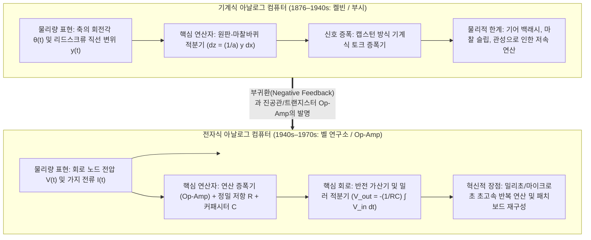
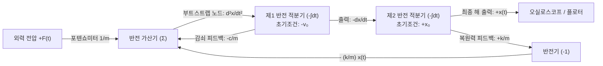

## 1. 서론: '계산(Computation)'이란 반드시 숫자를 세는 것인가?

오늘날 우리가 '컴퓨터(Computer)'라는 단어를 들을 때 떠올리는 것은 예외 없이 <strong>디지털 컴퓨터(Digital Computer)</strong>다. 디지털 패러다임에서는 자연계의 모든 연속적인 현상—음파, 빛의 세기, 유체의 소용돌이, 행성의 궤도, 신경망의 추론—이 먼저 표본화(Sampling)와 양자화(Quantization)를 거쳐 불연속적인 $0$과 $1$의 이진수 비트열로 변환된다. 그 후 글로벌 클록 주파수에 동기화된 수십억 개의 논리 게이트가 1초에 수십억 번의 사칙연산을 수행하며 연속적인 물리 세계를 근사한다.

그러나 과학사의 거시적 관점에서 볼 때, 모든 계산을 '손가락으로 세는 이산적인 숫자(Digit)'로 환원하는 방식은 20세기 중반 이후에야 패권을 잡은 비교적 최근의 우회로에 불과하다. 자연계의 근본 법칙인 뉴턴의 운동방정식, 맥스웰의 전자기장 방정식, 나비에-스토크스 유체 방정식, 슈뢰딩거 파동방정식은 본래 모두 <strong>연속적인 실수(Continuous Real Numbers)와 미분방정식(Differential Equations)</strong>으로 기술되어 있다.

디지털 컴퓨터가 세상을 지배하기 전, 인류는 전혀 다른 계산 철학을 발전시켰다. 바로 <strong>아날로그 컴퓨터(Analog Computer)</strong>다.

아날로그 컴퓨터는 숫자를 전혀 세지 않는다. 메모리 주소도, 프로그램 카운터도, 이산적인 클록 사이클도 없으며, 오일러 방법이나 룬게-쿠타(Runge-Kutta) 법 같은 수치적분 루프도 돌리지 않는다. 대신 <strong>풀고자 하는 수학적 문제의 미분방정식과 수학적으로 동형(Isomorphic)인 물리 시스템—기어의 회전각, 원판 마찰 적분기, 혹은 전자 회로의 연속적인 전압 $V(t)$과 전류 $I(t)$—을 직접 구성하여, 물리 법칙 자체가 실시간으로 미분방정식의 해를 도출하게 만드는 기계</strong>다. 스위치를 켜는 순간 키르히호프의 법칙과 전하 보존 법칙에 의해 회로의 전압 파형이 곧바로 미분방정식의 정밀한 해 궤적을 오실로스코프 화면에 그려낸다. 여기에는 이산화 절단 오차도 없고, 폰 노이만 병목(메모리와 CPU 사이의 데이터 이동 지연)도 존재하지 않는다.

본 글에서는 톰슨 형제와 배니바 부시의 기계식 미분해석기부터, 연산 증폭기(Op-Amp)의 가상 접지와 밀러 적분기 회로 이론, 켈빈의 피드백 부트스트랩(Bootstrap) 기법을 통한 고계 상미분방정식 풀이, 존슨-나이퀴스트 열잡음이 부과한 정보이론적 정밀도 한계, 그리고 21세기 딥러닝의 전력 장벽을 돌파하기 위해 화려하게 부활한 <strong>아날로그 인메모리 컴퓨팅(Memristor Crossbar), 실리콘 포토닉스 광 컴퓨팅, 뉴로모픽 칩</strong>까지 심층적으로 해부한다.

---

## 2. 기계식 아날로그 계산의 계보: 기어와 원판이 미적분을 수행하다

### 2.1 안티키테라 기계에서 계산자(Slide Rule)까지

인류 역사상 가장 오래된 정교한 아날로그 컴퓨터는 기원전 2세기경 고대 그리스에서 제작된 <strong>안티키테라 기계(Antikythera Mechanism)</strong>다. 차동 기어 장치를 포함한 30개 이상의 청동 기어로 구성된 이 장치는 크랭크 축의 회전을 연속적인 기어비로 변환하여 태양, 달, 행성의 황도상 위치와 일식·월식 주기를 계산했다. 이후 1620년대에는 존 네이피어의 로그 발견을 바탕으로 윌리엄 오트레드가 <strong>계산자(Slide Rule)</strong>를 발명했다. 계산자는 양의 실수 $x$를 $\log_{10} x$에 비례하는 물리적 길이로 대응시켜, 곱셈 $x \cdot y$를 두 눈금 막대의 물리적 변위의 합 $\log_{10} x + \log_{10} y = \log_{10}(xy)$으로 변환한 연속 아날로그 계산기로, 아폴로 우주선이 달에 착륙할 때까지 과학자와 엔지니어의 필수품이었다.

### 2.2 제임스 톰슨과 켈빈 경의 '원판-마찰바퀴 적분기'

사칙연산을 넘어 <strong>미적분(Calculus)과 미분방정식</strong>을 기계적으로 풀어낸 결정적 도약은 1876년 영국에서 이루어졌다. 물리학자 윌리엄 톰슨(<strong>켈빈 경, Lord Kelvin</strong>)의 형인 공학자 <strong>제임스 톰슨(James Thomson)</strong>이 발명한 <strong>원판-마찰바퀴 적분기(Wheel-and-Disk Integrator)</strong>의 기하학적 원리는 놀랍도록 우아하다:

1. 수평으로 놓인 <strong>회전 원판(Disk)</strong>이 독립변수 $x$에 비례하여 미소 각도 $dx$만큼 회전한다.
2. 반지름이 $a$인 작은 수직 <strong>마찰바퀴(Integrator Wheel)</strong>가 원판 중심으로부터 거리 $y(x)$(피적분함수)만큼 떨어진 위치에서 원판 표면에 수직으로 접촉한다.
3. 원판이 $dx$만큼 회전할 때, 반지름 $y(x)$ 지점의 호의 이동 거리는 $y(x)\,dx$이다. 미끄러짐(Slip)이 없는 이상적인 구름 접촉을 가정하면, 반지름 $a$인 마찰바퀴가 회전하는 각도 $dz$는 $a\,dz = y(x)\,dx$를 만족한다. 따라서 마찰바퀴의 누적 회전각 $z(x)$는 자동으로 정적분을 계산한다!

$$z(x) = \frac{1}{a} \int_{x_0}^{x} y(x')\,dx'$$

켈빈 경은 이 적분기와 도르래·와이어 조화 합성 장치를 결합하여 <strong>조석 예측기(Tide-Predicting Machine)</strong>를 제작했고, 달과 태양의 인력에 의한 수십 개의 조석 고조파 성분 $\sum_k A_k \cos(\omega_k t + \phi_k)$을 합산하여 단 4시간 만에 항구의 1년 치 연속 조석 곡선을 그려냈다.

### 2.3 배니바 부시의 '미분해석기(Differential Analyzer)'와 토크 증폭기

기계식 마찰 적분기에는 치명적인 약점이 있었다. 원판과 마찰바퀴가 오직 미세한 마찰력만으로 회전을 전달하기 때문에, 마찰바퀴의 출력축에 다음 적분기나 기록 펜 같은 무거운 부하를 직접 연결하면 바퀴가 미끄러져 적분 정밀도가 완전히 무너지는 <strong>출력 토크 부족</strong> 문제였다.

1931년 MIT의 <strong>배니바 부시(Vannevar Bush)</strong>는 선박의 캡스턴(Capstan, 윈치) 원리를 응용한 기계식 <strong>토크 증폭기(Torque Amplifier)</strong>를 발명하여 이 난제를 해결했다. 마찰바퀴의 미세한 회전이 외부 모터로 고속 회전하는 드럼통에 감긴 마찰 밴드를 살짝 당기기만 하면, 외부 모터의 동력으로 출력 토크가 수천 배로 증폭되어 여러 단의 적분기를 직렬 및 루프로 연결할 수 있게 되었다. 1941년 <strong>클로드 섀넌(Claude Shannon)</strong>은 『미분해석기의 수학적 이론』을 발표하여, 유한 개의 적분기로 구성된 미분해석기가 생성할 수 있는 함수의 집합이 <strong>대수적 미분방정식(ADE)</strong>의 해 집합과 정확히 일치함을 증명했다.

---

## 3. 전자식 아날로그 계산의 심장: 연산 증폭기(Op-Amp)와 연속 미적분 회로

제2차 세계대전 중 벨 연구소의 <strong>칼 스워첼(Karl D. Swartzel Jr.)</strong>과 컬럼비아 대학의 <strong>존 라가지니(John R. Ragazzini)</strong> 등은 무거운 강철 샤프트를 진공관 전자 회로로 대체했다. 오늘날 모든 전자회로의 핵심 소자인 <strong>'연산 증폭기(Operational Amplifier, Op-Amp)'</strong>라는 이름 자체가 1947년 라가지니의 논문에서 <strong>"아날로그 컴퓨터 내부에서 덧셈, 비례 스케일링, 적분 등 수학적 연산(Mathematical Operations)을 수행하는 고이득 직류 증폭기"</strong>라는 뜻으로 명명된 것이다.

### 3.1 이상적인 Op-Amp와 '가상 접지(Virtual Ground)'의 마법

연산 증폭기는 비반전 입력단($V_+$)과 반전 입력단($V_-$)의 전위차를 거대한 개방 루프 이득 $A_{\text{OL}}$($10^5 \sim 10^8$)배로 증폭하여 $V_{\text{out}} = A_{\text{OL}}(V_+ - V_-)$를 출력한다. 비반전 단자를 접지($V_+ = 0\,\text{V}$)하고 출력단에서 반전 단자로 수동 소자(저항 $R$ 또는 커패시터 $C$)를 통해 <strong>부귀환(Negative Feedback)</strong>을 걸면, 이상적인 Op-Amp($A_{\text{OL}} \to \infty$, 입력 임피던스 $Z_{\text{in}} \to \infty$)에서는 다음이 성립한다:

$$V_+ - V_- = \frac{V_{\text{out}}}{A_{\text{OL}}} \to 0 \implies V_- = V_+ = 0\,\text{V}, \quad I_- = 0$$

반전 단자 $V_-$는 물리적으로 접지에 연결되어 있지 않지만 부귀환에 의해 항상 $0\,\text{V}$ 전위로 유지되는데, 이를 <strong>가상 접지(Virtual Ground)</strong>라 부른다. 이 가상 접지($V_-=0$)와 입력 전류 제로($I_-=0$) 덕분에 증폭기 내부의 비선형성과 온도 드리프트가 수식에서 완전히 소거되고, 오직 외부 정밀 저항과 커패시터의 물리 법칙만으로 정밀한 수학 연산기가 완성된다.

### 3.2 기본 연산 회로의 엄밀한 유도

1. <strong>반전 가중 가산기(Summing Amplifier)</strong>:
   $N$개의 입력 전압 $V_1(t), \dots, V_N(t)$을 각각 저항 $R_1, \dots, R_N$을 통해 가상 접지 노드($V_- = 0$)에 연결하고 귀환 저항 $R_f$를 연결하면, 키르히호프의 전류 법칙(KCL)에 의해 다음이 성립한다:
   $$\sum_{k=1}^N \frac{V_k(t)}{R_k} + \frac{V_{\text{out}}(t)}{R_f} = 0 \implies V_{\text{out}}(t) = -\sum_{k=1}^N \left(\frac{R_f}{R_k}\right) V_k(t)$$
2. <strong>연속 시간 밀러 적분기(Miller Integrator)</strong>:
   귀환 경로에 정전용량 $C$인 커패시터를 연결하고 입력 저항 $R$을 통해 $V_{\text{in}}(t)$을 인가한다. 커패시터에 축적되는 전하 $Q(t) = C(0 - V_{\text{out}}(t)) = -C V_{\text{out}}(t)$이므로 전류는 $I_C(t) = C \frac{d V_{\text{out}}(t)}{dt}$이다. KCL을 적용하여 적분하면:
   $$\frac{V_{\text{in}}(t)}{R} + C \frac{d V_{\text{out}}(t)}{dt} = 0 \implies V_{\text{out}}(t) = -\frac{1}{RC} \int_0^t V_{\text{in}}(\tau)\,d\tau + V_{\text{out}}(0)$$
3. <strong>왜 아날로그 컴퓨터는 '미분기'를 쓰지 않고 오직 '적분기'만 사용하는가?</strong>
   라플라스 주파수 영역($s = j\omega$)에서 적분기의 전달함수 크기는 $|H_{\text{int}}(\omega)| = \frac{1}{\omega RC}$로, 고주파 열잡음을 감쇠시키는 안정적인 <strong>저역통과 필터(Low-Pass Filter)</strong>로 작동한다. 반면 미분기의 전달함수 크기는 $|H_{\text{diff}}(\omega)| = \omega RC$로 주파수 $\omega$에 비례해 이득이 무한정 커지는 <strong>고역통과 필터</strong>가 되어, 미세한 고주파 노이즈 $\varepsilon \sin(\omega_{\text{high}} t)$를 $\omega_{\text{high}}$배로 폭주시켜 증폭기를 포화시키고 발진(Ringing)을 일으키기 때문이다!

---

## 4. 배선으로 미분방정식 풀기: 켈빈의 피드백 부트스트랩 기법

미분기 없이 적분기만으로 2계 감쇠 조화 진동자 방정식 $m \ddot{x} + c \dot{x} + k x = F(t)$를 푸는 <strong>켈빈의 피드백(부트스트랩) 기법</strong>은 다음 4단계로 이루어진다:

1. <strong>최고계 도함수에 대해 정리</strong>: $\ddot{x}(t) = -\frac{c}{m}\dot{x}(t) - \frac{k}{m}x(t) + \frac{1}{m}F(t)$
2. <strong>최고계 도함수 신호 $\ddot{x}(t)$가 이미 존재한다고 가정</strong>: 미지의 전압 $\ddot{x}(t)$가 흐르는 노드를 설정한다.
3. <strong>직렬 적분기로 저계 도함수 생성</strong>: $\ddot{x}(t)$를 제1 반전 적분기(초기조건 $-v_0$)에 통과시켜 $-\dot{x}(t)$를 얻고, 이를 다시 제2 반전 적분기(초기조건 $+x_0$)에 통과시켜 해 $+x(t)$를 얻는다.
4. <strong>루프 닫기(Bootstrap)</strong>: 포텐쇼미터(가변저항)와 가산기를 이용해 우변 $-\frac{c}{m}\dot{x} - \frac{k}{m}x + \frac{1}{m}F(t)$를 합성한 뒤, <strong>그 출력선을 2단계에서 가정했던 제1 적분기의 입력단 $\ddot{x}(t)$에 직접 연결한다!</strong>

여기에 진폭 스케일링($\pm 10\,\text{V}$ 머신 유닛), 시간 스케일링($RC$ 시정수를 마이크로초로 줄여 초당 수천 번 해를 그리는 고속 반복 연산 Rep-Op), 그리고 항등식 $XY = \frac{1}{4}[(X+Y)^2 - (X-Y)^2]$을 이용한 <strong>사분제곱 아날로그 곱셈기(Quarter-Square Multiplier)</strong>를 결합하면 비선형 카오스 미분방정식까지 실시간으로 풀 수 있다.

---

## 5. 정밀도와 열잡음의 물리학: 왜 아날로그는 디지털에 왕좌를 내주었는가?

연립 미분방정식을 문제 크기 $N$에 상관없이 $O(1)$ 시간에 완전 병렬로 풀어내는 아날로그 컴퓨터가 1970년대 이후 디지털 컴퓨터에 밀려난 근본 원인은 <strong>통계열역학과 섀넌 정보이론이 부과하는 정밀도-에너지 지수 법칙</strong>에 있다.

### 5.1 존슨-나이퀴스트 열잡음과 오프셋 드리프트

절대온도 $T > 0\,\text{K}$에서 저항 $R$ 내부 전자의 열운동은 대역폭 $\Delta f$에 걸쳐 필연적으로 <strong>존슨-나이퀴스트 열잡음(Johnson-Nyquist Thermal Noise)</strong> 전압을 발생시킨다:

$$v_{\text{rms}} = \sqrt{4 k_B T R \Delta f}$$

또한 적분기에서는 미세한 직류 오프셋 전압 $V_{\text{os}}$이 시간에 따라 $-\frac{V_{\text{os}}}{RC}t$로 누적되어 발산한다(이를 억제하기 위해 1949년 골드버그가 <strong>초퍼 안정화 증폭기 Chopper-Stabilized Op-Amp</strong>를 발명했다).

### 5.2 정밀도 $b$ 비트 확장의 비용: 아날로그 $O(2^{2b})$ 대 디지털 $O(b)$

아날로그 도선 하나에서 $b$ 비트의 정밀도($2^b = V_{\max}/v_{\text{noise}}$)를 확보하려면 신호 대 잡음 전력비가 $\text{SNR}_{\text{power}} = 2^{2b}$여야 한다. 즉, <strong>아날로그 계산에서 정밀도를 1비트 높일 때마다 소비 전력이나 커패시터 면적($k_B T / C$ 잡음 억제)이 지수함수적($O(2^{2b})$)으로 폭발</strong>하며, 소자 정밀도 한계로 인해 <strong>유효숫자 3~4자리($10 \sim 14\,\text{bit}$, 오차 $0.01\% \sim 0.1\%$)</strong>가 물리적 한계였다. 반면 디지털 컴퓨터는 각 트랜지스터가 $0$과 $1$ 두 상태만 구별하여 매 게이트마다 노이즈를 소거하므로, $b$ 비트 정밀도를 얻기 위해 단지 $b$개의 회로만 나란히 배치하면 되어 <strong>비용이 선형적($O(b \sim b^2)$)으로만 증가</strong>한다!

| 비교 항목 | 전자식 아날로그 컴퓨터 | 폰 노이만 디지털 컴퓨터 |
| :--- | :--- | :--- |
| <strong>정보의 물리적 표현</strong> | 연속적인 전압 $V(t)$ 및 전류 $I(t)$ | 이산적인 이진수 비트열 ($0$과 $1$, 부동소수점) |
| <strong>미적분 수행 방식</strong> | 커패시터 전하 축적 $V = -\frac{1}{RC}\int V_{\text{in}}\,dt$에 의한 <strong>물리적 연속 적분</strong> | 오일러·룬게-쿠타 법에 의한 <strong>이산 시간 $\Delta t$ 수치 근사</strong> |
| <strong>연산 병렬성 및 속도</strong> | <strong>완전 공간 병렬</strong> (방정식 규모 $N$과 무관하게 실시간 $O(1)$ 해 도출) | 시간 다중화 순차 실행 (규모 $N$에 대해 $O(N \sim N^3)$ 시간 소요) |
| <strong>유효 정밀도 한계</strong> | <strong>십진수 3~4자리 ($10 \sim 14\,\text{bit}$, 오차 $0.01\% \sim 0.1\%$)</strong> | 임의 정밀도 가능 (64비트 배정밀도 기준 십진수 약 16자리) |
| <strong>정밀도 $b$ 비트당 비용</strong> | <strong>지수함수적 폭증 $\propto O(2^{2b})$</strong> ($k_B T$ 열잡음 및 부품 공차 한계) | <strong>선형·다항식적 증가 $\propto O(b \sim b^2)$</strong> (비트 폭 확장만으로 달성) |

1960년대 아폴로 계획에서는 로켓의 실시간 6자유도 자세 제어 미분방정식은 아날로그로 풀고 정밀 궤도 항법은 디지털로 계산하는 <strong>하이브리드 컴퓨터(Hybrid Computer)</strong>가 활약했다.

---

## 6. 21세기의 화려한 부활: AI 인메모리 컴퓨팅, 광학 컴퓨터, 뉴로모픽 칩

오늘날 무어의 법칙이 한계에 도달하고 딥러닝·거대언어모델(LLM)의 <strong>폰 노이만 병목(메모리 데이터 이동 에너지 장벽)</strong>이 심각해지면서, 아날로그 컴퓨팅이 최첨단 기술로 부활하고 있다:

1. <strong>멤리스터 크로스바(Memristor Crossbar) 기반 아날로그 인메모리 컴퓨팅(AIMC)</strong>: 신경망 연산의 99%를 차지하는 행렬-벡터 곱셈 $y_i = \sum_{j=1}^N W_{ij} x_j$은 64비트 고정밀도가 필요 없으며 $4 \sim 8\,\text{bit}$ 정밀도로 충분하다. 가중치 $W_{ij}$를 비휘발성 멤리스터(ReRAM/PCM) 소자의 컨덕턴스 $G_{ij} = 1/R_{ij}$로 저장하고 행 도선에 전압 $V_j$를 인가하면, <strong>옴의 법칙</strong>에 의해 $I_{ij} = G_{ij} V_j$ 곱셈이 일어나고 <strong>키르히호프의 전류 법칙(KCL)</strong>에 의해 열 도선에서 전류 합산 $I_i = \sum_{j=1}^N G_{ij} V_j$이 단 몇 나노초 만에 $O(1)$ 시간, $1/100$ 이하의 전력으로 완료된다!
2. <strong>실리콘 포토닉스(광 아날로그 컴퓨터)와 뉴로모픽 공학</strong>: 마하-젠더 간섭계(MZI) 격자를 통과하는 레이저 빛의 간섭으로 빛의 속도로 행렬 곱셈을 수행하는 광 프로세서, 그리고 카버 미드(Carver Mead)가 창시한 문턱전압 이하(Subthreshold) 영역의 지수함수적 트랜지스터 물리학으로 생물학적 뉴런의 이온 채널 미분방정식을 직접 모사하는 <strong>뉴로모픽 칩</strong>과 <strong>Neural ODE / 액체 신경망(Liquid Neural Networks)</strong>에 이르기까지, 인류는 디지털의 논리 제어와 아날로그의 물리적 초병렬성을 결합한 새로운 컴퓨팅 시대로 진입하고 있다.
