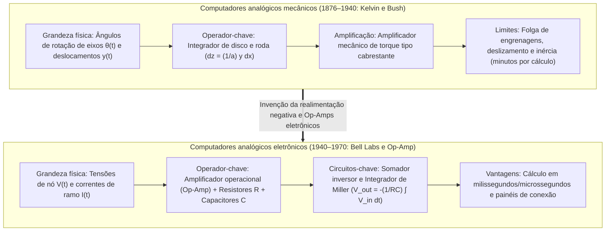
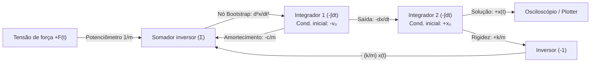

## 1. Introdução: "Computar" significa necessariamente contar dígitos?

Quando ouvimos a palavra "computador" hoje, imaginamos quase exclusivamente um <strong>computador digital (Digital Computer)</strong>. No paradigma digital, todo fenômeno contínuo do universo físico — ondas sonoras, turbulências de fluidos, órbitas planetárias ou a inferência de redes neurais — deve primeiro ser discretizado por amostragem e quantização em sequências finitas de dígitos binários ($0$ e $1$). Bilhões de portas lógicas comutam então ao ritmo de um clock global para aproximar a matemática contínua por meio de bilhões de passos aritméticos elementares.

Contudo, sob a perspectiva da física e da história da ciência, reduzir todo cálculo à contagem de dígitos discretos (do latim *digitus*, "dedo") é um desvio relativamente recente. As leis fundamentais da natureza — a mecânica de Newton, a eletrodinâmica de Maxwell, as equações de Navier-Stokes e a equação de Schrödinger — são formuladas nativamente na linguagem de <strong>variáveis reais contínuas governadas por equações diferenciais</strong>.

Muito antes de os computadores digitais alcançarem a hegemonia em meados do século XX, cientistas e engenheiros desenvolveram uma filosofia computacional radicalmente diferente: o <strong>computador analógico (Analog Computer)</strong>.

Um computador analógico não conta números. Ele não possui endereços de memória, nem contador de programa, nem ciclos de clock discretos, nem laços iterativos de integração numérica (como os métodos de Euler ou Runge-Kutta). Em vez disso, ele resolve um problema construindo um <strong>sistema físico — composto por engrenagens, integradores mecânicos de disco, amplificadores operacionais (Op-Amps), capacitores ou interferômetros ópticos — cujas equações físicas governantes são matematicamente isomorfas às equações diferenciais do problema investigado</strong>. No instante em que a chave é ligada, as leis de Kirchhoff e a conservação da carga forçam as tensões contínuas dos nós $V(t)$ e as correntes de ramo $I(t)$ a evoluírem em tempo real segundo a solução exata da equação diferencial, sem erros de truncamento por discretização e sem o gargalo de von Neumann de movimentação de dados entre memória e processador.

Neste artigo, exploramos toda a trajetória e a física da computação analógica: dos integradores mecânicos de James Thomson, Lord Kelvin e Vannevar Bush ao amplificador operacional, ao método de realimentação (Bootstrap) de Kelvin, aos limites termodinâmicos de ruído de Johnson-Nyquist e ao espetacular <strong>renascimento analógico do século XXI</strong> na computação em memória (memristores), na fotônica de silício e nos chips neuromórficos.

---

## 2. A linhagem mecânica: cálculo infinitesimal com engrenagens e discos

### 2.1 Do mecanismo de Anticítera à régua de cálculo

O mais antigo computador analógico complexo conhecido é o <strong>mecanismo de Anticítera</strong>, construído na Grécia helenística por volta do século II a.C. Com mais de trinta engrenagens de bronze (incluindo um mecanismo diferencial epicicloidal), calculava as posições eclípticas contínuas do Sol, da Lua e dos planetas, bem como os ciclos de eclipses de Saros. Por volta de 1622, com base nos logaritmos de John Napier, William Oughtred inventou a <strong>régua de cálculo (Slide Rule)</strong>, que mapeava cada número real positivo $x$ em um comprimento físico proporcional a $\log_{10} x$, transformando a multiplicação $x \cdot y$ na soma mecânica contínua de dois deslocamentos espaciais $\log_{10} x + \log_{10} y = \log_{10}(xy)$.

### 2.2 James Thomson, Lord Kelvin e o integrador de disco e roda

O salto decisivo para resolver mecanicamente <strong>equações diferenciais</strong> ocorreu em 1876, quando <strong>James Thomson</strong>, irmão mais velho de William Thomson (<strong>Lord Kelvin</strong>), inventou o <strong>integrador de disco e roda de fricção (Wheel-and-Disk Integrator)</strong>:

1. Um <strong>disco horizontal</strong> gira um ângulo infinitesimal $dx$ proporcional à variável independente $x$.
2. Uma pequena <strong>roda de fricção vertical</strong> de raio $a$ apoia-se sobre o disco a uma distância radial $y(x)$ do centro (representando o integrando).
3. Quando o disco gira $dx$, o arco percorrido sob o ponto de contato é $y(x)\,dx$. Assumindo rolamento sem deslizamento, o ângulo $dz$ girado pela roda satisfaz $a\,dz = y(x)\,dx$, de modo que a rotação acumulada $z(x)$ avalia fisicamente a integral definida:

$$z(x) = \frac{1}{a} \int_{x_0}^{x} y(x')\,dx'$$

Lord Kelvin utilizou esse integrador para construir sua famosa <strong>máquina previsora de marés (Tide-Predicting Machine)</strong>, somando as componentes harmônicas lunares e solares $\sum_k A_k \cos(\omega_k t + \phi_k)$ para traçar em quatro horas as curvas contínuas de maré de um ano inteiro.

### 2.3 O analisador diferencial de Vannevar Bush e o amplificador de torque

Acoplar vários integradores mecânicos em série foi impossível durante décadas devido ao <strong>baixo torque de saída</strong> da roda de fricção, que deslizava sob carga. Em 1931, no MIT, <strong>Vannevar Bush</strong> resolveu esse obstáculo inventando o <strong>amplificador mecânico de torque (Torque Amplifier)</strong> baseado no cabrestante naval, multiplicando o torque milhares de vezes por meio de um motor externo sem sobrecarregar a roda integradora. Em 1941, <strong>Claude Shannon</strong> demonstrou em sua *Teoria Matemática do Analisador Diferencial* que as funções geráveis por um número finito de integradores coincidem exatamente com as soluções das <strong>equações diferenciais algébricas (ADE)</strong>.

---

## 3. O coração da computação analógica eletrônica: o amplificador operacional (Op-Amp)

Durante a Segunda Guerra Mundial, <strong>Karl D. Swartzel Jr.</strong> (Bell Labs), <strong>Helmut Hoelzer</strong> (criador do computador analógico de orientação do foguete V-2) e <strong>John R. Ragazzini</strong> (Universidade de Columbia) substituíram os eixos mecânicos por circuitos eletrônicos a válvula. O próprio termo <strong>"amplificador operacional (Operational Amplifier, Op-Amp)"</strong> foi cunhado por Ragazzini em 1947 para designar um amplificador CC de alto ganho projetado especificamente para executar <strong>operações matemáticas</strong> (soma, escalamento e integração).

### 3.1 O Op-Amp ideal e a mágica do "terra virtual (Virtual Ground)"

Com um ganho em malha aberta $A_{\text{OL}} \sim 10^5 \text{–} 10^8$, a tensão de saída é $V_{\text{out}} = A_{\text{OL}}(V_+ - V_-)$. Conectando a entrada não inversora ao terra ($V_+ = 0\,\text{V}$) e aplicando <strong>realimentação negativa (Negative Feedback)</strong> à entrada inversora $V_-$, o limite $A_{\text{OL}} \to \infty$ (com impedância de entrada infinita $Z_{\text{in}} \to \infty$) impõe:

$$V_+ - V_- = \frac{V_{\text{out}}}{A_{\text{OL}}} \to 0 \implies V_- = V_+ = 0\,\text{V}, \quad I_- = 0$$

O nó $V_-$ permanece fixado em $0\,\text{V}$ sem estar fisicamente conectado ao terra: é o <strong>terra virtual (Virtual Ground)</strong>, que elimina as imperfeições internas do amplificador da equação matemática.

### 3.2 Derivação exata do somador e do integrador de Miller

1. <strong>Somador inversor ponderado (Summing Amplifier)</strong>:
   Aplicando a lei das correntes de Kirchhoff (KCL) no terra virtual ($V_- = 0$) para $N$ tensões de entrada $V_k(t)$ através de resistores $R_k$ e um resistor de realimentação $R_f$:
   $$\sum_{k=1}^N \frac{V_k(t)}{R_k} + \frac{V_{\text{out}}(t)}{R_f} = 0 \implies V_{\text{out}}(t) = -\sum_{k=1}^N \left(\frac{R_f}{R_k}\right) V_k(t)$$
2. <strong>Integrador contínuo de Miller (Miller Integrator)</strong>:
   Substituindo $R_f$ por um capacitor de capacitância $C$, a corrente de carga é $I_C(t) = C \frac{d V_{\text{out}}(t)}{dt}$, resultando por KCL em:
   $$\frac{V_{\text{in}}(t)}{R} + C \frac{d V_{\text{out}}(t)}{dt} = 0 \implies V_{\text{out}}(t) = -\frac{1}{RC} \int_0^t V_{\text{in}}(\tau)\,d\tau + V_{\text{out}}(0)$$
3. <strong>Por que computadores analógicos nunca usam diferenciadores, mas apenas integradores</strong>:
   No domínio da frequência ($s = j\omega$), o integrador tem ganho $|H_{\text{int}}(\omega)| = \frac{1}{\omega RC}$ e atua como um <strong>filtro passa-baixas</strong> que atenua o ruído térmico de alta frequência. Já um diferenciador tem ganho $|H_{\text{diff}}(\omega)| = \omega RC$ (<strong>filtro passa-altas</strong>), amplificando qualquer ruído de alta frequência $\varepsilon \sin(\omega_{\text{high}} t)$ por um fator $\omega_{\text{high}}$ e saturando o Op-Amp.

---

## 4. Resolver equações diferenciais por cabeamento: o método Bootstrap de Kelvin

Para resolver o oscilador harmônico amortecido $m \ddot{x} + c \dot{x} + k x = F(t)$ usando apenas integradores, o <strong>método de realimentação (Bootstrap) de Kelvin</strong> segue quatro passos:

1. <strong>Isolar a derivada de maior ordem</strong>: $\ddot{x}(t) = -\frac{c}{m}\dot{x}(t) - \frac{k}{m}x(t) + \frac{1}{m}F(t)$.
2. <strong>Supor que o fio com o sinal $\ddot{x}(t)$ já existe</strong>.
3. <strong>Integrar em cascata</strong>: Um primeiro integrador inversor (condição inicial $-v_0$) gera $-\dot{x}(t)$, e um segundo integrador inversor (condição inicial $+x_0$) gera $+x(t)$.
4. <strong>Fechar a malha de realimentação</strong>: Combinar $-\dot{x}(t)$, $-x(t)$ e $F(t)$ via potenciômetros e um somador para sintetizar o lado direito e <strong>conectar sua saída diretamente ao nó de entrada $\ddot{x}(t)$ suposto no passo 2</strong>!

---

## 5. Física da precisão e do ruído: por que o digital destronou o analógico

Todo resistor $R$ à temperatura absoluta $T > 0\,\text{K}$ gera inevitavelmente <strong>ruído térmico de Johnson-Nyquist</strong> em uma largura de banda $\Delta f$:

$$v_{\text{rms}} = \sqrt{4 k_B T R \Delta f}$$

Para representar $b$ bits de precisão ($2^b = V_{\max}/v_{\text{noise}}$) em um fio analógico contínuo, a relação sinal-ruído em potência deve ser $\text{SNR}_{\text{power}} = 2^{2b}$. <strong>Cada bit adicional de precisão multiplica por quatro a energia ou a capacitância necessária, fazendo com que o custo físico analógico escale exponencialmente como $O(2^{2b})$!</strong> Por isso, os computadores analógicos eletrônicos ficam limitados a <strong>3 ou 4 dígitos decimais ($10\text{–}14\text{ bits}$, erro de $0{,}01\% \text{ a } 0{,}1\%$)</strong>. Em um computador digital, cada transistor distingue apenas dois estados ($0$ e $1$), de modo que o custo de hardware para $b$ bits cresce apenas <strong>linear ou polinomialmente como $O(b \text{ a } b^2)$</strong>.

| Dimensão arquitetural | Computador analógico eletrônico | Computador digital (Von Neumann) |
| :--- | :--- | :--- |
| <strong>Representação de quantidades</strong> | Variáveis físicas contínuas ($V(t), I(t)$) | Palavras binárias discretas ($b$ bits, ponto flutuante IEEE 754) |
| <strong>Mecanismo de integração</strong> | Integração física contínua de carga $V = -\frac{1}{RC}\int V_{\text{in}}\,dt$ | Quadratura numérica discreta (Euler, Runge-Kutta) |
| <strong>Paralelismo e tempo de execução</strong> | <strong>Paralelismo espacial total</strong> ($O(1)$ tempo real independente de $N$) | Execução sequencial multiplexada ($O(N \sim N^3)$) |
| <strong>Teto prático de precisão</strong> | <strong>$3\text{–}4$ dígitos decimais ($10\text{–}14\text{ bits}$)</strong> | Precisão arbitrária ($64\text{ bits} \approx 16$ dígitos decimais) |
| <strong>Custo segundo a precisão $b$</strong> | <strong>Crescimento exponencial $\propto O(2^{2b})$</strong> (ruído térmico $k_B T$) | <strong>Crescimento linear / polinomial $\propto O(b \sim b^2)$</strong> |

Durante o programa Apollo, os <strong>computadores híbridos (Hybrid Computers)</strong> combinaram a velocidade em tempo real analógica (simulação de voo de 6 graus de liberdade com hardware no laço) com a precisão digital de 64 bits para a navegação translunar.

---

## 6. O renascimento no século XXI: computação em memória (AIMC), fotônica e chips neuromórficos

Hoje, diante do esgotamento da lei de Moore e da barreira energética do movimento de dados entre memória e processador (<strong>gargalo de von Neumann</strong>) no aprendizado profundo e nos grandes modelos de linguagem (LLMs), a computação analógica vive um renascimento extraordinário:

- <strong>Computação analógica em memória (AIMC) com matrizes de memristores</strong>: Mais de $99\%$ da computação em IA consiste em multiplicações matriz-vetor $y_i = \sum_{j=1}^N W_{ij} x_j$ que exigem apenas $4\text{ a }8\text{ bits}$ de precisão. Ao armazenar os pesos $W_{ij}$ como condutâncias $G_{ij} = 1/R_{ij}$ em uma matriz de memristores (ReRAM/PCM), a <strong>lei de Ohm</strong> ($I_{ij} = G_{ij} V_j$) e a <strong>lei de Kirchhoff</strong> ($I_i = \sum_j G_{ij} V_j$) executam toda a multiplicação matricial em nanossegundos em tempo $O(1)$ diretamente dentro da memória.
- <strong>Fotônica de silício, chips neuromórficos e Neural ODEs</strong>: Processadores fotônicos usam interferência laser em malhas de interferômetros de Mach-Zehnder (MZI) para multiplicar matrizes à velocidade da luz; circuitos <strong>neuromórficos sublimiares (Subthreshold CMOS)</strong> de Carver Mead emulam diretamente as equações diferenciais dos canais iônicos neurais, e as <strong>Neural ODEs / redes neurais líquidas</strong> unem equações diferenciais contínuas à inteligência artificial moderna.
