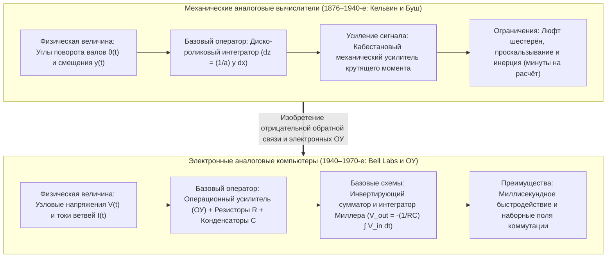
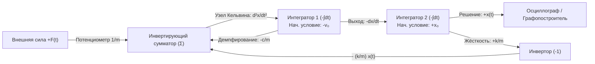

## 1. Введение: означает ли «вычисление» обязательный счёт цифр?

Когда сегодня мы слышим слово «компьютер», мы почти всегда представляем себе <strong>цифровой компьютер (Digital Computer)</strong>. В цифровой парадигме любое непрерывное явление физического мира — звуковые волны, вихри жидкости, орбиты планет или работа нейронных сетей — сначала должно быть дискретизировано путём квантования по времени и уровню в конечные последовательности двоичных разрядов ($0$ и $1$). Затем миллиарды логических вентилей переключаются по тактам глобального генератора тактовой частоты, аппроксимируя непрерывную математику миллиардами элементарных арифметических шагов.

Однако с точки зрения физики и истории науки сведение всех вычислений к счёту дискретных цифр (от лат. *digitus* — «палец») — это относительно недавний обходной путь. Фундаментальные законы природы — уравнения механики Ньютона, электродинамики Максвелла, гидродинамики Навье — Стокса и уравнение Шрёдингера — изначально записаны на языке <strong>непрерывных вещественных величин и дифференциальных уравнений</strong>.

Задолго до того, как цифровые ЭВМ завоевали господство в середине XX века, учёные и инженеры развивали принципиально иную вычислительную философию — <strong>аналоговый компьютер (Analog Computer)</strong>.

Аналоговый компьютер вообще не считает цифры. У него нет адресов памяти, счётчика команд, дискретных тактов и итерационных циклов численного интегрирования (таких как методы Эйлера или Рунге — Кутты). Вместо этого аналоговый компьютер решает задачу путём создания <strong>физической системы — из шестерён, дисковых механических интеграторов, операционных усилителей (ОУ), конденсаторов или оптических интерферометров, — чьи физические уравнения движения математически изоморфны дифференциальным уравнениям исследуемой задачи</strong>. В момент замыкания ключа законы Кирхгофа и закон сохранения заряда заставляют непрерывные узловые напряжения $V(t)$ и токи ветвей $I(t)$ изменяться в реальном времени строго по точному решению дифференциального уравнения — без ошибок дискретизации и без «бутылочного горлышка фон Неймана» при пересылке данных между памятью и процессором.

В этой статье мы подробно разберём историю и физику аналоговых вычислений: от механических интеграторов Джеймса Томсона, лорда Кельвина и Ванневара Буша до изобретения операционного усилителя, метода обратной связи (Bootstrap) Кельвина, термодинамических пределов теплового шума Джонсона — Найквиста и триумфального <strong>возрождения аналоговых вычислений в XXI веке</strong> в мемристорных кроссбар-матрицах для ИИ, кремниевой фотонике и нейроморфных чипах.

---

## 2. Механическая эпоха: математический анализ с помощью шестерён и дисков

### 2.1 От Антикитерского механизма до логарифмической линейки

Древнейший известный сложный аналоговый вычислитель — <strong>Антикитерский механизм</strong>, созданный в эллинистической Греции во II веке до н. э. Содержа более тридцати бронзовых шестерён (включая планетарный дифференциал), он вычислял непрерывные эклиптические координаты Солнца, Луны и планет, а также циклы затмений Сароса. В 1620-х годах на основе логарифмов Джона Непера Уильям Отред изобрёл <strong>логарифмическую линейку (Slide Rule)</strong>: отображая положительное число $x$ в физический отрезок длины $\log_{10} x$, она превратила умножение $x \cdot y$ в непрерывное механическое сложение двух длин $\log_{10} x + \log_{10} y = \log_{10}(xy)$.

### 2.2 Джеймс Томсон, лорд Кельвин и диско-роликовый интегратор

Решающий прорыв к механическому решению <strong>дифференциальных уравнений</strong> произошёл в 1876 году, когда <strong>Джеймс Томсон</strong>, старший брат Уильяма Томсона (<strong>лорда Кельвина</strong>), изобрёл <strong>диско-роликовый фрикционный интегратор (Wheel-and-Disk Integrator)</strong>:

1. Горизонтальный <strong>диск</strong> поворачивается на малый угол $dx$, пропорциональный независимой переменной $x$.
2. Маленький вертикальный <strong>фрикционный ролик</strong> радиуса $a$ прижат к поверхности диска на радиальном расстоянии $y(x)$ от центра (представляющем подынтегральную функцию).
3. При повороте диска на $dx$ дуга пути под точкой контакта равна $y(x)\,dx$. При качении без проскальзывания угол поворота ролика $dz$ удовлетворяет соотношению $a\,dz = y(x)\,dx$, так что суммарный угол поворота ролика $z(x)$ физически вычисляет определённый интеграл:

$$z(x) = \frac{1}{a} \int_{x_0}^{x} y(x')\,dx'$$

Лорд Кельвин использовал этот интегратор в своей знаменитой <strong>машине для предсказания приливов (Tide-Predicting Machine)</strong>, суммировавшей десятки лунных и солнечных гармоник $\sum_k A_k \cos(\omega_k t + \phi_k)$.

### 2.3 Дифференциальный анализатор Ванневара Буша и усилитель крутящего момента

Каскадное соединение механических интеграторов долгое время было невозможным из-за <strong>малого выходного крутящего момента</strong> фрикционного ролика, который начинал проскальзывать под нагрузкой. В 1931 году в MIT <strong>Ванневар Буш (Vannevar Bush)</strong> решил эту проблему, создав механический <strong>усилитель крутящего момента (Torque Amplifier)</strong> по принципу кабестана (лебёдки), который увеличивал момент в тысячи раз за счёт внешнего электродвигателя без нагрузки на ролик. В 1941 году <strong>Клод Шеннон</strong> доказал в работе *Mathematical Theory of the Differential Analyzer*, что класс функций, воспроизводимых конечным числом интеграторов, в точности совпадает с решениями <strong>алгебраических дифференциальных уравнений (ADE)</strong>.

---

## 3. Сердце электронного аналогового компьютера: операционный усилитель (ОУ)

В годы Второй мировой войны <strong>Карл Сварцель (Karl D. Swartzel Jr.)</strong> в Bell Labs, <strong>Гельмут Хёльцер</strong> (создатель бортового аналогового автопилота ракеты Фау-2) и <strong>Джон Рагаццини (John R. Ragazzini)</strong> в Колумбийском университете заменили стальные валы ламповыми схемами. Сам термин <strong>«операционный усилитель (Operational Amplifier, Op-Amp)»</strong> был введён Рагаццини в 1947 году для обозначения усилителя постоянного тока с огромным коэффициентом усиления, предназначенного для выполнения <strong>математических операций</strong> (сложения, масштабирования и интегрирования).

### 3.1 Идеальный ОУ и магия «виртуальной земли (Virtual Ground)»

При коэффициенте усиления разомкнутой петли $A_{\text{OL}} \sim 10^5 \text{–} 10^8$ выходное напряжение равно $V_{\text{out}} = A_{\text{OL}}(V_+ - V_-)$. Если заземлить неинвертирующий вход ($V_+ = 0\,\text{В}$) и подать <strong>отрицательную обратную связь (Negative Feedback)</strong> на инвертирующий вход $V_-$, то при $A_{\text{OL}} \to \infty$ и бесконечном входном сопротивлении $Z_{\text{in}} \to \infty$ получаем:

$$V_+ - V_- = \frac{V_{\text{out}}}{A_{\text{OL}}} \to 0 \implies V_- = V_+ = 0\,\text{В}, \quad I_- = 0$$

Узел $V_-$ удерживается под потенциалом $0\,\text{В}$ без физического соединения с землёй — это <strong>виртуальная земля (Virtual Ground)</strong>, полностью исключающая внутренние нелинейности усилителя из передаточной функции!

### 3.2 Строгий вывод сумматора и интегратора Миллера

1. <strong>Инвертирующий взвешенный сумматор (Summing Amplifier)</strong>:
   По первому закону Кирхгофа (KCL) в узле виртуальной земли ($V_- = 0$) для $N$ входных напряжений $V_k(t)$ через резисторы $R_k$ и резистор обратной связи $R_f$:
   $$\sum_{k=1}^N \frac{V_k(t)}{R_k} + \frac{V_{\text{out}}(t)}{R_f} = 0 \implies V_{\text{out}}(t) = -\sum_{k=1}^N \left(\frac{R_f}{R_k}\right) V_k(t)$$
2. <strong>Непрерывный интегратор Миллера (Miller Integrator)</strong>:
   Заменяя $R_f$ конденсатором ёмкости $C$ с током $I_C(t) = C \frac{d V_{\text{out}}(t)}{dt}$, по закону Кирхгофа получаем:
   $$\frac{V_{\text{in}}(t)}{R} + C \frac{d V_{\text{out}}(t)}{dt} = 0 \implies V_{\text{out}}(t) = -\frac{1}{RC} \int_0^t V_{\text{in}}(\tau)\,d\tau + V_{\text{out}}(0)$$
3. <strong>Почему в аналоговых компьютерах запрещены дифференциаторы и используются только интеграторы</strong>:
   В частотной области ($s = j\omega$) коэффициент передачи интегратора $|H_{\text{int}}(\omega)| = \frac{1}{\omega RC}$ спадает с частотой, работая как <strong>фильтр нижних частот</strong> и подавляя высокочастотный шум. Дифференциатор же имеет передаточную функцию $|H_{\text{diff}}(\omega)| = \omega RC$ (<strong>фильтр верхних частот</strong>), который усиливает любую микровольтовую высокочастотную помеху $\varepsilon \sin(\omega_{\text{high}} t)$ в $\omega_{\text{high}}$ раз, мгновенно вводя ОУ в насыщение и вызывая самовозбуждение.

---

## 4. Решение дифференциальных уравнений коммутацией проводов: метод Кельвина

Чтобы решить уравнение затухающего гармонического осциллятора $m \ddot{x} + c \dot{x} + k x = F(t)$ только с помощью интеграторов, применяется <strong>метод обратной связи (Bootstrap) Кельвина</strong>:

1. <strong>Выразить старшую производную</strong>: $\ddot{x}(t) = -\frac{c}{m}\dot{x}(t) - \frac{k}{m}x(t) + \frac{1}{m}F(t)$.
2. <strong>Предположить, что проводник с напряжением $\ddot{x}(t)$ уже существует</strong>.
3. <strong>Каскадно проинтегрировать</strong>: Первый инвертирующий интегратор (начальное условие $-v_0$) выдаёт $-\dot{x}(t)$, а второй инвертирующий интегратор (начальное условие $+x_0$) выдаёт искомое решение $+x(t)$.
4. <strong>Замкнуть петлю обратной связи</strong>: Собрать правую часть из $-\dot{x}(t)$, $-x(t)$ и $F(t)$ с помощью потенциометров и сумматора и <strong>соединить выход сумматора напрямую со входом первого интегратора $\ddot{x}(t)$, предположенным на шаге 2!</strong>

---

## 5. Физика точности и шума: почему цифра победила аналог

Любой резистор $R$ при абсолютной температуре $T > 0\,\text{К}$ создаёт в полосе частот $\Delta f$ неустранимый <strong>тепловой шум Джонсона — Найквиста</strong>:

$$v_{\text{rms}} = \sqrt{4 k_B T R \Delta f}$$

Чтобы передать точность в $b$ бит ($2^b = V_{\max}/v_{\text{noise}}$) по одному аналоговому проводу, отношение сигнал/шум по мощности должно составлять $\text{SNR}_{\text{power}} = 2^{2b}$. <strong>Каждый дополнительный бит точности в аналоговых вычислениях требует четырёхкратного увеличения мощности сигнала или ёмкости конденсатора — физические затраты растут экспоненциально как $O(2^{2b})$!</strong> Поэтому практический потолок точности электронных АВМ составляет <strong>3–4 десятичных знака ($10\text{–}14\text{ бит}$, погрешность $0{,}01\%\text{–}0{,}1\%$)</strong>. В цифровом же компьютере каждый транзистор различает лишь два состояния ($0$ и $1$), и аппаратные затраты на $b$ бит растут лишь <strong>линейно или полиномиально как $O(b \sim b^2)$</strong>.

| Архитектурный параметр | Электронный аналоговый компьютер | Цифровой компьютер (фон Неймана) |
| :--- | :--- | :--- |
| <strong>Представление величин</strong> | Непрерывные физические величины ($V(t), I(t)$) | Дискретные двоичные слова ($b$ бит, IEEE 754) |
| <strong>Механизм интегрирования</strong> | Точное физическое накопление заряда $V = -\frac{1}{RC}\int V_{\text{in}}\,dt$ | Дискретная численная аппроксимация (Эйлер, Рунге — Кутта) |
| <strong>Параллелизм и время счёта</strong> | <strong>Полный пространственный параллелизм</strong> ($O(1)$ независимо от $N$) | Последовательное разделение времени ($O(N \sim N^3)$) |
| <strong>Предел практической точности</strong> | <strong>$3\text{–}4$ десятичных знака ($10\text{–}14\text{ бит}$)</strong> | Произвольная точность ($64\text{ бита} \approx 16$ десятичных знаков) |
| <strong>Рост затрат с точностью $b$</strong> | <strong>Экспоненциальный $\propto O(2^{2b})$</strong> (тепловой шум $k_B T$) | <strong>Линейный / Полиномиальный $\propto O(b \sim b^2)$</strong> |

В лунной программе «Аполлон» широко применялись <strong>гибридные вычислительные машины (ГВМ)</strong>, объединявшие мгновенное аналоговое интегрирование динамики полёта в реальном времени с 64-битной цифровой точностью баллистической навигации.

---

## 6. Возрождение в XXI веке: вычисления в памяти (AIMC), фотоника и нейроморфные чипы

Сегодня, когда закон Мура упёрся в атомные пределы, а глубокое обучение и большие языковые модели (LLM) столкнулись с колоссальными затратами энергии на пересылку данных между памятью и процессором (<strong>узкое место фон Неймана</strong>), аналоговые вычисления переживают бурное возрождение:

- <strong>Аналоговые вычисления в памяти (AIMC) на мемристорных кроссбарах</strong>: Более $99\%$ вычислений в нейронных сетях составляют матрично-векторные умножения $y_i = \sum_{j=1}^N W_{ij} x_j$, которым достаточно точности $4\text{–}8\text{ бит}$. Если записать веса $W_{ij}$ как проводимости $G_{ij} = 1/R_{ij}$ мемристоров (ReRAM/PCM), то по <strong>закону Ома</strong> ($I_{ij} = G_{ij} V_j$) и <strong>закону Кирхгофа</strong> ($I_i = \sum_j G_{ij} V_j$) всё матричное умножение выполняется физически за наносекунды за время $O(1)$ прямо внутри памяти!
- <strong>Кремниевая фотоника, нейроморфные чипы и Neural ODE</strong>: Когерентные фотонные процессоры перемножают матрицы со скоростью света за счёт интерференции лазеров в решётках интерферометров Маха — Цендера (MZI); <strong>подпороговые нейроморфные КМОП-схемы</strong> Карвера Мида напрямую моделируют дифференциальные уравнения ионных каналов биологических нейронов, а <strong>нейронные ОДУ (Neural ODEs) и жидкостные нейросети (Liquid Neural Networks)</strong> возвращают непрерывные дифференциальные уравнения в самый центр современного искусственного интеллекта.
