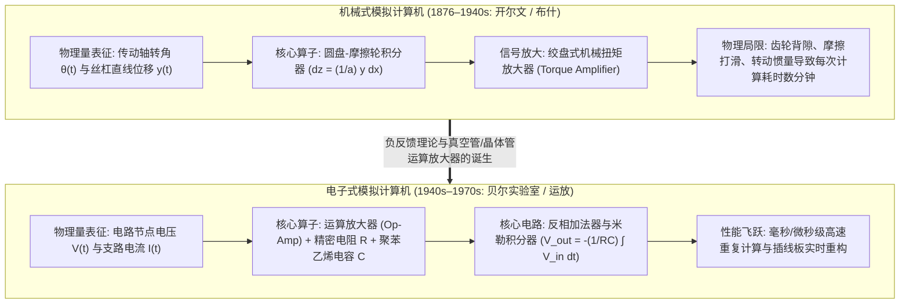

## 1. 引言：“计算（Computation）”一定意味着数数字吗？

今天，当我们提到“计算机（Computer）”时，脑海中浮现的几乎总是<strong>数字计算机（Digital Computer）</strong>。在数字计算范式中，自然界的一切现象——声波、光强、流体涡旋、行星轨道乃至神经网络的推理——都必须首先通过采样与量化，被切割成离散的二进制比特序列（$0$ 与 $1$）。随后，中央处理器（CPU）或图形处理器（GPU）在全局时钟脉冲的同步下，驱动数十亿个逻辑门每秒执行数十亿次离散算术运算，以此近似连续的物理世界。

然而，从物理学与科学史的宏大视角来看，将一切计算归结为“数离散的数字（Digit，源于拉丁语“手指”）”其实只是20世纪中叶才取得霸权的近期路径。自然界的基本定律——牛顿运动方程、麦克斯韦电磁场方程、纳维-斯托克斯流体方程以及薛定谔方程——本质上全部是由<strong>连续实数与微分方程（Differential Equations）</strong>所支配的。

在数字计算机统治世界之前，人类曾发展出另一套截然不同的计算哲学：<strong>模拟计算机（Analog Computer）</strong>。

模拟计算机完全不“数数字”。它没有内存地址、没有程序计数器、没有离散时钟周期，也不需要使用欧拉法或龙格-库塔（Runge-Kutta）法进行一步步的数值迭代逼近。相反，模拟计算机通过<strong>构造一个与待解数学问题具有相同微分方程形式（数学同构 Isomorphism）的物理系统——利用齿轮的旋转角、圆盘摩擦积分器、运算放大器（Op-Amp）的连续节点电压 $V(t)$、支路电流 $I(t)$ 或电容器上的电荷积累——让自然界的物理定律本身在连续时间内直接“演化”出方程的解</strong>。只要合上开关，基尔霍夫定律与电荷守恒定律就会迫使电路中的电压波形实时描绘出微分方程的精确解轨迹，既没有离散化截断误差，也没有冯·诺依曼架构中内存与处理器之间搬运数据的能量瓶颈。

本文将系统剖析模拟计算机的完整演进史与数学物理原理：从开尔文勋爵与范内瓦·布什的机械微分分析仪，到电子运算放大器（Op-Amp）的虚拟接地与米勒积分器推导、开尔文反馈自举法求解高阶常微分方程、热噪声与元件公差所决定的香农-冯·诺依曼精度极限，再到21世纪为突破深度学习算力与功耗墙而强势复兴的<strong>内存模拟计算（Analog In-Memory Computing）、硅基光子计算与神经形态芯片</strong>。

---

## 2. 机械模拟计算的演进：用齿轮与圆盘执行微积分

### 2.1 从安提基特拉机械到计算尺

人类已知最早的精密模拟计算机是公元前2世纪古希腊制造的<strong>安提基特拉机械（Antikythera Mechanism）</strong>。它利用30多个青铜齿轮（包含精巧的差动齿轮机构）将时间映射为连续的齿轮转角比例，精确计算太阳、月球与行星的黄道位置及日月食沙罗周期。1620年代，基于纳皮尔发现的对数，奥特雷德发明了<strong>计算尺（Slide Rule）</strong>。计算尺将正实数 $x$ 映射为物理刻度长度 $\log_{10} x$，从而将乘法 $x \cdot y$ 转化为两段空间位移的连续叠加 $\log_{10} x + \log_{10} y = \log_{10}(xy)$，直到阿波罗登月时代仍是工程师随身携带的核心计算工具。

### 2.2 汤姆逊兄弟与开尔文勋爵的“球-盘-柱积分器”

然而，从四则运算迈向<strong>微积分与微分方程求解</strong>的决定性突破，诞生于1876年的英国。物理学家威廉·汤姆逊（即<strong>开尔文勋爵 Lord Kelvin</strong>）的哥哥、工程师<strong>詹姆斯·汤姆逊（James Thomson）</strong>发明了<strong>圆盘-摩擦轮积分器（Wheel-and-Disk Integrator）</strong>：

1. 一个水平放置的<strong>旋转圆盘（Disk）</strong>绕中心轴旋转微小角度 $dx$，代表自变量 $x$ 的变化。
2. 一个半径为 $a$ 的垂直小<strong>摩擦轮（Integrator Wheel）</strong>压在圆盘表面上，其接触点到圆盘中心的径向距离由丝杠控制在 $y(x)$ 处（代表被积函数）。
3. 当圆盘旋转 $dx$ 时，半径 $y(x)$ 处的弧长位移为 $y(x)\,dx$。在无滑动理想滚动接触下，半径为 $a$ 的摩擦轮转过的角度 $dz$ 满足 $a\,dz = y(x)\,dx$。因此，摩擦轮累积旋转的总角度 $z(x)$ 自动完成了定积分运算：

$$z(x) = \frac{1}{a} \int_{x_0}^{x} y(x')\,dx'$$

开尔文勋爵利用这一积分器制造了著名的<strong>潮汐预测机（Tide-Predicting Machine）</strong>，通过滑轮与钢丝合成月球与太阳引力的数十个谐波分量 $\sum_k A_k \cos(\omega_k t + \phi_k)$，仅需摇动曲柄4小时即可绘出港口全年的连续潮汐曲线。

### 2.3 范内瓦·布什的“微分分析仪”与扭矩放大器

机械摩擦轮积分器长期受困于一个致命瓶颈：<strong>输出扭矩过小</strong>。因为摩擦轮仅靠与圆盘表面的微弱摩擦力转动，一旦直接驱动下一级积分器或绘图仪的沉重丝杠，摩擦轮就会打滑，导致积分精度彻底崩溃。

1931年，麻省理工学院（MIT）的<strong>范内瓦·布什（Vannevar Bush）</strong>发明了基于绞盘（Capstan）原理的<strong>机械扭矩放大器（Torque Amplifier）</strong>：摩擦轮只需输出极微小的力拉紧绕在高速旋转电机滚筒上的摩擦带，外部电机便能将输出扭矩放大数千倍而不对摩擦轮产生反作用负载。借此，布什建成了人类第一台通用机械模拟计算机——<strong>微分分析仪（Differential Analyzer）</strong>。1941年，信息论之父<strong>克劳德·香农（Claude Shannon）</strong>发表了《微分分析仪的数学理论》，严格证明有限个积分器互连所能生成的函数类恰好等价于<strong>代数微分方程（ADE）</strong>的解。

---

## 3. 电子模拟计算的心脏：运算放大器（Op-Amp）与连续微积分电路

二战期间，贝尔实验室的<strong>卡尔·斯沃策尔（Karl D. Swartzel Jr.）</strong>与哥伦比亚大学的<strong>约翰·拉加齐尼（John R. Ragazzini）</strong>等人用电子真空管电路取代了笨重的机械齿轮。事实上，今天所有电子工程师耳熟能详的<strong>“运算放大器（Operational Amplifier, Op-Amp）”</strong>一词，正是由拉加齐尼在1947年的经典论文中首次命名——意指<strong>“在电子模拟计算机中专门用于执行加法、乘法比例缩放与积分等数学运算（Mathematical Operations）的高增益直流放大器”</strong>。

### 3.1 理想运算放大器与“虚地（Virtual Ground）”原理

运算放大器是一个具有同相输入端（$V_+$）、反相输入端（$V_-$）和输出端（$V_{\text{out}}$）的差分放大器，其开环电压增益 $A_{\text{OL}}$ 极高（通常为 $10^5 \sim 10^8$）：

$$V_{\text{out}} = A_{\text{OL}} (V_+ - V_-)$$

当我们将同相端接地（$V_+ = 0\,\text{V}$），并通过外部无源网络（电阻或电容）从输出端 $V_{\text{out}}$ 向反相端 $V_-$ 引入<strong>负反馈（Negative Feedback）</strong>时，在理想运放（$A_{\text{OL}} \to \infty$，输入阻抗 $Z_{\text{in}} \to \infty$）条件下，只要输出未饱和，就有：

$$V_+ - V_- = \frac{V_{\text{out}}}{A_{\text{OL}}} \to 0 \implies V_- = V_+ = 0\,\text{V}, \quad I_- = 0$$

反相输入端 $V_-$ 虽然没有物理接地，但电位被负反馈死死钳位在 $0\,\text{V}$，称为<strong>“虚地（Virtual Ground）”</strong>。正是“虚地（$V_-=0$）”与“虚断（$I_-=0$）”这两个性质，将运放内部不稳定的非线性特性彻底消去，使电路的数学传递函数完全由高精度的外部电阻 $R$ 和电容 $C$ 决定！

### 3.2 基本数学运算电路的严格推导

1. <strong>反相器的加权求和电路（Summing Amplifier）</strong>：
   将 $N$ 个输入电压 $V_1(t), \dots, V_N(t)$ 分别通过电阻 $R_1, \dots, R_N$ 接入虚地节点（$V_- = 0$），反馈电阻为 $R_f$。根据欧姆定律与基尔霍夫电流定律（KCL），流入虚地节点的电流总和必等于流经反馈电阻的电流：
   $$\sum_{k=1}^N \frac{V_k(t)}{R_k} + \frac{V_{\text{out}}(t)}{R_f} = 0 \implies V_{\text{out}}(t) = -\sum_{k=1}^N \left(\frac{R_f}{R_k}\right) V_k(t)$$
2. <strong>连续时间米勒积分器（Miller Integrator）</strong>：
   将反馈电阻替换为电容 $C$，输入电压 $V_{\text{in}}(t)$ 经电阻 $R$ 流入虚地节点。由于电容极板电荷 $Q(t) = C(V_- - V_{\text{out}}(t)) = -C V_{\text{out}}(t)$，电容电流为 $I_C(t) = C \frac{d V_{\text{out}}(t)}{dt}$。由 KCL 可得：
   $$\frac{V_{\text{in}}(t)}{R} + C \frac{d V_{\text{out}}(t)}{dt} = 0 \implies V_{\text{out}}(t) = -\frac{1}{RC} \int_0^t V_{\text{in}}(\tau)\,d\tau + V_{\text{out}}(0)$$
   其中初始条件 $V_{\text{out}}(0)$ 由继电器在计算开始前对电容器预充电直接设定！
3. <strong>为什么模拟计算机严禁使用“微分器”而必须全部使用“积分器”？</strong>
   在拉普拉斯频域（$s = j\omega$）中，积分器的传递函数幅值为 $|H_{\text{int}}(\omega)| = \frac{1}{\omega RC}$，随频率升高按 $1/\omega$ 衰减，是一个天然的<strong>低通滤波器</strong>，能平滑并抑制高频热噪声；相反，微分器的传递函数幅值为 $|H_{\text{diff}}(\omega)| = \omega RC$，是一个<strong>高通滤波器</strong>，会将电路中微小的微伏级高频噪声 $\varepsilon \sin(\omega_{\text{high}} t)$ 放大 $\omega_{\text{high}}$ 倍（成千上万倍），导致运放瞬间饱和并引发剧烈的自激振荡。

---

## 4. 用导线求解微分方程：开尔文反馈自举法（Bootstrap Method）

如何在不使用任何微分器的前提下求解高阶常微分方程？我们以经典的二阶阻尼受迫谐振子（质量 $m$、阻尼 $c$、弹簧刚度 $k$、外力 $F(t)$）为例：

$$m \frac{d^2 x}{dt^2} + c \frac{dx}{dt} + k x(t) = F(t), \quad x(0) = x_0, \quad \dot{x}(0) = v_0$$

按照<strong>开尔文反馈自举法</strong>的四个步骤：

1. <strong>孤立最高阶导数项</strong>：将最高阶导数 $\ddot{x}(t)$ 移至等式左端：
   $$\frac{d^2 x}{dt^2} = -\frac{c}{m}\frac{dx}{dt} - \frac{k}{m}x(t) + \frac{1}{m}F(t)$$
2. <strong>假设最高阶导数电压信号 $\ddot{x}(t)$ 已经存在</strong>于某一节点导线上。
3. <strong>级联积分器生成低阶导数</strong>：将 $\ddot{x}(t)$ 送入<strong>第1级反相积分器</strong>（初始电压设为 $-v_0$），得到输出 $-\dot{x}(t)$；再将 $-\dot{x}(t)$ 送入<strong>第2级反相积分器</strong>（初始电压设为 $+x_0$），得到位移解输出 $+x(t)$。
4. <strong>闭环反馈（Bootstrap）</strong>：利用电位器（Potentiometer）将 $-\dot{x}(t)$、经反相器变号后的 $-x(t)$ 以及外力电压 $F(t)$ 按系数 $\frac{c}{m}, \frac{k}{m}, \frac{1}{m}$ 加权送入反相加法器，合成出右端项 $-\frac{c}{m}\dot{x} - \frac{k}{m}x + \frac{1}{m}F(t)$，然后<strong>将加法器的输出导线直接连回第2步所假设的 $\ddot{x}(t)$ 输入端</strong>！

当控制继电器切换到 `COMPUTE` 模式的瞬间，基尔霍夫定律迫使整个闭环电路在连续时间的每一时刻同时满足该微分方程！通过<strong>幅值缩放（Amplitude Scaling，如以 $\pm 10\,\text{V}$ 为1个机器单位）</strong>、<strong>时间缩放（Time Scaling，改变时间常数 $RC$ 实现每秒数千次的重复计算 Rep-Op）</strong>以及基于恒等式 $XY = \frac{1}{4}[(X+Y)^2 - (X-Y)^2]$ 的<strong>四分之一平方模拟乘法器（Quarter-Square Multiplier）</strong>与二极管函数发生器，模拟计算机还能实时求解洛伦兹混沌吸引子与空气动力学非线性偏微分方程。

---

## 5. 精度与热噪声的物理学：为什么数字计算机曾取代模拟计算机？

既然模拟计算机能以 $O(1)$ 的实时并行速度求解任意复杂的微分方程组，为什么它在1970年代之后被数字计算机取代？其根本原因在于<strong>热力学噪声与信息论所决定的“模拟精度指数级代价定律”</strong>。

### 5.1 约翰逊-奈奎斯特热噪声与零点漂移

任何处于绝对温度 $T > 0\,\text{K}$ 的电阻 $R$ 内部，自由电子的布朗热运动都会在带宽 $\Delta f$ 内产生不可消除的<strong>约翰逊-奈奎斯特热噪声（Johnson-Nyquist Thermal Noise）</strong>：

$$v_{\text{rms}} = \sqrt{4 k_B T R \Delta f}$$

此外，半导体与真空管还存在散粒噪声（Shot Noise）、低频闪烁噪声（$1/f$ 噪声）以及随温度变化的<strong>直流失调电压漂移（DC Offset Drift $V_{\text{os}}$）</strong>。在积分器中，哪怕只有几微伏的直流失调 $V_{\text{os}}$，也会随时间被积分为 $-\frac{V_{\text{os}}}{RC} t$ 而线性发散（为此 Edwin Goldberg 在1949年发明了<strong>斩波稳零运算放大器 Chopper-Stabilized Op-Amp</strong>）。

### 5.2 精度扩展代价：模拟的指数级 $O(2^{2b})$ 对比数字的线性级 $O(b)$

为了在单根连续模拟导线上实现 $b$ 比特的等效精度（动态范围 $2^b = V_{\max} / v_{\text{noise}}$），其信噪功率比必须满足：

$$\text{SNR}_{\text{power}} = \left(\frac{V_{\max}}{v_{\text{noise}}}\right)^2 = 2^{2b}$$

这意味着：<strong>在模拟计算中，每增加 1 比特精度（或每提高一位十进制有效数字），所需的信号能量或为抑制 $k_B T / C$ 热噪声所需的电容面积都会呈指数级 $O(2^{2b})$ 暴增</strong>，且所有电阻与电容的制造公差必须缩小一半！因此，电子模拟计算机的物理精度上限被死死锁定在 <strong>3～4位十进制有效数字（$10 \sim 14\,\text{bit}$，相对误差 $0.01\% \sim 0.1\%$）</strong>。

相反，在冯·诺依曼与香农建立的数字计算机中，每个晶体管只需区分高电平（$1$）和低电平（$0$）两个状态，热噪声在每一级逻辑门处被彻底抹除重构。若要将精度从16位提升到64位（16位十进制有效数字，误差 $10^{-16}$），只需将寄存器和全加器的晶体管位数横向扩展4倍——<strong>数字计算的硬件与能量代价随精度 $b$ 仅呈线性或多项式级 $O(b \sim b^2)$ 增长</strong>！

| 比较维度 | 电子模拟计算机（连续时间） | 冯·诺依曼数字计算机（离散时间） |
| :--- | :--- | :--- |
| <strong>物理量与信息表征</strong> | 连续物理量（节点电压 $V(t)$、支路电流 $I(t)$、光场振幅） | 离散二进制符号序列（$b$ 位定点数或 IEEE 754 浮点数） |
| <strong>微积分运算方式</strong> | 利用电容器电荷守恒 $V = -\frac{1}{RC}\int V_{\text{in}}\,dt$ 进行<strong>物理精确连续积分</strong> | 利用欧拉法、龙格-库塔法进行<strong>离散时间步长 $\Delta t$ 数值近似</strong> |
| <strong>并行度与时间复杂度</strong> | <strong>完全空间并行</strong>（求解时间 $O(1)$，与方程维数 $N$ 无关） | 时间复用顺序执行（受限于CPU核数，复杂度 $O(N \sim N^3)$） |
| <strong>有效精度上限</strong> | <strong>3～4位十进制数字（$10 \sim 14\,\text{bit}$，误差 $0.01\% \sim 0.1\%$）</strong> | 任意高精度（单精度32位约7位有效数字，双精度64位约16位） |
| <strong>精度 $b$ 比特的扩展成本</strong> | <strong>指数级暴增 $\propto O(2^{2b})$</strong>（受限于 $k_B T$ 热噪声与元件公差） | <strong>线性/多项式增长 $\propto O(b \sim b^2)$</strong>（仅需增加数据总线位宽） |

在1960～1970年代的阿波罗登月计划中，NASA 广泛采用了结合两者优势的<strong>混合计算机（Hybrid Computer）</strong>：用模拟计算机实时积分火箭发动机与登月舱的6自由度高频姿态动力学方程（用于硬件在环仿真 HILS），同时用数字计算机执行高精度的地月转移轨道导航计算。

---

## 6. 21世纪的华丽复兴：内存模拟计算、光子芯片与神经形态AI

进入2020年代，随着摩尔定律逼近原子尺寸极限，以及深度学习与大语言模型（LLM）带来的“冯·诺依曼内存墙（Memory Wall）”功耗危机，模拟计算机正在最前沿的人工智能与物理计算领域迎来震撼复兴：

1. <strong>AI与模拟计算的天作之合</strong>：深度神经网络99%以上的计算是大规模<strong>矩阵-向量乘法（MVM）</strong> $y_i = \sum_{j=1}^N W_{ij} x_j$。在数字GPU中，从DRAM搬运权重数据的能耗是算术运算本身的数百倍；而且神经网络天生具有强大的噪声鲁棒性，仅需 $4 \sim 8\,\text{bit}$（`INT4`/`INT8`）的低精度即可完美工作——这恰好处于模拟计算能效比数字电路高出两到三个数量级的黄金区间！
2. <strong>忆阻器交叉阵列（Memristor Crossbar / Analog In-Memory Computing）</strong>：将神经网络权重矩阵 $W_{ij}$ 直接存储为非易失性忆阻器（ReRAM/PCM）交叉点上的电导 $G_{ij} = 1/R_{ij}$，在水平字线上施加输入电压 $V_j$。根据<strong>欧姆定律</strong>，每个交叉点瞬间产生乘积电流 $I_{ij} = G_{ij} V_j$；再根据<strong>基尔霍夫电流定律（KCL）</strong>，同一列位线上的电流自然相加得到 $I_i = \sum_{j=1}^N G_{ij} V_j$。无需搬运任何数据，整个矩阵乘法在几纳秒内以 $O(1)$ 时间原地完成！
3. <strong>硅基光子模拟计算、神经形态芯片与神经常微分方程（Neural ODE）</strong>：利用马赫-曾德尔干涉仪（MZI）网格中激光干涉效应以光速完成矩阵乘法的<strong>光子模拟加速器</strong>、Carver Mead 提出的利用晶体管亚阈值区指数特性直接模拟生物脉冲神经元离子通道动力学方程的<strong>神经形态芯片（Neuromorphic Computing）</strong>，以及将离散网络层还原为连续时间微分方程 $\frac{d\mathbf{h}(t)}{dt} = f(\mathbf{h}(t), t, \theta)$ 的<strong>液态神经网络（Liquid Neural Networks）</strong>，都标志着人类正在走向“数字逻辑控制 + 模拟物理超并行计算”的全新融合时代。
