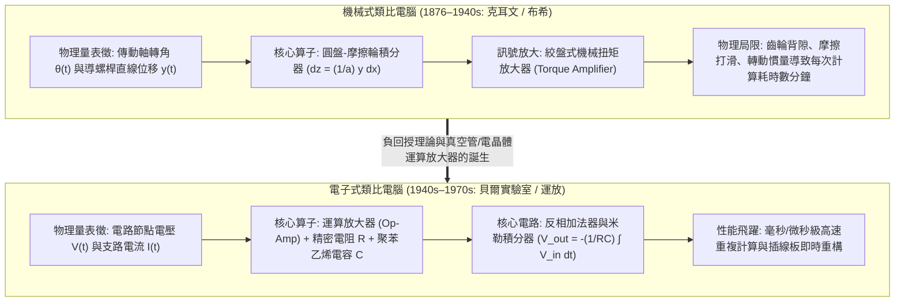

## 1. 引言：「計算（Computation）」一定意味著數數字嗎？

今天，當我們提到「電腦（Computer）」時，腦海中浮現的幾乎總是<strong>數位電腦（Digital Computer）</strong>。在數位計算範式中，自然界的一切現象——聲波、光強、流體渦旋、行星軌道乃至神經網路的推論——都必須首先透過取樣（Sampling）與量化（Quantization），被切割成離散的二進位位元序列（$0$ 與 $1$）。隨後，中央處理器（CPU）或圖形處理器（GPU）在全域時脈脈衝的同步下，驅動數十億個邏輯閘每秒執行數十億次離散算術運算，以此近似連續的物理世界。

然而，從物理學與科學史的宏大視角來看，將一切計算歸結為「數離散的數字（Digit，源於拉丁語「手指」）」其實只是20世紀中葉才取得霸權的近期路徑。自然界的基本定律——牛頓運動方程、馬克士威電磁場方程、納維-斯托克斯流體方程以及薛丁格方程——本質上全部是由<strong>連續實數與微分方程（Differential Equations）</strong>所支配的。

在數位電腦統治世界之前，人類曾發展出另一套截然不同的計算哲學：<strong>類比電腦（Analog Computer）</strong>。

類比電腦完全不「數數字」。它沒有記憶體位址、沒有程式計數器、沒有離散時脈週期，也不需要使用歐拉法或龍格-庫塔（Runge-Kutta）法進行一步步的數值迭代逼近。相反地，類比電腦透過<strong>構造一個與待解數學問題具有相同微分方程形式（數學同構 Isomorphism）的物理系統——利用齒輪的旋轉角、圓盤摩擦積分器、運算放大器（Op-Amp）的連續節點電壓 $V(t)$、支路電流 $I(t)$ 或電容器上的電荷積累——讓自然界的物理定律本身在連續時間內直接「演化」出方程的解</strong>。只要合上開關，克希荷夫定律（Kirchhoff's Laws）與電荷守恆定律就會迫使電路中的電壓波形即時描繪出微分方程的精確解軌跡，既沒有離散化截斷誤差，也沒有馮·諾伊曼架構中記憶體與處理器之間搬運資料的能量瓶頸。

本文將系統剖析類比電腦的完整演進史與數學物理原理：從克耳文男爵與范內瓦·布希的機械微分分析儀，到電子運算放大器（Op-Amp）的虛擬接地與米勒積分器推導、克耳文回授自舉法求解高階常微分方程、熱雜訊與元件公差所決定的夏農-馮·諾伊曼精度極限，再到21世紀為突破深度學習算力與功耗牆而強勢復興的<strong>記憶體內類比計算（Analog In-Memory Computing）、矽基光子計算與神經形態晶片</strong>。

---

## 2. 機械類比計算的演進：用齒輪與圓盤執行微積分

### 2.1 從安提基特拉機械到計算尺

人類已知最早的精密類比電腦是西元前2世紀古希臘製造的<strong>安提基特拉機械（Antikythera Mechanism）</strong>。它利用30多個青銅齒輪（包含精巧的差動齒輪機構）將時間映射為連續的齒輪轉角比例，精確計算太陽、月球與行星的黃道位置及日月食沙羅週期。1620年代，基於納皮爾發現的對數，奧特雷德發明了<strong>計算尺（Slide Rule）</strong>。計算尺將正實數 $x$ 映射為物理刻度長度 $\log_{10} x$，從而將乘法 $x \cdot y$ 轉化為兩段空間位移的連續疊加 $\log_{10} x + \log_{10} y = \log_{10}(xy)$，直到阿波羅登月時代仍是工程師隨身攜帶的核心計算工具。

### 2.2 湯姆森兄弟與克耳文男爵的「球-盤-柱積分器」

然而，從四則運算邁向<strong>微積分與微分方程求解</strong>的決定性突破，誕生於1876年的英國。物理學家威廉·湯姆森（即<strong>克耳文男爵 Lord Kelvin</strong>）的哥哥、工程師<strong>詹姆斯·湯姆森（James Thomson）</strong>發明了<strong>圓盤-摩擦輪積分器（Wheel-and-Disk Integrator）</strong>：

1. 一個水平放置的<strong>旋轉圓盤（Disk）</strong>繞中心軸旋轉微小角度 $dx$，代表自變數 $x$ 的變化。
2. 一個半徑為 $a$ 的垂直小<strong>摩擦輪（Integrator Wheel）</strong>壓在圓盤表面上，其接觸點到圓盤中心的徑向距離由導螺桿控制在 $y(x)$ 處（代表被積函數）。
3. 當圓盤旋轉 $dx$ 時，半徑 $y(x)$ 處的弧長位移為 $y(x)\,dx$。在無滑動理想滾動接觸下，半徑為 $a$ 的摩擦輪轉過的角度 $dz$ 滿足 $a\,dz = y(x)\,dx$。因此，摩擦輪累積旋轉的總角度 $z(x)$ 自動完成了定積分運算：

$$z(x) = \frac{1}{a} \int_{x_0}^{x} y(x')\,dx'$$

克耳文男爵利用這一積分器製造了著名的<strong>潮汐預測機（Tide-Predicting Machine）</strong>，透過滑輪與鋼絲合成月球與太陽引力的數十個諧波分量 $\sum_k A_k \cos(\omega_k t + \phi_k)$，僅需搖動曲柄4小時即可繪出港口全年的連續潮汐曲線。

### 2.3 范內瓦·布希的「微分分析儀」與扭矩放大器

機械摩擦輪積分器長期受困於一個致命瓶頸：<strong>輸出扭矩過小</strong>。因為摩擦輪僅靠與圓盤表面的微弱摩擦力轉動，一旦直接驅動下一級積分器或繪圖儀的沉重導螺桿，摩擦輪就會打滑，導致積分精度徹底崩潰。

1931年，麻省理工學院（MIT）的<strong>范內瓦·布希（Vannevar Bush）</strong>發明了基於絞盤（Capstan）原理的<strong>機械扭矩放大器（Torque Amplifier）</strong>：摩擦輪只需輸出極微小的力拉緊繞在高速旋轉馬達滾筒上的摩擦帶，外部馬達便能將輸出扭矩放大數千倍而不對摩擦輪產生反作用負載。藉此，布希建成了人類第一台通用機械類比電腦——<strong>微分分析儀（Differential Analyzer）</strong>。1941年，資訊理論之父<strong>克勞德·夏農（Claude Shannon）</strong>發表了《微分分析儀的數學理論》，嚴格證明有限個積分器互連所能生成的函數類恰好等價於<strong>代數微分方程（ADE）</strong>的解。

---

## 3. 電子類比計算的心臟：運算放大器（Op-Amp）與連續微積分電路

二戰期間，貝爾實驗室的<strong>卡爾·斯沃策爾（Karl D. Swartzel Jr.）</strong>與哥倫比亞大學的<strong>約翰·拉加齊尼（John R. Ragazzini）</strong>等人用電子真空管電路取代了笨重的機械齒輪。事實上，今天所有電子工程師耳熟能詳的<strong>「運算放大器（Operational Amplifier, Op-Amp）」</strong>一詞，正是由拉加齊尼在1947年的經典論文中首次命名——意指<strong>「在電子類比電腦中專門用於執行加法、乘法比例縮放與積分等數學運算（Mathematical Operations）的高增益直流放大器」</strong>。

### 3.1 理想運算放大器與「虛接地（Virtual Ground）」原理

運算放大器是一個具有同相輸入端（$V_+$）、反相輸入端（$V_-$）和輸出端（$V_{\text{out}}$）的差動放大器，其開迴路電壓增益 $A_{\text{OL}}$ 極高（通常為 $10^5 \sim 10^8$）：

$$V_{\text{out}} = A_{\text{OL}} (V_+ - V_-)$$

當我們將同相端接地（$V_+ = 0\,\text{V}$），並透過外部被動網路（電阻或電容）從輸出端 $V_{\text{out}}$ 向反相端 $V_-$ 引入<strong>負回授（Negative Feedback）</strong>時，在理想運放（$A_{\text{OL}} \to \infty$，輸入阻抗 $Z_{\text{in}} \to \infty$）條件下，只要輸出未飽和，就有：

$$V_+ - V_- = \frac{V_{\text{out}}}{A_{\text{OL}}} \to 0 \implies V_- = V_+ = 0\,\text{V}, \quad I_- = 0$$

反相輸入端 $V_-$ 雖然沒有物理接地，但電位被負回授死死鉗位在 $0\,\text{V}$，稱為<strong>「虛接地（Virtual Ground）」</strong>。正是「虛接地（$V_-=0$）」與「輸入電流為零（$I_-=0$）」這兩個性質，將運放內部不穩定的非線性特性徹底消去，使電路的數學轉移函數完全由高精度的外部電阻 $R$ 和電容 $C$ 決定！

### 3.2 基本數學運算電路的嚴格推導

1. <strong>反相加權加法器（Summing Amplifier）</strong>：
   將 $N$ 個輸入電壓 $V_1(t), \dots, V_N(t)$ 分別透過電阻 $R_1, \dots, R_N$ 接入虛接地節點（$V_- = 0$），回授電阻為 $R_f$。根據歐姆定律與克希荷夫電流定律（KCL），流入虛接地節點的電流總和必等於流經回授電阻的電流：
   $$\sum_{k=1}^N \frac{V_k(t)}{R_k} + \frac{V_{\text{out}}(t)}{R_f} = 0 \implies V_{\text{out}}(t) = -\sum_{k=1}^N \left(\frac{R_f}{R_k}\right) V_k(t)$$
2. <strong>連續時間米勒積分器（Miller Integrator）</strong>：
   將回授電阻替換為電容 $C$，輸入電壓 $V_{\text{in}}(t)$ 經電阻 $R$ 流入虛接地節點。由於電容極板電荷 $Q(t) = C(V_- - V_{\text{out}}(t)) = -C V_{\text{out}}(t)$，電容電流為 $I_C(t) = C \frac{d V_{\text{out}}(t)}{dt}$。由 KCL 可得：
   $$\frac{V_{\text{in}}(t)}{R} + C \frac{d V_{\text{out}}(t)}{dt} = 0 \implies V_{\text{out}}(t) = -\frac{1}{RC} \int_0^t V_{\text{in}}(\tau)\,d\tau + V_{\text{out}}(0)$$
   其中初始條件 $V_{\text{out}}(0)$ 由繼電器在計算開始前對電容器預充電直接設定！
3. <strong>為什麼類比電腦嚴禁使用「微分器」而必須全部使用「積分器」？</strong>
   在拉普拉斯頻域（$s = j\omega$）中，積分器的轉移函數幅值為 $|H_{\text{int}}(\omega)| = \frac{1}{\omega RC}$，隨頻率升高按 $1/\omega$ 衰減，是一個天然的<strong>低通濾波器</strong>，能平滑並抑制高頻熱雜訊；相反地，微分器的轉移函數幅值為 $|H_{\text{diff}}(\omega)| = \omega RC$，是一個<strong>高通濾波器</strong>，會將電路中微小的微伏級高頻雜訊 $\varepsilon \sin(\omega_{\text{high}} t)$ 放大 $\omega_{\text{high}}$ 倍（成千上萬倍），導致運放瞬間飽和並引發劇烈的自激振盪。

---

## 4. 用導線求解微分方程：克耳文回授自舉法（Bootstrap Method）

如何在不使用任何微分器的前提下求解高階常微分方程？我們以經典的二階阻尼受迫諧振子（質量 $m$、阻尼 $c$、彈簧剛度 $k$、外力 $F(t)$）為例：

$$m \frac{d^2 x}{dt^2} + c \frac{dx}{dt} + k x(t) = F(t), \quad x(0) = x_0, \quad \dot{x}(0) = v_0$$

按照<strong>克耳文回授自舉法</strong>的四個步驟：

1. <strong>孤立最高階導數項</strong>：將最高階導數 $\ddot{x}(t)$ 移至等式左端：
   $$\frac{d^2 x}{dt^2} = -\frac{c}{m}\frac{dx}{dt} - \frac{k}{m}x(t) + \frac{1}{m}F(t)$$
2. <strong>假設最高階導數電壓訊號 $\ddot{x}(t)$ 已經存在</strong>於某一節點導線上。
3. <strong>串聯積分器生成低階導數</strong>：將 $\ddot{x}(t)$ 送入<strong>第1級反相積分器</strong>（初始電壓設為 $-v_0$），得到輸出 $-\dot{x}(t)$；再將 $-\dot{x}(t)$ 送入<strong>第2級反相積分器</strong>（初始電壓設為 $+x_0$），得到位移解輸出 $+x(t)$。
4. <strong>閉迴路回授（Bootstrap）</strong>：利用電位器（Potentiometer）將 $-\dot{x}(t)$、經反相器變號後的 $-x(t)$ 以及外力電壓 $F(t)$ 按係數 $\frac{c}{m}, \frac{k}{m}, \frac{1}{m}$ 加權送入反相加法器，合成出右端項 $-\frac{c}{m}\dot{x} - \frac{k}{m}x + \frac{1}{m}F(t)$，然後<strong>將加法器的輸出導線直接連回第2步所假設的 $\ddot{x}(t)$ 輸入端</strong>！

當控制繼電器切換到 `COMPUTE` 模式的瞬間，克希荷夫定律迫使整個閉迴路電路在連續時間的每一時刻同時滿足該微分方程！透過<strong>幅值縮放（Amplitude Scaling，如以 $\pm 10\,\text{V}$ 為1個機器單位）</strong>、<strong>時間縮放（Time Scaling，改變時間常數 $RC$ 實現每秒數千次的重複計算 Rep-Op）</strong>以及基於恆等式 $XY = \frac{1}{4}[(X+Y)^2 - (X-Y)^2]$ 的<strong>四分之一平方類比乘法器（Quarter-Square Multiplier）</strong>與二極體函數產生器，類比電腦還能即時求解勞侖茲混沌吸引子與空氣動力學非線性偏微分方程。

---

## 5. 精度與熱雜訊的物理學：為什麼數位電腦曾取代類比電腦？

既然類比電腦能以 $O(1)$ 的即時平行速度求解任意複雜的微分方程組，為什麼它在1970年代之後被數位電腦取代？其根本原因在於<strong>熱力學雜訊與資訊理論所決定的「類比精度指數級代價定律」</strong>。

### 5.1 強森-奈奎斯特熱雜訊與零點漂移

任何處於絕對溫度 $T > 0\,\text{K}$ 的電阻 $R$ 內部，自由電子的布朗熱運動都會在頻寬 $\Delta f$ 內產生不可消除的<strong>強森-奈奎斯特熱雜訊（Johnson-Nyquist Thermal Noise）</strong>：

$$v_{\text{rms}} = \sqrt{4 k_B T R \Delta f}$$

此外，半導體與真空管還存在散粒雜訊（Shot Noise）、低頻閃爍雜訊（$1/f$ 雜訊）以及隨溫度變化的<strong>直流失調電壓漂移（DC Offset Drift $V_{\text{os}}$）</strong>。在積分器中，哪怕只有幾微伏的直流失調 $V_{\text{os}}$，也會隨時間被積分為 $-\frac{V_{\text{os}}}{RC} t$ 而線性發散（為此 Edwin Goldberg 在1949年發明了<strong>斬波穩零運算放大器 Chopper-Stabilized Op-Amp</strong>）。

### 5.2 精度擴展代價：類比的指數級 $O(2^{2b})$ 對比數位的線性級 $O(b)$

為了在單根連續類比導線上實現 $b$ 位元的等效精度（動態範圍 $2^b = V_{\max} / v_{\text{noise}}$），其訊號雜訊功率比必須滿足：

$$\text{SNR}_{\text{power}} = \left(\frac{V_{\max}}{v_{\text{noise}}}\right)^2 = 2^{2b}$$

這意味著：<strong>在類比計算中，每增加 1 位元精度（或每提高一位十進位有效數字），所需的訊號能量或為抑制 $k_B T / C$ 熱雜訊所需的電容面積都會呈指數級 $O(2^{2b})$ 暴增</strong>，且所有電阻與電容的製造公差必須縮小一半！因此，電子類比電腦的物理精度上限被死死鎖定在 <strong>3～4位十進位有效數字（$10 \sim 14\,\text{bit}$，相對誤差 $0.01\% \sim 0.1\%$）</strong>。

相反地，在馮·諾伊曼與夏農建立的數位電腦中，每個電晶體只需區分高電位（$1$）和低電位（$0$）兩個狀態，熱雜訊在每一級邏輯閘處被徹底抹除重構。若要將精度從16位元提升到64位元（16位十進位有效數字，誤差 $10^{-16}$），只需將暫存器和全加器的電晶體位數橫向擴展4倍——<strong>數位計算的硬體與能量代價隨精度 $b$ 僅呈線性或多項式級 $O(b \sim b^2)$ 增長</strong>！

| 比較維度 | 電子類比電腦（連續時間） | 馮·諾伊曼數位電腦（離散時間） |
| :--- | :--- | :--- |
| <strong>物理量與資訊表徵</strong> | 連續物理量（節點電壓 $V(t)$、支路電流 $I(t)$、光場振幅） | 離散二進位符號序列（$b$ 位元定點數或 IEEE 754 浮點數） |
| <strong>微積分運算方式</strong> | 利用電容器電荷守恆 $V = -\frac{1}{RC}\int V_{\text{in}}\,dt$ 進行<strong>物理精確連續積分</strong> | 利用歐拉法、龍格-庫塔法進行<strong>離散時間步長 $\Delta t$ 數值近似</strong> |
| <strong>平行度與時間複雜度</strong> | <strong>完全空間平行</strong>（求解時間 $O(1)$，與方程維數 $N$ 無關） | 時間多工順序執行（受限於CPU核心數，複雜度 $O(N \sim N^3)$） |
| <strong>有效精度上限</strong> | <strong>3～4位十進位數字（$10 \sim 14\,\text{bit}$，誤差 $0.01\% \sim 0.1\%$）</strong> | 任意高精度（單精度32位元約7位有效數字，雙精度64位元約16位） |
| <strong>精度 $b$ 位元的擴展成本</strong> | <strong>指數級暴增 $\propto O(2^{2b})$</strong>（受限於 $k_B T$ 熱雜訊與元件公差） | <strong>線性/多項式增長 $\propto O(b \sim b^2)$</strong>（僅需增加資料匯流排位寬） |

在1960～1970年代的阿波羅登月計畫中，NASA 廣泛採用了結合兩者優勢的<strong>混合電腦（Hybrid Computer）</strong>：用類比電腦即時積分火箭發動機與登月艙的6自由度高頻姿態動力學方程（用於硬體迴路模擬 HILS），同時用數位電腦執行高精度的地月轉移軌道導航計算。

---

## 6. 21世紀的華麗復興：記憶體內類比計算、光子晶片與神經形態AI

進入2020年代，隨著摩爾定律逼近原子尺寸極限，以及深度學習與大型語言模型（LLM）帶來的「馮·諾伊曼記憶體牆（Memory Wall）」功耗危機，類比電腦正在最前沿的人工智慧與物理計算領域迎來震撼復興：

1. <strong>AI與類比計算的天作之合</strong>：深度神經網路99%以上的計算是大規模<strong>矩陣-向量乘法（MVM）</strong> $y_i = \sum_{j=1}^N W_{ij} x_j$。在數位GPU中，從DRAM搬運權重資料的能耗是算術運算本身的數百倍；而且神經網路天生具有強大的雜訊魯棒性，僅需 $4 \sim 8\,\text{bit}$（`INT4`/`INT8`）的低精度即可完美運作——這恰好處於類比計算能效比數位電路高出兩到三個數量級的黃金區間！
2. <strong>憶阻器交叉陣列（Memristor Crossbar / Analog In-Memory Computing）</strong>：將神經網路權重矩陣 $W_{ij}$ 直接儲存為非揮發性憶阻器（ReRAM/PCM）交叉點上的電導 $G_{ij} = 1/R_{ij}$，在水平字元線上施加輸入電壓 $V_j$。根據<strong>歐姆定律</strong>，每個交叉點瞬間產生乘積電流 $I_{ij} = G_{ij} V_j$；再根據<strong>克希荷夫電流定律（KCL）</strong>，同一列位元線上的電流自然相加得到 $I_i = \sum_{j=1}^N G_{ij} V_j$。無需搬運任何資料，整個矩陣乘法在幾奈秒內以 $O(1)$ 時間原地完成！
3. <strong>矽基光子類比計算、神經形態晶片與神經常微分方程（Neural ODE）</strong>：利用馬赫-曾德爾干涉儀（MZI）網格中雷射干涉效應以光速完成矩陣乘法的<strong>光子類比加速器</strong>、Carver Mead 提出的利用電晶體次臨界區指數特性直接模擬生物脈衝神經元離子通道動力學方程的<strong>神經形態晶片（Neuromorphic Computing）</strong>，以及將離散網路層還原為連續時間微分方程 $\frac{d\mathbf{h}(t)}{dt} = f(\mathbf{h}(t), t, \theta)$ 的<strong>液態神經網路（Liquid Neural Networks）</strong>，都標誌著人類正在走向「數位邏輯控制 + 類比物理超平行計算」的全新融合時代。
