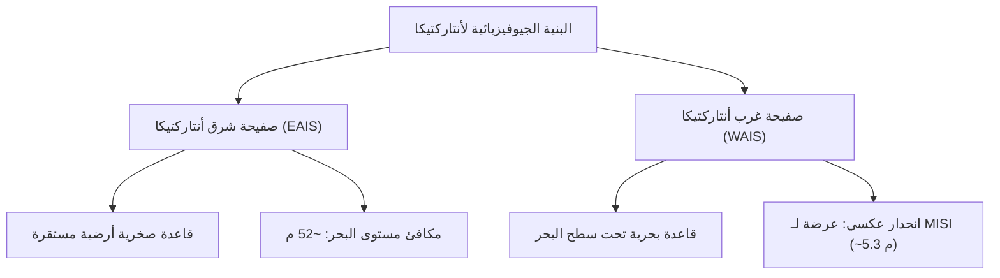
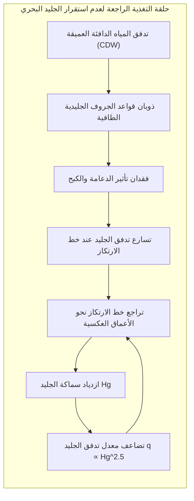

تعد القارة القطبية الجنوبية (أنتاركتيكا) أكبر مستودع جليدي على كوكب الأرض بمساحتها البالغة 14 مليون كيلومتر مربع، حيث يغطيها غطاء جليدي بمتوسط سماكة 2,160 متراً ويصل إلى أكثر من 4,800 متر. تحتجز القارة 90 % من الجليد العالمي و70 % من المياه العذبة، وإذا ذاب هذا الغطاء بالكامل، فسيرتفع منسوب مياه البحار والمحيطات بنحو 58 متراً.

غير أن جليد أنتاركتيكا ليس كتلة صلبة ساكنة، بل يتحرك ويتدفق كمائع غير نيوتوني عبر الانسياب اللزج البلاستيكي عبر آلاف السنين. وتحت أربعة كيلومترات من الجليد، ترقد مئات البحيرات تحت الجليدية، أبرزها بحيرة فوستوك (Lake Vostok)، حيث تزدهر كائنات دقيقة تحت ضغط هائل يبلغ 40 ميغاباسكال في ظلام مطلق. وعلى أطراف القارة، يدفع تشكل مياه قاع القطب الجنوبي (AABW) الدوران الحراري الملحي العالمي.

يتناول هذا البحث فيزياء الجليد، وعدم الاستقرار البحري، والبيولوجيا المتطرفة، وسجل اللباب الجليدي الممتد لـ 800 ألف عام.

---

## 1. البنية الجيوفيزيائية: أنتاركتيكا الشرقية مقابل الغربية

تقسم جبال عبر أنتاركتيكا القارة إلى نطاقين مختلفين تماماً:
1. <strong>صفيحة شرق أنتاركتيكا (EAIS)</strong>: صفيحة جليدية أرضية ترتكز على كراتون قاري صلب يعلو مستوى سطح البحر. تتميز باستقرار ديناميكي حراري هائل وتنخفض درجات الحرارة في هضابها الداخلية دون $-50^\circ\text{C}$ (سجلت أدنى درجة حرارة $-89{,}2^\circ\text{C}$). تمثل إمكانية رفع مستوى البحر بـ <strong>52 متراً</strong>.
2. <strong>صفيحة غرب أنتاركتيكا (WAIS)</strong>: <strong>صفيحة جليدية بحرية</strong> يقع قاعها الصخري تحت مستوى سطح البحر بمئات الأمتار مع <strong>انحدارات تراجعية عكسية</strong> (يتعمق القاع باتجاه الداخل). هذه الهندسة تسبب ظاهرة عدم استقرار الغطاء الجليدي البحري (MISI) التي تهدد برفع البحار بمقدار <strong>5.3 أمتار</strong>.

---

## 2. ميكانيكا غلين وعدم استقرار الجليد البحري (MISI)

يخضع التشوه اللدن للجليد لـ <strong>قانون غلين للتدفق</strong>:

$$\dot{\varepsilon}_{ij} = A(T) \, \tau_e^{n-1} \, \tau_{ij}$$

مع معامل إجهاد تجريبي $n \approx 3$، مما يعني أن مضاعفة إجهاد القص تؤدي إلى مضاعفة معدل الانفعال بمقدار ثماني مرات ($2^3 = 8$).

توفر الجروف الجليدية الطافية (Ice Shelves) دعامة كبح ميكانيكية حاسمة (<strong>تأثير الدعامة / Buttressing</strong>). وعندما تتدفق مياه المحيط الدافئة (CDW) لتذيب قواعد هذه الجروف، ينهار الدعم الخلفي. واستناداً إلى قانون كريستيان شوف (2007):

$$q \propto H_g^{\frac{n+3}{n}} \xrightarrow{n=3} q \propto H_g^2 \sim H_g^{2{,}5}$$

ففي المنحدرات العكسية، يؤدي تراجع خط الارتكاز (Grounding Line) إلى مياه أكثر عمقاً ($H_g$ يزداد)، مما يطلق انهياراً ذاتي التسارع لا رجعة فيه (<strong>MISI</strong>).

---

## 3. بحيرة فوستوك وأرشيف المناخ القديم لـ 800,000 عام

تقع بحيرة فوستوك (طولها 250 كم، وعمقها 1,000 م) تحت 3,750 متراً من الجليد عند ضغط 40 ميغاباسكال في ظلام دامس دام ملايين السنين. وأظهرت العينات الجليدية المترسبة وجود بكتيريا تعتمد على التخليق الكيميائي وبقايا حرارية أرضية، مما يجعلها النموذج الأرضي الأبرز للمحيطات الجليدية في قمر يوروبا وقمر إنسيلادوس.

وفي المناطق الساحلية، يؤدي طرد الأملاح أثناء التجمد السريع لمياه البحر (<strong>طرد المحلول الملحي / Brine Rejection</strong>) إلى تكوين <strong>مياه قاع القطب الجنوبي (AABW)</strong> شديدة الكثافة عند درجة حرارة $-1{,}9^\circ\text{C}$ التي تهبط للأعماق لتغذي الدوران المحيطي العالمي بالأكسجين.

ومن خلال تحاليل النظائر المستقرة ($\delta^{18}O, \delta D$) والغازات الحبيسة في عينات لباب الجليد في إبيكا (EPICA Dome C)، تم إثبات توافق دورات العصور الجليدية مع دورات ميلانكوفيتش الفلكية. فعلى مدى 800 ألف عام، تذبذب ثاني أكسيد الكربون بين 180 و280 جزءاً في المليون، بينما قفز النشاط البشري الحديث به إلى أكثر من <strong>420 جزءاً في المليون</strong>. تظل أنتاركتيكا الحارس الأهم والميزان الحرج لمستقبل كوكب الأرض.