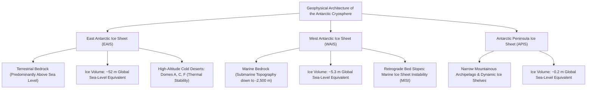
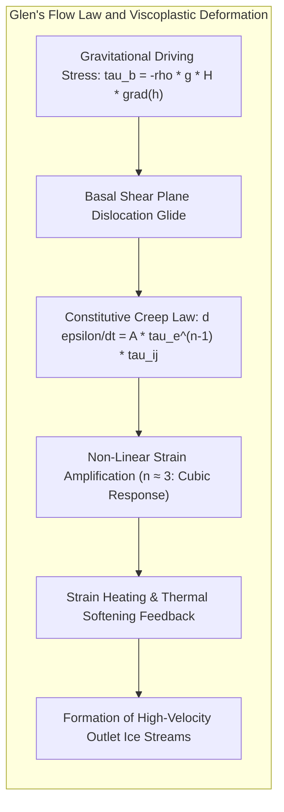
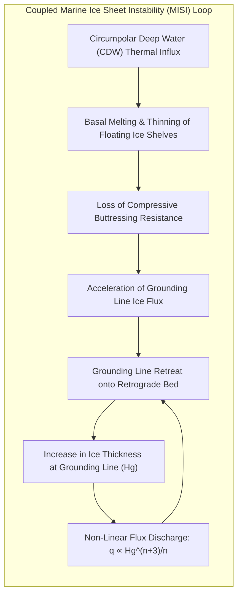
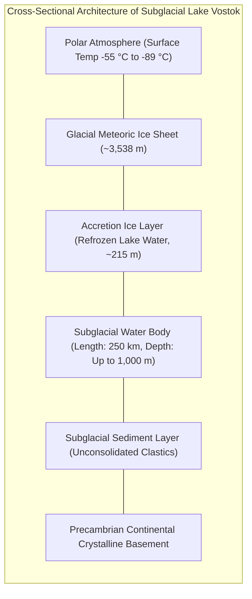
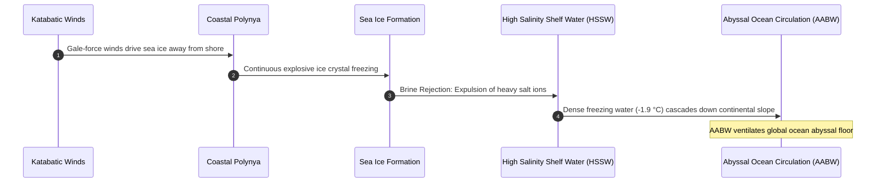
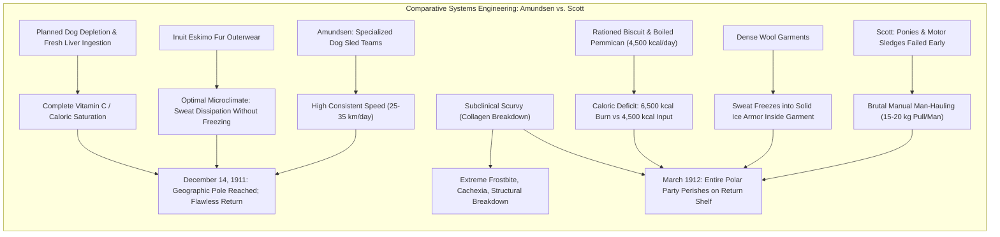
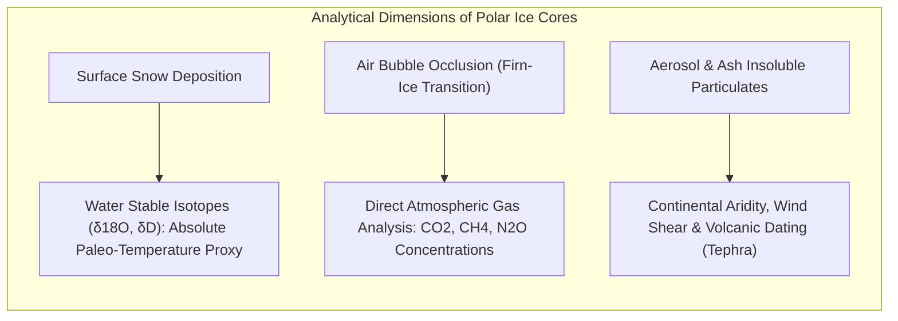

Isolated at the southernmost planetary terminus, the continent of Antarctica constitutes Earth's ultimate terrestrial frontier. Spanning approximately 14 million square kilometers—an area exceeding Europe and nearly twice the size of Australia—this colossal polar landmass is entombed beneath an ice sheet with a mean thickness of 2,160 meters and local maxima exceeding 4,800 meters. The Antarctic Ice Sheet sequesters roughly 90% of the world's solid glacial ice and 70% of its freshwater reserves. Should this cryogenic reservoir undergo complete thermal dissipation, global mean sea level would rise by approximately 58 meters, inundating every coastal metropolis on Earth.

Yet, Antarctica is far from an inert, static slab of frozen water. Internally, it behaves as a massive, non-linearly deforming non-Newtonian fluid, where gravity, basal geothermal flux, and subglacial water pressures govern continental-scale plastic creep across millennia. Hidden beneath four kilometers of overburden ice lie vast hydrological networks of subglacial lakes—isolated from the surface biosphere for millions of years—harboring bizarre, chemotrophic microbial ecosystems flourishing under pressures exceeding 40 megapascals in total darkness. Simultaneously, the frigid coastal margins act as the thermodynamic engine of the world ocean, generating Antarctic Bottom Water (AABW) that drives the global meridional overturning circulation and oxygenates the deep abyssal plains.

This treatise provides an exhaustive, mathematically rigorous, and historically synthesized analysis of the Antarctic continent. We systematically dissect the rheological equations of ice sheet motion, the mechanics of marine ice sheet instability (MISI), the microbiological discoveries of subglacial Lake Vostok, the logistical engineering of the "Heroic Age" polar expeditions, and the 800,000-year paleoclimatic chronicle preserved in deep ice cores.

---

## 1. Geophysical Architecture: The Dichotomy of East and West Antarctica

The fundamental point of departure for polar glaciology is the structural, geological, and topographic asymmetry dividing the continent along the spine of the Transantarctic Mountains into two distinct physical entities: the <strong>East Antarctic Ice Sheet (EAIS)</strong> and the <strong>West Antarctic Ice Sheet (WAIS)</strong>.



### 1.1 The East Antarctic Ice Sheet (EAIS): The Ancient Continental Shield

Occupying roughly 10 million square kilometers, the EAIS is an immense dome-shaped cratonic shield resting directly upon ancient Precambrian metamorphic and igneous crystalline continental crust. The vast majority of its underlying bedrock resides well above sea level, defining it as a <strong>terrestrial ice sheet</strong>.

Its high-altitude interior plateaus—punctuated by topographic summits such as Dome A (4,093 m above sea level), Dome C (3,233 m), and Dome Fuji (3,810 m)—experience the most extreme cold on the planet, with annual mean surface temperatures descending below $-50^\circ\text{C}$ and absolute minima plunging past $-89.2^\circ\text{C}$ (recorded at Vostok Station in 1983). Mean annual accumulation is miniscule—often less than 50 mm water equivalent per year—qualifying the interior as an hyper-arid polar desert. Consequently, surface ablation is virtually non-existent, conferring extraordinary long-term thermodynamic stability. The EAIS represents approximately <strong>52.2 meters of potential global sea-level rise</strong>.

### 1.2 The West Antarctic Ice Sheet (WAIS): The Marine Ice Vulnerability

In stark physical contrast, the WAIS covers approximately 2 million square kilometers and is characterized by a geological setting of acute structural vulnerability. The WAIS is a <strong>marine ice sheet</strong>: its bedrock floor lies hundreds to thousands of meters below sea level (reaching depths of $-2,500\,\text{m}$ in the Bentley Subglacial Trench) as a consequence of tectonic rifting and intense isostatic crustal depression caused by the overlying ice burden.

Crucially, the subglacial topography beneath the major outlet glaciers of the WAIS (such as the Thwaites and Pine Island glaciers in the Amundsen Sea Embayment) exhibits a <strong>retrograde bed slope</strong>—the bedrock deepens steadily inland toward the continental interior. As demonstrated in Section 3, this geometric configuration possesses a mathematical tipping point: once grounding line retreat initiates, it triggers an irreversible, self-sustaining catastrophic discharge known as Marine Ice Sheet Instability (MISI). The collapse of the WAIS would commit the global oceans to a rapid sea-level rise of <strong>5.3 meters</strong>.

---

## 2. Theoretical Glaciology: Continuum Mechanics and Non-Linear Ice Rheology

To describe the motion of an ice sheet across geological epochs, glaciologists model glacial ice as an incompressible, non-linearly viscous, polycrystalline solid exhibiting secondary plastic creep under sustained deviatoric stress.

### 2.1 Polycrystalline Ice Ih and Glen's Flow Law

Natural glacier ice crystallizes exclusively in the hexagonal crystal lattice known as ice Ih. Shear deformation occurs primarily via dislocation glide along parallel basal planes perpendicular to the crystallographic $c$-axis. In a bulk polycrystalline aggregate with randomly oriented grains, the empirical relationship between the strain-rate tensor $\dot{\varepsilon}_{ij}$ and the deviatoric stress tensor $\tau_{ij}$ is formulated by <strong>Glen's Flow Law</strong>:

$$\dot{\varepsilon}_{ij} = A(T, P^*) \, \tau_e^{n-1} \, \tau_{ij}$$

where $n$ is the creep exponent, empirically established across diverse laboratory and field experiments as $n \approx 3$ (ranging between $2.8$ and $3.2$). The scalar $\tau_e$ denotes the second invariant of the deviatoric stress tensor (the effective shear stress):

$$\tau_e = \sqrt{\frac{1}{2} \sum_{i,j} \tau_{ij} \tau_{ij}}$$

The rate factor $A(T, P^*)$ quantifies the mechanical softness of the ice and is governed by a temperature-dependent Arrhenius relation incorporating pressure-melting point corrections:

$$A(T) = A_0 \exp\left( -\frac{Q}{R T} \right)$$

where $Q$ is the activation energy for creep ($Q \approx 60\,\text{kJ/mol}$ for $T < -10^\circ\text{C}$; $Q \approx 139\,\text{kJ/mol}$ for $-10^\circ\text{C} \le T \le 0^\circ\text{C}$), $R \approx 8.314\,\text{J}/(\text{mol}\cdot\text{K})$ is the universal gas constant, and $T$ is absolute temperature in Kelvin.

Because the strain rate scales with the cube of stress ($\dot{\varepsilon} \propto \tau^3$), ice exhibits profound shear-thinning (pseudoplastic) behavior. When local shear stress doubles, internal deformation accelerates by a factor of eight ($2^3 = 8$). Consequently, deformation concentrates violently in basal shear zones and fast-flowing ice streams.



### 2.2 The Shallow Ice Approximation (SIA) and Parabolic Profiles

Because the aspect ratio of the Antarctic ice sheet is small—its vertical thickness $H \sim 3\,\text{km}$ is negligible compared to its horizontal radius $L \sim 2,000\,\text{km}$ (aspect ratio $\epsilon = H / L \sim 10^{-3} \ll 1$)—the Navier-Stokes equations can be systematically simplified via the <strong>Shallow Ice Approximation (SIA)</strong>.

Neglecting longitudinal stress gradients, the basal shear stress $\tau_b$ balancing gravitational driving stress is given by:

$$\tau_{xz}(z) = -\rho_i g (h - z) \frac{\partial h}{\partial x}$$

$$\tau_b = -\rho_i g H \frac{\partial h}{\partial x}$$

where $\rho_i \approx 917\,\text{kg/m}^3$ is glacial ice density, $g$ is gravitational acceleration, $h(x)$ is surface elevation, and $H(x)$ is ice thickness.

Integrating Glen's flow law vertically over depth under the boundary condition of zero basal sliding yields the depth-averaged horizontal velocity $\bar{u}$:

$$\bar{u}(x) = \frac{2 A}{n + 2} (\rho_i g)^n H^{n+1} \left| \frac{\partial h}{\partial x} \right|^{n-1} \left( -\frac{\partial h}{\partial x} \right)$$

Assuming uniform basal shear stress $\tau_b = \tau_0 \approx 100\,\text{kPa}$ across a flat circular bed of radius $L$, the integration yields the classical <strong>Vialov-Nye parabolic surface profile</strong>:

$$h(x) = \left( \frac{2 \tau_0}{\rho_i g} \right)^{1/2} (L - x)^{1/2}$$

This square-root geometric envelope predicts the broad, dome-like morphological profile observed along satellite altimetry transects across East Antarctica with remarkable fidelity.

---

## 3. Marine Ice Sheet Instability (MISI) and the Physics of Ice Shelf Buttressing

The existential threat posed by the Antarctic cryosphere to human coastal infrastructure centers upon the mechanical dynamics of its floating margins and the boundary physics of the <strong>grounding line</strong>.



### 3.1 The Mechanical Function of Ice Shelf Buttressing

As inland ice flows toward the coast, it transitions from a grounded state (supported by subglacial rock) to a floating state, forming expansive horizontal platforms known as <strong>ice shelves</strong> (e.g., the Ross, Filchner-Ronne, and Amery ice shelves).

Because an ice shelf is in hydrostatic equilibrium, its direct melting or disintegration does not perturb sea levels (governed by Archimedes' principle). However, ice shelves are rarely unconfined; they are laterally pinned against fjord sidewalls and grounded upon local seabed bathymetric highs called *ice rises*.

Frictional shear along these pinning margins generates upstream compressive back-stress—a mechanical phenomenon glaciologists term <strong>buttressing</strong>. Buttressing acts as a physical dam, resisting the gravitational outflow of the grounded continental ice sheet behind it. When warm ocean currents thin an ice shelf from below or atmospheric meltwater pools trigger explosive calving via hydrofracture, this back-stress collapses, liberating the inland glaciers to accelerate by orders of magnitude into the sea.

### 3.2 Grounding Line Mechanics and the Schoof Boundary Relation

The transition boundary separating grounded ice from floating shelf is the <strong>grounding line</strong>. At this exact point, Archimedes' flotation condition is satisfied:

$$\rho_i H_g = \rho_w z_b$$

where $H_g$ is ice thickness at the grounding line, $\rho_w \approx 1,028\,\text{kg/m}^3$ is seawater density, and $z_b$ is water depth.

In a seminal mathematical derivation, Christian Schoof (2007) solved the boundary layer transition between the Shallow Ice Approximation (grounded) and the Shallow Shelf Approximation (floating), establishing that the steady-state ice flux $q$ across the grounding line is an intrinsic, monotonically increasing function of local ice thickness $H_g$:

$$q = \left( \frac{\rho_i g (1 - \rho_i / \rho_w)}{4} \right)^n A \, C^{-1} \, H_g^{\frac{n+3}{n}}$$

Setting $n = 3$, the mass flux scales super-quadratically with thickness:

$$q \propto H_g^{\frac{6}{3}} = H_g^2 \quad (\text{or } H_g^{2.5} \text{ with basal friction models})$$

- <strong>Prograde Bed (Seaward Sloping)</strong>: As the grounding line retreats, the water depth becomes shallower, $H_g$ decreases, flux $q$ drops, and the system self-stabilizes into geometric equilibrium.
- <strong>Retrograde Bed (Inland Sloping)</strong>: If the seabed deepens toward the interior (as beneath Thwaites Glacier), any initial perturbation triggering grounding line retreat forces the grounding line into deeper water. Consequently, $H_g$ increases, which exponentially increases the ice flux $q$ discharged into the ocean. This mass deficit forces further inland retreat, creating an autonomous, self-amplifying runaway positive feedback loop: <strong>Marine Ice Sheet Instability (MISI)</strong>.

### 3.3 Marine Ice Cliff Instability (MICI)

When an ice shelf collapses completely, it leaves behind an unbuttressed, vertical subaerial ice cliff terminating directly into deep water. Solid mechanics dictates that polycrystalline ice has an intrinsic compressive structural failure threshold of approximately $\sigma_{\text{yield}} \approx 1 - 2\,\text{MPa}$.

If the exposed ice cliff height exceeds approximately $90 - 100\,\text{meters}$ above the waterline (corresponding to a total ice thickness of nearly $1,000\,\text{meters}$), the gravitational shear stress at the cliff face exceeds the structural strength of ice. The cliff undergoes rapid, episodic brittle structural collapse—a mechanism termed <strong>Marine Ice Cliff Instability (MICI)</strong>. If activated in the deep troughs of West Antarctica, MICI could double the rate of global sea-level rise within decades.

---

## 4. Subglacial Limnology and Extremophile Microbiology: Lake Vostok

Far beneath the high polar plateau, the thermal insulation of miles of ice, combined with geothermal heat flow from Earth's mantle (approximately $50 - 80\,\text{mW/m}^2$) and pressure-induced melting point depression (governed by the Clausius-Clapeyron relation, lowering the freezing point of water to approximately $-2.4^\circ\text{C}$ beneath 4,000 m of ice), maintains vast networks of liquid water. Over 400 subglacial lakes have been identified across Antarctica, the largest and most pristine of which is <strong>Lake Vostok</strong>.



### 4.1 Extreme Environmental Parameters of the Vostok Abyss

Discovered via airborne radio-echo sounding (RES) and satellite altimetry, Lake Vostok measures approximately 250 kilometers in length by 50 kilometers in width, covering an area of $12,500\,\text{km}^2$ with water depths reaching 1,000 meters. The environment within this sealed cavern represents one of the most extreme habitats on planet Earth:

1. <strong>Hyperbaric Hydrostatic Pressure</strong>: Overlying ice weighing roughly $3.5 \times 10^7\,\text{N/m}^2$ exerts a crushing hydrostatic pressure of <strong>40 MPa (400 atmospheres)</strong>.
2. <strong>Absolute Darkness</strong>: Shielded beneath nearly 4 km of solid ice, no solar photon has penetrated the lake for at least 15 to 30 million years, precluding any phototrophic primary production.
3. <strong>Hyperoxia</strong>: As basal meteoric ice melts continuously into the northern end of the lake, air hydrates (gas clathrates) trapped under hyperbaric pressure dissolve directly into the water column. The dissolved oxygen concentration is estimated to exceed $50\,\text{times}$ that of standard air-saturated surface freshwater, creating intense oxidative stress.
4. <strong>Perennial Sub-Zero Temperatures</strong>: Water temperature remains poised at approximately $-2.5^\circ\text{C}$ to $-0.5^\circ\text{C}$ in dynamic thermodynamic equilibrium with the ice ceiling.

### 4.2 Metagenomic Discoveries within Accretion Ice Cores

In the late 1990s and 2000s, deep Russian drilling at Vostok Station penetrated to a depth of 3,769 meters, stopping just meters above the liquid water table to prevent chemical contamination. Glaciological analysis revealed that the lowest 215 meters of the core (below 3,538 m) consisted not of compacted surface snow, but of <strong>accretion ice</strong>—lake water that had frozen onto the underside of the traversing ice sheet.

Metagenomic sequencing, 16S rRNA analysis, and flow cytometry performed on pristine accretion ice cores uncovered a viable, highly adapted extremophile microbiome:

- <strong>Chemolithoautotrophs</strong>: Microorganisms utilizing reduced inorganic compounds (elemental sulfur, ferrous iron, thiosulfate, and molecular hydrogen) as electron donors to fix inorganic carbon ($CO_2$) into biological macromolecules, driving a lightless food web.
- <strong>Piezophilic Psychrophiles</strong>: Bacteria possessing adaptive cell membrane modifications, specifically elevated ratios of polyunsaturated fatty acids (PUFAs) and branched-chain fatty acids that preserve membrane fluidity against extreme hydrostatic pressure and freezing temperatures.
- <strong>Geothermal Signatures</strong>: Sequences aligning with thermophilic bacteria (*Dictyoglomus*, *Hydrogenophilus*) were detected, indicating hydrothermal vents or fault-related geothermal circulation along the lake's rift-basin floor.

### 4.3 Astrobiological Implications: The Analogs for Europa and Enceladus

The discovery of a metabolically active biosphere sealed beneath the Antarctic ice sheet fundamentally expanded the boundaries of planetary habitability.

Outer solar system moons—most prominently Jupiter's moon <strong>Europa</strong> and Saturn's moon <strong>Enceladus</strong>—possess global subsurface liquid oceans sheltered beneath outer ice shells tens of kilometers thick. The endurance of life within Lake Vostok proves that complex, self-sustaining biological communities can persist in lightless, high-pressure, oxygen-stressed subglacial environments powered purely by chemolithoautotrophy and geothermal gradients, providing an operational template for future extraterrestrial cryo-drilling missions.

---

## 5. Polar Oceanography: Antarctic Bottom Water (AABW) and Planetary Thermohaline Circulation

Antarctica's influence extends across every ocean basin on Earth through the generation of <strong>Antarctic Bottom Water (AABW)</strong>—the densest, coldest, and most oxygen-rich water mass in the global ocean.



### 5.1 Coastal Polynyas and the Thermodynamics of Brine Rejection

The primary engines of AABW formation are <strong>latent heat coastal polynyas</strong> situated within the Weddell Sea, the Ross Sea, the Adélie Coast, and Prydz Bay. Polynyas are localized open-water fractures maintained amidst dense pack ice by fierce <strong>katabatic winds</strong>—dense, gravity-driven airflow cascading down the steep Antarctic ice sheet slopes at velocities exceeding $100\,\text{km/h}$.

As these winds drive newly formed ice seaward, open seawater is repeatedly exposed to polar air temperatures of $-30^\circ\text{C}$ to $-50^\circ\text{C}$. Violent heat loss to the atmosphere (frequently exceeding $800\,\text{W/m}^2$) induces explosive sea-ice crystallization.

During the nucleation of ice crystals, the hexagonal crystal matrix of ice physically excludes dissolved salt ions ($Na^+$, $Cl^-$, $Mg^{2+}$) into interstitial brine channels, which drain rapidly into the underlying ocean. This physical phenomenon is <strong>brine rejection</strong>.

The injection of expelled salts into near-freezing shelf waters creates an exceptionally cold ($-1.9^\circ\text{C}$), saline ($S > 34.7\,\text{PSU}$), ultra-dense water mass termed <strong>High Salinity Shelf Water (HSSW)</strong>.

### 5.2 Abyssal Ventilation and Global Overturning

Possessing potential densities exceeding $\sigma_\theta = 27.88\,\text{kg/m}^3$, HSSW spills over the continental shelf break, accelerating down submarine canyons as turbulent gravity density currents. Entraining overlying circumpolar waters as it cascades into the abyssal plains ($4,000 - 6,000\,\text{m}$ depth), it forms Antarctic Bottom Water.

AABW spreads northward along the ocean floor, traversing deep abyssal trenches into the South Atlantic, Indian, and Pacific basins:
1. <strong>Thermobaric Pumping</strong>: AABW constitutes the lower limb of the Atlantic Meridional Overturning Circulation (AMOC) and Southern Ocean Overturning Circulation, regulating planetary heat redistribution.
2. <strong>Global Biogeochemical Ventilation</strong>: AABW carries dissolved atmospheric oxygen into the deep ocean trenches, sustaining the entire benthic biosphere across the globe.
3. <strong>Carbon Sequestration</strong>: By dissolving carbon dioxide at sub-zero temperatures and descending to the seabed, AABW sequesters gigatons of anthropogenic carbon on millennial timescales.

Modern observational cruises demonstrate that melting Antarctic ice shelves are discharging hundreds of gigatons of low-density freshwater into coastal margins. This surface freshening impedes brine concentration, causing AABW formation to contract by up to 30% in recent decades—a disruption threatening to stagnate global abyssal circulation.

---

## 6. The Heroic Age of Polar Exploration: A Comparative Technological Analysis

Between 1895 and 1922, the "Heroic Age of Antarctic Exploration" witnessed an intense international struggle to conquer the geographic South Pole (90°S). The dramatic climax—the dual race between Norway's <strong>Roald Amundsen</strong> and Great Britain's <strong>Captain Robert Falcon Scott</strong> during the austral summer of 1911–1912—serves as a definitive case study in extreme logistics, physiology, and system engineering.

| Evaluated Parameter | Roald Amundsen (Fram Expedition) | Robert Falcon Scott (Terra Nova Expedition) |
|---|---|---|
| <strong>Underlying Philosophy</strong> | Systematic adaptation of Arctic Inuit technologies | British naval tradition, experimental mechanization, and scientific survey |
| <strong>Primary Propulsion</strong> | 52 selected Greenland sled-dogs; master cross-country skiers | Internal combustion motor sledges, Manchurian ponies, and manual man-hauling |
| <strong>Thermal Protective Gear</strong> | Reindeer, wolf, and sealskin fur parkas (breathable, frost-venting) | Burberry gabardine windproofs and heavy wool layers (sweat-trapping, freezing) |
| <strong>Nutritional Energetics</strong> | Pemmican, biscuits, chocolate, and fresh dog meat (Vitamin C rich) | Fixed-ration pemmican and dry biscuit (severe caloric deficit, latent scurvy) |
| <strong>Traversing Route</strong> | Bay of Whales (closer to Pole); direct ascent of Axel Heiberg Glacier | McMurdo Sound; Shackleton's arduous Beardmore Glacier route |
| <strong>Polar Attainment</strong> | <strong>December 14, 1911</strong> (All 5 men returned completely healthy) | <strong>January 17, 1912</strong> (Arrived 34 days late; all 5 perished on return) |



### 6.1 The Biophysical Mechanics of Scott's Caloric Failure

For decades, popular historiography attributed the demise of Scott's polar party purely to anomalous blizzards and unseasonable cold. However, contemporary physiological and glaciological reconstructions reveal that Scott's men died of <strong>chronic systemic starvation and subclinical scurvy</strong> dictated by flawed energy balance calculations.

At elevations exceeding 3,000 meters across the Antarctic plateau, manually hauling heavily loaded sledges across dry, high-friction wind-carved sastrugi snow consumes between <strong>6,500 and 7,500 kcal/day</strong> per man. Scott's planned daily ration yielded only <strong>4,200 to 4,500 kcal/day</strong>.

This deficit forced their bodies to catabolize their own skeletal muscle mass and adipose reserves, losing upwards of 20 to 30% of total body mass. Compounding this metabolic collapse, their diet lacked fresh meat; boiling their processed pemmican degraded all traces of ascorbic acid, inducing clinical scurvy characterized by capillary hemorrhage, reopening of healed wounds, and severe mental depression. In contrast, Amundsen's calculated consumption of sled-dog meat provided continuous megadoses of vitamin C, enabling his team to maintain positive energy balance.

### 6.2 The Geopolitical Genesis of the Antarctic Treaty (1959)

Despite the tragedy, Scott's expedition maintained rigorous scientific discipline to the end, dragging 16 kilograms of *Glossopteris* plant fossils on their sledges to their final tent. These fossils provided empirical validation for Alfred Wegener's nascent theory of continental drift, demonstrating that Antarctica was once a temperate component of the supercontinent Gondwana.

The legacy of the Heroic Age catalyzed international scientific collaboration, leading to the <strong>International Geophysical Year (IGY 1957–1958)</strong>. Recognizing the strategic danger of Cold War nuclearization and territorial partition in the polar south, twelve nations negotiated the <strong>Antarctic Treaty</strong> in Washington, D.C., in 1959.

The Treaty established revolutionary legal precedents:
1. Complete demilitarization and prohibition of nuclear testing or radioactive waste storage (Articles I & V).
2. Freezing of all territorial sovereignty claims (Article IV).
3. Absolute freedom of international scientific scientific cooperation and data transparency (Articles II & III).

Today, the Antarctic Treaty System governs the only continent on Earth legally dedicated exclusively to peace and science.

---

## 7. Ice Core Paleoclimatology: 800,000 Years of Planetary Atmospheric History

Deep within the Antarctic interior, successive annual snowfalls accumulate without melting. Under the relentless gravitational pressure of overlying strata, snow metamorphoses into granular firn (density $\approx 550\,\text{kg/m}^3$) and ultimately into solid, impermeable glacial ice (density $\approx 917\,\text{kg/m}^3$) at depths between 60 and 100 meters. During this transition, ambient atmospheric air is permanently trapped in closed gas bubbles (clathrate crystals at depths $>1,200\,\text{m}$).

Deep ice cores extracted from Antarctica provide the <strong>only direct, empirical record of Earth's paleo-atmosphere</strong> spanning nearly one million years.



### 7.1 Water Isotope Paleothermometry: Rayleigh Fractionation

The absolute paleotemperature of precipitation is encoded in the ratio of heavy to light stable water isotopes: $^{18}O / ^{16}O$ and $^{2}H / ^{1}H$ (deuterium, $D$). Variations are expressed in delta notation ($\delta$) in parts per thousand (permil, $‰$) relative to Vienna Standard Mean Ocean Water (VSMOW):

$$\delta = \left( \frac{R_{\text{sample}}}{R_{\text{VSMOW}}} - 1 \right) \times 1,000 \quad [‰]$$

As warm, moist air parcels evaporate from tropical oceans and migrate poleward, water molecules containing heavier isotopes ($H_2^{18}O$ and $HD^{16}O$) possess lower saturation vapor pressures and condense preferentially into precipitation. This continuous depletion is governed by <strong>Rayleigh Fractionation</strong>:

$$R = R_0 \, f^{\alpha - 1}$$

where $R_0$ is initial isotopic ratio, $f$ is remaining fraction of water vapor in the air mass, and $\alpha > 1$ is the temperature-dependent fractionation factor.

By the time the air mass reaches the Antarctic plateau, it has lost nearly all its moisture; subsequent snow is profoundly depleted in $^{18}O$ and $D$. Empirical calibration and atmospheric modeling yield a robust linear relationship between mean surface air temperature $T$ and the isotopic signal:

$$\Delta T_{\text{surface}} \approx \beta \, \Delta(\delta D) \quad (\beta \approx 0.12 - 0.16\,\text{K}/‰)$$

Mass spectrometric analysis of ice cores thus delivers continuous, sub-decadal records of local surface temperatures spanning multiple glacial cycles.

### 7.2 The 800,000-Year Climate Rhythm: Milankovitch Cycles and Greenhouse Forcing

The European Project for Ice Coring in Antarctica (EPICA) Dome C core reached a terminal depth of 3,270 meters, yielding a continuous, unperturbed climate archive encompassing <strong>eight complete glacial-interglacial cycles spanning 800,000 years</strong>.

```
    Glacial-Interglacial Atmospheric Carbon Dioxide Levels
    ---------------------------------------------------------
    Pre-Industrial Interglacial Maximum:  ~280 ppm
    Glacial Minimum (Last Glacial Max):   ~180 ppm
    Natural Cyclic Range over 800,000 yr:  180 - 280 ppm
    ---------------------------------------------------------
    Anthropogenic Level (Current Year):   > 420 ppm  (UNPRECEDENTED)
```

Key paradigm-shifting discoveries derived from EPICA and Dome Fuji include:

1. <strong>Strict Greenhouse-Temperature Coupling</strong>: Atmospheric carbon dioxide ($CO_2$) and methane ($CH_4$) concentrations are tightly coupled with global temperature throughout the entire 800,000-year record. Across all eight glacial cycles, $CO_2$ oscillated within a rigorously bounded natural corridor between $180\,\text{ppm}$ (glacial maxima) and $280\,\text{ppm}$ (interglacial peaks). Human fossil fuel combustion has driven atmospheric $CO_2$ past <strong>$420\,\text{ppm}$</strong> in under two centuries—a concentration entirely outside the geological operating envelope of the late Quaternary.
2. <strong>Orbital Astronomical Pacing</strong>: Spectral analysis of the isotopic and dust records confirmed that glacial cycles are paced by periodic variations in Earth's orbital geometry (<strong>Milankovitch cycles</strong>): 100,000-year orbital eccentricity, 41,000-year axial obliquity, and 23,000-year precession of the equinoxes. Orbital variations modulate seasonal insolation at high northern latitudes, which is amplified into global glaciations via Southern Ocean carbon ventilation and ice-albedo feedbacks.

---

## 8. Cryospheric Tipping Elements: 21st-Century Collapse Projections

Contemporary climate models identify the West Antarctic Ice Sheet as one of the critical <strong>tipping elements</strong> in the Earth system.

### 8.1 The Invasion of Circumpolar Deep Water (CDW)

The proximate driver of modern Antarctic ice loss is not atmospheric warming, but ocean thermodynamic forcing. Strengthening circumpolar westerly winds—driven by ozone depletion and greenhouse warming—have displaced oceanic fronts, forcing warm, saline <strong>Circumpolar Deep Water (CDW)</strong> onto the continental shelf of the Amundsen Sea.

Possessing temperatures of $+1.0^\circ\text{C}$ to $+2.0^\circ\text{C}$ (over $3^\circ\text{C}$ above the local in situ freezing point), CDW floods sub-shelf cavities, melting the undersides of the Thwaites and Pine Island ice shelves at rates exceeding <strong>50 to 100 meters per year</strong>.

### 8.2 Thwaites Glacier: The Keystone of the West Antarctic Arch

Thwaites Glacier—colloquially designated the "Doomsday Glacier"—spans a 120-kilometer-wide marine front. Its grounding line has retreated inland by over 14 kilometers since 1992, and the ice stream discharges more than 50 billion tons of net ice into the Amundsen Sea annually.

Because Thwaites occupies an over-deepened trough descending to $-2,000\,\text{meters}$ in the interior of West Antarctica, its complete structural collapse would unlock the interior ice reservoirs of the entire WAIS. The activation of coupled MISI and MICI mechanisms could commit the global climate to multiple meters of sea-level rise across the next two centuries, permanently redrawing the coastlines of human civilization.

---

## 9. Conclusion: The Cryogenic Keystone of Planetary Equilibrium

Antarctica is not a remote, frozen wasteland disconnected from the human realm. It is the master regulator of global ocean currents, the archive of Earth's climatic memory, the supreme laboratory for extraterrestrial life, and the arbiter of future coastlines.

From the non-linear tensor mechanics of Glen's flow law to the chemotrophic microbes respiring in the pitch-black abyss of Lake Vostok; from the brine-fueled engines of Antarctic Bottom Water to the paleoclimatic warnings entombed within 800,000-year-old ice cores: the science of Antarctica demonstrates the profound, fragile interdependence binding every component of the Earth system. Preserving the integrity of this frozen continent is not merely a polar scientific interest—it is the paramount ecological and geopolitical imperative for the survival of human civilization.