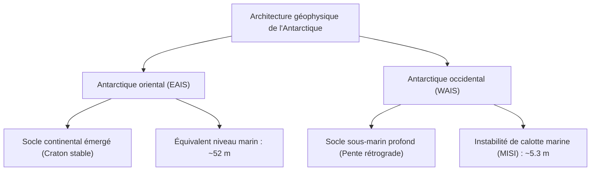
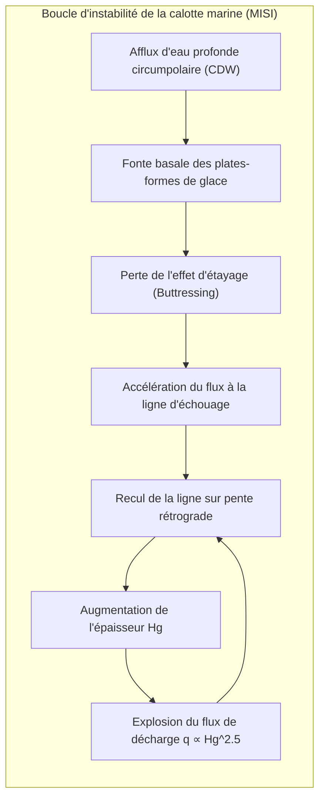

L'Antarctique, vaste masse continentale de 14 millions de kilomètres carrés isolée au pôle Sud, constitue le plus grand réservoir cryosphérique de la planète. Recouvert d'un inlandsis d'une épaisseur moyenne de 2 160 mètres et atteignant localement plus de 4 800 mètres, il concentre environ 90 % de la glace terrestre et 70 % de l'eau douce du globe. Sa fonte intégrale entraînerait une élévation du niveau marin mondial d'environ 58 mètres.

Pourtant, ce continent blanc n'est pas un bloc statique. Il se comporte comme un fluide non newtonien hautement visqueux soumis au fluage plastique sous l'action de son propre poids. Sous quatre kilomètres de glace se cachent des centaines de lacs sous-glaciaires isolés depuis des millions d'années, dont le lac Vostok, où prolifèrent des micro-organismes chimiosynthétiques sous 40 MPa de pression. En périphérie, la formation de l'eau de fond antarctique (AABW) alimente la circulation thermohaline globale.

Cet article explore la dynamique d'écoulement de la glace, la vulnérabilité marine de l'Antarctique occidental, la microbiologie des abysses glaciaires et les 800 000 ans d'histoire climatique inscrits dans les carottes polaires.

---

## 1. Structure géophysique : asymétrie entre Antarctique oriental et occidental

La chaîne Transantarctique sépare le continent en deux entités géophysiques distinctes :
1. <strong>Calotte de l'Antarctique oriental (EAIS)</strong> : Reposant sur un craton précambrien au-dessus du niveau de la mer, c'est une calotte terrestre remarquablement stable. Sur les hauts dômes (Dôme A, Dôme C, Dôme Fuji), les températures descendent sous $-50^\circ\text{C}$ (minimum absolu à $-89{,}2^\circ\text{C}$), maintenant un équilibre thermique pérenne. L'EAIS représente un potentiel d'élévation du niveau marin de <strong>52 mètres</strong>.
2. <strong>Calotte de l'Antarctique occidental (WAIS)</strong> : Une <strong>calotte marine</strong> dont le socle rocheux plonge à plusieurs centaines voire milliers de mètres sous le niveau marin. Ses glaciers reposent sur des <strong>pentes rétrogrades</strong> (le lit s'enfonce vers l'intérieur), ce qui engendre une instabilité mécanique intrinsèque (MISI) capable de libérer l'équivalent de <strong>5,3 mètres</strong> de hausse marine.

---

## 2. Rhéologie de la glace et loi d'écoulement de Glen

La déformation plastique de la glace polycristalline Ih est régie par la <strong>loi d'écoulement de Glen</strong> :

$$\dot{\varepsilon}_{ij} = A(T) \, \tau_e^{n-1} \, \tau_{ij}$$

avec un exposant expérimental $n \approx 3$. Cette non-linéarité implique que doubler la contrainte de cisaillement multiplie la vitesse de déformation par huit ($2^3 = 8$). Sous l'<strong>approximation de la glace peu profonde (SIA)</strong>, l'intégration des contraintes gravitationnelles aboutit au profil parabolique classique de <strong>Vialov-Nye</strong> :

$$h(x) = \left( \frac{2 \tau_0}{\rho_i g} \right)^{1/2} (L - x)^{1/2}$$

---

## 3. Instabilité de calotte marine (MISI) et étayage des plates-formes

Les plates-formes de glace flottantes (*ice shelves*, ex. Ross, Filchner-Ronne) exercent un effort de retenue essentiel par friction latérale contre les parois côtières (<strong>effet d'étayage ou buttressing</strong>).

L'intrusion sous-glaciaire d'eaux profondes circumpolaires chaudes (CDW) fait fondre la base de ces plates-formes. Selon la loi de flux de Christian Schoof (2007), le débit de décharge à la ligne d'échouage est une fonction super-quadratique de l'épaisseur de la glace :

$$q \propto H_g^{\frac{n+3}{n}} \xrightarrow{n=3} q \propto H_g^2 \sim H_g^{2{,}5}$$

Sur un lit rétrograde, le recul de la ligne d'échouage l'enfonce dans des eaux plus profondes ($H_g$ augmente), accélérant le flux d'éjection dans une boucle de rétroaction positive auto-amplifiée (<strong>MISI</strong>).

---

## 4. Le lac sous-glaciaire Vostok et les archives paléoclimatiques

### 4.1 Un écosystème extrême sous 4 000 m de glace

Situé sous 3 750 mètres de glace, le lac Vostok (250 km de long, 1 000 m de profondeur) subit une pression hydrostatique de <strong>40 MPa</strong> dans une obscurité totale depuis plus de 15 millions d'années. L'eau y est hyperoxique en raison de la fusion d'hydrates gazeux sous pression. L'analyse métagénomique de la glace d'accrétion a révélé des bactéries chimio-autotrophes et des séquences thermophiles suggérant un hydrothermalisme de fond, offrant un modèle précieux pour explorer Europe (lune de Jupiter) ou Encelade.

### 4.2 L'eau de fond antarctique (AABW) et 800 000 ans de carottes de glace

Dans les polynies côtières, la congélation rapide rejette une saumure dense (<strong>rejet de saumure / brine rejection</strong>), générant l'<strong>eau de fond antarctique (AABW)</strong> à $-1{,}9^\circ\text{C}$ qui plonge dans les abysses et oxygène les fonds océaniques mondiaux.

Parallèlement, les forages de glace (EPICA Dôme C, 3 270 m) ont permis d'extraire 800 000 ans d'histoire atmosphérique. L'analyse des isotopes stables ($\delta^{18}O, \delta D$) corrélée aux cycles de Milankovitch prouve que le $CO_2$ a fluctué naturellement entre 180 et 280 ppm. Le bond anthropique au-delà de <strong>420 ppm</strong> propulse la Terre dans un territoire climatique inédit. L'Antarctique demeure la sentinelle absolue des équilibres planétaires.