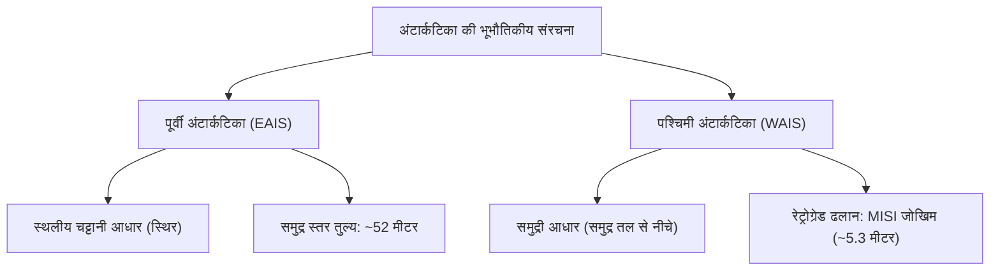
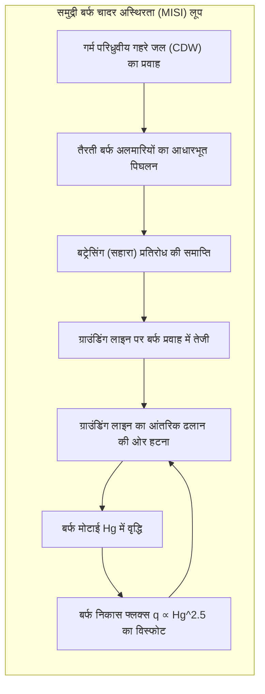

पृथ्वी के दक्षिणी ध्रुव पर स्थित अंटार्कटिका 14 मिलियन वर्ग किलोमीटर क्षेत्रफल में फैला हुआ दुनिया का सबसे विशाल क्रायोस्फेरिक तंत्र है। औसतन 2,160 मीटर और अधिकतम 4,800 मीटर से अधिक मोटी बर्फ की चादर से ढका यह महाद्वीप पृथ्वी की 90 % बर्फ और 70 % ताजे पानी को समाहित किए हुए है। यदि यह पूरी बर्फ पिघल जाए, तो वैश्विक समुद्र का जलस्तर लगभग 58 मीटर ऊपर उठ जाएगा।

किंतु अंटार्कटिका कोई स्थिर जड़ बर्फ का टुकड़ा नहीं है। गुरुत्वाकर्षण, भू-तापीय ताप और आधारभूत जल दबाव के अधीन, यह बर्फ हजारों वर्षों में विस्कोप्लास्टिक गैर-न्यूटनियन तरल की तरह धीरे-धीरे बहती है। चार किलोमीटर बर्फ के नीचे 400 से अधिक उप-हिमनदी झीलें (Subglacial Lakes) छिपी हैं, जिनमें सबसे प्रमुख वोस्तोक झील है जहाँ 40 MPa के अत्यधिक दबाव और पूर्ण अंधकार में रसायन-संश्लेषी सूक्ष्मजीव जीवित हैं। इसके तटों पर अंटार्कटिक बॉटम वॉटर (AABW) का निर्माण वैश्विक महासागरीय परिसंचरण को संचालित करता है।

यह लेख बर्फ के विरूपण भौतिकी, समुद्री बर्फ अस्थिरता, वोस्तोक झील की चरम पारिस्थितिकी और 800,000 वर्षों के बर्फ कोर जलवायु रिकॉर्ड का गहन विश्लेषण प्रस्तुत करता है।

---

## 1. भूभौतिकीय संरचना: पूर्वी बनाम पश्चिमी अंटार्कटिका

ट्रांस-अंटार्कटिक पर्वतमाला महाद्वीप को दो भिन्न भागों में विभाजित करती है:
1. <strong>पूर्वी अंटार्कटिक बर्फ की चादर (EAIS)</strong>: समुद्र तल से ऊपर स्थित प्राचीन क्रेटन पर टिकी स्थलीय बर्फ की चादर। इसके आंतरिक पठारों (डोम ए, डोम सी, डोम फुजी) पर तापमान $-50^\circ\text{C}$ से नीचे रहता है (न्यूनतम $-89{,}2^\circ\text{C}$)। यह अत्यधिक स्थिर है और समुद्र के जलस्तर में <strong>52 मीटर</strong> की संभावित वृद्धि का प्रतिनिधित्व करती है।
2. <strong>पश्चिमी अंटार्कटिक बर्फ की चादर (WAIS)</strong>: एक <strong>समुद्री बर्फ की चादर</strong> जिसका चट्टानी तल समुद्र तल से सैकड़ों मीटर नीचे है और इसकी ढलान अंदर की ओर गहरी (<strong>रेट्रोग्रेड बेड स्लोप</strong>) है। यह ज्यामिति समुद्री बर्फ चादर अस्थिरता (MISI) को जन्म देती है, जो समुद्र के स्तर को <strong>5.3 मीटर</strong> तक बढ़ाने का गंभीर खतरा उत्पन्न करती है।

---

## 2. ग्लेन का प्रवाह नियम और समुद्री बर्फ चादर अस्थिरता (MISI)

बर्फ का प्लास्टिक विरूपण <strong>ग्लेन के प्रवाह नियम (Glen's Flow Law)</strong> द्वारा नियंत्रित होता है:

$$\dot{\varepsilon}_{ij} = A(T) \, \tau_e^{n-1} \, \tau_{ij}$$

जहाँ प्रतिबल घातांक $n \approx 3$ है। इसका अर्थ है कि अपरूपण प्रतिबल दोगुना होने पर विरूपण की दर आठ गुना ($2^3 = 8$) बढ़ जाती है।

<strong>उथली बर्फ सन्निकटन (SIA)</strong> के तहत बर्फ की सतह का प्रोफाइल <strong>वियालोव-नाई (Vialov-Nye)</strong> परवलयिक रूप लेता है:

$$h(x) = \left( \frac{2 \tau_0}{\rho_i g} \right)^{1/2} (L - x)^{1/2}$$

तैरने वाली बर्फ की अलमारियां (Ice Shelves) पीछे की बर्फ को रोकने वाला यांत्रिक प्रतिरोध (<strong>बट्रेसिंग प्रभाव / Buttressing</strong>) प्रदान करती हैं। जब गर्म समुद्री धाराएं (CDW) इन अलमारियों को नीचे से पिघलाती हैं, तो यह सहारा ढह जाता है। क्रिश्चियन शूफ़ (2007) के अनुसार ग्राउंडिंग लाइन पर बर्फ का निकास प्रवाह बर्फ की मोटाई पर अत्यधिक गैर-रैखिक रूप से निर्भर करता है:

$$q \propto H_g^{\frac{n+3}{n}} \xrightarrow{n=3} q \propto H_g^2 \sim H_g^{2{,}5}$$

रेट्रोग्रेड ढलानों पर ग्राउंडिंग लाइन पीछे हटने से बर्फ की मोटाई $H_g$ बढ़ती है, जिससे बर्फ के बहिर्वाह में स्वतः-त्वरित अपरिवर्तनीय पतन (<strong>MISI</strong>) शुरू हो जाता है।

---

## 3. उप-हिमनदी वोस्तोक झील और 800,000 वर्षों का बर्फ कोर रिकॉर्ड

वोस्तोक झील (लंबाई 250 किमी, गहराई 1,000 मीटर) 3,750 मीटर बर्फ के नीचे 40 MPa दबाव और पूर्ण अंधकार में लाखों वर्षों से सील है। इसके अभिवृद्धि बर्फ (accretion ice) नमूनों के मेटाजीनोमिक विश्लेषण से कीमोलिथोऑटोट्रॉफ़िक जीवाणुओं और हाइड्रोथर्मल संकेतों का पता चला है, जो बृहस्पति के चंद्रमा यूरोपा और शनि के एन्सेलैडस के बर्फीले महासागरों में जीवन की खोज के लिए एक महत्वपूर्ण मॉडल प्रस्तुत करते हैं।

तटीय पोलिन्या में समुद्री बर्फ बनने के दौरान नमक बाहर निकलने की प्रक्रिया (<strong>ब्राइन रिजेक्शन / Brine Rejection</strong>) से $-1{,}9^\circ\text{C}$ का अत्यंत सघन <strong>अंटार्कटिक बॉटम वॉटर (AABW)</strong> बनता है, जो वैश्विक महासागरों के गहरे तलों को ऑक्सीजन पहुंचाता है।

EPICA डोम सी (3,270 मीटर) बर्फ कोर में जल समस्थानिकों ($\delta^{18}O, \delta D$) और वायु बुलबुलों के विश्लेषण ने मिलानकोविच खगोलीय चक्रों के साथ ग्रीनहाउस गैसों के पूर्ण तालमेल को सिद्ध किया। 800,000 वर्षों तक $CO_2$ की सांद्रता 180 से 280 ppm के बीच रही, जबकि आधुनिक मानव गतिविधियों ने इसे <strong>420 ppm से अधिक</strong> पहुंचा दिया है। अंटार्कटिका पृथ्वी के जलवायु संतुलन का सबसे महत्वपूर्ण प्रहरी है।