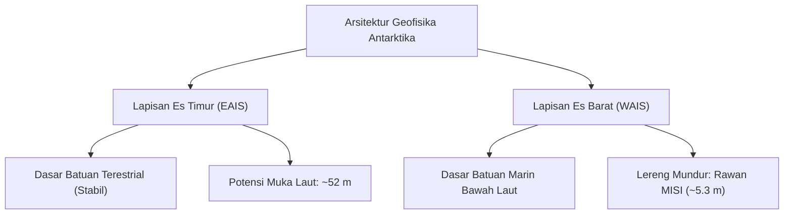
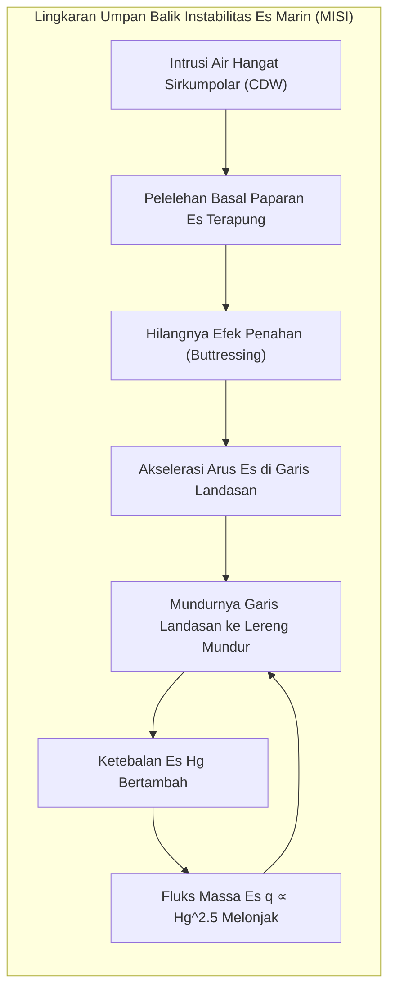

Terisolasi di ujung selatan Bumi, Antarktika merupakan reservoir kriosfer raksasa yang mencakup area seluas 14 juta kilometer persegi. Diselimuti oleh lapisan es dengan ketebalan rata-rata 2.160 meter dan ketebalan maksimum lebih dari 4.800 meter, benua ini mengunci sekitar 90 % es glasial dunia dan 70 % cadangan air tawar bumi. Jika seluruh lapisan es ini mencair, permukaan laut global akan naik setinggi sekitar 58 meter, menenggelamkan garis pantai peradaban manusia.

Namun, es Antarktika bukanlah massa statis yang membeku mati. Di bawah pengaruh gravitasi, panas bumi, dan tekanan air basal, es mengalir sebagai fluida non-Newtonian viskoplastik selama puluhan ribu tahun. Di kedalaman empat kilometer di bawah es tersembunyi lebih dari 400 danau subglasial terisolasi, terutama Danau Vostok, di mana mikroba kemolitotrof bertahan hidup dalam kegelapan abadi di bawah tekanan hidrostatis 40 MPa. Di pesisirnya, pembentukan Air Dasar Antarktika (AABW) menggerakkan sirkulasi termohalin laut global.

Artikel ini menyajikan kajian mendalam mengenai reologi es, instabilitas es marin, ekologi subglasial, perbandingan logistik ekspedisi Amundsen-Scott, dan arsip inti es 800.000 tahun.

---

## 1. Arsitektur Geofisika: Antarktika Timur vs Barat

Pegunungan Transantartika membagi benua menjadi dua domain yang sangat berbeda:
1. <strong>Lapisan Es Antarktika Timur (EAIS)</strong>: Lapisan es terestrial yang bertumpu pada kraton purba di atas permukaan laut. Di kubah pedalaman (Dome A, Dome C, Dome Fuji), suhu rata-rata di bawah $-50^\circ\text{C}$ (rekor terendah $-89{,}2^\circ\text{C}$), memberikan stabilitas termodinamika yang sangat tinggi. EAIS menyimpan potensi kenaikan muka laut sebesar <strong>52 meter</strong>.
2. <strong>Lapisan Es Antarktika Barat (WAIS)</strong>: Merupakan <strong>lapisan es marin</strong> di mana dasar batuannya berada ratusan hingga ribuan meter di bawah permukaan laut dengan kemiringan <strong>lereng mundur (retrograde bed slope)</strong>. Geometri ini memicu Ketidakstabilan Lapisan Es Marin (MISI) yang rentan runtuh dan menaikkan laut sebesar <strong>5,3 meter</strong>.

---

## 2. Reologi Es Glen dan Ketidakstabilan Es Marin (MISI)

Deformasi plastis es polikristalin Ih tunduk pada <strong>hukum aliran Glen (Glen's Flow Law)</strong>:

$$\dot{\varepsilon}_{ij} = A(T) \, \tau_e^{n-1} \, \tau_{ij}$$

dengan eksponen tegangan empiris $n \approx 3$. Hubungan non-linear kubik ini berarti bahwa penggandaan tegangan geser mempercepat laju regangan sebesar delapan kali lipat ($2^3 = 8$).

Berdasarkan <strong>Aproksimasi Es Dangkal (SIA)</strong>, integrasi tegangan menghasilkan profil permukaan parabolik <strong>Vialov-Nye</strong>:

$$h(x) = \left( \frac{2 \tau_0}{\rho_i g} \right)^{1/2} (L - x)^{1/2}$$

Paparan es terapung (*ice shelves*) memberikan gaya penahan mekanis yang vital (<strong>efek buttressing</strong>). Ketika arus laut dalam sirkumpolar yang hangat (CDW) mencairkan dasar paparan es, penahan ini lenyap. Menurut hukum fluks Christian Schoof (2007):

$$q \propto H_g^{\frac{n+3}{n}} \xrightarrow{n=3} q \propto H_g^2 \sim H_g^{2{,}5}$$

Pada lereng dasar mundur, mundurnya garis landasan (*grounding line*) masuk ke perairan yang lebih dalam ($H_g$ membesar), melipatgandakan debit pengeluaran es dalam siklus umpan balik positif yang tak terhentikan (<strong>MISI</strong>).

---

## 3. Danau Subglasial Vostok dan Rekaman Inti Es 800.000 Tahun

Danau Vostok membentang sepanjang 250 km dengan kedalaman 1.000 m di bawah 3.750 m es pada tekanan hidrostatis 40 MPa. Analisis metagenomik es akresi menemukan bakteri kemolitotrof dan jejak hidrotermal, menjadikannya analogi utama untuk eksplorasi kehidupan di laut es Europa (bulan Jupiter) dan Enceladus (bulan Saturnus).

Di pesisir Antarktika, proses pelepasan garam pekat saat pembentukan es laut (<strong>penolakan air garam / brine rejection</strong>) di polinya menghasilkan <strong>Air Dasar Antarktika (AABW)</strong> yang sangat padat pada suhu $-1{,}9^\circ\text{C}$, mengalir ke dasar samudra dunia untuk mengoksigenasi biosfer bentik.

Melalui pengeboran inti es EPICA Dome C (3.270 m), analisis isotop air ($\delta^{18}O, \delta D$) dan gas terjebak ($CO_2, CH_4$) membuktikan keterikatan iklim purba dengan siklus astronomi Milankovitch. Selama 800.000 tahun, $CO_2$ berosilasi alami antara 180 dan 280 ppm. Lonjakan aktivitas manusia saat ini melampaui <strong>420 ppm</strong> membawa Bumi keluar dari koridor kesetimbangan Kuarter. Antarktika adalah benteng dan saksi kunci kelangsungan iklim planet kita.