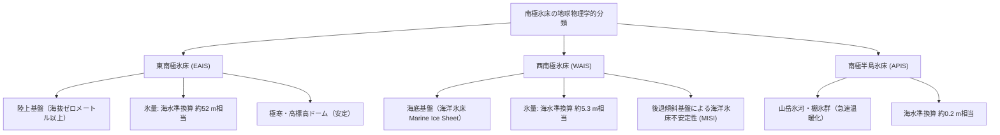
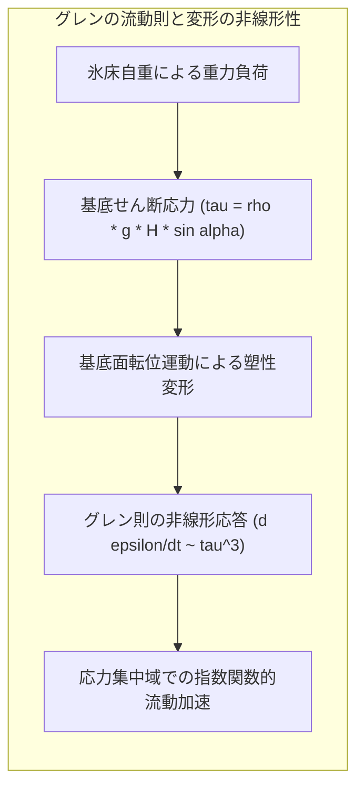
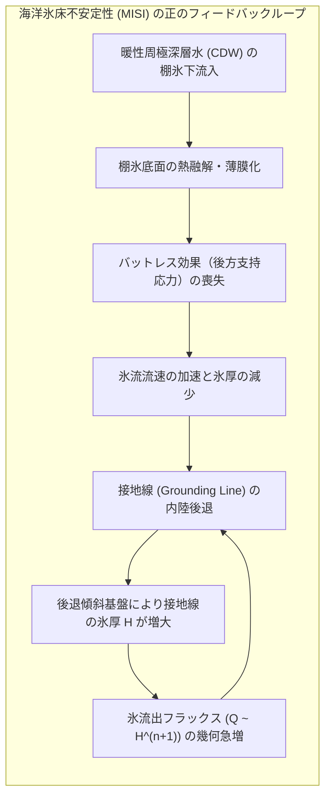
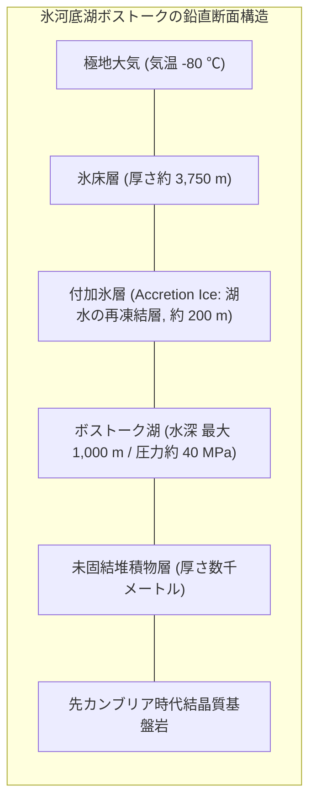
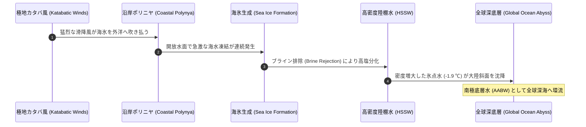
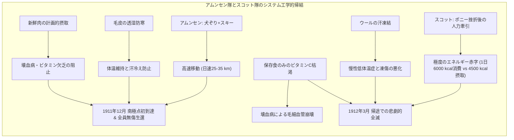
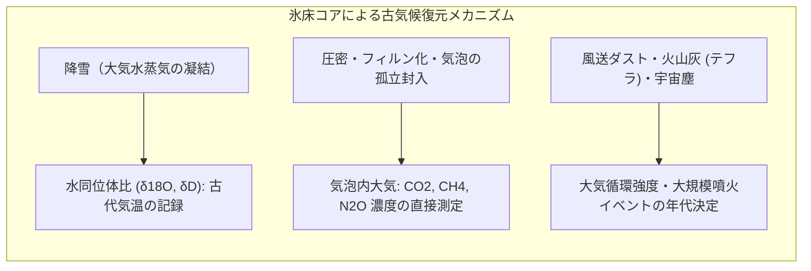

地球の最南端に孤立する巨大な白色の大陸、南極。面積約1,400万平方キロメートル（オーストラリア大陸の約2倍、日本列島の約37倍）に及ぶこの極限の陸地は、平均層厚2,160メートル、最大層厚4,800メートルに達する長大な氷の衣、すなわち「氷床（Ice Sheet）」に覆われています。この南極氷床には、地球上に存在する全氷量の約90%、全淡水資源の約70%が凝縮されており、仮にそのすべてが融解した場合、全球の平均海水準を約58メートル上昇させる潜在エネルギーを秘めています。

しかし、南極大陸は単なる冷たく凍てついた静止した氷の塊ではありません。内部では重力と地熱、基底水圧によって氷が数万年をかけて流動する巨大な非線形レオロジー運動が繰り広げられており、その深部には数百万年間外界から隔絶された「氷河底湖（Subglacial Lakes）」と超高圧・暗黒の極限微生物生態系が存在します。さらに、大陸を取り囲む南大洋では地球最大規模の熱塩循環の原動力である「南極底層水（AABW）」が絶え間なく生成され、全球の気候システムと深海生態系の命運を握っています。

本稿では、氷河物理学（グレンの流動則・氷床安定性理論）、極限環境生物学（ボストーク湖の生命探査）、極地海洋学（深層水形成と棚氷の相互作用）、極地探検史（英雄時代の科学技術的比較）、そして80万年に及ぶ氷床コア同位体解析に基づく古気候復元まで、南極大陸をめぐる科学の最前線を学術的・定量的に徹底解剖します。

---

## 1. 南極氷床の地球物理学的構造：東南極と西南極の根本的非対称性

南極大陸の氷床を理解する上で最も決定的な前提は、南極横断山脈（Transantarctic Mountains）を境界として大陸が<strong>東南極氷床（EAIS: East Antarctic Ice Sheet）</strong>と<strong>西南極氷床（WAIS: West Antarctic Ice Sheet）</strong>という、物理的性質が根本から異なる二つの領域に二分されているという事実です。

### 1.1 東南極氷床（EAIS）：古生代安定陸塊の巨大シールド

東南極氷床は面積約1,000万平方キロメートル、平均標高3,000メートルを超える地球最大の氷の山脈です。その基盤岩（Bedrock）の大部分は海抜ゼロメートル以上の強固な原生代・古生代クラトン（安定地塊）の上に直接載っており、地質学的に「陸上氷床（Terrestrial Ice Sheet）」に分類されます。

内陸部のドームA（標高4,093m）やドームC、ドームふじ（標高3,810m）では、年間平均気温が $-50^\circ\text{C}$ を下回り、降雪量は水換算で年間わずか数センチメートルという「氷の砂漠」です。この超低温環境のため、氷床表面での融解は実質的に皆無であり、極めて高い熱的・構造的安定性を維持しています。東南極の全氷量は、海水準換算でおよそ<strong>52メートル分</strong>に相当します。

### 1.2 西南極氷床（WAIS）：脆弱な海洋氷床（Marine Ice Sheet）

これに対し、西南極氷床は面積約200万平方キロメートルでありながら、現在の気候科学において最も差し迫った破滅的リスクとして注視されています。その理由は、基盤岩の大部分が海面下数百メートルから2,000メートル以上も深い海底盆地（トレンチ）に沈んでいる<strong>海洋氷床（Marine Ice Sheet）</strong>だからです。

氷床の重みによって地殻がアイソスタシー（地殻均衡）沈降しているだけでなく、多くの領域で内陸に向かうほど基盤が深くなる<strong>後退傾斜基盤（Retrograde Bed Slope）</strong>の幾何構造を持っています。この幾何構造は、後述する「海洋氷床不安定性（MISI）」を引き起こす決定的な物理的脆弱性を内包しています。西南極氷床の氷量は、海水準換算で約<strong>5.3メートル分</strong>に達します。

---

## 2. 氷床流動の物理学：非線形レオロジーと力学的平衡

氷床は一見静止した固体に見えますが、巨視的スケールでは自重によるせん断応力によって塑性変形し、内陸の高地から海岸線に向かって徐々に流動する極めて粘性の高い非ニュートン流体として振る舞います。

### 2.1 多結晶氷の結晶構造とグレンの流動則（Glen's Flow Law）

氷床を構成する氷は、水分子が水素結合によって六方晶系の結晶格子を形成した多結晶体（氷Ih相）です。せん断応力が加わると、結晶格子の底面（基底面）に沿って転位が運動することでクリープ（塑性流動）が生じます。

氷河物理学において、多結晶氷のひずみ速度テンソル $\dot{\varepsilon}_{ij}$ と偏差応力テンソル $\tau_{ij}$ の関係は、実験的に確立された<strong>グレンの流動則（Glen's Flow Law）</strong>によって記述されます：

$$\dot{\varepsilon}_{ij} = A(T, P) \, \tau_e^{n-1} \, \tau_{ij}$$

ここで、$n$ は応力指数であり、天然の氷床では実験的・観測的におおむね $n \approx 3$ とされます。$\tau_e$ は第二応力不変量から定義される有効せん断応力（Effective Shear Stress）です：

$$\tau_e = \sqrt{\frac{1}{2} \sum_{i,j} \tau_{ij}^2}$$

流動パラメータ $A(T, P)$ は氷の温度 $T$ と静水圧 $P$ に強く依存し、アレニウスの式に従います：

$$A(T) = A_0 \exp\left( -\frac{Q}{R T} \right)$$

ここで、$Q$ はクリープの活性化エネルギー（$T < -10^\circ\text{C}$ で約 $60\,\text{kJ/mol}$、$T \ge -10^\circ\text{C}$ で約 $139\,\text{kJ/mol}$）、$R$ は気体定数です。この非線形な指数 $n \approx 3$ により、応力が2倍になるとひずみ速度（変形速度）は $2^3 = 8$ 倍に急増します。すなわち、氷床は応力が集中する底部や氷河の合流部で急激に軟化し、高速流動を引き起こす性質を持っています。

### 2.2 シャローアイス近似（SIA）と氷床表面形状の理論解

氷床の水平スケール（数千キロメートル）は、その鉛直厚さ（数キロメートル）に比べて3桁以上大きいため、縦横比 $\delta = H / L \ll 1$ の極限を適用する<strong>シャローアイス近似（Shallow Ice Approximation: SIA）</strong>が成立します。

SIAの下では、氷床内部のせん断応力 $\tau_{xz}$ は局所的な氷の厚さ $H$ と表面勾配 $\frac{\partial h}{\partial x}$ にのみ支配されます：

$$\tau_{xz}(z) = -\rho_i g (h - z) \frac{\partial h}{\partial x}$$

ここで、$\rho_i \approx 917\,\text{kg/m}^3$ は氷の密度、$g$ は重力加速度、$h(x)$ は氷床表面標高、$z$ は垂直座標です。底面すべりがない理想的な一次元平坦基盤上の定常氷床を仮定すると、ヴィールトマン（Weertman）やナイ（Nye）の導出により、氷床の表面プロファイルは放物線型の解析解（ヴィールトマン・プロファイル）に収束します：

$$h(x) = \left( \frac{2 \tau_0}{\rho_i g} \right)^{1/2} (L - x)^{1/2}$$

この平方根プロファイルは、実際の東南極氷床の内陸ドームから沿岸にかけての観測標高プロファイルと驚くほど高精度で一致します。

---

## 3. 海洋氷床不安定性（MISI）と棚氷のバットレス効果

西南極氷床の将来予測において、地球温暖化がもたらす最大の懸念事項が「棚氷の崩壊」とそれに伴う「海洋氷床不安定性」の連鎖です。

### 3.1 棚氷（Ice Shelf）のバットレス効果（Buttressing Effect）

氷床が沿岸部に到達すると、氷は海上に押し出されて海上に浮かぶ巨大な氷の板、すなわち<strong>棚氷（Ice Shelf）</strong>を形成します（代表例：ロス棚氷、フィルヒナー・ロンネ棚氷）。

棚氷自体はすでに海に浮いているため、アルキメデスの原理により、棚氷そのものが融解しても直接の海水準上昇はゼロです。しかし、棚氷は力学的に極めて重要な役割を果たしています。棚氷が沿岸の島々（アイスライズ）やフィヨルドの側壁と摩擦接触することで、内陸から押し寄せる氷流に対して巨大な押し戻す力、すなわち<strong>バットレス効果（後方支持抵抗力）</strong>を発揮しているのです。

棚氷が存在することで、内陸氷床の海への流出速度は強くせき止められています。もし棚氷が薄氷化あるいは崩壊してこのバットレス効果が消失すると、コルク栓を抜いたボトルのように内陸の氷河が一気に加速して海へと崩落します。

### 3.2 接地線（Grounding Line）の後退と流出フラックスの非線形性

氷床が海底基盤に接触している最後の境界線を<strong>接地線（Grounding Line）</strong>と呼びます。海洋氷床力学の基礎理論（Schoof, 2007）によれば、接地線を通過して海へと流出する単位幅あたりの氷の質量フラックス $q$ は、接地線における氷の厚さ $H_g$ の強い非線形関数として表されます：

$$q \propto H_g^{\frac{n+3}{n}} \xrightarrow{n=3} q \propto H_g^{2.0} \sim H_g^{2.5}$$

基盤が海側に向かって低くなっている通常の順傾斜基盤であれば、氷床が後退すると接地線の水深が浅くなり、$H_g$ が減少するため流出フラックス $q$ が減少して自己安定化します。

しかし、西南極のパインアイランド氷河やスウェイツ氷河（いわゆる「終末の氷河 / Doomsday Glacier」）のように、<strong>内陸に向かって海底が深くなる後退傾斜基盤（Retrograde Bed）</strong>では、接地線がひとたび後退し始めると、後退するほど水深が深くなり、$H_g$ が増大します。その結果、流出フラックス $q$ が加速度的に増大し、外力の後押しがなくても氷床が自律的かつ不可逆的に崩壊し続ける<strong>海洋氷床不安定性（MISI: Marine Ice Sheet Instability）</strong>の暴走ループに突入するのです。

---

## 4. 氷河底湖ボストーク：暗黒と超高圧に閉ざされた極限生態系

氷床の底部は、すべてが凍りついているわけではありません。上部の数千メートルにおよぶ氷の断熱効果と、地球内部からの地殻熱流量（約 $50 - 80\,\text{mW/m}^2$）、さらに氷の巨大な静水圧によって氷の融点が低下（クラウジウス・クラペイロンの式により、約 $-2^\circ\text{C}$ 付近まで低下）することにより、氷床底部には広大な淡水の水文ネットワークが存在します。

現在、南極全土で400以上の<strong>氷河底湖（Subglacial Lakes）</strong>がレーダー探査（RES）によって確認されています。その中で圧倒的な規模を誇るのが、ロシアのボストーク基地直下に横たわる<strong>ボストーク湖（Lake Vostok）</strong>です。

### 4.1 ボストーク湖の物理化学的極限環境

ボストーク湖は長さ約250キロメートル、幅約50キロメートル、面積約12,500平方キロメートル（琵琶湖の約19倍）に達し、最大水深は1,000メートルを超えます。その環境は、地球上で最も過酷かつ異質な生物生息域の一つです：

1. <strong>超高圧環境</strong>: 上部にある約3,750メートルの氷床の自重により、湖水内の静水圧は<strong>約40 MPa（約400気圧）</strong>に達します。
2. <strong>完全なる暗黒</strong>: 数百万年間、太陽光が1光子も届いたことがなく、光合成に基づく一次生産は物理的に不可能です。
3. <strong>過剰な溶存酸素</strong>: 上部氷床が融解する際、氷河氷の中に高圧で閉じ込められていた空気クラスレート（ガスハイドレート）が湖水に直接放出されるため、溶存酸素濃度は通常の淡水の約50倍という超好気性（酸化ストレス）環境を形成しています。
4. <strong>数百万年の隔離</strong>: 周囲の氷床流動と孤立した地質学的断層により、少なくとも1,500万年以上にわたり地表大気から完全に隔離されてきたと推定されています。

### 4.2 付加氷（Accretion Ice）コアから検出された未知の生命群

1990年代後半から2010年代にかけ、ロシアの研究チームは湖水面直上約100メートルまで掘削を進め、湖水が氷床底面に再凍結して形成された「付加氷（Accretion Ice）」のコアサンプルを採取しました。

メタゲノム解析および16S rRNA遺伝子シーケンシングの結果、この極限環境から以下のような驚異的な微生物コンソーシアム（群集）の痕跡が同定されました：
- <strong>化学合成独立栄養細菌</strong>: 硫黄や鉄の酸化、あるいは水素と二酸化炭素からのメタン生成（メタン菌）によってエネルギーを獲得する独立栄養微生物。
- <strong>好冷・好圧菌（Psychrophiles / Piezophiles）</strong>: 細胞膜の不飽和脂肪酸比率を高めて流動性を維持し、低温下でも柔軟性を保つ特殊な低温活性酵素を進化させた真正細菌および古細菌。
- <strong>好熱性菌のシグネチャ</strong>: 驚くべきことに、好熱性細菌（*Dictyoglomus* 等）のDNA断片も検出されており、これはボストーク湖の底部に深海熱水噴出孔のような地熱活動が存在することを示唆しています。

### 4.3 宇宙生物学（アストロバイオロジー）のアナログ

ボストーク湖の研究は、地球外生命探査のフロンティアと直結しています。木星の衛星<strong>エウロパ（Europa）</strong>や土星の衛星<strong>エンケラドゥス（Enceladus）</strong>は、厚さ数キロメートルから数十キロメートルの氷外殻の下に広大な「内部海（Subsurface Ocean）」を抱えています。

日光が一切届かず、高圧で極寒の氷下海洋において、地熱や岩石-水相互作用（蛇紋岩化反応など）をエネルギー源として生命が持続可能であるかという問いに対し、ボストーク湖は地球上で唯一アクセス可能な天然の実験室を提供しています。

---

## 5. 南極底層水（AABW）の生成と全球熱塩循環

南極を取り囲む南大洋（Southern Ocean）は、地球全体の海洋大循環（熱塩循環・ブロッカーの海洋コンベアベルト）の最大の心臓部です。ここで形成される世界で最も冷たく密度の高い海水が、<strong>南極底層水（AABW: Antarctic Bottom Water）</strong>です。

### 5.1 ポリニヤとブライン排除（Brine Rejection）の熱力学

AABWの主な生成現場は、ウェッデル海、ロス海、アデリー海岸などの沿岸部です。ここでは、南極内陸の高地から吹き降ろす超強力な下降風「<strong>カタバ風（滑降風）</strong>」が、沿岸に張った海氷を外洋へと猛烈な勢いで押し流します。これにより、氷点下の極寒大気中に海面が露出した不凍水域「<strong>沿岸ポリニヤ（Coastal Polynya）</strong>」が維持されます。

ポリニヤでは、大気への猛烈な熱放出（数百 $\text{W/m}^2$）によって海水が次々と凍結します。水が氷（海氷）の結晶格子を形成する際、塩分（$Na^+, Cl^-$ 等のイオン）は結晶の外へと激しく排出されます。この物理プロセスを<strong>ブライン排除（Brine Rejection / 凍結脱塩）</strong>と呼びます。

排出された濃厚な濃縮塩水（ブライン）は、周囲の海水と混ざり合って水温約 $-1.9^\circ\text{C}$（海水の凝固点）、塩分 $34.7\,\text{PSU}$ 以上の極めて重い<strong>高密度陸棚水（HSSW: High Salinity Shelf Water）</strong>を形成します。

### 5.2 大陸斜面の滑降と全球気候の安定化

密度を極限まで高めたHSSWは、自重によって南極大陸の急峻な大陸斜面を海底滝のように流れ下り、周囲の深層水を取り込みながら海底最深部へと到達します。これが<strong>南極底層水（AABW）</strong>です。

AABWは、ポテンシャル密度 $\sigma_\theta > 27.88\,\text{kg/m}^3$ を誇り、大西洋、インド洋、太平洋の三大洋の海底谷を這うようにして北半球高緯度へ向かって数百年から千年以上のタイムスケールで移動します。この過程で：
1. 莫大な熱エネルギーと人為起源の二酸化炭素（$CO_2$）を深海に隔離・貯留する。
2. 酸素に富んだ表層水を深海底へと供給し、全球の深海生態系を呼吸させる。

近年の観測では、南極周辺の氷床融解水の流入によって沿岸の塩分が低下し、AABWの生成量が過去数十年間で急減（一部海域で30%以上減少）していることが確認されており、全球的な気候暴走や熱塩循環停止のトリガーとして深刻な警戒がなされています。

---

## 6. 極地探検の英雄時代：アムンセンとスコットの科学技術的対比

20世紀初頭、地理的発見の最後の空白地帯であった南極点（南緯90度）への到達をめぐり、人類史に刻まれる壮絶なドラマが展開されました。1911年から1912年にかけて繰り広げられたノルウェーの<strong>ロアール・アムンセン（Roald Amundsen）</strong>と英国の<strong>ロバート・ファルコン・スコット（Robert Falcon Scott）</strong>の競争は、極限環境における「科学技術の選択」「ロジスティクス」「組織論」の決定的なケーススタディとして語り継がれています。

| 比較項目 | ロアール・アムンセン（ノルウェー隊） | ロバート・ファルコン・スコット（英国隊） |
|---|---|---|
| <strong>基本思想</strong> | 先住民族（イヌイット）の技術体系の徹底適用 | 英国海軍の伝統、機械化と科学観測の融合 |
| <strong>主動力・移動手段</strong> | グリーンランド犬52頭による犬ぞり＋熟練スキー | マンチェスター製雪上車、満州産ポニー、最終的人力牽引 |
| <strong>防寒装備</strong> | アザラシ・トナカイの毛皮（通気性と透湿性、凍結防止） | バーバリー社製高密度織物（ウール＋ギャバジン、汗冷え凍結） |
| <strong>食料・カロリー計画</strong> | ペミカン、ビスケット、チョコレート、新鮮な犬肉（ビタミンC補給） | 定量ペミカン、ビスケット（重度のカロリー不足、壊血病発症） |
| <strong>ルート戦略</strong> | クジラ湾（鯨湾）発、未知のアクセル・ハイバーグ氷河横断 | マクマード発、シャクルトンが開拓したベアードモア氷河ルート |
| <strong>南極点到達日</strong> | <strong>1911年12月14日</strong>（無傷で全員無事生還） | <strong>1912年1月17日</strong>（34日遅れ、帰路全員遭難死） |

### 6.1 ロジスティクスの敗因：カロリー計算と熱力学的欠陥

スコット隊の悲劇は、運命や天候のみによるものではなく、ロジスティクスの定量的な計算ミスに起因していました。

標高3,000メートルを超える極寒の南極高原において、ソリを自力で牽引する人間のエネルギー消費量は1日あたり<strong>6,000〜7,000 kcal</strong>に達します。しかし、スコット隊の配給食料は1日あたり約<strong>4,500 kcal</strong>しか供給できず、毎日1,500 kcal以上の不可逆的な生理的赤字（自己の筋肉組織と脂肪の分解）に陥っていました。

さらに、ビタミンCの存在が科学的に解明されていなかった当時、加熱処理された缶詰と乾燥ビスケットに頼ったスコット隊は潜行性の<strong>壊血病</strong>を発症し、毛細血管の脆弱化と極度の疲労が彼らの歩行を停止させました。対照的に、アムンセンは犬の肉を計画的に消費することで、極寒下で必須となるビタミンCと新鮮な脂質を十二分に補給し続けたのです。

### 6.2 南極条約（1959年）への遺産

スコット隊は死の直前まで地質学的標本（グロッソプテリス植物化石など16 kg）をソリに載せて引き続けました。この化石は後に、南極大陸がかつて南半球の超大陸「ゴンドワナ大陸」の一部であったことを証明する決定打となりました。

英雄時代の探検者たちの犠牲と科学探究の精神は、1957-1958年の国際地球観測年（IGY）を経て、1959年の<strong>南極条約（Antarctic Treaty）</strong>へと結実しました。軍事利用の禁止、領有権主張の凍結、科学的調査の自由と国際協力を定めたこの条約により、南極は人類史上唯一、「平和と科学に捧げられた共有の大陸」として保全されています。

---

## 7. 氷床コア古気候学：80万年の地球環境タイムカプセル

南極氷床の内陸ドームに降り積もる雪は、一度も融解することなく数万年、数十万年にわたって自重で圧縮され、徐々に密度を高めてフィルン（万年雪）から固体の氷へと変化します。この過程で、降り積もった当時の大気が氷の気泡（Air Bubbles）として完全に密閉されます。

南極の氷床コアは、過去の地球の<strong>大気組成そのものを直接採取できる地球上で唯一無二のタイムカプセル</strong>です。

### 7.1 水同位体比温度計（$\delta^{18}O, \delta D$）の物理化学原理

氷（$H_2O$）を構成する水素と酸素には、質量の異なる安定同位体が存在します：
- 酸素同位体: $^{16}O$（軽水分子 $H_2^{16}O$）と $^{18}O$（重水分子 $H_2^{18}O$）
- 水素同位体: $^1H$ と $^2H$（デューテリウム $D$、$HD^{16}O$）

標準平均海水（VSMOW）に対する同位体比の偏差は、パーミル（$‰$）単位のデルタ値として定義されます：

$$\delta = \left( \frac{R_{\text{sample}}}{R_{\text{VSMOW}}} - 1 \right) \times 1,000 \quad [‰]$$

低緯度の海洋から蒸発した水蒸気が極地へと輸送される過程で、重い水分子（$H_2^{18}O$ や $HD^{16}O$）は蒸気圧が低いため優先的に凝縮して雨や雪として脱落します（<strong>レイリー分別 / Rayleigh Fractionation</strong>）。

気温が低ければ低いほど、水蒸気雲から重い同位体が搾り取られた後の極限状態で降雪が生じるため、氷床コア中の $\delta^{18}O$ および $\delta D$ は著しく低下（負に大きな値）します。経験的・理論的に、南極内陸部では次の高精度な線形関係が成立します：

$$\Delta T_{\text{surface}} \approx \alpha \, \Delta(\delta D) \quad (\alpha \approx 0.12 \sim 0.16 \, \text{K}/‰)$$

これにより、氷の同位体比を質量分析計で測定するだけで、過去数十万年間の地表気温の変動を絶対目盛りで復元することが可能となりました。

### 7.2 80万年間の気候同期：ミランコビッチ・サイクルと温室効果ガス

欧州のEPICAドームC掘削プロジェクト（深度3,270m、過去80万年）および日本のドームふじプロジェクト（深度3,035m、過去72万年）の氷床コア分析は、地球気候史に関するパラダイムシフトをもたらしました：

1. <strong>温室効果ガスと気温の完全同期</strong>: 過去80万年間の8回の氷期-間氷期サイクルを通じて、大気中二酸化炭素（$CO_2$）濃度は、氷期の約 $180\,\text{ppm}$ から間氷期の約 $280\,\text{ppm}$ の範囲内を極めて精密に往復していました。この自然の変動幅に対し、産業革命以降の人類活動はわずか200年足らずで $CO_2$ 濃度を <strong>$420\,\text{ppm}$ 超</strong>へと急上昇させました。現在の温室効果ガス水準は、過去数百万年間で前例のない未知の領域に突入しています。
2. <strong>ミランコビッチ・サイクル（Milankovitch Cycles）の証明</strong>: 氷床コアに記録された10万年周期（離心率）、4.1万年周期（地軸傾斜角）、2.3万年・1.9万年周期（歳差運動）の気候振動は、地球の軌道要素の周期的変化が入射日射量を変化させ、それが氷床のアルベドフィードバックと炭素循環によって増幅されるというミランコビッチ理論を完璧に裏付けました。

---

## 8. 21世紀の気候危機と南極の臨界点（Tipping Points）

かつて「不変の巨神」と考えられていた南極氷床は、今や地球温暖化の最前線で急速な構造崩壊の兆候を見せています。

### 8.1 暖性周極深層水（CDW）の侵入と棚氷底面融解

西南極における氷床質量損失の主因は、大気温の上昇ではなく、<strong>海水温の上昇</strong>です。

極域の偏西風の強化に伴い、水温 $1 \sim 2^\circ\text{C}$ の塩分が高く相対的に暖かい<strong>暖性周極深層水（CDW: Circumpolar Deep Water）</strong>が大陸棚へと湧昇し、アムンセン海のスウェイツ棚氷やパインアイランド棚氷の空洞底部へと侵入しています。氷の融点（約 $-2^\circ\text{C}$）を $3^\circ\text{C}$ 以上も上回るCDWは、棚氷の底面を年間数十メートルの猛烈な速度で削り溶かしています。

### 8.2 海洋氷崖不安定性（MICI: Marine Ice Cliff Instability）

さらに近年、力学的な新理論として提唱され激しい議論を呼んでいるのが<strong>海洋氷崖不安定性（MICI）</strong>です。

棚氷が完全に崩壊して厚さ1,000メートルに及ぶ氷床の垂直な断崖が海に直接露出した場合、氷の材料力学的降伏強度（圧縮強度約 $1 - 2\,\text{MPa}$）を超過するため、重力によって断崖が自重で連続的かつ構造力学的に自壊・倒壊します。このプロセスが始まると、西南極氷床の崩壊速度は従来の数値モデルの予測を数倍上回り、今世紀中に海水準を1メートル以上跳ね上げる破局的シナリオが現実味を帯びてきます。

---

## 9. 結論：地球生命系の未来を映す白い鏡

南極大陸は、人間社会から遠く離れた孤立無援の極点ではありません。その氷の結晶の奥深くには地球の過去80万年の大気史が完璧に刻まれ、その海底から湧き出す深層水は世界中の海洋に酸素と生命を送り届け、その氷床の力学的バランスは世界中の沿岸都市の海面高度を直接支配しています。

グレンの流動則に従って軋みながら流れる氷の河、4,000メートルの暗黒の氷下で生命の起源を語りかけるボストーク湖のバクテリア、そして崩壊の瀬戸際に立つ西南極の棚氷——。南極が発する物理的・生物学的シグナルは、地球という惑星システム全体の健康状態を映し出す最も精密で敏感なバロメーターです。

南極を理解し、その氷を守ることは、単なる極地科学の探求を超え、人類が築き上げてきた文明社会の持続可能性そのものを防衛する不可欠の使命なのです。