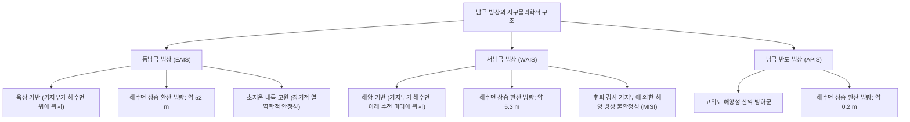

지구 최남단에 고립된 백색의 대륙 남극은 지구상에서 가장 거대한 빙권 시스템입니다. 면적 약 1,400만 평방킬로미터(호주의 약 2배, 한반도의 60배 이상)에 달하는 이 얼어붙은 대륙은 평균 두께 2,160m, 최대 두께 4,800m가 넘는 거대한 빙상(Ice Sheet)으로 뒤덮여 있습니다. 남극 빙상은 전 세계 얼음의 약 90%, 담수 자원의 약 70%를 보유하고 있으며, 만약 이 빙상이 완전히 녹는다면 전 지구 해수면을 약 58m 상승시킬 수 있는 잠재력을 지니고 있습니다.

그러나 남극은 정적인 얼음 덩어리가 아닙니다. 내부에서는 자중과 지열, 기저 수압에 의해 얼음이 수만 년에 걸쳐 서서히 소성 변형하는 비선형 비뉴턴 유동(레올로지)이 일어나고 있습니다. 4km 두께의 빙상 심부에는 수천만 년 동안 격리된 400여 개의 '빙하하호(Subglacial Lakes)'가 존재하여, 40메가파스칼의 초고압과 암흑 속에서 번성하는 극한 미생물 군집을 품고 있습니다. 또한 해안가에서는 전 지구 열염순환의 심장인 '남극 저층수(AABW)'가 끊임없이 생성되어 심해 생태계와 전 지구 탄소 흡수를 조절합니다.

본 논문은 빙하물리학, 극한생물학, 극지해양학, 탐험사 물류 공학, 그리고 80만 년 빙하 코어 동위원소 분석을 학술적이고 정량적으로 분석합니다.

---

## 1. 남극 빙상의 지구물리학적 구조: 동남극과 서남극의 근본적 비대칭성

남극횡단산맥을 경계로 남극 대륙은 지질학적 성격이 완전히 다른 두 영역으로 나뉩니다:

### 1.1 동남극 빙상 (EAIS): 안정된 순상지 위의 거대한 돔

동남극 빙상은 면적 약 1,000만 평방킬로미터로, 기저 암반이 해수면 위에 자리 잡은 견고한 육상 빙상(Terrestrial Ice Sheet)입니다. 돔 A(해발 4,093m), 돔 C, 돔 후지(3,810m) 등의 고원은 연평균 기온이 $-50^\circ\text{C}$ 이하이며 연간 강설량이 수 cm에 불과한 극저온 빙설 사막입니다. 표면 융해가 없어 극히 안정적이며, 총 얼음량은 해수면 <strong>52m</strong> 상승분에 해당합니다.

### 1.2 서남극 빙상 (WAIS): 취약한 해양 빙상과 역경사 기저부

반면 서남극 빙상은 기저 암반이 해수면 아래 수백 내지 2,500m 깊이로 가라앉아 있는 <strong>해양 빙상(Marine Ice Sheet)</strong>입니다. 특히 스웨이츠(Thwaites) 빙하와 파인 아일랜드(Pine Island) 빙하의 기저부는 내륙으로 갈수록 깊어지는 <strong>역경사 지형(Retrograde Bed Slope)</strong>을 가집니다. 이 기하학적 구조는 접지선 후퇴 시 자율적 붕괴가 폭주하는 해양 빙상 불안정성(MISI)을 유발하며, 해수면을 <strong>5.3m</strong> 급상승시킬 치명적 위험을 내포하고 있습니다.

---

## 2. 빙상 유동의 연속체 역학: 글렌의 유동 법칙 (Glen's Flow Law)

다결정 얼음의 점소성 변형은 실험적으로 확립된 <strong>글렌의 유동 법칙</strong>으로 기술됩니다:

$$\dot{\varepsilon}_{ij} = A(T, P) \, \tau_e^{n-1} \, \tau_{ij}$$

여기서 응력 지수 $n \approx 3$이며, 변형률 속도 $\dot{\varepsilon}$는 유효 전단응력 $\tau$의 3제곱에 비례합니다. 즉, 응력이 2배 증가하면 얼음 내부의 변형 속도는 $2^3 = 8$배로 급증합니다.

빙상의 편평한 종횡비를 이용한 <strong>천해빙 근사(Shallow Ice Approximation, SIA)</strong>를 통해 응력을 적분하면, 빙상 표면 프로파일은 포물선 형태의 <strong>비알로프-나이 프로파일(Vialov-Nye Profile)</strong>로 수렴합니다:

$$h(x) = \left( \frac{2 \tau_0}{\rho_i g} \right)^{1/2} (L - x)^{1/2}$$

---

## 3. 해양 빙상 불안정성 (MISI)과 빙붕의 버트레스 효과

빙하가 바다로 진출하며 형성되는 <strong>빙붕(Ice Shelf)</strong>은 그 자체로 부력을 받아 떠 있으므로 녹아도 직접적인 해수면 상승을 일으키지 않습니다. 그러나 빙붕은 주변 암벽과의 전단 마찰을 통해 내륙 빙하의 유출을 물리적으로 저지하는 거대한 댐 역할을 수행하는데, 이를 <strong>버트레스 효과(Buttressing Effect)</strong>라고 합니다.

따뜻한 순환 심층수(CDW)가 유입되어 빙붕 하부를 융해시키면 버트레스 효과가 소멸합니다. 크리스티안 슈프(Schoof, 2007)의 접지선 역학에 따르면 질량 유출 플럭스는 접지선 얼음 두께의 비선형 함수($q \propto H_g^2 \sim H_g^{2.5}$)이므로, 내륙으로 깊어지는 역경사 기저부에서는 접지선이 후퇴할수록 유출 속도가 기하급수적으로 폭증하는 자율 붕괴 루프(MISI)가 작동합니다.

---

## 4. 보스토크 빙하하호와 극지 해양-고기후 과학

### 4.1 보스토크호의 극한 환경과 우주생물학

빙상 3,750m 아래 위치한 보스토크호는 수심 1,000m, 면적 $12,500\,\text{km}^2$의 거대한 호수입니다. 40 MPa의 초고압, 수백만 년간 차단된 암흑, 과포화 용존산소 속에서도 화학합성 독립영양 세균 및 극한 미생물이 생존하고 있음이 시추 코어(Accretion Ice) 유전체 분석으로 증명되었습니다. 이는 목성의 유로파나 토성의 엔셀라두스 얼음 바다 탐사에 핵심적인 생명 지표 모델을 제공합니다.

### 4.2 남극 저층수 (AABW)와 80만 년 빙하 코어 기록

연안 폴리냐(Polynya)에서 해수가 급속 동결할 때 배출되는 고농도 염분수(<strong>염수 배제 / Brine Rejection</strong>)는 $-1.9^\circ\text{C}$의 고염분 대륙붕수를 형성하여 심해로 낙하, 전 지구 심해를 환기하는 <strong>남극 저층수(AABW)</strong>를 생성합니다.

또한 EPICA 돔 C 빙하 코어의 안정 동위원소($\delta^{18}O, \delta D$) 분석은 밀란코비치 주기와 맞물린 과거 80만 년간의 온실가스-기온 동기화를 증명했습니다. 80만 년 동안 $180 - 280\,\text{ppm}$에 머물던 대기 중 이산화탄소가 인간 활동으로 <strong>420 ppm 이상</strong>으로 폭증했음을 밝혀낸 남극은, 지구 생명 시스템의 미래를 좌우하는 절대적인 나침반입니다.