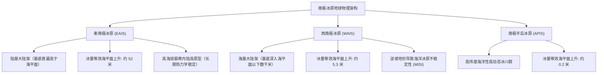
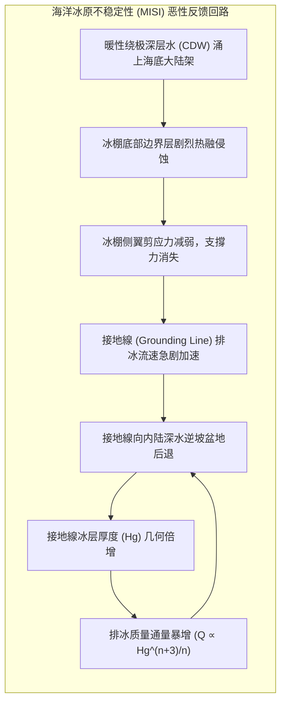
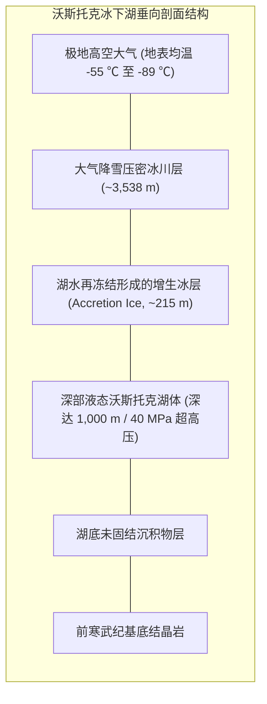

孤立于地球最南端的南极大陆，是人类在地表所能探索的最极致的冷原。其广袤的1,400万平方公里土地（相当于欧洲总面积的近1.4倍、澳大利亚的近两倍）被覆盖在平均厚度达2,160米、最大厚度超过4,800米的巨型冰原之下。南极冰原汇集了全球约90%的固体冰川和70%的淡水资源。如果这具冰雪巨兽完全融化，全球海平面将不可逆地暴涨约58米，淹没人类所有沿海平原与经济中心。

然而，南极绝非一块处于热力学死寂中的静态冰冻块体。在其深处，受重力荷载、地热通量与基底水压的共同支配，数万年来上演着壮阔的非牛顿流体塑性流变；在厚达4公里的重叠冰层下方，隐藏着与地表隔绝数千万年之久的“冰下湖”（Subglacial Lakes），滋养着在40兆帕超高压、完全黑暗与过饱和氧气中的化能极端微生物系统。与此同时，南大洋海岸带不断涌出的“南极底层水”（AABW）驱动着全球大洋溫鹽環流，维系着深海生态圈的呼吸与碳汇循环。

本文以严谨的地球物理学、极端微生物学与古气候学为经纬，定量剖析南极冰原动力学、海洋冰原不稳定性、冰下沃斯托克湖生态、阿蒙森-史考特极地探险史工程对比，以及80万年冰芯同位素记录的气候密码。

---

## 1. 南极冰原的地球物理架构：東南極与西南極的根本非對稱性

在极地冰川物理学中，南极大陆绝非均匀对称的整体。横贯南极山脉（Transantarctic Mountains）将大陆清晰地划分为地质性质截然不同的两大单元：<strong>東南極冰原（EAIS）</strong>与<strong>西南極冰原（WAIS）</strong>。

### 1.1 東南極冰原（EAIS）：古老克拉通陆盾上的高耸穹丘

東南極冰原面积约1,000万平方公里，其基底主要坐落在海平面之上的前寒武纪变质与结晶克拉通（稳定陆块）之上，属于典型的<strong>陆基冰原（Terrestrial Ice Sheet）</strong>。

在内陆核心区域的冰穹A（海拔4,093米）、冰穹C（3,233米）与冰穹富士（3,810米），年均气温低于 $-50^\circ\text{C}$，极端低温曾测得 $-89.2^\circ\text{C}$，年降水量不足50毫米水当量，堪称地球上最干旱寒冷的“白色沙漠”。极寒气候使得冰原表面毫无融化迹象，长期保持着极高的动力学稳定性。東南極全冰量折合全球海平面上升约<strong>52米</strong>。

### 1.2 西南極冰原（WAIS）：脆弱的海基冰原与逆坡基底

与東南極形成鲜明对照的是，面积仅约200万平方公里的西南極冰原是当今全球气候变暖面临的最严峻临界点脆弱带。西南極冰原属于典型的<strong>海基冰原（Marine Ice Sheet）</strong>，其基岩底面大部分沉降在海平面以下数百米乃至2,500米深处（如本特利冰下海沟）。

更致命的是，西南極主要冰流系统（如斯维茨冰川和松岛冰川）的基岩地形呈现向内陆倾斜的<strong>逆坡地形（Retrograde Bed Slope）</strong>。这种几何特征赋予了西南極冰原天然的力学不稳定性：一旦接地線在温暖海水侵蚀下向内陆后退，将诱发不可逆的“海洋冰原不稳定性（MISI）”，其崩塌将直接导致全球海平面骤升<strong>5.3米</strong>。

---

## 2. 冰川流动的连续介质力学：格倫流動律与浅冰近似

从宏观连续介质物理学的角度看，多晶冰是一种具有剪切稀化特性的非牛顿黏塑性流体。冰在重力荷载下的长期蠕变运动遵循经验确立的<strong>格倫流動律（Glen's Flow Law）</strong>：

$$\dot{\varepsilon}_{ij} = A(T, P) \, \tau_e^{n-1} \, \tau_{ij}$$

式中，$\dot{\varepsilon}_{ij}$ 为应变率张量，$\tau_{ij}$ 为偏应力张量，$n$ 为应力指数（自然界冰川冰实测 $n \approx 3$），$\tau_e$ 为有效剪应力。速率因子 $A(T)$ 遵循阿伦尼乌斯温度依赖关系：

$$A(T) = A_0 \exp\left( -\frac{Q}{R T} \right)$$

其中 $Q$ 为活化能（$T < -10^\circ\text{C}$ 时约为 $60\,\text{kJ/mol}$），$R$ 为气体常数。由于应变率与剪应力的立方成正比（$\dot{\varepsilon} \propto \tau^3$），应力增加一倍，变形速率将暴增8倍。这种强烈的非线性赋予冰原在应力集中区（如冰川底部与排冰流剪切带）极易发生局部软化与高速剪切滑移的动力学特征。

在纵横比极小的冰原尺度上（厚度数公里 vs 水平尺度数千公里），<strong>浅冰近似（Shallow Ice Approximation, SIA）</strong>将冰体剪应力简化为仅由局部厚度与表面坡度决定。在无基底滑动假定下，冰原表面几何形态积分收敛为经典的<strong>维亚洛夫-奈抛物线轮廓（Vialov-Nye Profile）</strong>：

$$h(x) = \left( \frac{2 \tau_0}{\rho_i g} \right)^{1/2} (L - x)^{1/2}$$

这一理论公式精准预测了南极大陆内陆高穹向海岸倾泻的抛物线状宏观形态。

---

## 3. 海洋冰原不稳定性（MISI）与冰棚支撐力坍塌

西南極冰原的流失并不主要由大气升温融化引起，而是海洋热动力学驱动的<strong>冰棚支撐力（Buttressing Effect）</strong>丧失。

### 3.1 冰棚支撐力机制

内陆冰川流向海洋时，在海面上延伸漂浮形成巨大的<strong>冰棚（Ice Shelves）</strong>（如罗斯冰棚、菲尔希纳-龙尼冰棚）。冰棚浮于水面，其本身的融化并不改变海平面。然而，冰棚与海湾两侧岩壁的侧向剪切摩擦以及在海底浅滩（冰隆）上的锚定，产生巨大的反向背应力——即<strong>支撐力（Buttress Effect）</strong>。

支撐力宛如大坝瓶塞，死死锁住后方内陆冰原的下泄速度。一旦漂浮冰棚在涌升暖水冲刷下变薄或因表面融水裂隙（水压劈裂）崩解，支撐力瞬间消失，内陆冰川将以数倍流速不受限制地倾入海洋。

### 3.2 舒夫（Schoof）接地線通量定律

根据冰川学家克里斯蒂安·舒夫（2007）建立的动力学边界层理论，跨越接地線的单位宽度排冰质量通量 $q$ 是接地線冰厚 $H_g$ 的强非线性函数：

$$q \propto H_g^{\frac{n+3}{n}} \xrightarrow{n=3} q \propto H_g^2 \sim H_g^{2.5}$$

在向海倾斜的正常基底下，接地線后退导致冰厚 $H_g$ 变薄，通量 $q$ 减少，系统自我稳定。然而在<strong>逆坡基底（内陆越深处基岩越深）</strong>上，接地線每向后退一步，当地水深更深、冰厚 $H_g$ 更大，排冰通量 $q$ 呈几何级数暴涨，从而迫使接地線加速内退——形成不可逆转的自毁性正反馈循环，即著名的<strong>海洋冰原不稳定性（MISI）</strong>。

---

## 4. 沃斯托克冰下湖：4000米冰层下的黑暗极端生态圈

冰原底部并非彻底冻结。在上方数千米冰层的隔热保护、地球地热通量（约 $50-80\,\text{mW/m}^2$）以及近400个大气压使冰熔点降低至 $-2.4^\circ\text{C}$ 的三重作用下，南极全境分布着400多个液态淡水<strong>冰下湖</strong>，其中最壮阔者为俄罗斯沃斯托克站正下方的<strong>沃斯托克湖（Lake Vostok）</strong>。

### 4.1 物理化学极端参数

沃斯托克湖长约250公里，宽50公里，水深逾1,000米。其环境参数将生命极限推向极端：
1. <strong>40兆帕（400个大气压）</strong>的超强静水压；
2. <strong>完全无光</strong>环境，光合作用绝对不可行；
3. <strong>高浓度过饱和溶解氧</strong>：上覆冰川融化释放出高压包裹的空气气体水合物（包合物），湖水含氧量达地表常规淡水的50倍以上，产生强烈的氧化应激；
4. <strong>与大气隔绝达1,500万至3,000万年</strong>的极度孤独。

### 4.2 增生冰核的總體基因體发现与地外生命模拟

通过对冰湖上覆的增生冰（Accretion Ice）取样，科学家利用總體基因體学与16S rRNA基因测序，检测到了适应极寒、高压与高氧的独特微生物群落：包括利用硫、铁、氢进行化能无机自养的细菌，以及指示湖底可能存在断裂热液流体活动的嗜热菌DNA残留。

这一发现为地外天体生命勘测奠定了实证基础：木星卫星<strong>木卫二（Europa）</strong>和土星卫星<strong>土卫二（Enceladus）</strong>同样拥有深达数十公里的冰壳及其下方的液态海洋。沃斯托克湖证实了生命可在完全黑暗的冰下高压海洋中仅凭化能自养与地热维持完整生态循环。

---

## 5. 南极底层水（AABW）与全球溫鹽環流

南极周边冰海是驱动全球大洋温盐传送带的根本引擎。其核心是密度最高、温度最低的<strong>南极底层水（AABW）</strong>的形成。

极地强风（下降风）在沿岸破开海冰形成“冰间湖（Polynya）”。在极寒大气暴露下，海水爆发式结冰并剧烈析出盐分离子（<strong>排鹽作用 / Brine Rejection</strong>）。高浓度的冰点冷盐水密度暴增，沿陡峭的大陆架斜坡如瀑布般沉入数千米深的深海海底，形成AABW，向北流向全球各大洋盆，为全大洋底栖生物带来丰沛的氧气并封存巨量工业二氧化碳。

---

## 6. 极地探险英雄时代的科学对比：阿蒙森 vs 史考特

1911年至1912年，挪威探险家<strong>罗尔德·阿蒙森</strong>与英国海军军官<strong>罗伯特·法尔肯·史考特</strong>展开了人类征服南极点的旷世竞争。这是一场关于极端环境工程学、营养代谢计算与后勤决策的残酷考验：

- <strong>阿蒙森</strong>：彻底践行因纽特极地智慧，采用爱斯基摩犬拉雪橇与熟练滑雪机动，穿着透气防冻的狼皮与驯鹿皮大衣，精准规划食用海狗肉与狗肉补给维生素C与脂肪。1911年12月14日率先成功抵达南极点并全员无伤凯旋。
- <strong>史考特</strong>：偏重机械化与英国海军人力拖拽传统，马匹与雪地车早早瘫痪，厚重羊毛织物汗水冻结成冰甲，每日配给口粮热量仅4,500 kcal（实际人体拖拽日消耗高达6,500-7,500 kcal），导致深度饥饿性肌萎缩与潜伏性坏血病爆发。1912年1月抵达时晚了34天，最终全队在归途中悲壮罹难。

史考特遗留的舌羊齿植物化石实证了魏格纳的大陆漂移学说，并推动了1959年《南极条约》的诞生，使南极成为全球唯一永久非军事化、专属于和平与科学的共同大陆。

---

## 7. 冰芯古气候学：80万年的地球大气时间胶囊

南极内陆积雪在严寒自重下被压密为冰，将古大气成分以微气泡形式永久密封在冰晶之内。

通过测量水分子中氢氧稳定同位素比值（$\delta^{18}O$ 与 $\delta D$），利用<strong>瑞利分馏（Rayleigh Fractionation）</strong>的热力学原理：

$$\Delta T_{\text{surface}} \approx \alpha \, \Delta(\delta D)$$

科学家精确重建了过去80万年间（如EPICA Dome C冰芯）的温度演化序列。冰芯不仅完整证实了地球轨道偏心率、地轴倾角与岁差决定的<strong>米蘭科維奇冰期周期</strong>，更无可辩驳地揭示出：在长达80万年的自然波动中，大气二氧化碳浓度严格约束在 $180 - 280\,\text{ppm}$ 的安全走廊内。而工业革命仅仅两百年，人类排放已将二氧化碳推升至 <strong>420 ppm 以上</strong>的极度危险未知海域。

南极是地球气候系统的哨兵与基石。保卫这片白色大陆的完整，关乎人类现代文明海岸线与生存未来的根本安危。