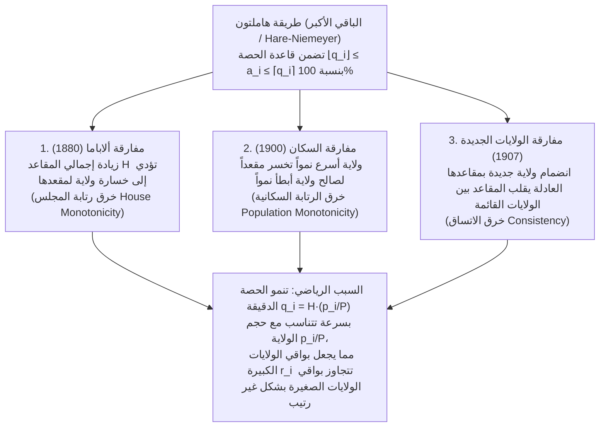

«وزِّع المقاعد الصحيحة للبرلمان بشكل عادل بين الولايات (أو الأحزاب السياسية) بالتناسب مع عدد سكانها».

عند مواجهة هذه المهمة، يلجأ الجميع تقريباً إلى الحساب الابتدائي للتناسب والتقريب: نقسم إجمالي عدد السكان على إجمالي عدد المقاعد للحصول على «القاسم القياسي» (عدد السكان لكل مقعد)، ثم نقسم سكان كل ولاية على هذا القاسم. وبما أن القسمة تنتج كسوراً عشرية مثل $7.73$ أو $1.36$ مقعد، نمنح كل ولاية أولاً جزءها الصحيح ($7$ و$1$)، ثم نوزع المقاعد المتبقية واحداً تلو الآخر على الولايات ذات البواقي العشرية الأكبر ($.73$، $.36$، إلخ). هل يمكن أن توجد طريقة أكثر طبيعية وعدالة من هذه؟

غير أنه في عام 1880، اكتشف تشارلز سيتون (Charles W. Seaton)، كبير الكتبة في مكتب التعداد الأمريكي، كابوساً رياضياً أثناء حساب مقاعد مجلس النواب الأمريكي بهذه الطريقة ذاتها (<strong>طريقة هاملتون</strong> أو <strong>طريقة الباقي الأكبر / هير-نيماير</strong>): عندما <strong>تمت زيادة إجمالي مقاعد المجلس بمقعد واحد فقط</strong> من $299$ إلى $300$ مقعد — دون تغير عدد سكان أي ولاية بشخص واحد — <strong>انخفضت حصة ولاية ألاباما من $8$ مقاعد إلى $7$ مقاعد</strong>!

تكبير الكعكة الكلية أدى إلى تقليص حصة أحد المشاركين: أعقب <strong>مفارقة ألاباما (Alabama Paradox)</strong> اكتشاف <strong>مفارقة السكان (Population Paradox)</strong> (ولاية ذات نمو سكاني سريع تخسر مقعداً لصالح ولاية أبطأ نمواً) و<strong>مفارقة الولايات الجديدة (New States Paradox)</strong> (انضمام ولاية جديدة مع عدد المقاعد العادل الموافق لسكانها يقلب المقاعد بين ولايات قديمة لا علاقة لها). وفي عام 1982، أثبت عالما الرياضيات <strong>ميشيل بالينسكي (Michel Balinski)</strong> و<strong>بيتون يونغ (H. Peyton Young)</strong> <strong>مبرهنة الاستحالة لبالينسكي-يونغ</strong>: <strong>من المستحيل رياضياً لأي طريقة لتوزيع المقاعد أن تحقق في آنٍ واحد قاعدة الحصة (Quota Rule) والرتابة (عدم وقوع المفارقات)</strong>.

---

## 1. الأزمة الدستورية لعام 1792: هاملتون ضد جيفرسون وأول فيتو رئاسي في التاريخ

نصت المادة الأولى، القسم 2 من الدستور الأمريكي لعام 1787 على توزيع النواب بين الولايات «وفقاً لأعدادها الخاصة»، بحيث لا يتجاوز العدد نائباً واحداً لكل $30,000$ نسمة. وبعد أول تعداد سكاني عام 1790 ($P = 3,615,920$ نسمة في $15$ ولاية)، أقر الكونغرس مشروع قانون يحدد حجم المجلس بـ $H = 120$ مقعداً (القاسم القياسي $D = P/H = 30,132.67$).

اقترح وزير الخزانة <strong>ألكسندر هاملتون</strong> <strong>طريقة الباقي الأكبر (طريقة هاملتون)</strong>: منح الجزء الصحيح $\lfloor p_i / D \rfloor$ أولاً (مجموعها $112$ مقعداً)، ثم منح المقاعد المتبقية $R = 8$ للولايات الثماني ذات البواقي الكسرية الأكبر. اعترض وزير الخارجية <strong>توماس جيفرسون</strong> والرئيس <strong>جورج واشنطن</strong> (وكلاهما من فرجينيا) بشدة: فبالإضافة إلى حرمان فرجينيا من مقعد الباقي، فإن الولايات الصغيرة التي جُبرت كسورها لأعلى — مثل ديلاوير ($55,540$ نسمة، مقعدان) — حصلت على <strong>نائب لكل $27,770$ نسمة</strong>، في انتهاك صريح للسقف الدستوري البالغ $30,000$!

اقترح جيفرسون بديلاً هو <strong>طريقة جيفرسون (المعروفة في أوروبا باسم طريقة دونت D'Hondt)</strong>: اختيار قاسم مشترك $x$ (مثل $x = 33,000$) وإهمال جميع الكسور ($\lfloor p_i / x \rfloor$) حتى يساوي المجموع $H$. وفي <strong>5 أبريل 1792</strong>، استخدم الرئيس واشنطن <strong>أول فيتو رئاسي في تاريخ الولايات المتحدة</strong> لإسقاط قانون هاملتون بسبب خلاف حول <strong>خوارزمية التقريب الرياضي</strong>!

---

## 2. الصياغة الرياضية وقاعدة الحصة (Quota Rule)

ليكن لدينا $s \ge 2$ ولاية بمتجه سكان $\mathbf{p} = (p_1, \dots, p_s)$، وإجمالي سكان $P = \sum_{i=1}^s p_i$، وحجم مجلس $H \in \mathbb{Z}_{>0}$. يُعرَّف <strong>القاسم القياسي $D$</strong> و<strong>الحصة الدقيقة (Exact Quota) $q_i$</strong> للولاية $i$ كما يلي:

$$D = \frac{P}{H}, \qquad q_i = \frac{p_i}{D} = H \cdot \frac{p_i}{P}, \qquad \sum_{i=1}^s q_i = H$$

عند تقريب العدد الحقيقي $q_i$ إلى عدد صحيح $a_i \in \mathbb{Z}_{\ge 0}$ ($\sum_{i=1}^s a_i = H$)، تقضي بديهية العدالة الدنيا بأن تحصل كل ولاية إما على <strong>حصتها الدنيا $\lfloor q_i \rfloor$</strong> أو <strong>حصتها العليا $\lceil q_i \rceil$</strong>. هذه هي <strong>قاعدة الحصة (Quota Rule)</strong>:

$$\lfloor q_i \rfloor \le a_i \le \lceil q_i \rceil \quad (\forall i \in \{1, 2, \dots, s\})$$

تقوم <strong>طريقة هاملتون (الباقي الأكبر / هير-نيماير)</strong> بتفكيك $q_i = \lfloor q_i \rfloor + r_i$ حيث $r_i \in [0, 1)$، وتمنح $\lfloor q_i \rfloor$ مقاعد أولاً، ثم توزع المقاعد المتبقية $R = H - \sum \lfloor q_i \rfloor = \sum r_i$ على أعلى $R$ ولايات في الباقي $r_i$:

$$q_i = \lfloor q_i \rfloor + r_i \quad (0 \le r_i < 1), \qquad R = H - \sum_{i=1}^s \lfloor q_i \rfloor = \sum_{i=1}^s r_i \in \{0, 1, \dots, s-1\}$$

$$a_i = \begin{cases} \lfloor q_i \rfloor + 1 & (\text{if } r_i \text{ is among the } R \text{ largest remainders}) \\ \lfloor q_i \rfloor & (\text{otherwise}) \end{cases}$$

بحكم تعريفها، تحقق طريقة هاملتون <strong>قاعدة الحصة بنسبة $100\%$ دائماً</strong>.

---

## 3. التشريح الكامل للمفارقات الثلاث الكلاسيكية

بين عامي 1880 و1907، كشفت بيانات التعداد الأمريكي ثلاث مفارقات مدمرة في طريقة هاملتون:

### 3.1 مفارقة ألاباما (1880) والبرهان العددي بنموذج 3 ولايات ($H = 10 \to 11$)

في عام 1880، عند انتقال $H$ من $299$ إلى $300$، زادت حصة ألاباما بمقدار $+0.025$ فقط ($7.646 \to 7.671$)، بينما زادت حصتا تكساس ($9.640 \to 9.672$، $+0.032$) وإلينوي ($18.640 \to 18.702$، $+0.062$) بسرعة أكبر وتجاوزتا باقي ألاباما في آنٍ واحد. لنثبت ذلك بنموذج دقيق من $3$ ولايات ($P = 1000$):

| الولاية | السكان $p_i$ | الحصة $q_i$ ($H=10$) | الجزء الصحيح والباقي $r_i$ ($H=10$) | <strong>المقاعد $a_i$ ($H=10$)</strong> | الحصة $q_i'$ ($H=11$) | الجزء الصحيح والباقي $r_i'$ ($H=11$) | <strong>المقاعد $a_i'$ ($H=11$)</strong> |
| :--- | :---: | :---: | :---: | :---: | :---: | :---: | :---: |
| <strong>الولاية A</strong> | $433$ | $4.330$ | $4$ ($r_A = 0.330$: المركز 2) | <strong>$4$ مقاعد</strong> | $4.763$ | $4$ ($r_A' = \mathbf{0.763}$: المركز 1) | <strong>$5$ مقاعد</strong> ($+1$) |
| <strong>الولاية B</strong> | $431$ | $4.310$ | $4$ ($r_B = 0.310$: المركز 3) | <strong>$4$ مقاعد</strong> | $4.741$ | $4$ ($r_B' = \mathbf{0.741}$: المركز 2) | <strong>$5$ مقاعد</strong> ($+1$) |
| <strong>الولاية C</strong> | $136$ | $1.360$ | $1$ ($r_C = \mathbf{0.360}$: المركز 1) | <strong>مقعدان ($2$)</strong> | $1.496$ | $1$ ($r_C' = 0.496$: المركز 3) | <strong>مقعد واحد ($1$)</strong> (<strong>$-1$</strong>) |
| <strong>المجموع</strong> | <strong>$1000$</strong> | <strong>$10.000$</strong> | مجموع الصحيح $= 9$ ($R=1$) | <strong>$10$ مقاعد</strong> | <strong>$11.000$</strong> | مجموع الصحيح $= 9$ ($R'=2$) | <strong>$11$ مقعداً</strong> |

عند زيادة $H$ من $10$ إلى $11$، تتقدم الولايتان الكبيرتان A وB بمقدار $+0.433$ و$+0.431$ مقابل $+0.136$ فقط للولاية الصغيرة C، فيقفز باقياهما ($0.763$ و$0.741$) فوق $r_C' = 0.496$، وتهبط الولاية C من <strong>مقعدين إلى مقعد واحد</strong> (خرق <strong>رتابة المجلس</strong>).

### 3.2 مفارقة السكان (1900) ومفارقة الولايات الجديدة (1907)

- <strong>مفارقة السكان</strong>: بين عامي 1890 و1900، نمت فرجينيا بنسبة $+12.0\%$ مقابل $+5.0\%$ لولاية مين، لكن فرجينيا خسرت مقعداً لصالح مين. في نموذجنا ($H = 10, P = 1000$): في الزمن 1، $p_A = 427, p_B = 435, p_C = 138 \implies$ المقاعد $(4, 4, 2)$ لأن $r_C = 0.380$ هو الأكبر. وفي الزمن 2، <strong>تنمو الولاية C بنسبة $+8.70\%$ ($138 \to 150$)</strong>، و<strong>تنمو الولاية B بنسبة $+6.90\%$ ($435 \to 465$)</strong>، وتتراجع الولاية A ($427 \to 385$). رغم أن معدل نمو C أعلى من B، فإن الزيادة المطلقة لحصة الولاية الكبيرة B ($+0.300 \implies r_B' = 0.650$) تفوق C ($+0.120 \implies r_C' = 0.500$)، بينما تعبر حصة A الحد الصحيح $4$ نزولاً ($q_A' = 3.850 \implies r_A' = 0.850$). وهكذا تخسر الولاية الأسرع نمواً C مقعداً ($2 \to 1$) لصالح B ($4 \to 5$)!
- <strong>مفارقة الولايات الجديدة</strong>: في عام 1907، أدى انضمام أوكلاهوما بـ $5$ مقاعد ($H: 386 \to 391$) إلى خسارة نيويورك لمقعد لصالح مين. في نموذج من ولايتين ($H = 10, P = 1000$ مع $p_A = 842, p_B = 158 \implies a_A = 8, a_B = 2$)، فإن انضمام ولاية جديدة C ($p_C = 165$) بمقعديها المستحقين ($H' = 12, P' = 1165$) يخفض القاسم القياسي من $100$ إلى $97.083$. تُضرب جميع الحصص في $1.03004$: ترتفع الحصة الكبيرة $q_A$ بمقدار $+0.253$ ($8.673$، الباقي $0.673$) وتتجاوز باقي الولاية الصغيرة B ($1.627$، الباقي $0.627$)، لتصبح المقاعد $(9, 1, 2)$!

---

## 4. النظرية الموحدة لطرق القواسم (الأوساط الأعلى) ودوال المعالم $d(n)$

تقوم <strong>طرق القواسم (Divisor Methods)</strong> بقسمة سكان كل ولاية $p_i$ على قاسم مشترك قابل للتعديل $x > 0$ وتقريب خارج القسمة $q = p_i / x$ بواسطة <strong>دالة معلمية (Signpost Function) $d(n) \in [n, n+1]$</strong>:

$$[q]_d = n \iff d(n-1) \le q \le d(n), \qquad a_i = \left[\frac{p_i}{x}\right]_d, \qquad \sum_{i=1}^s a_i = H$$

بحل المتباينة $d(a_i - 1) \le p_i / x \le d(a_i)$ بالنسبة إلى $x$، نحصل على <strong>التكافؤ التام مع طريقة الأوساط الأعلى (قيم الأولوية)</strong>:

$$\frac{p_i}{d(a_i)} \le x \le \frac{p_i}{d(a_i - 1)} \quad \Longleftrightarrow \quad \text{Priority}(i, n) = \frac{p_i}{d(n)}$$

إن توزيع $H$ مقاعد يكافئ تماماً منحها لأعلى $H$ <strong>قيم أولوية $\text{Priority}(i, n) = \frac{p_i}{d(n)}$</strong>. وبما أن الترتيب الشامل لا يتغير عند زيادة $H$ وأن نسبة الأولوية تحقق:

$$\frac{p_i'}{p_j'} \ge \frac{p_i}{p_j} \implies \frac{p_i' / d(n)}{p_j' / d(m)} = \frac{p_i'}{p_j'} \cdot \frac{d(m)}{d(n)} \ge \frac{p_i}{p_j} \cdot \frac{d(m)}{d(n)} = \frac{p_i / d(n)}{p_j / d(m)}$$

فإن <strong>جميع طرق القواسم محصنة تماماً ضد المفارقات الثلاث!</strong>

### مقارنة طرق القواسم الخمس التاريخية

| اسم الطريقة (الاسم الانتخابي) | المؤلفون والسنة | دالة المعلم $d(n)$ | متتالية القواسم $d(0), d(1), d(2), \dots$ | الحد الأدنى | الانحياز الحجمي ومعيار التحسين | السلوك تجاه قاعدة الحصة |
| :--- | :--- | :---: | :---: | :---: | :--- | :--- |
| <strong>1. طريقة جيفرسون</strong> (<strong>دونت D'Hondt</strong>) | Jefferson (1792) D'Hondt (1878) | $n + 1$ (تقريب لأسفل) | $1, 2, 3, 4, \dots$ | $0$ مقعد | <strong>تحابي الولايات / الأحزاب الكبيرة بشدة</strong> | تنتهك <strong>الحصة العليا</strong> ($a_i > \lceil q_i \rceil$) |
| <strong>2. طريقة وبستر</strong> (<strong>سانت-لاغي Sainte-Laguë</strong>) | Webster (1832) Sainte-Laguë (1910) | $n + 0.5$ (وسط حسابي) | $0.5, 1.5, 2.5, \dots$ (أو $1, 3, 5, \dots$) | $0$ مقعد | <strong>محايدة تماماً تجاه الحجم (Unbiased)</strong> | قد تنتهك (نادراً) الحصتين العليا والدنيا |
| <strong>3. هنتنغتون-هيل</strong> (<strong>النسب المتساوية</strong>) | Hill (1911) Huntington (1921) | $\sqrt{n(n+1)}$ (وسط هندسي) | $0, \sqrt{2}, \sqrt{6}, \sqrt{12}, \dots$ | مقعد واحد | تقلل التفاوت النسبي $T_{ij}$؛ <strong>مجلس النواب الأمريكي منذ 1941</strong> | قد تنتهك الحصتين العليا والدنيا |
| <strong>4. طريقة دين</strong> (<strong>الوسط التوافقي</strong>) | J. Dean (1832) | $\frac{2n(n+1)}{2n+1}$ (وسط توافقي) | $0, \frac{4}{3}, \frac{12}{5}, \frac{24}{7}, \dots$ | مقعد واحد | تقلل الفرق المطلق لحجم الدائرة $p_i/a_i$ | قد تنتهك الحصتين العليا والدنيا |
| <strong>5. طريقة آدمز</strong> (<strong>القواسم الأصغر</strong>) | J. Q. Adams (1832) | $n$ (تقريب لأعلى) | $0, 1, 2, 3, \dots$ | مقعد واحد | <strong>تحابي الولايات الصغيرة بشدة</strong> | تنتهك <strong>الحصة الدنيا</strong> ($a_i < \lfloor q_i \rfloor$) |

ومن متباينة الأوساط الحسابية والهندسية والتوافقية (AM-GM-HM):

$$T_{ij} = \frac{a_i / p_i}{a_j / p_j} - 1, \qquad d(n) = \sqrt{n(n+1)}$$

$$n < \underbrace{\frac{2n(n+1)}{2n+1}}_{\text{Dean (HM)}} < \underbrace{\sqrt{n(n+1)}}_{\text{Huntington-Hill (GM)}} < \underbrace{n + 0.5}_{\text{Webster (AM)}} < n + 1$$

---

## 5. مبرهنة الاستحالة لبالينسكي-يونغ (1982)

حتى <strong>طريقة وبستر / سانت-لاغي ($d(n) = n + 0.5$، التقريب القياسي لأقرب عدد صحيح)</strong> تنتهك كلاً من الحصة الدنيا والحصة العليا:
1. <strong>انتهاك الحصة الدنيا ($H = 10, P = 1000$)</strong>: لتكن ولاية كبيرة A ($p_A = 832 \implies q_A = 8.320$، الحصة الدنيا <strong>$8$ مقاعد</strong>) وثلاث ولايات صغيرة B, C, D ($p_i = 56 \implies q_i = 0.560$). بالقاسم $x = 111$، تحصل الولايات الصغيرة الثلاث على $56/111 \approx 0.5045 > 0.5$ فتُقرَّب لأعلى إلى مقعد لكل منها ($3$ مقاعد)، بينما تحصل الولاية A على $832/111 \approx 7.4955 < 7.5$ فتُقرَّب لأسفل إلى <strong>$7$ مقاعد</strong> — منتهكةً حصتها الدنيا البالغة $8$ مقاعد!
2. <strong>انتهاك الحصة العليا ($H = 10, P = 1000$)</strong>: لتكن ولاية كبيرة A ($p_A = 795 \implies q_A = 7.950$، الحصة العليا <strong>$8$ مقاعد</strong>) وخمس ولايات صغيرة B–F ($p_i = 41 \implies q_i = 0.410$). بالقاسم $x = 83$، تحصل الولايات الصغيرة الخمس على $41/83 \approx 0.4940 < 0.5$ ($0$ مقعد)، بينما تحصل الولاية A على $795/83 \approx 9.5783 > 9.5$ فتستحوذ على <strong>$10$ مقاعد كاملة</strong> — متجاوزةً حصتها العليا بمقعدين!

في عام 1982، أثبت بالينسكي ويونغ مبرهنتهما الحاسمة:
- <strong>المبرهنة 1 (تمييز طرق القواسم)</strong>: تحقق طريقة التوزيع المتجانسة وغير المتحيزة <strong>الرتابة السكانية</strong> إذا وفقط إذا كانت <strong>طريقة قواسم</strong>.
- <strong>المبرهنة 2 (مبرهنة الاستحالة لبالينسكي-يونغ، 1982)</strong>: عندما يكون عدد الولايات $s \ge 4$ وعدد المقاعد $H \ge 7$، <strong>لا توجد أي طريقة لتوزيع المقاعد تحقق في آنٍ واحد الرتابة السكانية وقاعدة الحصة ($\lfloor q_i \rfloor \le a_i \le \lceil q_i \rceil$)</strong>.

فعند تعديل القاسم المشترك $x$، تُضرب جميع الحصص الدقيقة في نفس المعامل $\lambda = D/x$ ($p_i/x = \lambda q_i$)، مما يجعل الإزاحة المطلقة $\Delta q_A = |1 - \lambda| q_A$ للولاية الكبيرة تتناسب طردياً مع حجمها $q_A$، فتعبر حتماً الحدود الصحيحة.
