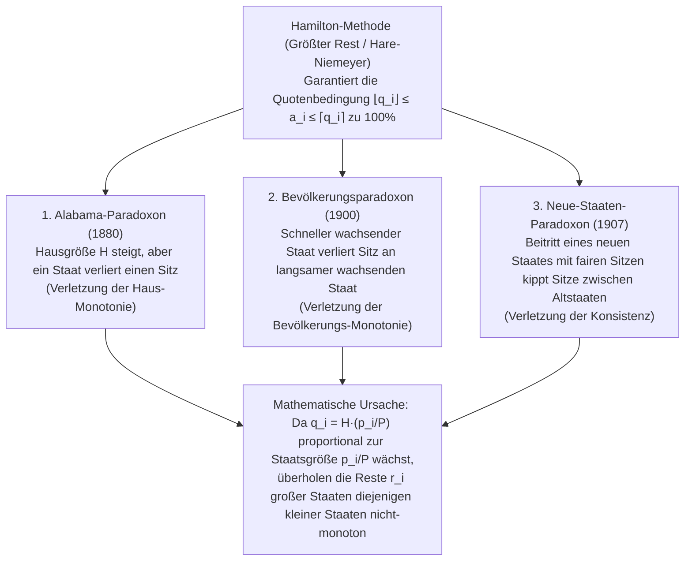

„Verteilen Sie die ganzzahligen Sitze eines Parlaments gerecht und proportional zur Bevölkerungszahl auf die einzelnen Bundesstaaten oder Parteien.“

Wer vor diese Aufgabe gestellt wird, denkt fast unweigerlich an die elementare Schulmathematik: Man teilt die Gesamtbevölkerung durch die Gesamtzahl der Parlamentssitze, erhält den „Standarddivisor“ (Einwohner pro Sitz) und dividiert die Bevölkerung jedes Staates durch diesen Wert. Da hierbei Dezimalzahlen wie $7{,}73$ oder $1{,}36$ Sitze entstehen, erhält jeder Staat zunächst seinen ganzzahligen Anteil (Abrundung), und die verbleibenden Restsitze werden der Reihe nach an die Staaten mit den größten Nachkommastellen vergeben. Könnte ein Verfahren natürlicher, transparenter und gerechter sein?

Doch im Jahr 1880 entdeckte Charles W. Seaton, leitender Beamter des US Census Office, bei der Berechnung der Sitzverteilung des US-Repräsentantenhauses nach genau diesem Verfahren (der <strong>Hamilton-Methode</strong> bzw. dem <strong>Hare-Niemeyer-Verfahren</strong>) ein erschütterndes Phänomen: Als die Gesamtzahl der Parlamentssitze von $299$ auf $300$ <strong>um einen einzigen Sitz erhöht wurde</strong>, fiel der Bundesstaat <strong>Alabama von $8$ Sitzen auf $7$ Sitze zurück</strong> – obwohl sich die Bevölkerungszahlen um keinen einzigen Menschen verändert hatten!

Dass ein Teilnehmer weniger erhält, wenn der gesamte Kuchen vergrößert wird, ging als <strong>Alabama-Paradoxon</strong> in die Mathematikgeschichte ein. Kurz darauf traten zwei weitere Pathologien zutage: Ein Staat mit starkem Bevölkerungswachstum kann einen Sitz an einen langsamer wachsenden Staat verlieren (das <strong>Bevölkerungsparadoxon</strong>), und der Beitritt eines neuen Staates mit exakt der ihm zustehenden Sitzzahl kann bestehende Sitze zwischen völlig unbeteiligten Altstaaten verschieben (das <strong>Neue-Staaten-Paradoxon</strong>). Im Jahr 1982 bewiesen <strong>Michel Balinski</strong> und <strong>H. Peyton Young</strong> schließlich ihren berühmten <strong>Unmöglichkeitssatz von Balinski und Young</strong>: Es ist mathematisch unmöglich, ein Sitzzuteilungsverfahren zu konstruieren, das gleichzeitig die <strong>Quotenbedingung (Quota Rule)</strong> erfüllt und <strong>monoton (paradoxonfrei)</strong> ist.

---

## 1. Die Verfassungskrise von 1792: Hamilton gegen Jefferson und das erste Veto der US-Geschichte

Artikel I, Abschnitt 2 der US-Verfassung von 1787 schrieb vor, dass die Abgeordneten proportional zur Bevölkerung der Bundesstaaten verteilt werden müssen, wobei auf je $30.000$ Einwohner höchstens ein Abgeordneter entfallen darf. Nach der ersten Volkszählung von 1790 ($P = 3.615.920$ Einwohner in $15$ Staaten) verabschiedete der Kongress ein Gesetz mit $H = 120$ Sitzen (Standarddivisor $D = P/H = 30.132{,}67$ Einwohner pro Sitz).

Finanzminister <strong>Alexander Hamilton</strong> schlug das <strong>Verfahren des größten Restes (Hamilton-Methode)</strong> vor: Jeder Staat erhält zunächst $\lfloor p_i / D \rfloor$ Sitze (zusammen $112$ Sitze), und die restlichen $R = 8$ Sitze gehen an die $8$ Staaten mit den größten gebrochenen Resten. Außenminister <strong>Thomas Jefferson</strong> und Präsident <strong>George Washington</strong> (beide aus Virginia) protestierten scharf: Während das bevölkerungsreichste Virginia leer ausging, erhielten kleine Nordstaaten durch Aufrundung so viele Sitze, dass etwa in Delaware ($55.540$ Einwohner, $2$ Sitze) bereits auf <strong>$27.770$ Einwohner ein Sitz</strong> entfiel – ein Verstoß gegen die Verfassungsschranke von $30.000$!

Jefferson entwarf als Gegenmodell die <strong>Jefferson-Methode (in Europa als D'Hondt-Verfahren bekannt)</strong>: Man wählt einen gemeinsamen Divisor $x$ (z. B. $x = 33.000$) und rundet alle Quotienten konsequent ab ($a_i = \lfloor p_i / x \rfloor$), bis die Summe exakt $H$ ergibt. Am <strong>5. April 1792</strong> legte Präsident Washington das <strong>allererste präsidentielle Veto der amerikanischen Geschichte</strong> gegen Hamiltons Gesetz ein – ausgelöst durch einen Streit über <strong>diskrete Rundungsalgorithmen</strong>!

---

## 2. Mathematische Formulierung und die Quotenbedingung (Quota Rule)

Seien $s \ge 2$ Staaten mit dem Bevölkerungsvektor $\mathbf{p} = (p_1, \dots, p_s)$, der Gesamtbevölkerung $P = \sum_{i=1}^s p_i$ und der Hausgröße $H \in \mathbb{Z}_{>0}$ gegeben. Der <strong>Standarddivisor $D$</strong> und die <strong>exakte Quote $q_i$</strong> des Staates $i$ lauten:

$$D = \frac{P}{H}, \qquad q_i = \frac{p_i}{D} = H \cdot \frac{p_i}{P}, \qquad \sum_{i=1}^s q_i = H$$

Die elementarste Gerechtigkeitsforderung bei der Ganzzahlrundung $a_i \in \mathbb{Z}_{\ge 0}$ ($\sum_{i=1}^s a_i = H$) besagt, dass jeder Staat entweder seine <strong>untere Quote $\lfloor q_i \rfloor$</strong> oder seine <strong>obere Quote $\lceil q_i \rceil$</strong> erhalten muss. Dies ist die <strong>Quotenbedingung (Quota Rule)</strong>:

$$\lfloor q_i \rfloor \le a_i \le \lceil q_i \rceil \quad (\forall i \in \{1, 2, \dots, s\})$$

Die <strong>Hamilton-Methode (Hare-Niemeyer-Verfahren)</strong> zerlegt $q_i = \lfloor q_i \rfloor + r_i$ mit $r_i \in [0, 1)$, vergibt vorab $\lfloor q_i \rfloor$ Sitze und verteilt die verbleibenden $R = H - \sum \lfloor q_i \rfloor = \sum r_i$ Sitze an die Staaten mit den größten Resten $r_i$:

$$q_i = \lfloor q_i \rfloor + r_i \quad (0 \le r_i < 1), \qquad R = H - \sum_{i=1}^s \lfloor q_i \rfloor = \sum_{i=1}^s r_i \in \{0, 1, \dots, s-1\}$$

$$a_i = \begin{cases} \lfloor q_i \rfloor + 1 & (\text{if } r_i \text{ is among the } R \text{ largest remainders}) \\ \lfloor q_i \rfloor & (\text{otherwise}) \end{cases}$$

Nach Konstruktion erfüllt die Hamilton-Methode die Quotenbedingung <strong>immer zu $100\%$</strong>.

---

## 3. Vollständige Analyse der drei klassischen Zuteilungsparadoxa

Zwischen 1880 und 1907 offenbarten reale US-Volkszählungsdaten drei fundamentale Paradoxa der Hamilton-Methode:

### 3.1 Das Alabama-Paradoxon (1880) im 3-Staaten-Modell ($H = 10 \to 11$)

Bei der Volkszählung 1880 wuchs beim Übergang von $H = 299$ auf $H = 300$ Alabamas Quote nur um $+0{,}025$ ($7{,}646 \to 7{,}671$), während die größeren Staaten Texas ($9{,}640 \to 9{,}672$, $+0{,}032$) und Illinois ($18{,}640 \to 18{,}702$, $+0{,}062$) ihre Nachkommastellen schneller steigerten und Alabama gleichzeitig überholten. Unser exaktes 3-Staaten-Modell ($P = 1000$) zeigt den Mechanismus:

| Staat | Bevölkerung $p_i$ | Quote $q_i$ ($H=10$) | Basis $\lfloor q_i \rfloor$ & Rest $r_i$ ($H=10$) | <strong>Sitze $a_i$ ($H=10$)</strong> | Quote $q_i'$ ($H=11$) | Basis $\lfloor q_i' \rfloor$ & Rest $r_i'$ ($H=11$) | <strong>Sitze $a_i'$ ($H=11$)</strong> |
| :--- | :---: | :---: | :---: | :---: | :---: | :---: | :---: |
| <strong>Staat A</strong> | $433$ | $4{,}330$ | $4$ ($r_A = 0{,}330$: Rang 2) | <strong>$4$ Sitze</strong> | $4{,}763$ | $4$ ($r_A' = \mathbf{0{,}763}$: Rang 1) | <strong>$5$ Sitze</strong> ($+1$) |
| <strong>Staat B</strong> | $431$ | $4{,}310$ | $4$ ($r_B = 0{,}310$: Rang 3) | <strong>$4$ Sitze</strong> | $4{,}741$ | $4$ ($r_B' = \mathbf{0{,}741}$: Rang 2) | <strong>$5$ Sitze</strong> ($+1$) |
| <strong>Staat C</strong> | $136$ | $1{,}360$ | $1$ ($r_C = \mathbf{0{,}360}$: Rang 1) | <strong>$2$ Sitze</strong> | $1{,}496$ | $1$ ($r_C' = 0{,}496$: Rang 3) | <strong>$1$ Sitz</strong> (<strong>$-1$</strong>) |
| <strong>Summe</strong> | <strong>$1000$</strong> | <strong>$10{,}000$</strong> | Basissumme $= 9$ ($R=1$) | <strong>$10$ Sitze</strong> | <strong>$11{,}000$</strong> | Basissumme $= 9$ ($R'=2$) | <strong>$11$ Sitze</strong> |

Da die Quoten der großen Staaten A und B mehr als dreimal so schnell wachsen wie die des kleinen Staates C, springen ihre Reste auf $0{,}763$ und $0{,}741$ an $r_C' = 0{,}496$ vorbei: Staat C fällt von <strong>$2$ Sitzen auf $1$ Sitz</strong> (Verletzung der <strong>Haus-Monotonie</strong>).

### 3.2 Das Bevölkerungsparadoxon (1900) und das Neue-Staaten-Paradoxon (1907)

- <strong>Bevölkerungsparadoxon</strong>: Zwischen 1890 und 1900 wuchs Virginia um $+12{,}0\%$, Maine nur um $+5{,}0\%$; dennoch verlor Virginia einen Sitz an Maine. Im 3-Staaten-Modell ($H = 10, P = 1000$): Zum Zeitpunkt 1 seien $p_A = 427, p_B = 435, p_C = 138 \implies$ Sitze $(4, 4, 2)$, da $r_C = 0{,}380$ am größten ist. Zum Zeitpunkt 2 wächst <strong>Staat C um $+8{,}70\%$ ($138 \to 150$)</strong>, <strong>Staat B um $+6{,}90\%$ ($435 \to 465$)</strong>, während Staat A schrumpft ($427 \to 385$). Obwohl C prozentual stärker wächst als B, ist der absolute Quotenzuwachs des großen Staates B ($+0{,}300 \implies r_B' = 0{,}650$) größer als der von C ($+0{,}120 \implies r_C' = 0{,}500$), und A unterschreitet die Ganzzahlschwelle $4$ ($q_A' = 3{,}850 \implies r_A' = 0{,}850$). Dadurch verliert der am schnellsten wachsende Staat C einen Sitz ($2 \to 1$) an B ($4 \to 5$)!
- <strong>Neue-Staaten-Paradoxon</strong>: Als Oklahoma 1907 mit $5$ Sitzen beitrat ($H: 386 \to 391$), verlor New York einen Sitz an Maine. Im Modell ($H = 10, P = 1000$ mit $p_A = 842, p_B = 158 \implies a_A = 8, a_B = 2$): Tritt Staat C mit $p_C = 165$ und seinen fairen $2$ Sitzen bei ($H' = 12, P' = 1165$), sinkt der Standarddivisor von $100$ auf $97{,}083$. Alle Quoten werden mit $1{,}03004$ multipliziert: Große Quote $q_A$ wächst um $+0{,}253$ auf $8{,}673$ ($r_A' = 0{,}673$), kleine Quote $q_B$ nur um $+0{,}047$ auf $1{,}627$ ($r_B' = 0{,}627$). Staat A überholt Staat B und entreißt ihm einen Sitz: $(9, 1, 2)$!

---

## 4. Einheitliche Theorie der Divisormethoden (Höchstzahlverfahren) und Wegweiserfunktionen $d(n)$

<strong>Divisormethoden</strong> teilen jede Bevölkerung $p_i$ durch einen anpassbaren gemeinsamen Divisor $x > 0$ und runden den Quotienten $q = p_i / x$ mithilfe einer streng monoton wachsenden <strong>Wegweiserfunktion (Signpost Function) $d(n) \in [n, n+1]$</strong>:

$$[q]_d = n \iff d(n-1) \le q \le d(n), \qquad a_i = \left[\frac{p_i}{x}\right]_d, \qquad \sum_{i=1}^s a_i = H$$

Löst man $d(a_i - 1) \le p_i / x \le d(a_i)$ nach $x$ auf, folgt die <strong>vollständige Äquivalenz zum Höchstzahlverfahren (Prioritätswertverfahren)</strong>:

$$\frac{p_i}{d(a_i)} \le x \le \frac{p_i}{d(a_i - 1)} \quad \Longleftrightarrow \quad \text{Priority}(i, n) = \frac{p_i}{d(n)}$$

Man vergibt die $H$ Sitze einfach an die $H$ größten <strong>Prioritätswerte $\text{Priority}(i, n) = \frac{p_i}{d(n)}$</strong>. Da die globale Rangfolge bei $H \to H+1$ unverändert bleibt und das Verhältnis zweier Prioritätswerte monoton von $p_i / p_j$ abhängt:

$$\frac{p_i'}{p_j'} \ge \frac{p_i}{p_j} \implies \frac{p_i' / d(n)}{p_j' / d(m)} = \frac{p_i'}{p_j'} \cdot \frac{d(m)}{d(n)} \ge \frac{p_i}{p_j} \cdot \frac{d(m)}{d(n)} = \frac{p_i / d(n)}{p_j / d(m)}$$

sind <strong>alle Divisormethoden absolut immun gegen das Alabama-, Bevölkerungs- und Neue-Staaten-Paradoxon!</strong>

### Vergleich der fünf historischen Divisormethoden

| Methodenname (Wahlrechtsname) | Urheber & Jahr | Wegweiser $d(n)$ | Divisorfolge $d(0), d(1), d(2), \dots$ | Mindestsitze | Größenvorteil & Optimierungskriterium | Verhalten bzgl. Quotenbedingung |
| :--- | :--- | :---: | :---: | :---: | :--- | :--- |
| <strong>1. Jefferson-Methode</strong> (<strong>D'Hondt</strong>) | Jefferson (1792) D'Hondt (1878) | $n + 1$ (Abrundung) | $1, 2, 3, 4, \dots$ | $0$ Sitze | <strong>Begünstigt große Staaten / Parteien stark</strong> | Verletzt die <strong>obere Quote</strong> ($a_i > \lceil q_i \rceil$) |
| <strong>2. Webster-Methode</strong> (<strong>Sainte-Laguë</strong>) | Webster (1832) Sainte-Laguë (1910) | $n + 0{,}5$ (Arithm. Mittel) | $0{,}5, 1{,}5, 2{,}5, \dots$ (oder $1, 3, 5, \dots$) | $0$ Sitze | <strong>Vollkommen größenneutral (Unbiased)</strong>; Bundestagswahl | Kann obere und untere Quote selten verletzen |
| <strong>3. Huntington-Hill</strong> (<strong>Equal Proportions</strong>) | Hill (1911) Huntington (1921) | $\sqrt{n(n+1)}$ (Geom. Mittel) | $0, \sqrt{2}, \sqrt{6}, \sqrt{12}, \dots$ | $1$ Sitz | Minimiert relative Ungleichheit $T_{ij}$; <strong>US-Repräsentantenhaus seit 1941</strong> | Kann obere und untere Quote verletzen |
| <strong>4. Dean-Methode</strong> (<strong>Harmonisches Mittel</strong>) | J. Dean (1832) | $\frac{2n(n+1)}{2n+1}$ (Harm. Mittel) | $0, \frac{4}{3}, \frac{12}{5}, \frac{24}{7}, \dots$ | $1$ Sitz | Minimiert absolute Differenz der Wahlkreisgrößen $p_i/a_i$ | Kann obere und untere Quote verletzen |
| <strong>5. Adams-Methode</strong> (<strong>Kleinste Divisoren</strong>) | J. Q. Adams (1832) | $n$ (Aufrundung) | $0, 1, 2, 3, \dots$ | $1$ Sitz | <strong>Begünstigt kleine Staaten stark</strong> | Verletzt die <strong>untere Quote</strong> ($a_i < \lfloor q_i \rfloor$) |

Für die Huntington-Hill-Methode gilt nach der klassischen Ungleichung vom arithmetischen, geometrischen und harmonischen Mittel (AM-GM-HM):

$$T_{ij} = \frac{a_i / p_i}{a_j / p_j} - 1, \qquad d(n) = \sqrt{n(n+1)}$$

$$n < \underbrace{\frac{2n(n+1)}{2n+1}}_{\text{Dean (HM)}} < \underbrace{\sqrt{n(n+1)}}_{\text{Huntington-Hill (GM)}} < \underbrace{n + 0.5}_{\text{Webster (AM)}} < n + 1$$

---

## 5. Der Unmöglichkeitssatz von Balinski und Young (1982)

Selbst die völlig symmetrische <strong>Webster-Methode ($d(n) = n + 0{,}5$, kaufmännisches Runden)</strong> verletzt sowohl die untere als auch die obere Quote:
1. <strong>Verletzung der unteren Quote ($H = 10, P = 1000$)</strong>: Staat A habe $p_A = 832$ ($q_A = 8{,}320$, untere Quote <strong>$8$ Sitze</strong>) und drei kleine Staaten B, C, D je $p_i = 56$ ($q_i = 0{,}560$). Mit dem Divisor $x = 111$ erhalten B, C, D wegen $56/111 \approx 0{,}5045 > 0{,}5$ je $1$ Sitz (zusammen $3$ Sitze), während Staat A wegen $832/111 \approx 7{,}4955 < 7{,}5$ auf <strong>$7$ Sitze</strong> abgerundet wird – ein Verstoß gegen seine untere Quote von $8$ Sitzen!
2. <strong>Verletzung der oberen Quote ($H = 10, P = 1000$)</strong>: Staat A habe $p_A = 795$ ($q_A = 7{,}950$, obere Quote <strong>$8$ Sitze</strong>) und fünf kleine Staaten B–F je $p_i = 41$ ($q_i = 0{,}410$). Mit $x = 83$ werden alle fünf kleinen Staaten wegen $41/83 \approx 0{,}4940 < 0{,}5$ auf $0$ abgerundet, während Staat A wegen $795/83 \approx 9{,}5783 > 9{,}5$ alle <strong>$10$ Sitze</strong> erhält – zwei Sitze über seiner oberen Quote!

1982 bewiesen Balinski und Young ihr fundamentales Theorem:
- <strong>Satz 1 (Charakterisierungssatz)</strong>: Eine anonyme, homogene Zuteilungsmethode ist genau dann <strong>bevölkerungsmonoton (frei vom Bevölkerungsparadoxon)</strong>, wenn sie eine <strong>Divisormethode</strong> ist.
- <strong>Satz 2 (Unmöglichkeitssatz von Balinski und Young, 1982)</strong>: Für $s \ge 4$ Staaten und $H \ge 7$ Sitze <strong>existiert kein Sitzzuteilungsverfahren, das gleichzeitig die Bevölkerungsmonotonie und die Quotenbedingung ($\lfloor q_i \rfloor \le a_i \le \lceil q_i \rceil$) erfüllt</strong>.

Denn bei jeder Divisormethode skaliert die Anpassung des Divisors $x$ alle exakten Quoten multiplikativ mit $\lambda = D/x$ ($p_i/x = \lambda q_i$). Dadurch verschiebt sich die Quote eines großen Staates absolut um $\Delta q_A = |1 - \lambda| q_A$, was bei asymmetrischer Größenverteilung unweigerlich Ganzzahlgrenzen überschreitet.
