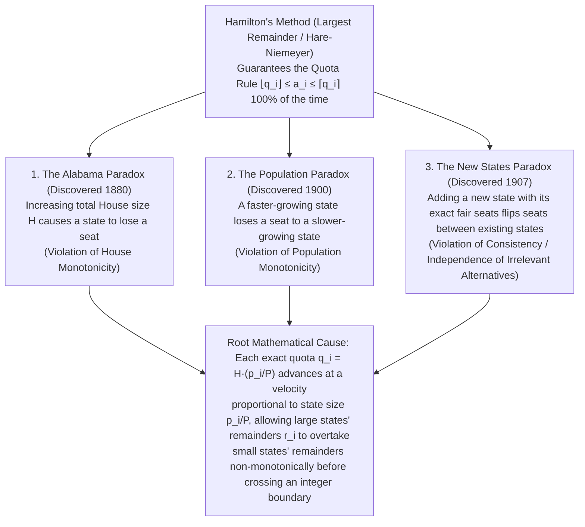
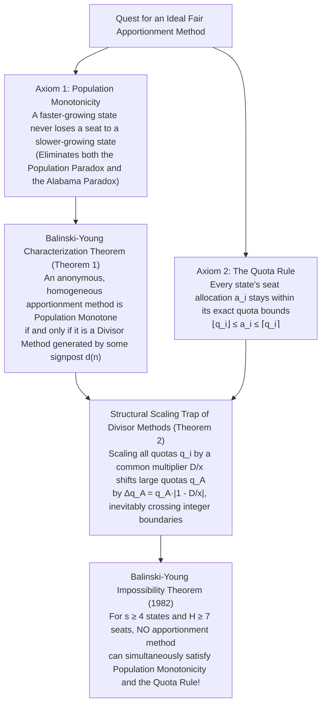

"Divide the seats of the national legislature fairly among the states in proportion to their populations."

If you were handed this task, what calculation would come to mind? Almost certainly, you would reach for the elementary arithmetic of proportions and rounding taught in grade school. First, divide the total national population by the total number of seats in the legislature to find the "standard population per seat." Next, divide each state's population by that standard divisor. Because this division inevitably produces decimal fractions—such as "$7.73$ seats" or "$1.36$ seats"—you first award each state its whole-number floor ($7$ seats and $1$ seat, respectively), and then distribute the remaining leftover seats one by one to the states with the largest fractional remainders ($.73$, $.36$, and so on). What could possibly be more natural, transparent, or unimpeachably fair?

Yet in 1880, a chief clerk at the United States Census Office computing congressional seat allocations under this exact "most natural and fair" rule uncovered a mathematical nightmare that sent chills through Capitol Hill. When the total size of the U.S. House of Representatives was <strong>increased by a single seat</strong> from $299$ seats to $300$ seats—without a single person moving or a single state's census count changing—the state of <strong>Alabama saw its allocation drop from $8$ seats to $7$ seats</strong>.

Increasing the total pie caused a participant's slice to shrink. This phenomenon, immortalized as the <strong>Alabama Paradox</strong>, was neither a clerical error nor a statistical fluke. Over the ensuing decades, an entire rogue's gallery of mathematical pathologies emerged from official census tabulations: a state whose population grew rapidly could lose a seat to a state whose population stagnated (the <strong>Population Paradox</strong>), and admitting a new state to the Union along with the exact number of new seats warranted by its population could cause two completely unrelated existing states to swap seats (the <strong>New States Paradox</strong>). For nearly two centuries, these anomalies embroiled U.S. presidents, Founding Fathers, congressional committees, and the National Academy of Sciences in fierce constitutional and mathematical warfare.

Finally, in 1982, mathematicians <strong>Michel Balinski</strong> and <strong>H. Peyton Young</strong> delivered the ultimate verdict: the <strong>Balinski-Young Impossibility Theorem</strong>. Their theorem proved with airtight mathematical finality that <strong>no apportionment method can simultaneously guarantee the Quota Rule</strong> (that every state receives either the floor or the ceiling of its exact proportional share) <strong>and avoid the Population Paradox</strong> (so that a faster-growing state never loses a seat to a slower-growing state). Just as Kenneth Arrow's Impossibility Theorem shattered the dream of a perfect voting system, the Balinski-Young theorem revealed an irreconcilable quantization barrier at the heart of representative democracy.

In this article, we trace the 230-year mathematical saga of apportionment—beginning with George Washington's historic first presidential veto in 1792 over the clash between Alexander Hamilton and Thomas Jefferson, deriving the exact algebraic and geometric mechanisms behind the three classic paradoxes with complete numerical tables, unifying the five classical <strong>Divisor Methods</strong> (Jefferson/D'Hondt, Adams, Webster/Sainte-Laguë, Dean, and Huntington-Hill) via signpost functions $d(n)$, and proving why even the most unbiased divisor method (Webster's method) is forced to violate the Quota Rule under the Balinski-Young theorem.

---

## Chapter 1: The Constitutional Crisis of 1792 — Division, Remainders, and the First Presidential Veto

The mathematical drama of apportionment begins at the dawn of the American republic. Article I, Section 2, Clause 3 of the United States Constitution (ratified in 1788) mandated:

> "Representatives and direct Taxes shall be apportioned among the several States which may be included within this Union, according to their respective Numbers... The Number of Representatives shall not exceed one for every thirty Thousand, but each State shall have at Least one Representative."

The Framers of the Constitution assumed that the phrase "according to their respective Numbers" was self-executing: once a census counted the population, computing each state's seats would be a routine exercise in schoolbook arithmetic. That illusion shattered as soon as the first U.S. Census of 1790 returned an official apportionment population of $P = 3,615,920$ across the $15$ states (the original thirteen plus Vermont and Kentucky). Because human representatives cannot besawed into fractional pieces, Congress collided head-on with the fundamental wall of discrete mathematics: <strong>integer quantization</strong>.

In early 1792, Congress passed an apportionment bill setting the size of the House of Representatives at $H = 120$ seats—the largest whole number satisfying the constitutional ceiling that the national average population per representative be at least $30,000$ ($3,615,920 / 120 = 30,132.67$ persons per seat).

To distribute those $120$ seats among the $15$ states, Secretary of the Treasury <strong>Alexander Hamilton</strong> proposed the two-step procedure known today as <strong>Hamilton's Method</strong> (or the <strong>Largest Remainder Method</strong>):
1. Divide each state's population $p_i$ by the national standard divisor $D = P / H = 30,132.67$ (or $30,000$ in the bill's variant) to obtain its exact quota $q_i$, and award each state its integer part $\lfloor q_i \rfloor$. Across the $15$ states, these integer parts summed to $112$ seats, leaving $R = 8$ unallocated seats.
2. Award the remaining $8$ seats one each to the $8$ states with the largest fractional remainders $r_i = q_i - \lfloor q_i \rfloor$.

When Secretary of State <strong>Thomas Jefferson</strong> and President <strong>George Washington</strong> (both Virginians) examined the resulting seat table, they were outraged. Under Hamilton's fractional rounding, almost all of the $8$ remainder seats went to northern commercial states (Hamilton's Federalist stronghold), while Virginia—the most populous state in the Union—just missed the remainder cutoff. Even worse, in small states whose fractional remainders were rounded up—most notably Delaware, whose population of $55,540$ received $2$ seats instead of $1$—the resulting ratio of population per representative inside Delaware dropped to $55,540 / 2 = \mathbf{27,770}$ persons per seat!

Jefferson mounted a blistering two-pronged critique:
1. <strong>Constitutional violation</strong>: The Constitution explicitly stated that "the Number of Representatives shall not exceed one for every thirty Thousand." Giving Delaware one representative for every $27,770$ residents violated the plain text of Article I if the $30,000$ limit was applied state by state rather than merely to the national aggregate.
2. <strong>Mathematical arbitrariness</strong>: Why divide by a national divisor first and then hold a separate tournament among fractional remainders? A remainder of $0.7$ represents $70\%$ of a seat for a tiny state with $1$ seat, whereas for a large state with $19$ seats, a remainder of $0.7$ represents less than $3.6\%$ of its representation. Treating raw fractional remainders as comparable across states of vastly different sizes systematically penalizes large states.

As a rigorous alternative, Jefferson proposed what became known as <strong>Jefferson's Method</strong> (rediscovered in Europe a century later by Victor D'Hondt as the <strong>D'Hondt Method</strong>): choose a single common divisor $x$ (such as $x = 33,000$ persons per seat), divide every state's population $p_i$ by $x$, and <strong>discard all fractional remainders unconditionally</strong> ($a_i = \lfloor p_i / x \rfloor$), adjusting the divisor $x$ until the integer parts alone sum to the desired House size $H$.

On <strong>April 5, 1792</strong>, President George Washington exercised the <strong>first presidential veto in United States history</strong>, striking down Hamilton's apportionment bill as unconstitutional. It is a remarkable historical fact that the very first use of the executive veto in American constitutional history was triggered not by war, treaties, or taxation, but by a dispute over <strong>which mathematical rounding algorithm should map real numbers to integers</strong>. Congress subsequently adopted Jefferson's divisor method with $x = 33,000$, yielding a House of $H = 105$ seats and inaugurating a two-century mathematical war between <strong>Quota Methods (Largest Remainder)</strong> and <strong>Divisor Methods (Highest Averages)</strong>.

---

## Chapter 2: Mathematical Formulation of Apportionment and the Quota Rule

To analyze why fair apportionment leads to inescapable paradoxes, let us establish a precise mathematical framework.

### 2.1 Fundamental Notation and the Exact Quota

- <strong>Set of states (or political parties)</strong>: $S = \{1, 2, \dots, s\}$ with $s \ge 2$.
- <strong>Population vector</strong>: $\mathbf{p} = (p_1, p_2, \dots, p_s) \in \mathbb{R}_{>0}^s$, where $p_i > 0$ is the population of state $i$ (or the vote total of party $i$ in proportional representation elections).
- <strong>Total population</strong>: $P = \sum_{i=1}^s p_i$.
- <strong>House size (total seats)</strong>: $H \in \mathbb{Z}_{>0}$.
- <strong>Apportionment vector</strong>: $\mathbf{a} = (a_1, a_2, \dots, a_s) \in \mathbb{Z}_{\ge 0}^s$ satisfying the exact sum constraint $\sum_{i=1}^s a_i = H$.

If seats were infinitely divisible real numbers rather than indivisible integers, the unique perfectly proportional allocation would assign to each state $i$ a share strictly proportional to its population fraction $p_i / P$. We define the <strong>Standard Divisor $D$</strong> (the national average population per seat) and state $i$'s <strong>Exact Quota $q_i$</strong> as:

$$D = \frac{P}{H}, \qquad q_i = \frac{p_i}{D} = H \cdot \frac{p_i}{P}, \qquad \sum_{i=1}^s q_i = H$$

By construction, the exact quotas $q_i$ are positive real numbers whose sum across all $s$ states equals the integer House size $H$.

### 2.2 Lower Quota, Upper Quota, and the Quota Rule

In practice, $q_i$ is almost never an integer. If state $i$'s exact quota is $q_i = 7.73$, what is the most fundamental requirement of fairness when rounding $q_i$ to an integer $a_i$? Every citizen's intuition agrees: a state entitled to $7.73$ seats should receive either its <strong>Lower Quota</strong> $\lfloor q_i \rfloor = 7$ (rounded down) or its <strong>Upper Quota</strong> $\lceil q_i \rceil = 8$ (rounded up). Under no circumstances should a state entitled to $7.73$ seats be cut down to $6$ seats or Fewer, nor inflated to $9$ seats or more!

This minimal fairness axiom is known as the <strong>Quota Rule (or Quota Condition)</strong>:

$$\lfloor q_i \rfloor \le a_i \le \lceil q_i \rceil \quad (\forall i \in \{1, 2, \dots, s\})$$

If an apportionment method assigns $a_i < \lfloor q_i \rfloor$ to any state, it commits a <strong>Lower Quota Violation</strong>. Conversely, if it assigns $a_i > \lceil q_i \rceil$, it commits an <strong>Upper Quota Violation</strong>. At first glance, satisfying the Quota Rule appears to be a non-negotiable prerequisite for any legitimate apportionment system.

---

## Chapter 3: Hamilton's Method (Largest Remainder / Hare-Niemeyer Method)

The most direct algorithm designed to enforce the Quota Rule by construction is <strong>Hamilton's Method</strong>, also known in political science and electoral law as the <strong>Largest Remainder Method</strong>, <strong>Vinton's Method</strong> (after Representative Samuel F. Vinton, who reintroduced it to the U.S. Congress in 1850), or the <strong>Hare-Niemeyer Method</strong> (after Thomas Hare and German mathematician Horst Niemeyer, who adopted it for Bundestag allocations in 1970).

Hamilton's algorithm proceeds in three deterministic steps:

1. <strong>Decomposition into integer floor and fractional remainder</strong>:
   Compute the exact quota $q_i = H \cdot (p_i / P)$ for each state $i \in \{1, \dots, s\}$ and decompose it into its integer part (lower quota) $\lfloor q_i \rfloor \in \mathbb{Z}_{\ge 0}$ and its fractional remainder $r_i \in [0, 1)$.
2. <strong>Initial allocation and leftover seat count $R$</strong>:
   Award each state $\lfloor q_i \rfloor$ seats. Because $0 \le r_i < 1$ for every $i$, the number of remaining unallocated seats $R = H - \sum_{i=1}^s \lfloor q_i \rfloor = \sum_{i=1}^s r_i$ is guaranteed to be an integer strictly between $0$ and $s - 1$.
3. <strong>Allocation by largest remainders</strong>:
   Rank the states in descending order of their fractional remainders $r_i$, and award $1$ additional seat to each of the top $R$ states:

$$q_i = \lfloor q_i \rfloor + r_i \quad (0 \le r_i < 1), \qquad R = H - \sum_{i=1}^s \lfloor q_i \rfloor = \sum_{i=1}^s r_i \in \{0, 1, \dots, s-1\}$$

$$a_i = \begin{cases} \lfloor q_i \rfloor + 1 & (\text{if } r_i \text{ is among the } R \text{ largest remainders}) \\ \lfloor q_i \rfloor & (\text{otherwise}) \end{cases}$$

Because every state receives either $\lfloor q_i \rfloor$ or $\lfloor q_i \rfloor + 1 \le \lceil q_i \rceil$ seats, <strong>Hamilton's Method satisfies the Quota Rule $100\%$ of the time for every conceivable population vector $\mathbf{p}$ and every House size $H$</strong>.

In 1850, after decades of complaints that Jefferson's Method systematically favored large states and violated upper quotas, the U.S. Congress officially adopted Hamilton's Method (under the name of Vinton's Act of 1850). Lawmakers believed they had solved the apportionment problem forever. Instead, they had walked into a mathematical minefield.

---

## Chapter 4: Anatomy of the Three Classic Apportionment Paradoxes

Between 1880 and 1907, real census tabulations under Hamilton's Method exposed <strong>three devastating mathematical paradoxes</strong>. Let us dissect the historical discovery, the underlying geometric mechanism, and a self-contained numerical proof for each of the three paradoxes.

### 4.1 The Alabama Paradox (1880): Failure of House Monotonicity

#### Historical Discovery (The Tragedy of $H = 299 \to 300$)
Following the Tenth U.S. Census of 1880, Chief Clerk <strong>Charles W. Seaton</strong> of the Census Office computed Hamilton apportionments for every House size $H$ from $275$ to $350$ seats to assist Congress in choosing the size of the new House. As Seaton inspected the transition from $H = 299$ seats to $H = 300$ seats, he discovered an astonishing anomaly and wrote an urgent letter to Congress:

| State | Exact Quota $q_i$ at $H = 299$ | Seats $a_i$ at $H = 299$ | Exact Quota $q_i$ at $H = 300$ | Seats $a_i$ at $H = 300$ | Net Change $\Delta a_i$ |
| :--- | :---: | :---: | :---: | :---: | :---: |
| <strong>Alabama</strong> | $7.646$ ($r_{\text{AL}} = 0.646$) | <strong>$8$ seats</strong> | $7.671$ ($r_{\text{AL}} = 0.671$) | <strong>$7$ seats</strong> | <strong>$-1$ (Loses a seat!)</strong> |
| <strong>Texas</strong> | $9.640$ ($r_{\text{TX}} = 0.640$) | $9$ seats | $9.672$ ($r_{\text{TX}} = 0.672$) | $10$ seats | $+1$ (Gains a seat) |
| <strong>Illinois</strong> | $18.640$ ($r_{\text{IL}} = 0.640$) | $18$ seats | $18.702$ ($r_{\text{IL}} = 0.702$) | $19$ seats | $+1$ (Gains a seat) |

Look closely at the numbers in Seaton's table:
- At $H = 299$, Alabama's exact quota was $7.646$, giving it a remainder of $r_{\text{AL}} = 0.646$—just barely ahead of Texas ($0.640$) and Illinois ($0.640$). Alabama claimed the very last leftover remainder seat, rounding up from $7$ to <strong>$8$ seats</strong>, while Texas ($9$) and Illinois ($18$) were rounded down.
- When the House size was increased by $1$ seat to $H = 300$, the sum of all exact quotas across the nation increased by $+1.000$. How is that $+1.000$ increase distributed among the states? Since $q_i(H) = H \cdot (p_i / P)$, the derivative of a state's quota with respect to House size $H$ is $\frac{\Delta q_i}{\Delta H} = \frac{p_i}{P}$—<strong>each state's quota grows at a speed strictly proportional to its population share!</strong>
- Consequently, medium-sized Alabama saw its quota advance by only $+0.025$ ($7.646 \to 7.671$), whereas larger Texas advanced by $+0.032$ ($9.640 \to 9.672$) and populous Illinois surged by $+0.062$ ($18.640 \to 18.702$).
- Because neither Texas nor Illinois crossed an integer boundary (which would have reset their fractional remainders modulo $1$), both of their remainders ($0.672$ and $0.702$) <strong>overtook Alabama's remainder ($0.671$) simultaneously</strong>! Texas and Illinois both jumped ahead in the remainder queue, absorbing not only the newly added $300\text{th}$ seat, but also the remainder seat previously held by Alabama. Alabama tumbled from $8$ seats down to $7$.

Two decades later, in 1900, the exact same curse struck <strong>Colorado</strong> and <strong>Maine</strong>: under the 1900 census, Maine and Colorado were knocked down a seat at several House sizes between $350$ and $400$, prompting enraged representatives to denounce Hamilton's method on the House floor (`"God help the State of Maine when mathematics reaches for her!"`) and ultimately driving Congress to abandon Hamilton's method forever in 1901.

#### Complete 3-State Numerical Proof ($P = 1000$, $H = 10 \to 11$)
To see that the Alabama Paradox does not require $38$ states or complex fractions, let us construct a crystal-clear $3$-state country with total population $P = 1000$ comparing $H = 10$ seats against $H = 11$ seats:

- <strong>State A</strong>: $p_A = 433$ ($43.3\%$ of national population)
- <strong>State B</strong>: $p_B = 431$ ($43.1\%$ of national population)
- <strong>State C</strong>: $p_C = 136$ ($13.6\%$ of national population)
- <strong>Total Population</strong>: $P = 433 + 431 + 136 = 1000$

| State | Population $p_i$ | Quota $q_i$ ($H=10$) | Floor $\lfloor q_i \rfloor$ & Remainder $r_i$ ($H=10$) | <strong>Seats $a_i$ ($H=10$)</strong> | Quota $q_i'$ ($H=11$) | Floor $\lfloor q_i' \rfloor$ & Remainder $r_i'$ ($H=11$) | <strong>Seats $a_i'$ ($H=11$)</strong> |
| :--- | :---: | :---: | :---: | :---: | :---: | :---: | :---: |
| <strong>State A</strong> | $433$ | $4.330$ | $4$ ($r_A = 0.330$, Rank 2) | <strong>$4$ seats</strong> | $4.763$ | $4$ ($r_A' = \mathbf{0.763}$, Rank 1) | <strong>$5$ seats</strong> ($+1$) |
| <strong>State B</strong> | $431$ | $4.310$ | $4$ ($r_B = 0.310$, Rank 3) | <strong>$4$ seats</strong> | $4.741$ | $4$ ($r_B' = \mathbf{0.741}$, Rank 2) | <strong>$5$ seats</strong> ($+1$) |
| <strong>State C</strong> | $136$ | $1.360$ | $1$ ($r_C = \mathbf{0.360}$, Rank 1) | <strong>$2$ seats</strong> | $1.496$ | $1$ ($r_C' = 0.496$, Rank 3) | <strong>$1$ seat</strong> (<strong>$-1$</strong>) |
| <strong>Total</strong> | <strong>$1000$</strong> | <strong>$10.000$</strong> | Sum of floors $= 9$ ($R = 1$) | <strong>$10$ seats</strong> | <strong>$11.000$</strong> | Sum of floors $= 9$ ($R' = 2$) | <strong>$11$ seats</strong> |

The mechanics are completely transparent:
1. At <strong>$H = 10$</strong>, the integer floors sum to $4 + 4 + 1 = 9$, leaving $R = 1$ remainder seat. Small State C has the largest remainder ($r_C = 0.360 > 0.330 > 0.310$), so State C wins the extra seat and receives <strong>$2$ seats</strong>.
2. When we add one seat to reach <strong>$H = 11$</strong>, each state's quota increases by its population share: State A gains $+0.433$, State B gains $+0.431$, and State C gains only $+0.136$. Because none of the quotas cross the next integer threshold ($5$ or $2$), the sum of integer floors remains $4 + 4 + 1 = 9$, so there are now $R' = 11 - 9 = 2$ remainder seats to distribute.
3. However, because large States A and B moved more than three times faster than small State C, both $r_A' = 0.763$ and $r_B' = 0.741$ leapfrog over $r_C' = 0.496$. States A and B take the $2$ remainder seats, and State C drops from <strong>$2$ seats down to $1$ seat</strong>!

In formal social choice theory, the requirement that no state should ever lose a seat when the House size increases ($H' > H \implies a_i(H') \ge a_i(H)$ for all $i$) is called <strong>House Monotonicity</strong>. Hamilton's Method violates House Monotonicity.

---

### 4.2 The Population Paradox (1900): Failure of Population Monotonicity

#### Historical Discovery (Virginia vs. Maine, 1890–1900)
Suppose we hold the House size $H$ fixed over time. Surely, if State $i$'s population grows at a faster percentage rate than State $j$'s population between two censuses, State $i$ cannot lose a seat while State $j$ gains a seat?

In 1900, Census comparisons between 1890 and 1900 proved that even this bedrock intuition fails under Hamilton's Method. Between 1890 and 1900, <strong>Virginia's</strong> population grew from $1,655,980$ to $1,854,184$—an increase of nearly $200,000$ people, or <strong>$+11.97\%$</strong>. Over the same decade, <strong>Maine's</strong> population grew from $661,086$ to $694,466$—an increase of just $33,380$ people, or <strong>$+5.05\%$</strong>. Virginia outgrew Maine both in absolute numbers and in relative percentage growth; the ratio of Virginia's population to Maine's rose from $2.505$ to $2.670$. Yet for fixed House sizes (such as $H = 386$), Hamilton's Method <strong>took a seat away from fast-growing Virginia ($10 \to 9$) and gave a seat to slow-growing Maine ($3 \to 4$)</strong>!

#### Complete 3-State Numerical Proof ($H = 10$ fixed, $P = 1000$)
Let us prove how this happens with a clean $3$-state model where total seats $H = 10$ and total population $P = 1000$ remain constant between Time 1 and Time 2:

- <strong>Time 1</strong>: $p_A = 427$, $p_B = 435$, $p_C = 138$ ($P = 1000$).
- <strong>Time 2</strong>:
  - <strong>State C grows by $+8.70\%$</strong> ($138 \to 150$).
  - <strong>State B grows by $+6.90\%$</strong> ($435 \to 465$).
  - <strong>State A declines by $-9.84\%$</strong> ($427 \to 385$).
  - Total population is still $P' = 385 + 465 + 150 = 1000$.

Notice that <strong>State C's population growth rate ($+8.70\%$) is strictly greater than State B's growth rate ($+6.90\%$)</strong>, so the relative population ratio $p_C / p_B$ increases from $138/435 \approx 0.3172$ to $150/465 \approx 0.3226$. Now observe the Hamilton apportionment at $H = 10$:

| State | Pop. $p_i$ (Time 1) | Quota $q_i$ & Remainder $r_i$ (Time 1) | <strong>Seats $a_i$ (Time 1)</strong> | Growth Rate | Pop. $p_i'$ (Time 2) | Quota $q_i'$ & Remainder $r_i'$ (Time 2) | <strong>Seats $a_i'$ (Time 2)</strong> | Net Change |
| :--- | :---: | :---: | :---: | :---: | :---: | :---: | :---: | :---: |
| <strong>State A</strong> | $427$ | $4.270$ ($r_A = 0.270$, Rank 3) | <strong>$4$ seats</strong> | $-9.84\%$ | $385$ | $3.850$ ($r_A' = \mathbf{0.850}$, Rank 1) | <strong>$4$ seats</strong> | $0$ |
| <strong>State B</strong> | $435$ | $4.350$ ($r_B = 0.350$, Rank 2) | <strong>$4$ seats</strong> | <strong>$+6.90\%$</strong> | $465$ | $4.650$ ($r_B' = \mathbf{0.650}$, Rank 2) | <strong>$5$ seats</strong> | <strong>$+1$ (Gains!)</strong> |
| <strong>State C</strong> | $138$ | $1.380$ ($r_C = \mathbf{0.380}$, Rank 1) | <strong>$2$ seats</strong> | <strong>$+8.70\%$</strong> | $150$ | $1.500$ ($r_C' = 0.500$, Rank 3) | <strong>$1$ seat</strong> | <strong>$-1$ (Loses!)</strong> |
| <strong>Total</strong> | <strong>$1000$</strong> | Floors $= 9$ ($R = 1$) | <strong>$10$ seats</strong> | $0.00\%$ | <strong>$1000$</strong> | Floors $= 8$ ($R' = 2$) | <strong>$10$ seats</strong> | — |

Two simultaneous mathematical traps produce this paradox:
1. <strong>Relative growth rate vs. absolute remainder velocity</strong>: Although small State C grew at a higher percentage rate ($+8.70\%$) than large State B ($+6.90\%$), a state's absolute quota increase is $\Delta q_i = q_i \times (\text{growth rate})$. Because State B's base quota ($4.350$) is more than three times larger than State C's ($1.380$), State B's remainder jumps by $+0.300$ ($0.350 \to 0.650$), whereas State C's remainder advances by only $+0.120$ ($0.380 \to 0.500$).
2. <strong>Integer boundary crossing by a third state (modulo-$1$ wrap-around)</strong>: Shrinking State A's quota drops from $4.270$ to $3.850$, crossing the integer boundary $4$ from above. Its integer floor drops from $4$ to $3$, which frees up a second remainder seat ($R' = 2$), but simultaneously causes State A's fractional remainder to wrap around modulo $1$ from $0.270$ up to $r_A' = 0.850$ (Rank 1!). Thus State A reclaims its $4\text{th}$ seat via the remainder pool, State B takes the second remainder seat to rise from $4$ to $5$, and fastest-growing State C is pushed out to $3\text{rd}$ place, dropping from $2$ seats to $1$!

Formally, an apportionment method satisfies <strong>Population Monotonicity</strong> if whenever $p_i' / p_j' \ge p_i / p_j$, it is impossible to have both $a_i' < a_i$ and $a_j' > a_j$ (unless tied). Any violation of this condition is called the <strong>Population Paradox</strong>.

---

### 4.3 The New States Paradox (1907): Failure of Consistency

#### Historical Discovery (Oklahoma's Admission in 1907)
In 1907, <strong>Oklahoma</strong> was admitted to the Union as the $46\text{th}$ state. Prior to Oklahoma's admission, the U.S. House had $H = 386$ seats apportioned among $45$ states. Based on Oklahoma's population of roughly $1,000,000$, its fair proportional entitlement under the existing ratio was $5$ seats. Congress therefore expanded the House by $5$ seats from $H = 386$ to $H' = 391$ seats so Oklahoma could receive its $5$ seats without disturbing the existing $45$ states.

Yet when Hamilton's Method was recomputed for all $46$ states at $H' = 391$, Oklahoma duly received its $5$ seats, but <strong>New York lost a seat ($38 \to 37$) and Maine gained a seat ($3 \to 4$)</strong>—even though neither New York's nor Maine's population had changed by a single person!

#### Complete Numerical Proof ($2$ Existing States $+$ $1$ New State)
Suppose a federation initially consists of two states, State A ($p_A = 842$) and State B ($p_B = 158$), sharing $H = 10$ seats ($P = 1000$, standard divisor $D = 100$ persons/seat):
- Before expansion ($H = 10, P = 1000$): $q_A = 8.420$ ($r_A = 0.420$) and $q_B = 1.580$ ($r_B = 0.580$). Since $r_B > r_A$, State B wins the remainder seat: <strong>State A gets $8$ seats, State B gets $2$ seats</strong>.
- Now <strong>New State C</strong> joins the federation with population <strong>$p_C = 165$</strong>. At the existing standard divisor of $D = 100$ persons/seat, State C is worth $1.65$ seats, which rounds to <strong>$2$ seats</strong>.
- We add exactly $2$ seats to the House ($H' = 10 + 2 = 12$) and recompute Hamilton's Method for all three states ($P' = 1000 + 165 = 1165$):

| State | Population $p_i$ | Quota $q_i$ Before ($H=10, P=1000$) | <strong>Seats $a_i$ Before</strong> | Quota $q_i'$ After ($H'=12, P'=1165$) | Floor & Remainder $r_i'$ After | <strong>Seats $a_i'$ After</strong> | Net Change |
| :--- | :---: | :---: | :---: | :---: | :---: | :---: | :---: |
| <strong>State A</strong> | $842$ | $8.420$ ($r_A = 0.420$, Rank 2) | <strong>$8$ seats</strong> | $8.673$ | $8$ ($r_A' = \mathbf{0.673}$, Rank 2) | <strong>$9$ seats</strong> | <strong>$+1$ (Gains!)</strong> |
| <strong>State B</strong> | $158$ | $1.580$ ($r_B = \mathbf{0.580}$, Rank 1) | <strong>$2$ seats</strong> | $1.627$ | $1$ ($r_B' = 0.627$, Rank 3) | <strong>$1$ seat</strong> | <strong>$-1$ (Loses!)</strong> |
| <strong>New State C</strong> | $165$ | — | — | $1.700$ | $1$ ($r_C' = \mathbf{0.700}$, Rank 1) | <strong>$2$ seats</strong> | ($2$ new seats) |
| <strong>Total</strong> | <strong>$1165$</strong> | Floors $= 9$ ($R = 1$) | <strong>$10$ seats</strong> | <strong>$12.000$</strong> | Floors $= 10$ ($R' = 2$) | <strong>$12$ seats</strong> | — |

Why did State A steal a seat from State B when State C joined? Because State C brought $p_C = 165$ people ($1.65$ standard quotas) along with $2$ whole seats, slightly lowering the national standard divisor from $D = 1000/10 = 100$ to $D' = 1165/12 \approx 97.083$ persons/seat. Rescaling every existing state's quota by $100 / 97.083 \approx 1.03004$ increases large State A's quota by $+0.253$ ($8.420 \to 8.673$), while small State B's quota increases by only $+0.047$ ($1.580 \to 1.627$). State A's remainder ($0.673$) overtakes State B's remainder ($0.627$), flipping a seat between them!

---

## Chapter 5: The Unified Theory of Divisor Methods and Signpost Functions $d(n)$

The common root of all three paradoxes in Hamilton's Method is its two-stage architecture: fixing a global divisor $D = P/H$ first, and then comparing fractional remainders modulo $1$ across states of different sizes. By contrast, <strong>Divisor Methods</strong>—originating with Thomas Jefferson in 1792—eliminate fractional remainder comparisons altogether.

### 5.1 Signpost Functions $d(n)$ and Generalized Rounding $[\cdot]_d$

A Divisor Method is uniquely specified by choosing a monotone increasing <strong>Signpost Function (or Dividing Function) $d(n)$</strong> that places a rounding threshold $d(n) \in [n, n+1]$ inside each integer interval $[n, n+1]$ for $n = 0, 1, 2, \dots$. Given $d(n)$, any non-negative real quotient $q = p_i / x$ is rounded to an integer $[q]_d = n$ according to:

$$[q]_d = n \iff d(n-1) \le q \le d(n), \qquad a_i = \left[\frac{p_i}{x}\right]_d, \qquad \sum_{i=1}^s a_i = H$$

Here $x > 0$ is an adjustable <strong>modified divisor</strong> chosen so that the rounded integers $a_i = [p_i / x]_d$ sum to the target House size $H$.

### 5.2 Exact Equivalence to Highest Averages (Priority Value) Methods

Rewriting the rounding condition $d(a_i - 1) \le \frac{p_i}{x} \le d(a_i)$ in terms of the modified divisor $x$ yields a profound equivalence:

$$\frac{p_i}{d(a_i)} \le x \le \frac{p_i}{d(a_i - 1)} \quad \Longleftrightarrow \quad \text{Priority}(i, n) = \frac{p_i}{d(n)}$$

This inequality states that every seat $n + 1$ ($0 \le n \le a_i - 1$) awarded to any state $i$ has a <strong>Priority Value $\text{Priority}(i, n) = \frac{p_i}{d(n)} \ge x$</strong>, while every un-awarded seat ($n \ge a_i$) has a priority value $\frac{p_i}{d(n)} \le x$. Consequently, finding a modified divisor $x$ and rounding via $d(n)$ is <strong>$100\%$ mathematically equivalent to computing the infinite matrix of priority values $\frac{p_i}{d(n)}$ for all states $i$ and seat numbers $n = 0, 1, 2, \dots$, sorting them in descending order, and awarding seats one by one to the top $H$ priority values!</strong> (If $d(0) = 0$, then $\frac{p_i}{0} = +\infty$, which automatically awards $1$ mandatory minimum seat to every state before comparing $n \ge 1$.)

This priority-value representation proves in three lines why <strong>every Divisor Method is completely immune to all three apportionment paradoxes</strong>:
1. <strong>No Alabama Paradox (House Monotonicity)</strong>: Increasing the House size from $H$ to $H+1$ simply awards the $(H+1)\text{th}$ highest priority value $\frac{p_i}{d(n)}$ in the fixed global ranking without altering the top $H$ seats already awarded.
2. <strong>No Population Paradox (Population Monotonicity)</strong>: If State $i$ grows faster than State $j$ ($p_i' / p_j' \ge p_i / p_j$), then for any seat counts $n$ and $m$, the ratio of their priority values satisfies:

$$\frac{p_i'}{p_j'} \ge \frac{p_i}{p_j} \implies \frac{p_i' / d(n)}{p_j' / d(m)} = \frac{p_i'}{p_j'} \cdot \frac{d(m)}{d(n)} \ge \frac{p_i}{p_j} \cdot \frac{d(m)}{d(n)} = \frac{p_i / d(n)}{p_j / d(m)}$$

   Thus State $j$'s priority value can never overtake State $i$'s priority value when State $i$ grows faster than State $j$.
3. <strong>No New States Paradox (Consistency)</strong>: Whether State $i$'s $n\text{th}$ priority value $\frac{p_i}{d(n)}$ beats State $j$'s $m\text{th}$ priority value $\frac{p_j}{d(m)}$ depends solely on $p_i$ and $p_j$, remaining completely invariant when a new State $C$ is added or removed.

### 5.3 Complete Comparison of the Five Historical Divisor Methods

The five classical divisor methods correspond to five natural choices of the signpost $d(n) \in [n, n+1]$:

| Method Name (Electoral Alias) | Proponents & Year | Signpost $d(n)$ | Divisor Sequence $d(0), d(1), d(2), \dots$ | Minimum Seats | Size Bias & Mathematical Optimization Criterion | Quota Rule Violation Behaviour |
| :--- | :--- | :---: | :---: | :---: | :--- | :--- |
| <strong>1. Jefferson's Method</strong> (<strong>D'Hondt Method</strong>) | T. Jefferson (1792) V. D'Hondt (1878) | $n + 1$ (Floor $\lfloor q \rfloor$) | $1, 2, 3, 4, \dots$ | $0$ seats | <strong>Strongly favors large states / parties</strong>. Maximizes $\min_i (a_i / p_i)$. | Commits <strong>Upper Quota Violations</strong> ($a_i > \lceil q_i \rceil$ for large states). |
| <strong>2. Webster's Method</strong> (<strong>Sainte-Laguë Method</strong>) | D. Webster (1832) A. Sainte-Laguë (1910) | $n + 0.5$ (Arithmetic Mean) | $0.5, 1.5, 2.5, 3.5, \dots$ (or odd integers $1, 3, 5, 7, \dots$) | $0$ seats | <strong>Unbiased between large and small states</strong>. Minimizes $\sum_i p_i (a_i/p_i - H/P)^2$. | Can commit both Upper and Lower Quota Violations (rarely in practice). |
| <strong>3. Huntington-Hill Method</strong> (<strong>Equal Proportions</strong>) | J. Hill (1911) E. V. Huntington (1921) | $\sqrt{n(n+1)}$ (Geometric Mean) | $0, \sqrt{2}, \sqrt{6}, \sqrt{12}, \dots$ ($0, 1.414, 2.449, 3.464, \dots$) | $1$ seat ($d(0)=0$) | Minimizes pairwise <strong>relative inequality</strong> $T_{ij}$. <strong>Official U.S. House method since 1941</strong>. | Can commit both Upper and Lower Quota Violations. |
| <strong>4. Dean's Method</strong> (<strong>Harmonic Mean</strong>) | J. Dean (1832) | $\dfrac{2n(n+1)}{2n+1}$ (Harmonic Mean) | $0, \frac{4}{3}, \frac{12}{5}, \frac{24}{7}, \dots$ ($0, 1.333, 2.400, 3.429, \dots$) | $1$ seat ($d(0)=0$) | Minimizes pairwise difference in district sizes $|p_i/a_i - p_j/a_j|$. Favors small states. | Can commit both Upper and Lower Quota Violations. |
| <strong>5. Adams's Method</strong> (<strong>Smallest Divisors</strong>) | J. Q. Adams (1832) | $n$ (Ceiling $\lceil q \rceil$) | $0, 1, 2, 3, \dots$ | $1$ seat ($d(0)=0$) | <strong>Strongly favors small states / prefectures</strong>. Used for Japanese Lower House districts. | Commits <strong>Lower Quota Violations</strong> ($a_i < \lfloor q_i \rfloor$ for large states). |

Why does the <strong>Huntington-Hill Method</strong> use the geometric mean $d(n) = \sqrt{n(n+1)}$? Harvard mathematician <strong>Edward V. Huntington (1921)</strong> defined the relative representation disparity between two states $i$ and $j$ (with $a_i/p_i > a_j/p_j$) as $T_{ij} = \frac{a_i / p_i}{a_j / p_j} - 1$. A transfer of one seat from State $i$ (holding $m+1$ seats) to State $j$ (holding $n$ seats) reduces their relative disparity $T_{ij}$ if and only if $\frac{p_j}{\sqrt{n(n+1)}} > \frac{p_i}{\sqrt{m(m+1)}}$. Moreover, by the classical <strong>AM-GM-HM inequality</strong>:

$$T_{ij} = \frac{a_i / p_i}{a_j / p_j} - 1, \qquad d(n) = \sqrt{n(n+1)}$$

$$n < \underbrace{\frac{2n(n+1)}{2n+1}}_{\text{Dean (HM)}} < \underbrace{\sqrt{n(n+1)}}_{\text{Huntington-Hill (GM)}} < \underbrace{n + 0.5}_{\text{Webster (AM)}} < n + 1$$

Because $\sqrt{n(n+1)} < n + 0.5$ for every $n \ge 1$ (for instance, at $n = 1$, $d_{\text{HH}}(1) = \sqrt{2} \approx 1.4142 < 1.500 = d_{\text{Webster}}(1)$), a quotient of $1.42$ rounds up to $2$ seats under Huntington-Hill whereas it rounds down to $1$ seat under Webster, giving Huntington-Hill a slight systematic tilt toward smaller states relative to Webster's method.

---

## Chapter 6: The Balinski-Young Impossibility Theorem (1982)

At this juncture, a natural question arises: since Hamilton's Method obeys the Quota Rule but suffers from monotonicity paradoxes, whereas Jefferson's ($d(n)=n+1$) and Adams's ($d(n)=n$) methods sit at the extreme endpoints of $[n, n+1]$ and violate upper or lower quotas, <strong>does a central divisor method like Webster's ($d(n) = n + 0.5$) or Huntington-Hill's ($d(n) = \sqrt{n(n+1)}$) satisfy both the Quota Rule and Monotonicity? Or can we design some hybrid rule that achieves both?</strong>

In 1982, <strong>Michel Balinski</strong> and <strong>H. Peyton Young</strong> proved that the answer is a resounding <strong>NO</strong>.

### 6.1 Concrete Proof That Even Webster's Method Violates Both Lower and Upper Quotas

Let us demonstrate via two explicit numerical counterexamples that even the perfectly symmetric, unbiased <strong>Webster Method ($d(n) = n + 0.5$, standard nearest-integer rounding)</strong> violates both the Lower Quota and the Upper Quota!

#### Case A: Webster's Method Commits a Lower Quota Violation ($4$ States, $H = 10, P = 1000$)
Consider a country with $1$ large state and $3$ identical small states, total population $P = 1000$, and $H = 10$ seats (standard divisor $D = 100$):
- <strong>State A</strong>: $p_A = 832 \implies$ Exact Quota <strong>$q_A = 8.320$</strong> (Lower Quota $\lfloor q_A \rfloor = \mathbf{8}$ seats, Upper Quota $\lceil q_A \rceil = 9$ seats).
- <strong>States B, C, D ($3$ states)</strong>: $p_B = p_C = p_D = 56 \implies$ Exact Quota <strong>$q_i = 0.560$</strong> each ($832 + 3 \times 56 = 1000$).
- Now apply <strong>Webster's Method</strong> ($d(n) = n + 0.5$) with modified divisor <strong>$x = 111$</strong>:
  - For each small state $i \in \{B, C, D\}$: $\frac{p_i}{x} = \frac{56}{111} \approx \mathbf{0.5045} > 0.5 \implies$ rounds up to <strong>$1$ seat each</strong> ($3$ seats total).
  - For large State A: $\frac{p_A}{x} = \frac{832}{111} \approx \mathbf{7.4955} < 7.5 \implies$ rounds down to <strong>$7$ seats</strong>!
  - Total seats allocated: $7 + 1 + 1 + 1 = 10 = H$.
- <strong>Result</strong>: State A's exact quota is <strong>$q_A = 8.320$</strong>, so its Lower Quota is <strong>$8$ seats</strong>, yet Webster's nearest-integer rounding gives State A only <strong>$7$ seats</strong>—a blatant <strong>Lower Quota Violation</strong>!

#### Case B: Webster's Method Commits an Upper Quota Violation ($6$ States, $H = 10, P = 1000$)
Conversely, consider $1$ large state and $5$ identical small states with $P = 1000$ and $H = 10$ seats:
- <strong>State A</strong>: $p_A = 795 \implies$ Exact Quota <strong>$q_A = 7.950$</strong> (Lower Quota $7$, Upper Quota $\lceil q_A \rceil = \mathbf{8}$ seats).
- <strong>States B, C, D, E, F ($5$ states)</strong>: $p_i = 41$ each $\implies$ Exact Quota <strong>$q_i = 0.410$</strong> each ($795 + 5 \times 41 = 1000$).
- Apply <strong>Webster's Method</strong> ($d(n) = n + 0.5$) with modified divisor <strong>$x = 83$</strong>:
  - For each small state $i \in \{B, C, D, E, F\}$: $\frac{p_i}{x} = \frac{41}{83} \approx \mathbf{0.4940} < 0.5 \implies$ all $5$ small states round down to <strong>$0$ seats</strong>!
  - For large State A: $\frac{p_A}{x} = \frac{795}{83} \approx \mathbf{9.5783} > 9.5 \implies$ rounds up to <strong>$10$ seats</strong>!
  - Total seats allocated: $10 + 0 \times 5 = 10 = H$.
- <strong>Result</strong>: State A's exact quota is <strong>$q_A = 7.950$</strong> (Upper Quota <strong>$8$ seats</strong>), yet Webster's method awards State A all <strong>$10$ seats</strong>—exceeding its Upper Quota by $2$ full seats!

### 6.2 Statement and Proof Architecture of the Balinski-Young Impossibility Theorem

Balinski and Young established their landmark impossibility result by combining two fundamental theorems:

> <strong>Theorem 1 (Balinski-Young Characterization Theorem for Divisor Methods)</strong>:
> An anonymous, homogeneous apportionment method satisfies <strong>Population Monotonicity</strong> (is free of the Population Paradox) if and only if it is a <strong>Divisor Method</strong> defined by some monotone signpost function $d(n)$.

> <strong>Theorem 2 (Balinski-Young Impossibility Theorem, 1982)</strong>:
> For any legislature with $s \ge 4$ states and House size $H \ge 7$, <strong>there exists no apportionment method that simultaneously satisfies Population Monotonicity and the Quota Rule ($\lfloor q_i \rfloor \le a_i \le \lceil q_i \rceil$) for all population vectors</strong>.

The geometric intuition behind the proof unites everything we have seen in this article:
1. <strong>Why avoiding the Population Paradox forces a Divisor Method</strong>: To guarantee that a seat transfer between State $i$ and State $j$ depends only on their relative growth ratio $p_i / p_j$ and never on a third state's population, the relative priority of State $i$'s $n\text{th}$ seat versus State $j$'s $m\text{th}$ seat must separate multiplicatively as $\frac{p_i / d(n)}{p_j / d(m)}$. Thus only Divisor Methods are Population Monotone.
2. <strong>Why every Divisor Method must violate the Quota Rule</strong>: Under any Divisor Method, adjusting the modified divisor from the standard divisor $D = P/H$ to $x \neq D$ multiplies every state's exact quota $q_i$ by the <strong>same multiplicative factor $\lambda = D / x$</strong>:
   $$\frac{p_i}{x} = q_i \cdot \left(\frac{D}{x}\right) = \lambda \, q_i$$
   When several small states cluster just above a signpost threshold $d(k)$ (as in Case A) or just below $d(k)$ (as in Case B), they collectively absorb or forfeit multiple seats, forcing $\lambda = D/x$ to deviate noticeably from $1$. Because $\lambda$ acts <strong>multiplicatively</strong>, the absolute shift in a large state's scaled quota is $\Delta q_A = |1 - \lambda| \cdot q_A$, which grows linearly with $q_A$! For a sufficiently large state $A$, this multiplicative shift inevitably pushes $\lambda \, q_A$ past one or more integer boundaries, violating either the lower quota $\lfloor q_A \rfloor$ or the upper quota $\lceil q_A \rceil$.

In short, <strong>the exact same mathematical asymmetry between additive remainders and multiplicative scaling</strong> that causes the Alabama and Population Paradoxes when we fix $D = P/H$ (Hamilton's Method) causes Quota Violations when we allow $x$ to float (Divisor Methods)! Even if we weaken the requirement from Population Monotonicity to mere <strong>House Monotonicity</strong> (avoiding only the Alabama Paradox), Balinski and Young constructed specialized "Quota-Divisor" methods (such as the Balinski-Young Quota Method, which restricts Jefferson's priority transfer to states currently below their upper quota), but Theorem 1 guarantees that any such method must then inevitably suffer from the <strong>Population Paradox</strong> and the <strong>New States Paradox</strong>.

---

## Conclusion: Fairness Is Not a Single Formula, Stepwise Quantization Is a Political Choice

When George Washington vetoed Alexander Hamilton's apportionment bill on April 5, 1792, neither man could have imagined that their disagreement over how to round fractional seats would take 190 years of mathematical research to resolve—culminating in a formal proof that the problem they were trying to solve has no perfect solution.

The Balinski-Young Impossibility Theorem teaches us a profound lesson that extends far beyond legislative districting to resource allocation, cloud computing scheduler design, and electoral engineering:
- Whenever continuous proportions ($q_i \in \mathbb{R}$) must be quantized into discrete indivisible units ($a_i \in \mathbb{Z}$) under a fixed sum constraint ($\sum a_i = H$), <strong>local proportionality (the Quota Rule)</strong> and <strong>relational consistency across scale and growth (Monotonicity)</strong> are mathematically incompatible.
- Choosing an apportionment algorithm is therefore not a neutral clerical calculation, but a normative constitutional choice among competing definitions of fairness: Hamilton's strict adherence to exact quota bounds at the cost of non-monotonic paradoxes; Jefferson/D'Hondt's coalition-friendly bonus to large parties; Adams's protective floor for small prefectures; Huntington-Hill's minimization of relative inter-state disparity; or Webster/Sainte-Laguë's statistical neutrality.

---

## References

1. <strong>Michel L. Balinski and H. Peyton Young</strong>, <em>Fair Representation: Meeting the Ideal of One Man, One Vote</em>, Yale University Press (1982); 2nd Edition, Brookings Institution Press (2001). — The definitive monograph proving the Balinski-Young Impossibility Theorem and chronicling the complete history of U.S. Congressional apportionment.
2. <strong>Edward V. Huntington</strong>, <em>"The Mathematical Theory of the Apportionment of Representatives"</em>, Proceedings of the National Academy of Sciences (PNAS), Vol. 7, No. 4, pp. 123–127 (1921). — Formulates the method of equal proportions ($d(n) = \sqrt{n(n+1)}$) and pairwise relative inequality minimization.
3. <strong>Friedrich Pukelsheim</strong>, <em>Proportional Representation: Apportionment Methods and Their Applications</em>, Springer (2014, 2nd Edition 2017). — Comprehensive mathematical treatment of divisor methods and Hare-Niemeyer quota methods in European parliamentary elections.
