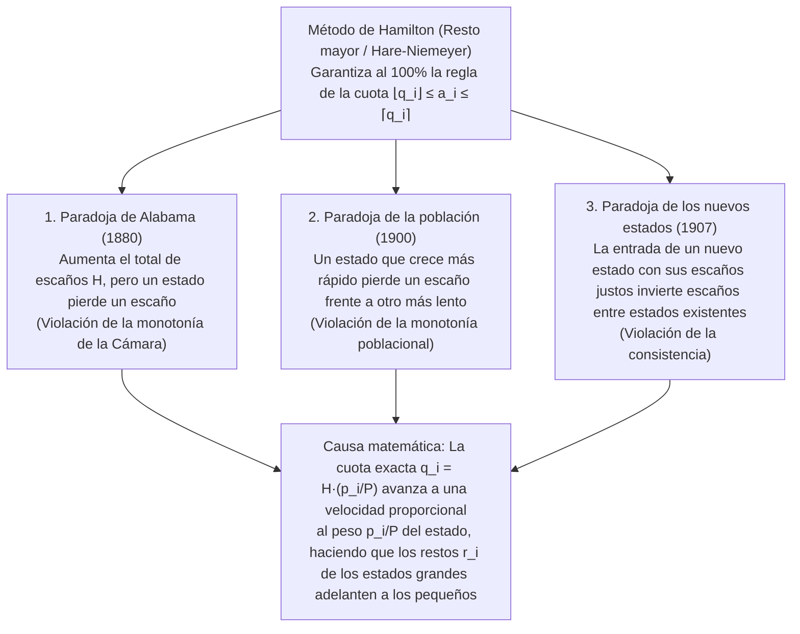

«Reparta de forma justa los escaños enteros de un parlamento entre los estados (o partidos políticos) en proporción a su población».

Ante esta tarea, casi cualquier persona recurre a la aritmética elemental de proporciones y redondeo: se divide la población nacional total entre el número total de escaños para obtener el «divisor estándar» (habitantes por escaño) y luego se divide la población de cada estado entre dicho divisor. Como aparecen números decimales como $7{,}73$ o $1{,}36$ escaños, primero se asigna a cada estado su parte entera ($7$ y $1$) y después se reparten los escaños sobrantes uno a uno a los estados con los mayores restos decimales ($,73$, $,36$, etc.). ¿Acaso podría existir un método más natural, transparente e indiscutiblemente justo?

Sin embargo, en 1880, Charles W. Seaton, oficial mayor de la Oficina del Censo de los Estados Unidos, descubrió una pesadilla matemática al calcular el reparto de la Cámara de Representantes con este mismo método (el <strong>método de Hamilton</strong> o <strong>método del resto mayor / Hare-Niemeyer</strong>): cuando el tamaño total de la Cámara se <strong>incrementó en un solo escaño</strong> de $299$ a $300$ escaños —sin que cambiara la población de ningún estado—, ¡el estado de <strong>Alabama vio reducida su asignación de $8$ escaños a $7$ escaños</strong>!

Hacer más grande el pastel total redujo la porción de un participante: esta <strong>paradoja de Alabama</strong> fue seguida por el descubrimiento de la <strong>paradoja de la población</strong> (un estado con rápido crecimiento demográfico pierde un escaño frente a otro de crecimiento más lento) y la <strong>paradoja de los nuevos estados</strong> (la admisión de un nuevo estado con sus escaños justos altera los escaños entre estados antiguos no relacionados). En 1982, <strong>Michel Balinski</strong> y <strong>H. Peyton Young</strong> demostraron el célebre <strong>teorema de imposibilidad de Balinski-Young</strong>: <strong>es matemáticamente imposible que un método de reparto cumpla simultáneamente la regla de la cuota y la monotonía (ausencia de paradojas)</strong>.

---

## 1. La crisis constitucional de 1792: Hamilton contra Jefferson y el primer veto presidencial

El Artículo I, Sección 2 de la Constitución de EE. UU. de 1787 establecía que los representantes se repartirían entre los estados «según sus respectivos números», sin exceder de uno por cada $30.000$ habitantes. Tras el primer censo de 1790 ($P = 3.615.920$ habitantes en $15$ estados), el Congreso aprobó una ley con $H = 120$ escaños (divisor estándar $D = P/H = 30.132{,}67$).

El secretario del Tesoro, <strong>Alexander Hamilton</strong>, propuso el <strong>método del resto mayor (método de Hamilton)</strong>: asignar primero $\lfloor p_i / D \rfloor$ escaños ($112$ en total) y otorgar los $R = 8$ escaños restantes a los $8$ estados con mayores partes fraccionarias. El secretario de Estado, <strong>Thomas Jefferson</strong>, y el presidente <strong>George Washington</strong> (ambos de Virginia) se opusieron rotundamente: además de perjudicar a Virginia, los estados pequeños redondeados hacia arriba —como Delaware ($55.540$ habitantes, $2$ escaños)— obtenían <strong>un representante por cada $27.770$ habitantes</strong>, ¡violando el límite constitucional de $30.000$!

Jefferson propuso como alternativa el <strong>método de Jefferson (conocido en Europa y Latinoamérica como método D'Hondt)</strong>: elegir un divisor común $x$ (por ejemplo, $x = 33.000$) y truncar siempre a la parte entera inferior ($a_i = \lfloor p_i / x \rfloor$) hasta que la suma sea igual a $H$. El <strong>5 de abril de 1792</strong>, George Washington ejerció el <strong>primer veto presidencial de la historia de Estados Unidos</strong> contra la ley de Hamilton, ¡desencadenado por una disputa sobre <strong>algoritmos matemáticos de redondeo</strong>!

---

## 2. Formulación matemática y la regla de la cuota (Quota Rule)

Sean $s \ge 2$ estados con vector de población $\mathbf{p} = (p_1, \dots, p_s)$, población total $P = \sum_{i=1}^s p_i$ y un parlamento de $H \in \mathbb{Z}_{>0}$ escaños. El <strong>divisor estándar $D$</strong> y la <strong>cuota exacta $q_i$</strong> del estado $i$ son:

$$D = \frac{P}{H}, \qquad q_i = \frac{p_i}{D} = H \cdot \frac{p_i}{P}, \qquad \sum_{i=1}^s q_i = H$$

Al redondear el número real $q_i$ a un entero $a_i \in \mathbb{Z}_{\ge 0}$ ($\sum_{i=1}^s a_i = H$), el axioma mínimo de justicia exige que cada estado reciba su <strong>cuota inferior $\lfloor q_i \rfloor$</strong> o su <strong>cuota superior $\lceil q_i \rceil$</strong>. Esta es la <strong>regla de la cuota (Quota Rule)</strong>:

$$\lfloor q_i \rfloor \le a_i \le \lceil q_i \rceil \quad (\forall i \in \{1, 2, \dots, s\})$$

El <strong>método de Hamilton (resto mayor / Hare-Niemeyer)</strong> descompone $q_i = \lfloor q_i \rfloor + r_i$ con $r_i \in [0, 1)$, asigna $\lfloor q_i \rfloor$ escaños y reparte los $R = H - \sum \lfloor q_i \rfloor = \sum r_i$ escaños sobrantes a los $R$ estados con mayores restos $r_i$:

$$q_i = \lfloor q_i \rfloor + r_i \quad (0 \le r_i < 1), \qquad R = H - \sum_{i=1}^s \lfloor q_i \rfloor = \sum_{i=1}^s r_i \in \{0, 1, \dots, s-1\}$$

$$a_i = \begin{cases} \lfloor q_i \rfloor + 1 & (\text{if } r_i \text{ is among the } R \text{ largest remainders}) \\ \lfloor q_i \rfloor & (\text{otherwise}) \end{cases}$$

Por construcción, el método de Hamilton <strong>cumple la regla de la cuota el $100\%$ de las veces</strong>.

---

## 3. Anatomía completa de las tres grandes paradojas de reparto

Entre 1880 y 1907, los datos reales del censo estadounidense revelaron tres paradojas demoledoras en el método de Hamilton:

### 3.1 La paradoja de Alabama (1880) y demostración numérica con 3 estados ($H = 10 \to 11$)

En 1880, al pasar de $H = 299$ a $H = 300$, la cuota de Alabama solo subió $+0{,}025$ ($7{,}646 \to 7{,}671$), mientras que Texas ($9{,}640 \to 9{,}672$, $+0{,}032$) e Illinois ($18{,}640 \to 18{,}702$, $+0{,}062$) aumentaron sus restos mucho más rápido y adelantaron simultáneamente a Alabama. Demostrémoslo en un modelo exacto de $3$ estados ($P = 1000$):

| Estado | Población $p_i$ | Cuota $q_i$ ($H=10$) | Piso $\lfloor q_i \rfloor$ y resto $r_i$ ($H=10$) | <strong>Escaños $a_i$ ($H=10$)</strong> | Cuota $q_i'$ ($H=11$) | Piso $\lfloor q_i' \rfloor$ y resto $r_i'$ ($H=11$) | <strong>Escaños $a_i'$ ($H=11$)</strong> |
| :--- | :---: | :---: | :---: | :---: | :---: | :---: | :---: |
| <strong>Estado A</strong> | $433$ | $4{,}330$ | $4$ ($r_A = 0{,}330$: 2.º) | <strong>$4$ escaños</strong> | $4{,}763$ | $4$ ($r_A' = \mathbf{0{,}763}$: 1.º) | <strong>$5$ escaños</strong> ($+1$) |
| <strong>Estado B</strong> | $431$ | $4{,}310$ | $4$ ($r_B = 0{,}310$: 3.º) | <strong>$4$ escaños</strong> | $4{,}741$ | $4$ ($r_B' = \mathbf{0{,}741}$: 2.º) | <strong>$5$ escaños</strong> ($+1$) |
| <strong>Estado C</strong> | $136$ | $1{,}360$ | $1$ ($r_C = \mathbf{0{,}360}$: 1.º) | <strong>$2$ escaños</strong> | $1{,}496$ | $1$ ($r_C' = 0{,}496$: 3.º) | <strong>$1$ escaño</strong> (<strong>$-1$</strong>) |
| <strong>Total</strong> | <strong>$1000$</strong> | <strong>$10{,}000$</strong> | Suma pisos $= 9$ ($R=1$) | <strong>$10$ escaños</strong> | <strong>$11{,}000$</strong> | Suma pisos $= 9$ ($R'=2$) | <strong>$11$ escaños</strong> |

Al subir $H$ de $10$ a $11$, los estados grandes A y B avanzan $+0{,}433$ y $+0{,}431$ frente a solo $+0{,}136$ del pequeño Estado C: sus restos ($0{,}763$ y $0{,}741$) superan a $r_C' = 0{,}496$, y el Estado C cae de <strong>$2$ escaños a $1$ escaño</strong> (violación de la <strong>monotonía de la Cámara</strong>).

### 3.2 La paradoja de la población (1900) y la paradoja de los nuevos estados (1907)

- <strong>Paradoja de la población</strong>: Entre 1890 y 1900, Virginia creció un $+12{,}0\%$ frente al $+5{,}0\%$ de Maine, pero perdió un escaño a manos de Maine. En nuestro modelo ($H = 10, P = 1000$): en el instante 1, $p_A = 427, p_B = 435, p_C = 138 \implies$ escaños $(4, 4, 2)$ porque $r_C = 0{,}380$ es el mayor resto. En el instante 2, <strong>el Estado C crece un $+8{,}70\%$ ($138 \to 150$)</strong>, <strong>el Estado B crece un $+6{,}90\%$ ($435 \to 465$)</strong> y el Estado A disminuye ($427 \to 385$). Aunque C crece porcentualmente más que B, el aumento absoluto de cuota del estado grande B ($+0{,}300 \implies r_B' = 0{,}650$) supera al de C ($+0{,}120 \implies r_C' = 0{,}500$), mientras que A cruza hacia abajo el entero $4$ ($q_A' = 3{,}850 \implies r_A' = 0{,}850$). Así, el estado de mayor crecimiento C pierde un escaño ($2 \to 1$) frente a B ($4 \to 5$).
- <strong>Paradoja de los nuevos estados</strong>: En 1907, la admisión de Oklahoma con sus $5$ escaños ($H: 386 \to 391$) hizo que Nueva York perdiera un escaño frente a Maine. En el modelo de $2$ estados ($H = 10, P = 1000$ con $p_A = 842, p_B = 158 \implies a_A = 8, a_B = 2$), al unirse el nuevo Estado C ($p_C = 165$) con sus $2$ escaños correspondientes ($H' = 12, P' = 1165$), el divisor estándar baja de $100$ a $97{,}083$. Todas las cuotas se multiplican por $1{,}03004$: la cuota grande $q_A$ sube $+0{,}253$ ($8{,}673$, resto $0{,}673$) y adelanta al resto del pequeño Estado B ($1{,}627$, resto $0{,}627$), resultando en $(9, 1, 2)$.

---

## 4. Teoría unificada de los métodos de divisores (promedios mayores) y funciones hito $d(n)$

Los <strong>métodos de divisores</strong> dividen cada población $p_i$ entre un divisor común ajustable $x > 0$ y redondean el cociente $q = p_i / x$ mediante una <strong>función hito (Signpost Function) $d(n) \in [n, n+1]$</strong>:

$$[q]_d = n \iff d(n-1) \le q \le d(n), \qquad a_i = \left[\frac{p_i}{x}\right]_d, \qquad \sum_{i=1}^s a_i = H$$

Despejando $x$ de $d(a_i - 1) \le p_i / x \le d(a_i)$ se obtiene la <strong>equivalencia exacta con el método de los promedios mayores (valores de prioridad)</strong>:

$$\frac{p_i}{d(a_i)} \le x \le \frac{p_i}{d(a_i - 1)} \quad \Longleftrightarrow \quad \text{Priority}(i, n) = \frac{p_i}{d(n)}$$

Asignar los $H$ escaños equivale exactamente a otorgarlos a los $H$ mayores <strong>valores de prioridad $\text{Priority}(i, n) = \frac{p_i}{d(n)}$</strong>. Como el orden global no cambia al incrementar $H$ y la razón de prioridades cumple:

$$\frac{p_i'}{p_j'} \ge \frac{p_i}{p_j} \implies \frac{p_i' / d(n)}{p_j' / d(m)} = \frac{p_i'}{p_j'} \cdot \frac{d(m)}{d(n)} \ge \frac{p_i}{p_j} \cdot \frac{d(m)}{d(n)} = \frac{p_i / d(n)}{p_j / d(m)}$$

<strong>¡todos los métodos de divisores son completamente inmunes a las tres paradojas!</strong>

### Comparación de los cinco métodos de divisores históricos

| Nombre del método (Alias electoral) | Autores y año | Función hito $d(n)$ | Sucesión de divisores $d(0), d(1), d(2), \dots$ | Escaños mín. | Sesgo de tamaño y criterio de optimización | Riesgo frente a la regla de la cuota |
| :--- | :--- | :---: | :---: | :---: | :--- | :--- |
| <strong>1. Método de Jefferson</strong> (<strong>D'Hondt</strong>) | Jefferson (1792) D'Hondt (1878) | $n + 1$ (Piso $\lfloor q \rfloor$) | $1, 2, 3, 4, \dots$ | $0$ escaños | <strong>Favorece fuertemente a los estados/partidos grandes</strong> | Viola la <strong>cuota superior</strong> ($a_i > \lceil q_i \rceil$) |
| <strong>2. Método de Webster</strong> (<strong>Sainte-Laguë</strong>) | Webster (1832) Sainte-Laguë (1910) | $n + 0{,}5$ (Media aritmética) | $0{,}5, \; 1{,}5, \; 2{,}5, \dots$ (o $1, 3, 5, \dots$) | $0$ escaños | <strong>Totalmente neutral (sin sesgo de tamaño)</strong> | Puede violar (rara vez) las cuotas superior e inferior |
| <strong>3. Huntington-Hill</strong> (<strong>Proporciones iguales</strong>) | Hill (1911) Huntington (1921) | $\sqrt{n(n+1)}$ (Media geométrica) | $0, \sqrt{2}, \sqrt{6}, \sqrt{12}, \dots$ | $1$ escaño | Minimiza la desigualdad relativa $T_{ij}$; <strong>Cámara de EE. UU. desde 1941</strong> | Puede violar las cuotas superior e inferior |
| <strong>4. Método de Dean</strong> (<strong>Media armónica</strong>) | J. Dean (1832) | $\frac{2n(n+1)}{2n+1}$ (Media armónica) | $0, \frac{4}{3}, \frac{12}{5}, \frac{24}{7}, \dots$ | $1$ escaño | Minimiza la diferencia absoluta de habitantes por escaño $p_i/a_i$ | Puede violar las cuotas superior e inferior |
| <strong>5. Método de Adams</strong> (<strong>Divisores menores</strong>) | J. Q. Adams (1832) | $n$ (Techo $\lceil q \rceil$) | $0, 1, 2, 3, \dots$ | $1$ escaño | <strong>Favorece fuertemente a los estados pequeños</strong> | Viola la <strong>cuota inferior</strong> ($a_i < \lfloor q_i \rfloor$) |

Por la desigualdad clásica entre las medias aritmética, geométrica y armónica (AM-GM-HM):

$$T_{ij} = \frac{a_i / p_i}{a_j / p_j} - 1, \qquad d(n) = \sqrt{n(n+1)}$$

$$n < \underbrace{\frac{2n(n+1)}{2n+1}}_{\text{Dean (HM)}} < \underbrace{\sqrt{n(n+1)}}_{\text{Huntington-Hill (GM)}} < \underbrace{n + 0.5}_{\text{Webster (AM)}} < n + 1$$

---

## 5. El teorema de imposibilidad de Balinski-Young (1982)

Incluso el <strong>método de Webster / Sainte-Laguë ($d(n) = n + 0{,}5$, redondeo estándar al entero más cercano)</strong> viola tanto la cuota inferior como la cuota superior:
1. <strong>Violación de la cuota inferior ($H = 10, P = 1000$)</strong>: Sea un estado grande A ($p_A = 832 \implies q_A = 8{,}320$, cuota inferior <strong>$8$ escaños</strong>) y tres estados pequeños B, C, D ($p_i = 56 \implies q_i = 0{,}560$). Con el divisor $x = 111$, los tres estados pequeños obtienen $56/111 \approx 0{,}5045 > 0{,}5$ y suben a $1$ escaño cada uno ($3$ en total), mientras que el Estado A obtiene $832/111 \approx 7{,}4955 < 7{,}5$ y se redondea hacia abajo a <strong>$7$ escaños</strong>, ¡violando su cuota inferior de $8$ escaños!
2. <strong>Violación de la cuota superior ($H = 10, P = 1000$)</strong>: Sea un estado grande A ($p_A = 795 \implies q_A = 7{,}950$, cuota superior <strong>$8$ escaños</strong>) y cinco estados pequeños B–F ($p_i = 41 \implies q_i = 0{,}410$). Con $x = 83$, los cinco estados pequeños obtienen $41/83 \approx 0{,}4940 < 0{,}5$ ($0$ escaños), mientras que el Estado A obtiene $795/83 \approx 9{,}5783 > 9{,}5$ y acapara los <strong>$10$ escaños</strong>, ¡superando en $2$ escaños su cuota superior!

En 1982, Balinski y Young demostraron su resultado definitivo:
- <strong>Teorema 1 (Caracterización de los métodos de divisores)</strong>: Un método de reparto anónimo y homogéneo satisface la <strong>monotonía poblacional</strong> si y solo si es un <strong>método de divisores</strong>.
- <strong>Teorema 2 (Teorema de imposibilidad de Balinski-Young, 1982)</strong>: Para $s \ge 4$ estados y $H \ge 7$ escaños, <strong>no existe ningún método de reparto que satisfaga simultáneamente la monotonía poblacional y la regla de la cuota ($\lfloor q_i \rfloor \le a_i \le \lceil q_i \rceil$)</strong>.

Al ajustar el divisor común $x$, todas las cuotas exactas se escalan por el mismo factor $\lambda = D/x$ ($p_i/x = \lambda q_i$), por lo que el desplazamiento absoluto $\Delta q_A = |1 - \lambda| q_A$ de un estado grande crece proporcionalmente a su tamaño $q_A$, cruzando inevitablemente fronteras enteras.
