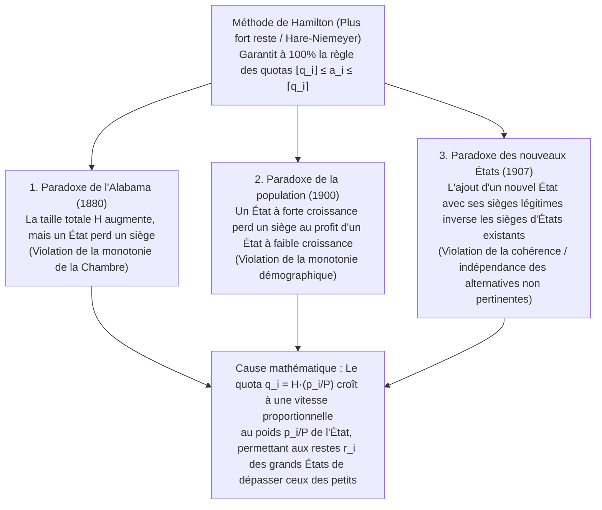

« Répartissez équitablement les sièges entiers d'une assemblée législative entre les États (ou les partis politiques) proportionnellement à leur population. »

Face à cette consigne, presque tout le monde applique la règle de trois et l'arrondi appris à l'école primaire : on divise la population totale du pays par le nombre total de sièges pour obtenir le « diviseur standard » (la population par siège), puis on divise la population de chaque État par ce diviseur. Comme on obtient des nombres décimaux tels que $7,73$ ou $1,36$ sièges, on attribue d'abord à chaque État sa partie entière ($7$ et $1$), puis on distribue les sièges restants un par un aux États ayant les plus forts restes décimaux ($,73$, $,36$, etc.). Quoi de plus naturel et de plus incontestablement juste ?

Pourtant, en 1880, Charles W. Seaton, greffier en chef du Bureau du recensement des États-Unis, découvrit un cauchemar mathématique en appliquant cette méthode (la <strong>méthode de Hamilton</strong> ou <strong>méthode au plus fort reste / Hare-Niemeyer</strong>) à la Chambre des représentants : lorsque la taille totale de la Chambre fut <strong>augmentée d'un seul siège</strong>, passant de $299$ à $300$ sièges — sans qu'un seul habitant ait déménagé —, l'État de l'<strong>Alabama vit son nombre de sièges chuter de $8$ à $7$ sièges</strong> !

Agrandir le gâteau global tout en réduisant la part d'un convive : ce <strong>paradoxe de l'Alabama</strong> fut suivi par la découverte du <strong>paradoxe de la population</strong> (un État en forte croissance démographique perd un siège au profit d'un État à croissance lente) et du <strong>paradoxe des nouveaux États</strong> (l'admission d'un nouvel État avec le nombre exact de sièges correspondant à sa population fait basculer un siège entre deux États existants). En 1982, <strong>Michel Balinski</strong> et <strong>H. Peyton Young</strong> démontrèrent le célèbre <strong>théorème d'impossibilité de Balinski-Young</strong> : <strong>il est mathématiquement impossible qu'une méthode de répartition respecte simultanément la règle des quotas et la monotonie (l'absence de paradoxes)</strong>.

---

## 1. La crise constitutionnelle de 1792 : Hamilton contre Jefferson et le premier veto présidentiel

L'article I, section 2 de la Constitution américaine de 1787 exigeait que les représentants soient répartis entre les États « selon leurs populations respectives », sans dépasser un représentant pour $30\,000$ habitants. Après le premier recensement de 1790 ($P = 3\,615\,920$ habitants dans $15$ États), le Congrès vota une loi fixant la Chambre à $H = 120$ sièges (diviseur standard $D = P/H = 30\,132,67$).

Le secrétaire au Trésor <strong>Alexander Hamilton</strong> proposa la <strong>méthode au plus fort reste (méthode de Hamilton)</strong> : attribuer d'abord $\lfloor p_i / D \rfloor$ sièges ($112$ au total), puis donner les $R = 8$ sièges restants aux $8$ États ayant les plus grandes parties fractionnaires. Le secrétaire d'État <strong>Thomas Jefferson</strong> et le président <strong>George Washington</strong> (tous deux de Virginie) s'y opposèrent farouchement : non seulement la Virginie perdait au jeu des restes, mais les petits États arrondis à l'unité supérieure — comme le Delaware ($55\,540$ habitants, $2$ sièges) — obtenaient <strong>un député pour $27\,770$ habitants</strong>, violant le plafond constitutionnel de $30\,000$ !

Jefferson proposa la <strong>méthode de Jefferson (connue en Europe sous le nom de méthode D'Hondt)</strong> : choisir un diviseur commun $x$ (par exemple $x = 33\,000$) et tronquer systématiquement à l'entier inférieur ($a_i = \lfloor p_i / x \rfloor$) de sorte que la somme vaille $H$. Le <strong>5 avril 1792</strong>, George Washington opposa le <strong>tout premier veto présidentiel de l'histoire des États-Unis</strong> à la loi de Hamilton — un veto historique déclenché par un conflit d'<strong>algorithmes d'arrondi mathématique</strong> !

---

## 2. Formulation mathématique et la règle des quotas (Quota Rule)

Soient $s \ge 2$ États de populations $\mathbf{p} = (p_1, \dots, p_s)$, de population totale $P = \sum_{i=1}^s p_i$, et une assemblée de $H \in \mathbb{Z}_{>0}$ sièges. Le <strong>diviseur standard $D$</strong> et le <strong>quota exact $q_i$</strong> de l'État $i$ sont définis par :

$$D = \frac{P}{H}, \qquad q_i = \frac{p_i}{D} = H \cdot \frac{p_i}{P}, \qquad \sum_{i=1}^s q_i = H$$

Lorsqu'on arrondit le réel $q_i$ en un entier $a_i \in \mathbb{Z}_{\ge 0}$ ($\sum_{i=1}^s a_i = H$), l'axiome minimal d'équité stipule que chaque État doit recevoir soit son <strong>quota inférieur $\lfloor q_i \rfloor$</strong>, soit son <strong>quota supérieur $\lceil q_i \rceil$</strong>. C'est la <strong>règle des quotas (Quota Rule)</strong> :

$$\lfloor q_i \rfloor \le a_i \le \lceil q_i \rceil \quad (\forall i \in \{1, 2, \dots, s\})$$

La <strong>méthode de Hamilton (plus fort reste / Hare-Niemeyer)</strong> décompose $q_i = \lfloor q_i \rfloor + r_i$ avec $r_i \in [0, 1)$, attribue $\lfloor q_i \rfloor$ sièges, puis distribue les $R = H - \sum \lfloor q_i \rfloor = \sum r_i$ sièges restants aux $R$ États ayant les plus grands restes $r_i$ :

$$q_i = \lfloor q_i \rfloor + r_i \quad (0 \le r_i < 1), \qquad R = H - \sum_{i=1}^s \lfloor q_i \rfloor = \sum_{i=1}^s r_i \in \{0, 1, \dots, s-1\}$$

$$a_i = \begin{cases} \lfloor q_i \rfloor + 1 & (\text{if } r_i \text{ is among the } R \text{ largest remainders}) \\ \lfloor q_i \rfloor & (\text{otherwise}) \end{cases}$$

Par construction, la méthode de Hamilton <strong>satisfait la règle des quotas dans $100\%$ des cas</strong>.

---

## 3. Anatomie complète des trois grands paradoxes de répartition

Entre 1880 et 1907, les calculs officiels du recensement américain mirent au jour trois paradoxes dévastateurs :

### 3.1 Le paradoxe de l'Alabama (1880) et sa preuve numérique à 3 États ($H = 10 \to 11$)

En 1880, en passant de $H = 299$ à $H = 300$, le quota de l'Alabama n'augmenta que de $+0,025$ ($7,646 \to 7,671$), tandis que ceux du Texas ($9,640 \to 9,672$, $+0,032$) et de l'Illinois ($18,640 \to 18,702$, $+0,062$) progressèrent plus vite et dépassèrent simultanément le reste de l'Alabama. Vérifions-le sur un modèle exact à $3$ États ($P = 1000$) :

| État | Population $p_i$ | Quota $q_i$ ($H=10$) | Partie entière & reste $r_i$ ($H=10$) | <strong>Sièges $a_i$ ($H=10$)</strong> | Quota $q_i'$ ($H=11$) | Partie entière & reste $r_i'$ ($H=11$) | <strong>Sièges $a_i'$ ($H=11$)</strong> |
| :--- | :---: | :---: | :---: | :---: | :---: | :---: | :---: |
| <strong>État A</strong> | $433$ | $4,330$ | $4$ ($r_A = 0,330$ : 2e) | <strong>$4$ sièges</strong> | $4,763$ | $4$ ($r_A' = \mathbf{0,763}$ : 1er) | <strong>$5$ sièges</strong> ($+1$) |
| <strong>État B</strong> | $431$ | $4,310$ | $4$ ($r_B = 0,310$ : 3e) | <strong>$4$ sièges</strong> | $4,741$ | $4$ ($r_B' = \mathbf{0,741}$ : 2e) | <strong>$5$ sièges</strong> ($+1$) |
| <strong>État C</strong> | $136$ | $1,360$ | $1$ ($r_C = \mathbf{0,360}$ : 1er) | <strong>$2$ sièges</strong> | $1,496$ | $1$ ($r_C' = 0,496$ : 3e) | <strong>$1$ siège</strong> (<strong>$-1$</strong>) |
| <strong>Total</strong> | <strong>$1000$</strong> | <strong>$10,000$</strong> | Somme entiers $= 9$ ($R=1$) | <strong>$10$ sièges</strong> | <strong>$11,000$</strong> | Somme entiers $= 9$ ($R'=2$) | <strong>$11$ sièges</strong> |

Lorsque $H$ passe de $10$ à $11$, les grands États A et B gagnent $+0,433$ et $+0,431$ de quota contre seulement $+0,136$ pour le petit État C : leurs restes ($0,763$ et $0,741$) doublent celui de C ($0,496$), qui rétrograde de <strong>$2$ sièges à $1$ siège</strong> (violation de la <strong>monotonie de la Chambre</strong>).

### 3.2 Le paradoxe de la population (1900) et le paradoxe des nouveaux États (1907)

- <strong>Paradoxe de la population</strong> : Entre 1890 et 1900, la Virginie crût de $+12,0\%$ contre $+5,0\%$ pour le Maine, mais perdit un siège au profit du Maine. Dans notre modèle à $3$ États ($H = 10, P = 1000$) : à l'instant 1, $p_A = 427, p_B = 435, p_C = 138 \implies$ sièges $(4, 4, 2)$ car $r_C = 0,380$ est en tête. À l'instant 2, <strong>l'État C croît de $+8,70\%$ ($138 \to 150$)</strong>, <strong>l'État B de $+6,90\%$ ($435 \to 465$)</strong>, et l'État A décline ($427 \to 385$). Bien que C ait un taux de croissance supérieur à B, le gain absolu de quota du grand État B ($+0,300 \implies r_B' = 0,650$) surpasse celui du petit État C ($+0,120 \implies r_C' = 0,500$), tandis que le quota de A franchit l'entier $4$ vers le bas ($q_A' = 3,850 \implies r_A' = 0,850$). Résultat : l'État C, pourtant le plus dynamique, perd un siège ($2 \to 1$) au profit de B ($4 \to 5$) !
- <strong>Paradoxe des nouveaux États</strong> : En 1907, l'admission de l'Oklahoma avec ses $5$ sièges ($H: 386 \to 391$) fit perdre un siège à New York au profit du Maine. Dans un modèle à $2$ États ($H = 10, P = 1000$ avec $p_A = 842, p_B = 158 \implies a_A = 8, a_B = 2$), l'entrée d'un nouvel État C ($p_C = 165$) avec ses $2$ sièges légitimes ($H' = 12, P' = 1165$) abaisse légèrement le diviseur standard de $100$ à $97,083$. Tous les quotas sont multipliés par $1,03004$ : le quota du grand État A grimpe de $+0,253$ ($8,673$, reste $0,673$) et dépasse le reste du petit État B ($1,627$, reste $0,627$), donnant $(9, 1, 2)$ !

---

## 4. Théorie unifiée des méthodes de diviseurs (plus fortes moyennes) et fonctions jalons $d(n)$

Les <strong>méthodes de diviseurs</strong> divisent chaque population $p_i$ par un diviseur modifiable $x > 0$ et arrondissent le quotient $q = p_i / x$ à l'aide d'une <strong>fonction jalon (Signpost Function) $d(n) \in [n, n+1]$</strong> :

$$[q]_d = n \iff d(n-1) \le q \le d(n), \qquad a_i = \left[\frac{p_i}{x}\right]_d, \qquad \sum_{i=1}^s a_i = H$$

L'encadrement $d(a_i - 1) \le p_i / x \le d(a_i)$ démontre l'<strong>équivalence totale avec les méthodes de la plus forte moyenne (valeurs de priorité)</strong> :

$$\frac{p_i}{d(a_i)} \le x \le \frac{p_i}{d(a_i - 1)} \quad \Longleftrightarrow \quad \text{Priority}(i, n) = \frac{p_i}{d(n)}$$

Attribuer les $H$ sièges revient exactement à sélectionner les $H$ plus grandes <strong>valeurs de priorité $\text{Priority}(i, n) = \frac{p_i}{d(n)}$</strong>. Puisque le classement global ne change pas quand $H$ augmente et que le rapport de priorité entre deux États vérifie :

$$\frac{p_i'}{p_j'} \ge \frac{p_i}{p_j} \implies \frac{p_i' / d(n)}{p_j' / d(m)} = \frac{p_i'}{p_j'} \cdot \frac{d(m)}{d(n)} \ge \frac{p_i}{p_j} \cdot \frac{d(m)}{d(n)} = \frac{p_i / d(n)}{p_j / d(m)}$$

<strong>toutes les méthodes de diviseurs sont totalement immunisées contre les trois paradoxes !</strong>

### Comparaison des cinq méthodes de diviseurs historiques

| Nom de la méthode (Alias électoral) | Auteurs & Année | Jalon $d(n)$ | Suite des diviseurs $d(0), d(1), d(2), \dots$ | Sièges min. | Biais de taille & Critère d'optimisation | Risque de violation des quotas |
| :--- | :--- | :---: | :---: | :---: | :--- | :--- |
| <strong>1. Méthode de Jefferson</strong> (<strong>D'Hondt</strong>) | Jefferson (1792) D'Hondt (1878) | $n + 1$ (Partie entière) | $1, 2, 3, 4, \dots$ | $0$ siège | <strong>Favorise fortement les grands États / partis</strong> | Viole le <strong>quota supérieur</strong> ($a_i > \lceil q_i \rceil$) |
| <strong>2. Méthode de Webster</strong> (<strong>Sainte-Laguë</strong>) | Webster (1832) Sainte-Laguë (1910) | $n + 0,5$ (Moy. arithmétique) | $0,5, \; 1,5, \; 2,5, \dots$ (ou $1, 3, 5, \dots$) | $0$ siège | <strong>Totalement neutre (sans biais de taille)</strong> | Peut violer (rarement) les quotas supérieur et inférieur |
| <strong>3. Huntington-Hill</strong> (<strong>Proportions égales</strong>) | Hill (1911) Huntington (1921) | $\sqrt{n(n+1)}$ (Moy. géométrique) | $0, \sqrt{2}, \sqrt{6}, \sqrt{12}, \dots$ | $1$ siège | Minimise l'inégalité relative $T_{ij}$ ; <strong>Chambre des représentants US depuis 1941</strong> | Peut violer les quotas supérieur et inférieur |
| <strong>4. Méthode de Dean</strong> (<strong>Moy. harmonique</strong>) | J. Dean (1832) | $\frac{2n(n+1)}{2n+1}$ (Moy. harmonique) | $0, \frac{4}{3}, \frac{12}{5}, \frac{24}{7}, \dots$ | $1$ siège | Minimise l'écart absolu de taille des circonscriptions $p_i/a_i$ | Peut violer les quotas supérieur et inférieur |
| <strong>5. Méthode d'Adams</strong> (<strong>Plus petits diviseurs</strong>) | J. Q. Adams (1832) | $n$ (Plafond $\lceil q \rceil$) | $0, 1, 2, 3, \dots$ | $1$ siège | <strong>Favorise fortement les petits États</strong> | Viole le <strong>quota inférieur</strong> ($a_i < \lfloor q_i \rfloor$) |

D'après l'inégalité classique des moyennes arithmétique, géométrique et harmonique (AM-GM-HM) :

$$T_{ij} = \frac{a_i / p_i}{a_j / p_j} - 1, \qquad d(n) = \sqrt{n(n+1)}$$

$$n < \underbrace{\frac{2n(n+1)}{2n+1}}_{\text{Dean (HM)}} < \underbrace{\sqrt{n(n+1)}}_{\text{Huntington-Hill (GM)}} < \underbrace{n + 0.5}_{\text{Webster (AM)}} < n + 1$$

---

## 5. Le théorème d'impossibilité de Balinski-Young (1982)

Même la <strong>méthode de Webster / Sainte-Laguë ($d(n) = n + 0,5$, arrondi à l'entier le plus proche)</strong> viole à la fois le quota inférieur et le quota supérieur :
1. <strong>Violation du quota inférieur ($H = 10, P = 1000$)</strong> : Soit un grand État A ($p_A = 832 \implies q_A = 8,320$, quota inférieur <strong>$8$ sièges</strong>) et trois petits États B, C, D ($p_i = 56 \implies q_i = 0,560$). Avec le diviseur $x = 111$, les trois petits États ont $56/111 \approx 0,5045 > 0,5$ et sont tous arrondis à $1$ siège ($3$ au total), tandis que le grand État A obtient $832/111 \approx 7,4955 < 7,5$, arrondi à <strong>$7$ sièges</strong> — violant son quota inférieur de $8$ sièges !
2. <strong>Violation du quota supérieur ($H = 10, P = 1000$)</strong> : Soit un grand État A ($p_A = 795 \implies q_A = 7,950$, quota supérieur <strong>$8$ sièges</strong>) et cinq petits États B–F ($p_i = 41 \implies q_i = 0,410$). Avec $x = 83$, les cinq petits États ont $41/83 \approx 0,4940 < 0,5$ ($0$ siège chacun), tandis que l'État A obtient $795/83 \approx 9,5783 > 9,5$, raflant les <strong>$10$ sièges</strong> — soit $2$ sièges au-dessus de son quota supérieur !

En 1982, Balinski et Young ont établi leur théorème définitif :
- <strong>Théorème 1 (Caractérisation des méthodes de diviseurs)</strong> : Une méthode de répartition anonyme et homogène vérifie la <strong>monotonie démographique</strong> si et seulement si c'est une <strong>méthode de diviseurs</strong>.
- <strong>Théorème 2 (Théorème d'impossibilité de Balinski-Young, 1982)</strong> : Pour $s \ge 4$ États et $H \ge 7$ sièges, <strong>il n'existe aucune méthode de répartition qui satisfasse simultanément la monotonie démographique et la règle des quotas ($\lfloor q_i \rfloor \le a_i \le \lceil q_i \rceil$)</strong>.

En effet, modifier le diviseur commun $x$ multiplie tous les quotas exacts par le même facteur $\lambda = D/x$ ($p_i/x = \lambda q_i$). Le décalage absolu $\Delta q_A = |1 - \lambda| q_A$ d'un grand État étant proportionnel à sa taille $q_A$, il franchit inévitablement des frontières entières lorsque plusieurs petits États basculent simultanément autour d'un jalon $d(k)$.
