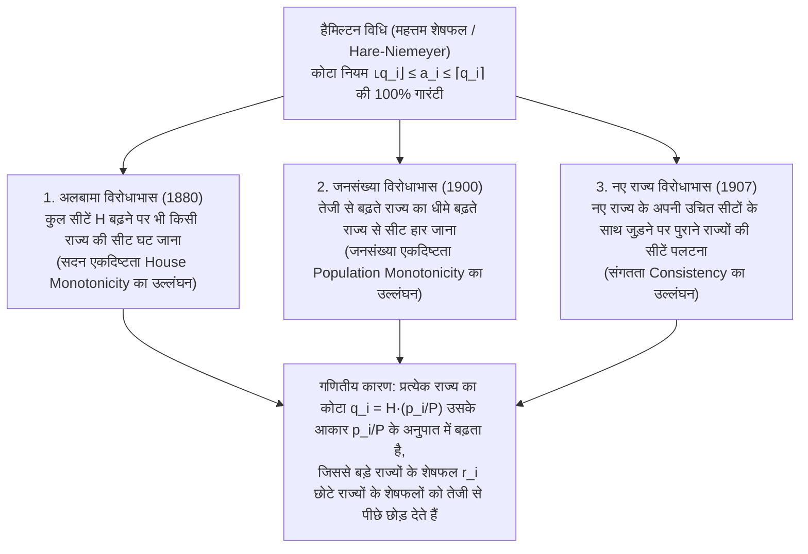

"संसद की पूर्णांक सीटों को राज्यों (या राजनीतिक दलों) की जनसंख्या के अनुपात में निष्पक्ष रूप से विभाजित करें।"

यदि आपको यह कार्य सौंपा जाए, तो लगभग हर व्यक्ति प्राथमिक विद्यालय में सीखे गए अनुपात और पूर्णांकन (rounding) के अंकगणित का उपयोग करेगा: पहले देश की कुल जनसंख्या को कुल संसदीय सीटों से भाग देकर 'मानक भाजक' (प्रति सीट जनसंख्या) निकालें, फिर प्रत्येक राज्य की जनसंख्या को उस मानक भाजक से भाग दें। चूँकि इससे $7.73$ या $1.36$ सीट जैसी दशमलव संख्याएँ प्राप्त होती हैं, इसलिए पहले प्रत्येक राज्य को उसका पूर्णांक भाग ($7$ और $1$ सीट) दें, और फिर बची हुई सीटों को सबसे बड़े दशमलव शेषफल ($.73$, $.36$, आदि) वाले राज्यों को एक-एक करके बाँट दें। क्या इससे अधिक स्वाभाविक और निष्पक्ष कोई विधि हो सकती है?

किंतु 1880 में, अमेरिकी जनगणना कार्यालय के मुख्य लिपिक चार्ल्स सीटन (Charles W. Seaton) ने इसी 'सबसे स्वाभाविक' नियम (<strong>हैमिल्टन विधि</strong> या <strong>महत्तम शेषफल विधि / हेयर-नीमायर विधि</strong>) से अमेरिकी प्रतिनिधि सभा की सीटों की गणना करते समय एक चौंकाने वाली घटना देखी: जब सदन की कुल सीटें $299$ से बढ़ाकर $300$ (<strong>केवल $1$ सीट की वृद्धि</strong>) की गईं—बिना किसी राज्य की जनसंख्या में एक भी व्यक्ति के बदलाव के—तो <strong>अलबामा (Alabama) राज्य की सीटें $8$ से घटकर $7$ रह गईं</strong>!

पूरे केक का आकार बढ़ाने पर किसी सदस्य का हिस्सा घट जाना—इस <strong>अलबामा विरोधाभास (Alabama Paradox)</strong> के बाद <strong>जनसंख्या विरोधाभास (Population Paradox)</strong> (तेजी से बढ़ती जनसंख्या वाला राज्य धीमी गति से बढ़ने वाले राज्य से सीट हार जाता है) और <strong>नए राज्य विरोधाभास (New States Paradox)</strong> (एक नए राज्य के अपने उचित सीटों के साथ जुड़ने मात्र से पुराने राज्यों के बीच सीटें पलट जाती हैं) की खोज हुई। अंततः 1982 में, गणितज्ञ <strong>मिशेल बालिंस्की (Michel Balinski)</strong> और <strong>एच. पेटन यंग (H. Peyton Young)</strong> ने प्रसिद्ध <strong>बालिंस्की-यंग असंभवता प्रमेय (Balinski-Young Impossibility Theorem)</strong> सिद्ध किया: <strong>गणितीय रूप से ऐसी कोई भी सीट आवंटन विधि अस्तित्व में नहीं हो सकती जो एक साथ 'कोटा नियम (Quota Rule)' और 'एकदिष्टता (विरोधाभास-मुक्ति)' दोनों की गारंटी दे सके</strong>।

---

## 1. 1792 का संवैधानिक संकट: हैमिल्टन बनाम जेफरसन और इतिहास का पहला राष्ट्रपति वीटो

1787 के अमेरिकी संविधान के अनुच्छेद I, खंड 2 में प्रावधान था कि प्रतिनिधियों को राज्यों के बीच "उनकी संबंधित जनसंख्या के अनुसार" आवंटित किया जाएगा, किंतु प्रत्येक $30,000$ व्यक्तियों पर एक से अधिक प्रतिनिधि नहीं होगा। 1790 की पहली जनगणना ($15$ राज्यों में कुल जनसंख्या $P = 3,615,920$) के बाद, कांग्रेस ने $H = 120$ सीटों वाला विधेयक पारित किया (मानक भाजक $D = P/H = 30,132.67$)।

वित्त मंत्री <strong>अलेक्जेंडर हैमिल्टन</strong> ने <strong>महत्तम शेषफल विधि (हैमिल्टन विधि)</strong> प्रस्तावित की: पहले प्रत्येक राज्य को पूर्णांक भाग $\lfloor p_i / D \rfloor$ (कुल $112$ सीटें) दें, और शेष $R = 8$ सीटें सबसे बड़े दशमलव शेषफल वाले $8$ राज्यों को दें। विदेश मंत्री <strong>थॉमस जेफरसन</strong> और राष्ट्रपति <strong>जॉर्ज वॉशिंगटन</strong> (दोनों वर्जीनिया से) ने इसका कड़ा विरोध किया: सबसे अधिक जनसंख्या वाले वर्जीनिया को शेषफल सीट नहीं मिली, जबकि ऊपर की ओर पूर्णांकित किए गए छोटे राज्यों—जैसे डेलावेयर ($55,540$ जनसंख्या, $2$ सीटें)—में <strong>प्रति $27,770$ व्यक्तियों पर एक प्रतिनिधि</strong> हो गया, जो $30,000$ की संवैधानिक सीमा का उल्लंघन था!

जेफरसन ने विकल्प के रूप में <strong>जेफरसन विधि (यूरोप में डी'होंड्ट विधि D'Hondt Method)</strong> प्रस्तुत की: एक उभयनिष्ठ भाजक $x$ (जैसे $x = 33,000$) चुनें और सभी दशमलव शेषफलों को छोड़ दें ($a_i = \lfloor p_i / x \rfloor$) जब तक कि योग $H$ न हो जाए। <strong>5 अप्रैल 1792</strong> को, राष्ट्रपति वॉशिंगटन ने हैमिल्टन के विधेयक के विरुद्ध <strong>अमेरिकी इतिहास का पहला राष्ट्रपति वीटो (Presidential Veto)</strong> प्रयोग किया—जो <strong>गणितीय पूर्णांकन एल्गोरिदम</strong> के विवाद पर आधारित था!

---

## 2. गणितीय सूत्रीकरण और कोटा नियम (Quota Rule)

मान लें कि $s \ge 2$ राज्य हैं जिनका जनसंख्या सदिश $\mathbf{p} = (p_1, \dots, p_s)$, कुल जनसंख्या $P = \sum_{i=1}^s p_i$, और सदन का आकार $H \in \mathbb{Z}_{>0}$ है। <strong>मानक भाजक $D$</strong> और राज्य $i$ का <strong>यथार्थ कोटा (Exact Quota) $q_i$</strong> हैं:

$$D = \frac{P}{H}, \qquad q_i = \frac{p_i}{D} = H \cdot \frac{p_i}{P}, \qquad \sum_{i=1}^s q_i = H$$

वास्तविक संख्या $q_i$ को पूर्णांक सीट $a_i \in \mathbb{Z}_{\ge 0}$ ($\sum_{i=1}^s a_i = H$) में बदलते समय न्यूनतम निष्पक्षता अभिगृहीत यह है कि प्रत्येक राज्य को या तो उसका <strong>निम्न कोटा $\lfloor q_i \rfloor$</strong> या <strong>उच्च कोटा $\lceil q_i \rceil$</strong> मिलना चाहिए। इसे <strong>कोटा नियम (Quota Rule)</strong> कहते हैं:

$$\lfloor q_i \rfloor \le a_i \le \lceil q_i \rceil \quad (\forall i \in \{1, 2, \dots, s\})$$

<strong>हैमिल्टन विधि (महत्तम शेषफल / हेयर-नीमायर विधि)</strong> $q_i = \lfloor q_i \rfloor + r_i$ ($0 \le r_i < 1$) में विभाजित करती है, पहले $\lfloor q_i \rfloor$ सीटें देती है, और शेष $R = H - \sum \lfloor q_i \rfloor = \sum r_i$ सीटें सबसे बड़े शेषफल $r_i$ वाले शीर्ष $R$ राज्यों को देती है:

$$q_i = \lfloor q_i \rfloor + r_i \quad (0 \le r_i < 1), \qquad R = H - \sum_{i=1}^s \lfloor q_i \rfloor = \sum_{i=1}^s r_i \in \{0, 1, \dots, s-1\}$$

$$a_i = \begin{cases} \lfloor q_i \rfloor + 1 & (\text{if } r_i \text{ is among the } R \text{ largest remainders}) \\ \lfloor q_i \rfloor & (\text{otherwise}) \end{cases}$$

अपनी संरचना से ही हैमिल्टन विधि <strong>$100\%$ मामलों में कोटा नियम का पालन करती है</strong>।

---

## 3. तीन शास्त्रीय आवंटन विरोधाभासों का संपूर्ण विश्लेषण

1880 और 1907 के बीच, वास्तविक अमेरिकी जनगणना डेटा ने हैमिल्टन विधि में तीन विनाशकारी विरोधाभास उजागर किए:

### 3.1 अलबामा विरोधाभास (1880) और 3-राज्य संख्यात्मक प्रमाण ($H = 10 \to 11$)

1880 में जब $H = 299$ से $300$ हुआ, तो अलबामा का कोटा केवल $+0.025$ ($7.646 \to 7.671$) बढ़ा, जबकि बड़े राज्य टेक्सास ($9.640 \to 9.672$, $+0.032$) और इलिनोइस ($18.640 \to 18.702$, $+0.062$) के शेषफल तेजी से बढ़े और दोनों ने एक साथ अलबामा को पीछे छोड़ दिया। आइए $P = 1000$ वाले $3$-राज्य मॉडल से इसे सिद्ध करें:

| राज्य | जनसंख्या $p_i$ | कोटा $q_i$ ($H=10$) | पूर्णांक $\lfloor q_i \rfloor$ व शेष $r_i$ ($H=10$) | <strong>सीटें $a_i$ ($H=10$)</strong> | कोटा $q_i'$ ($H=11$) | पूर्णांक $\lfloor q_i' \rfloor$ व शेष $r_i'$ ($H=11$) | <strong>सीटें $a_i'$ ($H=11$)</strong> |
| :--- | :---: | :---: | :---: | :---: | :---: | :---: | :---: |
| <strong>राज्य A</strong> | $433$ | $4.330$ | $4$ ($r_A = 0.330$: रैंक 2) | <strong>$4$ सीटें</strong> | $4.763$ | $4$ ($r_A' = \mathbf{0.763}$: रैंक 1) | <strong>$5$ सीटें</strong> ($+1$) |
| <strong>राज्य B</strong> | $431$ | $4.310$ | $4$ ($r_B = 0.310$: रैंक 3) | <strong>$4$ सीटें</strong> | $4.741$ | $4$ ($r_B' = \mathbf{0.741}$: रैंक 2) | <strong>$5$ सीटें</strong> ($+1$) |
| <strong>राज्य C</strong> | $136$ | $1.360$ | $1$ ($r_C = \mathbf{0.360}$: रैंक 1) | <strong>$2$ सीटें</strong> | $1.496$ | $1$ ($r_C' = 0.496$: रैंक 3) | <strong>$1$ सीट</strong> (<strong>$-1$</strong>) |
| <strong>कुल</strong> | <strong>$1000$</strong> | <strong>$10.000$</strong> | पूर्णांक योग $= 9$ ($R=1$) | <strong>$10$ सीटें</strong> | <strong>$11.000$</strong> | पूर्णांक योग $= 9$ ($R'=2$) | <strong>$11$ सीटें</strong> |

जब $H$ $10$ से $11$ होता है, तो बड़े राज्य A और B के कोटा में $+0.433$ और $+0.431$ की वृद्धि होती है जबकि छोटे राज्य C में केवल $+0.136$ की: उनके शेषफल ($0.763$ और $0.741$) $r_C' = 0.496$ से आगे निकल जाते हैं, और राज्य C <strong>$2$ सीटों से घटकर $1$ सीट</strong> पर आ जाता है (<strong>सदन एकदिष्टता</strong> का उल्लंघन)।

### 3.2 जनसंख्या विरोधाभास (1900) और नए राज्य विरोधाभास (1907)

- <strong>जनसंख्या विरोधाभास</strong>: 1890 और 1900 के बीच वर्जीनिया की जनसंख्या $+12.0\%$ बढ़ी जबकि मेन की केवल $+5.0\%$, फिर भी वर्जीनिया ने मेन के हाथों एक सीट गँवा दी। हमारे मॉडल ($H = 10, P = 1000$) में: समय 1 पर $p_A = 427, p_B = 435, p_C = 138 \implies$ सीटें $(4, 4, 2)$ क्योंकि $r_C = 0.380$ सबसे बड़ा है। समय 2 पर <strong>राज्य C $+8.70\%$ बढ़ता है ($138 \to 150$)</strong>, <strong>राज्य B $+6.90\%$ बढ़ता है ($435 \to 465$)</strong>, और राज्य A घटता है ($427 \to 385$)। यद्यपि C की वृद्धि दर B से अधिक है, बड़े राज्य B की निरपेक्ष कोटा वृद्धि ($+0.300 \implies r_B' = 0.650$) छोटे राज्य C ($+0.120 \implies r_C' = 0.500$) से अधिक है, और A का कोटा पूर्णांक $4$ से नीचे चला जाता है ($q_A' = 3.850 \implies r_A' = 0.850$)। परिणामस्वरूप सबसे तेजी से बढ़ने वाला राज्य C एक सीट खो देता है ($2 \to 1$) और B बढ़ जाता है ($4 \to 5$)!
- <strong>नए राज्य विरोधाभास</strong>: 1907 में ओक्लाहोमा के $5$ सीटों के साथ जुड़ने ($H: 386 \to 391$) पर न्यूयॉर्क ने मेन के हाथों एक सीट खो दी। $2$-राज्य मॉडल ($H = 10, P = 1000$, $p_A = 842, p_B = 158 \implies a_A = 8, a_B = 2$) में जब नया राज्य C ($p_C = 165$) अपनी $2$ उचित सीटों के साथ जुड़ता है ($H' = 12, P' = 1165$), तो मानक भाजक $100$ से घटकर $97.083$ हो जाता है। सभी कोटा $1.03004$ से गुणा होते हैं: बड़े राज्य A का कोटा $+0.253$ बढ़कर $8.673$ (शेष $0.673$) हो जाता है और छोटे राज्य B ($1.627$, शेष $0.627$) को पीछे छोड़ देता है, जिससे सीटें $(9, 1, 2)$ हो जाती हैं!

---

## 4. भाजक विधियों (उच्चतम औसत) का एकीकृत सिद्धांत और संकेतक फलन $d(n)$

<strong>भाजक विधियाँ (Divisor Methods)</strong> प्रत्येक जनसंख्या $p_i$ को एक समायोज्य उभयनिष्ठ भाजक $x > 0$ से भाग देती हैं और भागफल $q = p_i / x$ को एकदिष्ट <strong>संकेतक फलन (Signpost Function) $d(n) \in [n, n+1]$</strong> द्वारा पूर्णांकित करती हैं:

$$[q]_d = n \iff d(n-1) \le q \le d(n), \qquad a_i = \left[\frac{p_i}{x}\right]_d, \qquad \sum_{i=1}^s a_i = H$$

असमिका $d(a_i - 1) \le p_i / x \le d(a_i)$ को $x$ के लिए हल करने पर <strong>उच्चतम औसत विधि (प्राथमिकता मान विधि) के साथ पूर्ण तुल्यता</strong> प्राप्त होती है:

$$\frac{p_i}{d(a_i)} \le x \le \frac{p_i}{d(a_i - 1)} \quad \Longleftrightarrow \quad \text{Priority}(i, n) = \frac{p_i}{d(n)}$$

अर्थात् $H$ सीटें आवंटित करना शीर्ष $H$ <strong>प्राथमिकता मानों $\text{Priority}(i, n) = \frac{p_i}{d(n)}$</strong> को सीटें देने के पूर्णतः समतुल्य है। चूँकि $H$ बढ़ने पर वैश्विक क्रम नहीं बदलता और दो राज्यों के प्राथमिकता अनुपात के लिए:

$$\frac{p_i'}{p_j'} \ge \frac{p_i}{p_j} \implies \frac{p_i' / d(n)}{p_j' / d(m)} = \frac{p_i'}{p_j'} \cdot \frac{d(m)}{d(n)} \ge \frac{p_i}{p_j} \cdot \frac{d(m)}{d(n)} = \frac{p_i / d(n)}{p_j / d(m)}$$

अतः <strong>सभी भाजक विधियाँ तीनों विरोधाभासों से पूर्णतः मुक्त हैं!</strong>

### पाँच ऐतिहासिक भाजक विधियों की तुलना

| विधि का नाम (निर्वाचन नाम) | प्रस्तावक एवं वर्ष | संकेतक फलन $d(n)$ | भाजक अनुक्रम $d(0), d(1), d(2), \dots$ | न्यूनतम सीट | आकार झुकाव एवं इष्टतमीकरण मानदंड | कोटा नियम के प्रति व्यवहार |
| :--- | :--- | :---: | :---: | :---: | :--- | :--- |
| <strong>1. जेफरसन विधि</strong> (<strong>डी'होंड्ट D'Hondt</strong>) | Jefferson (1792) D'Hondt (1878) | $n + 1$ (निम्न पूर्णांकन) | $1, 2, 3, 4, \dots$ | $0$ सीट | <strong>बड़े राज्यों / दलों के प्रति प्रबल झुकाव</strong> | <strong>उच्च कोटा उल्लंघन</strong> ($a_i > \lceil q_i \rceil$) |
| <strong>2. वेबस्टर विधि</strong> (<strong>सेंट-लगु Sainte-Laguë</strong>) | Webster (1832) Sainte-Laguë (1910) | $n + 0.5$ (समांतर माध्य) | $0.5, 1.5, 2.5, \dots$ (या $1, 3, 5, \dots$) | $0$ सीट | <strong>आकार के प्रति पूर्णतः निष्पक्ष (Unbiased)</strong> | उच्च और निम्न दोनों कोटा का (दुर्लभ) उल्लंघन संभव |
| <strong>3. हंटिंगटन-हिल</strong> (<strong>समान अनुपात</strong>) | Hill (1911) Huntington (1921) | $\sqrt{n(n+1)}$ (गुणोत्तर माध्य) | $0, \sqrt{2}, \sqrt{6}, \sqrt{12}, \dots$ | $1$ सीट | सापेक्ष असमानता $T_{ij}$ का न्यूनीकरण; <strong>1941 से अमेरिकी सदन की आधिकारिक विधि</strong> | उच्च और निम्न दोनों कोटा का उल्लंघन संभव |
| <strong>4. डीन विधि</strong> (<strong>हरात्मक माध्य</strong>) | J. Dean (1832) | $\frac{2n(n+1)}{2n+1}$ (हरात्मक माध्य) | $0, \frac{4}{3}, \frac{12}{5}, \frac{24}{7}, \dots$ | $1$ सीट | प्रति सीट जनसंख्या $p_i/a_i$ के निरपेक्ष अंतर का न्यूनीकरण | उच्च और निम्न दोनों कोटा का उल्लंघन संभव |
| <strong>5. एडम्स विधि</strong> (<strong>लघुतम भाजक</strong>) | J. Q. Adams (1832) | $n$ (उच्च पूर्णांकन) | $0, 1, 2, 3, \dots$ | $1$ सीट | <strong>छोटे राज्यों के प्रति प्रबल झुकाव</strong> (जापान में प्रयुक्त) | <strong>निम्न कोटा उल्लंघन</strong> ($a_i < \lfloor q_i \rfloor$) |

समांतर, गुणोत्तर और हरात्मक माध्य असमिका (AM-GM-HM) के अनुसार:

$$T_{ij} = \frac{a_i / p_i}{a_j / p_j} - 1, \qquad d(n) = \sqrt{n(n+1)}$$

$$n < \underbrace{\frac{2n(n+1)}{2n+1}}_{\text{Dean (HM)}} < \underbrace{\sqrt{n(n+1)}}_{\text{Huntington-Hill (GM)}} < \underbrace{n + 0.5}_{\text{Webster (AM)}} < n + 1$$

---

## 5. बालिंस्की-यंग असंभवता प्रमेय (1982)

यहाँ तक कि पूर्णतः सममित <strong>वेबस्टर / सेंट-लगु विधि ($d(n) = n + 0.5$, निकटतम पूर्णांकन)</strong> भी निम्न कोटा और उच्च कोटा दोनों का उल्लंघन करती है:
1. <strong>निम्न कोटा उल्लंघन ($H = 10, P = 1000$)</strong>: मान लें कि बड़े राज्य A की जनसंख्या $p_A = 832$ ($q_A = 8.320$, निम्न कोटा <strong>$8$ सीटें</strong>) है और तीन छोटे राज्यों B, C, D की जनसंख्या $p_i = 56$ ($q_i = 0.560$) है। भाजक $x = 111$ लेने पर तीनों छोटे राज्यों को $56/111 \approx 0.5045 > 0.5$ के कारण $1$-$1$ सीट (कुल $3$ सीटें) मिलती हैं, जबकि राज्य A को $832/111 \approx 7.4955 < 7.5$ के कारण केवल <strong>$7$ सीटें</strong> मिलती हैं—जो उसके निम्न कोटा ($8$ सीटें) का सीधा उल्लंघन है!
2. <strong>उच्च कोटा उल्लंघन ($H = 10, P = 1000$)</strong>: मान लें कि बड़े राज्य A की जनसंख्या $p_A = 795$ ($q_A = 7.950$, उच्च कोटा <strong>$8$ सीटें</strong>) है और पाँच छोटे राज्यों B–F की जनसंख्या $p_i = 41$ ($q_i = 0.410$) है। भाजक $x = 83$ लेने पर पाँचों छोटे राज्यों को $41/83 \approx 0.4940 < 0.5$ के कारण $0$ सीट मिलती है, जबकि राज्य A को $795/83 \approx 9.5783 > 9.5$ के कारण पूरी <strong>$10$ सीटें</strong> मिल जाती हैं—जो उसके उच्च कोटा ($8$ सीटें) से $2$ सीट अधिक है!

1982 में बालिंस्की और यंग ने अपना अंतिम प्रमेय सिद्ध किया:
- <strong>प्रमेय 1 (भाजक विधियों का अभिलक्षणन)</strong>: कोई अनाम और समघाती आवंटन विधि <strong>जनसंख्या एकदिष्टता</strong> को तभी संतुष्ट करती है जब वह एक <strong>भाजक विधि</strong> हो।
- <strong>प्रमेय 2 (बालिंस्की-यंग असंभवता प्रमेय, 1982)</strong>: $s \ge 4$ राज्यों और $H \ge 7$ सीटों के लिए, <strong>ऐसी कोई आवंटन विधि अस्तित्व में नहीं है जो एक साथ जनसंख्या एकदिष्टता और कोटा नियम ($\lfloor q_i \rfloor \le a_i \le \lceil q_i \rceil$) दोनों को संतुष्ट करे</strong>।

उभयनिष्ठ भाजक $x$ को बदलने पर सभी यथार्थ कोटा समान गुणक $\lambda = D/x$ ($p_i/x = \lambda q_i$) से स्केल होते हैं, जिससे बड़े राज्य का निरपेक्ष विस्थापन $\Delta q_A = |1 - \lambda| q_A$ उसके आकार $q_A$ के अनुपात में बढ़ता है और अनिवार्य रूप से पूर्णांक सीमाओं को पार कर जाता है।
