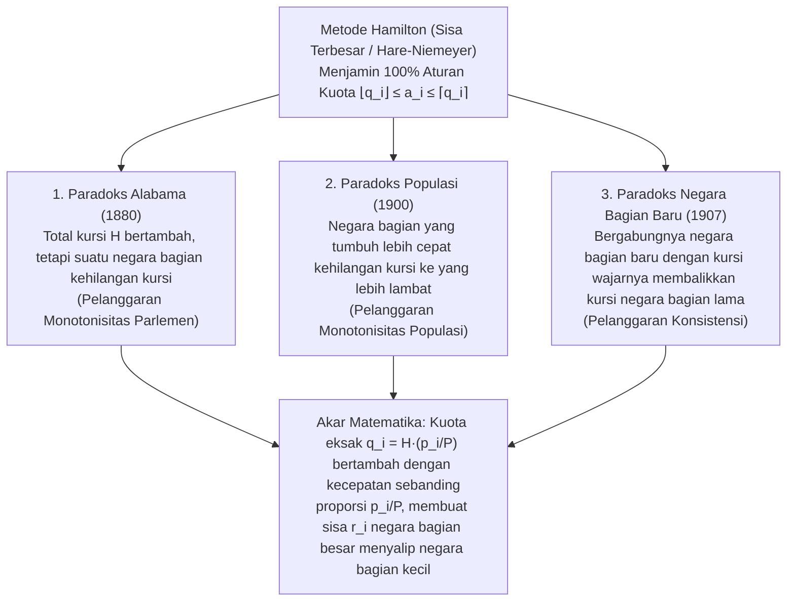

"Bagilah kursi bilangan bulat di parlemen secara adil di antara negara-negara bagian (atau partai politik) secara proporsional terhadap jumlah penduduknya."

Jika diberi tugas ini, hampir setiap orang akan menggunakan aritmetika proporsi dan pembulatan yang diajarkan di sekolah dasar: bagi total populasi nasional dengan total kursi parlemen untuk mendapatkan "pembagi standar" (jumlah penduduk per kursi), lalu bagi populasi setiap negara bagian dengan pembagi standar tersebut. Karena pembagian ini menghasilkan angka desimal seperti $7{,}73$ atau $1{,}36$ kursi, berikan terlebih dahulu bagian bilangan bulatnya ($7$ dan $1$ kursi), kemudian bagikan sisa kursi satu per satu kepada negara bagian dengan sisa pecahan desimal terbesar ($,73$, $,36$, dst.). Adakah metode yang lebih alami dan adil daripada ini?

Namun pada tahun 1880, Charles W. Seaton, kepala juru tulis Kantor Sensus Amerika Serikat, menemukan mimpi buruk matematika saat menghitung alokasi kursi DPR AS dengan metode ini (<strong>Metode Hamilton</strong> atau <strong>Metode Sisa Terbesar / Hare-Niemeyer</strong>): ketika total kursi DPR <strong>ditambah satu kursi</strong> dari $299$ menjadi $300$ kursi—tanpa perubahan satu orang pun dalam data sensus—negara bagian <strong>Alabama justru kehilangan kursinya dari $8$ kursi menjadi $7$ kursi</strong>!

Memperbesar kue secara keseluruhan justru memperkecil potongan seorang peserta: <strong>Paradoks Alabama</strong> ini kemudian disusul oleh penemuan <strong>Paradoks Populasi</strong> (negara bagian dengan laju pertumbuhan penduduk lebih cepat kehilangan kursi ke negara bagian yang tumbuh lebih lambat) dan <strong>Paradoks Negara Bagian Baru</strong> (masuknya negara bagian baru beserta jatah kursinya yang pas justru membalikkan perolehan kursi di antara negara-negara bagian lama). Akhirnya pada tahun 1982, matematikawan <strong>Michel Balinski</strong> dan <strong>H. Peyton Young</strong> membuktikan <strong>Teorema Ketidakmungkinan Balinski-Young</strong>: <strong>secara matematis tidak ada metode pembagian kursi yang dapat secara bersamaan menjamin Aturan Kuota dan monotonisitas (bebas paradoks)</strong>.

---

## 1. Krisis Konstitusional 1792: Hamilton vs. Jefferson dan Veto Kepresidenan Pertama

Pasal I, Ayat 2 Konstitusi AS tahun 1787 mengamanatkan bahwa anggota DPR dibagi di antara negara-negara bagian "menurut jumlah penduduk masing-masing", tidak melebihi satu wakil untuk setiap $30.000$ penduduk. Setelah sensus pertama tahun 1790 ($P = 3.615.920$ jiwa di $15$ negara bagian), Kongres mengesahkan RUU dengan $H = 120$ kursi (pembagi standar $D = P/H = 30.132{,}67$).

Menteri Keuangan <strong>Alexander Hamilton</strong> mengusulkan <strong>Metode Sisa Terbesar (Metode Hamilton)</strong>: berikan bagian bulat $\lfloor p_i / D \rfloor$ terlebih dahulu (total $112$ kursi), lalu berikan sisa $R = 8$ kursi kepada $8$ negara bagian dengan sisa desimal terbesar. Menteri Luar Negeri <strong>Thomas Jefferson</strong> dan Presiden <strong>George Washington</strong> (keduanya berasal dari Virginia) menentang keras: selain merugikan Virginia, negara bagian kecil yang dibulatkan ke atas—seperti Delaware ($55.540$ jiwa, $2$ kursi)—memperoleh <strong>satu wakil untuk setiap $27.770$ penduduk</strong>, melanggar batas konstitusi $30.000$!

Jefferson mengusulkan <strong>Metode Jefferson (dikenal di Eropa dan Indonesia sebagai Metode D'Hondt)</strong>: pilih satu pembagi bersama $x$ (misalnya $x = 33.000$) dan bulatkan semua hasil bagi ke bawah ($a_i = \lfloor p_i / x \rfloor$) hingga jumlahnya tepat $H$. Pada <strong>5 April 1792</strong>, Presiden Washington menggunakan <strong>veto kepresidenan pertama dalam sejarah Amerika Serikat</strong> untuk membatalkan RUU Hamilton—sebuah veto bersejarah yang dipicu oleh perselisihan tentang <strong>algoritma pembulatan matematika</strong>!

---

## 2. Formulasi Matematika dan Aturan Kuota (Quota Rule)

Misalkan terdapat $s \ge 2$ negara bagian dengan vektor populasi $\mathbf{p} = (p_1, \dots, p_s)$, total populasi $P = \sum_{i=1}^s p_i$, dan ukuran parlemen $H \in \mathbb{Z}_{>0}$. <strong>Pembagi Standar $D$</strong> dan <strong>Kuota Eksak $q_i$</strong> untuk negara bagian $i$ adalah:

$$D = \frac{P}{H}, \qquad q_i = \frac{p_i}{D} = H \cdot \frac{p_i}{P}, \qquad \sum_{i=1}^s q_i = H$$

Saat membulatkan bilangan riil $q_i$ menjadi bilangan bulat $a_i \in \mathbb{Z}_{\ge 0}$ ($\sum_{i=1}^s a_i = H$), aksioma keadilan minimum menuntut agar setiap negara bagian menerima <strong>Kuota Bawah $\lfloor q_i \rfloor$</strong> atau <strong>Kuota Atas $\lceil q_i \rceil$</strong>. Inilah <strong>Aturan Kuota (Quota Rule)</strong>:

$$\lfloor q_i \rfloor \le a_i \le \lceil q_i \rceil \quad (\forall i \in \{1, 2, \dots, s\})$$

<strong>Metode Hamilton (Sisa Terbesar / Hare-Niemeyer)</strong> menguraikan $q_i = \lfloor q_i \rfloor + r_i$ dengan $r_i \in [0, 1)$, memberikan $\lfloor q_i \rfloor$ kursi, lalu membagikan sisa $R = H - \sum \lfloor q_i \rfloor = \sum r_i$ kursi kepada $R$ negara bagian dengan sisa $r_i$ terbesar:

$$q_i = \lfloor q_i \rfloor + r_i \quad (0 \le r_i < 1), \qquad R = H - \sum_{i=1}^s \lfloor q_i \rfloor = \sum_{i=1}^s r_i \in \{0, 1, \dots, s-1\}$$

$$a_i = \begin{cases} \lfloor q_i \rfloor + 1 & (\text{if } r_i \text{ is among the } R \text{ largest remainders}) \\ \lfloor q_i \rfloor & (\text{otherwise}) \end{cases}$$

Berdasarkan konstruksinya, Metode Hamilton <strong>memenuhi Aturan Kuota $100\%$ setiap saat</strong>.

---

## 3. Anatomi Lengkap Tiga Paradoks Pembagian Kursi Klasik

Antara tahun 1880 dan 1907, data sensus AS mengungkap tiga paradoks matematika pada Metode Hamilton:

### 3.1 Paradoks Alabama (1880) dan Bukti Numerik 3 Negara Bagian ($H = 10 \to 11$)

Pada tahun 1880, saat $H$ naik dari $299$ ke $300$, kuota Alabama hanya naik $+0{,}025$ ($7{,}646 \to 7{,}671$), sedangkan Texas ($9{,}640 \to 9{,}672$, $+0{,}032$) dan Illinois ($18{,}640 \to 18{,}702$, $+0{,}062$) meningkatkan sisa desimalnya lebih cepat dan menyalip Alabama secara bersamaan. Mari kita buktikan dengan model $3$ negara bagian ($P = 1000$):

| Negara Bagian | Populasi $p_i$ | Kuota $q_i$ ($H=10$) | Bulat $\lfloor q_i \rfloor$ & Sisa $r_i$ ($H=10$) | <strong>Kursi $a_i$ ($H=10$)</strong> | Kuota $q_i'$ ($H=11$) | Bulat $\lfloor q_i' \rfloor$ & Sisa $r_i'$ ($H=11$) | <strong>Kursi $a_i'$ ($H=11$)</strong> |
| :--- | :---: | :---: | :---: | :---: | :---: | :---: | :---: |
| <strong>Negara Bagian A</strong> | $433$ | $4{,}330$ | $4$ ($r_A = 0{,}330$: Peringkat 2) | <strong>$4$ kursi</strong> | $4{,}763$ | $4$ ($r_A' = \mathbf{0{,}763}$: Peringkat 1) | <strong>$5$ kursi</strong> ($+1$) |
| <strong>Negara Bagian B</strong> | $431$ | $4{,}310$ | $4$ ($r_B = 0{,}310$: Peringkat 3) | <strong>$4$ kursi</strong> | $4{,}741$ | $4$ ($r_B' = \mathbf{0{,}741}$: Peringkat 2) | <strong>$5$ kursi</strong> ($+1$) |
| <strong>Negara Bagian C</strong> | $136$ | $1{,}360$ | $1$ ($r_C = \mathbf{0{,}360}$: Peringkat 1) | <strong>$2$ kursi</strong> | $1{,}496$ | $1$ ($r_C' = 0{,}496$: Peringkat 3) | <strong>$1$ kursi</strong> (<strong>$-1$</strong>) |
| <strong>Total</strong> | <strong>$1000$</strong> | <strong>$10{,}000$</strong> | Jumlah bulat $= 9$ ($R=1$) | <strong>$10$ kursi</strong> | <strong>$11{,}000$</strong> | Jumlah bulat $= 9$ ($R'=2$) | <strong>$11$ kursi</strong> |

Saat $H$ naik dari $10$ ke $11$, negara bagian besar A dan B bertambah $+0{,}433$ dan $+0{,}431$ sedangkan Negara Bagian C yang kecil hanya bertambah $+0{,}136$: sisa A dan B ($0{,}763$ dan $0{,}741$) menyalip $r_C' = 0{,}496$, sehingga Negara Bagian C turun dari <strong>$2$ kursi menjadi $1$ kursi</strong> (melanggar <strong>Monotonisitas Parlemen</strong>).

### 3.2 Paradoks Populasi (1900) dan Paradoks Negara Bagian Baru (1907)

- <strong>Paradoks Populasi</strong>: Antara 1890 dan 1900, Virginia tumbuh $+12{,}0\%$ dibandingkan $+5{,}0\%$ di Maine, tetapi Virginia kehilangan kursi ke Maine. Dalam model kita ($H = 10, P = 1000$): pada Waktu 1, $p_A = 427, p_B = 435, p_C = 138 \implies$ kursi $(4, 4, 2)$ karena $r_C = 0{,}380$ terbesar. Pada Waktu 2, <strong>Negara Bagian C tumbuh $+8{,}70\%$ ($138 \to 150$)</strong>, <strong>Negara Bagian B tumbuh $+6{,}90\%$ ($435 \to 465$)</strong>, dan Negara Bagian A turun ($427 \to 385$). Meski laju pertumbuhan C lebih tinggi daripada B, kenaikan kuota absolut B yang besar ($+0{,}300 \implies r_B' = 0{,}650$) mengalahkan C ($+0{,}120 \implies r_C' = 0{,}500$), sementara A melewati batas bilangan bulat $4$ ke bawah ($q_A' = 3{,}850 \implies r_A' = 0{,}850$). Akibatnya, Negara Bagian C yang tumbuh paling cepat justru kehilangan kursi ($2 \to 1$) ke B ($4 \to 5$).
- <strong>Paradoks Negara Bagian Baru</strong>: Pada tahun 1907, masuknya Oklahoma dengan $5$ kursi ($H: 386 \to 391$) membuat New York kehilangan satu kursi ke Maine. Dalam model $2$ negara bagian ($H = 10, P = 1000$ dengan $p_A = 842, p_B = 158 \implies a_A = 8, a_B = 2$), masuknya Negara Bagian Baru C ($p_C = 165$) dengan $2$ kursi wajarnya ($H' = 12, P' = 1165$) menurunkan pembagi standar dari $100$ menjadi $97{,}083$. Semua kuota dikalikan $1{,}03004$: kuota besar $q_A$ naik $+0{,}253$ ($8{,}673$, sisa $0{,}673$) dan menyalip sisa Negara Bagian B yang kecil ($1{,}627$, sisa $0{,}627$), mengubah kursi menjadi $(9, 1, 2)$.

---

## 4. Teori Terpadu Metode Pembagi (Rata-rata Tertinggi) dan Fungsi Penunjuk $d(n)$

<strong>Metode Pembagi (Divisor Methods)</strong> membagi setiap populasi $p_i$ dengan pembagi bersama $x > 0$ yang dapat disesuaikan, lalu membulatkan hasil bagi $q = p_i / x$ menggunakan <strong>Fungsi Penunjuk (Signpost Function) $d(n) \in [n, n+1]$</strong>:

$$[q]_d = n \iff d(n-1) \le q \le d(n), \qquad a_i = \left[\frac{p_i}{x}\right]_d, \qquad \sum_{i=1}^s a_i = H$$

Dengan menyelesaikan $d(a_i - 1) \le p_i / x \le d(a_i)$ terhadap $x$, diperoleh <strong>kesetaraan eksak dengan Metode Rata-rata Tertinggi (Nilai Prioritas)</strong>:

$$\frac{p_i}{d(a_i)} \le x \le \frac{p_i}{d(a_i - 1)} \quad \Longleftrightarrow \quad \text{Priority}(i, n) = \frac{p_i}{d(n)}$$

Memberikan $H$ kursi sama persis dengan memberikan kursi kepada $H$ <strong>nilai prioritas terbesar $\text{Priority}(i, n) = \frac{p_i}{d(n)}$</strong>. Karena urutan global tidak berubah saat $H$ bertambah dan rasio prioritas memenuhi:

$$\frac{p_i'}{p_j'} \ge \frac{p_i}{p_j} \implies \frac{p_i' / d(n)}{p_j' / d(m)} = \frac{p_i'}{p_j'} \cdot \frac{d(m)}{d(n)} \ge \frac{p_i}{p_j} \cdot \frac{d(m)}{d(n)} = \frac{p_i / d(n)}{p_j / d(m)}$$

<strong>semua Metode Pembagi sepenuhnya kebal terhadap ketiga paradoks tersebut!</strong>

### Perbandingan Lima Metode Pembagi Historis

| Nama Metode (Alias Pemilu) | Pengusul & Tahun | Fungsi Penunjuk $d(n)$ | Barisan Pembagi $d(0), d(1), d(2), \dots$ | Kursi Min. | Bias Ukuran & Kriteria Optimisasi | Risiko terhadap Aturan Kuota |
| :--- | :--- | :---: | :---: | :---: | :--- | :--- |
| <strong>1. Metode Jefferson</strong> (<strong>D'Hondt</strong>) | Jefferson (1792) D'Hondt (1878) | $n + 1$ (Bulat Bawah) | $1, 2, 3, 4, \dots$ | $0$ kursi | <strong>Sangat menguntungkan negara bagian / partai besar</strong> | Melanggar <strong>Kuota Atas</strong> ($a_i > \lceil q_i \rceil$) |
| <strong>2. Metode Webster</strong> (<strong>Sainte-Laguë</strong>) | Webster (1832) Sainte-Laguë (1910) | $n + 0{,}5$ (Rerata Aritmetika) | $0{,}5, \; 1{,}5, \; 2{,}5, \dots$ (atau $1, 3, 5, \dots$) | $0$ kursi | <strong>Sepenuhnya netral (tanpa bias ukuran)</strong>; Pemilu DPR RI | Dapat melanggar (jarang) Kuota Atas dan Bawah |
| <strong>3. Huntington-Hill</strong> (<strong>Proporsi Setara</strong>) | Hill (1911) Huntington (1921) | $\sqrt{n(n+1)}$ (Rerata Geometrik) | $0, \sqrt{2}, \sqrt{6}, \sqrt{12}, \dots$ | $1$ kursi | Meminimalkan ketimpangan relatif $T_{ij}$; <strong>DPR AS sejak 1941</strong> | Dapat melanggar Kuota Atas dan Bawah |
| <strong>4. Metode Dean</strong> (<strong>Rerata Harmonik</strong>) | J. Dean (1832) | $\frac{2n(n+1)}{2n+1}$ (Rerata Harmonik) | $0, \frac{4}{3}, \frac{12}{5}, \frac{24}{7}, \dots$ | $1$ kursi | Meminimalkan selisih absolut penduduk per kursi $p_i/a_i$ | Dapat melanggar Kuota Atas dan Bawah |
| <strong>5. Metode Adams</strong> (<strong>Pembagi Terkecil</strong>) | J. Q. Adams (1832) | $n$ (Bulat Atas) | $0, 1, 2, 3, \dots$ | $1$ kursi | <strong>Sangat menguntungkan negara bagian kecil</strong> | Melanggar <strong>Kuota Bawah</strong> ($a_i < \lfloor q_i \rfloor$) |

Berdasarkan ketaksamaan klasik rata-rata aritmetika, geometrik, dan harmonik (AM-GM-HM):

$$T_{ij} = \frac{a_i / p_i}{a_j / p_j} - 1, \qquad d(n) = \sqrt{n(n+1)}$$

$$n < \underbrace{\frac{2n(n+1)}{2n+1}}_{\text{Dean (HM)}} < \underbrace{\sqrt{n(n+1)}}_{\text{Huntington-Hill (GM)}} < \underbrace{n + 0.5}_{\text{Webster (AM)}} < n + 1$$

---

## 5. Teorema Ketidakmungkinan Balinski-Young (1982)

Bahkan <strong>Metode Webster / Sainte-Laguë ($d(n) = n + 0{,}5$, pembulatan ke bilangan bulat terdekat)</strong> yang paling netral sekalipun melanggar Kuota Bawah maupun Kuota Atas:
1. <strong>Pelanggaran Kuota Bawah ($H = 10, P = 1000$)</strong>: Misalkan Negara Bagian A besar ($p_A = 832 \implies q_A = 8{,}320$, Kuota Bawah <strong>$8$ kursi</strong>) dan tiga negara bagian kecil B, C, D ($p_i = 56 \implies q_i = 0{,}560$). Dengan pembagi $x = 111$, ketiga negara bagian kecil memperoleh $56/111 \approx 0{,}5045 > 0{,}5$ dan dibulatkan ke atas menjadi $1$ kursi masing-masing (total $3$ kursi), sedangkan Negara Bagian A memperoleh $832/111 \approx 7{,}4955 < 7{,}5$ dan dibulatkan ke bawah menjadi <strong>$7$ kursi</strong>—melanggar Kuota Bawahnya ($8$ kursi)!
2. <strong>Pelanggaran Kuota Atas ($H = 10, P = 1000$)</strong>: Misalkan Negara Bagian A besar ($p_A = 795 \implies q_A = 7{,}950$, Kuota Atas <strong>$8$ kursi</strong>) dan lima negara bagian kecil B–F ($p_i = 41 \implies q_i = 0{,}410$). Dengan $x = 83$, kelima negara bagian kecil memperoleh $41/83 \approx 0{,}4940 < 0{,}5$ ($0$ kursi), sedangkan Negara Bagian A memperoleh $795/83 \approx 9{,}5783 > 9{,}5$ dan memborong seluruh <strong>$10$ kursi</strong>—melampaui Kuota Atasnya sebanyak $2$ kursi!

Pada tahun 1982, Balinski dan Young membuktikan teorema pamungkas mereka:
- <strong>Teorema 1 (Karakterisasi Metode Pembagi)</strong>: Suatu metode pembagian kursi yang anonim dan homogen memenuhi <strong>Monotonisitas Populasi</strong> jika dan hanya jika metode tersebut adalah <strong>Metode Pembagi</strong>.
- <strong>Teorema 2 (Teorema Ketidakmungkinan Balinski-Young, 1982)</strong>: Untuk $s \ge 4$ negara bagian dan $H \ge 7$ kursi, <strong>tidak ada metode pembagian kursi yang dapat secara bersamaan memenuhi Monotonisitas Populasi dan Aturan Kuota ($\lfloor q_i \rfloor \le a_i \le \lceil q_i \rceil$)</strong>.

Saat pembagi bersama $x$ disesuaikan, semua kuota eksak dikalikan dengan faktor yang sama $\lambda = D/x$ ($p_i/x = \lambda q_i$), sehingga pergeseran absolut $\Delta q_A = |1 - \lambda| q_A$ pada negara bagian besar tumbuh sebanding dengan ukurannya $q_A$, yang niscaya melintasi batas bilangan bulat.
