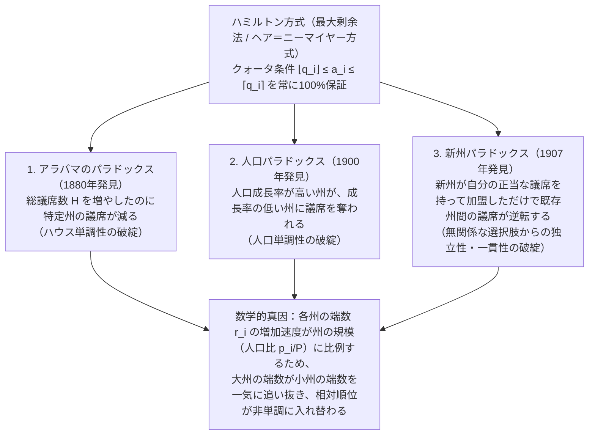
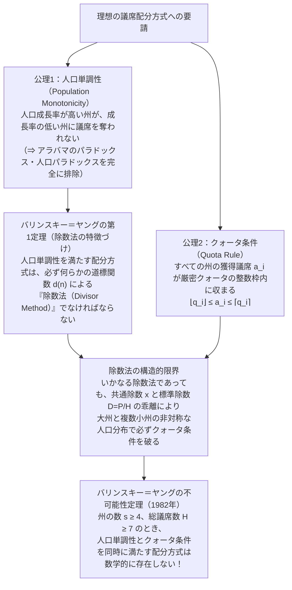

「各都道府県の人口に比例して、国会の議席を公平に分けなさい」

もしあなたがそう頼まれたら、どんな計算方法を思い浮かべるでしょうか。おそらくほとんどの人が、小学生で習う「割合と四捨五入（あるいは端数の大きい順）」を思い浮かべるはずです。まず全国の総人口を総議席数で割って「1議席あたりの基準人口」を出し、各都道府県の人口をその基準人口で割る。すると「$7.73$ 議席」や「$1.36$ 議席」といった小数が出てくるので、まずは整数部分の議席を配り、余った議席を「小数点以下の端数が大きい順」に1議席ずつ配っていく——。これ以上に自然で、公平で、疑いようのない方法があるでしょうか？

ところが1880年、アメリカ合衆国でこの「最も自然で公平な計算方法」を使って連邦下院の議席配分を計算していた統計局の職員が、背筋の凍るような怪現象を発見します。アメリカ全体の総議席数を「299議席」から「300議席」へと<strong>1議席増やした</strong>ところ、人口が1人も減っていないにもかかわらず、アラバマ州の獲得議席が<strong>8議席から7議席へと減ってしまった</strong>のです。

全体のパイ（総議席数）を増やしたのに、特定の州の取り分が減る——後に<strong>アラバマのパラドックス（The Alabama Paradox）</strong>と呼ばれることになるこの現象は、単なる計算ミスでも偶然のいたずらでもありませんでした。その後も「人口成長率が他州より高いのに、成長率の低い州に議席を奪われる（<strong>人口パラドックス</strong>）」「新しい州が自分の人口に見合う議席を持って加盟しただけなのに、既存の無関係な州の間で議席が移動する（<strong>新州パラドックス</strong>）」といった怪現象が次々と発覚し、アメリカの議会と数学界を150年以上にわたる大論争へと巻き込んでいきました。

そして1982年、数学者ミシェル・バリンスキー（Michel Balinski）とペイトン・ヤング（H. Peyton Young）によって、ついに最終的な審判が下されます。それが<strong>バリンスキー＝ヤングの不可能性定理（Balinski-Young Impossibility Theorem）</strong>です。この定理が突きつけたのは、「理想的な比例配分枠（クォータ）から1議席以上外れないこと」と「議席増や人口増に対して逆転現象（パラドックス）を起こさないこと」を両立する議席配分方式は、<strong>この宇宙に数学的に1つも存在しない</strong>という衝撃の事実でした。

本稿では、1792年にジョージ・ワシントン大統領が合衆国史上初の拒否権を発動した「ハミルトン対ジェファーソンの憲法危機」から出発し、3大配分パラドックスが起きる幾何学的・数理的メカニズムを完全な数値例とともに解剖します。さらに、日本の選挙でも馴染み深いドント方式やアダムズ方式を含む「除数法（Divisor Methods）」の統一理論と、バリンスキー＝ヤングの不可能性定理の核心へと迫ります。

---

## 第1章：1792年、合衆国を揺るがした「割り算と端数」の憲法危機

物語はアメリカ合衆国建国直後の1792年に遡ります。1787年に制定された合衆国憲法第1条第2節第3項には、連邦下院（House of Representatives）の議席配分について次のように記されていました。

> 「下院議員および直接税は、連邦に含まれる各州の間で、それぞれの人口に応じて配分されるものとする（Representatives and direct Taxes shall be apportioned among the several States which may be included within this Union, according to their respective Numbers...）。下院議員の数は、人口3万人につき1人を超えてはならないが、各州は少なくとも1人の下院議員を持つものとする。」

憲法の起草者たちは、「各州の人口に応じて（according to their respective Numbers）」と書けば、あとは単なる算数の問題であり、誰が計算しても同じ答えになると信じて疑いませんでした。しかし、1790年にアメリカ史上初の国勢調査（センサス）が実施され、全15州の配分対象人口が約361万5,920人と確定した瞬間、建国の父たちは「人間を小数点以下で切り刻むことはできない」という冷厳な離散数学の壁に激突します。

1792年、連邦議会は下院の総議席数を $H = 120$ 議席（憲法の上限である「3万人に1議席」を全国規模でほぼ満たす最大の整数）とする法案を作成しました。全国の総人口 $P = 3,615,920$ 人を総議席数 $H = 120$ で割ると、1議席あたりの基準人口（標準除数）は $D = 30,132.67$ 人となります。

ここで、財務長官<strong>アレクサンダー・ハミルトン（Alexander Hamilton）</strong>が提案した計算方式（後の<strong>ハミルトン方式 / 最大剰余法</strong>）を適用すると、深刻な問題が浮上しました。
ハミルトン方式では、まず各州の人口 $p_i$ を全国共通の基準人口 $D = 30,132.67$ で割り、その整数部分 $\lfloor p_i / D \rfloor$ を各州に配分します。すると15州の整数部分の合計は112議席となり、8議席が余ります。ハミルトン方式はこの残り8議席を、小数点以下の端数が大きい上位8州に1議席ずつ追加配分しました。

ところが、この結果に猛反発したのが、バージニア州出身の国務長官<strong>トーマス・ジェファーソン（Thomas Jefferson）</strong>と、同じくバージニア州出身の初代大統領<strong>ジョージ・ワシントン（George Washington）</strong>でした。なぜかといえば、ハミルトン方式で端数を切り上げた結果、北部諸州（ハミルトン率いる連邦派の地盤）の多くが端数議席を獲得したのに対し、当時最大の人口（約63万人）を抱えていた南部バージニア州は端数がわずかに足りず切り捨てられ、さらに端数切り上げを受けた小さな州（たとえばデラウェア州など）では、結果として「州人口を獲得議席数で割った1議席あたりの人口」が <strong>27,770人に1議席</strong>（3万人未満！）になってしまったのです。

ジェファーソンはこう主張しました。
「憲法には『下院議員の数は3万人に1人を超えてはならない』と書いてある。全国平均で3万人に1人という基準を立ててから端数を切り上げるハミルトンの方式は、特定州に『2万7千人に1人』という憲法違反の過剰代表を与えており、しかもそもそも『最初に全国で割り算をして、後から余った端数を州の間で奪い合う』という二段階の操作自体が恣意的だ！」

代案としてジェファーソンが考案したのは、まったく異なる発想に基づく計算方式（後の<strong>ジェファーソン方式 / ドント方式</strong>）でした。ジェファーソンは「3万人（あるいは3万3千人）につき1議席」という共通の除数 $x$ を定め、各州の人口 $p_i$ を $x$ で割って<strong>端数をすべて切り捨てる</strong>（$\lfloor p_i / x \rfloor$）だけで、合計が目標の総議席数になるように除数 $x$ の方を調整すべきだと論じたのです。

1792年4月5日、ワシントン大統領は連邦議会が可決したハミルトン方式の議席配分法案に対し、<strong>アメリカ合衆国憲法史上初となる大統領拒否権（Presidential Veto）</strong>を発動しました。大統領が法案に拒否権を発動した歴史上最初の理由が、外交でも戦争でも課税でもなく、実に<strong>「割り算の端数をどう丸めるかという数学アルゴリズムの対立」</strong>だったのです。結局、議会はハミルトン方式を断念し、除数 $x = 33,000$ 人で端数を切り捨てるジェファーソン方式（総議席数 $H=105$）を採択しました。これが、その後2世紀以上にわたって続く「最大剰余法（クォータ法）対 除数法」の壮大な数学戦争の幕開けでした。

---

## 第2章：比例配分の数学的定式化と「クォータ条件（Quota Rule）」

議論を厳密に進めるため、議席配分問題（Apportionment Problem）を数学的に定式化しましょう。

### 2.1 基本記号と厳密クォータ（Exact Quota）

- <strong>州（または政党）の集合</strong>：$S = \{1, 2, \dots, s\}$（$s \ge 2$）
- <strong>人口ベクトル</strong>：$\mathbf{p} = (p_1, p_2, \dots, p_s)$（各 $p_i > 0$ は州 $i$ の人口または政党 $i$ の得票数）
- <strong>総人口</strong>：$P = \sum_{i=1}^s p_i$
- <strong>総議席数（ハウスサイズ / House Size）</strong>：$H \in \mathbb{Z}_{>0}$
- <strong>配分ベクトル</strong>：$\mathbf{a} = (a_1, a_2, \dots, a_s) \in \mathbb{Z}_{\ge 0}^s$ であり、$\sum_{i=1}^s a_i = H$ を満たす非負整数ベクトル。

もし議席を実数（小数）のまま分割できるなら、唯一の完全に公平な配分は、各州の人口比 $p_i / P$ に総議席数 $H$ を掛けた値になります。これを定義するため、まず1議席あたりの全国基準人口を表す<strong>標準除数（Standard Divisor）</strong> $D$ を次のように定義します。

$$D = \frac{P}{H}$$

この標準除数 $D$ で各州の人口 $p_i$ を割った値を、州 $i$ の<strong>厳密クォータ（Exact Quota / 理想配分枠）</strong> $q_i$ と呼びます。

$$q_i = \frac{p_i}{D} = H \cdot \frac{p_i}{P}$$

当然ながら、すべての州の厳密クォータを足し合わせると、総議席数 $H$ に完全に一致します。

$$\sum_{i=1}^s q_i = \sum_{i=1}^s H \cdot \frac{p_i}{P} = H \cdot \frac{\sum_{i=1}^s p_i}{P} = H$$

### 2.2 下限クォータ・上限クォータと「クォータ条件」

厳密クォータ $q_i$ は一般に非整数（たとえば $q_i = 7.73$）です。これを整数 $a_i$ に丸めるとき、最も直感的で誰もが納得する最低限の公平性基準は何でしょうか？
それは、「理想値が $7.73$ 議席である州には、切り捨てた $7$ 議席か、切り上げた $8$ 議席のどちらかを与えるべきであり、どんな理由があっても $6$ 議席以下に減らされたり、$9$ 議席以上に増やされたりしてはならない」という基準です。

実数 $q_i$ に対し、その整数部分（切り捨て）を<strong>下限クォータ（Lower Quota）</strong> $\lfloor q_i \rfloor$、小数点以下を切り上げた整数を<strong>上限クォータ（Upper Quota）</strong> $\lceil q_i \rceil$ と呼びます。このとき、次の不等式を<strong>クォータ条件（Quota Rule / 枠条件）</strong>と定義します。

$$\lfloor q_i \rfloor \le a_i \le \lceil q_i \rceil \quad (\forall i \in \{1, 2, \dots, s\})$$

もしある州 $i$ で $a_i < \lfloor q_i \rfloor$ となった場合、それを<strong>下限クォータ違反（Lower Quota Violation）</strong>と呼び、逆に $a_i > \lceil q_i \rceil$ となった場合を<strong>上限クォータ違反（Upper Quota Violation）</strong>と呼びます。一見すると、このクォータ条件は「公平な比例配分であれば絶対に満たしていなければならない大前提」のように思えます。

---

## 第3章：ハミルトン方式（最大剰余法 / ヘア＝ニーマイヤー方式）のアルゴリズム

クォータ条件を最も直接的に実現するアルゴリズムが、第1章で登場したアレクサンダー・ハミルトンによる<strong>ハミルトン方式（Hamilton's Method）</strong>です。この方式は、後にヨーロッパの比例代表選挙においてトーマス・ヘア（Thomas Hare）やホルスト・ニーマイヤー（Horst Niemeyer）によって再発見されたため、政治学や選挙制度論では<strong>最大剰余法（Largest Remainder Method）</strong>あるいは<strong>ヘア＝ニーマイヤー方式（Hare-Niemeyer Method）</strong>とも呼ばれます。

ハミルトン方式のアルゴリズムは以下の3ステップで構成されます。

1. <strong>厳密クォータと整数・端数の分解</strong>：
   各州 $i$ について厳密クォータ $q_i = H \cdot \frac{p_i}{P}$ を計算し、それを整数部分（下限クォータ）$\lfloor q_i \rfloor$ と、小数点以下の<strong>端数（Remainder / 剰余）</strong> $r_i \in [0, 1)$ に分解する。
   $$q_i = \lfloor q_i \rfloor + r_i \quad (0 \le r_i < 1)$$

2. <strong>下限クォータの初期配分と残り議席数 $R$ の算出</strong>：
   まず各州に $\lfloor q_i \rfloor$ 議席を確定配分する。このとき、まだ配分されずに余っている残り議席数 $R$ は次のようになる。
   $$R = H - \sum_{i=1}^s \lfloor q_i \rfloor = \sum_{i=1}^s (q_i - \lfloor q_i \rfloor) = \sum_{i=1}^s r_i$$
   各 $r_i$ は $0 \le r_i < 1$ であるため、その和である整数 $R$ は必ず $0 \le R \le s - 1$ の範囲に収まる。

3. <strong>最大剰余の順による追加配分</strong>：
   端数 $r_i$ が大きい順に上位 $R$ 個の州を選び、それらの州に $1$ 議席ずつ追加する。したがって最終配分 $a_i$ は次のようになる。
   $$a_i = \begin{cases} \lfloor q_i \rfloor + 1 & (r_i \text{ が上位 } R \text{ 位以内のとき}) \\ \lfloor q_i \rfloor & (\text{それ以外のとき}) \end{cases}$$

この定義から明らかなように、ハミルトン方式ではすべての州の議席 $a_i$ が $\lfloor q_i \rfloor$ または $\lfloor q_i \rfloor + 1 \le \lceil q_i \rceil$ のいずれかになるため、<strong>いかなる人口分布や議席数に対してもクォータ条件を100%満たします</strong>。

1850年、アメリカ連邦議会はついにジェファーソン方式やウェブスター方式を捨て、このハミルトン方式（当時の推進者である下院議員サミュエル・ビントンの名を取って<strong>ビントン方式 Vinton's Method</strong> と呼ばれた）を公式の議席配分法として採用しました。クォータ条件を完璧に満たすハミルトン方式によって、議席配分問題は永遠に解決されたかに見えたのです。

---

## 第4章：3大配分パラドックスの完全解剖——なぜ直感は裏切られるのか

ところが1880年から1907年にかけて、ハミルトン方式の根底を突き崩す<strong>3つの数学的パラドックス</strong>が実際の米国勢調査データの中から次々と発見されました。それぞれがどのように発生し、なぜ私たちの直感を裏切るのか、歴史的経緯と完全な数値モデルによって徹底的に検証しましょう。

### 4.1 アラバマのパラドックス（The Alabama Paradox, 1880年）

#### 歴史的発見（299議席から300議席への悲劇）
1880年の第10回国勢調査の後、合衆国国勢調査局の首席書記チャールズ・W・シートン（Charles W. Seaton）は、議会が新しい下院定数 $H$ を決定する際の参考資料として、ハミルトン方式を用いて総議席数 $H$ を $275$ 議席から $350$ 議席まで1議席ずつ増やした場合の全州の配分一覧表を計算しました。

その計算結果を確認していたシートンは、$H = 299$ と $H = 300$ のページを見比べて愕然とし、連邦議会に緊急書簡を送りました。そこには信じがたい数値が並んでいたのです。

| 州名 | $H = 299$ での厳密クォータ $q_i$ | $H = 299$ での獲得議席 $a_i$ | $H = 300$ での厳密クォータ $q_i$ | $H = 300$ での獲得議席 $a_i$ | 議席の増減 |
| :--- | :---: | :---: | :---: | :---: | :---: |
| <strong>アラバマ州（Alabama）</strong> | $7.646$ （端数 $0.646$） | <strong>$8$ 議席</strong> | $7.671$ （端数 $0.671$） | <strong>$7$ 議席</strong> | <strong>$-1$（減少！）</strong> |
| <strong>テキサス州（Texas）</strong> | $9.640$ （端数 $0.640$） | $9$ 議席 | $9.672$ （端数 $0.672$） | $10$ 議席 | $+1$（増加） |
| <strong>イリノイ州（Illinois）</strong> | $18.640$ （端数 $0.640$） | $18$ 議席 | $18.702$ （端数 $0.702$） | $19$ 議席 | $+1$（増加） |

表を詳しく見てください。$H = 299$ のとき、アラバマ州の厳密クォータは $7.646$ で、端数 $0.646$ はテキサス州（$0.640$）やイリノイ州（$0.640$）をわずかに上回り、ちょうど残り議席を獲得できるボーダーライン上の最終枠に滑り込んで <strong>$8$ 議席</strong> を得ていました。
ところが、総議席数を1つ増やして $H = 300$ にすると、全国で配られる厳密クォータの合計は $+1$ 議席増えます。しかし、その $+1$ 議席分の増加がどのように各州の厳密クォータ $q_i = H \cdot (p_i / P)$ に配分されるかというと、<strong>各州の人口比 $p_i / P$ に比例したスピードで加算される</strong>のです！

そのため、中規模州であるアラバマ州のクォータは $7.646 \to 7.671$ へと <strong>$+0.025$</strong> しか増えなかったのに対し、より人口の多いテキサス州は $9.640 \to 9.672$（<strong>$+0.032$</strong>）、大州イリノイ州は $18.640 \to 18.702$（<strong>$+0.062$</strong>）という猛烈なスピードで端数を伸ばしました。その結果、テキサス州とイリノイ州の端数がどちらもアラバマ州の端数（$0.671$）を一気に追い抜いてしまい、追加された1議席だけでなく、アラバマ州が持っていた端数議席までもが奪われ、アラバマ州は <strong>$7$ 議席</strong> に転落してしまったのです。

#### 3州モデルによる完全な数値証明
この現象がどれほど普遍的かつ単純な算数から生じるかを確認するため、総人口 $P = 1000$ 人の3つの州（州A、州B、州C）に、総議席数 $H = 10$ を配分する場合と、1議席増やして $H = 11$ を配分する場合を完全に計算してみましょう。

- <strong>州Aの人口</strong>：$p_A = 433$ 人（人口比 $43.3\%$）
- <strong>州Bの人口</strong>：$p_B = 431$ 人（人口比 $43.1\%$）
- <strong>州Cの人口</strong>：$p_C = 136$ 人（人口比 $13.6\%$）
- <strong>総人口</strong>：$P = 433 + 431 + 136 = 1000$ 人

| 州 | 人口 $p_i$ | $H=10$ の厳密クォータ $q_i$ | $H=10$ の整数枠 $\lfloor q_i \rfloor$ と端数 $r_i$ | <strong>$H=10$ の配分 $a_i$</strong> | $H=11$ の厳密クォータ $q_i'$ | $H=11$ の整数枠 $\lfloor q_i' \rfloor$ と端数 $r_i'$ | <strong>$H=11$ の配分 $a_i'$</strong> |
| :--- | :---: | :---: | :---: | :---: | :---: | :---: | :---: |
| <strong>州A</strong> | $433$ | $4.330$ | $4$ （端数 $0.330$：2位） | <strong>$4$ 議席</strong> | $4.763$ | $4$ （端数 <strong>$0.763$：1位</strong>） | <strong>$5$ 議席</strong>（$+1$） |
| <strong>州B</strong> | $431$ | $4.310$ | $4$ （端数 $0.310$：3位） | <strong>$4$ 議席</strong> | $4.741$ | $4$ （端数 <strong>$0.741$：2位</strong>） | <strong>$5$ 議席</strong>（$+1$） |
| <strong>州C</strong> | $136$ | $1.360$ | $1$ （端数 <strong>$0.360$：1位</strong>） | <strong>$2$ 議席</strong> | $1.496$ | $1$ （端数 $0.496$：3位） | <strong>$1$ 議席</strong>（<strong>$-1$</strong>） |
| <strong>合計</strong> | <strong>$1000$</strong> | <strong>$10.000$</strong> | 整数和 $= 9$（残り $R=1$） | <strong>$10$ 議席</strong> | <strong>$11.000$</strong> | 整数和 $= 9$（残り $R'=2$） | <strong>$11$ 議席</strong> |

計算の仕組みは驚くほど明快です。
1. <strong>$H = 10$ のとき</strong>：整数部分の合計は $4 + 4 + 1 = 9$ 議席であり、残りは $R = 1$ 議席です。端数を比べると、小州Cの端数 $r_C = 0.360$ が、大州A（$0.330$）および大州B（$0.310$）を抑えて堂々の第1位となるため、州Cが追加の1議席を獲得して <strong>$2$ 議席</strong> になります。
2. <strong>$H = 11$ に増やしたとき</strong>：総議席数が1増えると、各州のクォータはそれぞれの人口比（Aは $+0.433$、Bは $+0.431$、Cは $+0.136$）だけ増加します。どの州のクォータもまだ次の整数（$5$ や $2$）には届かないため、整数部分の合計は $4 + 4 + 1 = 9$ 議席のまま変わらず、端数で配る残り議席数が $R' = 11 - 9 = 2$ 議席に増えます。
3. ところが、大州Aと大州Bの端数は $+0.43$ 以上も一気にジャンプして $r_A' = 0.763$、$r_B' = 0.741$ に達したのに対し、小州Cの端数は $+0.136$ しか進まず $r_C' = 0.496$ に留まります。その結果、残り2議席は大州Aと大州Bに1議席ずつ奪われ、小州Cは <strong>$2$ 議席から $1$ 議席へと減ってしまう</strong>のです！

このように、「総議席数 $H$ が増えたとき、どの州の配分議席も減ってはならない（$H' > H \implies a_i(H') \ge a_i(H)$）」という性質を<strong>ハウス単調性（House Monotonicity）</strong>と呼びます。ハミルトン方式はこのハウス単調性を根本的に欠いているのです。

---

### 4.2 人口パラドックス（The Population Paradox, 1900年）

#### 歴史的発見（バージニア州対メイン州の逆転）
アラバマのパラドックスに衝撃を受けたアメリカ議会は、総議席数 $H$ を慎重に選ぶことでアラバマのパラドックスが起きない定数を選び続けました。しかし1900年の国勢調査において、さらに深刻な第2のパラドックスが発覚します。

1890年から1900年までの10年間で、バージニア州の人口は約 $165.6$ 万人から約 $185.4$ 万人へと約 $19.8$ 万人増加（<strong>成長率 $+12.0\%$</strong>）しました。一方、メイン州の人口は約 $66.1$ 万人から約 $69.4$ 万人へと約 $3.3$ 万人しか増加しませんでした（<strong>成長率 $+5.0\%$</strong>）。バージニア州は絶対数でも成長率（比率）でもメイン州を圧倒しており、バージニア州とメイン州の人口比 $p_{\text{VA}} / p_{\text{ME}}$ は $2.505$ から $2.670$ へと明確に上昇していました。

ところが、同じ総議席数（たとえば $H = 386$ 議席）の下で1890年と1900年のハミルトン配分を比較すると、成長率の高いバージニア州が <strong>$10$ 議席から $9$ 議席へと1議席を失い</strong>、成長率の低いメイン州が <strong>$3$ 議席から $4$ 議席へと1議席を増やした</strong>のです！

#### 3州モデルによる完全な数値証明
なぜ「州Cの方が州Bよりも高い人口成長率を達成したのに、州Cが議席を失い、州Bが議席を得る」という不条理が起きるのでしょうか？ ここでも、先ほどのアラバマのパラドックスと同じ「成長率（比率）と端数の絶対増加量のズレ」が決定的な役割を果たします。総議席数 $H = 10$（固定）、総人口 $P = 1000$ 人の3州モデルで完全に再現してみましょう。

- <strong>時点1（初期状態）</strong>：
  - 州A：$p_A = 427$ 人
  - 州B：$p_B = 435$ 人
  - 州C：$p_C = 138$ 人
  - 合計：$P = 427 + 435 + 138 = 1000$ 人

- <strong>時点2（10年後の人口変化）</strong>：
  - <strong>州Cの人口</strong>：$138 \to 150$ 人に増加（成長率 <strong>$+8.70\%$</strong>）
  - <strong>州Bの人口</strong>：$435 \to 465$ 人に増加（成長率 <strong>$+6.90\%$</strong>）
  - <strong>州Aの人口</strong>：$427 \to 385$ 人に減少（成長率 $-9.84\%$）
  - 合計：$P' = 385 + 465 + 150 = 1000$ 人

注目してください。<strong>州Cの人口成長率（$+8.70\%$）は、州Bの人口成長率（$+6.90\%$）を明確に上回っています</strong>。実際、2州間の相対人口比も $p_C / p_B = 138 / 435 \approx 0.3172$ から $p_C' / p_B' = 150 / 465 \approx 0.3226$ へと州Cに有利な方向へ上昇しています。では、総議席数 $H = 10$ のハミルトン方式で何が起きるかを見てみましょう。

| 州 | 時点1の人口 $p_i$ | 時点1のクォータ $q_i$（端数 $r_i$） | <strong>時点1の配分 $a_i$</strong> | 人口成長率 | 時点2の人口 $p_i'$ | 時点2のクォータ $q_i'$（端数 $r_i'$） | <strong>時点2の配分 $a_i'$</strong> | 議席の変化 |
| :--- | :---: | :---: | :---: | :---: | :---: | :---: | :---: | :---: |
| <strong>州A</strong> | $427$ | $4.270$ （$r_A = 0.270$：3位） | <strong>$4$ 議席</strong> | $-9.84\%$ | $385$ | $3.850$ （$r_A' = \mathbf{0.850}$：1位） | <strong>$4$ 議席</strong> | $0$ （維持） |
| <strong>州B</strong> | $435$ | $4.350$ （$r_B = 0.350$：2位） | <strong>$4$ 議席</strong> | <strong>$+6.90\%$</strong> | $465$ | $4.650$ （$r_B' = \mathbf{0.650}$：2位） | <strong>$5$ 議席</strong> | <strong>$+1$（増加！）</strong> |
| <strong>州C</strong> | $138$ | $1.380$ （$r_C = \mathbf{0.380}$：1位） | <strong>$2$ 議席</strong> | <strong>$+8.70\%$</strong> | $150$ | $1.500$ （$r_C' = 0.500$：3位） | <strong>$1$ 議席</strong> | <strong>$-1$（減少！）</strong> |
| <strong>合計</strong> | <strong>$1000$</strong> | 整数和 $= 9$（残り $R=1$） | <strong>$10$ 議席</strong> | $0.00\%$ | <strong>$1000$</strong> | 整数和 $= 8$（残り $R'=2$） | <strong>$10$ 議席</strong> | — |

この表には、ハミルトン方式が抱える二重の罠が鮮やかに現れています。
1. <strong>成長率は「比率」だが、端数の追い抜きは「絶対差」で決まる</strong>：
   小州Cは $+8.70\%$ という高い成長率を達成しましたが、元のクォータが $1.380$ と小さいため、クォータの絶対的な増加量は $1.380 \times 0.0870 = +0.120$（端数 $0.380 \to 0.500$）にとどまります。一方、大州Bは成長率こそ $+6.90\%$ と州Cより低いものの、元のクォータが $4.350$ と大きいため、クォータの絶対増加量は $4.350 \times 0.0690 = +0.300$（端数 $0.350 \to 0.650$）に達し、州Cの端数を軽々と抜き去ってしまいます。
2. <strong>第三者（州A）の整数境界跨ぎによるバタフライ効果</strong>：
   さらに、人口が減少した州Aのクォータが $4.270$ から $3.850$ へと整数境界 $4$ を上から下に割り込んだため、州Aの整数枠は $4 \to 3$ に減った代わりに、端数が $0.270 \to 0.850$ へと跳ね上がりました。結果として、州Aは端数1位で $3 + 1 = 4$ 議席を死守し、端数2位に浮上した州Bが <strong>$4 \to 5$ 議席</strong> に増え、最も高い成長率を誇ったはずの州Cが <strong>$2 \to 1$ 議席</strong> に転落したのです。

このように、任意の2州 $i, j$ について「州 $i$ の人口が州 $j$ の人口以上の比率で成長した（$p_i' / p_j' \ge p_i / p_j$）にもかかわらず、州 $i$ の議席が減り（$a_i' < a_i$）かつ州 $j$ の議席が増える（$a_j' > a_j$）ことが決して起きない」という条件を<strong>人口単調性（Population Monotonicity）</strong>と呼びます。この条件が破れる現象こそが<strong>人口パラドックス（The Population Paradox）</strong>です。

---

### 4.3 新州パラドックス（The New States Paradox, 1907年）

#### 歴史的発見（オクラホマ州加盟とニューヨーク対メインの玉突き事故）
第3のパラドックスは、1907年にオクラホマ準州がアメリカ合衆国の第46番目の州として加盟した際に発生しました。
1900年の国勢調査に基づく当時の下院総議席数は $H = 386$ 議席（既存45州）でした。オクラホマ新州の人口は約100万人であり、当時の基準で計算するとちょうど <strong>$5$ 議席</strong> に相当しました。

そこで連邦議会は、既存の45州の議席には一切手をつけず、オクラホマ州の分の5議席をそのまま総議席数に追加して $H' = 386 + 5 = 391$ 議席としました。既存45州の人口は1人も変わっておらず、オクラホマ州にはその人口に見合う5議席を持参させただけなのですから、既存45州の議席配分はまったく変わらないはずです。

ところが、全46州・総議席数 $H' = 391$ でハミルトン方式を再計算したところ、オクラホマ州が予定通り5議席を獲得した裏で、オクラホマとは何の関係もない<strong>ニューヨーク州が $38$ 議席から $37$ 議席へと1議席を失い、メイン州が $3$ 議席から $4$ 議席へと1議席を増やす</strong>という玉突き現象が起きたのです！

#### 2州＋新州モデルによる完全な数値証明
この現象も、シンプルな数値モデルで完全に解明できます。既存の2州（州A、州B）に総議席数 $H = 10$ が配分されているところに、新州Cが加盟するケースを見てみましょう。

- <strong>初期状態（既存2州 A, B、総人口 $P = 1000$ 人、総議席数 $H = 10$、標準除数 $D = 100$ 人/議席）</strong>：
  - <strong>州A</strong>：人口 $p_A = 842$ 人 $\implies$ 厳密クォータ $q_A = 8.420$（整数枠 $8$、端数 $r_A = 0.420$）
  - <strong>州B</strong>：人口 $p_B = 158$ 人 $\implies$ 厳密クォータ $q_B = 1.580$（整数枠 $1$、端数 $r_B = 0.580$）
  - 整数枠の合計は $8 + 1 = 9$ 議席。残り $R = 1$ 議席は端数が大きい<strong>州B</strong>（$r_B = 0.580 > r_A = 0.420$）が獲得する。
  - <strong>初期配分</strong>：州Aが <strong>$8$ 議席</strong>、州Bが <strong>$2$ 議席</strong>（合計 $10$ 議席）。

- <strong>新州Cの加盟</strong>：
  - ここに人口 <strong>$p_C = 165$ 人</strong> の<strong>新州C</strong>が加盟します。
  - 1議席あたりの基準人口（標準除数）は $D = 100$ 人ですから、新州Cの理想議席数は $1.65$ 議席であり、どの丸め方をしても新州Cの正当な議席数は文句なしに <strong>$2$ 議席</strong> です。
  - そこで総議席数を2議席増やして <strong>$H' = 10 + 2 = 12$ 議席</strong> とし、3州の合計人口 <strong>$P' = 1000 + 165 = 1165$ 人</strong> でハミルトン方式を再計算します。

| 州 | 人口 $p_i$ | 加盟前（$H=10, P=1000$）のクォータ $q_i$ | <strong>加盟前の配分 $a_i$</strong> | 加盟後（$H'=12, P'=1165$）のクォータ $q_i'$ | 加盟後の整数枠と端数 $r_i'$ | <strong>加盟後の配分 $a_i'$</strong> | 議席の変化 |
| :--- | :---: | :---: | :---: | :---: | :---: | :---: | :---: |
| <strong>州A</strong> | $842$ | $8.420$ （$r_A = 0.420$：2位） | <strong>$8$ 議席</strong> | $8.673$ | $8$ （$r_A' = \mathbf{0.673}$：2位） | <strong>$9$ 議席</strong> | <strong>$+1$（増加！）</strong> |
| <strong>州B</strong> | $158$ | $1.580$ （$r_B = \mathbf{0.580}$：1位） | <strong>$2$ 議席</strong> | $1.627$ | $1$ （$r_B' = 0.627$：3位） | <strong>$1$ 議席</strong> | <strong>$-1$（減少！）</strong> |
| <strong>新州C</strong> | $165$ | — | — | $1.700$ | $1$ （$r_C' = \mathbf{0.700}$：1位） | <strong>$2$ 議席</strong> | （新加盟 $2$） |
| <strong>合計</strong> | <strong>$1165$</strong> | 整数和 $= 9$（$R=1$） | <strong>$10$ 議席</strong> | <strong>$12.000$</strong> | 整数和 $= 10$（$R'=2$） | <strong>$12$ 議席</strong> | — |

なぜこのような逆転が起きたのでしょうか？
新州Cは人口 $165$ 人（従来の基準では $1.65$ 議席分）に対して、切り上げられた整数である <strong>$2$ 議席</strong> を総議席数にプラスして加盟しました。すると、連邦全体の1議席あたり基準人口（標準除数）が、加盟前の $D = 1000 / 10 = 100$ 人/議席から、加盟後は $D' = 1165 / 12 \approx 97.083$ 人/議席へとわずかに小さくなります（つまり全州の厳密クォータが約 $1.03$ 倍に膨らみます）。
このとき、大州Aのクォータは $8.420 \times (100 / 97.083) = 8.673$ へと <strong>$+0.253$</strong> も増加したのに対し、小州Bのクォータは $1.580 \times (100 / 97.083) = 1.627$ へと <strong>$+0.047$</strong> しか増加しません。その結果、大州Aの端数（$0.673$）が小州Bの端数（$0.627$）を逆転し、新州Cが2議席を受け取った隣で、州Aが州Bから1議席を奪い取ってしまったのです！

この現象は<strong>新州パラドックス（The New States Paradox）</strong>と呼ばれ、意思決定理論やゲーム理論における「無関係な選択肢からの独立性（Independence of Irrelevant Alternatives）」や「一貫性（Consistency / 任意の部分集合を取り出してその獲得議席の合計を再配分しても同じ結果になること）」がハミルトン方式では成り立たないことを示しています。

---

## 第5章：除数法（Divisor Methods / 最高平均法）の体系と道標関数 $d(n)$

これら3つのパラドックスが次々と発覚したことで、数学者たちはハミルトン方式の致命的な構造欠陥に気づきました。ハミルトン方式が破綻する根本原因は、「まず全体の総議席数 $H$ から全国共通の標準除数 $D = P/H$ を固定し、その後で端数 $r_i$ という『整数部分を切り落とした後の非線形な残りカス』の順位を比較する」という二段階の手続きにあります。

これに対し、1792年にトーマス・ジェファーソンが提唱していたアプローチ——すなわち<strong>除数法（Divisor Methods）</strong>——は、まったく異なる数学的構造を持っています。

### 5.1 除数法の基本原理と道標関数（Signpost Function）

除数法では、標準除数 $D = P/H$ を使う代わりに、調整可能な正の実数パラメータである<strong>共通除数（Modified Divisor / 調整除数） $x > 0$</strong> を用意します。そして、各整数区間 $[n, n+1]$（$n = 0, 1, 2, \dots$）の中に1つずつ、切り捨てと切り上げの境界となる閾値——<strong>道標関数（Signpost Function / 境界関数） $d(n) \in [n, n+1]$</strong>——を定めます。

道標関数 $d(n)$ が与えられたとき、任意の実数 $q \ge 0$ を整数に丸める規則 $[q]_d$ を次のように定義します。

$$[q]_d = n \iff d(n-1) < q < d(n) \quad (\text{ただし } d(-1) = 0 \text{ とし、境界 } q = d(n) \text{ では } n \text{ または } n+1 \text{ のいずれかをとる})$$

たとえば、通常の四捨五入であれば $d(n) = n + 0.5$ ですから、$q = 2.49$ なら $d(1)=1.5 < 2.49 < d(2)=2.5$ なので $2$ に丸められ、$q = 2.51$ なら $3$ に丸められます。

除数法とは、各州の人口 $p_i$ を共通除数 $x$ で割った商 $p_i / x$ をこの丸め規則 $[\cdot]_d$ で整数化した値 $a_i = [p_i / x]_d$ の合計が、ちょうど目標の総議席数 $H$ に一致するように $x$ を選ぶ方法です。

$$a_i = \left[\frac{p_i}{x}\right]_d \quad \text{かつ} \quad \sum_{i=1}^s a_i = H$$

### 5.2 最高平均法（Highest Averages Method）との完全な同値性

この除数法の定義式 $d(a_i - 1) \le \frac{p_i}{x} \le d(a_i)$ を、共通除数 $x$ について整理してみましょう。すると、すべての州 $i$ について次の不等式が成り立つことがわかります。

$$\frac{p_i}{d(a_i)} \le x \le \frac{p_i}{d(a_i - 1)}$$

この不等式が意味する事実は極めて重要です。左辺の $\frac{p_i}{d(a_i)}$ は「州 $i$ がこれから $(a_i + 1)$ 議席目を獲得するための優先度」を表し、右辺の $\frac{p_i}{d(a_i - 1)}$ は「州 $i$ がすでに獲得した $a_i$ 議席目の優先度」を表しています。共通除数 $x$ がこれらすべての区間の間に挟まっているということは、<strong>「すでに配分された $H$ 個の議席の優先度 $\frac{p_i}{d(n)}$（$0 \le n \le a_i - 1$）はすべて $x$ 以上であり、配分されなかった議席の優先度 $\frac{p_i}{d(n)}$（$n \ge a_i$）はすべて $x$ 以下である」</strong>ということに他なりません！

すなわち、共通除数 $x$ を見つけて丸める操作は、次の<strong>最高平均法（Highest Averages Method / 優先度値方式）</strong>のアルゴリズムと数学的に100%同値なのです。

> <strong>【最高平均法のアルゴリズム】</strong>
> 各州 $i$ と各非負整数 $n = 0, 1, 2, \dots$ に対して、$(n+1)$ 議席目を受け取るための<strong>優先度値（Priority Value）</strong>を
> $$\text{Priority}(i, n) = \frac{p_i}{d(n)}$$
> と定義する。全州のすべての優先度値 $\frac{p_i}{d(n)}$ を大きい順に並べ、上から順番に $H$ 個の議席を1議席ずつ配分する（ただし $d(0) = 0$ の場合は $\frac{p_i}{0} = +\infty$ とみなし、まず全州に1議席ずつ配分してから $n \ge 1$ の比較を行う）。

この同値性によって、なぜ除数法が<strong>3大パラドックスを絶対に起こさないのか</strong>が一瞬で証明されます。
- <strong>アラバマのパラドックスが起きない理由（ハウス単調性）</strong>：総議席数を $H$ から $H+1$ に増やしたとき、優先度値 $\frac{p_i}{d(n)}$ のランキング表は1ミリも変わりません。ただ単に、ランキングの第 $(H+1)$ 位にある州に1議席が追加されるだけであり、すでに配られた上位 $H$ 個の議席が他州から奪われることは絶対にあり得ないのです。
- <strong>人口パラドックスが起きない理由（人口単調性）</strong>：州 $i$ の人口成長率が州 $j$ の人口成長率以上（$p_i' / p_j' \ge p_i / p_j$）であるとき、任意の議席数 $n, m$ に対する2州間の優先度値の比は
  $$\frac{p_i' / d(n)}{p_j' / d(m)} = \frac{p_i'}{p_j'} \cdot \frac{d(m)}{d(n)} \ge \frac{p_i}{p_j} \cdot \frac{d(m)}{d(n)} = \frac{p_i / d(n)}{p_j / d(m)}$$
  となり、常に州 $i$ に有利な方向へ単調に変化します。したがって、州 $i$ の優先度値が州 $j$ の優先度値に逆転されて議席を奪われることは数学的に起こり得ません。
- <strong>新州パラドックスが起きない理由（一貫性）</strong>：新州が加盟しても、既存州同士の優先度値 $\frac{p_i}{d(n)}$ と $\frac{p_j}{d(m)}$ の大小関係は新州の人口には一切依存しないため、既存州の間で一方が議席を増やし他方が議席を減らすような玉突き逆転は絶対に発生しません。

### 5.3 歴史的な5大除数法の完全比較

では、道標関数 $d(n) \in [n, n+1]$ をどう選ぶかによって、どのような除数法が生まれるのでしょうか？ 歴史上提案され、現在も世界各国の選挙制度や議席配分で使われている代表的な5つの除数法を整理しましょう。

| 方式名（別名） | 提唱者・年 | 道標関数 $d(n)$ | 除数列 $d(0), d(1), d(2), \dots$ | 最小保証議席 | 規模バイアスと数学的特徴 | クォータ条件の違反リスク |
| :--- | :--- | :---: | :---: | :---: | :--- | :--- |
| <strong>1. ジェファーソン方式</strong> （<strong>ドント方式</strong> D'Hondt） | T. Jefferson (1792) V. D'Hondt (1878) | $n + 1$ （切り捨て） | $1, 2, 3, 4, \dots$ | $0$ 議席 | <strong>大州（大政党）に最も有利</strong>。 日本の国政比例代表で採用。 | <strong>上限クォータ違反</strong>を起こす（大州が $\lceil q_i \rceil$ を超える） |
| <strong>2. ウェブスター方式</strong> （<strong>サン＝ラグ方式</strong> Sainte-Laguë） | D. Webster (1832) A. Sainte-Laguë (1910) | $n + 0.5$ （算術平均・四捨五入） | $0.5, 1.5, 2.5, 3.5, \dots$ （または $1, 3, 5, 7, \dots$） | $0$ 議席 | <strong>規模に対して最も中立（Unbiased）</strong>。 大州にも小州にも偏らない。 | 上限・下限ともにまれに違反し得る（確率は極めて低い） |
| <strong>3. ハンティントン＝ヒル方式</strong> （<strong>均等比例法</strong> Equal Proportions） | J. Hill (1911) E. V. Huntington (1921) | $\sqrt{n(n+1)}$ （幾何平均） | $0, \sqrt{2}, \sqrt{6}, \sqrt{12}, \dots$ （$0, 1.414, 2.449, 3.464, \dots$） | $1$ 議席 （$d(0)=0$） | 1人あたり議席数の<strong>相対的不平等度</strong>を最小化。 <strong>1941年以降の米国下院公式方式</strong>。 | 上限・下限ともに違反し得る |
| <strong>4. ディーン方式</strong> （<strong>調和平均法</strong> Harmonic Mean） | J. Dean (1832) | $\dfrac{2n(n+1)}{2n+1}$ （調和平均） | $0, \frac{4}{3}, \frac{12}{5}, \frac{24}{7}, \dots$ （$0, 1.333, 2.400, 3.429, \dots$） | $1$ 議席 （$d(0)=0$） | 1議席あたり人口 $p_i/a_i$ の<strong>絶対差</strong>を最小化。 やや小州に有利。 | 上限・下限ともに違反し得る |
| <strong>5. アダムズ方式</strong> （<strong>最小除数法</strong> Smallest Divisors） | J. Q. Adams (1832) | $n$ （切り上げ） | $0, 1, 2, 3, \dots$ | $1$ 議席 （$d(0)=0$） | <strong>小州（小政党）に最も有利</strong>。 <strong>日本の衆院小選挙区定数配分で採用</strong>。 | <strong>下限クォータ違反</strong>を起こす（大州が $\lfloor q_i \rfloor$ を下回る） |

それぞれの方式が持つ数理的な意味を深掘りしておきましょう。

#### (1) ジェファーソン方式（ドント方式）：$d(n) = n + 1$
道標を区間の右端 $d(n) = n + 1$ に置くため、商 $p_i / x$ の小数点以下はすべて切り捨てられます（$p_i / x = 1.999$ でも $1$ 議席）。優先度値は $\frac{p_i}{1}, \frac{p_i}{2}, \frac{p_i}{3}, \dots$ となり、日本の衆議院・参議院の比例代表選挙で使われている<strong>ドント方式</strong>そのものです。
なぜジェファーソン方式が大州（大政党）に有利なのでしょうか？ たとえば小州の商が $1.4 \to 1$ 議席になるには約 $29\%$ もの端数が切り捨てられますが、大州の商が $10.4 \to 10$ 議席になるときはわずか $3.8\%$ しか失われません。全州の合計を $H$ に合わせるために共通除数 $x$ を標準除数 $D$ より小さくしていくと、大州の商 $p_i / x$ はより速いスピードで膨張し、いくつもの整数境界を突破します。実際、1832年の米国勢調査試算では、ニューヨーク州の厳密クォータが <strong>$q_{\text{NY}} = 38.59$</strong>（上限クォータは $39$ 議席）であったにもかかわらず、ジェファーソン方式はニューヨーク州に <strong>$40$ 議席</strong> を与え、明白な<strong>上限クォータ違反</strong>を引き起こしました。

#### (2) アダムズ方式：$d(n) = n$
ジェファーソン方式の大州優遇に憤慨した第6代大統領ジョン・クインシー・アダムズ（ニューイングランドの小州地盤）が1832年に提案した、正反対の方式です。道標を区間の左端 $d(n) = n$ に置くため、商 $p_i / x$ の小数点以下は少しでも端数があればすべて切り上げられます（$\lceil p_i / x \rceil$）。
特に $d(0) = 0$ であるため、人口が $p_i > 0$ であるすべての都道府県・州には、まず最初に無条件で $1$ 議席が配分されます。「どんなに人口が少ない県でも最低1議席を保証しつつ、小県に配慮して定数を配分する」という性質から、日本の衆議院小選挙区の都道府県別定数配分では、一票の格差是正のために2020年国勢調査（2022年成立の「10増10減」法改正）からこの<strong>アダムズ方式</strong>が公式に採用されています。ただしその裏返しとして、大都市圏（大州）の議席が下限クォータ $\lfloor q_i \rfloor$ を割り込む<strong>下限クォータ違反</strong>が頻発します。

#### (3) ウェブスター方式（サン＝ラグ方式）：$d(n) = n + 0.5$
区間 $[n, n+1]$ のちょうど真ん中である<strong>算術平均（Arithmetic Mean）</strong> $d(n) = n + 0.5$ を道標とする通常の四捨五入方式です。優先度値は $\frac{p_i}{0.5}, \frac{p_i}{1.5}, \frac{p_i}{2.5}, \dots$（分母を2倍すれば奇数 $1, 3, 5, 7, \dots$ で割る<strong>サン＝ラグ方式</strong>と同一）となります。切り捨てられる期待値と切り上げられる期待値が対称であるため、統計的・確率的に見て<strong>大州にも小州にも一切バイアスを持たない唯一の中立的な除数法</strong>であることが証明されています。

#### (4) ハンティントン＝ヒル方式（均等比例法）：$d(n) = \sqrt{n(n+1)}$
現在、アメリカ合衆国下院（総議席数 $H = 435$、全50州）の議席配分に1941年以来ずっと使われ続けている現行法の方式です。1921年にハーバード大学の数学者エドワード・ハンティントンが定式化したこの方式は、道標関数として $n$ と $n+1$ の<strong>幾何平均（Geometric Mean / 相乗平均）</strong>を採用します。

$$d(n) = \sqrt{n(n+1)}$$

なぜ算術平均 $n + 0.5$ ではなく、幾何平均 $\sqrt{n(n+1)}$ を使うのでしょうか？
ハンティントンは、「2つの州 $i, j$ の間で1人あたり議席数 $a_i / p_i$ と $a_j / p_j$ を比べたとき、その<strong>相対的な格差（比率と1との差）</strong>がこれ以上どんな1議席の移動によっても縮まらない状態こそが真の公平（均等比例 Equal Proportions）である」と考えました。
いま、$a_i / p_i > a_j / p_j$ である2つの州の間で、相対的不平等度を

$$T_{ij} = \frac{a_i / p_i}{a_j / p_j} - 1$$

と測ることにします。もし州 $j$ が $n$ 議席、州 $i$ が $m+1$ 議席を持っている状態と、州 $i$ から州 $j$ へ1議席を移して州 $j$ が $n+1$ 議席、州 $i$ が $m$ 議席になる状態のどちらが相対的不平等度 $T_{ij}$ を小さくするかを計算すると、簡単な代数変形から次の同値関係が導かれます。

$$\text{州 } j \text{ に } (n+1) \text{ 議席目を与える方が相対格差が小さい} \iff \frac{p_j}{\sqrt{n(n+1)}} > \frac{p_i}{\sqrt{m(m+1)}}$$

なんと、2州間の相対的不平等度を最小化する条件から、必然的に幾何平均 $d(n) = \sqrt{n(n+1)}$ が導き出されるのです！ また、$n=0$ のときは $d(0) = \sqrt{0 \cdot 1} = 0$ となるため、合衆国憲法が定める「すべての州は少なくとも1人の下院議員を持つ」という要件も自動的に満たされます。
なお、算術平均・幾何平均・調和平均の不等式（AM-GM-HM不等式）により、すべての $n \ge 1$ に対して

$$n < \underbrace{\frac{2n(n+1)}{2n+1}}_{\text{ディーン（調和平均）}} < \underbrace{\sqrt{n(n+1)}}_{\text{ハンティントン＝ヒル（幾何平均）}} < \underbrace{n + 0.5}_{\text{ウェブスター（算術平均）}} < n + 1$$

が厳密に成り立ちます。たとえば $n = 1$ のとき、道標の値はディーンが $1.333$、ハンティントン＝ヒルが $\sqrt{2} \approx 1.414$、ウェブスターが $1.500$ です。道標が $1.500$ より小さい $\sqrt{2} \approx 1.414$ にあるということは、$1.42$ のような商でも $2$ 議席に切り上げられることを意味するため、ハンティントン＝ヒル方式はウェブスター方式に比べてわずかに小州に有利なバイアスを持っています。1920年代から1941年にかけて、ハーバード大学のハンティントン教授（ハンティントン＝ヒル方式を支持）と、コーネル大学のウォルター・ウィルコックス教授（ウェブスター方式を支持）の間で、米国科学アカデミー（NAS）を巻き込む激しい学界論争が繰り広げられ、最終的に1941年、フランクリン・ルーズベルト大統領の署名によってハンティントン＝ヒル方式が恒久法として確立されました。

---

## 第6章：バリンスキー＝ヤングの不可能性定理（1982年）

さて、ここで読者の皆さんの胸には1つの大きな疑問が湧いているはずです。
「ハミルトン方式はクォータ条件を100%満たすが、3大パラドックスを起こす。一方、除数法は3大パラドックスを一切起こさないが、ジェファーソン方式やアダムズ方式のようにクォータ条件に違反することがある。では、<strong>ウェブスター方式やハンティントン＝ヒル方式のように真ん中付近で丸める除数法ならクォータ条件も満たすのではないか？ あるいは、除数法を少し改良して、クォータ条件とパラドックス回避（単調性）の両方を100%満たす完璧な配分方式を作れるのではないか？</strong>」

この200年来の問いに完全な終止符を打ったのが、1982年にミシェル・バリンスキーとペイトン・ヤングが証明した<strong>バリンスキー＝ヤングの不可能性定理（Balinski-Young Impossibility Theorem）</strong>です。

### 6.1 ウェブスター方式ですらクォータ条件を破る！（具体的数値証明）

まず驚くべき事実として、最も中立で偏りのないはずの<strong>ウェブスター方式（四捨五入：$d(n) = n + 0.5$）であっても、上限クォータ違反と下限クォータ違反の両方を引き起こす</strong>ことを、具体的な数値例で証明しましょう。

#### ケースA：ウェブスター方式が「下限クォータ違反」を起こす例（4州モデル、$H = 10, P = 1000$）
1つの大州Aと、3つの小州B, C, Dからなる総人口 $P = 1000$ 人、総議席数 $H = 10$（標準除数 $D = 100$）の国を考えます。

- <strong>州Aの人口</strong>：$p_A = 832$ 人 $\implies$ 厳密クォータ <strong>$q_A = 8.320$</strong>（下限クォータは <strong>$\lfloor 8.320 \rfloor = 8$ 議席</strong>）
- <strong>州B, C, Dの人口（3州同数）</strong>：各 $p_i = 56$ 人 $\implies$ 厳密クォータ <strong>$q_i = 0.560$</strong>（下限 $0$、上限 $1$）
- 人口合計：$832 + 56 \times 3 = 1000$ 人。クォータ合計：$8.320 + 0.560 \times 3 = 10.000$。

この国にウェブスター方式（通常の四捨五入：$0.5$ 以上を切り上げ、$0.5$ 未満を切り捨て）を適用します。合計が $H = 10$ 議席になるように共通除数を <strong>$x = 111$</strong> に設定してみましょう。

- <strong>小州B, C, Dの商</strong>：$\dfrac{p_i}{x} = \dfrac{56}{111} \approx \mathbf{0.5045}$
  小数部分が $0.5045 > 0.5$ であるため、四捨五入によって3州すべてが <strong>$1$ 議席</strong> に切り上げられます（3州合計で $3$ 議席）。
- <strong>大州Aの商</strong>：$\dfrac{p_A}{x} = \dfrac{832}{111} \approx \mathbf{7.4955}$
  小数部分が $0.4955 < 0.5$ であるため、四捨五入によって切り捨てられ、なんと <strong>$7$ 議席</strong> になってしまいます！
- 獲得議席の合計：$7 + 1 + 1 + 1 = 10$ 議席（これにより $x = 111$ が正しい共通除数であることが確定します）。

結果を見てください！ 州Aは全国の $83.2\%$ の人口を抱え、厳密クォータが <strong>$q_A = 8.32$ 議席</strong>（どう切り捨てても最低 <strong>$8$ 議席</strong> は貰えるはずの下限クォータ $\lfloor q_A \rfloor = 8$）であるにもかかわらず、ウェブスター方式では <strong>$7$ 議席</strong> しか配分されず、<strong>下限クォータ条件に明確に違反</strong>してしまうのです！

#### ケースB：ウェブスター方式が「上限クォータ違反」を起こす例（6州モデル、$H = 10, P = 1000$）
逆に、1つの大州Aと5つの小州B, C, D, E, Fからなる総人口 $P = 1000$ 人、総議席数 $H = 10$ の国を考えます。

- <strong>州Aの人口</strong>：$p_A = 795$ 人 $\implies$ 厳密クォータ <strong>$q_A = 7.950$</strong>（上限クォータは <strong>$\lceil 7.950 \rceil = 8$ 議席</strong>）
- <strong>州B, C, D, E, Fの人口（5州同数）</strong>：各 $p_i = 41$ 人 $\implies$ 厳密クォータ <strong>$q_i = 0.410$</strong>（下限 $0$、上限 $1$）
- 人口合計：$795 + 41 \times 5 = 1000$ 人。クォータ合計：$7.950 + 0.410 \times 5 = 10.000$。

ここにウェブスター方式を適用し、共通除数を <strong>$x = 83$</strong> に設定します。

- <strong>小州B〜F（5州）の商</strong>：$\dfrac{p_i}{x} = \dfrac{41}{83} \approx \mathbf{0.4940}$
  すべて $0.5$ 未満であるため、四捨五入によって5州すべてが <strong>$0$ 議席</strong> に切り捨てられます。
- <strong>大州Aの商</strong>：$\dfrac{p_A}{x} = \dfrac{795}{83} \approx \mathbf{9.5783}$
  小数部分が $0.5783 > 0.5$ であるため、四捨五入によって切り上げられ、なんと <strong>$10$ 議席すべてを独占</strong>します！

州Aの厳密クォータは <strong>$q_A = 7.95$ 議席</strong> であり、クォータ条件の下では多くとも上限クォータの <strong>$8$ 議席</strong> までしか受け取れないはずです。それにもかかわらず、ウェブスター方式は州Aに <strong>$10$ 議席</strong> を与え、上限クォータを2議席も突破してしまうのです（ハンティントン＝ヒル方式でも、小州に最低1議席を配った後の第2議席目の道標 $\sqrt{2} \approx 1.414$ の周辺で全く同じ構造のクォータ違反が発生します）。

### 6.2 バリンスキー＝ヤングの不可能性定理のステートメントと証明の骨格

なぜ、どのような道標関数 $d(n)$ を選んでもクォータ違反を消すことができないのでしょうか？ そして、除数法以外の方法でパラドックスとクォータ違反を同時に防ぐことはできないのでしょうか？
バリンスキーとヤングは、以下の2つの定理を組み合わせることで、この問題に最終決着をつけました。

> <strong>【定理1：除数法の特徴づけ定理（Balinski-Young Characterization Theorem）】</strong>
> 匿名性（州の名前に依存しない対称性）、斉次性（全州の人口を定数倍しても配分が変わらないこと）、および一貫性を持つ議席配分方式が<strong>人口単調性（Population Monotonicity）</strong>を満たすための必要十分条件は、その方式がある単調増加な道標関数 $d(n)$ に基づく<strong>除数法（Divisor Method）</strong>であることである。

> <strong>【定理2：バリンスキー＝ヤングの不可能性定理（Balinski-Young Impossibility Theorem, 1982）】</strong>
> 州の数 $s \ge 4$、総議席数 $H \ge 7$ のとき、<strong>人口単調性（Population Monotonicity）を満たし、かつクォータ条件（Quota Rule：$\lfloor q_i \rfloor \le a_i \le \lceil q_i \rceil$）を常に満たす議席配分方式は存在しない</strong>。

この証明のロジックは息を呑むほどエレガントです。
1. まず、私たちが「人口パラドックス（成長率の高い州が低い州に議席を奪われること）」を絶対に許さないと決めた瞬間、定理1によって、採用できるアルゴリズムは<strong>除数法（最高平均法）のみ</strong>に絞られます。なぜなら、2州間の議席獲得境界が第3の州の人口に影響されないようにするためには、各州の各議席に独立した優先度関数 $f(p_i, n) = p_i / d(n)$ を割り当てる以外に方法がないからです。
2. ところが、いったん除数法を採用すると、すべての州に対して同じ共通除数 $x$ で人口を割り、同じ道標関数 $d(n)$ で丸めることになります。
3. いま、ケースAやケースBで見たように、「1つの巨大な州（厳密クォータ $q_A$ が大きい）」と「複数の小さな州（厳密クォータ $q_i$ が小さい）」が混在する状況を考えます。もし複数の小州が道標 $d(0)$ や $d(1)$ のすぐ上（たとえば $d(1) + \epsilon$）に密集していると、それら複数の小州がすべて一斉に切り上げられて余分な議席を吸い上げます。
4. 合計議席数を $H$ に保つためには、共通除数 $x$ を標準除数 $D = P/H$ よりも大きく引き上げざるを得ません（$x > D$）。
5. このとき、共通除数が $D \to x$ へと引き上げられると、すべての州の商 $p_i / x = q_i \cdot (D / x)$ は同じ比率 $D / x < 1$ で縮小します。しかし、<strong>同じ比率で縮小したとき、元の値 $q_A$ が大きい大州ほど、絶対的な減少量 $\Delta q_A = q_A (1 - D/x)$ が何倍も大きくなる</strong>のです！
6. その結果、小州たちの商がまだ道標 $d(1)$ を割り込まないわずかな縮小率であっても、大州Aの商 $p_A / x$ は $1$ 議席分以上の絶対量を失って道標 $d(\lfloor q_A \rfloor - 1)$ を下回り、下限クォータ $\lfloor q_A \rfloor$ 未満へと転落してしまいます（逆に小州たちが道標のすぐ下に密集して一斉に切り捨てられれば、$x < D$ となって大州Aの商が急膨張し、上限クォータ $\lceil q_A \rceil$ を突破します）。

つまり、<strong>「2州間の相対成長率という『乗法的（比率的）な順序』を守るためには除数法（共通除数 $x$ によるスケーリング）を使うしかないが、クォータ条件という『加法的（差分的）な $\pm 1$ 議席の幅』を守るためには大州も小州も同じ絶対幅の中に押し込めなければならない」</strong>——この「乗法的対称性（比率の保存）」と「加法的制約（整数格子への丸め幅 $\pm 1$）」の間の根本的な非互換性こそが、バリンスキー＝ヤングの不可能性定理の数学的正体なのです。

なお、バリンスキーとヤングは1975年に、「人口単調性を諦めて、より弱い<strong>ハウス単調性（アラバマのパラドックスを起こさないこと）</strong>と<strong>クォータ条件</strong>の2つだけを両立させる方式は存在するか？」という問題も研究し、実際にその2つだけを両立する<strong>クォータ法（Balinski-Young Quota Method）</strong>を構築しました（基本的にはドント方式のように優先度順で配りつつ、上限クォータに達した州をその場で足切りする方式）。しかし、定理2が示す通り、そのクォータ法であっても<strong>人口パラドックス（成長率の高い州が議席を失う現象）からは決して逃れられない</strong>ため、実際の政治制度として採用されることはありませんでした。

---

## 第7章：アローの不可能性定理との共鳴——「公平さ」を選ぶという政治哲学

離散数学と社会選択理論（Social Choice Theory）の歴史を振り返るとき、バリンスキー＝ヤングの不可能性定理（1982年）は、ノーベル経済学賞受賞者ケネス・アローが1951年に証明した<strong>アローの不可能性定理（Arrow's Impossibility Theorem）</strong>と鮮やかな双璧をなしています。

- <strong>アローの不可能性定理（選好の集約）</strong>：3つ以上の選択肢があるとき、「全員一致の尊重（パレート効率性）」「無関係な選択肢からの独立性（IIA）」「非独裁性」をすべて満たす理想的な投票・順位集約ルールは存在しない。
- <strong>バリンスキー＝ヤングの不可能性定理（比例配分）</strong>：4つ以上の州（または政党）があるとき、「クォータ条件（理想枠から1議席以上外れないこと）」と「人口単調性（アラバマ・人口・新州の各パラドックスを起こさないこと）」をすべて満たす理想的な整数配分ルールは存在しない。

この2つの不可能性定理が私たちに教えてくれるのは、「民主主義や公平な分配が数学的に無意味である」という絶望ではありません。そうではなく、<strong>「『公平さ（Fairness）』という言葉の中には、実は互いに数学的に両立し得ない複数の異なる価値基準が含まれており、制度を設計する人間は『どの不公平を絶対に避け、どの妥協を受け入れるか』を自覚的に選択しなければならない」</strong>という冷徹かつ建設的な教訓です。

実際、現代の世界各国やシステム設計は、この定理の上で明確なトレードオフの選択を行っています。

1. <strong>「クォータ条件」を最優先する場合（ハミルトン方式 / 最大剰余法）</strong>：
   総議席数 $H$ が憲法や法律で完全に固定されており、事後的に $H \to H+1$ へ変更する議論が起きない場面では、どの政党やグループも理想枠 $\lfloor q_i \rfloor \sim \lceil q_i \rceil$ から絶対に外れない最大剰余法が今なお強い説得力を持ちます。
2. <strong>「単調性とパラドックスの完全排除」を最優先する場合（除数法）</strong>：
   人口移動や定数変更が定期的に行われる議席配分や比例代表選挙では、人口が増えたのに議席が減るようなパラドックスは有権者の信頼を根底から破壊するため、世界の大半の国が除数法を採用しています。そして除数法の中で、さらに次の価値判断が分かれます。
   - <strong>政権の安定や大政党の統合力を重視するなら</strong>：ジェファーソン方式（<strong>ドント方式</strong>、$d(n)=n+1$）。
   - <strong>大州・小州に対する完全な中立性を重視するなら</strong>：ウェブスター方式（<strong>サン＝ラグ方式</strong>、$d(n)=n+0.5$）。
   - <strong>2州間の1人あたり代表権の相対格差最小化を重視するなら</strong>：<strong>ハンティントン＝ヒル方式</strong>（$d(n)=\sqrt{n(n+1)}$、米国下院）。
   - <strong>小規模自治体の最低代表権保護と一票の格差抑制を重視するなら</strong>：<strong>アダムズ方式</strong>（$d(n)=n$、日本の衆議院小選挙区）。

この数学的構造は、選挙や議席配分だけにとどまりません。クラウドコンピューティングにおけるサーバー・コンテナの整数個アロケーション、企業内の各部署への人員配置、国際機関における加盟国間の分担金や投票権の割当など、「連続的な比率 $p_i / P$ を離散的な整数 $a_i$ に丸めて合計を $H$ に一致させる」あらゆる場面に、アラバマのパラドックスとバリンスキー＝ヤングの定理は潜んでいます。

たった1つの割り算と四捨五入の背後に、ワシントンやジェファーソンを悩ませ、200年にわたって数学者たちを魅了し続けた深遠な離散幾何学の宇宙が広がっている——それこそが、数学が社会のルールを照らし出す最もスリリングな瞬間なのです。
