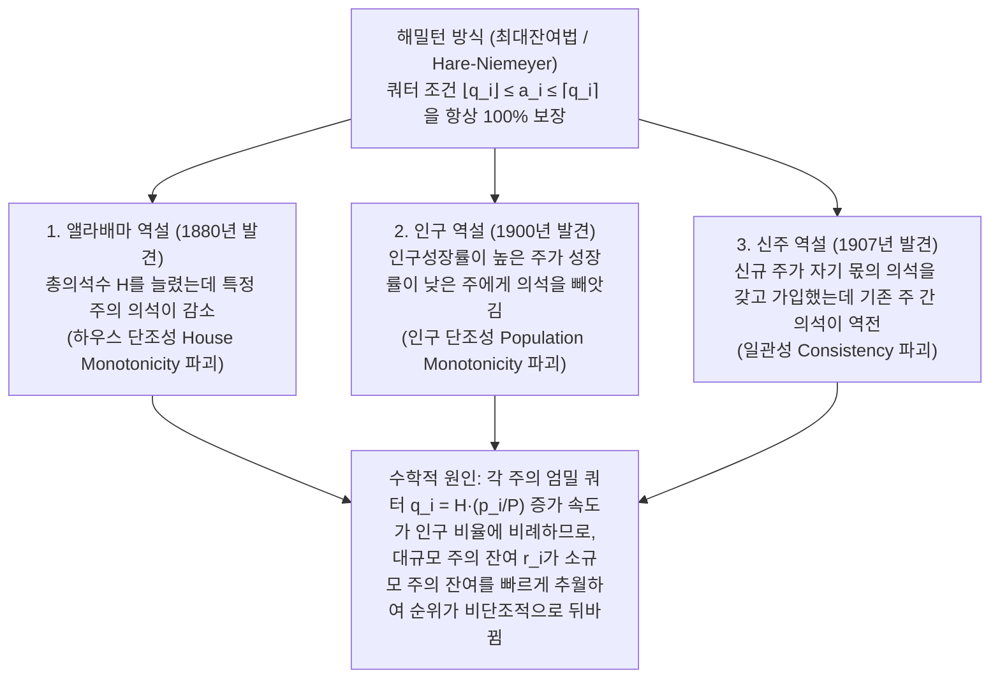

"각 주(또는 정당)의 인구에 비례하여 국회의 정수 의석을 공정하게 배분하라."

이 질문을 받으면 대부분의 사람은 초등학교에서 배운 비례식과 반올림(또는 가장 큰 소수점 잔여 순 배분)을 떠올릴 것입니다. 먼저 전국 총인구를 총의석수로 나누어 '1석당 표준인구'를 구하고, 각 주의 인구를 이 표준제수로 나눕니다. 그러면 $7.73$석이나 $1.36$석 같은 소수가 나오므로, 우선 정수 부분만큼 의석을 배분한 뒤 남은 의석을 소수점 아래 잔여가 큰 순서대로 1석씩 나누어 주는 방식입니다. 이보다 더 자연스럽고 공정한 방법이 있을까요?

그러나 1880년, 미국 인구조사국 수석 서기 찰스 시턴(Charles W. Seaton)은 이 가장 자연스러운 방법(<strong>해밀턴 방식 / 최대잔여법</strong>)으로 연방 하원의 의석 배분을 계산하다가 등골이 서늘해지는 기이한 현상을 발견했습니다. 미국 전체 하원 의석수를 $299$석에서 $300$석으로 <strong>1석 늘렸더니</strong>, 인구가 단 한 명도 줄지 않은 <strong>앨라배마주(Alabama)의 의석이 $8$석에서 $7$석으로 줄어든 것</strong>입니다!

전체 파이를 키웠는데 특정 주의 몫이 줄어드는 <strong>앨라배마 역설(Alabama Paradox)</strong>은 단순한 계산 실수가 아니었습니다. 이후 인구성장률이 더 높은 주가 성장률이 낮은 주에게 의석을 빼앗기는 <strong>인구 역설(Population Paradox)</strong>과, 새로운 주가 자기 인구에 맞는 정당한 의석을 가지고 연방에 가입했을 뿐인데 기존 주들 사이에서 의석이 뒤바뀌는 <strong>신주 역설(New States Paradox)</strong>이 잇따라 발견되었습니다. 마침내 1982년, 수학자 미셸 발린스키(Michel Balinski)와 페이턴 영(H. Peyton Young)은 <strong>발린스키-영 불가능성 정리(Balinski-Young Impossibility Theorem)</strong>를 통해 <strong>"이상적인 비례할당 범위(쿼터 조건)를 지키는 것과 역설(단조성 위배)을 피하는 것을 동시에 만족하는 의석 배분 방식은 수학적으로 존재하지 않는다"</strong>는 충격적인 사실을 증명했습니다.

---

## 1. 1792년 미국의 헌법 위기: 해밀턴 대 제퍼슨, 그리고 사상 최초의 대통령 거부권

1787년 제정된 미국 헌법 제1조 제2절은 "하원의원은 각 주의 인구에 비례하여 배분하되, 인구 3만 명당 1인을 초과할 수 없으며 각 주는 최소 1인의 하원의원을 가진다"라고 규정했습니다. 1790년 미국 최초의 인구조사에서 15개 주의 총인구가 $P = 3,615,920$명으로 확정되자, 의회는 총의석수를 $H = 120$석(전국 평균 표준제수 $D = P/H = 30,132.67$명)으로 하는 법안을 통과시켰습니다.

재무장관 <strong>알렉산더 해밀턴(Alexander Hamilton)</strong>은 <strong>최대잔여법(Hamilton's Method)</strong>을 제안했습니다. 먼저 각 주에 정수 부분 $\lfloor p_i / D \rfloor$(합계 $112$석)를 배분하고, 남은 $R = 8$석을 소수점 잔여가 큰 상위 8개 주에 1석씩 추가 배분하는 방식이었습니다. 그러나 버지니아주 출신의 국무장관 <strong>토머스 제퍼슨(Thomas Jefferson)</strong>과 초대 대통령 <strong>조지 워싱턴(George Washington)</strong>은 강력히 반발했습니다. 해밀턴 방식으로 반올림한 결과, 최대 인구 주인 버지니아는 잔여가 간발의 차로 밀려 버림을 받은 반면, 델라웨어주(인구 $55,540$명, $2$석 획득) 같은 소규모 주는 <strong>1석당 인구가 $27,770$명</strong>이 되어 헌법이 정한 '3만 명당 1인' 상한선을 위반했기 때문입니다!

제퍼슨은 대안으로 공통 제수 $x$(예: $x = 33,000$명)로 각 주 인구를 나눈 뒤 <strong>소수점 이하를 모두 버리는($\lfloor p_i / x \rfloor$) 제퍼슨 방식(Jefferson's Method, 유럽의 동트 방식 D'Hondt Method)</strong>을 고안했습니다. <strong>1792년 4월 5일, 워싱턴 대통령은 해밀턴 방식의 의석배분 법안에 대해 미국 역사상 최초의 대통령 거부권(Presidential Veto)을 행사했습니다.</strong> 미국 헌정사상 첫 거부권이 외교나 전쟁이 아니라 <strong>"나눗셈의 소수점 잔여를 어떻게 반올림할 것인가"라는 수학 알고리즘의 충돌</strong> 때문에 행사된 것입니다!

---

## 2. 비례배분의 수학적 정식화와 쿼터 조건(Quota Rule)

$s$개의 주(또는 정당)의 인구 벡터를 $\mathbf{p} = (p_1, \dots, p_s)$, 총인구를 $P = \sum_{i=1}^s p_i$, 총의석수를 $H \in \mathbb{Z}_{>0}$라 합시다. <strong>표준제수(Standard Divisor) $D$</strong>와 각 주의 <strong>엄밀 쿼터(Exact Quota) $q_i$</strong>는 다음과 같이 정의됩니다:

$$D = \frac{P}{H}, \qquad q_i = \frac{p_i}{D} = H \cdot \frac{p_i}{P}, \qquad \sum_{i=1}^s q_i = H$$

실수 $q_i$를 정수 의석 $a_i$($\sum_{i=1}^s a_i = H$)로 반올림할 때 가장 직관적인 공정성 기준은, 엄밀 쿼터가 $7.73$석인 주는 내림한 <strong>하한 쿼터 $\lfloor q_i \rfloor = 7$석</strong> 또는 올림한 <strong>상한 쿼터 $\lceil q_i \rceil = 8$석</strong> 중 하나를 받아야 한다는 것입니다. 이를 <strong>쿼터 조건(Quota Rule)</strong>이라 합니다:

$$\lfloor q_i \rfloor \le a_i \le \lceil q_i \rceil \quad (\forall i \in \{1, 2, \dots, s\})$$

<strong>해밀턴 방식(최대잔여법 / 헤어-니마이어 방식)</strong>은 $q_i = \lfloor q_i \rfloor + r_i$로 분해하여 우선 $\lfloor q_i \rfloor$석을 배분하고, 잔여 의석 $R = H - \sum \lfloor q_i \rfloor = \sum r_i$를 소수 잔여 $r_i$가 가장 큰 상위 $R$개 주에 1석씩 배분합니다:

$$q_i = \lfloor q_i \rfloor + r_i \quad (0 \le r_i < 1), \qquad R = H - \sum_{i=1}^s \lfloor q_i \rfloor = \sum_{i=1}^s r_i \in \{0, 1, \dots, s-1\}$$

$$a_i = \begin{cases} \lfloor q_i \rfloor + 1 & (\text{if } r_i \text{ is among the } R \text{ largest remainders}) \\ \lfloor q_i \rfloor & (\text{otherwise}) \end{cases}$$

정의에 의해 해밀턴 방식은 <strong>모든 인구 분포와 모든 총의석수 $H$에 대해 쿼터 조건을 $100\%$ 만족합니다</strong>.

---

## 3. 3대 배분 역설의 완벽 해부와 수치 증명

그러나 1880년부터 1907년 사이, 해밀턴 방식은 실제 미국 인구조사 데이터에서 3대 수학적 역설을 일으켰습니다:

### 3.1 앨라배마 역설 (The Alabama Paradox, 1880)

1880년 센서스에서 총의석수가 $H = 299 \to 300$으로 1석 늘어났을 때, 중규모 주인 앨라배마의 쿼터는 $7.646 \to 7.671$($+0.025$)로 조금 늘어난 반면, 대규모 주인 텍사스($9.640 \to 9.672$, $+0.032$)와 일리노이($18.640 \to 18.702$, $+0.062$)는 훨씬 빠르게 잔여를 늘려 앨라배마의 잔여를 동시에 추월했습니다.

총인구 $P = 1000$인 <strong>3개 주 모델($H = 10 \to 11$)</strong>로 이를 완벽히 증명해 봅시다:

| 주 | 인구 $p_i$ | $H=10$ 엄밀 쿼터 $q_i$ | $H=10$ 정수 몫과 잔여 $r_i$ | <strong>$H=10$ 배분 $a_i$</strong> | $H=11$ 엄밀 쿼터 $q_i'$ | $H=11$ 정수 몫과 잔여 $r_i'$ | <strong>$H=11$ 배분 $a_i'$</strong> |
| :--- | :---: | :---: | :---: | :---: | :---: | :---: | :---: |
| <strong>A주</strong> | $433$ | $4.330$ | $4$ (잔여 $0.330$: 2위) | <strong>$4$석</strong> | $4.763$ | $4$ (잔여 <strong>$0.763$: 1위</strong>) | <strong>$5$석</strong> ($+1$) |
| <strong>B주</strong> | $431$ | $4.310$ | $4$ (잔여 $0.310$: 3위) | <strong>$4$석</strong> | $4.741$ | $4$ (잔여 <strong>$0.741$: 2위</strong>) | <strong>$5$석</strong> ($+1$) |
| <strong>C주</strong> | $136$ | $1.360$ | $1$ (잔여 <strong>$0.360$: 1위</strong>) | <strong>$2$석</strong> | $1.496$ | $1$ (잔여 $0.496$: 3위) | <strong>$1$석</strong> (<strong>$-1$</strong>) |
| <strong>합계</strong> | <strong>$1000$</strong> | <strong>$10.000$</strong> | 정수합 $= 9$ ($R=1$) | <strong>$10$석</strong> | <strong>$11.000$</strong> | 정수합 $= 9$ ($R'=2$) | <strong>$11$석</strong> |

$H = 10 \to 11$이 될 때 대규모 주 A, B의 잔여는 $+0.43$ 이상 급증하여 $0.763, 0.741$이 된 반면, 소규모 주 C의 잔여는 $+0.136$만 증가해 $0.496$에 머물렀기 때문에 C주는 <strong>$2$석에서 $1$석으로 강등</strong>됩니다(<strong>하우스 단조성</strong> 위배).

### 3.2 인구 역설 (The Population Paradox, 1900)

1900년 센서스에서 버지니아주의 10년간 인구성장률($+12.0\%$)은 메인주($+5.0\%$)의 두 배가 넘었지만, 버지니아는 1석을 잃고 메인은 1석을 얻었습니다. $H = 10, P = 1000$인 3개 주 모델에서:
- <strong>시점 1</strong>: $p_A = 427, p_B = 435, p_C = 138 \implies q_A = 4.270, q_B = 4.350, q_C = 1.380$. 잔여 1위인 C주($r_C = 0.380$)가 추가 의석을 얻어 배분은 $(4, 4, 2)$입니다.
- <strong>시점 2</strong>: <strong>C주가 $+8.70\%$ 성장($138 \to 150$)</strong>하고 <strong>B주는 $+6.90\%$ 성장($435 \to 465$)</strong>, A주는 $-9.84\%$ 감소($427 \to 385$)합니다. C주의 성장률이 B주보다 높지만, 원래 규모가 큰 B주의 절대 쿼터 증가량($+0.300 \implies r_B' = 0.650$)이 C주($+0.120 \implies r_C' = 0.500$)를 압도하고, 인구가 줄어든 A주의 쿼터가 $3.850$으로 정수 경계 $4$ 아래로 내려가면서 잔여가 $r_A' = 0.850$(1위)으로 급등합니다. 결국 가장 빠르게 성장한 C주가 <strong>$2$석에서 $1$석으로 감소</strong>하고 B주가 $4$석에서 $5$석으로 증가합니다(<strong>인구 단조성</strong> 위배)!

### 3.3 신주 역설 (The New States Paradox, 1907)

1907년 오클라호마주가 가입하면서 자기 몫인 $5$석을 더해 총의석수를 $386 \to 391$석으로 늘렸더니, 아무 상관없는 뉴욕주가 1석을 잃고 메인주가 1석을 얻었습니다. 2개 주(A: $842$, B: $158$, $H=10, P=1000 \implies a_A=8, a_B=2$)에 신주 C(인구 $165$, 정당한 몫 $2$석)가 가입하여 $H'=12, P'=1165$가 되면, 표준제수가 $100 \to 97.083$으로 약간 작아지면서 모든 쿼터가 $1.03004$배가 됩니다. 이때 대주 A의 쿼터는 $8.420 \to 8.673$(잔여 $0.673$)으로 크게 늘어 소주 B($1.580 \to 1.627$, 잔여 $0.627$)를 역전하여 A주가 B주의 의석 1개를 빼앗아 $(9, 1, 2)$가 됩니다!

---

## 4. 제수법(최고평균법)의 통합 이론과 이정표 함수 $d(n)$

<strong>제수법(Divisor Methods)</strong>은 조정 가능한 공통 제수 $x > 0$와 각 구간 $[n, n+1]$ 내의 반올림 경계인 <strong>이정표 함수(Signpost Function) $d(n) \in [n, n+1]$</strong>을 사용하여 의석을 배분합니다:

$$[q]_d = n \iff d(n-1) \le q \le d(n), \qquad a_i = \left[\frac{p_i}{x}\right]_d, \qquad \sum_{i=1}^s a_i = H$$

부등식 $d(a_i - 1) \le p_i / x \le d(a_i)$를 $x$에 대해 정리하면 <strong>최고평균법(Highest Averages Method / 우선순위 값 방식)과의 완벽한 동치성</strong>이 유도됩니다:

$$\frac{p_i}{d(a_i)} \le x \le \frac{p_i}{d(a_i - 1)} \quad \Longleftrightarrow \quad \text{Priority}(i, n) = \frac{p_i}{d(n)}$$

즉 모든 주와 $n=0,1,2,\dots$에 대해 <strong>우선순위 값 $\text{Priority}(i, n) = \frac{p_i}{d(n)}$</strong>을 계산하여 가장 큰 순서대로 상위 $H$개의 의석을 배분하는 것과 $100\%$ 동일합니다. 따라서 두 주 사이의 우선순위 비율이 오직 $p_i / p_j$에만 의존하므로:

$$\frac{p_i'}{p_j'} \ge \frac{p_i}{p_j} \implies \frac{p_i' / d(n)}{p_j' / d(m)} = \frac{p_i'}{p_j'} \cdot \frac{d(m)}{d(n)} \ge \frac{p_i}{p_j} \cdot \frac{d(m)}{d(n)} = \frac{p_i / d(n)}{p_j / d(m)}$$

<strong>모든 제수법은 앨라배마 역설, 인구 역설, 신주 역설을 절대 일으키지 않습니다!</strong>

### 역사적 5대 제수법 완벽 비교표

| 방식명 (선거제도 별칭) | 제안자 및 연도 | 이정표 함수 $d(n)$ | 제수열 $d(0), d(1), d(2), \dots$ | 최소 보장 의석 | 규모 편향 및 수리적 특징 | 쿼터 조건 위배 위험 |
| :--- | :--- | :---: | :---: | :---: | :--- | :--- |
| <strong>1. 제퍼슨 방식</strong> (<strong>동트 방식 D'Hondt</strong>) | Jefferson (1792) D'Hondt (1878) | $n + 1$ (내림) | $1, 2, 3, 4, \dots$ | $0$석 | <strong>대규모 주/정당에 가장 유리</strong> (한국·일본 비례대표제에 활용) | <strong>상한 쿼터 위배</strong> 발생 ($a_i > \lceil q_i \rceil$) |
| <strong>2. 웹스터 방식</strong> (<strong>생트라귀 방식 Sainte-Laguë</strong>) | Webster (1832) Sainte-Laguë (1910) | $n + 0.5$ (산술평균) | $0.5, 1.5, 2.5, \dots$ (또는 $1, 3, 5, \dots$) | $0$석 | <strong>규모에 대해 완전히 중립(Unbiased)</strong> | 상한·하한 쿼터 모두 드물게 위배 가능 |
| <strong>3. 헌팅턴-힐 방식</strong> (<strong>균등비례법</strong>) | Hill (1911) Huntington (1921) | $\sqrt{n(n+1)}$ (기하평균) | $0, \sqrt{2}, \sqrt{6}, \sqrt{12}, \dots$ | $1$석 | 1인당 의석수의 <strong>상대적 불평등도 최소화</strong>; <strong>1941년 이후 미국 하원 공식 방식</strong> | 상한·하한 쿼터 모두 위배 가능 |
| <strong>4. 딘 방식</strong> (<strong>조화평균법</strong>) | J. Dean (1832) | $\frac{2n(n+1)}{2n+1}$ (조화평균) | $0, \frac{4}{3}, \frac{12}{5}, \frac{24}{7}, \dots$ | $1$석 | 1석당 인구 $p_i/a_i$의 절대차 최소화 | 상한·하한 쿼터 모두 위배 가능 |
| <strong>5. 애덤스 방식</strong> (<strong>최소제수법</strong>) | J. Q. Adams (1832) | $n$ (올림) | $0, 1, 2, 3, \dots$ | $1$석 | <strong>소규모 주/도도부현에 가장 유리</strong> (일본 중의원 소선거구 배분 채택) | <strong>하한 쿼터 위배</strong> 발생 ($a_i < \lfloor q_i \rfloor$) |

헌팅턴-힐 방식은 상대적 불평등도 $T_{ij}$를 최소화하며, 산술-기하-조화평균 부등식(AM-GM-HM)을 만족합니다:

$$T_{ij} = \frac{a_i / p_i}{a_j / p_j} - 1, \qquad d(n) = \sqrt{n(n+1)}$$

$$n < \underbrace{\frac{2n(n+1)}{2n+1}}_{\text{Dean (HM)}} < \underbrace{\sqrt{n(n+1)}}_{\text{Huntington-Hill (GM)}} < \underbrace{n + 0.5}_{\text{Webster (AM)}} < n + 1$$

---

## 5. 발린스키-영 불가능성 정리 (Balinski-Young Impossibility Theorem, 1982)

가장 중립적인 <strong>웹스터 방식($d(n) = n + 0.5$, 사사오입 반올림)</strong>조차도 상한 쿼터와 하한 쿼터를 모두 위배합니다!
1. <strong>하한 쿼터 위배 반례 ($H = 10, P = 1000$)</strong>: 대주 A의 인구가 $p_A = 832$(엄밀 쿼터 $q_A = 8.320$, 하한 쿼터 <strong>$8$석</strong>)이고 소주 B, C, D 3곳의 인구가 각각 $56$($q_i = 0.560$)일 때, 공통 제수 $x = 111$을 적용하면 소주 3곳은 $56/111 \approx 0.5045 > 0.5$로 모두 반올림되어 $1$석씩(합계 $3$석)을 얻는 반면, 대주 A는 $832/111 \approx 7.4955 < 7.5$가 되어 버림을 받고 <strong>$7$석</strong>에 그쳐 하한 쿼터($8$석)를 위배합니다!
2. <strong>상한 쿼터 위배 반례 ($H = 10, P = 1000$)</strong>: 대주 A의 인구가 $p_A = 795$(엄밀 쿼터 $q_A = 7.950$, 상한 쿼터 <strong>$8$석</strong>)이고 소주 B–F 5곳의 인구가 각각 $41$($q_i = 0.410$)일 때, 공통 제수 $x = 83$을 적용하면 소주 5곳은 $41/83 \approx 0.4940 < 0.5$로 모두 $0$석이 되고, 대주 A는 $795/83 \approx 9.5783 > 9.5$로 올림되어 <strong>$10$석 전체를 독식</strong>하며 상한 쿼터($8$석)를 2석이나 초과합니다!

1982년 발린스키와 영은 다음 두 정리를 결합하여 200년 논쟁에 종지부를 찍었습니다:
- <strong>정리 1 (제수법 특성화 정리)</strong>: 익명성과 동차성을 만족하는 배분 방식이 <strong>인구 단조성(인구 역설 배제)</strong>을 만족할 필요충분조건은 그 방식이 어떤 단조 이정표 함수 $d(n)$에 기초한 <strong>제수법</strong>인 것이다.
- <strong>정리 2 (발린스키-영 불가능성 정리)</strong>: 주의 수 $s \ge 4$, 총의석수 $H \ge 7$일 때, <strong>인구 단조성과 쿼터 조건($\lfloor q_i \rfloor \le a_i \le \lceil q_i \rceil$)을 동시에 항상 만족하는 의석 배분 방식은 수학적으로 존재하지 않는다.</strong>

제수법에서 공통 제수 $x$를 조정하면 모든 주의 쿼터에 동일한 배율 $\lambda = D/x$가 곱해지는데($p_i/x = \lambda q_i$), 원래 쿼터 $q_A$가 큰 대주일수록 절대 변화량 $\Delta q_A = |1 - \lambda| q_A$가 몇 배나 크게 증폭되어 필연적으로 정수 경계를 넘어가기 때문입니다. 이는 연속적인 비율을 이산적인 정수로 양자화할 때 발생하는 근본적인 수학적 한계를 보여줍니다.
