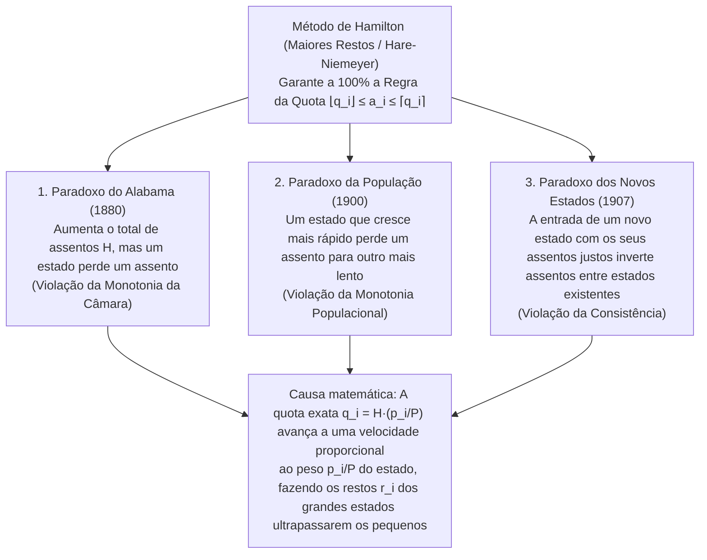

«Distribua de forma justa os assentos inteiros de um parlamento entre os estados (ou partidos políticos) proporcionalmente à sua população.»

Perante esta tarefa, quase toda a gente recorre à aritmética elementar das proporções e arredondamentos: divide-se a população total do país pelo número total de assentos para obter o «divisor padrão» (habitantes por assento) e divide-se a população de cada estado por esse divisor. Como surgem números decimais como $7{,}73$ ou $1{,}36$ assentos, atribui-se primeiro a cada estado a sua parte inteira ($7$ e $1$) e distribuem-se os assentos restantes um a um aos estados com os maiores restos decimais ($,73$, $,36$, etc.). Poderia existir um método mais natural e inquestionavelmente justo?

Contudo, em 1880, Charles W. Seaton, funcionário-chefe do Gabinete do Censo dos Estados Unidos, descobriu um pesadelo matemático ao calcular a distribuição da Câmara dos Representantes com este mesmo método (o <strong>método de Hamilton</strong> ou <strong>método dos maiores restos / Hare-Niemeyer</strong>): quando o tamanho total da Câmara foi <strong>aumentado em apenas um assento</strong>, passando de $299$ para $300$ assentos — sem que a população de nenhum estado mudasse —, o estado do <strong>Alabama viu a sua bancada cair de $8$ assentos para $7$ assentos</strong>!

Aumentar o bolo total diminuiu a fatia de um participante: este <strong>Paradoxo do Alabama</strong> foi seguido pela descoberta do <strong>Paradoxo da População</strong> (um estado com rápido crescimento demográfico perde um assento para outro de crescimento lento) e do <strong>Paradoxo dos Novos Estados</strong> (a admissão de um novo estado com os seus assentos justos altera os assentos entre estados antigos sem qualquer relação). Em 1982, <strong>Michel Balinski</strong> e <strong>H. Peyton Young</strong> demonstraram o célebre <strong>Teorema da Impossibilidade de Balinski-Young</strong>: <strong>é matematicamente impossível que um método de repartição cumpra simultaneamente a Regra da Quota e a monotonia (ausência de paradoxos)</strong>.

---

## 1. A Crise Constitucional de 1792: Hamilton contra Jefferson e o Primeiro Veto Presidencial

O Artigo I, Secção 2 da Constituição dos EUA de 1787 determinava que os representantes fossem repartidos entre os estados «segundo os seus respetivos números», não excedendo um por cada $30.000$ habitantes. Após o primeiro censo de 1790 ($P = 3.615.920$ habitantes em $15$ estados), o Congresso aprovou uma lei fixando a Câmara em $H = 120$ assentos (divisor padrão $D = P/H = 30.132{,}67$).

O Secretário do Tesouro, <strong>Alexander Hamilton</strong>, propôs o <strong>método dos maiores restos (método de Hamilton)</strong>: atribuir primeiro $\lfloor p_i / D \rfloor$ assentos ($112$ no total) e entregar os $R = 8$ assentos restantes aos $8$ estados com maiores partes fracionárias. O Secretário de Estado, <strong>Thomas Jefferson</strong>, e o Presidente <strong>George Washington</strong> (ambos da Virgínia) opuseram-se veementemente: além de prejudicar a Virgínia, os pequenos estados arredondados para cima — como o Delaware ($55.540$ habitantes, $2$ assentos) — ficavam com <strong>um deputado por cada $27.770$ habitantes</strong>, violando o teto constitucional de $30.000$!

Jefferson propôs como alternativa o <strong>método de Jefferson (conhecido na Europa e em Portugal/Brasil como método D'Hondt)</strong>: escolher um divisor comum $x$ (por exemplo, $x = 33.000$) e truncar sempre para a parte inteira inferior ($a_i = \lfloor p_i / x \rfloor$) até que a soma iguale $H$. Em <strong>5 de abril de 1792</strong>, George Washington exerceu o <strong>primeiro veto presidencial da história dos Estados Unidos</strong> contra a lei de Hamilton — desencadeado por uma disputa sobre <strong>algoritmos matemáticos de arredondamento</strong>!

---

## 2. Formulação Matemática e a Regra da Quota (Quota Rule)

Sejam $s \ge 2$ estados com vetor populacional $\mathbf{p} = (p_1, \dots, p_s)$, população total $P = \sum_{i=1}^s p_i$ e um parlamento de $H \in \mathbb{Z}_{>0}$ assentos. O <strong>divisor padrão $D$</strong> e a <strong>quota exata $q_i$</strong> do estado $i$ são:

$$D = \frac{P}{H}, \qquad q_i = \frac{p_i}{D} = H \cdot \frac{p_i}{P}, \qquad \sum_{i=1}^s q_i = H$$

Ao arredondar o número real $q_i$ para um inteiro $a_i \in \mathbb{Z}_{\ge 0}$ ($\sum_{i=1}^s a_i = H$), o axioma mínimo de justiça exige que cada estado receba a sua <strong>quota inferior $\lfloor q_i \rfloor$</strong> ou a sua <strong>quota superior $\lceil q_i \rceil$</strong>. Esta é a <strong>Regra da Quota (Quota Rule)</strong>:

$$\lfloor q_i \rfloor \le a_i \le \lceil q_i \rceil \quad (\forall i \in \{1, 2, \dots, s\})$$

O <strong>método de Hamilton (maiores restos / Hare-Niemeyer)</strong> decompõe $q_i = \lfloor q_i \rfloor + r_i$ com $r_i \in [0, 1)$, atribui $\lfloor q_i \rfloor$ assentos e distribui os $R = H - \sum \lfloor q_i \rfloor = \sum r_i$ assentos sobrantes aos $R$ estados com maiores restos $r_i$:

$$q_i = \lfloor q_i \rfloor + r_i \quad (0 \le r_i < 1), \qquad R = H - \sum_{i=1}^s \lfloor q_i \rfloor = \sum_{i=1}^s r_i \in \{0, 1, \dots, s-1\}$$

$$a_i = \begin{cases} \lfloor q_i \rfloor + 1 & (\text{if } r_i \text{ is among the } R \text{ largest remainders}) \\ \lfloor q_i \rfloor & (\text{otherwise}) \end{cases}$$

Por construção, o método de Hamilton <strong>cumpre a Regra da Quota em $100\%$ dos casos</strong>.

---

## 3. Anatomia Completa dos Três Grandes Paradoxos de Repartição

Entre 1880 e 1907, os dados reais do censo norte-americano revelaram três paradoxos devastadores no método de Hamilton:

### 3.1 O Paradoxo do Alabama (1880) e Prova Numérica com 3 Estados ($H = 10 \to 11$)

Em 1880, ao passar de $H = 299$ para $H = 300$, a quota do Alabama subiu apenas $+0{,}025$ ($7{,}646 \to 7{,}671$), enquanto o Texas ($9{,}640 \to 9{,}672$, $+0{,}032$) e o Illinois ($18{,}640 \to 18{,}702$, $+0{,}062$) aumentaram os seus restos muito mais depressa e ultrapassaram simultaneamente o Alabama. Vejamos o modelo exato de $3$ estados ($P = 1000$):

| Estado | População $p_i$ | Quota $q_i$ ($H=10$) | Piso $\lfloor q_i \rfloor$ e resto $r_i$ ($H=10$) | <strong>Assentos $a_i$ ($H=10$)</strong> | Quota $q_i'$ ($H=11$) | Piso $\lfloor q_i' \rfloor$ e resto $r_i'$ ($H=11$) | <strong>Assentos $a_i'$ ($H=11$)</strong> |
| :--- | :---: | :---: | :---: | :---: | :---: | :---: | :---: |
| <strong>Estado A</strong> | $433$ | $4{,}330$ | $4$ ($r_A = 0{,}330$: 2.º) | <strong>$4$ assentos</strong> | $4{,}763$ | $4$ ($r_A' = \mathbf{0{,}763}$: 1.º) | <strong>$5$ assentos</strong> ($+1$) |
| <strong>Estado B</strong> | $431$ | $4{,}310$ | $4$ ($r_B = 0{,}310$: 3.º) | <strong>$4$ assentos</strong> | $4{,}741$ | $4$ ($r_B' = \mathbf{0{,}741}$: 2.º) | <strong>$5$ assentos</strong> ($+1$) |
| <strong>Estado C</strong> | $136$ | $1{,}360$ | $1$ ($r_C = \mathbf{0{,}360}$: 1.º) | <strong>$2$ assentos</strong> | $1{,}496$ | $1$ ($r_C' = 0{,}496$: 3.º) | <strong>$1$ assento</strong> (<strong>$-1$</strong>) |
| <strong>Total</strong> | <strong>$1000$</strong> | <strong>$10{,}000$</strong> | Soma pisos $= 9$ ($R=1$) | <strong>$10$ assentos</strong> | <strong>$11{,}000$</strong> | Soma pisos $= 9$ ($R'=2$) | <strong>$11$ assentos</strong> |

Quando $H$ sobe de $10$ para $11$, os grandes estados A e B avançam $+0{,}433$ e $+0{,}431$ contra apenas $+0{,}136$ do pequeno Estado C: os seus restos ($0{,}763$ e $0{,}741$) ultrapassam $r_C' = 0{,}496$, e o Estado C cai de <strong>$2$ assentos para $1$ assento</strong> (violação da <strong>Monotonia da Câmara</strong>).

### 3.2 O Paradoxo da População (1900) e o Paradoxo dos Novos Estados (1907)

- <strong>Paradoxo da População</strong>: Entre 1890 e 1900, a Virgínia cresceu $+12{,}0\%$ contra $+5{,}0\%$ do Maine, mas perdeu um assento para o Maine. No nosso modelo ($H = 10, P = 1000$): no instante 1, $p_A = 427, p_B = 435, p_C = 138 \implies$ assentos $(4, 4, 2)$ porque $r_C = 0{,}380$ é o maior resto. No instante 2, <strong>o Estado C cresce $+8{,}70\%$ ($138 \to 150$)</strong>, <strong>o Estado B cresce $+6{,}90\%$ ($435 \to 465$)</strong> e o Estado A diminui ($427 \to 385$). Embora C cresça percentualmente mais do que B, o ganho absoluto de quota do grande Estado B ($+0{,}300 \implies r_B' = 0{,}650$) supera o de C ($+0{,}120 \implies r_C' = 0{,}500$), enquanto A cruza para baixo o inteiro $4$ ($q_A' = 3{,}850 \implies r_A' = 0{,}850$). Assim, o Estado C de maior crescimento perde um assento ($2 \to 1$) para B ($4 \to 5$).
- <strong>Paradoxo dos Novos Estados</strong>: Em 1907, a admissão de Oklahoma com $5$ assentos ($H: 386 \to 391$) fez Nova Iorque perder um assento para o Maine. No modelo de $2$ estados ($H = 10, P = 1000$ com $p_A = 842, p_B = 158 \implies a_A = 8, a_B = 2$), quando o novo Estado C ($p_C = 165$) entra com os seus $2$ assentos legítimos ($H' = 12, P' = 1165$), o divisor padrão desce de $100$ para $97{,}083$. Todas as quotas são multiplicadas por $1{,}03004$: a quota grande $q_A$ sobe $+0{,}253$ ($8{,}673$, resto $0{,}673$) e ultrapassa o resto do pequeno Estado B ($1{,}627$, resto $0{,}627$), resultando em $(9, 1, 2)$.

---

## 4. Teoria Unificada dos Métodos dos Divisores (Maiores Médias) e Funções Marco $d(n)$

Os <strong>métodos dos divisores</strong> dividem cada população $p_i$ por um divisor comum ajustável $x > 0$ e arredondam o quociente $q = p_i / x$ através de uma <strong>função marco (Signpost Function) $d(n) \in [n, n+1]$</strong>:

$$[q]_d = n \iff d(n-1) \le q \le d(n), \qquad a_i = \left[\frac{p_i}{x}\right]_d, \qquad \sum_{i=1}^s a_i = H$$

Isolando $x$ em $d(a_i - 1) \le p_i / x \le d(a_i)$, obtém-se a <strong>equivalência exata com o método das maiores médias (valores de prioridade)</strong>:

$$\frac{p_i}{d(a_i)} \le x \le \frac{p_i}{d(a_i - 1)} \quad \Longleftrightarrow \quad \text{Priority}(i, n) = \frac{p_i}{d(n)}$$

Atribuir os $H$ assentos equivale exatamente a entregá-los aos $H$ maiores <strong>valores de prioridade $\text{Priority}(i, n) = \frac{p_i}{d(n)}$</strong>. Como a ordenação global não muda quando $H$ aumenta e a razão de prioridades verifica:

$$\frac{p_i'}{p_j'} \ge \frac{p_i}{p_j} \implies \frac{p_i' / d(n)}{p_j' / d(m)} = \frac{p_i'}{p_j'} \cdot \frac{d(m)}{d(n)} \ge \frac{p_i}{p_j} \cdot \frac{d(m)}{d(n)} = \frac{p_i / d(n)}{p_j / d(m)}$$

<strong>todos os métodos dos divisores são totalmente imunes aos três paradoxos!</strong>

### Comparação dos Cinco Métodos dos Divisores Históricos

| Nome do Método (Designação Eleitoral) | Autores e Ano | Função Marco $d(n)$ | Sucessão de Divisores $d(0), d(1), d(2), \dots$ | Assentos Mín. | Viés de Dimensão e Critério de Otimização | Risco face à Regra da Quota |
| :--- | :--- | :---: | :---: | :---: | :--- | :--- |
| <strong>1. Método de Jefferson</strong> (<strong>D'Hondt</strong>) | Jefferson (1792) D'Hondt (1878) | $n + 1$ (Piso $\lfloor q \rfloor$) | $1, 2, 3, 4, \dots$ | $0$ assentos | <strong>Favorece fortemente grandes estados/partidos</strong> | Viola a <strong>quota superior</strong> ($a_i > \lceil q_i \rceil$) |
| <strong>2. Método de Webster</strong> (<strong>Sainte-Laguë</strong>) | Webster (1832) Sainte-Laguë (1910) | $n + 0{,}5$ (Média Aritmética) | $0{,}5, \; 1{,}5, \; 2{,}5, \dots$ (ou $1, 3, 5, \dots$) | $0$ assentos | <strong>Totalmente neutro (sem viés de dimensão)</strong> | Pode violar (raramente) as quotas superior e inferior |
| <strong>3. Huntington-Hill</strong> (<strong>Proporções Iguais</strong>) | Hill (1911) Huntington (1921) | $\sqrt{n(n+1)}$ (Média Geométrica) | $0, \sqrt{2}, \sqrt{6}, \sqrt{12}, \dots$ | $1$ assento | Minimiza a desigualdade relativa $T_{ij}$; <strong>Câmara dos EUA desde 1941</strong> | Pode violar as quotas superior e inferior |
| <strong>4. Método de Dean</strong> (<strong>Média Harmónica</strong>) | J. Dean (1832) | $\frac{2n(n+1)}{2n+1}$ (Média Harmónica) | $0, \frac{4}{3}, \frac{12}{5}, \frac{24}{7}, \dots$ | $1$ assento | Minimiza a diferença absoluta de habitantes por assento $p_i/a_i$ | Pode violar as quotas superior e inferior |
| <strong>5. Método de Adams</strong> (<strong>Menores Divisores</strong>) | J. Q. Adams (1832) | $n$ (Teto $\lceil q \rceil$) | $0, 1, 2, 3, \dots$ | $1$ assento | <strong>Favorece fortemente pequenos estados</strong> | Viola a <strong>quota inferior</strong> ($a_i < \lfloor q_i \rfloor$) |

Pela desigualdade clássica entre as médias aritmética, geométrica e harmónica (AM-GM-HM):

$$T_{ij} = \frac{a_i / p_i}{a_j / p_j} - 1, \qquad d(n) = \sqrt{n(n+1)}$$

$$n < \underbrace{\frac{2n(n+1)}{2n+1}}_{\text{Dean (HM)}} < \underbrace{\sqrt{n(n+1)}}_{\text{Huntington-Hill (GM)}} < \underbrace{n + 0.5}_{\text{Webster (AM)}} < n + 1$$

---

## 5. O Teorema da Impossibilidade de Balinski-Young (1982)

Mesmo o <strong>método de Webster / Sainte-Laguë ($d(n) = n + 0{,}5$, arredondamento padrão ao inteiro mais próximo)</strong> viola tanto a quota inferior como a quota superior:
1. <strong>Violação da quota inferior ($H = 10, P = 1000$)</strong>: Seja um grande Estado A ($p_A = 832 \implies q_A = 8{,}320$, quota inferior <strong>$8$ assentos</strong>) e três pequenos estados B, C, D ($p_i = 56 \implies q_i = 0{,}560$). Com o divisor $x = 111$, os três pequenos estados obtêm $56/111 \approx 0{,}5045 > 0{,}5$ e sobem para $1$ assento cada ($3$ no total), enquanto o Estado A obtém $832/111 \approx 7{,}4955 < 7{,}5$ e é arredondado para baixo para <strong>$7$ assentos</strong> — violando a sua quota inferior de $8$ assentos!
2. <strong>Violação da quota superior ($H = 10, P = 1000$)</strong>: Seja um grande Estado A ($p_A = 795 \implies q_A = 7{,}950$, quota superior <strong>$8$ assentos</strong>) e cinco pequenos estados B–F ($p_i = 41 \implies q_i = 0{,}410$). Com $x = 83$, os cinco pequenos estados obtêm $41/83 \approx 0{,}4940 < 0{,}5$ ($0$ assentos), enquanto o Estado A obtém $795/83 \approx 9{,}5783 > 9{,}5$ e recebe todos os <strong>$10$ assentos</strong> — ultrapassando em $2$ assentos a sua quota superior!

Em 1982, Balinski e Young provaram o seu resultado definitivo:
- <strong>Teorema 1 (Caracterização dos métodos dos divisores)</strong>: Um método de repartição anónimo e homogéneo satisfaz a <strong>monotonia populacional</strong> se e só se for um <strong>método dos divisores</strong>.
- <strong>Teorema 2 (Teorema da Impossibilidade de Balinski-Young, 1982)</strong>: Para $s \ge 4$ estados e $H \ge 7$ assentos, <strong>não existe nenhum método de repartição que satisfaça simultaneamente a monotonia populacional e a Regra da Quota ($\lfloor q_i \rfloor \le a_i \le \lceil q_i \rceil$)</strong>.

Ao ajustar o divisor comum $x$, todas as quotas exatas são multiplicadas pelo mesmo fator $\lambda = D/x$ ($p_i/x = \lambda q_i$), pelo que o desvio absoluto $\Delta q_A = |1 - \lambda| q_A$ de um estado grande cresce proporcionalmente ao seu tamanho $q_A$, cruzando inevitavelmente fronteiras inteiras.
