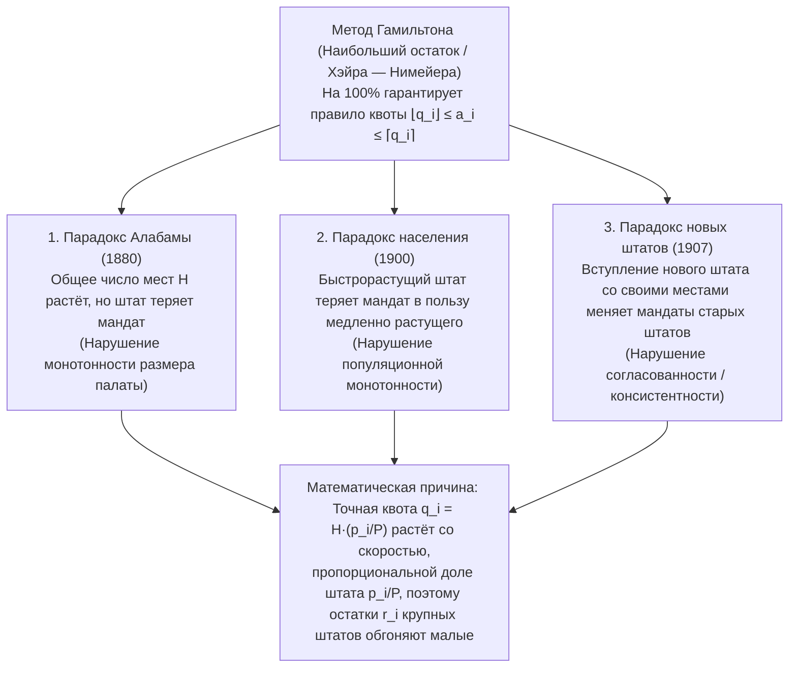

«Распределите целое число мест в парламенте между штатами (или политическими партиями) справедливо и пропорционально их численности населения».

Столкнувшись с такой задачей, почти каждый человек вспомнит школьную арифметику пропорций и округления: сначала разделим общую численность населения страны на общее число мест в парламенте, чтобы найти «стандартный делитель» (число жителей на один мандат), а затем разделим население каждого штата на этот делитель. Поскольку при делении возникают дробные числа вроде $7{,}73$ или $1{,}36$ места, сначала отдадим каждому штату его целую часть ($7$ и $1$), а оставшиеся места распределим по одному между штатами с наибольшими дробными остатками ($,73$, $,36$ и т. д.). Разве может существовать более естественный и безупречно справедливый метод?

Однако в 1880 году главный клерк Бюро переписи населения США Чарльз Ситон (Charles W. Seaton), рассчитывая распределение мест в Палате представителей именно по этому «самому естественному» правилу (<strong>методу Гамильтона</strong>, или <strong>методу наибольшего остатка / Хэйра — Нимейера</strong>), обнаружил леденящую душу аномалию: когда общее число мест в Палате представителей было <strong>увеличено всего на одно место</strong> — с $299$ до $300$ мест (при неизменной численности населения всех штатов!), — представительство штата <strong>Алабама сократилось с $8$ до $7$ мест</strong>!

Общий пирог увеличился, но доля участника уменьшилась: вслед за <strong>парадоксом Алабамы</strong> были открыты <strong>парадокс населения</strong> (быстрорастущий штат теряет место в пользу медленно растущего штата) и <strong>парадокс новых штатов</strong> (присоединение нового штата ровно с причитающимся ему числом мест приводит к перераспределению мандатов между старыми штатами). Наконец, в 1982 году математики <strong>Мишель Балинский (Michel Balinski)</strong> и <strong>Пейтон Янг (H. Peyton Young)</strong> доказали знаменитую <strong>теорему о невозможности Балинского — Янга</strong>: <strong>математически не существует метода распределения мандатов, который одновременно удовлетворял бы правилу квоты и монотонности (отсутствию парадоксов)</strong>.

---

## 1. Конституционный кризис 1792 года: Гамильтон против Джефферсона и первое президентское вето

Статья I, раздел 2 Конституции США 1787 года гласила, что представители распределяются между штатами «соответственно их численности», но не более одного представителя на каждые $30\,000$ жителей. После первой переписи 1790 года ($P = 3\,615\,920$ человек в $15$ штатах) Конгресс принял законопроект с $H = 120$ местами (стандартный делитель $D = P/H = 30\,132{,}67$).

Министр финансов <strong>Александр Гамильтон</strong> предложил <strong>метод наибольшего остатка (метод Гамильтона)</strong>: сначала раздать целые части $\lfloor p_i / D \rfloor$ (всего $112$ мест), а оставшиеся $R = 8$ мест отдать $8$ штатам с наибольшими дробными остатками. Госсекретарь <strong>Томас Джефферсон</strong> и президент <strong>Джордж Вашингтон</strong> (оба из Виргинии) выступили категорически против: мало того что крупнейшая Виргиния осталась без дополнительного мандата, так ещё и малые штаты, получившие место за счёт округления вверх (например, Делавэр с населением $55\,540$ человек и $2$ местами), оказались представлены из расчёта <strong>один депутат на $27\,770$ жителей</strong> — в прямое нарушение конституционного порога в $30\,000$!

Джефферсон предложил альтернативу — <strong>метод Джефферсона (известный в Европе как метод Д’Ондта)</strong>: выбрать общий делитель $x$ (например, $x = 33\,000$) и отбрасывать все дробные части ($a_i = \lfloor p_i / x \rfloor$), подбирая $x$ так, чтобы сумма целых частей равнялась $H$. <strong>5 апреля 1792 года</strong> президент Вашингтон применил <strong>первое в истории США президентское вето</strong>, отклонив закон Гамильтона из-за спора о <strong>математическом алгоритме округления</strong>!

---

## 2. Математическая постановка задачи и правило квоты (Quota Rule)

Пусть имеются $s \ge 2$ штатов с вектором населения $\mathbf{p} = (p_1, \dots, p_s)$, общим населением $P = \sum_{i=1}^s p_i$ и общим числом мест $H \in \mathbb{Z}_{>0}$. <strong>Стандартный делитель $D$</strong> и <strong>точная квота $q_i$</strong> штата $i$ определяются как:

$$D = \frac{P}{H}, \qquad q_i = \frac{p_i}{D} = H \cdot \frac{p_i}{P}, \qquad \sum_{i=1}^s q_i = H$$

При округлении вещественной квоты $q_i$ до целого числа мандатов $a_i \in \mathbb{Z}_{\ge 0}$ ($\sum_{i=1}^s a_i = H$) минимальная аксиома справедливости требует, чтобы каждый штат получал либо свою <strong>нижнюю квоту $\lfloor q_i \rfloor$</strong>, либо <strong>верхнюю квоту $\lceil q_i \rceil$</strong>. Это <strong>правило квоты (Quota Rule)</strong>:

$$\lfloor q_i \rfloor \le a_i \le \lceil q_i \rceil \quad (\forall i \in \{1, 2, \dots, s\})$$

<strong>Метод Гамильтона (наибольшего остатка / Хэйра — Нимейера)</strong> представляет $q_i = \lfloor q_i \rfloor + r_i$, где $r_i \in [0, 1)$, выделяет каждому штату $\lfloor q_i \rfloor$ мест, а оставшиеся $R = H - \sum \lfloor q_i \rfloor = \sum r_i$ мест отдаёт $R$ штатам с наибольшими остатками $r_i$:

$$q_i = \lfloor q_i \rfloor + r_i \quad (0 \le r_i < 1), \qquad R = H - \sum_{i=1}^s \lfloor q_i \rfloor = \sum_{i=1}^s r_i \in \{0, 1, \dots, s-1\}$$

$$a_i = \begin{cases} \lfloor q_i \rfloor + 1 & (\text{if } r_i \text{ is among the } R \text{ largest remainders}) \\ \lfloor q_i \rfloor & (\text{otherwise}) \end{cases}$$

По построению метод Гамильтона <strong>выполняет правило квоты в $100\%$ случаев</strong>.

---

## 3. Полная анатомия трёх классических парадоксов распределения

В 1880–1907 годах реальные расчёты переписей населения США выявили три фундаментальных парадокса метода Гамильтона:

### 3.1 Парадокс Алабамы (1880) и полное доказательство на модели 3 штатов ($H = 10 \to 11$)

В 1880 году при увеличении $H$ с $299$ до $300$ квота Алабамы выросла лишь на $+0{,}025$ ($7{,}646 \to 7{,}671$), тогда как более крупные Техас ($9{,}640 \to 9{,}672$, $+0{,}032$) и Иллинойс ($18{,}640 \to 18{,}702$, $+0{,}062$) нарастили свои остатки быстрее и одновременно обошли Алабаму. Проверим это на точной модели из $3$ штатов ($P = 1000$):

| Штат | Население $p_i$ | Квота $q_i$ ($H=10$) | Целая часть и остаток $r_i$ ($H=10$) | <strong>Места $a_i$ ($H=10$)</strong> | Квота $q_i'$ ($H=11$) | Целая часть и остаток $r_i'$ ($H=11$) | <strong>Места $a_i'$ ($H=11$)</strong> |
| :--- | :---: | :---: | :---: | :---: | :---: | :---: | :---: |
| <strong>Штат A</strong> | $433$ | $4{,}330$ | $4$ ($r_A = 0{,}330$: 2-е место) | <strong>$4$ места</strong> | $4{,}763$ | $4$ ($r_A' = \mathbf{0{,}763}$: 1-е место) | <strong>$5$ мест</strong> ($+1$) |
| <strong>Штат B</strong> | $431$ | $4{,}310$ | $4$ ($r_B = 0{,}310$: 3-е место) | <strong>$4$ места</strong> | $4{,}741$ | $4$ ($r_B' = \mathbf{0{,}741}$: 2-е место) | <strong>$5$ мест</strong> ($+1$) |
| <strong>Штат C</strong> | $136$ | $1{,}360$ | $1$ ($r_C = \mathbf{0{,}360}$: 1-е место) | <strong>$2$ места</strong> | $1{,}496$ | $1$ ($r_C' = 0{,}496$: 3-е место) | <strong>$1$ место</strong> (<strong>$-1$</strong>) |
| <strong>Итого</strong> | <strong>$1000$</strong> | <strong>$10{,}000$</strong> | Сумма целых $= 9$ ($R=1$) | <strong>$10$ мест</strong> | <strong>$11{,}000$</strong> | Сумма целых $= 9$ ($R'=2$) | <strong>$11$ мест</strong> |

При переходе $H = 10 \to 11$ квоты крупных штатов A и B прирастают на $+0{,}433$ и $+0{,}431$, а малого штата C — лишь на $+0{,}136$: остатки A и B ($0{,}763$ и $0{,}741$) обгоняют $r_C' = 0{,}496$, и штат C падает с <strong>$2$ мест до $1$ места</strong> (нарушение <strong>монотонности размера палаты</strong>).

### 3.2 Парадокс населения (1900) и парадокс новых штатов (1907)

- <strong>Парадокс населения</strong>: Между 1890 и 1900 годами население Виргинии выросло на $+12{,}0\%$, а Мэна — лишь на $+5{,}0\%$, но Виргиния потеряла мандат в пользу Мэна. В нашей модели ($H = 10, P = 1000$): в момент 1 $p_A = 427, p_B = 435, p_C = 138 \implies$ места $(4, 4, 2)$, так как $r_C = 0{,}380$ максимален. В момент 2 <strong>штат C вырастает на $+8{,}70\%$ ($138 \to 150$)</strong>, <strong>штат B — на $+6{,}90\%$ ($435 \to 465$)</strong>, а штат A сокращается ($427 \to 385$). Хотя темп роста C выше, чем у B, абсолютный прирост квоты крупного штата B ($+0{,}300 \implies r_B' = 0{,}650$) больше, чем у малого C ($+0{,}120 \implies r_C' = 0{,}500$), а квота A пробивает сверху целую границу $4$ ($q_A' = 3{,}850 \implies r_A' = 0{,}850$). В итоге самый быстрорастущий штат C теряет место ($2 \to 1$) в пользу B ($4 \to 5$)!
- <strong>Парадокс новых штатов</strong>: В 1907 году присоединение Оклахомы с $5$ мандатами ($H: 386 \to 391$) привело к потере места Нью-Йорком в пользу Мэна. В модели из $2$ штатов ($H = 10, P = 1000$, $p_A = 842, p_B = 158 \implies a_A = 8, a_B = 2$) вступление нового штата C ($p_C = 165$) с его законными $2$ местами ($H' = 12, P' = 1165$) снижает стандартный делитель со $100$ до $97{,}083$. Все квоты умножаются на $1{,}03004$: квота крупного штата A растёт на $+0{,}253$ ($8{,}673$, остаток $0{,}673$) и обгоняет остаток малого штата B ($1{,}627$, остаток $0{,}627$), давая $(9, 1, 2)$!

---

## 4. Единая теория методов делителей (наибольших средних) и путевых функций $d(n)$

<strong>Методы делителей</strong> делят население $p_i$ на регулируемый общий делитель $x > 0$ и округляют частное $q = p_i / x$ с помощью монотонной <strong>путевой функции (Signpost Function) $d(n) \in [n, n+1]$</strong>:

$$[q]_d = n \iff d(n-1) \le q \le d(n), \qquad a_i = \left[\frac{p_i}{x}\right]_d, \qquad \sum_{i=1}^s a_i = H$$

Выражая $x$ из неравенства $d(a_i - 1) \le p_i / x \le d(a_i)$, получаем <strong>полную эквивалентность методу наибольших средних (значений приоритета)</strong>:

$$\frac{p_i}{d(a_i)} \le x \le \frac{p_i}{d(a_i - 1)} \quad \Longleftrightarrow \quad \text{Priority}(i, n) = \frac{p_i}{d(n)}$$

Выделение $H$ мест в точности эквивалентно присуждению мандатов $H$ наибольшим <strong>значениям приоритета $\text{Priority}(i, n) = \frac{p_i}{d(n)}$</strong>. Поскольку глобальный рейтинг не меняется при росте $H$, а отношение приоритетов двух штатов удовлетворяет условию:

$$\frac{p_i'}{p_j'} \ge \frac{p_i}{p_j} \implies \frac{p_i' / d(n)}{p_j' / d(m)} = \frac{p_i'}{p_j'} \cdot \frac{d(m)}{d(n)} \ge \frac{p_i}{p_j} \cdot \frac{d(m)}{d(n)} = \frac{p_i / d(n)}{p_j / d(m)}$$

<strong>все методы делителей абсолютно защищены от всех трёх парадоксов!</strong>

### Сравнение пяти исторических методов делителей

| Название метода (Избирательный аналог) | Авторы и год | Путевая функция $d(n)$ | Последовательность $d(0), d(1), d(2), \dots$ | Мин. мест | Смещение по размеру и критерий оптимизации | Поведение относительно правила квоты |
| :--- | :--- | :---: | :---: | :---: | :--- | :--- |
| <strong>1. Метод Джефферсона</strong> (<strong>Д’Ондта</strong>) | Jefferson (1792) D'Hondt (1878) | $n + 1$ (Округление вниз) | $1, 2, 3, 4, \dots$ | $0$ мест | <strong>Сильно благоприятствует крупным штатам/партиям</strong> | Нарушает <strong>верхнюю квоту</strong> ($a_i > \lceil q_i \rceil$) |
| <strong>2. Метод Вебстера</strong> (<strong>Сент-Лагю</strong>) | Webster (1832) Sainte-Laguë (1910) | $n + 0{,}5$ (Среднее арифм.) | $0{,}5, \; 1{,}5, \; 2{,}5, \dots$ (или $1, 3, 5, \dots$) | $0$ мест | <strong>Полностью нейтрален к размеру штатов</strong> | Может (редко) нарушать верхнюю и нижнюю квоты |
| <strong>3. Хантингтона — Хилла</strong> (<strong>Равных пропорций</strong>) | Hill (1911) Huntington (1921) | $\sqrt{n(n+1)}$ (Среднее геом.) | $0, \sqrt{2}, \sqrt{6}, \sqrt{12}, \dots$ | $1$ место | Минимизирует относительное неравенство $T_{ij}$; <strong>Палата представителей США с 1941 г.</strong> | Может нарушать верхнюю и нижнюю квоты |
| <strong>4. Метод Дина</strong> (<strong>Среднее гармоническое</strong>) | J. Dean (1832) | $\frac{2n(n+1)}{2n+1}$ (Среднее гарм.) | $0, \frac{4}{3}, \frac{12}{5}, \frac{24}{7}, \dots$ | $1$ место | Минимизирует абсолютную разность размеров округов $p_i/a_i$ | Может нарушать верхнюю и нижнюю квоты |
| <strong>5. Метод Адамса</strong> (<strong>Наименьших делителей</strong>) | J. Q. Adams (1832) | $n$ (Округление вверх) | $0, 1, 2, 3, \dots$ | $1$ место | <strong>Сильно благоприятствует малым штатам</strong> | Нарушает <strong>нижнюю квоту</strong> ($a_i < \lfloor q_i \rfloor$) |

Согласно классическому неравенству о средних арифметическом, геометрическом и гармоническом (AM-GM-HM):

$$T_{ij} = \frac{a_i / p_i}{a_j / p_j} - 1, \qquad d(n) = \sqrt{n(n+1)}$$

$$n < \underbrace{\frac{2n(n+1)}{2n+1}}_{\text{Dean (HM)}} < \underbrace{\sqrt{n(n+1)}}_{\text{Huntington-Hill (GM)}} < \underbrace{n + 0.5}_{\text{Webster (AM)}} < n + 1$$

---

## 5. Теорема о невозможности Балинского — Янга (1982)

Даже абсолютно симметричный <strong>метод Вебстера / Сент-Лагю ($d(n) = n + 0{,}5$, обычное округление до ближайшего целого)</strong> нарушает как нижнюю, так и верхнюю квоту:
1. <strong>Нарушение нижней квоты ($H = 10, P = 1000$)</strong>: Пусть крупный штат A имеет $p_A = 832$ ($q_A = 8{,}320$, нижняя квота <strong>$8$ мест</strong>), а три малых штата B, C, D — по $p_i = 56$ ($q_i = 0{,}560$). При делителе $x = 111$ малые штаты получают $56/111 \approx 0{,}5045 > 0{,}5$ и округляются вверх до $1$ места каждый (всего $3$ места), тогда как штат A получает $832/111 \approx 7{,}4955 < 7{,}5$ и округляется вниз до <strong>$7$ мест</strong> — нарушая свою нижнюю квоту в $8$ мест!
2. <strong>Нарушение верхней квоты ($H = 10, P = 1000$)</strong>: Пусть крупный штат A имеет $p_A = 795$ ($q_A = 7{,}950$, верхняя квота <strong>$8$ мест</strong>), а пять малых штатов B–F — по $p_i = 41$ ($q_i = 0{,}410$). При $x = 83$ все пять малых штатов получают $41/83 \approx 0{,}4940 < 0{,}5$ ($0$ мест), а штат A получает $795/83 \approx 9{,}5783 > 9{,}5$ и забирает все <strong>$10$ мест</strong> — превышая верхнюю квоту на $2$ мандата!

В 1982 году Балинский и Янг доказали фундаментальную теорему:
- <strong>Теорема 1 (Характеризация методов делителей)</strong>: Анонимный и однородный метод распределения удовлетворяет <strong>популяционной монотонности</strong> тогда и только тогда, когда он является <strong>методом делителей</strong>.
- <strong>Теорема 2 (Теорема о невозможности Балинского — Янга, 1982)</strong>: При числе штатов $s \ge 4$ и числе мест $H \ge 7$ <strong>не существует метода распределения мандатов, который одновременно удовлетворял бы популяционной монотонности и правилу квоты ($\lfloor q_i \rfloor \le a_i \le \lceil q_i \rceil$)</strong>.

Изменение общего делителя $x$ умножает все точные квоты на один и тот же множитель $\lambda = D/x$ ($p_i/x = \lambda q_i$), поэтому абсолютное смещение квоты крупного штата $\Delta q_A = |1 - \lambda| q_A$ растёт пропорционально его размеру $q_A$, неизбежно пересекая целые границы.
