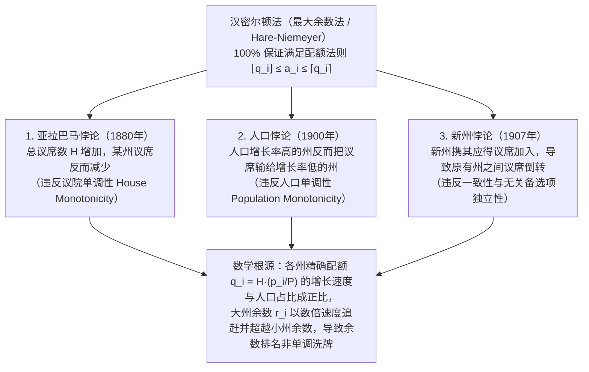

“请按照各州（或各政党）的人口比例，公平地分配议会的整数个议席。”

面对这个问题，绝大多数人都会想到小学算术中的“按比例计算并按最大余数凑整”：先用全国总人口除以总议席数得到“每席标准人口”，再用各州人口除以该标准除数得到精确配额（如 $7.73$ 席或 $1.36$ 席）；先向各州分配整数部分的议席，最后将剩余议席按小数余数从大到小依次补发。还有什么方法比这更自然、更公平吗？

然而1880年，美国人口普查局首席书记官查尔斯·西顿（Charles W. Seaton）在用这种最自然的方法（<strong>汉密尔顿法 / 最大余数法</strong>）计算联邦众议院议席时，发现了一个令人毛骨悚然的怪象：当全国总议席数从 $299$ 席<strong>增加到 $300$ 席</strong>时，人口未减少一人的<strong>亚拉巴马州（Alabama）所获议席竟从 $8$ 席跌落至 $7$ 席</strong>！

把蛋糕做大，某人的份额反而缩小——这一<strong>亚拉巴马悖论（Alabama Paradox）</strong>并非计算失误，而是离散数学的深层陷阱。随后人们又相继发现了<strong>人口悖论</strong>（人口增长率更高的州反而输给增长率更低的州）和<strong>新州悖论</strong>（新州带着完全匹配自身人口的议席加入联邦，却导致原有两州之间发生议席倒转）。1982年，数学家米歇尔·巴林斯基（Michel Balinski）与佩顿·杨（H. Peyton Young）证明了著名的<strong>巴林斯基-杨不可能定理（Balinski-Young Impossibility Theorem）</strong>：<strong>在数学上，没有任何一种议席分配方法能够同时保证“配额法则（Quota Rule）”与“单调性（不发生悖论）”</strong>。本文将系统推导这一跨越两百余年的数学史诗。

---

## 1. 1792年美国宪政危机：汉密尔顿对决杰斐逊与史上首次总统否决权

1787年《美国宪法》第1条第2款规定：“众议员名额应按各州人口比例分配，每三万人不得超过一名代表，但每州至少有一名代表。”1790年美国首次人口普查确定全国15州总人口为 $P = 3,615,920$ 人，国会拟定众议院总席位为 $H = 120$ 席（全国平均每席标准除数 $D = P/H = 30,132.67$ 人）。

财政部长<strong>亚历山大·汉密尔顿（Alexander Hamilton）</strong>提出了<strong>最大余数法（Hamilton's Method）</strong>：先按 $\lfloor p_i / D \rfloor$ 分配整数部分（共分出 $112$ 席），再将剩余 $R = 8$ 席分给小数余数最大的8个州。然而国务卿<strong>托马斯·杰斐逊（Thomas Jefferson）</strong>与总统<strong>乔治·华盛顿（George Washington）</strong>对此强烈反对：在汉密尔顿法下，不仅人口第一大州弗吉尼亚因余数略小被舍去，而且获得余数进位的小州（如特拉华州，人口 $55,540$ 人获 $2$ 席）实际达到了<strong>每 $27,770$ 人一席</strong>，违反了宪法“每三万人不超过一席”的上限！

杰斐逊提出了<strong>除数法（Jefferson's Method，即欧洲比例代表制中的汉狄法 D'Hondt Method）</strong>：设定一个可调的公共除数 $x$（如 $x = 33,000$），各州议席直接取下整 $\lfloor p_i / x \rfloor$（完全舍弃小数余数），通过调整 $x$ 使各州整数部分之和恰好等于总议席数 $H$。<strong>1792年4月5日，华盛顿总统对汉密尔顿分配法案行使了美国历史上第一次总统否决权（Presidential Veto）</strong>——美国宪政史上首次总统否决，竟源于<strong>“如何将实数四舍五入为整数”的数学算法之争</strong>！

---

## 2. 比例分配的数学形式化与配额法则（Quota Rule）

设共有 $s$ 个州，人口向量为 $\mathbf{p} = (p_1, \dots, p_s)$，总人口 $P = \sum_{i=1}^s p_i$，总议席数为正整数 $H$。定义<strong>标准除数 $D$</strong> 与第 $i$ 州的<strong>精确配额（Exact Quota）$q_i$</strong> 为：

$$D = \frac{P}{H}, \qquad q_i = \frac{p_i}{D} = H \cdot \frac{p_i}{P}, \qquad \sum_{i=1}^s q_i = H$$

将非整数 $q_i$ 映射为非负整数议席 $a_i$（满足 $\sum_{i=1}^s a_i = H$）时，最直观的底线公平准则是：若某州精确配额为 $7.73$ 席，则它只能获得<strong>下限配额 $\lfloor q_i \rfloor = 7$ 席</strong>或<strong>上限配额 $\lceil q_i \rceil = 8$ 席</strong>，绝不能少于 $7$ 席或多于 $8$ 席。这就是<strong>配额法则（Quota Rule）</strong>：

$$\lfloor q_i \rfloor \le a_i \le \lceil q_i \rceil \quad (\forall i \in \{1, 2, \dots, s\})$$

<strong>汉密尔顿法（最大余数法 / 黑尔-尼迈耶法 Hare-Niemeyer）</strong>将 $q_i$ 分解为整数部分 $\lfloor q_i \rfloor$ 与小数余数 $r_i \in [0, 1)$，剩余议席数 $R = H - \sum \lfloor q_i \rfloor = \sum r_i$ 由余数 $r_i$ 最大的前 $R$ 个州各得1席：

$$q_i = \lfloor q_i \rfloor + r_i \quad (0 \le r_i < 1), \qquad R = H - \sum_{i=1}^s \lfloor q_i \rfloor = \sum_{i=1}^s r_i \in \{0, 1, \dots, s-1\}$$

$$a_i = \begin{cases} \lfloor q_i \rfloor + 1 & (\text{if } r_i \text{ is among the } R \text{ largest remainders}) \\ \lfloor q_i \rfloor & (\text{otherwise}) \end{cases}$$

显然，汉密尔顿法<strong>在任何情况下都 $100\%$ 满足配额法则</strong>。

---

## 3. 三大分配悖论的完全剖析与数值证明

然而在1880年至1907年间，汉密尔顿法在实际人口普查中接连爆出三大数学悖论：

### 3.1 亚拉巴马悖论（The Alabama Paradox, 1880）

1880年普查中，当 $H = 299$ 增至 $H = 300$ 时，亚拉巴马州的精确配额从 $7.646$ 增至 $7.671$（仅增 $+0.025$），而大州得克萨斯（$9.640 \to 9.672$，增 $+0.032$）和伊利诺伊（$18.640 \to 18.702$，增 $+0.062$）的余数增长速度更快，双双反超亚拉巴马的余数，夺走了新增议席及亚拉巴马原有的余数席位！

我们用总人口 $P = 1000$ 的<strong>三州模型（$H = 10 \to 11$）</strong>给出完整数值证明：

| 州 | 人口 $p_i$ | $H=10$ 精确配额 $q_i$ | $H=10$ 整数框与余数 $r_i$ | <strong>$H=10$ 席位 $a_i$</strong> | $H=11$ 精确配额 $q_i'$ | $H=11$ 整数框与余数 $r_i'$ | <strong>$H=11$ 席位 $a_i'$</strong> |
| :--- | :---: | :---: | :---: | :---: | :---: | :---: | :---: |
| <strong>A州</strong> | $433$ | $4.330$ | $4$ （余数 $0.330$：第2名） | <strong>$4$ 席</strong> | $4.763$ | $4$ （余数 <strong>$0.763$：第1名</strong>） | <strong>$5$ 席</strong>（$+1$） |
| <strong>B州</strong> | $431$ | $4.310$ | $4$ （余数 $0.310$：第3名） | <strong>$4$ 席</strong> | $4.741$ | $4$ （余数 <strong>$0.741$：第2名</strong>） | <strong>$5$ 席</strong>（$+1$） |
| <strong>C州</strong> | $136$ | $1.360$ | $1$ （余数 <strong>$0.360$：第1名</strong>） | <strong>$2$ 席</strong> | $1.496$ | $1$ （余数 $0.496$：第3名） | <strong>$1$ 席</strong>（<strong>$-1$</strong>） |
| <strong>合计</strong> | <strong>$1000$</strong> | <strong>$10.000$</strong> | 整数和 $= 9$（余 $R=1$ 席） | <strong>$10$ 席</strong> | <strong>$11.000$</strong> | 整数和 $= 9$（余 $R'=2$ 席） | <strong>$11$ 席</strong> |

当 $H$ 从 $10$ 增至 $11$ 时，大州 A、B 的配额分别增加 $+0.433$ 和 $+0.431$，而小州 C 仅增加 $+0.136$，导致 A、B 的余数一举反超 C，使 C 州从 $2$ 席跌至 $1$ 席，彻底破坏了<strong>议院单调性（House Monotonicity）</strong>。

### 3.2 人口悖论（The Population Paradox, 1900）

1900年普查中，弗吉尼亚州十年人口增长率达 $+12.0\%$，远超缅因州的 $+5.0\%$，但在固定总议席数下，弗吉尼亚却丢掉1席而缅因州增加1席。在 $H = 10, P = 1000$ 的三州模型中：
- <strong>时刻1</strong>：$p_A = 427, p_B = 435, p_C = 138$ $\implies$ 配额 $q_A = 4.270, q_B = 4.350, q_C = 1.380$。整数和为 $9$，余数最大的 <strong>C州（$r_C = 0.380$）</strong>获剩余1席，席位为 $(4, 4, 2)$。
- <strong>时刻2</strong>：<strong>C州人口增长 $+8.70\%$（$138 \to 150$）</strong>，<strong>B州增长 $+6.90\%$（$435 \to 465$）</strong>，A州减少 $-9.84\%$（$427 \to 385$）。虽然 C 州相对增长率高于 B 州，但大州 B 的绝对配额增量（$+0.300 \implies r_B' = 0.650$）大于小州 C（$+0.120 \implies r_C' = 0.500$），且缩减的 A 州向下跌破整数边界 $4$（$q_A' = 3.850$），使余数跳升至 $r_A' = 0.850$（第1名）。最终 A、B 夺走2个余数席位，增长最快的 C 州反而从 $2$ 席跌至 $1$ 席，违反了<strong>人口单调性（Population Monotonicity）</strong>！

### 3.3 新州悖论（The New States Paradox, 1907）

1907年俄克拉荷马州加入联邦（带入应得的 $5$ 席，总席位 $386 \to 391$），却导致毫无关联的纽约州丢掉1席、缅因州增加1席。在二州加新州模型中：初始 $H = 10, P = 1000$（$p_A = 842, p_B = 158 \implies q_A = 8.420, q_B = 1.580$），席位为 $a_A = 8, a_B = 2$。当人口 $p_C = 165$ 的新州 C 携 $2$ 席加入后（$H' = 12, P' = 1165$，标准除数从 $100$ 略降至 $97.083$），各州配额同乘 $1.03004$：大州 A 的配额增至 $q_A' = 8.673$（余数 $0.673$），小州 B 增至 $q_B' = 1.627$（余数 $0.627$），新州 C 为 $q_C' = 1.700$（余数 $0.700$）。大州 A 的余数反超小州 B，席位变为 $(9, 1, 2)$！

---

## 4. 除数法（最高均数法）体系与路标函数 $d(n)$

为消除余数比较造成的悖论，<strong>除数法（Divisor Methods）</strong>引入可调公共除数 $x > 0$，并在每个整数区间 $[n, n+1]$ 内指定一个<strong>路标函数（Signpost Function）$d(n) \in [n, n+1]$</strong> 来定义取整规则 $[q]_d$：

$$[q]_d = n \iff d(n-1) \le q \le d(n), \qquad a_i = \left[\frac{p_i}{x}\right]_d, \qquad \sum_{i=1}^s a_i = H$$

将 $d(a_i - 1) \le p_i / x \le d(a_i)$ 对 $x$ 求解，即得<strong>除数法与最高均数法（Highest Averages Method / 优先级法）的完全等价性</strong>：

$$\frac{p_i}{d(a_i)} \le x \le \frac{p_i}{d(a_i - 1)} \quad \Longleftrightarrow \quad \text{Priority}(i, n) = \frac{p_i}{d(n)}$$

即按照<strong>优先级值 $\text{Priority}(i, n) = \frac{p_i}{d(n)}$</strong> 从大到小依次分配前 $H$ 个议席。由于优先级排序固定且两州优先级之比仅取决于 $p_i / p_j$：

$$\frac{p_i'}{p_j'} \ge \frac{p_i}{p_j} \implies \frac{p_i' / d(n)}{p_j' / d(m)} = \frac{p_i'}{p_j'} \cdot \frac{d(m)}{d(n)} \ge \frac{p_i}{p_j} \cdot \frac{d(m)}{d(n)} = \frac{p_i / d(n)}{p_j / d(m)}$$

因此<strong>任何除数法都绝对不会发生亚拉巴马悖论、人口悖论和新州悖论</strong>！

### 五大经典除数法对比表

| 方法名称（选举制别名） | 提出者与年份 | 路标函数 $d(n)$ | 除数序列 $d(0), d(1), d(2), \dots$ | 保底席位 | 规模偏向与数学优化目标 | 配额法则违反风险 |
| :--- | :--- | :---: | :---: | :---: | :--- | :--- |
| <strong>1. 杰斐逊法</strong>（<strong>汉狄法 D'Hondt</strong>） | Jefferson (1792) D'Hondt (1878) | $n + 1$（向下取整） | $1, 2, 3, 4, \dots$ | $0$ 席 | <strong>最有利于大州 / 大党</strong> | 发生<strong>上限配额违反</strong>（$a_i > \lceil q_i \rceil$） |
| <strong>2. 韦伯斯特法</strong>（<strong>圣拉古法 Sainte-Laguë</strong>） | Webster (1832) Sainte-Laguë (1910) | $n + 0.5$（算术平均） | $0.5, 1.5, 2.5, \dots$（或 $1, 3, 5, \dots$） | $0$ 席 | <strong>对大州小州完全无偏（Unbiased）</strong> | 极少数情况下违反上限或下限配额 |
| <strong>3. 亨廷顿-希尔法</strong>（<strong>均等比例法</strong>） | Hill (1911) Huntington (1921) | $\sqrt{n(n+1)}$（几何平均） | $0, \sqrt{2}, \sqrt{6}, \sqrt{12}, \dots$ | $1$ 席 | 最小化两州间人均代表数的<strong>相对差距</strong>；<strong>1941年至今美国众议院法定方法</strong> | 可违反上限或下限配额 |
| <strong>4. 迪恩法</strong>（<strong>调和平均法</strong>） | J. Dean (1832) | $\frac{2n(n+1)}{2n+1}$（调和平均） | $0, \frac{4}{3}, \frac{12}{5}, \frac{24}{7}, \dots$ | $1$ 席 | 最小化每席代表人口 $p_i/a_i$ 的绝对差 | 可违反上限或下限配额 |
| <strong>5. 亚当斯法</strong>（<strong>最小除数法</strong>） | J. Q. Adams (1832) | $n$（向上取整） | $0, 1, 2, 3, \dots$ | $1$ 席 | <strong>最有利于小州</strong>（日本众议院小选区采用） | 发生<strong>下限配额违反</strong>（$a_i < \lfloor q_i \rfloor$） |

其中亨廷顿-希尔法最小化两州相对不平等度 $T_{ij}$，且由算术-几何-调和平均不等式（AM-GM-HM）：

$$T_{ij} = \frac{a_i / p_i}{a_j / p_j} - 1, \qquad d(n) = \sqrt{n(n+1)}$$

$$n < \underbrace{\frac{2n(n+1)}{2n+1}}_{\text{Dean (HM)}} < \underbrace{\sqrt{n(n+1)}}_{\text{Huntington-Hill (GM)}} < \underbrace{n + 0.5}_{\text{Webster (AM)}} < n + 1$$

---

## 5. 巴林斯基-杨不可能定理（Balinski-Young Impossibility Theorem, 1982）

既然除数法能彻底消除三大悖论，那么居中的<strong>韦伯斯特法（$d(n) = n + 0.5$，四舍五入）</strong>能否同时满足配额法则？答案是<strong>不能</strong>！

1. <strong>韦伯斯特法违反下限配额的数值反例（$H = 10, P = 1000$）</strong>：设大州 A 人口 $p_A = 832$（精确配额 $q_A = 8.320$，下限配额为 <strong>$8$ 席</strong>），三个小州 B, C, D 人口各为 $56$（$q_i = 0.560$）。取公共除数 $x = 111$，则三个小州的商 $56/111 \approx 0.5045 > 0.5$ 全部四舍五入进位得 $1$ 席（共 $3$ 席），而大州 A 的商 $832/111 \approx 7.4955 < 7.5$ 被舍去，仅得 <strong>$7$ 席</strong>（低于下限配额 $8$ 席）！
2. <strong>韦伯斯特法违反上限配额的数值反例（$H = 10, P = 1000$）</strong>：设大州 A 人口 $p_A = 795$（精确配额 $q_A = 7.950$，上限配额为 <strong>$8$ 席</strong>），五个小州 B–F 人口各为 $41$（$q_i = 0.410$）。取公共除数 $x = 83$，则五个小州的商 $41/83 \approx 0.4940 < 0.5$ 全部舍为 $0$ 席，而大州 A 的商 $795/83 \approx 9.5783 > 9.5$ 进位独吞全部 <strong>$10$ 席</strong>（突破上限配额 $8$ 席达2席之多）！

1982年，巴林斯基与杨证明了终极定理：
- <strong>定理1（除数法特征定理）</strong>：一个匿名、齐次的分配方法满足<strong>人口单调性（不发生人口悖论）</strong>，当且仅当它是基于某个单调路标函数 $d(n)$ 的<strong>除数法</strong>。
- <strong>定理2（巴林斯基-杨不可能定理）</strong>：当州数 $s \ge 4$ 且总议席数 $H \ge 7$ 时，<strong>在数学上不存在任何一种议席分配方法能够同时满足人口单调性与配额法则（$\lfloor q_i \rfloor \le a_i \le \lceil q_i \rceil$）</strong>。

其本质原因在于：除数法调整公共除数 $x$ 时，所有州的配额按同一比例因子 $\lambda = D/x$ 缩放（$p_i/x = \lambda q_i$）。当多个小州聚集在取整阈值 $d(k)$ 附近同时进位或舍去时，$\lambda$ 偏离 $1$，而大州配额的绝对偏移量 $\Delta q_A = |1 - \lambda| q_A$ 与其规模成正比，必然跨越整数边界从而打破配额法则。这揭示了离散公平分配中不可逾越的数学测不准原理。
