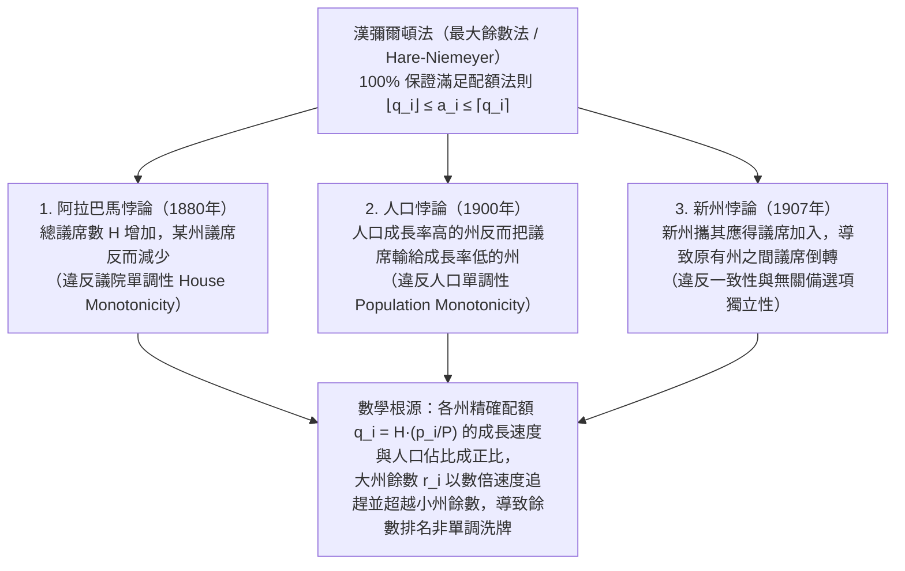

「請按照各州（或各政黨）的人口比例，公平地分配議會的整數個議席。」

面對這個問題，絕大多數人都會想到小學算術中的「按比例計算並按最大餘數湊整」：先用全國總人口除以總議席數得到「每席標準人口」，再用各州人口除以該標準除數得到精確配額（如 $7.73$ 席或 $1.36$ 席）；先向各州分配整數部分的議席，最後將剩餘議席按小數餘數從大到小依次補發。還有什麼方法比這更自然、更公平嗎？

然而1880年，美國人口普查局首席書記官查爾斯·西頓（Charles W. Seaton）在用這種最自然的方法（<strong>漢彌爾頓法 / 最大餘數法</strong>）計算聯邦眾議院議席時，發現了一個令人毛骨悚然的怪象：當全國總議席數從 $299$ 席<strong>增加到 $300$ 席</strong>時，人口未減少一人的<strong>阿拉巴馬州（Alabama）所獲議席竟從 $8$ 席跌落至 $7$ 席</strong>！

把餅做大，某人的份額反而縮小——這一<strong>阿拉巴馬悖論（Alabama Paradox）</strong>並非計算失誤，而是離散數學的深層陷阱。隨後人們又相繼發現了<strong>人口悖論</strong>（人口成長率更高的州反而輸給成長率更低的州）和<strong>新州悖論</strong>（新州帶著完全匹配自身人口的議席加入聯邦，卻導致原有兩州之間發生議席倒轉）。1982年，數學家米歇爾·巴林斯基（Michel Balinski）與佩頓·楊（H. Peyton Young）證明了著名的<strong>巴林斯基-楊不可能定理（Balinski-Young Impossibility Theorem）</strong>：<strong>在數學上，沒有任何一種議席分配方法能夠同時保證「配額法則（Quota Rule）」與「單調性（不發生悖論）」</strong>。本文將系統推導這一跨越兩百餘年的數學史詩。

---

## 1. 1792年美國憲政危機：漢彌爾頓對決傑佛遜與史上首次總統否決權

1787年《美國憲法》第1條第2款規定：「眾議員名額應按各州人口比例分配，每三萬人不得超過一名代表，但每州至少有一名代表。」1790年美國首次人口普查確定全國15州總人口為 $P = 3,615,920$ 人，國會擬定眾議院總席次為 $H = 120$ 席（全國平均每席標準除數 $D = P/H = 30,132.67$ 人）。

財政部長<strong>亞歷山大·漢彌爾頓（Alexander Hamilton）</strong>提出了<strong>最大餘數法（Hamilton's Method）</strong>：先按 $\lfloor p_i / D \rfloor$ 分配整數部分（共分出 $112$ 席），再將剩餘 $R = 8$ 席分給小數餘數最大的8個州。然而國務卿<strong>湯瑪斯·傑佛遜（Thomas Jefferson）</strong>與總統<strong>喬治·華盛頓（George Washington）</strong>對此強烈反對：在漢彌爾頓法下，不僅人口第一大州維吉尼亞因餘數略小被捨去，而且獲得餘數進位的小州（如德拉瓦州，人口 $55,540$ 人獲 $2$ 席）實際達到了<strong>每 $27,770$ 人一席</strong>，違反了憲法「每三萬人不超過一席」的上限！

傑佛遜提出了<strong>除數法（Jefferson's Method，即歐洲比例代表制中的漢狄法 D'Hondt Method）</strong>：設定一個可調的公共除數 $x$（如 $x = 33,000$），各州議席直接取下整 $\lfloor p_i / x \rfloor$（完全捨棄小數餘數），通過調整 $x$ 使各州整數部分之和恰好等於總議席數 $H$。<strong>1792年4月5日，華盛頓總統對漢彌爾頓分配法案行使了美國歷史上第一次總統否決權（Presidential Veto）</strong>——美國憲政史上首次總統否決，竟源於<strong>「如何將實數四捨五入為整數」的數學演算法之爭</strong>！

---

## 2. 比例分配的數學形式化與配額法則（Quota Rule）

設共有 $s$ 個州，人口向量為 $\mathbf{p} = (p_1, \dots, p_s)$，總人口 $P = \sum_{i=1}^s p_i$，總議席數為正整數 $H$。定義<strong>標準除數 $D$</strong> 與第 $i$ 州的<strong>精確配額（Exact Quota）$q_i$</strong> 為：

$$D = \frac{P}{H}, \qquad q_i = \frac{p_i}{D} = H \cdot \frac{p_i}{P}, \qquad \sum_{i=1}^s q_i = H$$

將非整數 $q_i$ 映射為非負整數議席 $a_i$（滿足 $\sum_{i=1}^s a_i = H$）時，最直觀的底線公平準則是：若某州精確配額為 $7.73$ 席，則它只能獲得<strong>下限配額 $\lfloor q_i \rfloor = 7$ 席</strong>或<strong>上限配額 $\lceil q_i \rceil = 8$ 席</strong>，絕不能少於 $7$ 席或多於 $8$ 席。這就是<strong>配額法則（Quota Rule）</strong>：

$$\lfloor q_i \rfloor \le a_i \le \lceil q_i \rceil \quad (\forall i \in \{1, 2, \dots, s\})$$

<strong>漢彌爾頓法（最大餘數法 / 黑爾-尼邁耶法 Hare-Niemeyer）</strong>將 $q_i$ 分解為整數部分 $\lfloor q_i \rfloor$ 與小數餘數 $r_i \in [0, 1)$，剩餘議席數 $R = H - \sum \lfloor q_i \rfloor = \sum r_i$ 由餘數 $r_i$ 最大的前 $R$ 個州各得1席：

$$q_i = \lfloor q_i \rfloor + r_i \quad (0 \le r_i < 1), \qquad R = H - \sum_{i=1}^s \lfloor q_i \rfloor = \sum_{i=1}^s r_i \in \{0, 1, \dots, s-1\}$$

$$a_i = \begin{cases} \lfloor q_i \rfloor + 1 & (\text{if } r_i \text{ is among the } R \text{ largest remainders}) \\ \lfloor q_i \rfloor & (\text{otherwise}) \end{cases}$$

顯然，漢彌爾頓法<strong>在任何情況下都 $100\%$ 滿足配額法則</strong>。

---

## 3. 三大分配悖論的完全剖析與數值證明

然而在1880年至1907年間，漢彌爾頓法在實際人口普查中接連爆出三大數學悖論：

### 3.1 阿拉巴馬悖論（The Alabama Paradox, 1880）

1880年普查中，當 $H = 299$ 增至 $H = 300$ 時，阿拉巴馬州的精確配額從 $7.646$ 增至 $7.671$（僅增 $+0.025$），而大州德克薩斯（$9.640 \to 9.672$，增 $+0.032$）和伊利諾州（$18.640 \to 18.702$，增 $+0.062$）的餘數成長速度更快，雙雙反超阿拉巴馬的餘數，奪走了新增議席及阿拉巴馬原有的餘數席次！

我們用總人口 $P = 1000$ 的<strong>三州模型（$H = 10 \to 11$）</strong>給出完整數值證明：

| 州 | 人口 $p_i$ | $H=10$ 精確配額 $q_i$ | $H=10$ 整數框與餘數 $r_i$ | <strong>$H=10$ 席次 $a_i$</strong> | $H=11$ 精確配額 $q_i'$ | $H=11$ 整數框與餘數 $r_i'$ | <strong>$H=11$ 席次 $a_i'$</strong> |
| :--- | :---: | :---: | :---: | :---: | :---: | :---: | :---: |
| <strong>A州</strong> | $433$ | $4.330$ | $4$ （餘數 $0.330$：第2名） | <strong>$4$ 席</strong> | $4.763$ | $4$ （餘數 <strong>$0.763$：第1名</strong>） | <strong>$5$ 席</strong>（$+1$） |
| <strong>B州</strong> | $431$ | $4.310$ | $4$ （餘數 $0.310$：第3名） | <strong>$4$ 席</strong> | $4.741$ | $4$ （餘數 <strong>$0.741$：第2名</strong>） | <strong>$5$ 席</strong>（$+1$） |
| <strong>C州</strong> | $136$ | $1.360$ | $1$ （餘數 <strong>$0.360$：第1名</strong>） | <strong>$2$ 席</strong> | $1.496$ | $1$ （餘數 $0.496$：第3名） | <strong>$1$ 席</strong>（<strong>$-1$</strong>） |
| <strong>合計</strong> | <strong>$1000$</strong> | <strong>$10.000$</strong> | 整數和 $= 9$（餘 $R=1$ 席） | <strong>$10$ 席</strong> | <strong>$11.000$</strong> | 整數和 $= 9$（餘 $R'=2$ 席） | <strong>$11$ 席</strong> |

當 $H$ 從 $10$ 增至 $11$ 時，大州 A、B 的配額分別增加 $+0.433$ 和 $+0.431$，而小州 C 僅增加 $+0.136$，導致 A、B 的餘數一舉反超 C，使 C 州從 $2$ 席跌至 $1$ 席，徹底破壞了<strong>議院單調性（House Monotonicity）</strong>。

### 3.2 人口悖論（The Population Paradox, 1900）

1900年普查中，維吉尼亞州十年人口成長率達 $+12.0\%$，遠超緬因州的 $+5.0\%$，但在固定總議席數下，維吉尼亞卻丟掉1席而緬因州增加1席。在 $H = 10, P = 1000$ 的三州模型中：
- <strong>時刻1</strong>：$p_A = 427, p_B = 435, p_C = 138$ $\implies$ 配額 $q_A = 4.270, q_B = 4.350, q_C = 1.380$。整數和為 $9$，餘數最大的 <strong>C州（$r_C = 0.380$）</strong>獲剩餘1席，席次為 $(4, 4, 2)$。
- <strong>時刻2</strong>：<strong>C州人口成長 $+8.70\%$（$138 \to 150$）</strong>，<strong>B州成長 $+6.90\%$（$435 \to 465$）</strong>，A州減少 $-9.84\%$（$427 \to 385$）。雖然 C 州相對成長率高於 B 州，但大州 B 的絕對配額增量（$+0.300 \implies r_B' = 0.650$）大於小州 C（$+0.120 \implies r_C' = 0.500$），且縮減的 A 州向下跌破整數邊界 $4$（$q_A' = 3.850$），使餘數跳升至 $r_A' = 0.850$（第1名）。最終 A、B 奪走2個餘數席次，成長最快的 C 州反而從 $2$ 席跌至 $1$ 席，違反了<strong>人口單調性（Population Monotonicity）</strong>！

### 3.3 新州悖論（The New States Paradox, 1907）

1907年奧克拉荷馬州加入聯邦（帶入應得的 $5$ 席，總席次 $386 \to 391$），卻導致毫無關聯的紐約州丟掉1席、緬因州增加1席。在二州加新州模型中：初始 $H = 10, P = 1000$（$p_A = 842, p_B = 158 \implies q_A = 8.420, q_B = 1.580$），席次為 $a_A = 8, a_B = 2$。當人口 $p_C = 165$ 的新州 C 攜 $2$ 席加入後（$H' = 12, P' = 1165$，標準除數從 $100$ 略降至 $97.083$），各州配額同乘 $1.03004$：大州 A 的配額增至 $q_A' = 8.673$（餘數 $0.673$），小州 B 增至 $q_B' = 1.627$（餘數 $0.627$），新州 C 為 $q_C' = 1.700$（餘數 $0.700$）。大州 A 的餘數反超小州 B，席次變為 $(9, 1, 2)$！

---

## 4. 除數法（最高均數法）體系與路標函數 $d(n)$

為消除餘數比較造成的悖論，<strong>除數法（Divisor Methods）</strong>引入可調公共除數 $x > 0$，並在每個整數區間 $[n, n+1]$ 內指定一個<strong>路標函數（Signpost Function）$d(n) \in [n, n+1]$</strong> 來定義取整規則 $[q]_d$：

$$[q]_d = n \iff d(n-1) \le q \le d(n), \qquad a_i = \left[\frac{p_i}{x}\right]_d, \qquad \sum_{i=1}^s a_i = H$$

將 $d(a_i - 1) \le p_i / x \le d(a_i)$ 對 $x$ 求解，即得<strong>除數法與最高均數法（Highest Averages Method / 優先級法）的完全等價性</strong>：

$$\frac{p_i}{d(a_i)} \le x \le \frac{p_i}{d(a_i - 1)} \quad \Longleftrightarrow \quad \text{Priority}(i, n) = \frac{p_i}{d(n)}$$

即按照<strong>優先級值 $\text{Priority}(i, n) = \frac{p_i}{d(n)}$</strong> 從大到小依次分配前 $H$ 個議席。由於優先級排序固定且兩州優先級之比僅取決於 $p_i / p_j$：

$$\frac{p_i'}{p_j'} \ge \frac{p_i}{p_j} \implies \frac{p_i' / d(n)}{p_j' / d(m)} = \frac{p_i'}{p_j'} \cdot \frac{d(m)}{d(n)} \ge \frac{p_i}{p_j} \cdot \frac{d(m)}{d(n)} = \frac{p_i / d(n)}{p_j / d(m)}$$

因此<strong>任何除數法都絕對不會發生阿拉巴馬悖論、人口悖論和新州悖論</strong>！

### 五大經典除數法對比表

| 方法名稱（選舉制別名） | 提出者與年份 | 路標函數 $d(n)$ | 除數序列 $d(0), d(1), d(2), \dots$ | 保底席次 | 規模偏向與數學優化目標 | 配額法則違反風險 |
| :--- | :--- | :---: | :---: | :---: | :--- | :--- |
| <strong>1. 傑佛遜法</strong>（<strong>漢狄法 D'Hondt</strong>） | Jefferson (1792) D'Hondt (1878) | $n + 1$（無條件捨去） | $1, 2, 3, 4, \dots$ | $0$ 席 | <strong>最有利於大州 / 大黨</strong> | 發生<strong>上限配額違反</strong>（$a_i > \lceil q_i \rceil$） |
| <strong>2. 韋伯斯特法</strong>（<strong>聖拉古法 Sainte-Laguë</strong>） | Webster (1832) Sainte-Laguë (1910) | $n + 0.5$（算術平均） | $0.5, 1.5, 2.5, \dots$（或 $1, 3, 5, \dots$） | $0$ 席 | <strong>對大州小州完全無偏（Unbiased）</strong> | 極少數情況下違反上限或下限配額 |
| <strong>3. 亨廷頓-希爾法</strong>（<strong>均等比例法</strong>） | Hill (1911) Huntington (1921) | $\sqrt{n(n+1)}$（幾何平均） | $0, \sqrt{2}, \sqrt{6}, \sqrt{12}, \dots$ | $1$ 席 | 最小化兩州間人均代表數的<strong>相對差距</strong>；<strong>1941年至今美國眾議院法定方法</strong> | 可違反上限或下限配額 |
| <strong>4. 迪恩法</strong>（<strong>調和平均法</strong>） | J. Dean (1832) | $\frac{2n(n+1)}{2n+1}$（調和平均） | $0, \frac{4}{3}, \frac{12}{5}, \frac{24}{7}, \dots$ | $1$ 席 | 最小化每席代表人口 $p_i/a_i$ 的絕對差 | 可違反上限或下限配額 |
| <strong>5. 亞當斯法</strong>（<strong>最小除數法</strong>） | J. Q. Adams (1832) | $n$（無條件進位） | $0, 1, 2, 3, \dots$ | $1$ 席 | <strong>最有利於小州</strong>（日本眾議院小選區採用） | 發生<strong>下限配額違反</strong>（$a_i < \lfloor q_i \rfloor$） |

其中亨廷頓-希爾法最小化兩州相對不平等度 $T_{ij}$，且由算術-幾何-調和平均不等式（AM-GM-HM）：

$$T_{ij} = \frac{a_i / p_i}{a_j / p_j} - 1, \qquad d(n) = \sqrt{n(n+1)}$$

$$n < \underbrace{\frac{2n(n+1)}{2n+1}}_{\text{Dean (HM)}} < \underbrace{\sqrt{n(n+1)}}_{\text{Huntington-Hill (GM)}} < \underbrace{n + 0.5}_{\text{Webster (AM)}} < n + 1$$

---

## 5. 巴林斯基-楊不可能定理（Balinski-Young Impossibility Theorem, 1982）

既然除數法能徹底消除三大悖論，那麼居中的<strong>韋伯斯特法（$d(n) = n + 0.5$，四捨五入）</strong>能否同時滿足配額法則？答案是<strong>不能</strong>！

1. <strong>韋伯斯特法違反下限配額的數值反例（$H = 10, P = 1000$）</strong>：設大州 A 人口 $p_A = 832$（精確配額 $q_A = 8.320$，下限配額為 <strong>$8$ 席</strong>），三個小州 B, C, D 人口各為 $56$（$q_i = 0.560$）。取公共除數 $x = 111$，則三個小州的商 $56/111 \approx 0.5045 > 0.5$ 全部四捨五入進位得 $1$ 席（共 $3$ 席），而大州 A 的商 $832/111 \approx 7.4955 < 7.5$ 被捨去，僅得 <strong>$7$ 席</strong>（低於下限配額 $8$ 席）！
2. <strong>韋伯斯特法違反上限配額的數值反例（$H = 10, P = 1000$）</strong>：設大州 A 人口 $p_A = 795$（精確配額 $q_A = 7.950$，上限配額為 <strong>$8$ 席</strong>），五個小州 B–F 人口各為 $41$（$q_i = 0.410$）。取公共除數 $x = 83$，則五個小州的商 $41/83 \approx 0.4940 < 0.5$ 全部捨為 $0$ 席，而大州 A 的商 $795/83 \approx 9.5783 > 9.5$ 進位獨吞全部 <strong>$10$ 席</strong>（突破上限配額 $8$ 席達2席之多）！

1982年，巴林斯基與楊證明了終極定理：
- <strong>定理1（除數法特徵定理）</strong>：一個匿名、齊次的分配方法滿足<strong>人口單調性（不發生人口悖論）</strong>，當且僅當它是基於某個單調路標函數 $d(n)$ 的<strong>除數法</strong>。
- <strong>定理2（巴林斯基-楊不可能定理）</strong>：當州數 $s \ge 4$ 且總議席數 $H \ge 7$ 時，<strong>在數學上不存在任何一種議席分配方法能夠同時滿足人口單調性與配額法則（$\lfloor q_i \rfloor \le a_i \le \lceil q_i \rceil$）</strong>。

其本質原因在於：除數法調整公共除數 $x$ 時，所有州的配額按同一比例因子 $\lambda = D/x$ 縮放（$p_i/x = \lambda q_i$）。當多個小州聚集在取整閾值 $d(k)$ 附近同時進位或捨去時，$\lambda$ 偏離 $1$，而大州配額的絕對偏移量 $\Delta q_A = |1 - \lambda| q_A$ 與其規模成正比，必然跨越整數邊界從而打破配額法則。這揭示了離散公平分配中不可逾越的數學極限。
