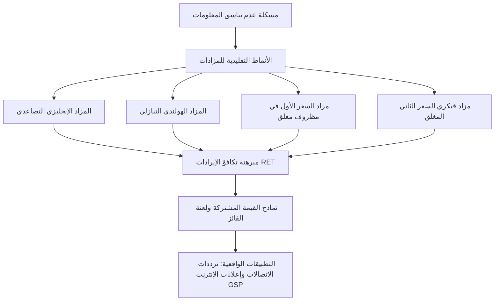
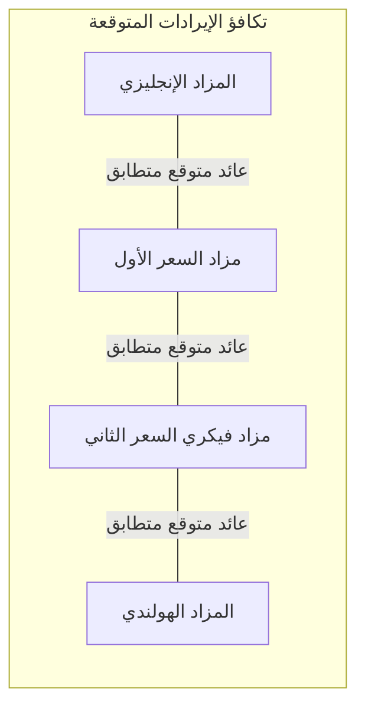

تمثل نظرية المزادات إحدى أبهى حلقات الوصل بين الاقتصاد الجزئي النظري ونظرية الألعاب التطبيقية والتصميم الرياضي للأسواق. منذ المزادات البابلية القديمة وحتى بيع الإمبراطورية الرومانية بالمزاد العلني على يد الحرس البريتوري في عام 193 ميلادية، كانت المزادات الآلية الاقتصادية المثلى لاكتشاف الأسعار الحقيقية وتوزيع الموارد النادرة في ظل التفاوت المعلوماتي. لكن تحول المزادات إلى علم رياضي دقيق انطلق مع الأبحاث الرائدة للبروفيسور ويليام فيكري (William Vickrey) في عام 1961، والتي مهدت لتأسيس نظرية تصميم الآليات (Mechanism Design) الحائزة على جوائز نوبل متعددة.

## 1. الأسس الرياضية لنظرية الألعاب وأنماط المزادات الكلاسيكية

في النموذج القياسي للمزادات، يُنظر إلى العملية على أنها لعبة بايزية غير تعاونية (Bayesian Game) بمعلومات غير مكتملة. لدينا مجموعة من المزايدين $N = \{1, 2, \dots, n\}$، حيث يمتلك كل مزايد $i$ قيمة ذاتية خاصة $v_i \in [0, \bar{v}]$ تُسحب باستقلالية وتطابق من توزيع احتمالي $F(v)$ مع دالة كثافة احتمالية $f(v) = F'(v) > 0$.

توجد أربعة أنماط قياسية للمزادات على أصل واحد:

1. **المزاد الإنجليزي (المزاد التصاعدي العلني)**: يرفع مدير المزاد السعر تدريجياً، وينسحب المشاركون بمجرد تجاوز السعر لقيمهم الذاتية. يفوز آخر المشاركين ويدفع السعر الذي انسحب عنده المزايد قبل الأخير.
2. **المزاد الهولندي (المزاد التنازلي العلني)**: يبدأ السعر من مستوى مرتفع للغاية وينخفض بمعدل زمني ثابت حتى يعلن أول مشترٍ قبوله الشراء بالسعر اللحظي.
3. **مزاد السعر الأول في مظروف مغلق (FPSB)**: يرسل كل مشارك عرضاً سرياً $b_i$. يفوز صاحب أعلى عرض ويدفع بالضبط المبلغ الذي عرضه: $P = \max_j b_j$.
4. **مزاد السعر الثاني في مظروف مغلق (مزاد فيكري - SPSB)**: يقدم المشاركون عروضاً مغلقة. يفوز صاحب العرض الأعلى، لكنه يدفع فقط قيمة ثاني أعلى عرض مقدم: $P = \max_{j \neq i^*} b_j$.

| صيغة المزاد | آلية تحديد السعر | الاستراتيجية المثلى | التعقيد المعلوماتي |
| :--- | :--- | :--- | :--- |
| **الإنجليزي** | تصاعدي علني | البقاء حتى $p = v_i$ | بسيط للغاية |
| **الهولندي** | تنازلي علني | خفض العرض عن القيمة الذاتية | معقد استراتيجياً |
| **السعر الأول** | مظروف مغلق | موازنة هامش الربح باحتمال الفوز | معقد حسابياً |
| **السعر الثاني (فيكري)** | مظروف مغلق | تقديم القيمة الحقيقية $b_i = v_i$ | استراتيجية مهيمنة ضعيفة |

## 2. عبقرية مزاد فيكري والاستراتيجية المهيمنة

أثبت ويليام فيكري رياضياً في عام 1961 أنه في ظل نموذج القيم الخاصة المستقلة (IPV)، فإن تقديم عرض يساوي تماماً القيمة الذاتية الحقيقية للمزايد ($b_i = v_i$) يشكل **استراتيجية مهيمنة ضعيفة** (Weakly Dominant Strategy).

البرهان الرياضي يقوم على غياب أي حافز استراتيجي للمراوغة:
إذا كانت القيمة الذاتية للمشارك هي $v_i$، وكان أعلى عرض من بين باقي المنافسين هو $r_i = \max_{j \neq i} b_j$، فإن دالة العائد الصافي للمشارك $i$ عند تقديم عرض $b_i$ هي:

$$\pi_i(b_i, r_i) = \begin{cases} v_i - r_i & \text{إذا كان } b_i > r_i \\ 0 & \text{إذا كان } b_i < r_i \end{cases}$$

إذا حاول المزايد المزايدة بأعلى من قيمته الحقيقية ($b_i > v_i$):
- إذا كان $r_i < v_i$، يفوز ويدفع $r_i$ ويحصل على نفس العائد $v_i - r_i$.
- إذا كان $r_i > b_i$، يخسر وعائده صفر.
- إذا كان $v_i < r_i < b_i$، يفوز بالسلعة ولكنه يدفع سعراً يتجاوز قيمتها لديه، محققاً خسارة صافية قطعية: $\pi_i = v_i - r_i < 0$.

وإذا حاول تخفيض عرضه دون قيمته الحقيقية ($b_i < v_i$):
- إذا كان $r_i < b_i$، يفوز ولا يتغير ربحه.
- إذا كان $r_i > v_i$، يخسر وربحه صفر.
- إذا كان $b_i < r_i < v_i$، يخسر صفقة رابحة كان يمكنه جني ربح موجب منها قدره $v_i - r_i > 0$.

لذلك، فإن الصدق التام وتقديم القيمة الحقيقية هو الخيار العقلاني الأمثل في كل الحالات الممكنة، دون الحاجة للتخمين أو التجسس على المنافسين.

## 3. مبرهنة تكافؤ الإيرادات (Revenue Equivalence Theorem)

تعد مبرهنة تكافؤ الإيرادات التي صاغها روجر مايرسون (1981) وويليام فيكري حجر الزاوية في الاقتصاد النظري الحديث:

> **المبرهنة**: إذا كان لدى $n$ من المزايدين الحياديين تجاه المخاطر تقييمات خاصة مستقلة ومتطابقة التوزيع (i.i.d.) على فترة متصلة $[\underline{v}, \bar{v}]$، فإن أي آلية مزاد تضمن:
> 1. تخصيص الأصل دائماً للمشارك صاحب أعلى تقييم؛
> 2. حصول المشارك صاحب أدنى تقييم ممكن $\underline{v}$ على فائض متوقع قدره صفر؛
> 
> ستحقق للبائع نفس العائد الإجمالي المتوقع، وتترك لكل مشترٍ نفس الفائض المتوقع.

في مزاد السعر الأول في مظروف مغلق مع توزيع منتظم $F(v) = v / \bar{v}$، تأخذ استراتيجية توازن ناش البايزي الشكل الرياضي:

$$b(v) = \frac{n-1}{n} v$$

وهذا يعني أن المزايد يقلل عرضه بنسبة معينة، ولكن قيمة العرض الفائز المتوقع تساوي رياضياً توقع ثاني أعلى قيمة في مزاد فيكري، محققة التكافؤ التام للإيراد.

## 4. انهيار الفرضيات: لعنة الفائز (Winner's Curse)

في المزادات الواقعية مثل امتيازات حقول النفط أو ترددات الجيل الخامس، تسود بيئة **القيمة المشتركة** (Common Value). في هذا النموذج، يمتلك الأصل قيمة موضوعية موحدة $V$ غير معلومة بدقة للجميع، ويتلقى كل مشارك إشارة تقديرية مشوبة بالضوضاء $X_i = V + \epsilon_i$.

إذا زايد المشاركون بسذاجة وفق تقديراتهم الفردية $\mathbb{E}[V \mid X_i]$، فإن الفائز سيكون حتماً صاحب الإشارة الأكثر تفاؤلاً وخطأً:

$$\max_j X_j = V + \max_j \epsilon_j > V$$

هذه الظاهرة تُعرف بـ **لعنة الفائز** (Winner's Curse)، حيث يكتشف الفائز بعد المزاد أنه دفع ثمناً مبالغاً فيه تسبب له في خسائر فادحة. ولتجنب ذلك، يجب على المزايد العقلاني تقليص عرضه استباقياً ليعكس حقيقة أنه سيفوز فقط عندما تكون تقديرات الآخرين أقل من تقديره:

$$b_i(x_i) = \mathbb{E}\left[V \;\middle|\; X_i = x_i, \; \max_{j \neq i} X_j = x_i\right]$$

وقد أثبت ميلغروم وويلسون أن المزاد الإنجليزي يحقق إيرادات أعلى للبائع في هذه الحالات، لأن الكشف التدريجي عن انسحاب المنافسين يقلل من عدم اليقين ويخفف من حدة الخصم الذي يفرضه المزايدون لتفادي لعنة الفائز.

## 5. التطبيق التاريخي: مزادات ترددات الاتصالات FCC

في عام 1994، أحدثت هيئة الاتصالات الفيدرالية الأمريكية (FCC) ثورة اقتصادية عندما استعانت بعلماء نظرية الألعاب (بول ميلغروم، روبرت ويلسون، بريستون مكافي) لتصميم **المزاد التصاعدي المتزامن متعدد الجولات** (Simultaneous Multiple-Round Auction, SMRA).

كانت المعضلة تكمن في التكامل الجغرافي: شركات الاتصالات تحتاج إلى حزم ترددية متجاورة عبر الولايات (مثل نيويورك وبوسطن). المزادات التقليدية المتتالية كانت تسبب مخاطر التعرض (Exposure Problem)، حيث تشتري الشركة ترخيصاً في ولاية بثمن باهظ ثم تخسر ترخيص الولاية المجاورة، فتبقى بأصل عديم القيمة التشغيلية.

ابتكر نظام SMRA:
1. طرح جميع الرخص في مزاد مفتوح متزامن يستمر لعدة جولات.
2. قواعد نشاط صارمة تمنع التخفي والترقب في اللحظات الأخيرة.
3. مرونة كاملة لتجميع حزم الترددات المتكاملة بكفاءة اقتصادية استثنائية.

وقد منحت الأكاديمية السويدية جائزة نوبل في الاقتصاد لعام 2020 لكل من بول ميلغروم وروبرت ويلسون تقديراً لهذا الإنجاز التاريخي.

## 6. الإعلانات الرقمية وخوارزمية GSP

يمثل سوق الإعلانات الرقمية والبحث على الإنترنت (Google Ads وBing) التطبيق الكمي الأضخم لنظرية المزادات في عصرنا الحديث، حيث تُجرى مليارات المزادات كل ثانية لترتيب الروابط الإعلانية.

تعتمد هذه المحركات على آلية **مزاد السعر الثاني المعمم** (Generalized Second Price, GSP). لتوزيع عدة مواضع إعلانية بمعدلات نقر متناقصة ($\alpha_1 > \alpha_2 > \dots$):
- يُرتب المعلنون وفق نتيجة التصنيف: $S_i = \text{Bid}_i \times \text{CTR}_i$.
- يدفع المعلن في المركز $k$ الحد الأدنى اللازم للتفوق على المعلن في المركز $k+1$:

$$P_k = \frac{\text{Bid}_{k+1} \times \text{CTR}_{k+1}}{\text{CTR}_k} + 0.01$$

وعلى الرغم من أن GSP لا يتمتع باستراتيجية مهيمنة بسيطة كآلية فيكري، إلا أنه يحقق توازنات مستقرة تخلو من الحسد المحلي (Locally Envy-Free)، مما جعله الركيزة الأساسية لاقتصاد الإنترنت الحديث.
