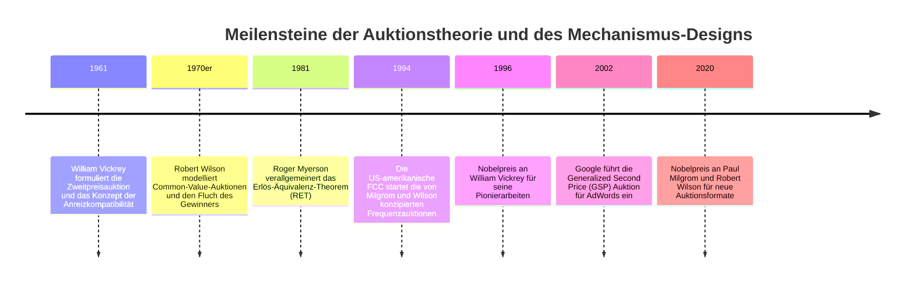
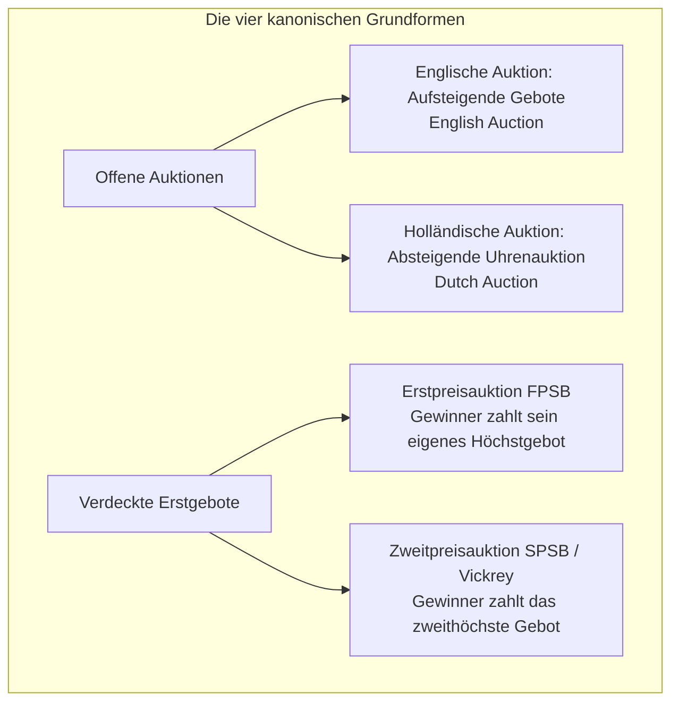
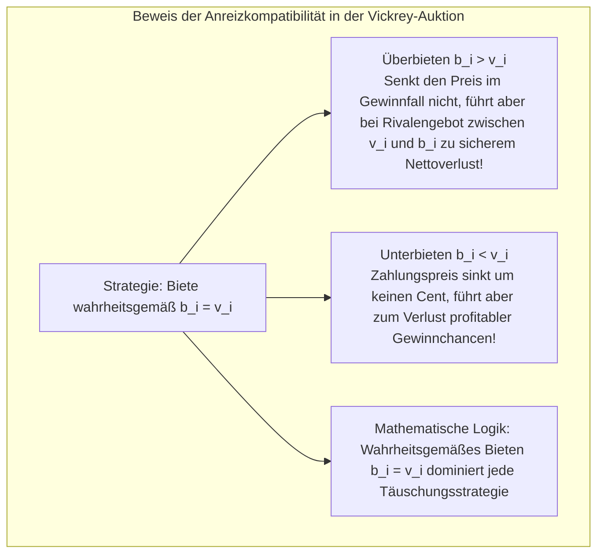
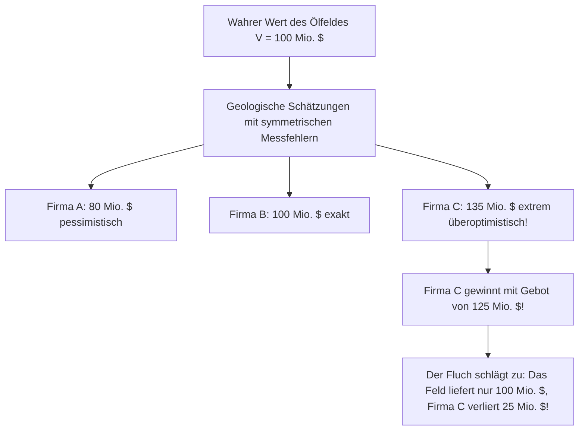

In den winzigen 100 Millisekunden zwischen der Eingabe eines Suchbegriffs bei Google und dem Erscheinen der Ergebnisseiten führen tausende Server im Hintergrund hunderte Millionen simultane **Echtzeit-Auktionen (Real-Time Bidding, RTB)** durch. Nahezu die gesamten Werbeeinnahmen von Alphabet und Meta – hunderte Milliarden Dollar jährlich – basieren auf den Algorithmen der Spieltheorie und des Mechanismus-Designs.

Ebenso verdankt die moderne Mobilfunkwelt (4G und 5G) ihre Leistungsfähigkeit den **simultanen aufsteigenden Mehrrundenauktionen (SMRA)**, mit denen Regierungen knappe Funkfrequenzen an Telekommunikationsanbieter verteilen. Für diese bahnbrechenden Entwürfe erhielten die Stanford-Ökonomen Paul Milgrom und Robert Wilson 2020 den Nobelpreis für Wirtschaftswissenschaften.

Auktionen sind weit mehr als historische Kunstversteigerungen. Sie sind eine hochpräzise Ingenieurwissenschaft für Märkte, die unter Bedingungen asymmetrischer Information das eigennützige Verhalten strategischer Akteure in eine sozial optimale Güterallokation lenkt.

---

## 1. Die vier kanonischen Auktionsformate und Informationsmodelle

In der Mikroökonomik ist eine Auktion eine dezentrale Marktinstitution mit expliziten Regeln, die auf der Grundlage von Geboten über die Güterzuteilung und die Preisfindung entscheidet.

- **Private-Value-Modell**: Die Wertschätzung $v_i$ eines Bieters ist rein subjektiv (z. B. Kunstsammler). Das Wissen um die Gebote anderer ändert den eigenen Nutzen nicht.
- **Common-Value-Modell**: Das Gut besitzt einen objektiven, für alle gleichen, aber vorab unbekannten wahren Wert $V$ (z. B. Erdölvorkommen oder Mobilfunklizenzen). Jeder Bieter erhält lediglich ein mit Messfehlern behaftetes Signal $s_i = V + \epsilon_i$.

---

## 2. William Vickreys Meisterstreich: Wahre Bewertung als dominante Strategie

1961 bewies **William Vickrey**, dass in einer verdeckten Zweitpreisauktion das **wahrheitsgemäße Bieten des eigenen Reservationspreises ($b_i = v_i$) eine schwach dominante Strategie ist**.

Da der zu zahlende Preis durch das **zweithöchste Gebot der Konkurrenten ($B_{-i}$)** und nicht durch das eigene Gebot bestimmt wird, wird das Bieten von der Zahlungsverpflichtung entkoppelt. Taktisches Pokern oder Herunterrechnen von Geboten entfällt vollkommen: Der Bieter muss lediglich seinen wahren Wert nennen (**Incentive Compatibility**).

---

## 3. Das Erlös-Äquivalenz-Theorem (Revenue Equivalence Theorem)

Für Verkäufer stellt sich die intuitive Frage: „Verliere ich Geld, wenn ich nur das zweithöchste Gebot annehme?“
Das von Vickrey und Roger Myerson formulierte **Erlös-Äquivalenz-Theorem** beweist:
Unter standardisierten Annahmen (risikoneutrale Bieter, unabhängig identisch verteilte private Bewertungen) erzielen **die englische, holländische, Erstpreis- und Zweitpreisauktion für den Verkäufer exakt denselben erwarteten Erlös**.
Bei der Erstpreisauktion rechnen die Bieter ihre Gebote strategisch herunter (*Bid Shading*). Im symmetrischen Nash-Gleichgewicht entspricht dieses herabgesetzte Gebot mathematisch genau dem Erwartungswert des zweithöchsten Gebots in einer Vickrey-Auktion.

---

## 4. Common-Value-Auktionen und der Fluch des Gewinners (Winner's Curse)

Bei unvollständiger Information über den wahren Wert eines Gutes (z. B. Ölfelder) droht der **Fluch des Gewinners**:

Wer gewinnt, ist statistisch gesehen derjenige, der den wahren Wert am drastischsten überschätzt hat. Rationale Bieter müssen diesen Selektionseffekt antizipieren und ihre Gebote im Voraus massiv nach unten korrigieren, um nicht durch ihren eigenen Sieg ruiniert zu werden.

---

## 5. Frequenzauktionen (SMRA) und der digitale Werbemarkt (GSP)

1994 schufen Milgrom und Wilson die **Simultaneous Multiple-Round Ascending Auction (SMRA)** für die US-Behörde FCC. Sie erlaubte es Telekommunikationsfirmen, Lizenzen für benachbarte Regionen zeitgleich in transparenten Runden zu ersteigern, was den Fluch des Gewinners dämpfte und hunderte Milliarden Dollar in Staatskassen spülte.

Im Internet entwickelte Google für AdWords die **Generalized Second Price (GSP)** Auktion:
$$
\text{Ad Rank}_i = \text{Gebot } b_i \times \text{Qualitätsfaktor } q_i
$$
Klickt ein Nutzer auf die Anzeige, zahlt der Werbekunde nur den Mindestbetrag, der nötig ist, um den Ad Rank des nächstplatzierten Konkurrenten zu schlagen:
$$
\text{CPC}_i = \frac{\text{Ad Rank}_{i+1}}{q_i} + 0,01\ \$
$$

### Fazit
Die Auktionstheorie zeigt, dass funktionierende Märkte kein Zufallsprodukt sind, sondern das Ergebnis präziser mathematischer Architektur.
