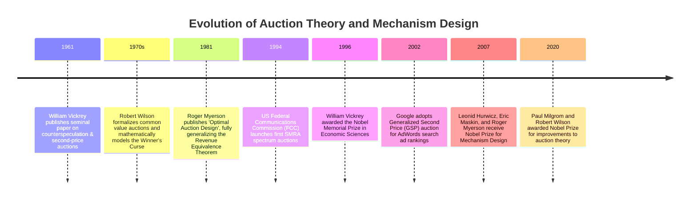
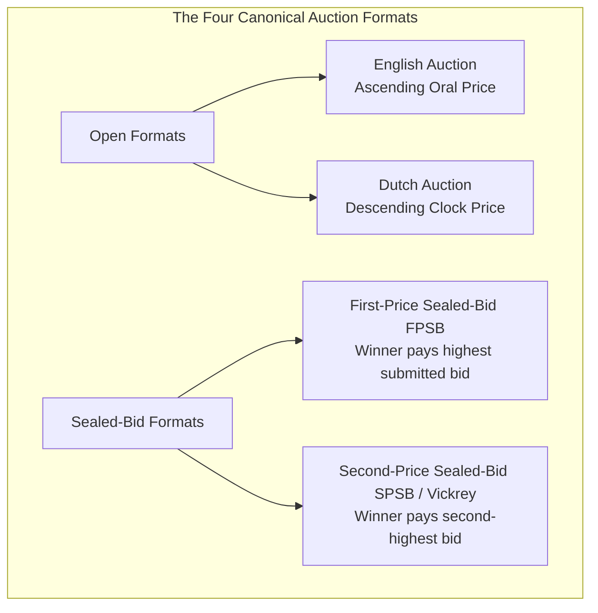
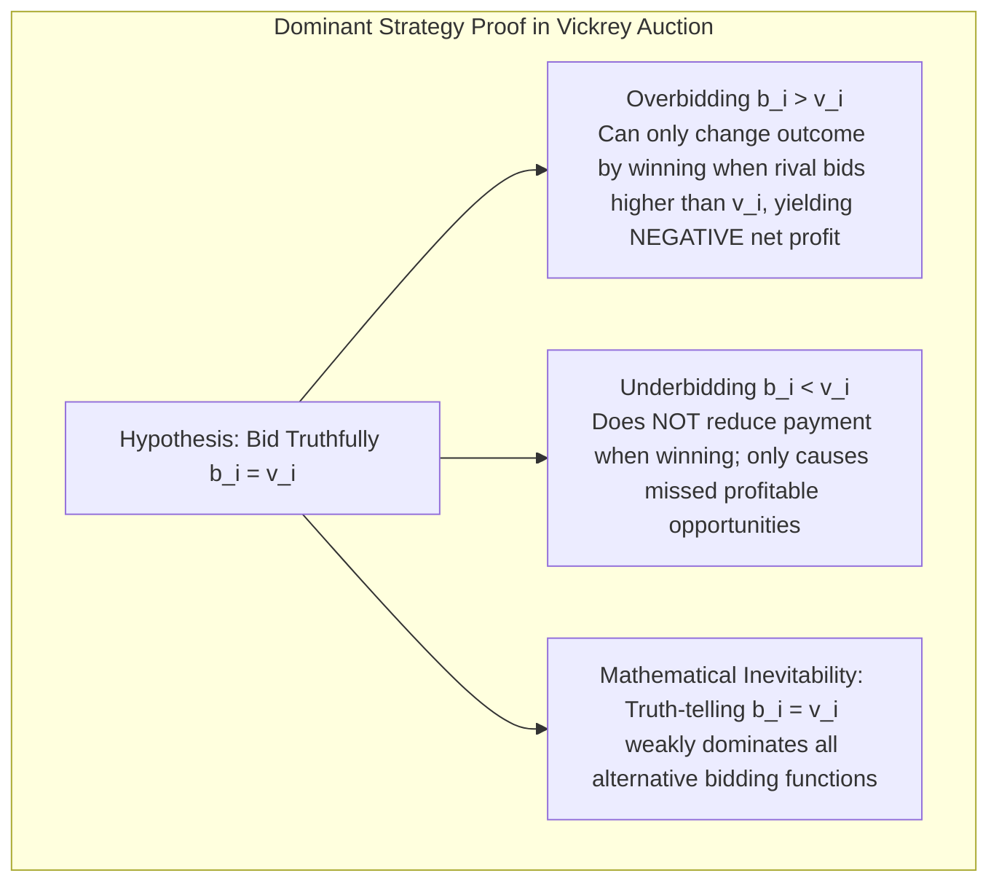
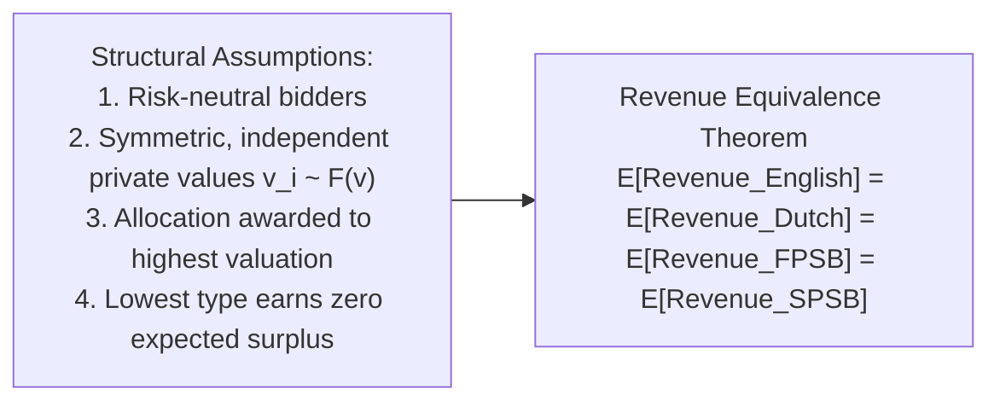
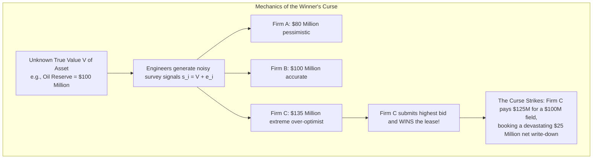
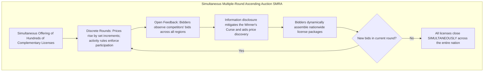
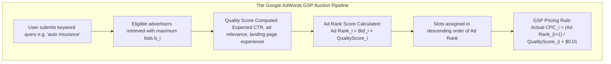

In the hundred milliseconds between typing a search query into Google and the page rendering on your screen, thousands of distributed servers execute hundreds of millions of simultaneous **real-time algorithmic auctions**. Virtually the entire multi-hundred-billion-dollar revenue engine of modern digital giants like Alphabet and Meta is powered by game-theoretic auction mechanisms.

Similarly, the seamless high-speed connectivity enjoyed on 4G and 5G smartphones exists because national governments allocate scarce, invisible electromagnetic spectrum using **Simultaneous Multiple-Round Ascending Auctions (SMRA)**. For pioneering these profound institutional designs, Stanford economists Paul Milgrom and Robert Wilson were awarded the 2020 Nobel Memorial Prize in Economic Sciences.

How did auctions transform from antiquarian art house curiosities into the indispensable structural plumbing of the global high-tech economy? This monograph explores the mathematical, theoretical, and algorithmic foundations of **Auction Theory and Mechanism Design**—the science of engineering rules of engagement that steer self-interested strategic agents toward socially optimal allocations under conditions of private, asymmetric information.

---

## 1. Canonical Formats and Information Structures

In microeconomics, an auction is formally defined as a **decentralized market institution with explicit rules governing resource allocation and payment determination on the basis of bids submitted by market participants**.

### 1.1 The Four Basic Formats
1. **The English Auction (Ascending Oral)**: An auctioneer initiates bidding at a low reservation price and raises the ask progressively. Bidders signal willingness to buy until only one bidder remains, who secures the lot at their final stated bid.
2. **The Dutch Auction (Descending Clock)**: The auctioneer opens with an exorbitantly high price and lowers it continuously via a mechanical or digital clock. The first participant to hit the buzzer claims the item immediately at that exact price.
3. **The First-Price Sealed-Bid Auction (FPSB)**: Each participant independently submits a single hidden bid without observing rivals' choices. Bids are opened simultaneously; the highest bidder wins and **pays the exact amount they wrote on their ballot**.
4. **The Second-Price Sealed-Bid Auction (SPSB / Vickrey Auction)**: Bids are submitted privately in sealed envelopes. The highest bidder wins, but **pays only the second-highest bid submitted by competitors**.

### 1.2 Strategic Equivalence
Game theory identifies profound structural isomorphisms across these formats:
- **Dutch $\equiv$ First-Price Sealed-Bid (FPSB)**: In a Dutch auction, a bidder receives zero information about rivals' valuations until someone halts the clock. The decision reduces to picking a single optimal stopping threshold without prior dynamic feedback—a strategic problem identical to calculating an optimal sealed bid in FPSB.
- **English $\approx$ Second-Price Sealed-Bid (SPSB)**: Under private values, an English auction terminates the exact moment the second-to-last bidder drops out. The victor acquires the asset at an increment marginally above the second-highest valuation, yielding economic outcomes equivalent to the Vickrey format.

### 1.3 Information Typologies: Private vs. Common Values
The mathematical behavior of an auction depends critically on how bidders assess value:
- **Independent Private Values (IPV)**: Each bidder $i$ knows their own subjective valuation $v_i$ with certainty (e.g., consumer goods, rare art for personal display). Knowing another bidder's valuation provides zero new information about one's own enjoyment of the good.
- **Pure Common Value Model**: The underlying asset possesses a single objective, identical economic value $V$ for all participants (e.g., an offshore oil reservoir, mineral concession, or wireless spectrum license), but this value is unknown *a priori*. Each bidder receives an imperfect, noisy private estimate or geological signal $s_i = V + \epsilon_i$.

---

## 2. William Vickrey's Stroke of Genius: Truth-Telling as a Dominant Strategy

In 1961, Canadian-American economist **William Vickrey (1914–1996)** published his landmark paper, *"Counterspeculation, Auctions, and Competitive Sealed Tenders"*. Vickrey resolved one of the oldest dilemmas in market design: how can a mechanism compel self-interested actors to truthfully reveal their private reservations?

### 2.1 The Mathematical Proof of Incentive Compatibility
Let bidder $i$ have true valuation $v_i \ge 0$ and submit bid $b_i \ge 0$.
Let $B_{-i} = \max_{j \neq i} b_j$ denote the highest bid among all other $n-1$ participants.

Under second-price sealed-bid rules, the payoff function $\pi_i(b_i, B_{-i})$ is:
$$
\pi_i = \begin{cases}
v_i - B_{-i} & \text{if } b_i > B_{-i} \\
0 & \text{if } b_i < B_{-i}
\end{cases}
$$
(Tie-breaking rules award the lot by fair coin-toss without loss of generality).

We prove that bidding $b_i = v_i$ is a **weakly dominant strategy**—it maximizes expected payoff regardless of the actions, beliefs, or probability distributions of rivals.

#### Case 1: Overbidding ($b_i' > v_i$)
- If $B_{-i} < v_i$: Under both truthful bidding ($b_i = v_i$) and overbidding ($b_i'$), the bidder wins and pays $B_{-i}$. Payoff is identical: $\pi_i = v_i - B_{-i} > 0$.
- If $B_{-i} \ge b_i'$: Under both strategies, the bidder loses. Payoff is identical: $\pi_i = 0$.
- If $v_i < B_{-i} < b_i'$: Truthful bidding loses, yielding $\pi_i = 0$. Overbidding wins, forcing the bidder to pay $B_{-i}$. The resulting payoff is $\pi_i = v_i - B_{-i} < 0$ (**a strictly negative net loss**).
$\therefore$ Overbidding never improves the payoff and risks catastrophic losses.

#### Case 2: Underbidding ($b_i'' < v_i$)
- If $B_{-i} < b_i''$: The bidder wins under both strategies and pays $B_{-i}$. Payoff is identical: $\pi_i = v_i - B_{-i} > 0$.
- If $B_{-i} \ge v_i$: The bidder loses under both strategies. Payoff is identical: $\pi_i = 0$.
- If $b_i'' < B_{-i} < v_i$: Truthful bidding wins, capturing a strictly positive surplus $\pi_i = v_i - B_{-i} > 0$. Underbidding loses, yielding $\pi_i = 0$ (**an unforced opportunity loss**).
$\therefore$ Underbidding never reduces the price paid when winning (since price is governed exclusively by $B_{-i}$), but directly causes the bidder to forfeit profitable victories.

#### Q.E.D.
Bidding $b_i = v_i$ is a weakly dominant strategy. The Vickrey auction achieves **Strategy-Proofness (Incentive Compatibility)**: it completely decouples what a bidder *pays* from what they *bid*, liberating market participants from complex psychological guesswork and strategic shade-pricing.

---

## 3. The Revenue Equivalence Theorem (RET)

From the seller's perspective, the Vickrey auction appears counter-intuitive: why willingly forfeit the highest bid and accept the second-highest offer? Would a first-price auction not extract greater revenue?

The answer is provided by the **Revenue Equivalence Theorem**, formalized by William Vickrey, John Riley, William Samuelson, and generalized to its ultimate mathematical zenith by **Roger Myerson** (1981):

### 3.1 Formal Statement of the Theorem
Assume $n$ risk-neutral bidders have private valuations drawn independently and identically from a strictly increasing cumulative distribution function $F(v)$ on interval $[\underline{v}, \bar{v}]$. Any auction mechanism in which:
1. The object is always allocated to the bidder with the highest valuation, and
2. The bidder with the lowest possible valuation $\underline{v}$ expects zero surplus,
**yields the exact same expected revenue to the seller and leaves every bidder with the exact same expected surplus**.

### 3.2 The Intuition: Strategic Bid Shading
In a first-price auction (FPSB), rational bidders recognize that bidding $b_i = v_i$ guarantees zero surplus even upon victory ($\pi_i = v_i - v_i = 0$). Hence, they systematically shade their bids downward. In symmetric Bayes-Nash equilibrium, the optimal bidding strategy $b(v)$ under a uniform distribution $U[0, 1]$ is:
$$
b(v) = \frac{n-1}{n} v
$$
The highest bidder wins, but their shaded payment $\frac{n-1}{n} v_{(1)}$ is mathematically identical in expectation to the expected value of the second-highest unshaded bid in a Vickrey auction, $E[v_{(2)} | v_{(1)}]$. The formats collect revenue through completely divergent mechanics, yet converge upon identical expected revenues.

---

## 4. The Winner's Curse in Common Value Auctions

When assets have common values—such as oil extraction leases, corporate takeovers, or telecom spectrum—the assumption of independent private taste collapses. This environment gives rise to one of the most perilous traps in market economics: **the Winner's Curse**.

### 4.1 The Statistical Trap: Why the Victor Is the Most Mistaken
Suppose an offshore tract contains an unknown oil reserve worth $V$. Ten petroleum consortia perform independent seismic testing. Each firm receives an unbiased estimate $s_i = V + \epsilon_i$, where the measurement error $\epsilon_i$ has mean zero.
- If all firms bid naively based on their raw estimates, **the auction will inevitably be won by the firm that made the largest positive error ($\max \epsilon_i$)**.
- The winner is not the most competent operator; **the winner is simply the most egregiously mistaken**. Upon drilling, the winner discovers the true reserve volume is far below their estimate, turning victory into insolvency.

### 4.2 Game-Theoretic Inoculation
Rational bidding requires conditioning one's bid on the hypothesis: *"Suppose I win. What does that imply about my competitors' signals?"* Winning implies that every other participant estimated a lower value ($s_j < s_i$ for all $j \neq i$). 

Therefore, a rational bidder must calculate the **conditional expectation of the asset given that their signal is the maximum**:
$$
E[V \mid s_i = \max_{j} s_j] \ll E[V \mid s_i]
$$
Bidders must aggressively shade their bids downward to discount for this adverse selection effect. Paradoxically, as the number of competing bidders $n$ increases, the danger of extreme statistical outliers rises, compelling sophisticated participants to bid *more conservatively* rather than more aggressively.

---

## 5. Spectrum Auctions: The Milgrom-Wilson Market Engineering

Until the 1990s, the US Federal Communications Commission allocated radio spectrum via bureaucratic "beauty contests" (administrative hearings vulnerable to political lobbying) or random lotteries. Lotteries sparked rampant speculation: shell companies won licenses for free and flipped them to genuine telecom carriers for tens of millions of dollars.

In 1994, the FCC commissioned economists **Paul Milgrom** and **Robert Wilson** to design an auction mechanism from scratch.

### 5.1 Architecture of the SMRA Mechanism
Milgrom and Wilson devised the **Simultaneous Multiple-Round Ascending Auction (SMRA)**, introducing three revolutionary innovations:
1. **Simultaneous Exposure**: Rather than auctioning licenses sequentially (which causes early-round bidders to guess blindly about future prices), hundreds of geographic licenses were auctioned concurrently.
2. **Package Aggregation (Synergies)**: Spectrum exhibits intense spatial complementarities: a license for New York is vastly more valuable if a carrier also secures Boston and Philadelphia. The SMRA allowed carriers to assemble contiguous regional footprints dynamically, shifting bids between substitute regions as prices fluctuated.
3. **Information Feedback against the Winner's Curse**: By conducting the auction over discrete rounds and publishing all bids between rounds, carriers observed how rivals valued different markets, reducing valuation uncertainty and mitigating the Winner's Curse.

The FCC auctions have raised over $200 billion for public treasuries while allocating radio spectrum to the most productive telecommunications operators worldwide.

---

## 6. The Digital Engine: Generalized Second Price (GSP) in Online Advertising

Every time a user enters a search query into Google, a multi-item position auction determines which sponsored links appear and in what vertical order.

### 6.1 Mechanics of GSP
Rather than using the computationally daunting multi-unit VCG mechanism, Google pioneered the **Generalized Second Price (GSP)** auction:
- Advertisers submit a single maximum willingness-to-pay per click ($b_i$).
- Google computes an **Ad Rank** for each participant:
  $$
  \text{Ad Rank}_i = b_i \times q_i
  $$
  where $q_i$ is the multidimensional Quality Score (historical CTR, semantic relevance, landing page speed).
- Ad slots with progressively lower expected click volumes are awarded to advertisers in descending order of Ad Rank.
- **The GSP Pricing Formula**: When a user clicks an ad, the advertiser does not pay their bid $b_i$. Instead, they pay the minimum price necessary to retain their position over the next-highest competitor:
  $$
  p_i = \frac{\text{Ad Rank}_{i+1}}{q_i} + \$0.01 = \frac{b_{i+1} q_{i+1}}{q_i} + \$0.01
  $$

### 6.2 Equilibrium Economics of GSP
Pioneering game-theoretic papers by Edelman, Ostrovsky, and Schwarz (2007) and Hal Varian (2007) demonstrated that while GSP lacks the strict dominant-strategy truth-telling property of single-item Vickrey auctions, it possesses a natural, highly robust **Locally Envy-Free Nash Equilibrium**. In this equilibrium, no advertiser wishes to swap positions with the tier above or below them, generating stable revenue and transparent bidding incentives that power the modern digital advertising ecosystem.

---

## 7. Comparative Syntheses and the Frontier of Mechanism Design

Auction theory proves that competitive market efficiency is not an organic accident; it is an engineered mathematical outcome.

| Theoretical Concept | Practical Real-World Implementation | Strategic Axiom |
| :--- | :--- | :--- |
| **Vickrey Pricing (Second-Price)** | eBay proxy bidding, Google Ad Exchange | Decoupling payments from bids eliminates costly strategic shade-pricing. |
| **Revenue Equivalence (RET)** | Procurement benchmarking and defense contracting | Focus on underlying information distributions and entry barriers rather than superficial format mechanics. |
| **Winner's Curse Mitigation** | M&A corporate takeovers, resource extraction concessions | Discount valuation estimates aggressively when competing in crowded common-value environments. |
| **Simultaneous Ascending (SMRA)** | Wholesale electricity markets, 5G spectrum allocations | Complementary assets must be priced and allocated concurrently to prevent hold-up and exposure problems. |
| **Quality-Weighted GSP** | Algorithmic programmatic ad exchanges (DSP/SSP) | Weighting bids by execution quality aligns platform utility, consumer experience, and merchant revenue. |

### Conclusion
From the scribbled paper slips of early trading houses to the microsecond algorithmic auctions executing across global cloud infrastructure, auction theory represents one of the most successful unions of pure mathematical formalization and real-world institutional engineering in the history of science. It stands as definitive proof that by designing rules with game-theoretic rigor, we can harness individual self-interest to achieve collective economic optimality.
