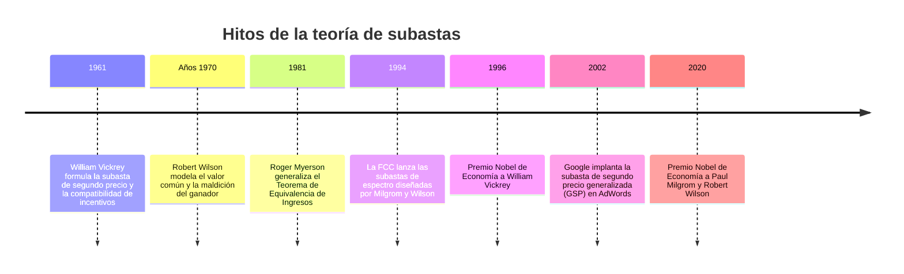

En los escasos 100 milisegundos que transcurren desde que un usuario pulsa buscar en Google hasta que se despliegan los enlaces patrocinados, miles de servidores ejecutan cientos de millones de **subastas algorítmicas en tiempo real (Real-Time Bidding, RTB)**. Los cientos de miles de millones de dólares que factura la economía digital descansan sobre los cimientos matemáticos de la teoría de subastas.

Del mismo modo, la asignación de licencias de espectro radioeléctrico (4G/5G) por parte de los Estados se efectúa mediante **subastas ascendentes simultáneas multirronda (SMRA)**, diseño por el cual Paul Milgrom y Robert Wilson recibieron el Premio Nobel de Economía en 2020.

---

## 1. Los cuatro formatos fundamentales

1. **Subasta inglesa (ascendente)**: Precio creciente hasta que queda un único postor.
2. **Subasta holandesa (descendente)**: El reloj reduce el precio hasta que alguien acepta.
3. **Primer precio en sobre cerrado (FPSB)**: El ganador paga su propia oferta.
4. **Segundo precio en sobre cerrado (SPSB / Vickrey)**: El ganador paga la **segunda oferta más alta**.

---

## 2. La revelación de la verdad en la subasta de Vickrey

William Vickrey demostró que pujar exactamente la valoración personal ($b_i = v_i$) es una **estrategia débilmente dominante**:
- Sobrepujar ($b_i > v_i$) solo altera el resultado cuando el rival puja por encima de $v_i$, acarreando pérdidas netas.
- Subpujar ($b_i < v_i$) no abarata el precio que se paga al ganar y arriesga perder contratos rentables.
Al desligar lo que se puja de lo que se paga, se alcanza la **compatibilidad de incentivos**.

---

## 3. Teorema de Equivalencia de Ingresos y Maldición del Ganador

El **Teorema de Equivalencia de Ingresos** (Myerson) demuestra que, bajo condiciones simétricas y postores neutrales al riesgo, los cuatro formatos reportan en promedio exactamente los mismos ingresos al vendedor.

Por otra parte, en subastas de valor común (pozos petrolíferos, frecuencias de telefonía), surge la **maldición del ganador**: quien vence es invariablemente quien cometió el error de sobrestimación más disparatado. Para evitar la bancarrota, los licitadores racionales descuentan fuertemente sus ofertas a la baja.

---

## 4. Subastas de espectro (SMRA) y publicidad web (GSP)

Milgrom y Wilson crearon el formato **SMRA** en 1994 para que las empresas pudieran pujar simultáneamente por paquetes complementarios de frecuencias, con información pública en cada ronda que mitigaba la maldición del ganador.

En Internet, Google aplica la **Subasta de Segundo Precio Generalizada (GSP)**:
$$
\text{Ad Rank}_i = \text{Puja } b_i \times \text{Nivel de calidad } q_i
$$
El coste por clic efectivo liquida únicamente el valor necesario para superar al competidor inmediato:
$$
\text{CPC}_i = \frac{\text{Ad Rank}_{i+1}}{q_i} + 0,01\ \$
$$
