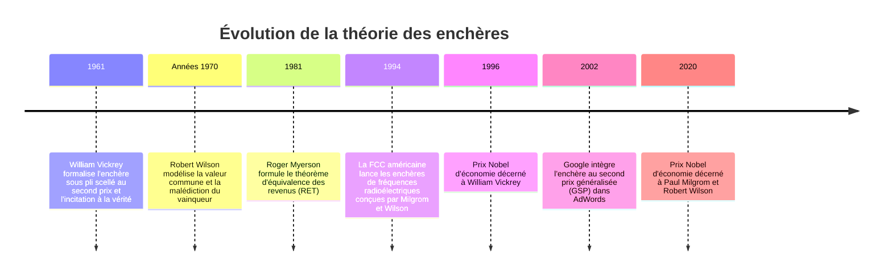
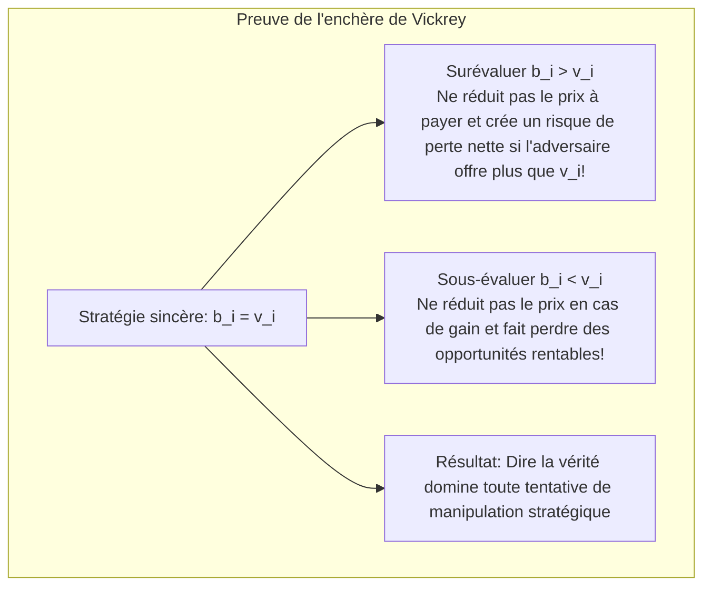

Dans les cent millisecondes qui séparent la saisie d'une requête sur Google de l'affichage des résultats, des milliers de serveurs exécutent des centaines de millions d'**enchères algorithmiques en temps réel (Real-Time Bidding, RTB)**. Les revenus colossaux de géants comme Alphabet ou Meta reposent entièrement sur les mathématiques de la théorie des jeux et la théorie des enchères.

De même, le déploiement mondial de la 4G et de la 5G a été rendu possible grâce aux **enchères ascendantes simultanées à tours multiples (SMRA)**, conçues pour allouer le spectre électromagnétique. Leurs créateurs, Paul Milgrom et Robert Wilson, ont reçu le prix Nobel d'économie en 2020.

L'analyse des enchères est la science de l'ingénierie des marchés : elle démontre comment des règles mathématiques rigoureuses peuvent canaliser la poursuite d'intérêts privés vers l'optimalité collective sous asymétrie d'information.

---

## 1. Les quatre formats canoniques d'enchères

1. **L'enchère anglaise (ascendante)** : Le prix monte jusqu'à ce qu'il ne reste qu'un seul enchérisseur.
2. **L'enchère hollandaise (descendante)** : L'horloge fait baisser le prix jusqu'à ce que le premier acheteur se manifeste.
3. **L'enchère sous pli scellé au premier prix (FPSB)** : Les offres sont secrètes ; le gagnant paie le montant exact de son offre.
4. **L'enchère sous pli scellé au second prix (SPSB / Vickrey)** : Le gagnant paie **le montant de la deuxième meilleure offre soumise**.

---

## 2. Le génie de William Vickrey : Révélation de la vérité

William Vickrey a démontré en 1961 que déclarer sa vraie valeur ($b_i = v_i$) est une **stratégie faiblement dominante** dans l'enchère au second prix.

Comme le prix payé est déconnecté de l'offre du vainqueur et dépend uniquement de celle du rival immédiat ($B_{-i}$), le participant est libéré de tout calcul spéculatif.

---

## 3. Le théorème d'équivalence des revenus (RET)

Formalisé par Roger Myerson, ce théorème fondamental stipule que sous des hypothèses standards (enchérisseurs neutres au risque, valeurs privées indépendantes), **les quatre mécanismes d'enchères génèrent exactement le même revenu espéré pour le vendeur**. Dans l'enchère au premier prix, les enchérisseurs réduisent rationnellement leur offre, et cette réduction compense exactement la règle du second prix.

---

## 4. La malédiction du vainqueur (Winner's Curse)

Dans les enchères à valeur commune (gisements de pétrole, licences de télécommunications), chaque entreprise estime la valeur $V$ avec une marge d'erreur. Si les participants misent naïvement selon leur estimation, **le vainqueur sera inévitablement celui qui a commis la surestimation la plus extravagante**, le condamnant à une exploitation déficitaire. Les enchérisseurs rationnels doivent anticiper ce biais et corriger agressivement leur offre à la baisse.

---

## 5. Les enchères spectrales (SMRA) et la publicité numérique (GSP)

En 1994, Milgrom et Wilson ont résolu le problème de la complémentarité des licences régionales en créant les **enchères SMRA**, permettant aux opérateurs d'agréger des licences simultanément avec retour d'information public.

Sur le web, Google utilise l'**enchère au second prix généralisée (GSP)** :
$$
\text{Ad Rank}_i = b_i \times q_i
$$
L'annonceur ne paie que le prix minimal par clic nécessaire pour devancer le concurrent du rang inférieur :
$$
\text{CPC}_i = \frac{\text{Ad Rank}_{i+1}}{q_i} + 0,01\ \$
$$

La théorie des enchères prouve qu'un marché efficient ne relève pas de la magie, mais d'une ingénierie algorithmique rigoureuse.
