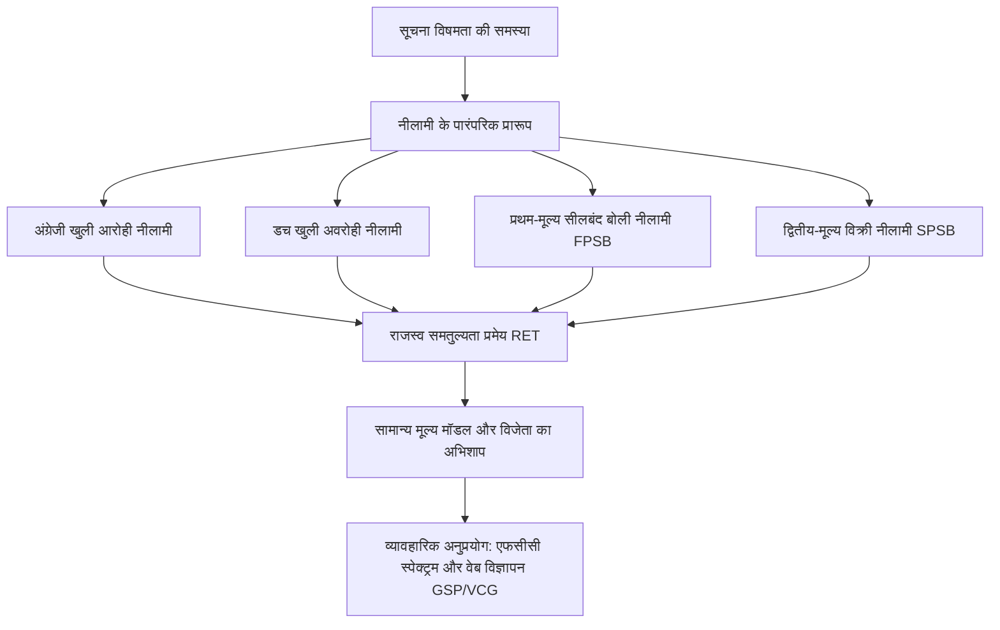

नीलामी सिद्धांत (Auction Theory) आधुनिक व्यावहारिक गेम थ्योरी, सूक्ष्म अर्थशास्त्र और गणितीय बाजार डिज़ाइन के सबसे प्रभावशाली संगमों में से एक है। प्राचीन बेबीलोन से लेकर 193 ईस्वी में प्रिटोरियन गार्ड द्वारा पूरे रोमन साम्राज्य की नीलामी तक, दुर्लभ संसाधनों के आवंटन और सूचना विषमता (Information Asymmetry) के तहत मूल्य खोज के लिए नीलामी सबसे शक्तिशाली माध्यम रही है। हालांकि, 1961 में विलियम विक्री (William Vickrey) के क्रांतिकारी शोधपत्रों ने नीलामी को एक कठोर गणितीय विज्ञान का रूप दिया, जिसने आगे चलकर नोबेल पुरस्कार विजेता मैकेनिज्म डिज़ाइन (Mechanism Design) की नींव रखी।



## 1. गेम थ्योरी के बुनियादी सिद्धांत और क्लासिक नीलामी प्रारूप

गणितीय विश्लेषण में, नीलामी को अपूर्ण सूचना वाले एक गैर-सहकारी खेल (Bayesian Game) के रूप में देखा जाता है। इसमें $n$ बोलीदाताओं का समूह $N = \{1, 2, \dots, n\}$ होता है। प्रत्येक बोलीदाता $i$ का एक निजी मूल्यांकन $v_i \in [0, \bar{v}]$ होता है, जो स्वतंत्र और समान रूप से संचयी वितरण फलन $F(v)$ तथा घनत्व फलन $f(v) = F'(v) > 0$ से निर्धारित होता है।

एकल वस्तु के लिए चार पारंपरिक नीलामी प्रारूप हैं:

1. **अंग्रेजी नीलामी (English Auction - खुली आरोही)**: नीलामीकर्ता लगातार कीमत बढ़ाता है। जब कीमत प्रतिभागियों के निजी मूल्यांकन से अधिक हो जाती है, तो वे हट जाते हैं। अंतिम शेष बोलीदाता उस कीमत पर वस्तु जीतता है जिस पर दूसरा अंतिम बोलीदाता हटा था।
2. **डच नीलामी (Dutch Auction - खुली अवरोही)**: कीमत बहुत ऊंचे स्तर से शुरू होकर धीरे-धीरे घटती है, जब तक कि पहला प्रतिभागी तुरंत उस कीमत को स्वीकार नहीं कर लेता।
3. **प्रथम-मूल्य सीलबंद बोली (First-Price Sealed-Bid, FPSB)**: प्रत्येक प्रतिभागी गुप्त रूप से बोली $b_i$ जमा करता है। उच्चतम बोलीदाता जीतता है और अपनी लगाई गई पूरी बोली का भुगतान करता है: $P = \max_j b_j$।
4. **द्वितीय-मूल्य सीलबंद बोली (Second-Price Sealed-Bid, SPSB / विक्री नीलामी)**: सभी प्रतिभागी सीलबंद बोली लगाते हैं। उच्चतम बोली लगाने वाला जीतता है, लेकिन वह केवल दूसरी सबसे बड़ी बोली के बराबर भुगतान करता है: $P = \max_{j \neq i^*} b_j$।

| नीलामी प्रारूप | मूल्य निर्धारण तंत्र | इष्टतम रणनीति | विश्लेषणात्मक जटिलता |
| :--- | :--- | :--- | :--- |
| **अंग्रेजी** | खुली आरोही | $p = v_i$ तक डटे रहना | अत्यंत सरल |
| **डच** | खुली अवरोही | मूल्यांकन से कम बोली लगाना ($b < v$) | उच्च |
| **प्रथम मूल्य** | सीलबंद लिफाफा | लाभ मार्जिन और जीत की संभावना में संतुलन | उच्च |
| **द्वितीय मूल्य (विक्री)** | सीलबंद लिफाफा | सत्यवादी प्रकटीकरण $b_i = v_i$ | कमजोर प्रभावी रणनीति |

## 2. विक्री नीलामी की बौद्धिक उत्कृष्टता और प्रभावी रणनीति

विलियम विक्री ने 1961 में सिद्ध किया कि स्वतंत्र निजी मूल्यों (IPV) के अंतर्गत, अपनी सच्ची आंतरिक वैल्यू के बराबर बोली लगाना ($b_i = v_i$) एक **कमजोर प्रभावी रणनीति** (Weakly Dominant Strategy) है।

इसका गणितीय प्रमाण अत्यंत सुरुचिपूर्ण है:
मान लीजिए प्रतिभागी $i$ का वास्तविक मूल्य $v_i$ है, और अन्य सभी $n-1$ प्रतिद्वंद्वियों की उच्चतम बोली $r_i = \max_{j \neq i} b_j$ है। बोलीदाता $i$ का शुद्ध लाभ (Payoff) इस प्रकार परिभाषित है:

$$\pi_i(b_i, r_i) = \begin{cases} v_i - r_i & \text{यदि } b_i > r_i \\ 0 & \text{यदि } b_i < r_i \end{cases}$$

रणनीतिक विचलन के प्रभाव:
1. **यदि प्रतिभागी अपने मूल्य से अधिक बोली लगाता है ($b_i > v_i$)**:
   - यदि $r_i < v_i$, तो वह जीतता है और $v_i - r_i > 0$ प्राप्त करता है (सच बोलने के समान)।
   - यदि $r_i > b_i$, तो वह हार जाता है और लाभ 0 रहता है।
   - यदि $v_i < r_i < b_i$, तो वह वस्तु जीत जाता है लेकिन उसे अपने मूल्य से अधिक $r_i$ चुकाना पड़ता है, जिससे सीधा आर्थिक नुकसान होता है: $\pi_i = v_i - r_i < 0$।
2. **यदि प्रतिभागी अपने मूल्य से कम बोली लगाता है ($b_i < v_i$)**:
   - यदि $r_i < b_i$, वह जीतता है और $v_i - r_i$ पाता है।
   - यदि $r_i > v_i$, वह हार जाता है।
   - यदि $b_i < r_i < v_i$, तो वह एक लाभदायक सौदे को खो देता है जिसमें उसे $v_i - r_i > 0$ का शुद्ध लाभ मिल सकता था।

अतः, किसी भी परिस्थिति में सच से भटकने पर कोई लाभ नहीं होता। विक्री नीलामी बोलीदाताओं को दूसरों की जासूसी करने या रणनीतिक चालें चलने की आवश्यकता से मुक्त करती है।

## 3. राजस्व समतुल्यता प्रमेय (Revenue Equivalence Theorem)

रोजर मायर्सन (1981) और विलियम विक्री द्वारा प्रतिपादित राजस्व समतुल्यता प्रमेय नीलामी सिद्धांत का सबसे महत्वपूर्ण स्तम्भ है:

> **प्रमेय**: यदि $n$ जोखिम-तटस्थ बोलीदाताओं के निजी मूल्यांकन स्वतंत्र और समान रूप से वितरित (i.i.d.) हों, तो ऐसा कोई भी नीलामी प्रारूप जिसमें:
> 1. वस्तु सदैव उच्चतम मूल्यांकन वाले बोलीदाता को आवंटित होती है;
> 2. न्यूनतम संभव मूल्यांकन $\underline{v}$ वाले बोलीदाता का अपेक्षित अधिशेष शून्य होता है;
> 
> विक्रेता के लिए समान अपेक्षित राजस्व उत्पन्न करेगा और प्रत्येक बोलीदाता को समान अपेक्षित अधिशेष प्रदान करेगा।

```mermaid
graph LR
    subgraph मानक परिस्थितियों में राजस्व समतुल्यता
        ENG[अंग्रेजी नीलामी]
        DUT[डच नीलामी]
        FP[प्रथम मूल्य नीलामी]
        SP[द्वितीय मूल्य / विक्री नीलामी]
    end
    ENG ---|समान अपेक्षित राजस्व| FP
    FP ---|समान अपेक्षित राजस्व| SP
    SP ---|समान अपेक्षित राजस्व| DUT
```

समान वितरण $F(v) = v / \bar{v}$ के तहत प्रथम-मूल्य नीलामी में बायेसियन नैश संतुलन बोली फलन है:

$$b(v) = \frac{n-1}{n} v$$

प्रथम-मूल्य नीलामी में उच्चतम बोली का गणितीय प्रत्याशा मान द्वितीय-मूल्य नीलामी में दूसरे सर्वोच्च मूल्यांकन की प्रत्याशा के बिल्कुल बराबर होता है।

## 4. विजेता का अभिशाप (Winner's Curse) और सामान्य मूल्य नीलामी

जब हम निजी मूल्यों से हटकर **सामान्य मूल्य मॉडल** (Common Value Model) की ओर बढ़ते हैं (जैसे तेल के कुओं या 5G स्पेक्ट्रम की नीलामी), तो वस्तु का वास्तविक मूल्य $V$ सभी के लिए समान होता है लेकिन अज्ञात होता है। प्रत्येक बोलीदाता को केवल एक अनिश्चित अनुमान संकेत $X_i = V + \epsilon_i$ मिलता है।

यदि प्रतिभागी सीधे अपने व्यक्तिगत अनुमान $\mathbb{E}[V \mid X_i]$ पर बोली लगाते हैं, तो विजेता अनिवार्य रूप से वह होगा जिसका संकेत सबसे अधिक अतिशयोक्तिपूर्ण था:

$$\max_j X_j = V + \max_j \epsilon_j > V$$

इसे **विजेता का अभिशाप** (Winner's Curse) कहा जाता है। जीतने के बाद कंपनी को एहसास होता है कि उसने बाजार के औसत से बहुत अधिक कीमत चुका दी है, जिससे भारी घाटा होता है। तर्कसंगत बोलीदाताओं को अपनी बोली में यह पूर्व-समायोजन करना होता है कि वे केवल तभी जीतेंगे जब उनका संकेत सबसे ऊंचा होगा:

$$b_i(x_i) = \mathbb{E}\left[V \;\middle|\; X_i = x_i, \; \max_{j \neq i} X_j = x_i\right]$$

पॉल मिलग्रोम और रॉबर्ट विल्सन ने दिखाया कि अंग्रेजी खुली नीलामी में प्रतिद्वंद्वियों के हटने की जानकारी मिलने से अनिश्चितता घटती है, जिससे विजेता के अभिशाप का प्रभाव कम होता है और विक्रेता को अधिक राजस्व मिलता है।

## 5. व्यावहारिक क्रांति: अमेरिकी एफसीसी स्पेक्ट्रम नीलामी

1994 में, अमेरिकी संघीय संचार आयोग (FCC) ने गेम थ्योरी विशेषज्ञों (पॉल मिलग्रोम, रॉबर्ट विल्सन, प्रेस्टन मैकेफी) की मदद से **एकसाथ बहु-दौर आरोही नीलामी** (Simultaneous Multiple-Round Auction, SMRA) का आविष्कार किया।

दूरसंचार लाइसेंसों में भौगोलिक पूरकता (Complementarity) होती है: एक ऑपरेटर को न्यूयॉर्क, फिलाडेल्फिया और बोस्टन के लाइसेंस एक साथ चाहिए होते हैं। पारंपरिक अनुक्रमिक नीलामियों में एक्सपोज़र समस्या (Exposure Problem) उत्पन्न होती थी, जहाँ ऑपरेटर एक शहर में अत्यधिक बोली लगा देता था लेकिन पड़ोसी शहर का लाइसेंस हार जाता था।

SMRA के प्रमुख घटक:
1. सभी लाइसेंसों की नीलामी एक साथ कई राउंड्स में चलती है।
2. सख्त गतिविधि नियम (Activity Rules) जो बोलीदाताओं को अंत तक छिपे रहने से रोकते हैं।
3. संपूर्ण नेटवर्क पैकेज बनाने की रणनीतिक लचीलापन।

इस प्रणाली ने वैश्विक सरकारों को खरबों डॉलर का राजस्व दिया और मिलग्रोम तथा विल्सन को 2020 का अर्थशास्त्र का नोबेल पुरस्कार दिलाया।

## 6. डिजिटल विज्ञापन और जीएसपी एल्गोरिदम

आधुनिक युग में नीलामी सिद्धांत का सबसे विशाल वास्तविक अनुप्रयोग इंटरनेट सर्च विज्ञापनों (Google Ads) में होता है। हर सेकंड लाखों नीलामियां **सामान्यीकृत द्वितीय मूल्य** (Generalized Second Price, GSP) एल्गोरिदम के माध्यम से संचालित होती हैं।

घटती क्लिक दर (CTR) $\alpha_1 > \alpha_2 > \dots$ वाले कई विज्ञापन स्लॉट्स के लिए:
- विज्ञापनदाताओं को रैंकिंग स्कोर $S_i = \text{Bid}_i \times \text{CTR}_i$ द्वारा क्रमबद्ध किया जाता है।
- स्थान $k$ पर आने वाला विज्ञापनदाता अपने ठीक नीचे वाले स्थान $k+1$ के स्कोर को पार करने के लिए न्यूनतम आवश्यक राशि चुकाता है:

$$P_k = \frac{\text{Bid}_{k+1} \times \text{CTR}_{k+1}}{\text{CTR}_k} + 0.01$$

यद्यपि जीएसपी में वीसीजी की तरह शुद्ध प्रभावी रणनीति नहीं होती, लेकिन यह स्थानीय रूप से ईर्ष्या-मुक्त संतुलन (Locally Envy-Free Equilibrium) प्रदान करता है, जो आधुनिक डिजिटल अर्थव्यवस्था की रीढ़ बन चुका है।
