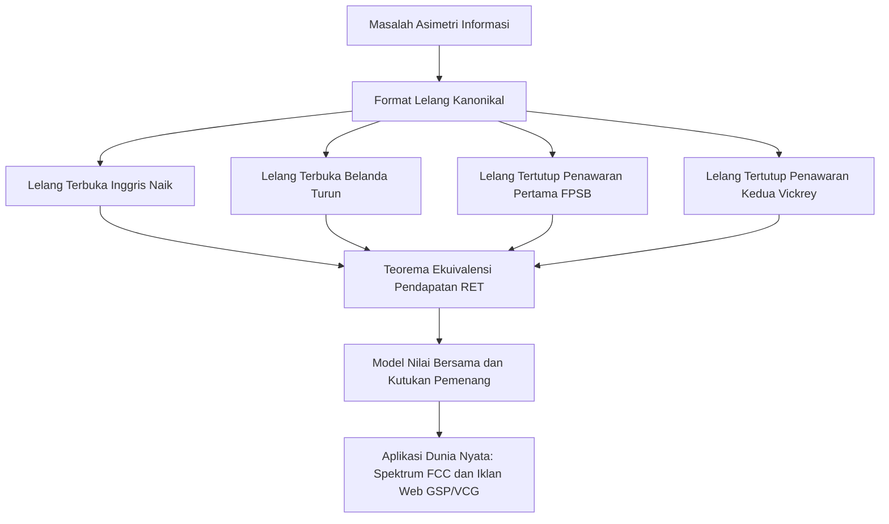

Teori lelang merupakan salah satu pencapaian intelektual paling elegan yang menjembatani matematika teori permainan terapan dan mikroekonomi modern. Sejak zaman kuno di Babilonia hingga pelelangan kekaisaran Romawi oleh Pengawal Praetorian pada 193 M, lelang telah menjadi mekanisme alokasi sumber daya langka yang paling efisien di bawah asimetri informasi. Transformasi lelang menjadi disiplin sains yang presisi bermula dari karya monumental William Vickrey pada tahun 1961, yang kemudian dikembangkan menjadi teori desain mekanisme (Mechanism Design) oleh peraih Nobel Leonid Hurwicz, Eric Maskin, dan Roger Myerson.



## 1. Fondasi Teori Permainan dan Klasifikasi Lelang

Dalam konteks formal, lelang adalah permainan non-kooperatif dengan informasi tidak lengkap (Bayesian Game). Terdapat $n$ penawar dalam himpunan $N = \{1, 2, \dots, n\}$. Setiap penawar $i$ memiliki penilaian pribadi $v_i \in [0, \bar{v}]$, yang merupakan variabel acak berdistribusi identik dan independen (i.i.d.) dengan fungsi distribusi kumulatif $F(v)$ dan fungsi kepadatan probabilitas $f(v) = F'(v) > 0$.

Terdapat empat format lelang standar untuk alokasi satu barang indivisibel:

1. **Lelang Inggris (English Auction)**: Harga dinaikkan bertahap oleh juru lelang. Peserta mundur ketika harga melampaui nilai pribadi mereka. Pemenangnya adalah penawar terakhir dengan harga setara tawaran tertinggi kedua.
2. **Lelang Belanda (Dutch Auction)**: Harga diturunkan bertahap dari angka yang sangat tinggi hingga peserta pertama berseru menerima harga saat itu.
3. **Lelang Tertutup Harga Pertama (First-Price Sealed-Bid, FPSB)**: Setiap peserta memasukkan penawaran rahasia $b_i$. Penawar tertinggi menang dan membayar tepat sebesar $b_i$.
4. **Lelang Tertutup Harga Kedua (Second-Price Sealed-Bid, SPSB / Vickrey)**: Setiap peserta memasukkan penawaran rahasia. Penawar tertinggi menang, namun hanya membayar harga dari tawaran tertinggi kedua ($P = \max_{j \neq i^*} b_j$).

| Tipe Lelang | Mekanisme Penentuan Harga | Strategi Keseimbangan | Kompleksitas Informasi |
| :--- | :--- | :--- | :--- |
| **Inggris** | Terbuka Naik | Bertahan hingga $p = v_i$ | Rendah |
| **Belanda** | Terbuka Turun | Shading penawaran $b(v) < v$ | Tinggi |
| **Harga Pertama** | Tertutup Amplop | Optimasi trade-off probabilitas dan margin | Tinggi |
| **Harga Kedua (Vickrey)** | Tertutup Amplop | Mengungkapkan nilai sejati $b_i = v_i$ | Strategi Dominan Lemah |

## 2. Kejeniusan Lelang Vickrey dan Strategi Dominan

William Vickrey membuktikan bahwa dalam lelang harga kedua dengan nilai pribadi independen, menawar tepat sebesar nilai intrinsik sejati ($b_i = v_i$) adalah **strategi dominan lemah** (Weakly Dominant Strategy Equilibrium).

Bukti matematisnya sangat intuitif:
Misalkan nilai sejati peserta $i$ adalah $v_i$. Misalkan $r_i = \max_{j \neq i} b_j$ adalah penawaran tertinggi dari semua lawan. Keuntungan bersih (payoff) penawar $i$ adalah:

$$\pi_i(b_i, r_i) = \begin{cases} v_i - r_i & \text{jika } b_i > r_i \\ 0 & \text{jika } b_i < r_i \end{cases}$$

Analisis terhadap penyimpangan strategi:
- **Jika menawar lebih tinggi dari nilai sebenarnya ($b_i > v_i$)**:
  - Jika $r_i < v_i$, hasil tidak berubah: menang dan untung $v_i - r_i$.
  - Jika $r_i > b_i$, tetap kalah dengan keuntungan 0.
  - Jika $v_i < r_i < b_i$, penawar menang tetapi harus membayar $r_i > v_i$, menghasilkan kerugian riil $\pi_i = v_i - r_i < 0$.
- **Jika menawar lebih rendah dari nilai sebenarnya ($b_i < v_i$)**:
  - Jika $r_i < b_i$, menang dan untung $v_i - r_i$.
  - Jika $r_i > v_i$, kalah dengan keuntungan 0.
  - Jika $b_i < r_i < v_i$, penawar kehilangan kesempatan menang yang menguntungkan di mana ia seharusnya memperoleh keuntungan positif $v_i - r_i > 0$.

Karena itu, berbohong tidak pernah memberikan keuntungan superior dalam kondisi apa pun, menjadikan lelang Vickrey instrumen paling jujur dalam alokasi sumber daya.

## 3. Teorema Ekuivalensi Pendapatan (Revenue Equivalence Theorem)

Pilar utama dalam teori lelang adalah Teorema Ekuivalensi Pendapatan (RET), yang dirumuskan secara komprehensif oleh Roger Myerson (1981):

> **Teorema**: Jika $n$ penawar netral risiko memiliki nilai pribadi yang berdistribusi independen dan identik (i.i.d.) pada interval $[\underline{v}, \bar{v}]$, maka mekanisme lelang apa pun di mana:
> 1. Barang selalu dialokasikan kepada penawar dengan penilaian tertinggi;
> 2. Penawar dengan penilaian terendah $\underline{v}$ memperoleh surplus ekspektasi nol;
> 
> akan menghasilkan ekspektasi penerimaan total yang identik bagi penjual, dan menyisakan ekspektasi surplus yang sama bagi setiap pembeli.

```mermaid
graph LR
    subgraph Ekuivalensi Pendapatan Penjual (RET)
        ENG[Lelang Inggris]
        DUT[Lelang Belanda]
        FP[Harga Pertama FPSB]
        SP[Harga Kedua Vickrey]
    end
    ENG ---|Ekspektasi Pendapatan Sama| FP
    FP ---|Ekspektasi Pendapatan Sama| SP
    SP ---|Ekspektasi Pendapatan Sama| DUT
```

Pada lelang harga pertama dengan distribusi seragam $F(v) = v / \bar{v}$, fungsi strategi penawaran keseimbangan Bayesian Nash adalah:

$$b(v) = \frac{n-1}{n} v$$

Ekspektasi tawaran tertinggi pada lelang harga pertama tepat sama dengan ekspektasi statistik urutan kedua dari nilai sejati pada lelang harga kedua, membuktikan kesetaraan pendapatan secara analitis.

## 4. Kutukan Pemenang (Winner's Curse) dalam Nilai Bersama

Dalam lelang dunia nyata seperti eksplorasi blok migas atau lelang frekuensi radio, nilai barang bersifat **Nilai Bersama** (Common Value). Nilai sejati $V$ sama bagi semua orang, namun tidak diketahui secara pasti. Masing-masing peserta hanya memperoleh sinyal estimasi acak $X_i = V + \epsilon_i$, dengan $\mathbb{E}[\epsilon_i] = 0$.

Jika peserta menawar sesuai estimasi naif mereka $\mathbb{E}[V \mid X_i]$, pemenangnya adalah pihak yang memperoleh sinyal estimasi paling tinggi:

$$\max_j X_j = V + \max_j \epsilon_j > V$$

Hal ini menimbulkan **Kutukan Pemenang** (Winner's Curse): memenangkan lelang menjadi pertanda bahwa estimasi penawar tersebut terlalu optimis dibanding perkiraan rata-rata pasar, yang berujung pada kerugian finansial telak. Penawar rasional harus mengoreksi tawaran ke bawah dengan memperhitungkan kondisi bahwa ia menang hanya jika sinyalnya adalah yang tertinggi:

$$b_i(x_i) = \mathbb{E}\left[V \;\middle|\; X_i = x_i, \; \max_{j \neq i} X_j = x_i\right]$$

Penelitian Paul Milgrom dan Robert Wilson membuktikan bahwa lelang terbuka Inggris menghasilkan pendapatan lebih tinggi daripada lelang tertutup karena proses terbuka secara bertahap menyingkap informasi pasar dan mengurangi kecemasan akan kutukan pemenang.

## 5. Implementasi Spektakuler: Lelang Spektrum Frekuensi FCC

Tahun 1994 menandai era baru kebijakan publik ketika Komisi Komunikasi Federal AS (FCC) merancang **Lelang Naik Simultan Banyak Putaran** (Simultaneous Multiple-Round Auction, SMRA) yang digagas Paul Milgrom, Robert Wilson, dan Preston McAfee.

Tantangan utama alokasi gelombang elektromagnetik adalah masalah sinergi geografis (komplementaritas). Perusahaan telekomunikasi memerlukan lisensi bersambung antar wilayah (misalnya New York, New Jersey, dan Boston). Lelang sekuensial tradisional berisiko menimbulkan masalah paparan (Exposure Problem), di mana perusahaan membeli satu kota dengan harga tinggi tetapi gagal memenangkan kota tetangganya.

Desain SMRA memperkenalkan:
1. Lelang terbuka bersamaan untuk semua lisensi regional.
2. Aturan aktivitas ketat (Milgrom-Wilson Activity Rules) untuk mencegah perilaku wait-and-see (sniping).
3. Transparansi putaran yang memungkinkan operator menyesuaikan strategi agregasi spektrum secara fleksibel.

Model ini menghasilkan ratusan miliar dolar bagi perbendaharaan negara di seluruh dunia dan mengantarkan Milgrom dan Wilson meraih Hadiah Nobel Ekonomi pada tahun 2020.

## 6. Algoritma Iklan Mesin Pencari: Mekanisme GSP

Aplikasi kuantitatif terbesar teori lelang saat ini terjadi dalam lelang iklan tautan bersponsor di Google Ads dan platform pencarian modern. Jutaan lelang berlangsung setiap detik menggunakan mekanisme **Generalized Second Price (GSP)**.

Dalam lelang penempatan iklan berperingkat $k \in \{1, 2, \dots, K\}$ dengan rasio klik-tayang (CTR) menurun $\alpha_1 > \alpha_2 > \dots$:
- Pengiklan diurutkan berdasarkan skor gabungan $S_i = \text{Bid}_i \times \text{CTR}_i$.
- Pengiklan pada posisi $k$ membayar tarif minimum untuk mengalahkan skor posisi di bawahnya:

$$P_k = \frac{\text{Bid}_{k+1} \times \text{CTR}_{k+1}}{\text{CTR}_k} + 0.01$$

Meskipun GSP tidak memiliki strategi dominan murni seperti mekanisme VCG lengkap, model keseimbangan stabil bebas rasa iri (Locally Envy-Free Equilibrium) menjamin efisiensi alokasi iklan dan menghasilkan pendapatan puluhan miliar dolar per kuartal bagi industri teknologi global.
