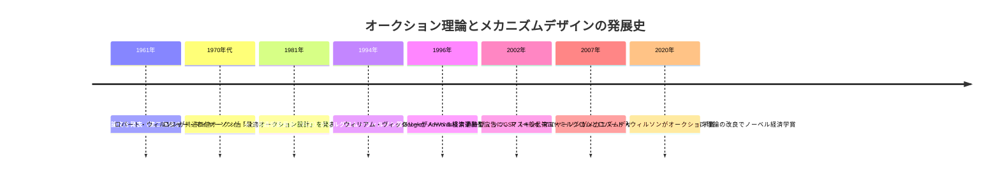
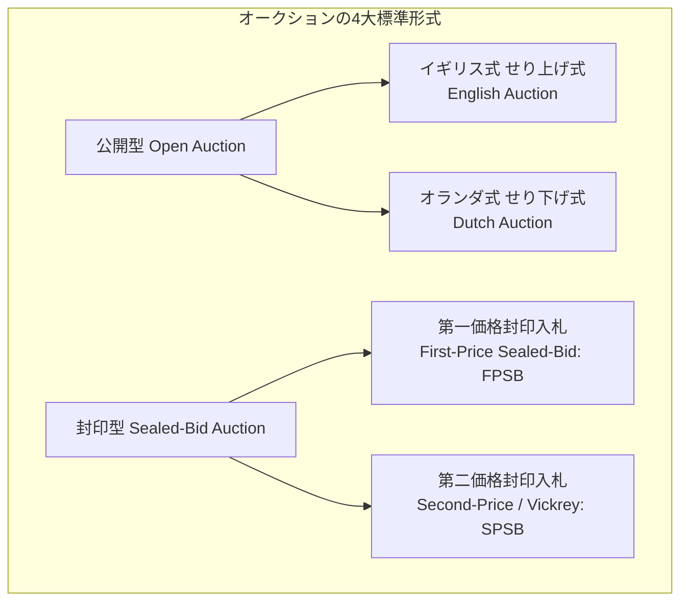
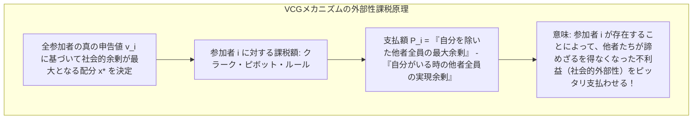
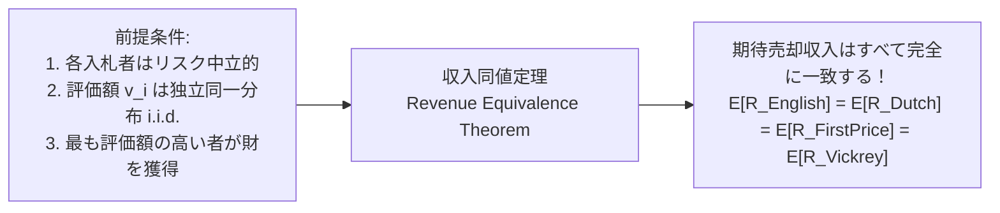
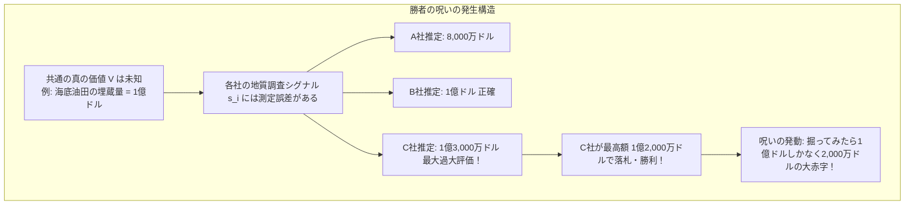
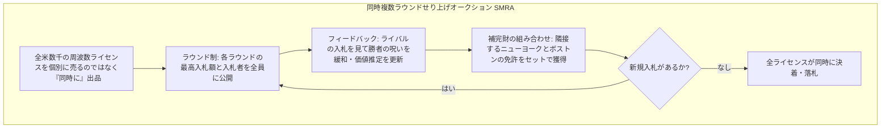
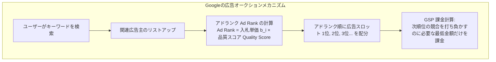
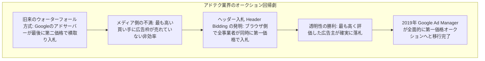

私たちがGoogleで検索窓にキーワードを打ち込み、検索結果が表示されるまでのわずか0.1秒（100ミリ秒）の間に、水面下では数千台のサーバーが協調し、数億回におよぶ**「リアルタイム・オークション」**が瞬時に執行されています。GoogleやMetaの年間数千億ドルに達する収益のほぼすべては、ゲーム理論とオークション理論の数理アルゴリズムによって生み出されています。

また、現代の5Gや4Gスマートフォンが快適に通信できるのも、国家が保有する公共財である電波周波数帯を、最も効率的な通信事業者に配分するために設計された**「同時複数ラウンド周波数オークション（SMRA）」**の賜物です。この理論的功績により、ポール・ミルグロムとロバート・ウィルソンは2020年にノーベル経済学賞を受賞しました。

なぜオークションは、単なる「物の売り買いの手法」を超えて、現代のハイテク経済と公共政策を支える最強のインフラとなったのでしょうか。本稿では、情報の非対称性と戦略的駆け引きを乗り越え、人間の利己的なインセンティブを社会的最適配分へと導く**オークション理論（Auction Theory）とメカニズムデザイン（Mechanism Design）**の全貌を、数学的・歴史的・実務的視点から徹底的に解剖します。



---

## 1. オークションの4大基本形式と情報構造モデル

オークションとは、**「価格があらかじめ固定されていない財に対して、買い手（入札者）たちの戦略的な提示額（入札）に基づいて価格と配分を決定する市場メカニズム」**です。



### 1.1 4大基本形式のルールとメカニズム
1. **イギリス式オークション（English Auction / 公開せり上げ式）**:
   - オークショニアが低い価格から呼び上げを始め、入札者が順次高値を提示していく最も一般的な形式。他の入札者が全員脱落した時点で、最後に最も高い価格をつけた入札者がその価格で財を獲得します。
2. **オランダ式オークション（Dutch Auction / 公開せり下げ式）**:
   - アムステルダムの花市場などで用いられる形式。非常に高い価格からスタートし、価格表示クロックが連続的に値下がりしていきます。最初に「買った！」と声を上げた（ボタンを押した）入札者が、その瞬間の価格で即座に財を獲得します。
3. **第一価格封印入札（First-Price Sealed-Bid: FPSB）**:
   - 各入札者が互いに見えないよう入札額を書面（封筒）に密封して提出。オークショニアが一斉に開票し、**「最も高い金額を入札した者」が勝者となり、「自分が書いた入札額そのもの」を支払う**形式（公共事業の一般競争入札など）。
4. **第二価格封印入札（Second-Price Sealed-Bid: SPSB / ヴィックリー・オークション）**:
   - 封印入札を行う点はFPSBと同じですが、**「最も高い金額を入札した者が勝者となるが、支払う金額は【2番目に高かった入札額】でよい」**という画期的なルール。

### 1.2 戦略的同値性（Strategic Equivalence）
ゲーム理論の観点から見ると、これら4つの形式の間には興味深い「戦略的同値性」が存在します：
- **オランダ式 $\equiv$ 第一価格封印入札（FPSB）**: オランダ式では、クロックが下がるのを見守りながら「どのタイミングで止めるか」を決めるゲームです。他のプレイヤーの行動を見る前に単一の停止価格を選ぶ必要があるため、情報構造として第一価格封印入札と完全に数学的同値になります。
- **イギリス式 $\approx$ 第二価格封印入札（SPSB）**: 私的価値モデルにおいて、イギリス式では「他者がすべて降りた瞬間の価格（＝2番目の入札者が脱落した直後の価格）」で財を獲得するため、第二価格封印入札と極めて近い均衡結果をもたらします。

### 1.3 情報構造：私的価値 vs 共通価値
オークション理論では、入札者が財に対して抱く価値評価の構造を大きく2つに分類します：
- **私的価値モデル（Independent Private Values: IPV）**:
  - 各入札者 $i$ の評価額 $v_i$ は自分だけの主観的な好み（美術品の鑑賞価値、個人の消費効用など）であり、他者の評価額を知っても自分の価値評価は変化しないモデル。
- **共通価値モデル（Common Value Model）**:
  - 海底油田の埋蔵量や電波周波数の電波利用権のように、財の客観的価値 $V$ は全入札者にとって共通であるが、各入札者は不完全な予測シグナル $s_i$ しか持っていないモデル。他者の情報（シグナル）を知ると、自分の価値評価自体が事後的に更新される特徴を持ちます。

---

## 2. ウィリアム・ヴィックリーの天才：第二価格オークションと真実告知

1961年、コロンビア大学の**ウィリアム・ヴィックリー（William Vickrey）**は、経済学の歴史を塗り替える論文を発表しました。それが第二価格封印入札（ヴィックリー・オークション）の提唱です。

```mermaid
flowchart TD
    subgraph ヴィックリー・オークションのインセンティブ両立性
        Truth[戦略: 自分の真の評価額を入札 b_i = v_i]
        Truth --> Case1[真の評価より高く入札した場合 b_i > v_i<br/>勝率が上がるが、他者の入札が v_i を超えると純損失利得がマイナスになる]
        Truth --> Case2[真の評価より低く入札した場合 b_i < v_i<br/>支払額は下がらないのに、勝てたはずの勝負を取りこぼす]
        Truth --> Dominant[結論: b_i = v_i は他のいかなる戦略に対しても弱支配戦略である]
    end
```

### 2.1 弱支配戦略としての「真実告知（$b_i = v_i$）」の厳密な数学的証明
プレイヤー $i$ の真の評価額を $v_i$、入札額を $b_i$ とします。
他のすべてのプレイヤーの入札額のうち、最大値を $B_{-i} = \max_{j \neq i} b_j$ と定義します。

第二価格オークションのルールにより、プレイヤー $i$ の利得（ペイオフ） $\pi_i$ は次のように決まります：
$$
\pi_i = \begin{cases}
v_i - B_{-i} & \text{if } b_i > B_{-i} \quad (\text{勝者となり、2番目最高額を支払う}) \\
0 & \text{if } b_i < B_{-i} \quad (\text{敗者となり、支払いも獲得もゼロ})
\end{cases}
$$
（※同点タイの場合は等確率で勝者を決定しますが、利得の本質には影響しません）

ここで、**「真実の評価額通りに入札する戦略（$b_i = v_i$）」が、他のいかなる入札戦略に対しても弱支配的（Weakly Dominant）であること**を証明します。

#### ケース1：真実より過大に入札した場合（$b_i' > v_i$）
- もし $B_{-i} < v_i$ ならば：
  - 真実入札（$b_i = v_i$）でも過大入札（$b_i'$）でも勝利し、支払額は $B_{-i}$ なので、利得はともに $v_i - B_{-i} > 0$ で不変。
- もし $B_{-i} \ge b_i'$ ならば：
  - どちらの戦略でも敗北し、利得はともに $0$。
- もし $v_i < B_{-i} < b_i'$ ならば：
  - 真実入札（$b_i = v_i$）なら負けて利得は $0$。
  - しかし過大入札（$b_i'$）をすると勝ってしまい、支払額は $B_{-i}$ となるため、利得は $\pi_i = v_i - B_{-i} < 0$ となり、**純損失（赤字）が発生する**！
$\therefore$ 真実より高く入札しても得することは一切なく、損をするリスクだけが増加する。

#### ケース2：真実より過小に入札した場合（$b_i'' < v_i$）
- もし $B_{-i} < b_i''$ ならば：
  - どちらの戦略でも勝利し、支払額は $B_{-i}$ なので、利得はともに $v_i - B_{-i} > 0$ で不変。
- もし $B_{-i} \ge v_i$ ならば：
  - どちらの戦略でも敗北し、利得はともに $0$。
- もし $b_i'' < B_{-i} < v_i$ ならば：
  - 真実入札（$b_i = v_i$）なら勝てて利得 $v_i - B_{-i} > 0$ を得られたはずなのに、過小入札（$b_i''$）したせいで負けてしまい、利得が $0$ に転落する（**機会損失**）。
$\therefore$ 真実より低く入札しても支払額は1円も安くならず、勝てたはずの利益を失うリスクだけが生じる。

#### 結論
いかなる $B_{-i}$ の値に対しても、$b_i = v_i$ は $b_i'$ や $b_i''$ と同等以上の利得をもたらし、特定の局面では厳密に大きな利得をもたらします。したがって、**「真実の評価額をそのまま入札すること（Truth-telling）」が、他者の行動や戦略に一切依存しない、絶対的な「弱支配戦略（Incentive Compatible）」**となるのです。

### 2.2 メカニズムデザインにおける革命性
第一価格オークション（FPSB）では、入札者は「自分の評価額そのままを入札すると、勝っても利得が $v_i - v_i = 0$ になってしまう」ため、必ず真の評価額からいくらか値を引いて入札（シェーディング / Bid shading）しなければなりません。このとき、「他者がいくらで入札してくるか」を必死に推測しあう心理戦（情報戦）が発生し、計算コストが膨大になります。

ヴィックリー・オークションは、**「支払額を自分の入札額から切り離し、他者の入札額によって決定する」**という天才的なルール変更によって、入札者から他者の読み合いという認知負荷を完全に消し去り、**「ただ自分の本音（真の評価額）を打ち明けることこそが最強の戦略である」**という状況を制度的に作り出したのです。

---


### 2.3 多財への拡張：VCG（ヴィックリー・クラーク・グローブス）メカニズム
単一の財に対するヴィックリーの第二価格オークションは、エドワード・クラーク（1971年）とセオドア・グローブス（1973年）によって、複数の財や公共財の供給問題へと一般化されました。これがメカニズムデザイン論の頂点に君臨する**「VCGメカニズム（VCG Mechanism）」**です。



#### クラーク・ピボット・ルールの数式定義
参加者全体の集合を $N$、可能なすべての配分案の集合を $X$ とします。
各参加者 $i$ の評価関数を $v_i(x)$ とすると、VCGメカニズムは社会的総余剰を最大化する配分 $x^* = \arg\max_{x \in X} \sum_{j \in N} v_j(x)$ を選択します。

このとき、参加者 $i$ が支払う金額 $P_i$ は、次のように定められます：
$$
P_i = \max_{x \in X} \sum_{j \neq i} v_j(x) - \sum_{j \neq i} v_j(x^*)
$$
この支払額の第1項は「もし自分 $i$ がこの世に存在しなかった場合に、他者全員が得られたはずの最大余剰」であり、第2項は「自分 $i$ が参加した結果、他者全員が現実に得た余剰の合計」です。
すなわち、**「自分の参加によって他者が被った余剰の減少分（社会的外部性）」をそのまま自己負担させる**構造になっています。

これにより、参加者 $i$ の最終利得は：
$$
\pi_i = v_i(x^*) - P_i = \left( v_i(x^*) + \sum_{j \neq i} v_j(x^*) \right) - \max_{x \in X} \sum_{j \neq i} v_j(x)
$$
となり、カッコ内はまさに「社会全体の総余剰」となります。つまり、**「自分の個人的利得の最大化」が「社会全体の総余剰の最大化」と完全に数学的に一致する**ため、虚偽の申告をする動機が完全にゼロになります。

#### なぜVCGは実社会でそのまま使われないのか？
VCGメカニズムは理論上完璧であるにもかかわらず、現実の実務では敬遠されることが多々あります：
1. **談合・共謀（Collusion）に対する極端な脆弱性**: 2人の入札者が結託して嘘の入札を行うと、支払額をゼロにして財を山分けできてしまう。
2. **売り手の赤字リスク**: 状況によっては、売り手の収入がゼロになったり、逆にオークショニアが赤字を垂れ流す場合がある。
3. **計算量の爆発（NP困難問題）**: 何千もの財と組み合わせが存在する場合、最適解 $x^*$ を見つける計算コストが指数関数的に爆発する。


---

## 3. 収入同値定理（Revenue Equivalence Theorem）

オークションの売り手（出品者）の立場からすれば、重大な疑問が湧きます：
「第二価格オークションでは2番目の安値しか受け取れないのだから、一番高い入札額をそのまま没収できる第一価格オークションのほうが、売り手の儲け（期待収入）は大きいのではないか？」

この疑問に答えたのが、ヴィックリー、ライリー、サミュエルソン、そしてノーベル賞受賞者ロジャー・マイヤーソンらによって確立された**「収入同値定理（Revenue Equivalence Theorem: RET）」**です。



### 3.1 定理の数理的主張
以下の条件が満たされるとき：
1. 入札者は全員リスク中立的（Risk-neutral）である。
2. 入札者たちの評価額 $v_i$ は、区間 $[\underline{v}, \bar{v}]$ 上で独立同一な連続確率分布（i.i.d.）に従って生成される。
3. オークションメカニズムにおいて、最も高い評価額を持つ入札者が常に財を獲得する。
4. 最低評価額 $\underline{v}$ を持つ入札者の期待利得がゼロである。

このとき、**イギリス式、オランダ式、第一価格封印入札、第二価格封印入札の4大オークション形式において、売り手が得られる「期待収入（Expected Revenue）」は、数学的に完全に一致する**。

### 3.2 直感的なメカニズム
なぜ第一価格と第二価格の収入が等しくなるのか：
- **第二価格オークション**: 入札者は真実を語り $b_i = v_i$ と高く入札しますが、売り手が手にするのは「第2位の入札額」です。
- **第一価格オークション**: 売り手は「第1位の入札額」を手にしますが、入札者たちは全員、利得を最大化するために慎重に値を引き下げて入札（シェーディング）します。
対称ナッシュ均衡において、各入札者が第一価格オークションで切り下げる入札額 $b(v)$ は、数学的に**「自分以外の入札者の中で最も高い評価額の期待値（＝まさに第2位の評価額）」**と完全に一致するように最適化されます。
したがって、売り手の視点から見れば、どちらのオークションを採用しても、平均して手元に残る金額は全く同じになるのです。

---


### 3.3 第一価格オークションの対称ナッシュ均衡の厳密な数学的導出
第一価格オークションにおいて、入札者たちがどの程度値を切り下げて入札するのかを微分方程式を用いて厳密に導出してみましょう。

#### モデル設定
- 入札者の人数は $n$ 人。
- 各自の評価額 $v_i$ は、区間 $[0, 1]$ 上の独立同一な一様分布 $U[0, 1]$ に従う。
- 各入札者は共通の対称で狭義単調増加な微分可能入札戦略 $b(v)$ を用いると仮定する。

プレイヤー1の真の評価額が $v$ であるとき、あたかも自分の評価額が $r$ であるかのように装って $b(r)$ と入札したとします。
プレイヤー1が勝利する条件は、他の $n-1$ 人のライバルの評価額 $v_2, \dots, v_n$ がすべて $r$ 未満であることです（戦略 $b$ が単調増加であるため）。

他の1人の評価額が一様分布から引かれて $r$ 未満である確率は $P(v_j < r) = r$ です。
したがって、他の $n-1$ 人全員が $r$ 未満である確率（勝率）は $r^{n-1}$ となります。

プレイヤー1の期待利得 $E[\pi(r; v)]$ は次のようになります：
$$
E[\pi(r; v)] = (v - b(r)) \cdot r^{n-1}
$$

対称ナッシュ均衡では、真の評価額通りに $r = v$ と申告することが期待利得を最大化しなければなりません（一階の最適条件）：
$$
\left. \frac{\partial E[\pi(r; v)]}{\partial r} \right|_{r = v} = 0
$$

微分を実行します：
$$
\frac{d}{dr} \left[ v r^{n-1} - b(r) r^{n-1} \right]_{r=v} = (n-1) v \cdot v^{n-2} - b'(v) v^{n-1} - b(v) (n-1) v^{n-2} = 0
$$
全体を $v^{n-2}$ で割ります：
$$
(n-1) v - b'(v) v - (n-1) b(v) = 0
$$
整理すると、以下の線形一階常微分方程式が得られます：
$$
v b'(v) + (n-1) b(v) = (n-1) v
$$

両辺に積分因子 $v^{n-2}$ を掛けると、左辺は積の微分になります：
$$
\frac{d}{dv} \left[ v^{n-1} b(v) \right] = (n-1) v^{n-1}
$$
両辺を $0$ から $v$ まで積分します（初期条件 $b(0) = 0$）：
$$
v^{n-1} b(v) = \int_{0}^{v} (n-1) t^{n-1} dt = (n-1) \left[ \frac{t^n}{n} \right]_{0}^{v} = \frac{n-1}{n} v^n
$$
両辺を $v^{n-1}$ で割ると、極めて美しい対称ナッシュ均衡入札戦略が得られます：
$$
b(v) = \frac{n-1}{n} v
$$

#### 経済学的解釈
- もし入札者が2人（$n=2$）なら、$b(v) = \frac{1}{2} v$ となり、各自は自分の評価額の**半額**で入札します。
- 人数が増える（$n \to \infty$）につれて、$\frac{n-1}{n} \to 1$ となり、入札額は真の評価額 $v$ に漸近します。競争相手が増えるほど、値を引いて勝率を落とすリスクを冒せなくなるからです。


---

## 4. 共通価値オークションと「勝者の呪い（Winner's Curse）」

私的価値の世界を離れ、石油採掘権や通信周波数、企業のM&Aのような「共通価値（Common Value）」の世界に入ると、オークション理論はさらに冷酷で劇的な現象を暴き出します。それが**「勝者の呪い（Winner's Curse）」**です。



### 4.1 勝者は「最も過大評価した人間」である
いま、ある海底油田の真の価値を $V$ とします。各石油会社は独自の音波探査や地質調査を行いますが、測定には必ずノイズ（誤差）が伴います。各社の推定値を $s_i = V + \epsilon_i$ とします（誤差 $\epsilon_i$ の平均値はゼロ）。

もし各社が自分の調査結果（推定値 $s_i$）を無邪気に信じて入札したら何が起きるでしょうか？
- オークションで勝利するのは、**「最も高い入札額をつけた企業」**です。
- それは必然的に、**「真の価値 $V$ に対して最も極端にプラスの測定誤差（勘違い）をやらかした、最も見積もりが甘かった企業」**になってしまいます！
- 勝者はライバルたちを打ち負かして歓喜しますが、いざ油田を掘削してみると、実際の埋蔵量は自分の推定値より遥かに少なく、巨額の赤字を背負って倒産に追い込まれます。これが「勝者の呪い」です。

### 4.2 ゲーム理論的防衛策：シグナルの下方修正
合理的な入札者は、**「自分が勝者になったという事実そのものが持つ情報（条件付き確率）」**を逆算して入札しなければなりません。
「もし自分が勝ったとすれば、他のすべてのライバルたちは自分よりも低いシグナルを受け取っていたに違いない。ということは、自分の見積もりは平均より高すぎたのだ」と推論し、**入札額をあらかじめ大幅に割り引いて（保守的に）入札する**ことによってのみ、勝者の呪いを回避することができます。参加するライバル企業の数が増えれば増えるほど、最高推定値のブレが大きくなるため、入札者はより一層慎重に値を下げなければならないという逆説が生じます。

---


### 4.3 ニュージーランド周波数オークションの歴史的悲劇（1990年）
オークション理論が現実の制度設計においていかに致命的な重要性を持つかを世界に知らしめたのが、1990年にニュージーランド政府が実施した電波オークションの大失敗です。

ニュージーランド政府は、世界に先駆けて電波周波数の民営化を決定し、ヴィックリーの第二価格封印入札（SPSB）を採用しました。しかし、彼らはオークション理論の最も初歩的かつ重要な前提である**「リザーブプライス（最低落札価格）」の設定を完全に怠った**のです。

その結果、信じがたい事態が発生しました：
- ある地方都市のテレビ放送周波数帯において、ある大学の学生が「1ドル」で入札しました。驚くべきことに他に対抗入札者が現れなかったため、この学生は**わずか1ドル**で公共財である周波数免許を獲得してしまいました。
- さらに別の主要周波数では、最高入札企業が「10万ニュージーランドドル」で入札したのに対し、2位の入札額が**「わずか6ドル」**でした。第二価格ルールの規定通り、この企業は**6ドル**だけを支払って免許を合法的に手に入れました。

落札総額が政府の見積もりを天文学的に下回り、国庫は大損害を被り、メディアと世論から「公共財の投げ売り」として猛烈な批判を浴びました。この教訓から、**「リザーブプライスの適切な設定」**と**「市場の競争環境の確保」**が、いかなるオークション設計においても生命線であることが世界中の経済学者に刻み込まれたのです。


---

## 5. 電波周波数オークション（FCC）とミルグロム・ウィルソンの偉業

1990年代初頭まで、アメリカ連邦通信委員会（FCC）は、テレビ局や携帯電話事業者に電波の周波数を割り当てる際、官僚による審査（美人投票 / Beauty contests）や、無作為の「宝くじ（Lottery）」に頼っていました。
しかし、審査制は政治家へのロビー活動や贈収賄の温床となり、宝くじ制では当選した無名の個人が翌日に本物の通信会社へ数千万ドルで権利を転売するという投機が横行し、公共の電波が完全に無駄遣いされていました。

そこで1994年、スタンフォード大学の**ロバート・ウィルソン（Robert Wilson）**と**ポール・ミルグロム（Paul Milgrom）**らが招聘され、全く新しいオークション方式がゼロから開発されました。



### 5.1 同時複数ラウンドせり上げオークション（SMRA）の設計
ミルグロムとウィルソンが考案した**SMRA（Simultaneous Multiple-Round Ascending Auction）**の革新性は以下の点にありました：
1. **同時並行出品**: 数十から数百の周波数帯ライセンスを同時に出品し、全ライセンスが同時に終了するまでラウンドを繰り返す。
2. **補完財（Synergy）の収集**: 通信会社にとって、周波数は「ニューヨーク単体」や「ニュージャージー単体」では価値が低く、連続した地域をセット（パッケージ）で確保できて初めて全国ネットワークが構築できます。SMRAでは、隣接地域の入札状況を見ながら、同時に複数のライセンスに入札し、高騰した地域から別の地域へ柔軟に戦略を切り替えることが可能になりました。
3. **勝者の呪いの緩和**: 公開ラウンド制により、ライバル企業がどの周波数にいくらで入札しているかが毎ラウンド可視化されるため、各社は他社の評価を学習して不確実性を減らし、勝者の呪いを恐れずに適正価格まで強気に入札できるようになりました。

FCCオークションは大成功を収め、国家財政に数百億ドルの税外収入をもたらすと同時に、最も電波を有効活用できる事業者に周波数を効率配分し、現代のモバイル通信革命を爆発させました。

---

## 6. 現代デジタル広告経済の心臓：GSP（一般化第二価格オークション）

今日、オークション理論が世界で最も高頻度に実行されている場所は、アート市場でも周波数でもなく、**GoogleやMetaの広告配信プラットフォーム**です。

検索エンジンでユーザーが検索を行うたびに、検索結果の上部に表示される複数の広告枠（スロット1位、2位、3位…）をめぐって、広告主たちの自動アルゴリズムがリアルタイム入札（RTB）を繰り広げています。



### 6.1 GSP（Generalized Second Price Auction）とは何か
複数の一等席、二等席スロットがある場合、ヴィックリーの理論を複数財に拡張した純粋な「VCGメカニズム（Vickrey-Clarke-Groves）」をそのまま使うと、直感的に分かりにくく、システム実装も極めて複雑になります。
そこでGoogleが開発・採用したのが**「一般化第二価格オークション（GSP）」**です：
- 広告主 $i$ は、クリック1回あたりに支払ってもよい上限入札額 $b_i$ を設定。
- システムは、入札額 $b_i$ と広告のクリック率や関連性を表す「品質スコア（Quality Score: $q_i$）」を掛け合わせて**アドランク（$\text{Ad Rank}_i = b_i \times q_i$）**を算出。
- アドランクの高い順に上位のスロット（クリック率の高い枠）を配分。
- **課金金額の決定**: 広告が実際にクリックされた時、広告主 $i$ が支払うクリック単価（CPC）は、**「1つ下の順位（$i+1$位）の競合他社のアドランクを上回るために必要なギリギリの金額」**に自動調整されます：
$$
\text{Actual CPC}_i = \frac{\text{Ad Rank}_{i+1}}{q_i} + \$0.01
$$

### 6.2 なぜGSPは世界を席巻したのか
ハーバード大学のベンジャミン・エデルマン、マイケル・オストロフスキー、マイケル・シュワルツ（2007年）の研究により、GSPは純粋なヴィックリー・オークションとは異なり厳密には真実告知が支配戦略にはならないものの、**「局所無羨望均衡（Locally Envy-Free Equilibrium）」**と呼ばれる安定したナッシュ均衡が存在し、VCGメカニズムと同等以上の巨大な収益をプラットフォームにもたらすことが数学的に証明されました。

広告主は「他社の裏をかいてクリック単価を1セントでも安くしよう」と常時入札額を監視する必要がなく、安心して自分の許容上限額を設定して放置できるため、広告市場全体の取引摩擦が極小化され、天文学的な広告取引量が実現したのです。

---


### 6.3 ヘッダー入札（Header Bidding）と第一価格オークションへの回帰
2010年代後半から2020年代にかけて、Googleを中心とするデジタル広告エコシステムにおいて、オークション設計の歴史を揺るがす大きな地殻変動が起きました。それが**「GSP（第二価格）から第一価格オークションへの全面回帰」**です。



かつての広告取引では、媒体社（ウェブサイト）のアドサーバー内で優先順位をつけて順次問い合わせる「ウォーターフォール方式」が採られており、GSPの不透明さを利用して中間事業者がマージンを抜く不公正が横行していました。
これに対抗してメディア側が開発したのが、ユーザーのブラウザ上で複数の広告ネットワーク（DSP）を一斉に競わせる**「ヘッダー入札（Header Bidding）」**でした。

この競争の中で、第二価格の複雑さよりも**「一番高い金額をつけた者がその金額をそのまま支払う」という第一価格オークションの明快さと取引の透明性**が支持を集め、2019年にはついにGoogle自身も主要広告枠のオークションを第一価格オークションへと切り替えました。理論の進化とテクノロジーの実装環境によって、最適なメカニズムがダイナミックに交代し続ける生きた実例と言えます。


---

## 7. 現代への教訓と今後のフロンティア

オークション理論とメカニズムデザインが私たちに教えてくれる最も深遠な知見は、**「人間の善意やモラルに頼るのではなく、ルールそのものを数学的に設計することで、利己的な個人が自己利益を最大化しようと行動した結果、自動的に社会全体にとって最も望ましい結末（効率配分）が達成される」**という制度設計の力です。

| オークション理論の概念 | 現代社会・ビジネスにおける応用 | 設計上の重要教訓 |
| :--- | :--- | :--- |
| **ヴィックリーの第二価格制** | ヤフオク・eBayの自動入札機能、Google広告 | 支払額を自分の入札額から切り離すことで、情報探索コストを最小化できる |
| **収入同値定理（RET）** | 官民調達プロセスの比較評価 | ルールの見かけの違いに惑わされず、市場参加者のインセンティブ構造の本質を見抜く |
| **勝者の呪い（Winner's Curse）** | 資源開発入札、企業M&Aの買収プレミアム | 勝利した瞬間に潜む過大評価リスクを認識し、あらかじめ入札額を下方補正する |
| **同時複数ラウンド（SMRA）** | 電力市場の卸電力取引、再生可能エネルギー入札 | 相互に補完関係にある複雑な財は、段階的フィードバックを与えながら同時に決着させる |
| **品質加重型GSP** | クラウドインフラのリソース自動配分、DSP/SSP | 単なる金額競争ではなく、システムの品質・信頼性を掛け合わせることでプラットフォーム全体の価値を最大化する |

### 結論
見えざる手によって市場を動かすのではなく、**「市場そのものを工学的にデザインする」**——オークション理論は、純粋数学とゲーム理論が現実の資本主義と融合して生み出した、現代経済学における最も偉大な知的金字塔の一つなのです。
