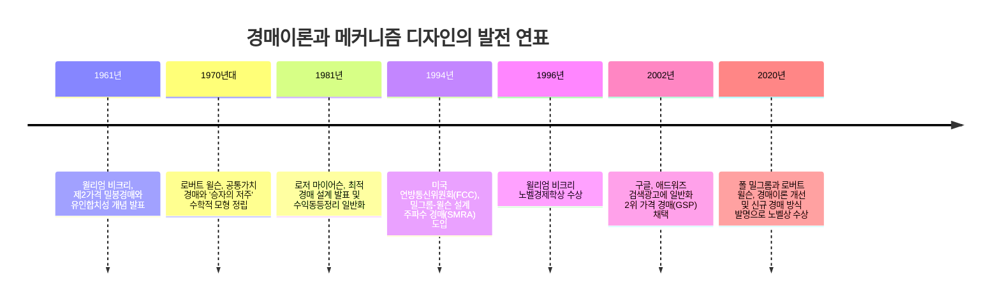
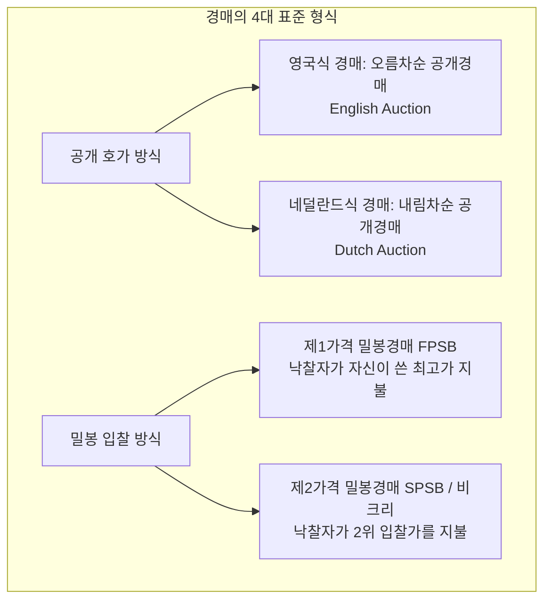
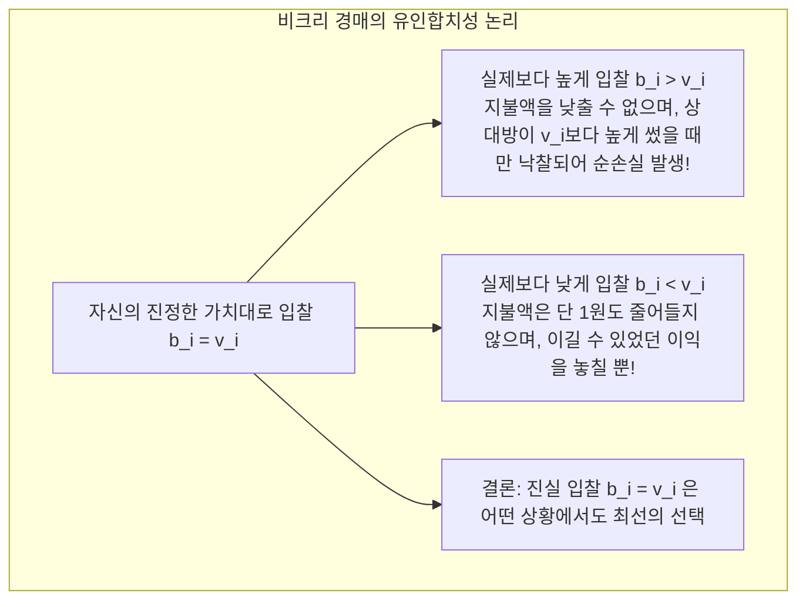
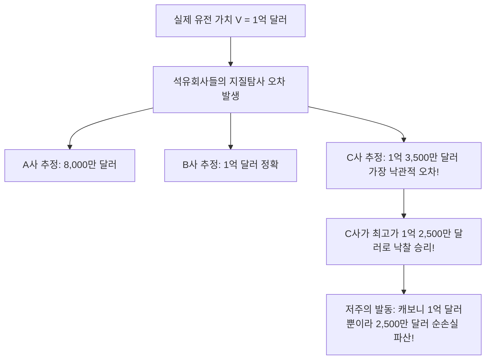

우리가 검색창에 단어를 입력하고 검색 결과가 브라우저에 표시되는 100밀리초(0.1초)의 찰나 동안, 백엔드의 수많은 서버에서는 수억 건의 **실시간 경매(Real-Time Bidding, RTB)**가 일제히 집행됩니다. 구글과 메타가 매년 벌어들이는 수천억 달러의 광고 수익은 전적으로 게임이론과 경매이론의 수학 알고리즘을 엔진으로 삼고 있습니다.

또한 우리가 일상에서 사용하는 4G와 5G 통신망 역시 국가가 한정된 전파 주파수를 가장 효율적인 통신사에 배분하기 위해 설계된 **동시 다중 라운드 오름차순 경매(SMRA)**의 산물입니다. 이 메커니즘을 창안한 폴 밀그롬과 로버트 윌슨 교수는 2020년 노벨경제학상을 수상했습니다.

경매는 단순히 물건을 비싸게 파는 기법이 아니라, 정보의 비대칭성과 이기적인 전략적 행동 속에서 경기자들의 사익 추구를 사회 전체의 최적 배분으로 유도하는 **메커니즘 디자인(Mechanism Design)**의 정점입니다.

---

## 1. 경매의 4대 기본 형식과 정보 구조

경매는 **'사전에 가격이 고정되지 않은 재화에 대해, 입찰자들의 전략적 호가를 바탕으로 배분과 가격을 결정하는 분권적 시장 제도'**입니다.

- **사적가치(Private Value)**: 재화에 대한 효용 $v_i$가 순전히 개인의 주관적 선호에 좌우되는 모형.
- **공통가치(Common Value)**: 유전의 매장량이나 전파 면허처럼 객관적 가치 $V$는 모두에게 동일하지만, 사전에는 각자가 오차가 포함된 불완전한 추정 신호 $s_i = V + \epsilon_i$만을 가진 모형.

---

## 2. 윌리엄 비크리의 천재성: 진실 보고(Truth-telling)의 약지배전략 증명

1961년 **윌리엄 비크리(William Vickrey)**는 제2가격 밀봉경매에서 **"자신의 진정한 가치평가액대로 입찰하는 것($b_i = v_i$)"이 다른 모든 전략을 약지배(Weakly Dominant)한다**는 사실을 증명했습니다.

비크리 경매에서는 내가 지불할 금액이 나의 입찰가가 아니라 **'나를 제외한 상대방 중 2위의 입찰가'**에 의해 결정됩니다. 따라서 남의 수를 읽고 눈치 보며 입찰가를 깎을 필요가 전혀 없으며, 오직 자신의 솔직한 가치관을 밝히는 것만이 최선의 전략이 되는 **유인합치성(Incentive Compatibility)**이 완성됩니다.

---

## 3. 수익동등정리 (Revenue Equivalence Theorem)

"2위 가격만 받는다면 판매자 입장에서는 1위 가격을 통째로 챙기는 제1가격 경매보다 손해 아닌가?"라는 의문에 대해, 마이어슨 등은 **수익동등정리**를 통해 다음과 같이 답했습니다:
- 위험중립적 입찰자, 독립적 사적가치 등 표준 가정이 성립할 때, **영국식, 네덜란드식, 제1가격, 제2가격 경매가 판매자에게 안겨주는 기대수익은 수학적으로 완벽히 동일하다!**
제1가격 경매에서는 입찰자들이 이윤을 남기기 위해 입찰가를 깎아 쓰는데(셰이딩), 내시 균형에서 그 깎아 쓴 금액의 기대치가 정확히 제2가격 경매의 지불액과 일치하기 때문입니다.

---

## 4. 공통가치 경매와 '승자의 저주 (Winner's Curse)'

유전이나 전파처럼 객관적 가치가 존재하는 공통가치 경매에서는 경매의 가장 잔혹한 역설인 **'승자의 저주'**가 발생합니다.

내가 이겼다는 사실은, **"경쟁자 전원이 나보다 낮은 가치로 평가했다"**는 뜻이며, 내가 가장 터무니없이 낙관적인 오차를 범했다는 증거입니다. 따라서 합리적 입찰자는 자신이 이겼을 때의 조건부 확률을 감안하여 입찰가를 대폭 보수적으로 깎아서 적어내야만 파산을 피할 수 있습니다.

---

## 5. 주파수 경매(SMRA)와 디지털 광고 GSP

밀그롬과 윌슨은 1994년 **동시 다중 라운드 경매(SMRA)**를 설계하여, 전국 단위로 상호보완성을 지닌 전파 주파수들을 묶음 패키지로 동시에 투명하게 입찰하도록 만듦으로써 승자의 저주를 완화하고 통신 혁명을 견인했습니다.

인터넷 검색 광고 시장에서 구글은 이를 다수 광고 슬롯에 맞게 변형한 **일반화 2위 가격 경매(GSP)**를 도입했습니다:
$$
\text{Ad Rank}_i = \text{입찰가 } b_i \times \text{품질점수 } q_i
$$
광고주는 자신의 바로 아래 순위 경쟁자의 애드랭크를 이기기 위한 최소한의 금액만을 클릭당 비용(CPC)으로 지불하게 함으로써, 광고주들이 불필요한 입찰 탐색 비용 없이 안심하고 최대 지불의사를 입력할 수 있는 거대한 광고 생태계를 완성했습니다.

### 결론
경매이론은 시장의 보이지 않는 손을 맹신하는 대신, **'인간의 사익 추구 행동을 수리적으로 설계된 규칙을 통해 공익과 효율로 유도하는'** 현대 경제학 최고의 실천적 성과입니다.
