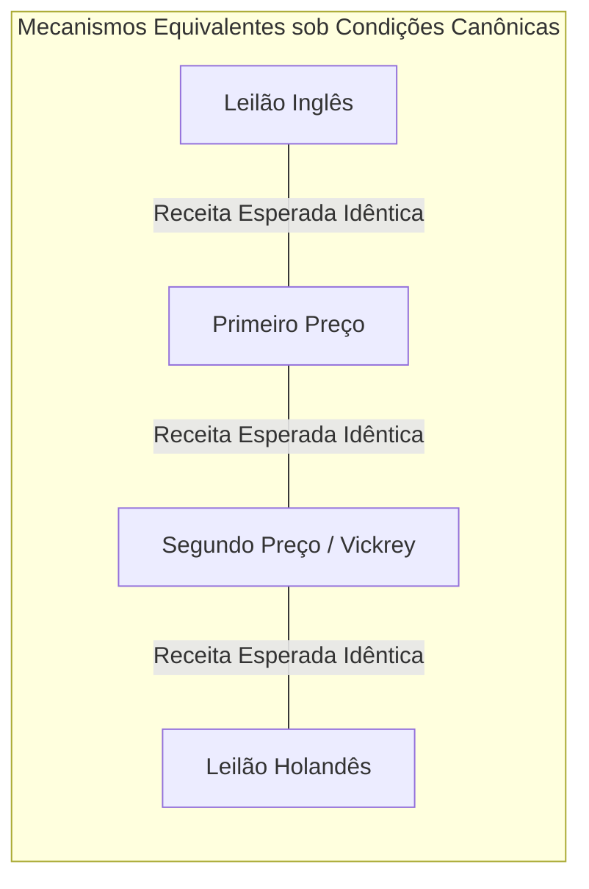

A teoria dos leilões representa uma das interseções mais fascinantes e matematicamente elegantes entre a microeconomia pura e a teoria dos jogos aplicada. Desde a Antiguidade clássica, na qual os babilônios leiloavam donzelas e os romanos chegavam a leiloar o próprio Império Romano pela Guarda Pretoriana em 193 d.C., os leilões têm sido mecanismos primordiais de descoberta de preços sob assimetria de informação. No entanto, foi com os trabalhos pioneiros de William Vickrey na década de 1960 e com o desenvolvimento do desenho de mecanismos (Mechanism Design) por Leonid Hurwicz, Eric Maskin e Roger Myerson que a disciplina ganhou uma base axiomática e analítica rigorosa.

## 1. Fundamentos da Teoria dos Jogos e Tipologia Clássica

Em um leilão formal, os participantes (licitantes) são agentes econômicos estratégicos dotados de preferências privadas ou sinais ruidosos sobre o valor intrínseco de um bem indivisível ou lote de bens. Definimos o conjunto de licitantes como $N = \{1, 2, \dots, n\}$, onde cada agente $i$ atribui uma valoração privada $v_i \in [0, \bar{v}]$, sorteada independentemente de acordo com uma distribuição de probabilidade cumulativa comum $F(v)$ estritamente crescente e diferenciável, com função densidade de probabilidade $f(v) = F'(v)$.

Existem quatro formatos canônicos de leilão para um único bem indivisível:

1. **Leilão Inglês (Ascendente aberto)**: O leiloeiro eleva o preço gradativamente. Os participantes abandonam o processo conforme o preço excede suas valorações. O último remanescente adquire o bem pelo preço em que o penúltimo licitante desistiu.
2. **Leilão Holandês (Descendente aberto)**: O preço parte de um valor extremamente elevado e cai a uma taxa constante até que o primeiro participante declare interesse imediato, adquirindo o bem no nível atual de preço.
3. **Leilão de Primeiro Preço em Envelope Fechado (First-Price Sealed-Bid, FPSB)**: Cada agente submete um lance secreto $b_i$. O vencedor é aquele com maior lance, pagando exatamente o montante licitado: $P = \max_j b_j$.
4. **Leilão de Segundo Preço em Envelope Fechado (Second-Price Sealed-Bid, SPSB / Vickrey)**: Cada agente submete um lance secreto $b_i$. O maior licitante vence, mas paga apenas o segundo maior lance: $P = \max_{j \neq i^*} b_j$.

| Formato | Mecanismo de Preço | Estratégia de Lance | Complexidade Cognitiva |
| :--- | :--- | :--- | :--- |
| **Inglês** | Ascendente Aberto | Permanecer até $p = v_i$ | Muito Baixa |
| **Holandês** | Descendente Aberto | Otimização $b_i(v_i) < v_i$ | Alta |
| **Primeiro Preço** | Envelope Fechado | Shading de Lance $b_i(v_i) = \mathbb{E}[\max v_j \mid v_j \le v_i]$ | Alta |
| **Vickrey (2º Preço)**| Envelope Fechado | Revelação Verdadeira $b_i = v_i$ | Dominante Simples |

## 2. A Genialidade do Leilão de Vickrey e Estratégia Dominante

William Vickrey demonstrou em seu seminal artigo de 1961 que, no leilão de segundo preço com valores privados independentes (IPV), a estratégia de submeter um lance estritamente igual à verdadeira valoração privada ($b_i = v_i$) é uma **estratégia fracamente dominante** (Weakly Dominant Strategy Equilibrium).

A prova matemática repousa na ausência de incentivo para distorção estratégica:
Suponha que a valoração verdadeira do participante $i$ seja $v_i$. Seja $r_i = \max_{j \neq i} b_j$ o maior lance submetido pelos demais $n-1$ competidores. O payoff do participante $i$ ao ofertar $b_i$ é expresso por:

$$\pi_i(b_i, r_i) = \begin{cases} v_i - r_i & \text{se } b_i > r_i \\ 0 & \text{se } b_i < r_i \end{cases}$$

Se o jogador tentar um lance acima da verdade, $b_i > v_i$:
- Se $r_i < v_i$, ele vence e paga $r_i$, auferindo $v_i - r_i$, exatamente o mesmo ganho de ofertar $v_i$.
- Se $r_i > b_i$, ele perde e ganha 0.
- Se $v_i < r_i < b_i$, ele vence, mas o preço a pagar supera sua valoração, resultando em prejuízo líquido estrito: $\pi_i = v_i - r_i < 0$.

Se o jogador tentar reduzir o lance (bid shading), $b_i < v_i$:
- Se $r_i < b_i$, ele vence e paga $r_i$, recebendo $v_i - r_i$.
- Se $r_i > v_i$, ele perde e ganha 0.
- Se $b_i < r_i < v_i$, ele perde uma oportunidade lucrativa na qual teria auferido ganho positivo $v_i - r_i > 0$.

Portanto, em todos os cenários possíveis da natureza, desviar de $b_i = v_i$ nunca melhora o bem-estar e pode gerar perda estrita. A revelação sincera da verdade é compatível com incentivos (Strategy-Proofness).

## 3. O Teorema da Equivalência de Receita (RET)

Um dos teoremas mais profundos da economia teórica é o **Teorema da Equivalência de Receita**, formulado em sua generalidade por Roger Myerson (1981) e William Vickrey:

> **Teorema**: Suponha que $n$ licitantes neutros ao risco possuam valorações independentes e identicamente distribuídas (i.i.d.) de acordo com uma distribuição estritamente crescente $F(v)$ no intervalo $[\underline{v}, \bar{v}]$. Então, qualquer mecanismo de leilão em que:
> 1. O bem é sempre alocado ao licitante com a maior valoração;
> 2. O licitante com a menor valoração viável $\underline{v}$ obtém excedente esperado zero;
> 
> produzirá exatamente a mesma receita esperada para o vendedor e atribuirá a cada jogador o mesmo excedente esperado.

Matematicamente, no leilão de primeiro preço com distribuição uniforme $F(v) = v / \bar{v}$ em $[0, \bar{v}]$, a função de lance em equilíbrio de Nash Bayesiano é obtida por:

$$b(v) = v - \frac{\int_0^v F(t)^{n-1} dt}{F(v)^{n-1}} = \frac{n-1}{n} v$$

O lance mais alto esperado é a esperança da maior estatística de ordem de $b(v)$, que coincide com a esperança da segunda maior estatística de ordem de $v$, comprovando analiticamente a identidade da receita esperada do vendedor sob ambos os desenhos.

## 4. Quebra de Pressupostos: A Maldição do Vencedor

Quando abandonamos o axioma dos valores privados puros e passamos para o modelo de **Valores Comuns** (Common Value Model) ou valores afiliados (Milgrom & Weber, 1982), a equivalência de receita colapsa dramaticamente.

No leilão de valor comum (como direitos de exploração de campos de petróleo ou espectro 5G), o verdadeiro valor do bem $V$ é idêntico para todos, mas cada licitante recebe apenas um sinal imperfeito e ruidoso $X_i = V + \epsilon_i$, onde $\mathbb{E}[\epsilon_i] = 0$.

Se os licitantes não forem perfeitamente sofisticados e fizerem ofertas baseadas na estimativa ingênua $\mathbb{E}[V \mid X_i]$, o vencedor será invariavelmente o agente com o sinal mais otimista:

$$\max_{j} X_j = V + \max_j \epsilon_j > V$$

Isso acarreta a famosa **Maldição do Vencedor** (Winner's Curse): ao vencer a disputa, o licitante descobre que superestimou o valor econômico do ativo em relação à média de todos os demais concorrentes, amargando prejuízos severos. Em equilíbrio bayesiano racional, os licitantes antecipam esse viés de seleção e condicionam sua estratégia de oferta ao evento de estarem no topo:

$$b_i(x_i) = \mathbb{E}\left[V \;\middle|\; X_i = x_i, \; \max_{j \neq i} X_j = x_i\right]$$

Milgrom e Weber demonstraram que o Leilão Inglês proporciona receitas sistematicamente superiores ao de Primeiro Preço sob valores afiliados, porque o leilão ascendente revela informações contínuas ao longo do processo, reduzindo a incerteza e mitigando o conservadorismo induzido pela maldição do vencedor.

## 5. Revolução Prática: O Leilão de Espectro da FCC

Na década de 1990, a Comissão Federal de Comunicações dos Estados Unidos (FCC) abandonou os métodos arcaicos de loteria e audiências administrativas para alocação de frequências eletromagnéticas de telecomunicação. Os teóricos dos jogos Paul Milgrom, Robert Wilson e Preston McAfee foram contratados para desenhar o **Leilão Ascendente Simultâneo de Múltiplas Rodadas** (Simultaneous Multiple-Round Auction, SMR / SMRA).

O desafio central residia nas fortes complementaridades e substitutibilidades geográficas: uma operadora de telefonia precisa de licenças contíguas em Nova York, Filadélfia e Boston para estruturar uma malha viável. Leilões sequenciais tradicionais geravam riscos catastróficos de exposição (exposure problem), no qual uma empresa vencia em uma cidade a preço recorde, mas perdia a licença contígua, ficando com um ativo desvalorizado.

O desenho SMRA introduziu:
1. **Lances simultâneos por rodadas**: todas as licenças permanecem abertas simultaneamente até que ninguém mais dê lances em nenhuma faixa.
2. **Regras estritas de atividade** (Milgrom-Wilson Activity Rules): licitantes não podem aguardar nas sombras; devem manter lances ativos em uma porcentagem mínima de sua elegibilidade total a cada rodada.
3. **Mecanismo de saída e substituição**: redução drástica do risco de exposição e garantia de agregação sinérgica eficiente.

As inovações renderam dezenas de bilhões de dólares aos cofres públicos globais e culminaram na concessão do Prêmio Nobel de Economia de 2020 a Paul Milgrom e Robert Wilson.

## 6. Publicidade Digital e o Algoritmo GSP

A maior aplicação quantitativa diária da teoria dos leilões na economia contemporânea ocorre nas plataformas de busca e mídias programáticas (Google Ads, Bing, Meta). Milhões de leilões ocorrem a cada segundo para decidir a ordenação e os preços dos links patrocinados.

Ao contrário de um único item, a publicidade digital envolve múltiplos slots posicionais $k \in \{1, 2, \dots, K\}$, com taxas de clique (CTR) decrescentes $\alpha_1 > \alpha_2 > \dots > \alpha_K$.

O mecanismo padrão adotado é o **Leilão de Segundo Preço Generalizado** (Generalized Second Price, GSP), formalmente dissecado por Edelman, Ostrovsky e Schwarz (2007) e Varian (2007). No GSP:
- Os anunciantes são ordenados pelo score de lance: $s_i = eCTR_i \times b_i$.
- O anunciante alocado na posição $k$ paga o preço mínimo necessário para superar o lance do participante na posição $k+1$:

$$p_k = \frac{b_{k+1} \times eCTR_{k+1}}{eCTR_k} + 0.01$$

Embora o GSP não possua uma estratégia estritamente dominante de revelação verdadeira (ao contrário do mecanismo completo de Vickrey-Clarke-Groves, VCG), ele admite equilíbrios perfeitos em subjogos estáveis chamados de **Equilíbrios Locais Livres de Inveja** (Locally Envy-Free Equilibria), que replicam o resultado de eficiência social e receita robusta da alocação ótima de VCG sem exigir complexidade excessiva de taxação cruzada.

A teoria dos leilões, portanto, transitou de um ramo abstrato da matemática aplicada para a infraestrutura operacional silenciosa que move o comércio eletrônico, as telecomunicações globais e a governança de bens públicos no século XXI.
