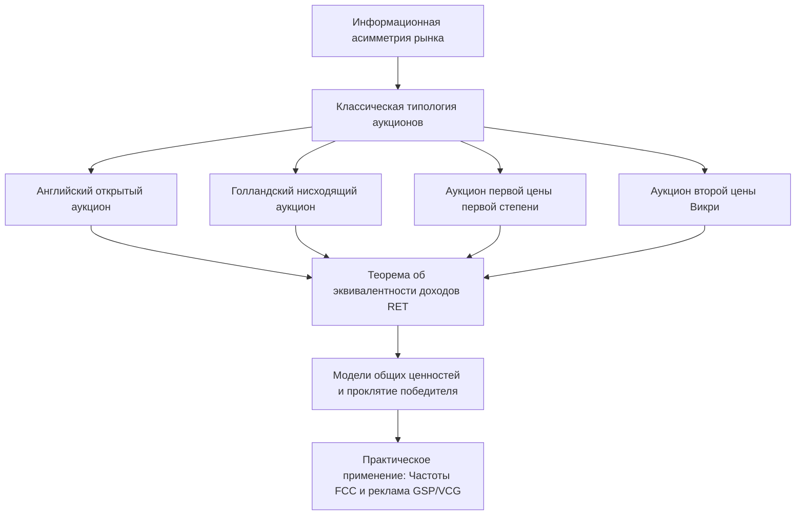
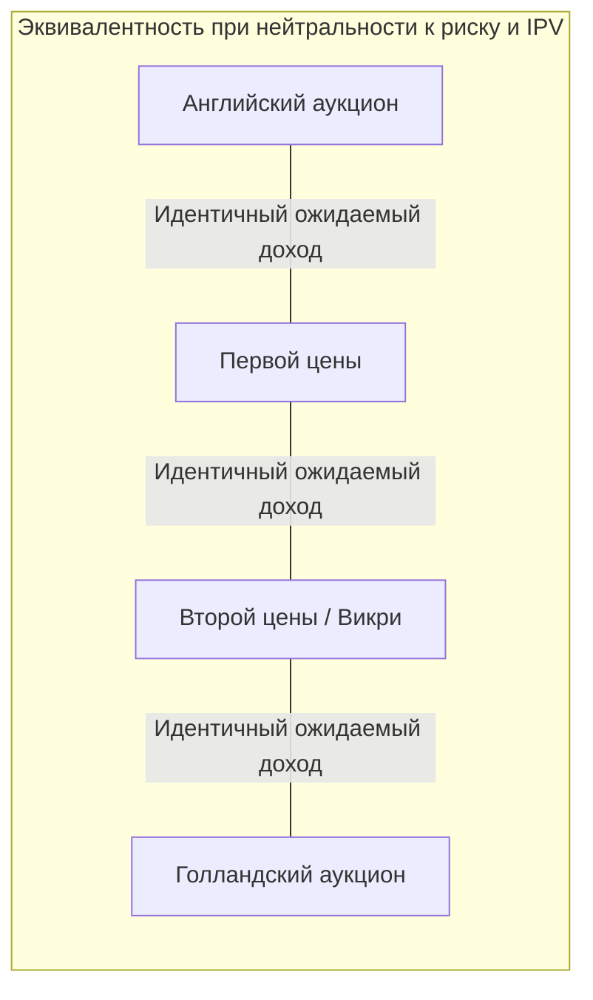

Теория аукционов занимает уникальное положение на стыке чистой математической теории игр, прикладной микроэкономики и алгоритмического дизайна рынков. С древнейших времен аукционы служили универсальным инструментом установления цен в условиях глубокой информационной асимметрии: от аукционов в Вавилоне до продажи всей Римской империи преторианской гвардией в 193 году н.э. Однако превращение аукционов в строгую математическую дисциплину произошло в 1960-х годах благодаря эпохальным трудам Уильяма Викри (William Vickrey), удостоенного впоследствии Нобелевской премии по экономике.

## 1. Базовые принципы теории игр и канонические форматы

В стандартной аукционной модели рассматривается распределение неделимого блага среди конечного множества потенциальных покупателей (биддеров) $N = \{1, 2, \dots, n\}$. Каждый участник $i$ обладает частной оценкой (ценностью) объекта $v_i \in [0, \bar{v}]$, которая является случайной величиной, независимо извлекаемой из непрерывного распределения с функцией распределения $F(v)$ и плотностью $f(v) = F'(v) > 0$.

Существуют четыре классических формата однопредметного аукциона:

1. **Английский аукцион (открытый восходящий)**: Аукционист последовательно повышает цену лота. Участники выходят из торгов, когда текущая цена превышает их субъективную оценку. Победителем становится последний оставшийся участник, выплачивающий цену выхода предпоследнего биддера.
2. **Голландский аукцион (открытый нисходящий)**: Начальная цена устанавливается заведомо выше максимальной возможной оценки и непрерывно снижается до тех пор, пока один из участников не назовет цену и не заберет лот по текущей ставке.
3. **Аукцион первой цены в закрытых конвертах (FPSB)**: Каждый участник подает тайную ставку $b_i$. Лот достается участнику с наивысшей ставкой, и он выплачивает именно эту сумму: $P = \max_j b_j$.
4. **Аукцион второй цены в закрытых конвертах (SPSB, аукцион Викри)**: Участники подают тайные ставки. Лот присуждается автору наибольшей ставки, однако цена выкупа равна второй по величине ставке: $P = \max_{j \neq i^*} b_j$.

| Формат аукциона | Механизм ценообразования | Оптимальная стратегия | Аналитическая сложность |
| :--- | :--- | :--- | :--- |
| **Английский** | Открытый восходящий | Оставаться до $p = v_i$ | Минимальная |
| **Голландский** | Открытый нисходящий | Занижение ставки $b_i(v_i) < v_i$ | Высокая |
| **Первой цены** | Закрытый конверт | Баланс маржи и вероятности выигрыша | Высокая |
| **Второй цены (Викри)** | Закрытый конверт | Правдивое раскрытие $b_i = v_i$ | Доминантная стратегия |

## 2. Математическая элегантность аукциона Викри

Уильям Викри в 1961 году сформулировал фундаментальное свойство аукциона второй цены: при независимых частных ценностях (IPV) подача ставки, строго равной истинной оценке ($b_i = v_i$), является **слабо доминирующей стратегией** (Weakly Dominant Strategy).

Доказательство строится через исследование функции полезности. Пусть $v_i$ — истинная оценка участника $i$, а $r_i = \max_{j \neq i} b_j$ — максимальная ставка среди всех его соперников. Выигрыш участника $i$ при подаче ставки $b_i$ описывается функцией:

$$\pi_i(b_i, r_i) = \begin{cases} v_i - r_i & \text{если } b_i > r_i \\ 0 & \text{если } b_i < r_i \end{cases}$$

Рассмотрим возможные отклонения от честной стратегии:
1. **Завышение ставки ($b_i > v_i$)**:
   - При $r_i < v_i$ исход не меняется: участник побеждает и получает $v_i - r_i > 0$.
   - При $r_i > b_i$ участник проигрывает и получает 0.
   - При $v_i < r_i < b_i$ завышение приводит к победе, но цена выкупа превышает полезность, порождая чистый убыток: $\pi_i = v_i - r_i < 0$.
2. **Занижение ставки ($b_i < v_i$)**:
   - При $r_i < b_i$ исход сохраняется: победа и выигрыш $v_i - r_i$.
   - При $r_i > v_i$ участник не победил бы и при честной ставке.
   - При $b_i < r_i < v_i$ занижение приводит к упущенной выгоде: участник добровольно отдает лот сопернику, хотя мог бы получить строго положительный излишек $v_i - r_i > 0$.

Таким образом, ни при каких реализациях ставок соперников отклонение от $b_i = v_i$ не приносит выгоды и может обернуться прямым ущербом. Аукцион Викри делает честность доминирующим выбором, избавляя участников от необходимости шпионить за конкурентами и предсказывать чужое поведение.

## 3. Теорема об эквивалентности доходов (Revenue Equivalence Theorem)

Краеугольным камнем теории механизмов является теорема об эквивалентности доходов, доказанная в полном объеме Роджером Майерсоном (1981):

> **Теорема**: Если $n$ нейтральных к риску участников обладают независимыми и одинаково распределенными (i.i.d.) оценками на интервале $[\underline{v}, \bar{v}]$, то любой механизм аукциона, в котором:
> 1. Объект всегда достается участнику с наибольшей оценкой;
> 2. Участник с наименьшей возможной оценкой $\underline{v}$ имеет нулевой ожидаемый выигрыш;
> 
> обеспечивает продавцу одинаковый ожидаемый совокупный доход и оставляет каждому участнику одинаковый ожидаемый выигрыш.

Для аукциона первой цены при равномерном распределении $F(v) = v / \bar{v}$ байесовское равновесие Нэша диктует стратегию:

$$b(v) = \frac{n-1}{n} v$$

Ожидаемая победная ставка в аукционе первой цены в точности совпадает с математическим ожиданием второй порядковой статистики в аукционе второй цены, что подтверждает теорему аналитически.

## 4. Проклятие победителя в аукционах с общей ценностью

В реальности многие аукционы не являются рынками с чисто субъективными оценками. В модели **общей ценности** (Common Value Model), впервые исследованной в контексте разработки нефтяных месторождений в Мексиканском заливе (Capen, Clapp, Campbell, 1971), объект обладает единой, но априори неизвестной истинной ценностью $V$. Каждый биддер $i$ получает лишь зашумленный частный сигнал $X_i = V + \epsilon_i$, где $\mathbb{E}[\epsilon_i] = 0$.

Если участники наивно делают ставки, исходя из своей персональной оценки $\mathbb{E}[V \mid X_i]$, победителем окажется тот, кто получил наибольшую случайную ошибку:

$$\max_{j} X_j = V + \max_j \epsilon_j > V$$

Это явление называется **проклятием победителя** (Winner's Curse). Победив на аукционе, компания осознает, что все остальные участники оценили объект скромнее, и проект приносит колоссальные убытки. В рациональном равновесии рациональный агент обязан корректировать свою ставку с учетом условия победы:

$$b_i(x_i) = \mathbb{E}\left[V \;\middle|\; X_i = x_i, \; \max_{j \neq i} X_j = x_i\right]$$

Пол Милгром и Роберт Уилсон (1982) доказали, что восходящий английский аукцион в таких условиях превосходит закрытый аукцион первой цены по доходу продавца, так как наблюдение за сходом соперников постепенно рассеивает неопределенность и снижает необходимую поправку на риск проклятия победителя.

## 5. Практический триумф: Спектральные аукционы FCC

В 1994 году Федеральная комиссия по связи США (FCC) отказалась от бюрократических слушаний и лотерей в пользу математического дизайна механизмов. Милгром, Уилсон и Престон Макафи разработали **одновременный многораундовый восходящий аукцион** (Simultaneous Multiple-Round Auction, SMRA).

Телекоммуникационные частоты обладают свойствами взаимной комплементарности: операторам нужны смежные полосы частот в соседних штатах. При последовательных торгах оператор рисковал купить лицензию в Нью-Йорке за миллионы долларов, но уступить лицензию в Бостоне (проблема незавершенного покрытия, Exposure Problem).

Архитектура SMRA объединила:
1. Одновременное открытие торгов по всем лицензиям.
2. Раундовый характер торгов с правилами минимальной активности (Milgrom-Wilson Activity Rules), предотвращающими снайперство и выжидательные стратегии.
3. Возможность отзыва ставок со штрафом для безопасной перегруппировки портфеля частот.

Этот механизм принес государственным бюджетам сотен стран сотни миллиардов долларов и привел к вручению Нобелевской премии по экономике Полу Милгрому и Роберту Уилсону в 2020 году.

## 6. Алгоритмические аукционы в веб-рекламе: GSP и VCG

Крупнейшей в мире практической реализацией теории аукционов сегодня являются аукционы контекстной и поисковой рекламы (Google Ads, Яндекс.Директ). Каждую секунду миллионы рекламных аукционов распределяют рекламные позиции на основе **обобщенного аукциона второй цены** (Generalized Second Price, GSP).

В аукционе GSP для нескольких рекламных мест с убывающим CTR ($\alpha_1 > \alpha_2 > \dots > \alpha_K$):
- Участники ранжируются по рекламному скору: $S_i = \text{Bid}_i \times \text{CTR}_i$.
- Рекламодатель на позиции $k$ платит минимальную ставку, достаточную для удержания позиции над участником $k+1$:

$$P_k = \frac{\text{Bid}_{k+1} \times \text{CTR}_{k+1}}{\text{CTR}_k} + 0.01$$

Хотя GSP, в отличие от механизма Викри-Кларка-Гровса (VCG), не гарантирует доминантности честной стратегии, он обладает локально устойчивыми равновесиями без зависти (Locally Envy-Free Equilibria), гарантируя высокую эффективность аллокации и миллиардные ежедневные доходы технологическим гигантам. Теория аукционов стала фундаментом современной цифровой экономики.
