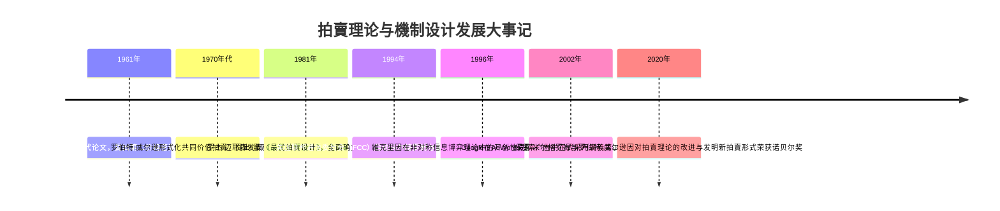
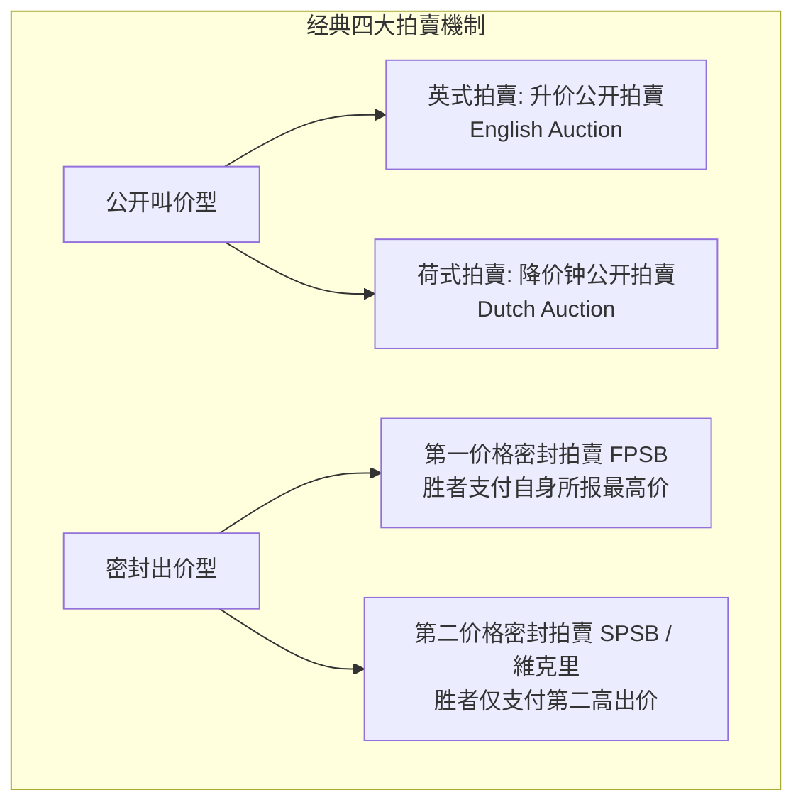
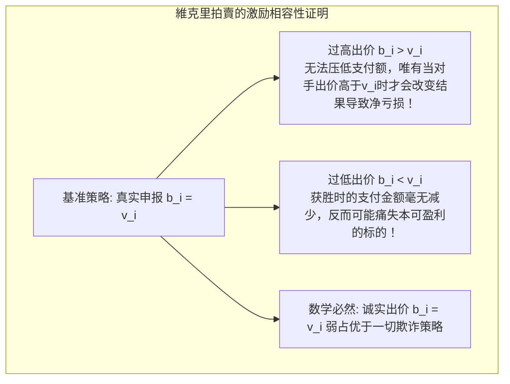
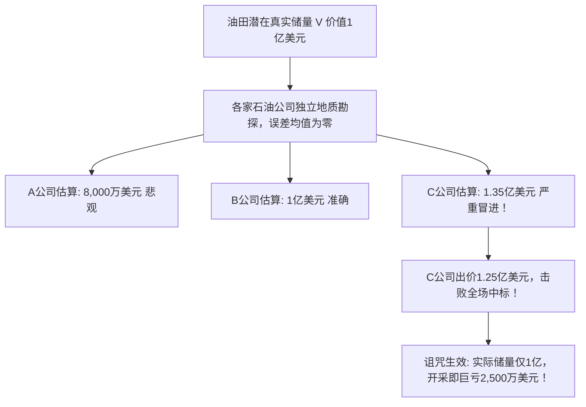

在当今互联网世界，当你在搜索引擎中输入一个关键词，在结果页面加载出来的短短100毫秒之内，后台成千上万台分布式服务器已经协同执行了数亿次**实时竞价拍賣（Real-Time Bidding, RTB）**。Google、Meta等科技巨头每年数千亿美元的商业帝国，其底层引擎完全建立在賽局理論与拍賣機制设计的数学算法之上。

同样，现代4G与5G移动通信之所以能够顺畅运行，得益于国家将无线电頻譜这一宝贵的公共资源，通过精心设计的**同时多轮递升拍賣（SMRA）**分配给最具效率的电信运营商。这一理论突破使斯坦福大学教授保罗·米尔格罗姆与罗伯特·威尔逊荣获2020年诺贝尔经济学奖。

拍賣绝非简单的“价高者得”交易，而是如何在信息不对称与自私博弈的环境下，通过规则设计引导个体追求自利的同时达成全社会资源最优配置的**機制设计（Mechanism Design）**科学。

---

## 1. 经典拍賣的四大基石形式与信息结构

在賽局理論中，拍賣被严格定义为**“基于参与者提交的出价，由确定性规则决定资源分配与支付金额的去中心化市场制度”**。

1. **英式拍賣（升价公开）**：叫价逐步攀升，直至仅剩一人，该胜者按最终叫价成交。
2. **荷式拍賣（降价钟）**：从极高价格连续下调，首位拍下按钮叫停者按当前价格成交。
3. **第一价格密封拍賣（FPSB）**：竞标者背靠背单次报价，最高出价者获胜并**支付自身出价**。
4. **第二价格密封拍賣（SPSB / 維克里拍賣）**：最高出价者获胜，但**只需支付全场第二高的竞标出价**。

### 信息结构划分：私有价值 vs 共同价值
- **独立私有价值模型（IPV）**：各竞标者的估值 $v_i$ 仅取决于自身主观偏好（如艺术品收藏）。获知他人的估值不会改变自己对拍品的效用。
- **共同价值模型（Common Value）**：拍品存在单一客观的潜在真实价值 $V$（如油田储量或頻譜特许权），但各方在事前仅掌握带有噪声的勘探信号 $s_i = V + \epsilon_i$。

---

## 2. 維克里的天才构想：诚实报价作为弱占优策略

1961年，哥伦比亚大学经济学家**威廉·維克里（William Vickrey）**证明了一个不可思议的定理：在第二价格拍賣中，**“如实申报自身真实估值（$b_i = v_i$）”是每个竞标者的弱占优策略（Weakly Dominant Strategy）**。

### 数学机理简析
假设除自己外其他对手的最高出价为 $B_{-i}$。
- 如果你试图**虚高报价（$b_i' > v_i$）**：只有在对手最高价介于两者之间（$v_i < B_{-i} < b_i'$）时才会改变结果。但此时你赢了却必须支付 $B_{-i}$，由于 $B_{-i} > v_i$，你的净利润为 $v_i - B_{-i} < 0$，出现**实质性亏损**！
- 如果你试图**压低报价（$b_i'' < v_i$）**：若对手最高价更低（$B_{-i} < b_i''$），你的支付金额依然是 $B_{-i}$，一分钱没省下；但一旦对手最高价介于其间（$b_i'' < B_{-i} < v_i$），你本可通过如实报价获利（$v_i - B_{-i} > 0$），却因虚假压价痛失中标机会。

維克里拍賣通过将**“胜负决定权（自身出价）”**与**“定价决定权（对手出价）”**彻底解耦，从制度上彻底消除了尔虞我诈的心理博弈，实现了**激励相容（Incentive Compatibility）**。

---

## 3. 收益等價定理（Revenue Equivalence Theorem）

卖家可能会产生直觉疑问：“如果采用第二价格拍賣，我只能收取第二高的价格，岂不是比第一价格拍賣赚得少？”

迈耶森（Roger Myerson）等人证明的**收益等價定理（RET）**给出了否定回答：
在风险中性竞标者、独立同分布私有价值且最高估值者得标的标准假设下，**英式、荷式、第一价格与第二价格拍賣，带给卖家的期望收益完全相等！**

在第一价格拍賣中，理性的竞标者必然会向下压价（Bid Shading），在对称納許均衡下，其压低后的出价恰好等于**“除自己外对手最高估值的数学期望”**。因此，两种機制殊途同归。

---

## 4. 共同价值拍賣与“贏家的詛咒（Winner's Curse）”

在油田勘探与通信頻譜等共同价值拍賣中，如果不精通賽局理論，胜者往往会遭遇**“贏家的詛咒”**：

你中标这个事实本身，向你传递了一个残酷的信息：**全场所有同行做出的估算全部比你低！** 如果你没有在出价时大幅度向下打折（保守折价），那么中标的那一刻，就是你被市场清算破产的起点。

---

## 5. 頻譜拍賣（FCC）与数字广告GSP機制

1994年米尔格罗姆与威尔逊为美国FCC设计的**同时多轮递升拍賣（SMRA）**，巧妙地解决了具有空间互补性（如纽约与波士顿牌照需要成套拼盘）的牌照分配难题。通过公开透明的多轮叫价，各公司能够动态观察对手反馈，极大缓解了贏家的詛咒，为国库筹集了数千亿美元，创造了现代电信行业奇迹。

而在数字经济领域，Google为了解决多个广告位展现的问题，在AdWords中设计了**廣義第二价格拍賣（GSP）**：
$$
\text{Ad Rank}_i = \text{出价 } b_i \times \text{质量得分 } q_i
$$
当用户点击广告时，排名第 $i$ 位的广告主实际支付的单次点击费用（CPC），仅需勉强击败第 $i+1$ 位对手即可：
$$
\text{实际CPC}_i = \frac{\text{Ad Rank}_{i+1}}{q_i} + 0.01\text{美元}
$$

### 结语
拍賣理论向世人证明：**优良的制度并非依赖人性的美德，而是依靠严谨精密的数学设计**。通过构建正确的规则，让追求个人利益最大化的理性个体在无形之中推动社会资源实现最高效的分配。
