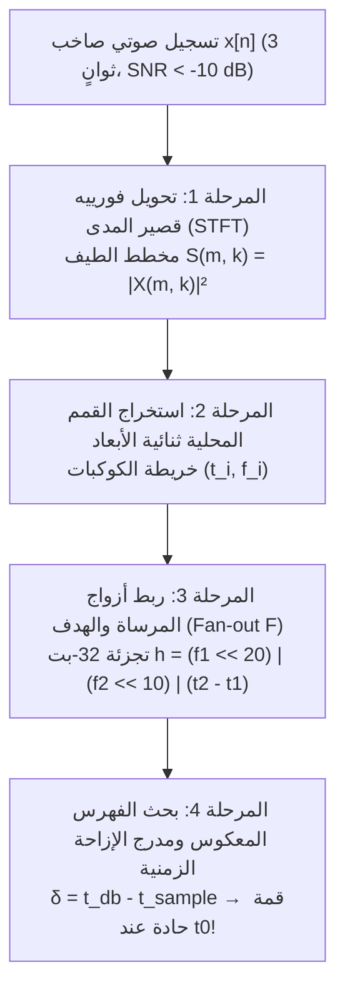

تخيّل أنك تقف في مقهى مزدحم: آلة الإسبريسو تطلق بخاراً عالي الضغط، والأطباق تصطدم ببعضها، وعشرات الأشخاص يتحدثون في آنٍ واحد، بينما تنبعث من مكبر صوت رخيص في السقف موسيقى بالكاد تُسمع. ترفع هاتفك الذكي لمدة <strong>ثلاث ثوانٍ فقط</strong>، وفي أقل من ثانية يظهر على الشاشة اسم الأغنية بدقة، واسم المغني، وغلاف الألبوم، بل وحتى كلمات الأغنية متزامنةً مع الثانية الدقيقة التي وصل إليها التشغيل (مثلاً الدقيقة `02:14`).

من منظور نظرية المعلومات ومعالجة الإشارات الرقمية (DSP)، تتغلب هذه العملية اليومية على أربع عقبات رياضية بدت طويلاً شبه مستحيلة:

1. <strong>نسبة إشارة إلى ضجيج كارثية ($\text{SNR} < -10\,\text{dB}$)</strong>: أكثر من 90% من الطاقة الصوتية التي يلتقطها الميكروفون هي ضجيج خلفي.
2. <strong>تشوه القناة والاستجابة النبضية للغرفة (*Room Impulse Response*)</strong>: الإشارة الأصلية $s(t)$ تتشوه عبر مكبر الصوت وتنعكس عشرات المرات عن الجدران ($h_{\text{room}}(t)$) لتصل على شكل التفاف رياضي $x(t) = (s * h_{\text{room}})(t) + n(t)$.
3. <strong>عدم معرفة لحظة بدء التسجيل ($t_0$-Translation Invariance)</strong>: المقطع المسجل $[t_0, t_0 + 3\,\text{s}]$ أُخِذ من موضع عشوائي مجهول داخل الأغنية.
4. <strong>البحث الفوري في قاعدة بيانات تضم 100 مليون أغنية ($10^8$ Tracks)</strong>: يجب مطابقة المقطع مع مكتبة صوتية يتجاوز طولها ألف عام من التشغيل المتواصل في غضون أجزاء من الثانية.

في هذا المقال، نشرح البنية الرياضية ذات المراحل الأربع <strong>للبصمة الصوتية (خوارزمية Shazam)</strong> التي صاغها <strong>أيفري لي-تشون وانغ (Avery Li-Chun Wang)</strong> في ورقته المرجعية عام 2003 (*"An Industrial-Strength Audio Search Algorithm"*)، ثم نقارنها بالمشكلة التوأم في معالجة الإشارات: <strong>مشكلة حفلة الكوكتيل (*Cocktail Party Problem*)</strong> و<strong>الفصل الأعمى للمصادر (*Blind Source Separation* / BSS)</strong> باستخدام <strong>تحليل المركبات المستقلة (ICA / FastICA)</strong>.

---

## الفصل الأول: لماذا تفشل مطابقة الموجات المباشرة ودوال التجزئة التشفيرية؟

صُممت دوال التجزئة التشفيرية مثل `SHA-256` لتحقيق <strong>تأثير الانهيار الجليدي (*Avalanche Effect*)</strong>: تغيير بت واحد فقط في الملف الصوتي بسبب ضجيج الميكروفون أو ضغط MP3 يقلب 50% من بتات المخرجات عشوائياً.

كما أن <strong>الارتباط المتقاطع (*Cross-Correlation*)</strong> في المجال الزمني $R_{x s_i}[\tau] = \sum_{n=0}^{L-1} x[n]\, s_i[n + \tau]$ عبر $10^8$ أغنية يفشل لسببين قاتلين:
1. <strong>الانفجار الحسابي</strong>: عند تردد أخذ عينات $f_s = 8000\,\text{Hz}$ ($L = 24,000$ عينة لثلاث ثوانٍ)، يتطلب البحث في $10^8$ أغنية نحو <strong>$3.5 \times 10^{18}$ عملية حسابية (3.5 إكسافلوبس)</strong> لكل استعلام!
2. <strong>تحطم طيف الطور بفعل الصدى</strong>: انعكاسات الغرفة $h_{\text{room}}(t)$ تبعثر طور الموجة الصوتية $\arg X(\omega)$، مما يجعل الضرب الداخلي في المجال الزمني يهبط نحو الصفر حتى لنفس الأغنية.

---

## الفصل الثاني: المرحلة الأولى — تحويل فورييه قصير المدى (STFT) ومبدأ اللاحتمية لغابور-هايزنبرغ

للتخلص من تشوهات الطور، تُقسَّم الإشارة $x[n]$ إلى نوافذ متداخلة بطول $N$ وإزاحة $H$، وتُضرَب في <strong>نافذة هان (Hann Window)</strong> $w[n] = 0.5\left(1 - \cos\frac{2\pi n}{N-1}\right)$، ثم تُحوَّل إلى <strong>مخطط طيفي للطاقة ثنائي الأبعاد (Spectrogram)</strong> عبر <strong>STFT</strong>:

$$X(m, k) = \sum_{n=0}^{N-1} x[n + mH]\, w[n]\, e^{-i \frac{2\pi k n}{N}}, \qquad S(m, k) = |X(m, k)|^2$$

ويخضع اختيار طول النافذة $N$ <strong>لمبدأ اللاحتمية لغابور-هايزنبرغ (Gabor-Heisenberg Uncertainty Principle)</strong>:

$$\sigma_t \cdot \sigma_\omega \ge \frac{1}{2} \quad \Longleftrightarrow \quad \Delta t \cdot \Delta f = \left(\frac{N}{f_s}\right) \cdot \left(\frac{f_s}{N}\right) = 1$$

فإذا كبر $N$ زادت الدقة الترددية $\Delta f$ لكن تلاشت الدقة الزمنية $\Delta t$ لضربات الإيقاع؛ وإذا صغر $N$ حدث العكس. يختار Shazam نقطة التوازن المثلى <strong>$N = 1024$ عينة ($\Delta t = 128\,\text{ms}$، $\Delta f = 7.8125\,\text{Hz}$ عند $f_s = 8000\,\text{Hz}$)</strong>.

---

## الفصل الثالث: المرحلة الثانية — استخراج القمم المحلية وبناء «خريطة الكوكبات» (Constellation Map)

بدلاً من الاحتفاظ بمصفوفة الطيف الكاملة $S(m, k)$، يحتفظ أيفري وانغ <strong>فقط بالقمم المحلية (Local Maxima)</strong> التي تتفوق في طاقتها على جميع جيرانها في الجوار ثنائي الأبعاد $\mathcal{N}(m_i, k_i)$:

$$(m_i, k_i) \in \mathcal{C} \iff S(m_i, k_i) > S(m, k) \quad \forall (m, k) \in \mathcal{N}(m_i, k_i) \setminus \{(m_i, k_i)\}$$

وهكذا يتحول المخطط الطيفي الكثيف إلى مجموعة متناثرة جداً من النقاط $(t_i, f_i)$ أسماها وانغ <strong>«خريطة الكوكبات» (Constellation Map)</strong> تشبيهاً بالنجوم اللامعة في سماء الليل.

لماذا تصمد خريطة الكوكبات أمام ضجيج المقهى العنيف؟ لأن الضجيج الصوتي يتوزع على الطيف كضباب متجانس، بينما تتركز طاقة القمم الصوتية الحادة (كالإيقاعات وترددات الفورمانت البشرية) في نقاط ضيقة تخترق سقف الضجيج تماماً كما تظل نجوم كوكبة الجبار مرئية رغم التلوث الضوئي للمدن!

---

## الفصل الرابع: المرحلتان الثالثة والرابعة — التجزئة التوافقية للأزواج (32-Bit Hash) والمدرج التكراري للإزاحة

لو اكتفينا بفهرسة كل قمة منفردة بترددها $f_1 \in [0, 1023]$، فلن يكون لدينا سوى $1024$ قيمة محتملة، مما يسبب ملايين التصادمات في جدول التجزئة.

لذلك ابتكر وانغ <strong>التجزئة التوافقية لأزواج (المرساة — الهدف / Anchor-Target Pairs)</strong>:
1. تُختار كل قمة $(t_1, f_1)$ بوصفها <strong>نقطة مرساة (Anchor)</strong>.
2. تُحدَّد أمامها زمنياً <strong>منطقة هدف (Target Zone)</strong> ضمن النافذة $\Delta t = t_2 - t_1 \in [\tau_{\min}, \tau_{\max}]$.
3. تُربط المرساة بـ $F \approx 10$ قمم هدف $(t_2, f_2)$ (<strong>معامل التفرع Fan-out Factor $F$</strong>)، وتُدمج القيم الثلاث في <strong>مفتاح تجزئة صحيح بطول 32-بت</strong>:

$$h = \text{Hash}(f_1,\; f_2,\; t_2 - t_1) = (f_1 \ll 20) \;\mid\; (f_2 \ll 10) \;\mid\; (t_2 - t_1)$$

ويحقق هذا التصميم معجزتين رياضيتين:
- <strong>مضاعفة التخصيص بمقدار $1,000,000$ مرة</strong>: من $10\,\text{بت}$ ($10^3$ دلو) إلى <strong>$30\,\text{بت}$ ($10^9$ دلو فريد)</strong> في الفهرس المعكوس، مما يجعل البحث $O(1)$!
- <strong>الثبات التام تجاه لحظة بدء التسجيل $t_0$</strong>: لأن المفتاح يخزن فرق الزمن النسبي $\Delta t = (t_2 + t_0) - (t_1 + t_0) = t_2 - t_1$!

وفي المرحلة الرابعة، لكل تطابق للمفتاح $h_k$ في قاعدة البيانات عند الزمن $t_{\text{db}, k}$، يحسب الخادم فرق التوقيت:

$$\delta_k = t_{\text{db}, k} - t_{\text{sample}, k}$$

التطابقات العشوائية الخاطئة تتبعثر عشوائياً على محور $\delta$، بينما تصطف جميع أزواج الأغنية الصحيحة عند إزاحة واحدة بالضبط $\delta_k = t_0$، مشكِّلةً <strong>قمة ديراك حادة</strong> تحدد الأغنية وموضع التشغيل في أجزاء من الألف من الثانية!

---

## الفصل الخامس: مشكلة حفلة الكوكتيل والفصل الأعمى للمصادر عبر تحليل المركبات المستقلة (ICA)

ماذا لو أردنا <strong>فصل أصوات المتحدثين المتداخلة</strong> بدلاً من مجرد التعرف على أغنية (<strong>Cocktail Party Problem</strong>)?
لنفترض أن $M$ ميكروفونات تسجل خليطاً خطياً $\mathbf{x}(t) = \mathbf{A}\mathbf{s}(t)$ من $M$ مصادر صوتية مستقلة $\mathbf{s}(t)$ بمصفوفة خلط مجهولة $\mathbf{A}$. نريد إيجاد مصفوفة الفصل $\mathbf{W} = \mathbf{A}^{-1}$ بحيث $\hat{\mathbf{s}}(t) = \mathbf{W}\mathbf{x}(t)$.

### لماذا يفشل تحليل المركبات الرئيسية (PCA) في فصل الأصوات؟
يكتفي PCA (التبييض الإحصائي $\mathbf{z} = \mathbf{V}\mathbf{x}$) بإلغاء الارتباط من الدرجة الثانية ($\mathbb{E}[\mathbf{z}\mathbf{z}^\top] = \mathbf{I}$). لكن ضرب المتجه المبيَّض $\mathbf{z}$ في <strong>أي مصفوفة دوران متعامدة</strong> $\mathbf{U} \in O(M)$ يحافظ على مصفوفة التغاير الوحدة $\mathbf{U}\mathbf{I}\mathbf{U}^\top = \mathbf{I}$! أي أن إحصاءات الدرجة الثانية عمياء تماماً عن زاوية الدوران $\mathbf{U}$.

### الحل عبر تعظيم اللاغاوسية (FastICA — Pierre Comon & Aapo Hyvärinen)
يستثمر <strong>تحليل المركبات المستقلة (ICA)</strong> <strong>مبرهنة النهاية المركزية (Central Limit Theorem)</strong>:
- الإشارات الصوتية البشرية $s_i(t)$ ذات توزيع <strong>فوق-غاوسي (Super-Gaussian / Leptokurtic)</strong> يتميز بقمة حادة وذيول ثقيلة.
- بموجب مبرهنة النهاية المركزية، فإن أي مجموع خطي لإشارات مستقلة $y = \mathbf{w}^\top \mathbf{z} = \sum_i q_i s_i$ يكون <strong>أقرب إلى التوزيع الغاوسي (الطبيعي)</strong> من كل إشارة منفردة!
- وبالتالي، تصل التركيبة الخطية $y = \mathbf{w}^\top \mathbf{z}$ إلى <strong>أقصى درجة من اللاغاوسية (Non-Gaussianity)</strong> إذا وفقط إذا استخرج المتجه $\mathbf{w}$ مصدراً صوتياً واحداً نقياً ($y = \pm s_i$)!

وتقوم خوارزمية <strong>FastICA</strong> بتعظيم اللاغاوسية عبر <strong>التفرطح (Kurtosis — العزم الرابع)</strong> أو <strong>النيغإنتروبيا (Negentropy)</strong>:

$$\text{kurt}(y) = \mathbb{E}[y^4] - 3\left(\mathbb{E}[y^2]\right)^2, \qquad J(y) = H(y_{\text{gauss}}) - H(y)$$

باستخدام تكرار النقطة الثابتة لنيوتن ذي التقارب التكعيبي الفائق، مما يفصل كل صوت بشري بدقة مذهلة دون أي معرفة مسبقة بمواقع المتحدثين!

---

## الفصل السادس: جدول مقارنة شامل لتقنيات معالجة الإشارات الصوتية

| التقنية / الخوارزمية | الأساس الرياضي | مقاومة الضجيج والصدى | التعقيد الحسابي | المجال التطبيقي الرئيسي |
|---|---|---|---|---|
| <strong>الارتباط المتقاطع الزمني</strong> | الضرب الداخلي المباشر للموجة $x[n]$ | ضعيفة جداً (تنهار بتغير طور الغرفة) | $O(L \cdot N_{\text{db}})$ (مستحيل لقواعد البيانات الضخمة) | مزامنة الإشارات المخبرية |
| <strong>Shazam (Constellation Hashing)</strong> | STFT + القمم المحلية + مفتاح 32-بت $(f_1, f_2, \Delta t)$ | فائقة جداً (تعمل عند $\text{SNR} < -10\,\text{dB}$) | بحث $O(1)$ في الفهرس + مدرج تكراري $\delta$ | التعرف الفوري على الموسيقى والبث |
| <strong>PCA / Whitening</strong> | القيم الذاتية لمصفوفة التغاير $\mathbb{E}[\mathbf{x}\mathbf{x}^\top]$ | يلغي ارتباط الدرجة الثانية فقط (غموض الدوران $\mathbf{U}$) | $O(M^2 T + M^3)$ | تقليص الأبعاد والتمهيد لـ ICA |
| <strong>FastICA (الفصل الأعمى للمصادر)</strong> | تعظيم اللاغاوسية (التفرطح / النيغإنتروبيا من الرتبة $\ge 4$) | يفصل المخاليط الخطية بدقة ($M_{\text{mic}} \ge M_{\text{src}}$) | تقارب تكعيبي سريع بطريقة نيوتن | فصل الأصوات (Cocktail Party) وتنقية إشارات الدماغ EEG |

---

## خاتمة

تُجسّد خوارزمية Shazam وتحليل المركبات المستقلة (ICA) روعة الرياضيات التطبيقية: فحين تعجز القوة الحاسوبية الغاشمة أمام الضجيج الهائل، ينجح اختيار الفضاء الرياضي الصحيح—سواء عبر الثوابت الهندسية لخريطة الكوكبات الطيفية أو عبر تعظيم الإنتروبيا اللاغاوسية—في استخلاص النظام من قلب الفوضى في طرفة عين.
