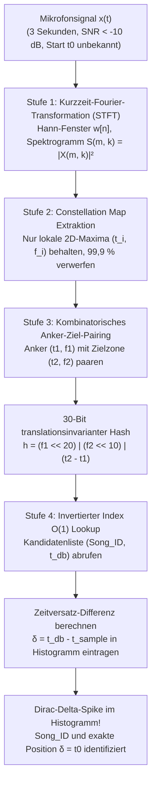
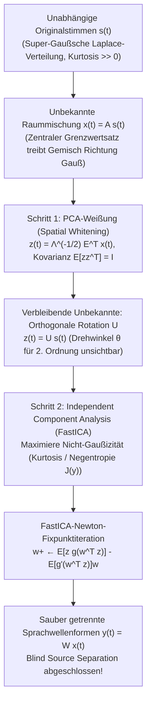

Stellen Sie sich vor, Sie stehen in einem belebten Café: Eine Espressomaschine zischt unter Hochdruck, Geschirr klappert, und Dutzende Gäste unterhalten sich gleichzeitig. Aus einem billigen Deckenlautsprecher ist kaum wahrnehmbar eine Melodie zu hören. Sie halten Ihr Smartphone für nur <strong>drei Sekunden</strong> in die Luft. Noch bevor eine Sekunde vergeht, zeigt der Bildschirm den exakten Songtitel, den Interpreten, das Albumcover und sogar den synchronisierten Liedtext an der genauen Wiedergabeposition – etwa bei Minute 2:14.

Aus Sicht der Informationstheorie und der digitalen Signalverarbeitung (DSP) verbirgt sich hinter dieser alltäglichen Funktion ein scheinbar unlösbares mathematisches Problem:

1. <strong>Katastrophales Signal-Rausch-Verhältnis ($\text{SNR} < -10\,\text{dB}$)</strong>: Mehr als 90 % der akustischen Energie, die das Mikrofon erreicht, besteht aus Störgeräuschen wie Stimmengewirr und Klappern.
2. <strong>Unbekannte Raumimpulsantwort und Kanalverzerrung</strong>: Das ursprüngliche Musiksignal $s(t)$ wird durch Lautsprecherverzerrungen und mehrfache Wandreflexionen (Faltung mit der Raumimpulsantwort $h_{\text{room}}(t)$) zu $x(t) = (s * h_{\text{room}})(t) + n(t)$ deformiert.
3. <strong>Unbekannter Startzeitpunkt ($t_0$-Translationsinvarianz)</strong>: Der 3-Sekunden-Ausschnitt $[t_0, t_0 + 3\,\text{s}]$ beginnt an einer völlig beliebigen Stelle des Liedes.
4. <strong>100 Millionen Songs ($10^8$ Tracks) im Suchraum</strong>: Eine Datenbank mit über 1.000 Jahren Gesamtlaufzeit muss innerhalb weniger hundert Millisekunden durchsucht werden.

In diesem Artikel analysieren wir die vierstufige Architektur des <strong>akustischen Fingerabdrucks (Shazam-Algorithmus)</strong> aus Avery Li-Chun Wangs bahnbrechendem ISMIR-Paper von 2003 (*"An Industrial-Strength Audio Search Algorithm"*) und stellen ihr das komplementäre Problem gegenüber: <strong>Das Cocktailparty-Problem und die blinde Quellentrennung (Blind Source Separation, BSS)</strong> mittels <strong>Unabhängiger Komponentenanalyse (ICA / FastICA)</strong>.

---

## Kapitel 1: Warum direkter Wellenformvergleich und kryptografisches Hashing scheitern

Kryptografische Hashfunktionen wie `SHA-256` sind auf den <strong>Lawineneffekt (Avalanche Effect)</strong> ausgelegt: Ändert sich nur ein einziges Bit im Eingabesignal, kippen im Schnitt 50 % aller Ausgabebits. Schon eine MP3-Kompression oder thermisches Mikrofonrauschen zerstört den Hash vollständig.

Auch die zeitliche <strong>Kreuzkorrelation (Cross-Correlation)</strong> $R_{x s_i}[\tau] = \sum_{n=0}^{L-1} x[n]\, s_i[n + \tau]$ über $10^8$ Lieder scheitert doppelt: Bei einer Abtastrate von $f_s = 8000\,\text{Hz}$ ($L = 24.000$ Samples für 3 Sekunden) gibt es rund $1{,}92 \times 10^{14}$ mögliche Verschiebungen $\tau$, was <strong>$4{,}6 \times 10^{18}$ Rechenoperationen (4,6 ExaFLOPs)</strong> pro Suchanfrage erfordert. Zudem zerstören Raumreflexionen $h_{\text{room}}(t)$ das Phasenspektrum der Wellenform $x[n]$, sodass das Skalarprodukt im Zeitbereich selbst bei identischem Song gegen null fällt.

---

## Kapitel 2: Stufe 1 — Kurzzeit-Fourier-Transformation (STFT) und Gabor-Heisenberg-Unschärfe

Um Phasenverzerrungen zu eliminieren, überführt Stufe 1 das 1D-Zeitsignal $x[n]$ (heruntergetastet auf $f_s = 8000\,\text{Hz}$) mittels einer <strong>Hann-Fensterfunktion</strong> $w[n] = 0{,}5 - 0{,}5\cos\left(\frac{2\pi n}{N-1}\right)$ der Länge $N$ und Schrittweite $H$ in ein 2D-Zeit-Frequenz-Spektrogramm:

$$X(m, k) = \sum_{n=0}^{N-1} x[n + mH]\, w[n]\, e^{-i \frac{2\pi k n}{N}}, \qquad S(m, k) = |X(m, k)|^2$$

Durch Verwerfen der Phase $\arg(X(m, k))$ bleibt das Leistungsspektrum $S(m, k)$ gegenüber Raumphasendrehungen unempfindlich. Die Wahl der Fensterlänge $N$ unterliegt jedoch der <strong>Gabor-Heisenberg-Unschärferelation</strong>:

$$\sigma_t \cdot \sigma_\omega \ge \frac{1}{2} \quad \Longleftrightarrow \quad \Delta t \cdot \Delta f = \left(\frac{N}{f_s}\right) \cdot \left(\frac{f_s}{N}\right) = 1$$

Ein zu großes $N$ verschmiert Schlagzeug-Transienten zeitlich; ein zu kleines $N$ lässt benachbarte Halbtöne frequenzseitig verschmelzen. Shazam wählt mit <strong>$N = 1024$ Samples ($\Delta t = 128\,\text{ms}$, $\Delta f = 7{,}8125\,\text{Hz}$)</strong> bei $f_s = 8000\,\text{Hz}$ den optimalen Kompromiss.

---

## Kapitel 3: Stufe 2 — Sparse Peak Extraction: Die „Constellation Map“

Um selbst bei $\text{SNR} < -10\,\text{dB}$ zu überleben, <strong>verwirft Shazam 99,9 % aller Spektrogrammdaten</strong> und behält ausschließlich die Koordinaten $(t_i, f_i)$ strikter <strong>lokaler 2D-Maxima</strong> innerhalb einer Nachbarschaft $\mathcal{N}(m_i, k_i)$:

$$(m_i, k_i) \in \mathcal{P} \iff S(m_i, k_i) > S(m, k) \quad \forall (m, k) \in \mathcal{N}(m_i, k_i) \setminus \{(m_i, k_i)\}$$

Auf einer schwarzen $(t, f)$-Ebene gleichen diese Punkte einem Sternenhimmel – daher der Name <strong>Constellation Map (Sternbildkarte)</strong>.
1. <strong>Berggipfel ragen aus dem Nebel</strong>: Additives Hintergrundrauschen hebt lediglich den „Meeresspiegel“ (Rauschteppich), während die höchsten spektralen Berggipfel (Snare-Transienten, Vokalformanten) exakt an denselben $(t_i, f_i)$-Positionen herausragen.
2. <strong>Invarianz gegenüber Equalizer und Lautstärke</strong>: Sobald ein Punkt $(t_i, f_i)$ ausgewählt ist, wird seine Amplitude $S(t_i, f_i)$ komplett verworfen! Da die Raumübertragungsfunktion $|H_{\text{room}}(f)|^2$ glatt verläuft, verschiebt sie lokale Extremstellen ($\frac{\partial S}{\partial f} = 0$) nicht.

---

## Kapitel 4: Stufe 3 — Kombinatorisches 32-Bit-Hashing von Anker-Ziel-Paaren

Würde man einzelne Frequenzbins $f_i \in [0, 1023]$ (nur 10 Bit = 1.024 Buckets) indizieren, träfe jede Suche auf Hunderte Millionen Kollisionen.

Wangs geniale Lösung ist das <strong>kombinatorische Paaren (Combinatorial Hashing)</strong>:
Jeder <strong>Ankerpunkt</strong> $p_1 = (t_1, f_1)$ wird mit bis zu $F \approx 10$ (<strong>Fan-out-Faktor</strong>) <strong>Zielpunkten</strong> $p_2 = (t_2, f_2)$ in einer zeitlich vorausliegenden Zielzone ($\Delta t = t_2 - t_1 \in [\tau_{\min}, \tau_{\max}]$) gepaart. Beide Frequenzen und ihre <strong>relative Zeitdifferenz $\Delta t = t_2 - t_1$</strong> werden in einen einzigen <strong>32-Bit-Integer-Hash $h$</strong> gepackt:

$$h = \text{Hash}(f_1,\; f_2,\; t_2 - t_1) = (f_1 \ll 20) \;\mid\; (f_2 \ll 10) \;\mid\; (\Delta t)$$

- <strong>1.000.000-mal weniger Kollisionen</strong>: Aus 10 Bit ($10^3$ Buckets) werden <strong>30 Bit ($2^{30} \approx 1{,}07 \times 10^9$ Buckets)</strong>!
- <strong>Exakte Zeitverschiebungsinvarianz</strong>: Da $\Delta t' = (t_2 - t_0) - (t_1 - t_0) = t_2 - t_1$ gilt, kürzt sich der unbekannte Aufnahmezeitpunkt $t_0$ vollständig heraus! Selbst wenn 70 % aller echten Peaks im Lärm untergehen ($p = 0{,}3$), überleben $p^2 = 9\,\%$ der Paare – rund 80 exakte 30-Bit-Treffer in 3 Sekunden.



---

## Kapitel 5: Stufe 4 — Invertierter Index und Zeitversatz-Histogramm ($\Delta T$)

Für jeden im invertierten Index gefundenen Treffer $(\text{Song\_ID}, t_{\text{db}, k})$ bildet der Server die <strong>Zeitversatz-Differenz</strong> zur Abfragezeit $t_{\text{sample}, k}$:

$$\delta_k = t_{\text{db}, k} - t_{\text{sample}, k}$$

Bei falschen Liedern streuen die zufälligen Werte $\delta_k$ gleichmäßig über alle Zeitbins. Beim <strong>wahren Song</strong> erfüllen alle echten Treffer die Gleichung $t_{\text{db}, k} = t_{\text{sample}, k} + t_0$, sodass sämtliche Differenzen $\delta_k = t_0$ exakt in denselben Histogramm-Bin fallen und einen turmhohen <strong>Dirac-Delta-Peak</strong> erzeugen!

| Kriterium | Wellenform-Kreuzkorrelation | Kryptografischer Hash (`SHA-256`) | Chroma-Fingerabdruck (`Chromaprint`) | Shazam Constellation + Kombinatorischer Hash |
| :--- | :--- | :--- | :--- | :--- |
| <strong>Merkmalsbasis</strong> | Zeitsamples $x[n]$ | Roher Datei-Bytestrom | 12-Halbton-Chroma-Vektoren | Sparse STFT-Peak-Paare $(f_1, f_2, \Delta t)$ |
| <strong>Robustheit bei $-10\,\text{dB}$ SNR</strong> | Sehr gering (Phasenfehler & Rauschen) | Null (1 Bitkippen ändert 50 % des Hashs) | Mittel (Rauschen verformt Chroma) | <strong>Extrem hoch (Gipfelpeaks durchstoßen Lärm)</strong> |
| <strong>Beliebiger 3s-Ausschnitt ($t_0$)</strong> | Erfordert Scan über $10^{14}$ Positionen | Unmöglich | Erfordert gleitende Fenstersuche | <strong>Exakt invariant ($\Delta t = t_2 - t_1$ kürzt $t_0$)</strong> |
| <strong>Suchkomplexität ($10^8$ Songs)</strong> | $O(N_{\text{songs}} \cdot L^2)$ (Stunden) | $O(1)$ (unbrauchbar für Audio) | Sublinearer Bitfehler-Scan | <strong>$O(1)$ Invertierter Index + $O(1)$ Histogramm</strong> |

---

## Kapitel 6: Das komplementäre Problem — Cocktailparty-Effekt und Blind Source Separation (ICA)

Was aber, wenn wir die gleichzeitigen Gespräche im Café nicht verwerfen, sondern <strong>jede einzelne menschliche Stimme als saubere Wellenform aus dem Mikrofongemisch $\mathbf{x}(t) = \mathbf{A}\mathbf{s}(t)$ rekonstruieren</strong> wollen, ohne die Mischmatrix $\mathbf{A}$ oder die Quellsignale $\mathbf{s}(t)$ zu kennen? Dies ist Colin Cherrys <strong>Cocktailparty-Problem (1953)</strong> bzw. <strong>Blind Source Separation (BSS)</strong>.

### 6.1 Warum die Hauptkomponentenanalyse (PCA) an der orthogonalen Rotation scheitert

Wendet man auf die Kovarianzmatrix $\mathbf{\Sigma}_x = \mathbb{E}[\mathbf{x}\mathbf{x}^\top] = \mathbf{E}\mathbf{\Lambda}\mathbf{E}^\top$ eine <strong>PCA-Weißung (Spatial Whitening)</strong> an,

$$\mathbf{z}(t) = \mathbf{\Lambda}^{-1/2} \mathbf{E}^\top \mathbf{x}(t) = \left(\mathbf{\Lambda}^{-1/2}\mathbf{E}^\top \mathbf{A}\right)\mathbf{s}(t) = \mathbf{U}\mathbf{s}(t)$$

so sind die Komponenten zwar unkorreliert ($\mathbb{E}[\mathbf{z}\mathbf{z}^\top] = \mathbf{I}$), doch $\mathbf{U} \in O(M)$ bleibt eine unbekannte <strong>orthogonale Rotationsmatrix</strong> ($\mathbf{U}\mathbf{U}^\top = \mathbf{I}$)! Da für jede Drehung $\mathbf{R}(\theta)$ weiterhin $\mathbb{E}[\mathbf{R}\mathbf{z}(\mathbf{R}\mathbf{z})^\top] = \mathbf{I}$ gilt, sind Statistiken zweiter Ordnung blind gegenüber dem Drehwinkel $\theta$.

### 6.2 Umkehrung des Zentralen Grenzwertsatzes: Maximierung der Nicht-Gaußizität (FastICA)

Die <strong>Unabhängige Komponentenanalyse (ICA)</strong> (Comon 1994, Bell & Sejnowski 1995, Hyvärinen 1999) nutzt den <strong>Zentralen Grenzwertsatz (CLT)</strong> rückwärts:
1. <strong>Super-Gaußizität menschlicher Sprache</strong>: Wegen Sprechpausen ($s_i \approx 0$) und explosiven Lautspitzen folgt Sprache einer spitzgipfligen <strong>Laplace-Verteilung</strong> mit stark positiver <strong>Kurtosis</strong> $\text{kurt}(y) = \mathbb{E}[y^4] - 3(\mathbb{E}[y^2])^2 \gg 0$.
2. <strong>Maximierung der Nicht-Gaußizität</strong>: Nach dem Zentralen Grenzwertsatz ist jede echte Mischung $y = \mathbf{w}^\top \mathbf{z} = q_1 s_1 + q_2 s_2$ ($\|\mathbf{w}\|=1$) *gaußförmiger* als die Einzelstimmen. Maximiert man daher die <strong>Nicht-Gaußizität</strong> – gemessen über die <strong>Kurtosis</strong> oder die informationstheoretische <strong>Negentropie</strong> $J(y) = H(y_{\text{gauss}}) - H(y) \propto (\mathbb{E}[G(y)] - \mathbb{E}[G(\nu)])^2$ mit $g(y) = G'(y) = \tanh(a_1 y)$ –, so rastet $\mathbf{w}$ exakt auf den einzelnen Sprechern ein! Hyvärinens <strong>FastICA-Fixpunktiteration</strong> (Newton-Verfahren auf der Einheitssphäre) konvergiert kubisch/quadratisch in wenigen Schritten:

$$\mathbf{w}^{+} \leftarrow \mathbb{E}\!\left[\mathbf{z}\, g(\mathbf{w}^\top \mathbf{z})\right] - \mathbb{E}\!\left[g'(\mathbf{w}^\top \mathbf{z})\right] \mathbf{w}, \qquad \mathbf{W} \leftarrow \left(\mathbf{W}\mathbf{W}^\top\right)^{-1/2} \mathbf{W}$$



---

## Kapitel 7: Vollständige Python-Implementierung (Shazam & FastICA)

```python
import numpy as np
from scipy.ndimage import maximum_filter
from collections import defaultdict

class ShazamFingerprinter:
    def __init__(self, fs=8000, n_fft=1024, hop_length=256, neighborhood=(15, 15), fan_out=10):
        self.fs, self.n_fft, self.hop_length = fs, n_fft, hop_length
        self.neighborhood, self.fan_out = neighborhood, fan_out
        self.database = defaultdict(list)

    def stft_spectrogram(self, signal):
        window = np.hanning(self.n_fft)
        n_frames = 1 + (len(signal) - self.n_fft) // self.hop_length
        spec = np.zeros((self.n_fft // 2, n_frames))
        for m in range(n_frames):
            frame = signal[m * self.hop_length : m * self.hop_length + self.n_fft] * window
            spec[:, m] = 10.0 * np.log10(np.abs(np.fft.rfft(frame)[:self.n_fft // 2])**2 + 1e-10)
        return spec

    def extract_peaks(self, spec, pct=85):
        mask = (maximum_filter(spec, size=self.neighborhood) == spec) & (spec > np.percentile(spec, pct))
        f_idx, t_idx = np.where(mask)
        order = np.argsort(t_idx)
        return list(zip(t_idx[order], f_idx[order]))

    def generate_hashes(self, peaks, dt_min=2, dt_max=60, df_max=150):
        hashes = []
        for i, (t1, f1) in enumerate(peaks):
            cnt = 0
            for t2, f2 in peaks[i + 1:]:
                dt = t2 - t1
                if dt < dt_min: continue
                if dt > dt_max: break
                if abs(f2 - f1) <= df_max:
                    h = (int(f1 & 0x3FF) << 20) | (int(f2 & 0x3FF) << 10) | int(dt & 0x3FF)
                    hashes.append((h, int(t1)))
                    cnt += 1
                    if cnt >= self.fan_out: break
        return hashes

    def recognize(self, snippet):
        q_hashes = self.generate_hashes(self.extract_peaks(self.stft_spectrogram(snippet)))
        hist = defaultdict(lambda: defaultdict(int))
        for h, t_s in q_hashes:
            for song_id, t_db in self.database.get(h, ()):
                hist[song_id][t_db - t_s] += 1
        best_song, best_votes, best_dt = None, 0, 0
        for song_id, counts in hist.items():
            dt, votes = max(counts.items(), key=lambda x: x[1])
            if votes > best_votes:
                best_song, best_votes, best_dt = song_id, votes, dt
        return best_song, best_votes, best_dt * self.hop_length / self.fs

def fast_ica(X, max_iter=200, tol=1e-7):
    m, n = X.shape
    Xc = X - np.mean(X, axis=1, keepdims=True)
    eigvals, eigvecs = np.linalg.eigh((Xc @ Xc.T) / n)
    Z = (np.diag(1.0 / np.sqrt(eigvals + 1e-12)) @ eigvecs.T) @ Xc
    W = np.eye(m)
    for _ in range(max_iter):
        WZ = W @ Z
        g, gp = np.tanh(WZ), 1.0 - np.tanh(WZ)**2
        W_new = (g @ Z.T) / n - np.diag(np.mean(gp, axis=1)) @ W
        u, _, vt = np.linalg.svd(W_new)
        W_new = u @ vt
        if np.max(np.abs(np.abs(np.diag(W_new @ W.T)) - 1.0)) < tol:
            break
        W = W_new
    return W @ Z
```
