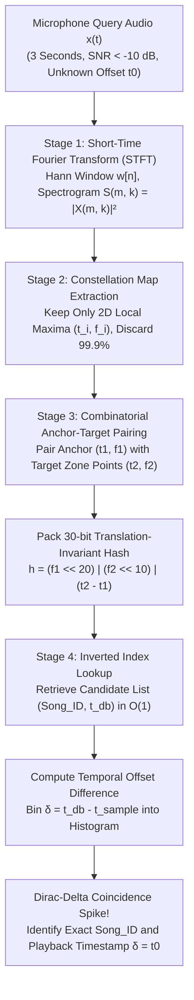
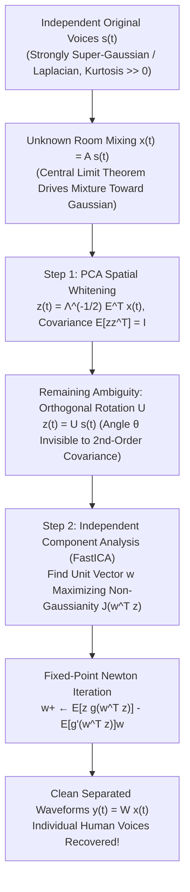

Imagine standing inside a bustling coffee shop. An espresso machine hisses with high-pressure steam, ceramic mugs clatter against saucers, and dozens of overlapping conversations echo off concrete walls. Barely audible from a cheap ceiling-mounted loudspeaker, an unfamiliar song is playing. You pull out your smartphone, tap a button, and hold the microphone up for just <strong>three seconds</strong>. Within a fraction of a second, the screen displays the exact song title, artist, album art, and even live-synced lyrics locked to the precise timestamp—say, 2 minutes and 14 seconds into the track.

We take this everyday magic for granted. Yet when we examine the physical and information-theoretic constraints from the standpoint of Digital Signal Processing (DSP) and algorithm design, we are looking at what once seemed like an <strong>impossible mathematical problem</strong>:

1. <strong>Catastrophic Signal-to-Noise Ratio ($\text{SNR} < -10\,\text{dB}$)</strong>: Over 90% of the acoustic energy hitting the smartphone's MEMS microphone consists of non-stationary environmental interference—competing human speech, broadband steam hiss, and impulsive dish clatter. The target music signal is deeply submerged beneath the noise floor.
2. <strong>Unknown Room Impulse Response and Nonlinear Distortion</strong>: The microphone never receives the clean studio master $s(t)$. Instead, the audio passes through a nonlinear loudspeaker, bounces off walls and furniture (convolving with an unknown room impulse response $h_{\text{room}}(t)$), suffers frequency roll-off at the phone's tiny microphone aperture, and undergoes lossy compression. The observed signal is $x(t) = (s * h_{\text{room}})(t) + n(t)$.
3. <strong>Arbitrary Temporal Offset ($t_0$ Invariance)</strong>: The user never starts recording at $0\text{:}00$ of the track. The 3-second snippet covers an unknown interval $[t_0, t_0 + 3\,\text{s}]$ inside a 4-minute song. Any representation must be strictly <strong>translation-invariant</strong> along the time axis.
4. <strong>A Search Space of 100 Million Tracks ($10^8$ Songs)</strong>: Modern music catalogs contain roughly $10^8$ tracks—equivalent to $2.4 \times 10^{10}$ seconds, or <strong>over 760 years of continuous audio</strong>. The server must match the 3-second query against all 760 years of music and return the answer in a few hundred milliseconds.

In this article, we dissect the complete mathematical architecture of <strong>Avery Li-Chun Wang's landmark 2003 ISMIR paper</strong>, *"An Industrial-Strength Audio Search Algorithm"* (the foundational Shazam algorithm), tracing every stage from the Gabor-Heisenberg time-frequency uncertainty trade-off and sparse <strong>Constellation Maps</strong> to the <strong>32-bit combinatorial anchor-target hash</strong> and <strong>temporal offset coincidence histograms</strong>. In the second half, we explore the dual problem in statistical signal processing: <strong>The Cocktail Party Problem and Blind Source Separation (BSS)</strong> via <strong>Independent Component Analysis (ICA)</strong>—answering why Principal Component Analysis (PCA) fails to unmix overlapping voices due to orthogonal rotational invariance, and how maximizing <strong>Non-Gaussianity</strong> (Kurtosis and Negentropy via <strong>FastICA</strong>) exploits the Central Limit Theorem in reverse to separate mixed human voices into clean individual waveforms.

---

## Chapter 1: Why Naive Waveform Matching and Cryptographic Hashing Fail Completely

Before building the Shazam pipeline, it is instructive to see why the two most obvious approaches from standard computer science and signal processing collapse immediately under real-world acoustic conditions.

### 1.1 The Trap of Cryptographic Hash Functions (`SHA-256` / `MD5`)

When software engineers hear "search 100 million records in $O(1)$ time," their immediate instinct is hashing (`SHA-256`, `MD5`, or `xxHash`). However, cryptographic and standard hash functions are engineered to exhibit the <strong>Avalanche Effect</strong>: flipping a single bit in the input buffer alters every output bit with probability $p = 0.5$.

Even without room noise, encoding the exact same studio WAV file as a 128 kbps MP3 versus a 256 kbps AAC file changes every single PCM sample value. Shifting a recording by a single sample ($1 / 44,100\,\text{s} \approx 22.7\,\mu\text{s}$) or adding thermal Johnson-Nyquist noise in the microphone preamplifier completely randomizes a `SHA-256` digest. What we require is not a cryptographic hash, but an <strong>Acoustic Fingerprint (Perceptual Hash)</strong> whose output remains invariant under severe additive noise, convolutional reverberation, and arbitrary time shifts, while remaining distinct across different songs.

### 1.2 Computational Explosion and Phase Collapse of Sliding Cross-Correlation

A classical DSP engineer might instead propose <strong>Normalized Cross-Correlation (Matched Filtering)</strong> in the time domain: sliding the 3-second recorded waveform $x[n]$ of length $L$ across every database track $s_i[n]$ at every possible sample offset $\tau$:

$$R_{x s_i}[\tau] = \sum_{n=0}^{L-1} x[n]\, s_i[n + \tau]$$

Let us calculate the arithmetic cost. Even if we downsample all audio to $f_s = 8,000\,\text{Hz}$, a 3-second query contains $L = 24,000$ samples. A database of $10^8$ songs averaging 240 seconds ($1.92 \times 10^6$ samples each) contains $1.92 \times 10^{14}$ candidate sample offsets $\tau$. Evaluating the inner product of length $24,000$ at every offset requires:

$$1.92 \times 10^{14} \times 24,000 \approx 4.6 \times 10^{18}\;\text{multiply-accumulate operations (4.6 ExaFLOPs)} \quad \text{per query!}$$

Even on a dedicated supercomputer, a single user query would take minutes. Worse still, <strong>time-domain cross-correlation fails physically even if we had infinite compute</strong>: room reflections $h_{\text{room}}(t)$ introduce frequency-dependent phase shifts (group delay dispersion). While the human cochlea is virtually insensitive to phase distortion (Helmholtz's law of phase deafness), phase dispersion scrambles the time-domain waveform shape $x[n]$, driving the inner product $R_{x s_i}[\tau]$ toward zero even when the song is playing right in front of the microphone.

---

## Chapter 2: Stage 1 — Short-Time Fourier Transform (STFT) and the Gabor-Heisenberg Uncertainty Principle

To achieve phase invariance and mimic the frequency selectivity of the human basilar membrane, Stage 1 transforms the 1D discrete time waveform $x[n]$ into a 2D time-frequency energy landscape: the <strong>Spectrogram</strong>.

### 2.1 Discrete-Time STFT Formulation and Spectral Leakage Suppression

Incoming audio is first converted to mono and downsampled to $f_s = 8,000\,\text{Hz}$ (giving a Nyquist frequency of $f_{\text{Nyquist}} = 4,000\,\text{Hz}$). Why discard everything above $4\,\text{kHz}$? Because the fundamental frequencies and primary harmonics of musical instruments, vocal formants, and snare/kick transients lie overwhelmingly below $4\,\text{kHz}$, whereas higher frequencies suffer severe atmospheric and acoustic attenuation in indoor spaces.

We slice the signal $x[n]$ into overlapping frames of length $N$ samples shifted by a hop size of $H$ samples, multiply each frame by a smooth window function $w[n]$—typically the <strong>Hann Window</strong>

$$w[n] = \frac{1}{2}\left(1 - \cos\!\left(\frac{2\pi n}{N - 1}\right)\right), \qquad n = 0, 1, \dots, N-1$$

to suppress rectangular-window Dirichlet sidelobes from $-13\,\text{dB}$ down to $-31.5\,\text{dB}$ with an asymptotic roll-off of $-18\,\text{dB/octave}$—and compute the Discrete Fourier Transform (DFT). This yields the <strong>Short-Time Fourier Transform (STFT)</strong>:

$$X(m, k) = \sum_{n=0}^{N-1} x[n + mH]\, w[n]\, e^{-i \frac{2\pi k n}{N}}, \qquad k = 0, 1, \dots, \frac{N}{2}$$

where $m \in \mathbb{Z}$ indexes the discrete time frame ($t_m = m \frac{H}{f_s}$ seconds) and $k$ indexes the frequency bin ($f_k = k \frac{f_s}{N}\,\text{Hz}$). Writing the complex STFT coefficient in polar form $X(m, k) = |X(m, k)| e^{i \phi(m, k)}$, we <strong>discard the phase $\phi(m, k)$ completely</strong>—eliminating the phase sensitivity that doomed time-domain cross-correlation—and retain only the power spectral density (spectrogram):

$$S(m, k) = |X(m, k)|^2 = \left(\text{Re}\,X(m, k)\right)^2 + \left(\text{Im}\,X(m, k)\right)^2$$

### 2.2 The Gabor-Heisenberg Time-Frequency Uncertainty Principle

Choosing the window length $N$ forces us to confront a fundamental law of harmonic analysis: the <strong>Gabor-Heisenberg Time-Frequency Uncertainty Principle</strong>. For any square-integrable signal or window function $w(t) \in L^2(\mathbb{R})$, let $\sigma_t^2$ be its normalized temporal variance and $\sigma_\omega^2$ be its normalized angular-frequency variance. Cauchy-Schwarz inequality dictates that their product is bounded below:

$$\sigma_t \cdot \sigma_\omega \ge \frac{1}{2} \quad \Longleftrightarrow \quad \Delta t \cdot \Delta f \ge \frac{1}{4\pi}$$

In a discrete STFT with sampling rate $f_s$ and window length $N$ samples, the temporal duration of each frame is $\Delta t = \frac{N}{f_s}$ seconds, while the spacing between adjacent DFT frequency bins is $\Delta f = \frac{f_s}{N}\,\text{Hz}$. Multiplying the two reveals an inescapable reciprocity:

$$\Delta t \cdot \Delta f = \left(\frac{N}{f_s}\right) \cdot \left(\frac{f_s}{N}\right) = 1$$

- <strong>If $N$ is too large</strong> (e.g., $N = 4096$ at $f_s = 8000\,\text{Hz} \implies \Delta f = 1.95\,\text{Hz}$, $\Delta t = 512\,\text{ms}$): We achieve razor-sharp pitch resolution capable of distinguishing vibrato nuances, but every percussive transient is smeared across half a second of time, destroying the temporal precision needed to measure time intervals between musical events.
- <strong>If $N$ is too small</strong> (e.g., $N = 128 \implies \Delta t = 16\,\text{ms}$, $\Delta f = 62.5\,\text{Hz}$): We pinpoint drum hits to within milliseconds, but each frequency bin spans $62.5\,\text{Hz}$, blurring entire chords and melodies below $500\,\text{Hz}$ into indistinguishable blobs.

Avery Wang's Shazam architecture strikes an optimal balance around <strong>$N = 1024$ samples at $f_s = 8000\,\text{Hz}$</strong> (giving $N/2 = 512$ to $1024$ frequency bins with resolution $\Delta f = 7.8125\,\text{Hz}$ and frame duration $\Delta t = 128\,\text{ms}$, stepped by hop size $H = 256$ or $512$, i.e., $32\,\text{ms}$ to $64\,\text{ms}$ per frame).

---

## Chapter 3: Stage 2 — Sparse Peak Extraction and the "Constellation Map"

Even after computing the spectrogram $S(m, k)$, we cannot directly match spectrogram patches against a database: café noise $N(m, k)$ adds broadband energy across the entire plane, and the room transfer function $|H_{\text{room}}(k)|^2$ multiplies each frequency row by an unknown gain curve.

Wang's breakthrough in Stage 2 is radical data reduction: <strong>discard $99.9\%$ of the spectrogram and retain ONLY the 2D coordinates $(t_i, f_i)$ of strict local maxima</strong>.

### 3.1 Mathematical Definition of 2D Spectrogram Local Maxima

A time-frequency grid cell $(m_i, k_i)$ is selected as a feature point if and only if its spectral power $S(m_i, k_i)$ strictly exceeds every other cell inside a 2D rectangular neighborhood $\mathcal{N}(m_i, k_i) = [m_i - \tau_w, m_i + \tau_w] \times [k_i - \nu_w, k_i + \nu_w]$:

$$(m_i, k_i) \in \mathcal{P} \iff S(m_i, k_i) > S(m, k) \quad \forall (m, k) \in \mathcal{N}(m_i, k_i) \setminus \{(m_i, k_i)\}$$

To ensure uniform coverage across the spectrum and prevent booming bass notes from monopolizing all peaks, the frequency axis is partitioned into logarithmic sub-bands (e.g., bins $[30\text{–}40], [40\text{–}80], [80\text{–}120], [120\text{–}180], [180\text{–}300]$) or filtered with a decaying threshold envelope so that only the strongest local peaks per time-frequency region survive.

When the surviving sparse point cloud $\mathcal{P} = \{(t_1, f_1), (t_2, f_2), \dots, (t_M, f_M)\}$ is plotted as white dots on a black $(t, f)$ plane, it looks unmistakably like stars in the night sky. Wang termed this representation the <strong>Constellation Map</strong>.

### 3.2 Why Constellation Maps Survive $-10\,\text{dB}$ Noise and Room Equalization

Notice a profound detail: once a point $(t_i, f_i)$ qualifies for the Constellation Map, <strong>its amplitude $S(t_i, f_i)$ is completely thrown away!</strong> Every peak is reduced to a pure coordinate pair $(t_i, f_i)$. This seemingly extreme discard of amplitude information grants three extraordinary physical properties:

1. <strong>Immunity to Broadband Additive Noise</strong>:
   Think of the spectrogram $S(t, f)$ as a mountain range and additive café noise as a rising sea level (or dense city smog). When the noise floor rises to $\text{SNR} = -10\,\text{dB}$, all the valleys, foothills, and subtle reverberation tails are submerged underwater. However, <strong>the highest mountain summits—percussive snare transients, vocal formants, and synth harmonic peaks—still poke above the water at the exact same $(t_i, f_i)$ coordinates!</strong> And if a clattering coffee cup creates a few extraneous noise peaks, it merely adds a few "false stars" to the sky without shifting the positions of the true musical stars.
2. <strong>Invariance to Room Acoustics, Loudspeaker EQ, and Microphone AGC</strong>:
   A room transfer function or cheap loudspeaker acts as a smooth frequency-dependent multiplier $S_{\text{mic}}(t, f) \approx |H_{\text{room}}(f)|^2 S_{\text{orig}}(t, f)$. Because a sharp spectral peak has zero first derivative ($\frac{\partial S}{\partial f} = 0$) and large negative curvature ($\frac{\partial^2 S}{\partial f^2} \ll 0$), multiplying by a slowly varying envelope $|H_{\text{room}}(f)|^2$ leaves the peak location $f_i$ virtually unchanged. Furthermore, because amplitude values are discarded, automatic gain control (AGC) and recording volume have zero effect on the Constellation Map.
3. <strong>10,000$\times$ Data Compression</strong>:
   Reducing raw audio to roughly $10\text{–}30$ coordinate pairs per second compresses megabytes of waveform data into a few hundred bytes per track snippet.

---

## Chapter 4: Stage 3 — Combinatorial Hashing of Anchor-Target Pairs (The 32-Bit Hash Trick)

We now have a noise-resistant Constellation Map $\mathcal{P} = \{(t_i, f_i)\}$. How do we index and search these points across $10^8$ songs?

Let us see why <strong>indexing individual constellation points $(t_i, f_i)$ fails catastrophically</strong>:
First, because the recording start offset $t_0$ is unknown, the absolute timestamp $t_i$ cannot be used as a lookup key. That leaves only the frequency bin $f_i \in \{0, 1, \dots, 1023\}$ ($10\,\text{bits}$).
A 10-bit key provides only $2^{10} = 1,024$ hash buckets! Across $10^8$ songs with $\sim 3,000$ constellation points per song ($3 \times 10^{11}$ total points), <strong>every single frequency bin $f_i$ collides with $3 \times 10^8$ database entries!</strong> Searching single points has almost zero discriminative specificity.

### 4.1 Pairing Stars into "Constellation Line Segments" (Anchor-Target Tuples)

To multiply the Shannon entropy (specificity) of each lookup key while simultaneously achieving <strong>strict invariance to time translation $t_0$</strong>, Avery Wang introduced <strong>Combinatorial Hashing of Anchor-Target Pairs</strong>:

1. Select each constellation point $p_1 = (t_1, f_1) \in \mathcal{P}$ in turn as an <strong>Anchor Point</strong>.
2. Define a rectangular <strong>Target Zone</strong> $\mathcal{Z}(p_1)$ situated slightly ahead of $p_1$ in time:
   $$\mathcal{Z}(p_1) = \left\{ (t_2, f_2) \in \mathcal{P} \;\middle|\; \tau_{\min} \le t_2 - t_1 \le \tau_{\max}, \quad |f_2 - f_1| \le \Delta f_{\max} \right\}$$
3. Pair the anchor $p_1$ with up to $F$ points $p_2 = (t_2, f_2) \in \mathcal{Z}(p_1)$, where $F$ is the <strong>Fan-Out Factor</strong> (typically $F \approx 5\text{–}15$).
4. Pack the anchor frequency $f_1$, target frequency $f_2$, and their <strong>relative time difference $\Delta t = t_2 - t_1$</strong> into a single <strong>32-bit unsigned integer hash key (`uint32`)</strong>:

$$h = \text{Hash}(f_1,\; f_2,\; t_2 - t_1) = (f_1 \ll 20) \;\mid\; (f_2 \ll 10) \;\mid\; (\Delta t)$$

Alongside the 32-bit hash key $h$, the database stores the value tuple `$(\text{Song\_ID}, t_1)$`, where $t_1$ is the absolute time of the anchor point from the start of the song.

### 4.2 The Information-Theoretic Miracle: $1,000,000\times$ Fewer Collisions and Exact $t_0$ Invariance

Let us examine the bit budget and combinatorics of this 32-bit integer $h$:
- Anchor frequency $f_1 \in [0, 1023]$: <strong>10 bits</strong> (bits 20–29)
- Target frequency $f_2 \in [0, 1023]$: <strong>10 bits</strong> (bits 10–19)
- Relative time delta $\Delta t = t_2 - t_1 \in [0, 1023]$: <strong>10 bits</strong> (bits 0–9)

By pairing two points and including their relative time separation, the hash key expands from $10\,\text{bits}$ ($1,024$ buckets) to <strong>$30\,\text{bits}$ ($2^{30} = 1,073,741,824 \approx 1.07 \times 10^9$ buckets)</strong>—all fitting inside a single 32-bit machine word!
With a fan-out factor of $F = 10$, we increase the number of indexed records by $10\times$, but we expand the address space by <strong>$2^{20} = 1,048,576\times$ (over one million times!)</strong>, slashing the rate of false random hash collisions per query by five orders of magnitude.

Even better, observe what happens to the time coordinate when a user starts recording at an unknown offset $t_0$ inside the song:
The anchor occurs at sample time $t_1' = t_1 - t_0$, and the target occurs at sample time $t_2' = t_2 - t_0$. When we compute the hash key $h$, the unknown offset $t_0$ cancels out identically:

$$\Delta t' = t_2' - t_1' = (t_2 - t_0) - (t_1 - t_0) = t_2 - t_1 = \Delta t$$

Thus, <strong>the 32-bit hash $h$ is $100\%$ invariant to where in the song the recording started!</strong>

### 4.3 Survival Probability Under Severe Acoustic Occlusion

What if café noise obliterates $70\%$ of the true constellation peaks in our 3-second recording, leaving each true peak with a survival probability of only $p = 0.30$?
For an anchor-target pair $(p_1, p_2)$ to survive intact, both endpoints must survive, which occurs with probability $p^2 = 0.30^2 = 0.09$ ($9\%$). If a clean 3-second snippet generates $30\;\text{peaks/s} \times 3\,\text{s} \times (F=10) = 900$ combinatorial hashes, then even when $70\%$ of all peaks are destroyed by noise, roughly <strong>$900 \times 0.09 = 81$ exact 30-bit hashes still survive and match the true song in the database!</strong> The probability that 81 random 30-bit hashes collide consistently by pure chance is less than $10^{-100}$.



---

## Chapter 5: Stage 4 — Inverted Index Lookup and the Temporal Offset Coincidence Histogram ($\Delta T$)

In the final stage, our 3-second query snippet produces a list of $M$ observed hash-timestamp pairs: $\{(h_k, t_{\text{sample}, k})\}_{k=1}^{M}$, where $t_{\text{sample}, k} \in [0, 3\,\text{s}]$ is the anchor's timestamp relative to the start of the 3-second recording.

### 5.1 Fast Inverted Index Architecture

The server maintains a massive <strong>Inverted Index</strong> (hash table) mapping every 32-bit hash $h \in [0, 2^{30}-1]$ to a posting list of all occurrences across the $10^8$-song catalog:

$$\text{Index}[h] \longrightarrow \left[ (\text{Song\_ID}_1, t_{\text{db}, 1}),\; (\text{Song\_ID}_2, t_{\text{db}, 2}),\; \dots \right]$$

For each query hash $(h_k, t_{\text{sample}, k})$, we fetch $\text{Index}[h_k]$ in $O(1)$ time.

### 5.2 Enforcing Temporal Coherence via Offset Binning ($\delta_k = t_{\text{db}, k} - t_{\text{sample}, k}$)

Simply counting which `Song_ID` accumulates the most hash hits is suboptimal because long tracks or dense orchestral pieces attract more accidental collisions. Instead, Wang enforced <strong>Temporal Coherence</strong>: every authentic hash match $(t_{\text{sample}, k}, t_{\text{db}, k})$ from the true song must obey the exact linear timing relationship

$$t_{\text{db}, k} = t_{\text{sample}, k} + \delta_{\text{true}}$$

where $\delta_{\text{true}} = t_0$ is the exact timestamp in the original studio track where the user began recording!
Rearranging this equation, the <strong>Temporal Offset Difference</strong> $\delta_k$ for every true match must be a constant:

$$\delta_k \equiv t_{\text{db}, k} - t_{\text{sample}, k} = \delta_{\text{true}} = \text{const.}$$

- <strong>For an incorrect song (False Collisions)</strong>: Accidental hash matches occur at random database timestamps $t_{\text{db}, k}$ unrelated to $t_{\text{sample}, k}$. Thus, the differences $\delta_k = t_{\text{db}, k} - t_{\text{sample}, k}$ scatter uniformly across all $\sim 3,750$ time frames of a 4-minute song, rarely stacking more than $1$ or $2$ hits in any single bin.
- <strong>For the true song (True Matches)</strong>: If we plot a 2D scatter diagram of $(t_{\text{sample}, k}, t_{\text{db}, k})$, all true matches lie on a crisp $45^\circ$ diagonal line of slope $+1$ and y-intercept $\delta_{\text{true}}$! When we project along this diagonal by computing $\delta_k = t_{\text{db}, k} - t_{\text{sample}, k}$ and incrementing a 1D histogram $C_{\text{Song\_ID}}[\delta_k]$, all authentic matches pile into the <strong>exact same histogram bin $\delta = \delta_{\text{true}}$</strong>, forming a towering <strong>Dirac-delta coincidence spike</strong>!

If a song's background collision rate is $\lambda \approx 0.01$ hits per time bin, the Poisson probability of observing a spike of $K = 20$ aligned hits by chance in a single bin is roughly $\frac{\lambda^K e^{-\lambda}}{K!} \approx \frac{10^{-40}}{2.4 \times 10^{18}} \approx 4 \times 10^{-59}$. Thus, in $O(1)$ binning time per hit—without any Dynamic Time Warping (DTW) or RANSAC—Shazam simultaneously identifies the exact song out of 100 million candidates and locks onto the playback position $\delta_{\text{true}}$ to the nearest $32\,\text{ms}$.

| Feature / Metric | Raw Waveform Cross-Correlation | Cryptographic Hash (`SHA-256`) | Chroma Fingerprinting (`Chromaprint`) | Shazam Constellation + Combinatorial Hash |
| :--- | :--- | :--- | :--- | :--- |
| <strong>Core Representation</strong> | Time-domain PCM samples $x[n]$ | Raw file byte stream | 12-semitone pitch-class energy vectors | Sparse STFT local peaks $(f_1, f_2, \Delta t)$ |
| <strong>Robustness at $\text{SNR} < -10\,\text{dB}$</strong> | Very Poor (phase distortion & noise) | Zero (1 bit flip alters $50\%$ of hash) | Moderate (heavy noise skews chroma vector) | <strong>Exceptional (summit peaks pierce noise floor)</strong> |
| <strong>3-Second Arbitrary Snippet ($t_0$)</strong> | Requires sliding over all $10^{14}$ offsets | Impossible (requires whole file) | Requires sliding window bit-error scan | <strong>Exact Invariance ($\Delta t = t_2 - t_1$ cancels $t_0$)</strong> |
| <strong>Search Complexity ($10^8$ Songs)</strong> | $O(N_{\text{songs}} \cdot L^2)$ (hours per query) | $O(1)$ (unusable for noisy audio) | Sub-linear inverted bit-error search | <strong>$O(1)$ inverted index + $O(1)$ $\delta$-histogram</strong> |
| <strong>Cover Songs / Live Versions</strong> | Fails (exact recording only) | Fails | <strong>Succeeds (captures harmonic progression)</strong> | Fails (designed for exact master identification) |

---

## Chapter 6: The Complementary Challenge — The Cocktail Party Problem and Blind Source Separation (BSS)

Shazam solves the coffee shop challenge by treating background conversations as hostile noise, stripping the audio down to a sparse skeleton of 32-bit integers to retrieve metadata.

Now let us flip the problem completely on its head:
<strong>What if we do not want to discard the voices or look up a database ID, but instead want to physically unmix the overlapping acoustic waves—separating Speaker 1's voice, Speaker 2's voice, and the café music into clean, isolated audio waveforms without knowing where anyone is standing or how the room echoes?</strong>

First posed by cognitive scientist Colin Cherry in 1953, this is the celebrated <strong>Cocktail Party Problem</strong>, known mathematically in signal processing as <strong>Blind Source Separation (BSS)</strong>.

### 6.1 The Linear Instantaneous Mixing Model

Suppose $M$ statistically independent acoustic sources $\mathbf{s}(t) = [s_1(t), s_2(t), \dots, s_M(t)]^\top$ (for clarity, consider $M = 2$ simultaneous speakers) are recorded by $M$ microphones placed at different locations in the room, producing observed signals $\mathbf{x}(t) = [x_1(t), x_2(t)]^\top$. Because each microphone receives a linear superposition of both voices weighted by unknown acoustic attenuation coefficients $a_{ij}$, we have:

$$\begin{bmatrix} x_1(t) \\ x_2(t) \end{bmatrix} = \begin{bmatrix} a_{11} & a_{12} \\ a_{21} & a_{22} \end{bmatrix} \begin{bmatrix} s_1(t) \\ s_2(t) \end{bmatrix} \quad \Longleftrightarrow \quad \mathbf{x}(t) = \mathbf{A} \mathbf{s}(t)$$

If the $M \times M$ <strong>Mixing Matrix $\mathbf{A}$</strong> were known, recovering the original voices would be trivial matrix inversion: $\mathbf{s}(t) = \mathbf{A}^{-1} \mathbf{x}(t)$.
What makes the problem *Blind* Source Separation is that <strong>both the source waveforms $\mathbf{s}(t)$ AND the mixing matrix $\mathbf{A}$ are completely unknown!</strong> Given only the mixed microphone recordings $\mathbf{x}(t)$, how can we possibly estimate an unmixing matrix $\mathbf{W} \approx \mathbf{A}^{-1}$ such that $\mathbf{y}(t) = \mathbf{W}\mathbf{x}(t)$ recovers the original voices $\mathbf{s}(t)$?

---

## Chapter 7: Why Principal Component Analysis (PCA) Fails to Separate Mixed Voices

A natural first instinct from linear algebra and machine learning is to apply <strong>Principal Component Analysis (PCA)</strong>—also known as <strong>Spatial Whitening or Decorrelation</strong>. Since Speaker 1 and Speaker 2 are speaking independently, their signals $s_1(t)$ and $s_2(t)$ are uncorrelated ($\mathbb{E}[s_1 s_2] = 0$). Can we simply diagonalize the covariance matrix of the microphone recordings $\mathbf{x}(t)$ to separate the voices?

The answer is a definitive <strong>NO</strong>: second-order statistics (covariance and PCA) are mathematically incapable of separating mixed sources. Let us prove why.

### 7.1 Spatial Whitening and the Orthogonal Rotation Ambiguity $O(M)$

Without loss of generality, assume the zero-mean independent sources $\mathbf{s}(t)$ are scaled to unit variance, so their true covariance matrix is the identity matrix:

$$\mathbf{\Sigma}_s = \mathbb{E}\!\left[\mathbf{s}(t)\mathbf{s}(t)^\top\right] = \begin{bmatrix} \mathbb{E}[s_1^2] & \mathbb{E}[s_1 s_2] \\ \mathbb{E}[s_2 s_1] & \mathbb{E}[s_2^2] \end{bmatrix} = \mathbf{I}$$

From the observed mixtures $\mathbf{x}(t) = \mathbf{A}\mathbf{s}(t)$, we compute the sample covariance matrix $\mathbf{\Sigma}_x$ and perform eigendecomposition $\mathbf{\Sigma}_x = \mathbf{E}\mathbf{\Lambda}\mathbf{E}^\top$, where $\mathbf{E}$ is orthogonal ($\mathbf{E}\mathbf{E}^\top = \mathbf{I}$) and $\mathbf{\Lambda} = \text{diag}(\lambda_1, \dots, \lambda_M)$ contains the positive eigenvalues:

$$\mathbf{\Sigma}_x = \mathbb{E}\!\left[\mathbf{x}\mathbf{x}^\top\right] = \mathbf{A}\,\mathbb{E}\!\left[\mathbf{s}\mathbf{s}^\top\right]\mathbf{A}^\top = \mathbf{A}\mathbf{A}^\top = \mathbf{E}\mathbf{\Lambda}\mathbf{E}^\top$$

We now apply the <strong>PCA Spatial Whitening Transformation</strong>:

$$\mathbf{z}(t) = \mathbf{\Lambda}^{-1/2} \mathbf{E}^\top \mathbf{x}(t)$$

Checking the covariance matrix of $\mathbf{z}(t)$ confirms that its components are completely uncorrelated with unit variance:

$$\mathbb{E}\!\left[\mathbf{z}\mathbf{z}^\top\right] = \mathbf{\Lambda}^{-1/2}\mathbf{E}^\top \left(\mathbf{E}\mathbf{\Lambda}\mathbf{E}^\top\right) \mathbf{E}\mathbf{\Lambda}^{-1/2} = \mathbf{I}$$

Has whitening recovered the voices $\mathbf{s}(t)$? Substituting $\mathbf{x}(t) = \mathbf{A}\mathbf{s}(t)$ yields:

$$\mathbf{z}(t) = \underbrace{\left(\mathbf{\Lambda}^{-1/2}\mathbf{E}^\top \mathbf{A}\right)}_{\mathbf{U}} \mathbf{s}(t) = \mathbf{U}\mathbf{s}(t)$$

Notice that $\mathbf{U}\mathbf{U}^\top = \mathbb{E}[\mathbf{z}\mathbf{z}^\top] = \mathbf{I}$, which means <strong>$\mathbf{U} \in O(M)$ is an unknown orthogonal rotation matrix!</strong>
If we multiply $\mathbf{z}(t)$ by *any* 2D rotation matrix $\mathbf{R}(\theta) = \begin{bmatrix} \cos\theta & -\sin\theta \\ \sin\theta & \cos\theta \end{bmatrix}$, the rotated vector $\tilde{\mathbf{z}}(t) = \mathbf{R}(\theta)\mathbf{z}(t)$ still has the exact same identity covariance matrix for every angle $\theta \in [0, 2\pi)$:

$$\mathbb{E}\!\left[\tilde{\mathbf{z}}\tilde{\mathbf{z}}^\top\right] = \mathbf{R}(\theta)\,\mathbb{E}\!\left[\mathbf{z}\mathbf{z}^\top\right]\mathbf{R}(\theta)^\top = \mathbf{R}(\theta)\mathbf{I}\mathbf{R}(\theta)^\top = \mathbf{I}$$

In terms of degrees of freedom, an arbitrary $M \times M$ mixing matrix $\mathbf{A}$ has $M^2$ unknown parameters. The symmetric covariance matrix $\mathbf{\Sigma}_x$ supplies only $\frac{M(M+1)}{2}$ independent constraints, leaving exactly

$$M^2 - \frac{M(M+1)}{2} = \frac{M(M-1)}{2}$$

degrees of freedom—the dimension of the orthogonal group $O(M)$—completely undetermined! PCA removes the stretching and shearing of $\mathbf{A}$, reducing the problem to finding a pure orthogonal rotation $\mathbf{W}_{\text{ICA}} = \mathbf{U}^\top$. To lock down that rotation angle $\theta$, we must go beyond second-order decorrelation ($\mathbb{E}[y_1 y_2] = 0$) to full <strong>statistical independence</strong> ($p(y_1, y_2) = p_1(y_1)p_2(y_2)$) using <strong>Higher-Order Statistics</strong>.

---

## Chapter 8: Independent Component Analysis (ICA) — Reversing the Central Limit Theorem via Non-Gaussianity

Developed in its modern form by Pierre Comon (1994), Tony Bell and Terrence Sejnowski (1995, InfoMax), and Aapo Hyvärinen (1999, FastICA), <strong>Independent Component Analysis (ICA)</strong> solves the unknown orthogonal rotation $\mathbf{U}$ through a breathtakingly elegant insight based on the <strong>Central Limit Theorem (CLT)</strong>.

### 8.1 The Central Limit Theorem as a Mathematical Compass

The Central Limit Theorem states that the sum of independent random variables always converges toward a <strong>Gaussian (Normal) distribution</strong>. Specifically, if $s_1$ and $s_2$ are independent non-Gaussian random variables of unit variance, then any nontrivial linear mixture

$$y = \mathbf{w}^\top \mathbf{z} = \mathbf{w}^\top \mathbf{U}\mathbf{s} = q_1 s_1 + q_2 s_2 \qquad \left(\text{with }\|\mathbf{w}\|^2 = q_1^2 + q_2^2 = 1\right)$$

is <strong>strictly more Gaussian</strong> than the least Gaussian of the original sources $s_1, s_2$!

Now read that theorem backward: as we rotate the unit vector $\mathbf{w} = [\cos\phi, \sin\phi]^\top$ around the unit circle in the whitened space $\mathbf{z}$, when does the projected signal $y(t) = \mathbf{w}^\top \mathbf{z}(t)$ become <strong>MAXIMALLY NON-GAUSSIAN</strong>?
If and only if the weight vector $\mathbf{q} = \mathbf{U}^\top \mathbf{w}$ collapses onto a coordinate axis—$(q_1, q_2) = (\pm 1, 0)$ or $(0, \pm 1)$—meaning <strong>the mixture has been completely unmixed and $y(t) = \pm s_i(t)$ is a pure, isolated human voice!</strong>



### 8.2 Why Human Speech is Strongly Super-Gaussian (Leptokurtic Geometry)

Why does maximizing non-Gaussianity work so well on speech and music? Because natural acoustic signals are <strong>strongly super-Gaussian (leptokurtic)</strong>!
During natural speech, brief pauses between syllables and words produce a massive concentration of samples near zero amplitude ($s_i(t) \approx 0$), punctuated by high-amplitude bursts during vowels and plosive consonants. Consequently, the probability density function (PDF) of human speech closely follows a <strong>Laplacian Distribution</strong> rather than a Gaussian bell curve:

$$p_{\text{speech}}(s) = \frac{1}{\sqrt{2}\,\sigma} \exp\!\left(-\frac{\sqrt{2}\,|s|}{\sigma}\right)$$

When we plot the joint scatter diagram $(s_1(t), s_2(t))$ of two independent speakers:
- Most of the time, either Speaker 1 is loud while Speaker 2 is silent (points along the horizontal axis $s_2 \approx 0$) or Speaker 2 is loud while Speaker 1 is silent (points along the vertical axis $s_1 \approx 0$).
- The joint scatter plot forms a sharp <strong>Four-Pointed Star (Cross)</strong> aligned with the coordinate axes!
- After microphone mixing $\mathbf{x} = \mathbf{A}\mathbf{s}$ and PCA whitening $\mathbf{z} = \mathbf{U}\mathbf{s}$, the four-pointed star is rigidly rotated by an unknown angle $\theta$. Maximizing non-Gaussianity rotates our projection axis $\mathbf{w}$ until it aligns directly with the sharp spikes of the four-pointed star!

*(Note: This also explains why ICA requires that at most one source be Gaussian. If two sources were both pure Gaussian white noise, their joint PDF $p(s_1, s_2) = \frac{1}{2\pi}e^{-(s_1^2+s_2^2)/2}$ would be perfectly circularly symmetric with no spikes to lock onto, making the rotation $\mathbf{U}$ unidentifiable.)*

### 8.3 Quantitative Contrast Functions: Kurtosis vs. Negentropy

To turn "Maximize Non-Gaussianity of $y = \mathbf{w}^\top \mathbf{z}$ subject to $\|\mathbf{w}\| = 1$" into an optimization algorithm, we need a differentiable contrast function:

#### (1) Fourth-Order Cumulant: Kurtosis

For a zero-mean, unit-variance signal ($\mathbb{E}[y^2] = 1$), the fourth-order cumulant (<strong>Kurtosis</strong>) is:

$$\text{kurt}(y) = \mathbb{E}[y^4] - 3\left(\mathbb{E}[y^2]\right)^2 = \mathbb{E}[y^4] - 3$$

Since a standard normal variable $\nu \sim \mathcal{N}(0, 1)$ satisfies $\mathbb{E}[\nu^4] = 3$, <strong>every Gaussian distribution has $\text{kurt}(\nu) = 0$</strong>. Sub-Gaussian signals (like uniform noise) have $\text{kurt}(y) < 0$, while super-Gaussian speech signals have $\text{kurt}(y) \gg 0$. Because cumulants are additive for independent variables, $\text{kurt}(q_1 s_1 + q_2 s_2) = q_1^4 \text{kurt}(s_1) + q_2^4 \text{kurt}(s_2)$. Maximizing $|\text{kurt}(y)|$ on the unit circle $q_1^2 + q_2^2 = 1$ attains its strict global maxima at the canonical basis vectors $(\pm 1, 0)$ and $(0, \pm 1)$!

#### (2) Information-Theoretic Negentropy and Robust Contrast Functions

While fourth-order kurtosis $\mathbb{E}[y^4]$ provides a clean algebraic proof, raising samples to the fourth power makes it hypersensitive to impulsive outliers. A far more robust information-theoretic measure is <strong>Negentropy</strong> $J(y)$, defined via differential Shannon entropy $H(y) = -\int p(y)\log p(y)\,dy$:

$$J(y) = H(y_{\text{gauss}}) - H(y) \ge 0$$

Because the Gaussian distribution maximizes entropy among all distributions of equal variance, $J(y) \ge 0$ always, and $J(y) = 0$ if and only if $y$ is Gaussian. Moreover, minimizing the <strong>Mutual Information</strong> $I(y_1; \dots; y_M) = \sum_{i=1}^M H(y_i) - H(\mathbf{y})$ among uncorrelated unit-variance projections is strictly equivalent to maximizing the sum of their negentropies $\sum_{i=1}^M J(y_i)$!

Hyvärinen showed that $J(y)$ can be accurately approximated without density estimation using smooth non-quadratic contrast functions $G(y)$:

$$J(y) \propto \left(\mathbb{E}[G(y)] - \mathbb{E}[G(\nu)]\right)^2, \qquad \nu \sim \mathcal{N}(0, 1)$$

where choosing $G(y) = \frac{1}{a_1}\log\cosh(a_1 y)$ yields the bounded, outlier-resistant derivative $g(y) = G'(y) = \tanh(a_1 y)$ and second derivative $g'(y) = G''(y) = a_1\left(1 - \tanh^2(a_1 y)\right)$.

### 8.4 Deriving Hyvärinen's FastICA Fixed-Point Iteration (Newton's Method)

To find the unit vector $\mathbf{w}$ ($\|\mathbf{w}\|^2 = 1$) that extremizes $\mathbb{E}[G(\mathbf{w}^\top \mathbf{z})]$, we set the gradient of the Lagrangian $\mathcal{L}(\mathbf{w}, \beta) = \mathbb{E}[G(\mathbf{w}^\top \mathbf{z})] - \frac{\beta}{2}(\|\mathbf{w}\|^2 - 1)$ to zero:

$$F(\mathbf{w}) = \mathbb{E}\!\left[\mathbf{z}\, g(\mathbf{w}^\top \mathbf{z})\right] - \beta \mathbf{w} = \mathbf{0}$$

Applying the multidimensional Newton-Raphson method requires the Jacobian matrix $\mathbf{J}_F(\mathbf{w})$:

$$\mathbf{J}_F(\mathbf{w}) = \frac{\partial F}{\partial \mathbf{w}} = \mathbb{E}\!\left[\mathbf{z}\mathbf{z}^\top g'(\mathbf{w}^\top \mathbf{z})\right] - \beta\mathbf{I}$$

Because the data are sphered ($\mathbb{E}[\mathbf{z}\mathbf{z}^\top] = \mathbf{I}$), the expectation factorizes to an extraordinarily clean diagonal approximation: $\mathbb{E}[\mathbf{z}\mathbf{z}^\top g'(\mathbf{w}^\top \mathbf{z})] \approx \mathbb{E}[\mathbf{z}\mathbf{z}^\top]\,\mathbb{E}[g'(\mathbf{w}^\top \mathbf{z})] = \mathbb{E}[g'(\mathbf{w}^\top \mathbf{z})]\mathbf{I}$! Inverting this scalar-diagonal Jacobian and multiplying through yields <strong>Hyvärinen's FastICA Fixed-Point Iteration</strong>:

$$\mathbf{w}^{+} \leftarrow \mathbb{E}\!\left[\mathbf{z}\, g(\mathbf{w}^\top \mathbf{z})\right] - \mathbb{E}\!\left[g'(\mathbf{w}^\top \mathbf{z})\right] \mathbf{w}, \qquad \mathbf{w} \leftarrow \frac{\mathbf{w}^{+}}{\|\mathbf{w}^{+}\|}$$

To extract all $M$ voices simultaneously without two rows of $\mathbf{W} = [\mathbf{w}_1, \dots, \mathbf{w}_M]^\top$ converging to the same voice, we apply <strong>Symmetric Orthogonalization</strong> after each update:

$$\mathbf{W} \leftarrow \left(\mathbf{W}\mathbf{W}^\top\right)^{-1/2} \mathbf{W}$$

Unlike stochastic gradient descent, FastICA requires zero learning-rate tuning and exhibits <strong>cubic (or quadratic) convergence</strong>, separating mixed audio sources in just 10 to 20 iterations!

---

## Chapter 9: Convolutive Room Mixtures, the Frequency Permutation Problem, and Modern Neural Audio Systems

Here the two halves of our journey—Shazam's STFT time-frequency representation and ICA's statistical source separation—join together into a unified framework that powers modern audio engineering.

### 9.1 Frequency-Domain ICA (FD-ICA), the Permutation Problem, and Independent Vector Analysis (IVA)

In a real reverberant room, sound reaches the microphones across multiple reflected paths with time delays $\tau$:

$$\mathbf{x}(t) = \sum_{\tau=0}^{L-1} \mathbf{A}(\tau)\,\mathbf{s}(t - \tau)$$

Solving for hundreds of delay matrices $\mathbf{A}(\tau)$ directly in the time domain is computationally formidable. Instead, we apply the <strong>Short-Time Fourier Transform (STFT)</strong> from Stage 1! By the Fourier Convolution Theorem, time-domain convolution turns into <strong>instantaneous matrix multiplication inside each individual frequency bin $k$</strong>:

$$\mathbf{X}(m, k) \approx \mathbf{A}(k)\,\mathbf{S}(m, k), \qquad k = 0, 1, \dots, \frac{N}{2}$$

This allows us to run complex-valued FastICA independently inside each frequency bin $k$ to estimate an unmixing matrix $\mathbf{W}(k) \approx \mathbf{A}(k)^{-1}$—an architecture known as <strong>Frequency-Domain ICA (FD-ICA)</strong>.

However, running ICA independently across $512$ frequency bins exposes a famous mathematical subtlety: the <strong>Frequency Permutation Problem</strong>. Because ICA is invariant to row permutations, in frequency bin $k = 100$ ($781\,\text{Hz}$), output channel 1 might extract Speaker A and channel 2 Speaker B, whereas in adjacent bin $k = 101$ ($789\,\text{Hz}$), output channel 1 might extract Speaker B and channel 2 Speaker A! If we invert the STFT without aligning the speaker order across all $512$ frequency bins, both reconstructed waveforms will still contain a scrambled blend of both speakers.

Signal processing researchers solved this permutation ambiguity by exploiting the <strong>harmonic co-modulation of human speech</strong>:
1. <strong>Inter-Frequency Envelope Correlation</strong>: When Speaker A pronounces a vowel, the fundamental frequency $f_0$ and all its overtones $2f_0, 3f_0, \dots$ rise and fall synchronously in amplitude over time frames $m$. By maximizing the correlation of temporal amplitude envelopes $|Y_i(m, k_1)|$ and $|Y_j(m, k_2)|$ across frequency bins, permutations are aligned globally.
2. <strong>Independent Vector Analysis (IVA)</strong>: Rather than aligning bins after the fact, IVA models all frequency bins of source $i$ as a single multivariate super-Gaussian vector $\mathbf{s}_i(m) = [S_i(m, 0), \dots, S_i(m, K)]^\top$ governed by a joint spherical contrast function:
   $$G\!\left(\mathbf{y}_i(m)\right) = \sqrt{\sum_{k=0}^{K} |Y_i(m, k)|^2}$$
   Because all frequency bins share a coupled norm inside the square root, maximizing non-Gaussianity automatically locks all harmonics of the same speaker into the same output channel!

### 9.2 Pitch/Tempo Scaling Invariance and Neural Contrastive Audio Fingerprinting

Similarly, acoustic fingerprinting has evolved beyond fixed-speed studio matching:
- <strong>Constant-Q Transform (CQT) and Scale-Invariant Ratio Hashing</strong>: If a radio station or club DJ speeds up a track by $+4\%$ ($x(\alpha t)$), the duration between peaks shrinks to $\Delta t / \alpha$ and frequencies shift to $\alpha f$. By replacing the linear frequency axis with a logarithmic <strong>Constant-Q Transform</strong> ($\log f$), multiplicative pitch scaling becomes an additive shift $\log(\alpha f) = \log f + \log\alpha$. Furthermore, forming 3-peak tuples $(t_1, t_2, t_3)$ and hashing the dimensionless time ratio $\frac{t_3 - t_2}{t_2 - t_1}$ alongside log-frequency differences $\log(f_2/f_1)$ yields a fingerprint invariant to both tempo and pitch changes.
- <strong>On-Device Neural Audio Fingerprinting (Google Pixel "Now Playing" & Contrastive Learning)</strong>: Modern smartphones can identify ambient songs 24/7 right on the lock screen with zero internet connectivity using less than $1\,\text{mW}$ of DSP power. These systems train compact convolutional or transformer encoders via <strong>Contrastive Learning (SimCLR / NT-Xent loss)</strong> on Mel-spectrograms, mapping heavily degraded 1-second audio segments onto unit-hypersphere embeddings $\mathbf{e} \in \mathbb{R}^{128}$ indexed via Product Quantization (FAISS).

---

## Chapter 10: Complete Python Implementation — Shazam Constellation Hasher & FastICA Blind Source Separator

Below is a complete, self-contained Python implementation using NumPy and SciPy that builds both a working <strong>Shazam Constellation Hasher & $\Delta T$ Coincidence Engine</strong> and a <strong>FastICA Blind Source Separator</strong>, including an end-to-end verification benchmark under severe noise and unknown mixing.

```python
import numpy as np
from scipy.ndimage import maximum_filter
from collections import defaultdict

# =====================================================================
# Part 1: Shazam Acoustic Fingerprinting Engine
# (STFT -> Constellation Map -> 32-bit Combinatorial Hash -> ΔT Spike)
# =====================================================================
class ShazamFingerprinter:
    def __init__(self, fs=8000, n_fft=1024, hop_length=256, neighborhood=(15, 15), fan_out=10):
        self.fs = fs
        self.n_fft = n_fft
        self.hop_length = hop_length
        self.neighborhood = neighborhood
        self.fan_out = fan_out
        # Inverted Index: uint32_hash -> list of (song_id, anchor_frame_t1)
        self.database = defaultdict(list)

    def stft_spectrogram(self, signal):
        '''Stage 1: Windowed STFT Power Spectrogram S(m, k) in dB.'''
        window = np.hanning(self.n_fft)
        n_frames = 1 + (len(signal) - self.n_fft) // self.hop_length
        spec = np.zeros((self.n_fft // 2, n_frames), dtype=np.float64)
        for m in range(n_frames):
            idx = m * self.hop_length
            frame = signal[idx:idx + self.n_fft] * window
            spectrum = np.abs(np.fft.rfft(frame)[:self.n_fft // 2])
            spec[:, m] = 10.0 * np.log10(spectrum**2 + 1e-10)
        return spec

    def extract_constellation_peaks(self, spec, percentile_thresh=85):
        '''Stage 2: Sparse 2D Local Maxima Extraction (Constellation Map).'''
        is_local_max = (maximum_filter(spec, size=self.neighborhood) == spec)
        amp_thresh = np.percentile(spec, percentile_thresh)
        peaks_mask = is_local_max & (spec > amp_thresh)
        freq_bins, time_frames = np.where(peaks_mask)
        order = np.argsort(time_frames)
        return list(zip(time_frames[order], freq_bins[order]))

    def compute_combinatorial_hashes(self, peaks, dt_min=2, dt_max=60, df_max=150):
        '''Stage 3: Pair Anchor (t1, f1) with Target Zone (t2, f2) into 30-bit Hash.'''
        hashes = []
        n_peaks = len(peaks)
        for i in range(n_peaks):
            t1, f1 = peaks[i]
            count = 0
            for j in range(i + 1, n_peaks):
                t2, f2 = peaks[j]
                dt = t2 - t1
                if dt < dt_min:
                    continue
                if dt > dt_max:
                    break
                if abs(f2 - f1) <= df_max:
                    # Pack into 32-bit int: (f1: 10 bits) | (f2: 10 bits) | (dt: 10 bits)
                    h = (int(f1 & 0x3FF) << 20) | (int(f2 & 0x3FF) << 10) | int(dt & 0x3FF)
                    hashes.append((h, int(t1)))
                    count += 1
                    if count >= self.fan_out:
                        break
        return hashes

    def register_song(self, song_id, audio):
        spec = self.stft_spectrogram(audio)
        peaks = self.extract_constellation_peaks(spec)
        hashes = self.compute_combinatorial_hashes(peaks)
        for h, t1 in hashes:
            self.database[h].append((song_id, t1))
        return len(peaks), len(hashes)

    def query_snippet(self, snippet_audio):
        '''Stage 4: Inverted Index Lookup & Temporal Offset Histogram (δ = t_db - t_sample).'''
        spec = self.stft_spectrogram(snippet_audio)
        peaks = self.extract_constellation_peaks(spec)
        q_hashes = self.compute_combinatorial_hashes(peaks)

        histograms = defaultdict(lambda: defaultdict(int))
        for h, t_sample in q_hashes:
            for song_id, t_db in self.database.get(h, ()):
                delta = t_db - t_sample
                histograms[song_id][delta] += 1

        best_song, max_spike, runner_up, best_delta = None, 0, 0, 0
        for song_id, delta_counts in histograms.items():
            delta, spike = max(delta_counts.items(), key=lambda item: item[1])
            if spike > max_spike:
                runner_up = max_spike
                best_song, max_spike, best_delta = song_id, spike, delta
            elif spike > runner_up:
                runner_up = spike

        offset_seconds = best_delta * self.hop_length / self.fs
        return best_song, max_spike, runner_up, offset_seconds


# =====================================================================
# Part 2: FastICA Blind Source Separation (Cocktail Party Solver)
# =====================================================================
def fast_ica_separate(X, max_iter=200, tol=1e-7):
    '''
    Symmetric FastICA using log-cosh / tanh Negentropy Approximation.
    X: shape (M_microphones, N_samples)
    '''
    m_chan, n_samp = X.shape
    # Step 1: Center variables to zero mean
    X_centered = X - np.mean(X, axis=1, keepdims=True)

    # Step 2: PCA Spatial Whitening -> Z = Λ^(-1/2) E^T X so E[Z Z^T] = I
    cov = (X_centered @ X_centered.T) / n_samp
    eigvals, eigvecs = np.linalg.eigh(cov)
    V_whiten = np.diag(1.0 / np.sqrt(eigvals + 1e-12)) @ eigvecs.T
    Z = V_whiten @ X_centered

    # Step 3: Newton Fixed-Point Iteration on the Unit Sphere
    rng = np.random.default_rng(2026)
    W = rng.standard_normal((m_chan, m_chan))
    u, _, vt = np.linalg.svd(W)
    W = u @ vt

    for _ in range(max_iter):
        WZ = W @ Z
        g = np.tanh(WZ)                  # First derivative G'(y) = tanh(y)
        g_deriv = 1.0 - g**2             # Second derivative G''(y) = 1 - tanh^2(y)

        W_next = (g @ Z.T) / n_samp - np.diag(np.mean(g_deriv, axis=1)) @ W
        # Symmetric Orthogonalization: W <- (W W^T)^(-1/2) W
        u, _, vt = np.linalg.svd(W_next)
        W_next = u @ vt

        if np.max(np.abs(np.abs(np.diag(W_next @ W.T)) - 1.0)) < tol:
            W = W_next
            break
        W = W_next

    S_recovered = W @ Z
    unmixing_matrix = W @ V_whiten
    return S_recovered, unmixing_matrix


if __name__ == "__main__":
    # --- Benchmark 1: Shazam Identification at SNR = -6 dB ---
    rng = np.random.default_rng(2026)
    fs = 8000
    shazam = ShazamFingerprinter(fs=fs)

    t_track = np.linspace(0, 20.0, 20 * fs, endpoint=False)
    catalog = {}
    for idx in range(1, 6):
        track = np.zeros_like(t_track)
        for _ in range(40):
            t0 = rng.uniform(0, 19.0)
            f0 = rng.uniform(180, 1800)
            mask = (t_track >= t0) & (t_track < t0 + 0.35)
            env = np.exp(-8.0 * (t_track[mask] - t0))
            track[mask] += env * (np.sin(2 * np.pi * f0 * t_track[mask]) +
                                  0.6 * np.sin(2 * np.pi * 2 * f0 * t_track[mask]))
        catalog[f"Song_0{idx}"] = track
        shazam.register_song(f"Song_0{idx}", track)

    # Extract a 3-second snippet starting at 7.50s of Song_03 and add severe noise
    true_start = 7.50
    sample_idx = int(true_start * fs)
    clean_snippet = catalog["Song_03"][sample_idx:sample_idx + 3 * fs]
    noise = rng.normal(0, np.std(clean_snippet) * 2.0, size=clean_snippet.shape)
    noisy_snippet = clean_snippet + noise

    pred_song, top_votes, second_votes, pred_offset = shazam.query_snippet(noisy_snippet)
    print(f"[Shazam Benchmark] Matched: {pred_song} | Spike Votes: {top_votes} (Runner-up: {second_votes})")
    print(f"[Shazam Benchmark] Recovered Timestamp: {pred_offset:.2f}s (Ground Truth: {true_start:.2f}s)")

    # --- Benchmark 2: FastICA Unmixing of Super-Gaussian Speech Models ---
    n_pts = 40000
    t_vec = np.linspace(0, 5.0, n_pts)
    s1 = rng.laplace(0, 1.0, n_pts) * (1.0 + 0.8 * np.sin(2 * np.pi * 3.0 * t_vec))
    s2 = rng.laplace(0, 1.0, n_pts) * (1.0 + 0.8 * np.cos(2 * np.pi * 5.5 * t_vec))
    S_orig = np.vstack([s1 / np.std(s1), s2 / np.std(s2)])

    A_room = np.array([[0.82, 0.58], [0.45, 0.91]])
    X_mic = A_room @ S_orig

    S_unmixed, W_est = fast_ica_separate(X_mic)
    corr = np.abs(np.corrcoef(S_orig, S_unmixed)[:2, 2:])
    print(f"[FastICA Benchmark] Recovered Source Correlations: {np.max(corr, axis=1)}")
```

---

## Conclusion: The Unifying Power of Sparsity and Statistical Independence

At first glance, <strong>Shazam's acoustic fingerprinting</strong> and <strong>ICA blind source separation</strong> solve opposite problems—one reduces a noisy song snippet into a compact identity hash while rejecting human voices, whereas the other reconstructs continuous human voice waveforms from an unknown room mixture. Yet beneath the surface, both triumphs rest on the same two foundational pillars of modern signal processing:

1. <strong>Transforming into the Time-Frequency Domain</strong>: By navigating the Gabor-Heisenberg uncertainty trade-off via the Short-Time Fourier Transform (STFT), messy time-domain convolutions and phase distortions become clean, localized geometric structures in the $(t, f)$ plane.
2. <strong>Exploiting Sparsity and Super-Gaussianity</strong>: Real-world music and human speech are the exact opposite of diffuse Gaussian noise—they concentrate their energy into sparse, high-kurtosis peaks. Shazam extracts those 2D spectral peaks into a <strong>Constellation Map</strong>, pairs anchors and targets into <strong>30-bit translation-invariant combinatorial hashes</strong>, and detects a <strong>Dirac-delta spike</strong> in the temporal offset histogram $\delta = t_{\text{db}} - t_{\text{sample}}$. Meanwhile, <strong>Independent Component Analysis (FastICA)</strong> reverses the Central Limit Theorem, rotating whitened microphone mixtures toward maximum <strong>Non-Gaussianity</strong> (Kurtosis and Negentropy) until every overlapping voice snaps into crystal-clear isolation.
