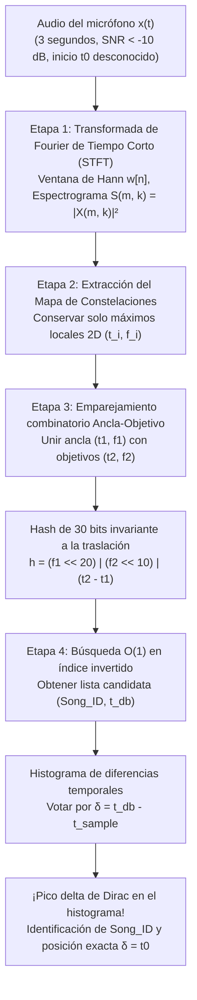
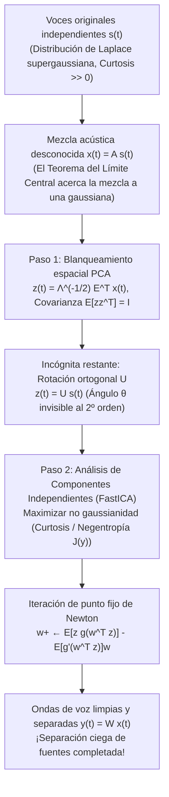

Imagina estar en medio de una cafetería bulliciosa: la máquina de espresso silba con vapor a alta presión, los platos entrechocan y decenas de personas conversan simultáneamente. Desde un altavoz barato en el techo apenas se distingue una melodía. Sacas tu teléfono, tocas un botón y sostienes el micrófono en el aire durante solo <strong>tres segundos</strong>. En menos de un segundo, la pantalla muestra el título exacto de la canción, el artista, la portada del álbum e incluso la letra sincronizada en el instante preciso (por ejemplo, en el minuto 2:14).

Desde la teoría de la información y el procesamiento digital de señales (DSP), esta proeza cotidiana resuelve cuatro desafíos matemáticos extremos:

1. <strong>Relación señal-ruido catastrófica ($\text{SNR} < -10\,\text{dB}$)</strong>: Más del 90 % de la energía acústica captada por el micrófono proviene de ruido ambiental aditivo (voces, golpes, máquinas).
2. <strong>Respuesta al impulso de la sala desconocida</strong>: La señal original $s(t)$ sufre distorsión en el altavoz y reverberación multicamino en paredes y techo (convolución con $h_{\text{room}}(t)$), observándose únicamente $x(t) = (s * h_{\text{room}})(t) + n(t)$.
3. <strong>Desfase temporal arbitrario ($t_0$ desconocido)</strong>: El fragmento de 3 segundos $[t_0, t_0 + 3\,\text{s}]$ comienza en cualquier punto desconocido de la canción.
4. <strong>Espacio de búsqueda de 100 millones de canciones ($10^8$ pistas)</strong>: Más de 1.000 años de audio continuo deben consultarse en pocos cientos de milisegundos.

En este artículo desglosamos la arquitectura en cuatro etapas de la <strong>huella acústica de Shazam</strong> formulada por Avery Li-Chun Wang en 2003 (*"An Industrial-Strength Audio Search Algorithm"*, ISMIR) y abordamos su problema dual: <strong>el problema de la fiesta de cóctel (Cocktail Party Problem) y la separación ciega de fuentes (BSS)</strong> mediante <strong>Análisis de Componentes Independientes (ICA / FastICA)</strong>.

---

## Capítulo 1: Por qué fallan la correlación directa de ondas y el hashing criptográfico

Las funciones hash criptográficas (`SHA-256`, `MD5`) están diseñadas con <strong>efecto avalancha</strong>: cambiar un solo bit de entrada invierte aleatoriamente el 50 % de los bits de salida. Cualquier compresión MP3 o mínimo ruido térmico destruye por completo el hash.

Por otro lado, calcular la <strong>correlación cruzada en el dominio del tiempo</strong> $R_{x s_i}[\tau] = \sum_{n=0}^{L-1} x[n]\, s_i[n + \tau]$ sobre $10^8$ canciones (a $f_s = 8000\,\text{Hz}$, $L = 24.000$ muestras en 3 segundos) implica evaluar $1{,}92 \times 10^{14}$ posiciones de deslizamiento $\tau$, requiriendo <strong>$4{,}6 \times 10^{18}$ operaciones (4,6 ExaFLOPs)</strong> por consulta. Además, las reflexiones de la sala $h_{\text{room}}(t)$ distorsionan la fase de la onda $x[n]$, hundiendo la correlación temporal a cero aunque el oído humano (insensible a la fase según Helmholtz) reconozca perfectamente la melodía.

---

## Capítulo 2: Etapa 1 — Transformada de Fourier de Tiempo Corto (STFT) e incertidumbre de Gabor-Heisenberg

Para eliminar la sensibilidad a la fase, la Etapa 1 transforma la señal 1D $x[n]$ (submuestreada a $f_s = 8000\,\text{Hz}$) en un <strong>espectrograma</strong> 2D tiempo-frecuencia aplicando una <strong>ventana de Hann</strong> $w[n] = 0{,}5 - 0{,}5\cos\left(\frac{2\pi n}{N-1}\right)$ de longitud $N$ y salto $H$:

$$X(m, k) = \sum_{n=0}^{N-1} x[n + mH]\, w[n]\, e^{-i \frac{2\pi k n}{N}}, \qquad S(m, k) = |X(m, k)|^2$$

La elección de $N$ está regida por el <strong>principio de incertidumbre tiempo-frecuencia de Gabor-Heisenberg</strong>:

$$\sigma_t \cdot \sigma_\omega \ge \frac{1}{2} \quad \Longleftrightarrow \quad \Delta t \cdot \Delta f = \left(\frac{N}{f_s}\right) \cdot \left(\frac{f_s}{N}\right) = 1$$

Un $N$ demasiado grande ($4096$) ofrece gran resolución frecuencial pero difumina los golpes de batería durante $\Delta t = 512\,\text{ms}$; un $N$ demasiado pequeño ($128$) localiza ataques pero mezcla semitonos vecinos ($\Delta f = 62{,}5\,\text{Hz}$). Shazam elige el punto óptimo <strong>$N = 1024$ ($\Delta t = 128\,\text{ms}$, $\Delta f = 7{,}8125\,\text{Hz}$)</strong>.

---

## Capítulo 3: Etapa 2 — Extracción dispersa de picos: El «Mapa de Constelaciones»

Para resistir un $\text{SNR} < -10\,\text{dB}$, Avery Wang <strong>descarta el 99,9 % del espectrograma</strong> y conserva únicamente las coordenadas $(t_i, f_i)$ de los <strong>máximos locales 2D</strong> dentro de una vecindad $\mathcal{N}(m_i, k_i)$:

$$(m_i, k_i) \in \mathcal{P} \iff S(m_i, k_i) > S(m, k) \quad \forall (m, k) \in \mathcal{N}(m_i, k_i) \setminus \{(m_i, k_i)\}$$

Al graficar estos puntos sobre el plano $(t, f)$, parecen estrellas en el cielo nocturno, recibiendo el nombre de <strong>Constellation Map (Mapa de Constelaciones)</strong>.
1. <strong>Cumbres que sobresalen de la niebla</strong>: El ruido de fondo eleva el «nivel del mar», sumergiendo los valles, pero las cumbres espectrales más altas (transitorios de caja, formantes vocales) siguen emergiendo exactamente en las mismas coordenadas $(t_i, f_i)$.
2. <strong>Invariancia frente a ecualización (EQ) y ganancia (AGC)</strong>: ¡La amplitud $S(t_i, f_i)$ se descarta por completo! Solo se guarda el par $(t_i, f_i)$, logrando inmunidad total al volumen del micrófono y al filtrado $|H_{\text{room}}(f)|^2$.

---

## Capítulo 4: Etapa 3 — Hashing combinatorio de 32 bits de pares Ancla-Objetivo

Indexar picos individuales por su sola frecuencia $f_i \in [0, 1023]$ (10 bits = 1.024 cubetas) produciría cientos de millones de colisiones.

La genialidad de Wang fue el <strong>emparejamiento combinatorio Ancla-Objetivo (Combinatorial Hashing)</strong>:
Cada <strong>punto ancla</strong> $p_1 = (t_1, f_1)$ se empareja con hasta $F \approx 10$ (<strong>factor de fan-out</strong>) <strong>puntos objetivo</strong> $p_2 = (t_2, f_2)$ dentro de una zona adelantada en el tiempo ($\Delta t = t_2 - t_1 \in [\tau_{\min}, \tau_{\max}]$). Las dos frecuencias y su <strong>diferencia temporal relativa $\Delta t = t_2 - t_1$</strong> se empaquetan en un <strong>hash entero de 32 bits $h$</strong>:

$$h = \text{Hash}(f_1,\; f_2,\; t_2 - t_1) = (f_1 \ll 20) \;\mid\; (f_2 \ll 10) \;\mid\; (\Delta t)$$

- <strong>Un millón de veces menos colisiones</strong>: El espacio hash pasa de 10 bits ($10^3$ cubetas) a <strong>30 bits ($2^{30} \approx 1{,}07 \times 10^9$ cubetas)</strong>.
- <strong>Invariancia exacta al desplazamiento temporal</strong>: Como $\Delta t' = (t_2 - t_0) - (t_1 - t_0) = t_2 - t_1$, ¡el instante inicial desconocido $t_0$ se cancela algebraicamente! Incluso si el ruido destruye el 70 % de los picos ($p = 0{,}3$), sobrevive el $p^2 = 9\,\%$ de los pares.



---

## Capítulo 5: Etapa 4 — Índice invertido e histograma de coincidencia temporal ($\Delta T$)

Para cada coincidencia $(\text{Song\_ID}, t_{\text{db}, k})$ en el índice invertido, el servidor calcula la <strong>diferencia de desfase temporal</strong>:

$$\delta_k = t_{\text{db}, k} - t_{\text{sample}, k}$$

En canciones incorrectas, $\delta_k$ se dispersa al azar. En la <strong>canción correcta</strong>, todos los aciertos verdaderos cumplen $t_{\text{db}, k} = t_{\text{sample}, k} + t_0$, por lo que todos los $\delta_k = t_0$ caen en la misma celda del histograma formando un <strong>pico delta de Dirac gigante</strong>.

| Métrica | Correlación cruzada temporal | Hash criptográfico (`SHA-256`) | Huella Chroma (`Chromaprint`) | Shazam Constelación + Hash combinatorio |
| :--- | :--- | :--- | :--- | :--- |
| <strong>Representación</strong> | Muestras PCM $x[n]$ | Flujo de bytes bruto | Vectores de 12 semitonos | Pares de picos STFT $(f_1, f_2, \Delta t)$ |
| <strong>Robustez a $-10\,\text{dB}$</strong> | Muy baja (fase y ruido) | Nula (efecto avalancha) | Moderada | <strong>Excepcional (cumbres sobre el ruido)</strong> |
| <strong>Fragmento de 3s ($t_0$)</strong> | Escaneo de $10^{14}$ posiciones | Imposible | Ventana deslizante | <strong>Invariancia exacta ($\Delta t$ cancela $t_0$)</strong> |
| <strong>Complejidad ($10^8$ pistas)</strong> | $O(N_{\text{songs}} \cdot L^2)$ (horas) | $O(1)$ (inútil con ruido) | Búsqueda sublineal | <strong>Índice invertido $O(1)$ + histograma $O(1)$</strong> |

---

## Capítulo 6: El problema complementario — El efecto fiesta de cóctel y separación ciega (ICA)

¿Y si en lugar de descartar las voces de la cafetería queremos <strong>separar físicamente las $M$ voces superpuestas a partir de la mezcla $\mathbf{x}(t) = \mathbf{A}\mathbf{s}(t)$</strong> sin conocer las voces $\mathbf{s}(t)$ ni la matriz de mezcla $\mathbf{A}$? Este es el <strong>problema de la fiesta de cóctel (Colin Cherry, 1953)</strong> o <strong>separación ciega de fuentes (BSS)</strong>.

### 6.1 Por qué falla el Análisis de Componentes Principales (PCA)

El <strong>blanqueamiento espacial (PCA Whitening)</strong> mediante la covarianza $\mathbf{\Sigma}_x = \mathbb{E}[\mathbf{x}\mathbf{x}^\top] = \mathbf{E}\mathbf{\Lambda}\mathbf{E}^\top$ produce:

$$\mathbf{z}(t) = \mathbf{\Lambda}^{-1/2} \mathbf{E}^\top \mathbf{x}(t) = \mathbf{U}\mathbf{s}(t), \qquad \mathbb{E}\!\left[\mathbf{z}\mathbf{z}^\top\right] = \mathbf{I}$$

Aunque $\mathbf{z}(t)$ está incorrelacionado, $\mathbf{U} \in O(M)$ sigue siendo una <strong>matriz de rotación ortogonal desconocida</strong> ($\mathbf{U}\mathbf{U}^\top = \mathbf{I}$). Como cualquier rotación $\mathbf{R}(\theta)\mathbf{z}$ mantiene la covarianza identidad $\mathbf{I}$, las estadísticas de segundo orden son ciegas al ángulo $\theta$.

### 6.2 Invertir el Teorema del Límite Central: Maximizar la no gaussianidad (FastICA)

El <strong>Análisis de Componentes Independientes (ICA)</strong> (Comon 1994, Bell & Sejnowski 1995, Hyvärinen 1999) invierte el <strong>Teorema del Límite Central (TLC)</strong>:
1. <strong>Supergaussianidad del habla humana</strong>: Las pausas entre sílabas ($s_i \approx 0$) y los picos vocálicos siguen una <strong>distribución de Laplace</strong> con alta <strong>curtosis</strong> ($\text{kurt}(y) = \mathbb{E}[y^4] - 3(\mathbb{E}[y^2])^2 \gg 0$).
2. <strong>Maximización de la negentropía</strong>: Por el TLC, cualquier mezcla $y = \mathbf{w}^\top \mathbf{z} = q_1 s_1 + q_2 s_2$ es *más gaussiana* que las fuentes puras. Al buscar el vector unitario $\mathbf{w}$ que maximiza la <strong>no gaussianidad</strong> mediante la <strong>negentropía</strong> $J(y) = H(y_{\text{gauss}}) - H(y) \propto (\mathbb{E}[G(y)] - \mathbb{E}[G(\nu)])^2$ con $g(y) = \tanh(a_1 y)$, la iteración de punto fijo de Newton de <strong>FastICA</strong> separa cada voz en 10–20 pasos:

$$\mathbf{w}^{+} \leftarrow \mathbb{E}\!\left[\mathbf{z}\, g(\mathbf{w}^\top \mathbf{z})\right] - \mathbb{E}\!\left[g'(\mathbf{w}^\top \mathbf{z})\right] \mathbf{w}, \qquad \mathbf{W} \leftarrow \left(\mathbf{W}\mathbf{W}^\top\right)^{-1/2} \mathbf{W}$$



---

## Capítulo 7: Implementación completa en Python (Shazam & FastICA)

```python
import numpy as np
from scipy.ndimage import maximum_filter
from collections import defaultdict

class ShazamFingerprinter:
    def __init__(self, fs=8000, n_fft=1024, hop_length=256, neighborhood=(15, 15), fan_out=10):
        self.fs, self.n_fft, self.hop_length = fs, n_fft, hop_length
        self.neighborhood, self.fan_out = neighborhood, fan_out
        self.database = defaultdict(list)

    def stft_spectrogram(self, signal):
        window = np.hanning(self.n_fft)
        n_frames = 1 + (len(signal) - self.n_fft) // self.hop_length
        spec = np.zeros((self.n_fft // 2, n_frames))
        for m in range(n_frames):
            frame = signal[m * self.hop_length : m * self.hop_length + self.n_fft] * window
            spec[:, m] = 10.0 * np.log10(np.abs(np.fft.rfft(frame)[:self.n_fft // 2])**2 + 1e-10)
        return spec

    def extract_peaks(self, spec, pct=85):
        mask = (maximum_filter(spec, size=self.neighborhood) == spec) & (spec > np.percentile(spec, pct))
        f_idx, t_idx = np.where(mask)
        order = np.argsort(t_idx)
        return list(zip(t_idx[order], f_idx[order]))

    def generate_hashes(self, peaks, dt_min=2, dt_max=60, df_max=150):
        hashes = []
        for i, (t1, f1) in enumerate(peaks):
            cnt = 0
            for t2, f2 in peaks[i + 1:]:
                dt = t2 - t1
                if dt < dt_min: continue
                if dt > dt_max: break
                if abs(f2 - f1) <= df_max:
                    h = (int(f1 & 0x3FF) << 20) | (int(f2 & 0x3FF) << 10) | int(dt & 0x3FF)
                    hashes.append((h, int(t1)))
                    cnt += 1
                    if cnt >= self.fan_out: break
        return hashes

    def recognize(self, snippet):
        q_hashes = self.generate_hashes(self.extract_peaks(self.stft_spectrogram(snippet)))
        hist = defaultdict(lambda: defaultdict(int))
        for h, t_s in q_hashes:
            for song_id, t_db in self.database.get(h, ()):
                hist[song_id][t_db - t_s] += 1
        best_song, best_votes, best_dt = None, 0, 0
        for song_id, counts in hist.items():
            dt, votes = max(counts.items(), key=lambda x: x[1])
            if votes > best_votes:
                best_song, best_votes, best_dt = song_id, votes, dt
        return best_song, best_votes, best_dt * self.hop_length / self.fs

def fast_ica(X, max_iter=200, tol=1e-7):
    m, n = X.shape
    Xc = X - np.mean(X, axis=1, keepdims=True)
    eigvals, eigvecs = np.linalg.eigh((Xc @ Xc.T) / n)
    Z = (np.diag(1.0 / np.sqrt(eigvals + 1e-12)) @ eigvecs.T) @ Xc
    W = np.eye(m)
    for _ in range(max_iter):
        WZ = W @ Z
        g, gp = np.tanh(WZ), 1.0 - np.tanh(WZ)**2
        W_new = (g @ Z.T) / n - np.diag(np.mean(gp, axis=1)) @ W
        u, _, vt = np.linalg.svd(W_new)
        W_new = u @ vt
        if np.max(np.abs(np.abs(np.diag(W_new @ W.T)) - 1.0)) < tol:
            break
        W = W_new
    return W @ Z
```
