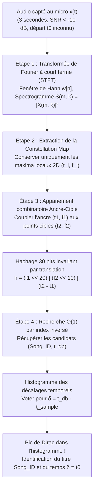
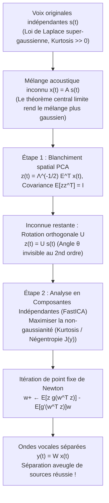

Imaginez-vous dans un café bondé : le percolateur à expresso siffle, les tasses s'entrechoquent et des dizaines de conversations se superposent. Depuis un petit haut-parleur fixé au plafond, une mélodie à peine audible se fait entendre. Vous sortez votre smartphone, appuyez sur un bouton et tendez le microphone pendant <strong>trois secondes</strong>. En une fraction de seconde, l'écran affiche le titre exact du morceau, l'artiste, la pochette de l'album et même les paroles synchronisées au dixième de seconde près — par exemple à 2 minutes et 14 secondes.

Du point de vue de la théorie de l'information et du traitement numérique du signal (DSP), cette prouesse quotidienne résout un défi mathématique redoutable :

1. <strong>Rapport signal sur bruit catastrophique ($\text{SNR} < -10\,\text{dB}$)</strong> : Plus de 90 % de l'énergie acoustique captée provient du bruit ambiant (voix, chocs, ventilation).
2. <strong>Réponse impulsionnelle de la pièce inconnue</strong> : Le signal original $s(t)$ subit la distorsion du haut-parleur et la réverbération des murs (convolution avec $h_{\text{room}}(t)$), donnant $x(t) = (s * h_{\text{room}})(t) + n(t)$.
3. <strong>Décalage temporel arbitraire ($t_0$ inconnu)</strong> : L'extrait de 3 secondes $[t_0, t_0 + 3\,\text{s}]$ commence à n'importe quel instant du morceau.
4. <strong>Un catalogue de 100 millions de titres ($10^8$ chansons)</strong> : Plus de 1 000 ans d'audio continu doivent être fouillés en quelques centaines de millisecondes.

Cet article décortique l'architecture en quatre étapes de <strong>l'empreinte acoustique Shazam</strong> publiée par Avery Li-Chun Wang en 2003 (*"An Industrial-Strength Audio Search Algorithm"*, ISMIR), puis explore son problème dual : <strong>le problème de la soirée cocktail (Cocktail Party Problem) et la séparation aveugle de sources (BSS)</strong> par <strong>Analyse en Composantes Indépendantes (ICA / FastICA)</strong>.

---

## Chapitre 1 : Pourquoi la corrélation directe et le hachage cryptographique échouent totalement

Les fonctions de hachage cryptographiques (`SHA-256`, `MD5`) reposent sur <strong>l'effet d'avalanche</strong> : modifier un seul bit en entrée inverse aléatoirement 50 % des bits de sortie. Le moindre bruit thermique ou réencodage MP3 détruit complètement le hachage.

Quant à la <strong>corrélation croisée temporelle</strong> $R_{x s_i}[\tau] = \sum_{n=0}^{L-1} x[n]\, s_i[n + \tau]$ sur $10^8$ chansons (à $f_s = 8000\,\text{Hz}$, soit $L = 24\,000$ échantillons pour 3 secondes), elle exigerait d'évaluer $1{,}92 \times 10^{14}$ décalages $\tau$, soit <strong>$4{,}6 \times 10^{18}$ opérations (4,6 ExaFLOPs)</strong> par requête ! De plus, la réverbération de la pièce $h_{\text{room}}(t)$ brouille la phase du signal temporel $x[n]$, faisant chuter la corrélation vers zéro alors même que l'oreille humaine (insensible à la phase selon la loi de Helmholtz) reconnaît parfaitement la musique.

---

## Chapitre 2 : Étape 1 — Transformée de Fourier à court terme (STFT) et incertitude de Gabor-Heisenberg

Pour éliminer la sensibilité à la phase, l'étape 1 convertit l'onde 1D $x[n]$ (sous-échantillonnée à $f_s = 8000\,\text{Hz}$) en un <strong>spectrogramme</strong> temps-fréquence 2D à l'aide d'une <strong>fenêtre de Hann</strong> $w[n] = 0{,}5 - 0{,}5\cos\left(\frac{2\pi n}{N-1}\right)$ de taille $N$ et d'un pas d'avancement $H$ :

$$X(m, k) = \sum_{n=0}^{N-1} x[n + mH]\, w[n]\, e^{-i \frac{2\pi k n}{N}}, \qquad S(m, k) = |X(m, k)|^2$$

Le choix de la longueur de fenêtre $N$ est gouverné par le <strong>principe d'incertitude temps-fréquence de Gabor-Heisenberg</strong> :

$$\sigma_t \cdot \sigma_\omega \ge \frac{1}{2} \quad \Longleftrightarrow \quad \Delta t \cdot \Delta f = \left(\frac{N}{f_s}\right) \cdot \left(\frac{f_s}{N}\right) = 1$$

Une fenêtre trop longue ($N = 4096$) offre une résolution fréquentielle fine mais étale les attaques de percussions sur $\Delta t = 512\,\text{ms}$ ; une fenêtre trop courte ($N = 128$) localise les transitoires mais fusionne les notes adjacentes ($\Delta f = 62{,}5\,\text{Hz}$). Shazam adopte le compromis optimal <strong>$N = 1024$ ($\Delta t = 128\,\text{ms}$, $\Delta f = 7{,}8125\,\text{Hz}$)</strong>.

---

## Chapitre 3 : Étape 2 — Extraction de pics parcimonieux : La « Constellation Map »

Pour survivre à un rapport signal sur bruit de $-10\,\text{dB}$, Avery Wang <strong>élimine 99,9 % des données du spectrogramme</strong> et ne conserve que les coordonnées $(t_i, f_i)$ des <strong>maxima locaux 2D</strong> dans un voisinage $\mathcal{N}(m_i, k_i)$ :

$$(m_i, k_i) \in \mathcal{P} \iff S(m_i, k_i) > S(m, k) \quad \forall (m, k) \in \mathcal{N}(m_i, k_i) \setminus \{(m_i, k_i)\}$$

Projeté sur le plan $(t, f)$, ce nuage de points évoque une carte céleste, d'où le nom de <strong>Constellation Map (carte de constellations)</strong>.
1. <strong>Des sommets qui percent le brouillard</strong> : Le bruit de fond additif élève le « niveau de la mer », submergeant les vallées, mais les plus hauts sommets spectraux (transitoires de caisse claire, formants vocaux) émergent toujours aux mêmes coordonnées $(t_i, f_i)$.
2. <strong>Invariance à l'égalisation (EQ) et au gain (AGC)</strong> : L'amplitude $S(t_i, f_i)$ est totalement jetée ! Seul le couple $(t_i, f_i)$ est conservé, rendant l'empreinte insensible au volume du micro et au filtrage fréquentiel $|H_{\text{room}}(f)|^2$.

---

## Chapitre 4 : Étape 3 — Hachage combinatoire 32 bits de paires Ancre-Cible

Indexer un pic isolé par sa seule fréquence $f_i \in [0, 1023]$ (10 bits = 1 024 compartiments) provoquerait des centaines de millions de collisions.

L'astuce géniale de Wang consiste à former des <strong>paires combinatoires Ancre-Cible (Combinatorial Hashing)</strong> :
Chaque <strong>point d'ancrage</strong> $p_1 = (t_1, f_1)$ est associé à un maximum de $F \approx 10$ (<strong>facteur de fan-out</strong>) <strong>points cibles</strong> $p_2 = (t_2, f_2)$ situés dans une zone cible juste en avant dans le temps ($\Delta t = t_2 - t_1 \in [\tau_{\min}, \tau_{\max}]$). Les deux fréquences et leur <strong>différence de temps relative $\Delta t = t_2 - t_1$</strong> sont condensées dans un <strong>entier de 32 bits $h$</strong> :

$$h = \text{Hash}(f_1,\; f_2,\; t_2 - t_1) = (f_1 \ll 20) \;\mid\; (f_2 \ll 10) \;\mid\; (\Delta t)$$

- <strong>Un million de fois moins de collisions</strong> : L'espace de hachage passe de 10 bits ($10^3$ compartiments) à <strong>30 bits ($2^{30} \approx 1{,}07 \times 10^9$ compartiments)</strong> !
- <strong>Invariance parfaite par translation temporelle</strong> : Puisque $\Delta t' = (t_2 - t_0) - (t_1 - t_0) = t_2 - t_1$, l'instant de départ inconnu $t_0$ s'annule algébriquement ! Même si 70 % des pics sont détruits par le bruit ($p = 0{,}3$), $p^2 = 9\,\%$ des paires survivent intactes.



---

## Chapitre 5 : Étape 4 — Index inversé et histogramme de coïncidence temporelle ($\Delta T$)

Pour chaque correspondance $(\text{Song\_ID}, t_{\text{db}, k})$ issue de l'index inversé, le serveur calcule la <strong>différence de décalage temporel</strong> :

$$\delta_k = t_{\text{db}, k} - t_{\text{sample}, k}$$

Pour un mauvais titre, les valeurs $\delta_k$ se dispersent aléatoirement. Pour la <strong>bonne chanson</strong>, toutes les vraies correspondances vérifient $t_{\text{db}, k} = t_{\text{sample}, k} + t_0$, de sorte que tous les $\delta_k = t_0$ s'accumulent dans la même case de l'histogramme, formant un <strong>pic de Dirac géant</strong> !

| Critère | Corrélation croisée temporelle | Hachage cryptographique (`SHA-256`) | Empreinte Chroma (`Chromaprint`) | Shazam Constellation + Hachage combinatoire |
| :--- | :--- | :--- | :--- | :--- |
| <strong>Représentation</strong> | Échantillons PCM $x[n]$ | Flux d'octets brut | Vecteurs d'énergie à 12 demi-tons | Paires de pics STFT $(f_1, f_2, \Delta t)$ |
| <strong>Robustesse à $-10\,\text{dB}$</strong> | Très faible (phase & bruit) | Nulle (effet d'avalanche) | Moyenne | <strong>Exceptionnelle (pics émergents)</strong> |
| <strong>Extrait libre de 3s ($t_0$)</strong> | Balayage de $10^{14}$ positions | Impossible | Fenêtre glissante requise | <strong>Invariance exacte ($\Delta t$ annule $t_0$)</strong> |
| <strong>Complexité ($10^8$ titres)</strong> | $O(N_{\text{songs}} \cdot L^2)$ (heures) | $O(1)$ (inutilisable sous bruit) | Recherche sous-linéaire | <strong>Index inversé $O(1)$ + histogramme $O(1)$</strong> |

---

## Chapitre 6 : Le défi complémentaire — Le problème de la soirée cocktail et l'ICA (FastICA)

Que faire si, au lieu d'éliminer les voix du café, nous voulons <strong>séparer physiquement les $M$ locuteurs simultanés à partir du mélange $\mathbf{x}(t) = \mathbf{A}\mathbf{s}(t)$</strong> sans connaître ni les voix $\mathbf{s}(t)$ ni la matrice de mélange $\mathbf{A}$ ? C'est le <strong>problème de la soirée cocktail (Colin Cherry, 1953)</strong> ou <strong>séparation aveugle de sources (BSS)</strong>.

### 6.1 Pourquoi l'Analyse en Composantes Principales (PCA) échoue

Le <strong>blanchiment spatial (PCA Whitening)</strong> via la matrice de covariance $\mathbf{\Sigma}_x = \mathbb{E}[\mathbf{x}\mathbf{x}^\top] = \mathbf{E}\mathbf{\Lambda}\mathbf{E}^\top$ donne :

$$\mathbf{z}(t) = \mathbf{\Lambda}^{-1/2} \mathbf{E}^\top \mathbf{x}(t) = \mathbf{U}\mathbf{s}(t), \qquad \mathbb{E}\!\left[\mathbf{z}\mathbf{z}^\top\right] = \mathbf{I}$$

Les signaux $\mathbf{z}(t)$ sont décorrélés, mais $\mathbf{U} \in O(M)$ reste une <strong>matrice de rotation orthogonale inconnue</strong> ($\mathbf{U}\mathbf{U}^\top = \mathbf{I}$) ! Comme toute rotation $\mathbf{R}(\theta)\mathbf{z}$ préserve la covariance identité $\mathbf{I}$, les statistiques du second ordre sont aveugles à l'angle $\theta$.

### 6.2 Inverser le théorème central limite : Maximiser la non-gaussianité

L'<strong>Analyse en Composantes Indépendantes (ICA)</strong> (Comon 1994, Bell & Sejnowski 1995, Hyvärinen 1999) exploite le <strong>théorème central limite (TCL)</strong> à rebours :
1. <strong>Super-gaussianité de la voix humaine</strong> : Les silences inter-syllabiques ($s_i \approx 0$) et les impulsions vocaliques confèrent à la parole une <strong>distribution de Laplace</strong> à forte <strong>kurtosis</strong> ($\text{kurt}(y) = \mathbb{E}[y^4] - 3(\mathbb{E}[y^2])^2 \gg 0$).
2. <strong>Maximisation de la négentropie</strong> : Selon le TCL, toute combinaison linéaire $y = \mathbf{w}^\top \mathbf{z} = q_1 s_1 + q_2 s_2$ est *plus gaussienne* que les voix pures. En cherchant le vecteur unitaire $\mathbf{w}$ qui maximise la <strong>non-gaussianité</strong> via la <strong>négentropie</strong> $J(y) = H(y_{\text{gauss}}) - H(y) \propto (\mathbb{E}[G(y)] - \mathbb{E}[G(\nu)])^2$ avec $g(y) = \tanh(a_1 y)$, l'algorithme <strong>FastICA</strong> (méthode de Newton sur la sphère unité) isole chaque voix en 10 à 20 itérations :

$$\mathbf{w}^{+} \leftarrow \mathbb{E}\!\left[\mathbf{z}\, g(\mathbf{w}^\top \mathbf{z})\right] - \mathbb{E}\!\left[g'(\mathbf{w}^\top \mathbf{z})\right] \mathbf{w}, \qquad \mathbf{W} \leftarrow \left(\mathbf{W}\mathbf{W}^\top\right)^{-1/2} \mathbf{W}$$



---

## Chapitre 7 : Implémentation complète en Python (Shazam & FastICA)

```python
import numpy as np
from scipy.ndimage import maximum_filter
from collections import defaultdict

class ShazamFingerprinter:
    def __init__(self, fs=8000, n_fft=1024, hop_length=256, neighborhood=(15, 15), fan_out=10):
        self.fs, self.n_fft, self.hop_length = fs, n_fft, hop_length
        self.neighborhood, self.fan_out = neighborhood, fan_out
        self.database = defaultdict(list)

    def stft_spectrogram(self, signal):
        window = np.hanning(self.n_fft)
        n_frames = 1 + (len(signal) - self.n_fft) // self.hop_length
        spec = np.zeros((self.n_fft // 2, n_frames))
        for m in range(n_frames):
            frame = signal[m * self.hop_length : m * self.hop_length + self.n_fft] * window
            spec[:, m] = 10.0 * np.log10(np.abs(np.fft.rfft(frame)[:self.n_fft // 2])**2 + 1e-10)
        return spec

    def extract_peaks(self, spec, pct=85):
        mask = (maximum_filter(spec, size=self.neighborhood) == spec) & (spec > np.percentile(spec, pct))
        f_idx, t_idx = np.where(mask)
        order = np.argsort(t_idx)
        return list(zip(t_idx[order], f_idx[order]))

    def generate_hashes(self, peaks, dt_min=2, dt_max=60, df_max=150):
        hashes = []
        for i, (t1, f1) in enumerate(peaks):
            cnt = 0
            for t2, f2 in peaks[i + 1:]:
                dt = t2 - t1
                if dt < dt_min: continue
                if dt > dt_max: break
                if abs(f2 - f1) <= df_max:
                    h = (int(f1 & 0x3FF) << 20) | (int(f2 & 0x3FF) << 10) | int(dt & 0x3FF)
                    hashes.append((h, int(t1)))
                    cnt += 1
                    if cnt >= self.fan_out: break
        return hashes

    def recognize(self, snippet):
        q_hashes = self.generate_hashes(self.extract_peaks(self.stft_spectrogram(snippet)))
        hist = defaultdict(lambda: defaultdict(int))
        for h, t_s in q_hashes:
            for song_id, t_db in self.database.get(h, ()):
                hist[song_id][t_db - t_s] += 1
        best_song, best_votes, best_dt = None, 0, 0
        for song_id, counts in hist.items():
            dt, votes = max(counts.items(), key=lambda x: x[1])
            if votes > best_votes:
                best_song, best_votes, best_dt = song_id, votes, dt
        return best_song, best_votes, best_dt * self.hop_length / self.fs

def fast_ica(X, max_iter=200, tol=1e-7):
    m, n = X.shape
    Xc = X - np.mean(X, axis=1, keepdims=True)
    eigvals, eigvecs = np.linalg.eigh((Xc @ Xc.T) / n)
    Z = (np.diag(1.0 / np.sqrt(eigvals + 1e-12)) @ eigvecs.T) @ Xc
    W = np.eye(m)
    for _ in range(max_iter):
        WZ = W @ Z
        g, gp = np.tanh(WZ), 1.0 - np.tanh(WZ)**2
        W_new = (g @ Z.T) / n - np.diag(np.mean(gp, axis=1)) @ W
        u, _, vt = np.linalg.svd(W_new)
        W_new = u @ vt
        if np.max(np.abs(np.abs(np.diag(W_new @ W.T)) - 1.0)) < tol:
            break
        W = W_new
    return W @ Z
```
