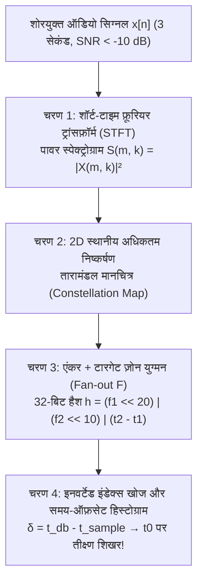

कल्पना कीजिए कि आप एक भीड़-भाड़ वाले कैफ़े में खड़े हैं: एस्प्रेसो मशीन तेज़ भाप छोड़ रही है, कप और प्लेटें खनखना रही हैं, दर्जनों लोग एक साथ बातचीत कर रहे हैं, और छत पर लगे एक सस्ते स्पीकर से बहुत धीमी आवाज़ में कोई गाना बज रहा है। आप अपना स्मार्टफ़ोन निकालते हैं और केवल <strong>तीन सेकंड</strong> के लिए माइक्रोफ़ोन ऑन करते हैं। एक सेकंड से भी कम समय में स्क्रीन पर उस गाने का सटीक नाम, गायक, एल्बम कवर और यहाँ तक कि उस सटीक पल (जैसे `02:14`) के सिंक्रोनाइज़्ड लिरिक्स आ जाते हैं!

सूचना सिद्धांत (Information Theory) और डिजिटल सिग्नल प्रोसेसिंग (DSP) की दृष्टि से यह रोज़मर्रा का चमत्कार चार अत्यंत कठिन गणितीय चुनौतियों को हल करता है:

1. <strong>भयावह सिग्नल-टू-नॉइज़ अनुपात ($\text{SNR} < -10\,\text{dB}$)</strong>: माइक्रोफ़ोन तक पहुँचने वाली 90% से अधिक ध्वनि ऊर्जा केवल पृष्ठभूमि का शोर (Background Noise) है।
2. <strong>कमरे की प्रतिध्वनि और चैनल विरूपण (*Room Impulse Response*)</strong>: मूल संगीत संकेत $s(t)$ स्पीकर और दीवारों से टकराकर ($h_{\text{room}}(t)$ के साथ कन्वोल्यूशन) $x(t) = (s * h_{\text{room}})(t) + n(t)$ में बदल जाता है।
3. <strong>अज्ञात प्रारंभिक समय ($t_0$-Time Shift Invariance)</strong>: 3 सेकंड का यह नमूना $[t_0, t_0 + 3\,\text{s}]$ गाने के किसी भी अज्ञात हिस्से से शुरू हो सकता है।
4. <strong>10 करोड़ ($10^8$) गानों के विशाल डेटाबेस में खोज</strong>: 1,000 वर्षों से अधिक की कुल अवधि वाले ऑडियो डेटाबेस में कुछ मिलीसेकंड के भीतर मिलान करना आवश्यक है।

इस लेख में हम Shazam के सह-संस्थापक <strong>एवरी ली-चुन वांग (Avery Li-Chun Wang)</strong> के ऐतिहासिक 2003 ISMIR शोधपत्र (*"An Industrial-Strength Audio Search Algorithm"*) के चार-चरणीय <strong>ध्वनिक फ़िंगरप्रिंटिंग (Acoustic Fingerprinting)</strong> आर्किटेक्चर का विश्लेषण करेंगे, और इसके साथ ही इसकी पूरक समस्या—<strong>कॉकटेल पार्टी समस्या (Cocktail Party Problem)</strong> तथा <strong>स्वतंत्र घटक विश्लेषण (ICA / FastICA)</strong> द्वारा <strong>ब्लाइंड सोर्स सेपरेशन (BSS)</strong>—का गणितीय रहस्य समझेंगे।

---

## अध्याय 1: प्रत्यक्ष वेवफ़ॉर्म मिलान और क्रिप्टोग्राफ़िक हैशिंग क्यों विफल हो जाते हैं?

`SHA-256` जैसे क्रिप्टोग्राफ़िक हैश फ़ंक्शन <strong>एवलांच प्रभाव (Avalanche Effect)</strong> के लिए बनाए जाते हैं: यदि ऑडियो में माइक्रोफ़ोन के शोर या MP3 संपीड़न के कारण एक भी बिट बदल जाए, तो हैश के 50% बिट पूरी तरह बदल जाते हैं।

दूसरी ओर, समय-डोमेन में <strong>क्रॉस-कोरिलेशन (Cross-Correlation)</strong> $R_{x s_i}[\tau] = \sum_{n=0}^{L-1} x[n]\, s_i[n + \tau]$ भी दो कारणों से पूरी तरह विफल हो जाता है:
1. <strong>संगणनात्मक विस्फोट</strong>: $f_s = 8000\,\text{Hz}$ सैंपलिंग दर पर 3 सेकंड के नमूने ($L = 24,000$) को $10^8$ गानों से मिलाने के लिए प्रति खोज लगभग <strong>$3.5 \times 10^{18}$ फ़्लोटिंग-पॉइंट ऑपरेशंस (3.5 ExaFLOPs)</strong> की आवश्यकता होगी!
2. <strong>कमरे की प्रतिध्वनि द्वारा फ़ेज़ (Phase) का विनाश</strong>: कमरे की दीवारों से होने वाले बहु-पथ परावर्तन $h_{\text{room}}(t)$ तरंग के फ़ेज़ को पूरी तरह बिगाड़ देते हैं, जिससे समय-डोमेन में डॉट-प्रोडक्ट शून्य के क़रीब गिर जाता है।

---

## अध्याय 2: चरण 1 — शॉर्ट-टाइम फ़ूरियर ट्रांसफ़ॉर्म (STFT) और गैबोर-हाइज़ेनबर्ग अनिश्चितता

फ़ेज़ विरूपण से बचने के लिए सिग्नल $x[n]$ को लंबाई $N$ और हॉप आकार $H$ के ओवरलैपिंग टुकड़ों में बाँटकर <strong>हैन विंडो (Hann Window)</strong> $w[n] = 0.5\left(1 - \cos\frac{2\pi n}{N-1}\right)$ से गुणा किया जाता है और <strong>STFT</strong> द्वारा 2D <strong>पावर स्पेक्ट्रोग्राम</strong> $S(m, k)$ निकाला जाता है:

$$X(m, k) = \sum_{n=0}^{N-1} x[n + mH]\, w[n]\, e^{-i \frac{2\pi k n}{N}}, \qquad S(m, k) = |X(m, k)|^2$$

यहाँ विंडो की लंबाई $N$ का चुनाव <strong>गैबोर-हाइज़ेनबर्ग अनिश्चितता सिद्धांत (Gabor-Heisenberg Uncertainty Principle)</strong> से बँधा है:

$$\sigma_t \cdot \sigma_\omega \ge \frac{1}{2} \quad \Longleftrightarrow \quad \Delta t \cdot \Delta f = \left(\frac{N}{f_s}\right) \cdot \left(\frac{f_s}{N}\right) = 1$$

यदि $N$ बहुत बड़ा हो, तो आवृत्ति विभेदन ($\Delta f$) तो तीक्ष्ण होगा किंतु ड्रम की थाप का समय ($\Delta t$) धुँधला हो जाएगा; यदि $N$ बहुत छोटा हो, तो पास-पास के सुर एक-दूसरे में मिल जाएँगे। Shazam $f_s = 8000\,\text{Hz}$ पर <strong>$N = 1024$ सैंपल ($\Delta t = 128\,\text{ms}$, $\Delta f = 7.8125\,\text{Hz}$)</strong> का इष्टतम संतुलन चुनता है।

---

## अध्याय 3: चरण 2 — "तारामंडल मानचित्र" (Constellation Map) और शोर-प्रतिरोधकता

एवरी वांग की सबसे बड़ी अंतर्दृष्टि यह थी कि पूरे स्पेक्ट्रोग्राम $S(m, k)$ को सहेजने के बजाय केवल उन <strong>स्थानीय शिखरों (Local Maxima / Peaks)</strong> को रखा जाए जो अपने 2D पड़ोस $\mathcal{N}(m_i, k_i)$ के सभी बिंदुओं से बड़े हैं:

$$(m_i, k_i) \in \mathcal{C} \iff S(m_i, k_i) > S(m, k) \quad \forall (m, k) \in \mathcal{N}(m_i, k_i) \setminus \{(m_i, k_i)\}$$

इससे स्पेक्ट्रोग्राम का 99.9% डेटा हट जाता है और समय-आवृत्ति तल पर केवल कुछ चमकीले बिंदुओं $(t_i, f_i)$ का एक विरल नक़्शा बचता है, जिसे वांग ने रात के आकाश के तारों की तरह <strong>Constellation Map (तारामंडल मानचित्र)</strong> नाम दिया।

यह मानचित्र कैफ़े के भारी शोर ($\text{SNR} = -10\,\text{dB}$) में भी क्यों जीवित रहता है? क्योंकि शोर पूरे स्पेक्ट्रम में धुंध की तरह फैलता है, जबकि गायक के वोकल फ़ॉर्मेंट्स और वाद्ययंत्रों के तीव्र प्रहारों की ऊर्जा अत्यंत संकीर्ण शिखरों $(t_i, f_i)$ में केंद्रित होती है जो शोर की परत को चीरकर ऊपर चमकते रहते हैं!

---

## अध्याय 4: चरण 3 और 4 — एंकर-टारगेट युग्मों की 32-बिट कॉम्बिनेटरियल हैशिंग और समय-ऑफ़सेट हिस्टोग्राम

यदि हम केवल एकल शिखर की आवृत्ति $f_1 \in [0, 1023]$ को इंडेक्स करें, तो केवल $1024$ बकेट होने के कारण लाखों गानों में टकराव (Hash Collisions) होगा।

इसलिए Shazam <strong>एंकर-टारगेट युग्मों की कॉम्बिनेटरियल हैशिंग (Anchor-Target Pair Hashing)</strong> करता है:
1. प्रत्येक शिखर $(t_1, f_1)$ को <strong>एंकर बिंदु (Anchor Point)</strong> माना जाता है।
2. उसके आगे के समय $\Delta t = t_2 - t_1 \in [\tau_{\min}, \tau_{\max}]$ में एक <strong>टारगेट ज़ोन (Target Zone)</strong> बनाया जाता है।
3. एंकर को टारगेट ज़ोन के $F \approx 10$ शिखरों $(t_2, f_2)$ (<strong>फ़ैन-आउट फ़ैक्टर $F$</strong>) के साथ जोड़ा जाता है और दोनों आवृत्तियों तथा <strong>सापेक्ष समय-अंतर $\Delta t = t_2 - t_1$</strong> को मिलाकर एक <strong>32-बिट पूर्णांक हैश</strong> बनाया जाता है:

$$h = \text{Hash}(f_1,\; f_2,\; t_2 - t_1) = (f_1 \ll 20) \;\mid\; (f_2 \ll 10) \;\mid\; (t_2 - t_1)$$

इसके दो जादुई गणितीय लाभ हैं:
- <strong>विशिष्टता में $1,000,000$ गुना वृद्धि</strong>: एकल आवृत्ति के $10\,\text{बिट}$ ($10^3$ बकेट) की तुलना में युग्म हैश <strong>$30\,\text{बिट}$ ($10^9$ अद्वितीय बकेट)</strong> प्रदान करता है, जिससे इनवर्टेड इंडेक्स में $O(1)$ समय में खोज होती है!
- <strong>रिकॉर्डिंग शुरू करने के समय $t_0$ से पूर्ण स्वतंत्रता</strong>: क्योंकि हैश में केवल अंतर $(t_2 + t_0) - (t_1 + t_0) = t_2 - t_1$ शामिल है!

चरण 4 में, प्रत्येक मेल खाने वाले हैश $h_k$ के लिए डेटाबेस के समय $t_{\text{db}, k}$ और नमूने के समय $t_{\text{sample}, k}$ का अंतर निकाला जाता है:

$$\delta_k = t_{\text{db}, k} - t_{\text{sample}, k}$$

गलत गानों के संयोगवश मिले हैश अलग-अलग $\delta_k$ पर बिखर जाते हैं, जबकि सही गाने के सभी सत्य हैश एक ही ऑफ़सेट $\delta_k = t_0$ पर इकट्ठे होकर हिस्टोग्राम में <strong>एक विशाल तीक्ष्ण शिखर (Dirac Spike)</strong> बनाते हैं!

---

## अध्याय 5: कॉकटेल पार्टी समस्या और स्वतंत्र घटक विश्लेषण (ICA / FastICA)

यदि हम शोर में गाना पहचानने के बजाय एक साथ बोल रहे कई लोगों की <strong>आवाज़ों को अलग-अलग करना</strong> चाहें (<strong>Cocktail Party Problem</strong>), तो क्या करें?
मान लीजिए $M$ माइक्रोफ़ोन $M$ स्वतंत्र वक्ताओं $\mathbf{s}(t)$ के रैखिक मिश्रण $\mathbf{x}(t) = \mathbf{A}\mathbf{s}(t)$ को रिकॉर्ड करते हैं, जहाँ मिश्रण मैट्रिक्स $\mathbf{A}$ अज्ञात है। हमें $\mathbf{W} = \mathbf{A}^{-1}$ खोजना है ताकि $\hat{\mathbf{s}}(t) = \mathbf{W}\mathbf{x}(t)$ प्राप्त हो सके।

### PCA (प्रिंसिपल कंपोनेंट एनालिसिस) आवाज़ों को अलग क्यों नहीं कर पाता?
PCA और व्हाइटनिंग ($\mathbf{z} = \mathbf{V}\mathbf{x}$) केवल द्वितीय-क्रम सहप्रसरण ($\mathbb{E}[\mathbf{z}\mathbf{z}^\top] = \mathbf{I}$) को असंबंधित करते हैं। किंतु किसी भी ऑर्थोगोनल रोटेशन मैट्रिक्स $\mathbf{U} \in O(M)$ के लिए $\mathbb{E}[(\mathbf{U}\mathbf{z})(\mathbf{U}\mathbf{z})^\top] = \mathbf{U}\mathbf{I}\mathbf{U}^\top = \mathbf{I}$ रहता है! अर्थात् द्वितीय-क्रम सांख्यिकी कोण $\mathbf{U}$ को निर्धारित नहीं कर सकती।

### ICA और FastICA: नॉन-गॉसियनिटी (Non-Gaussianity) का अधिकतमीकरण
<strong>स्वतंत्र घटक विश्लेषण (ICA — पियरे कॉमोन 1994, आपो ह्यवैरिनेन FastICA 1999)</strong> <strong>केंद्रीय सीमा प्रमेय (Central Limit Theorem)</strong> का उपयोग करता है:
- मानव आवाज़ $s_i(t)$ का प्रायिकता बंटन <strong>सुपर-गॉसियन (Super-Gaussian / नुकीला शिखर और भारी पूँछ)</strong> होता है।
- केंद्रीय सीमा प्रमेय के अनुसार, दो स्वतंत्र संकेतों का योग $y = q_1 s_1 + q_2 s_2$ हमेशा मूल संकेतों की तुलना में <strong>अधिक गॉसियन (Gaussian)</strong> होता है!
- इसलिए, $y = \mathbf{w}^\top \mathbf{z}$ की <strong>नॉन-गॉसियनिटी (गैर-गॉसियनता)</strong> तभी अधिकतम होगी जब $\mathbf{w}$ किसी एक शुद्ध आवाज़ ($y = \pm s_i$) को अलग कर ले!

<strong>FastICA</strong> एल्गोरिदम चौथे क्रम के आघूर्ण <strong>कर्टोसिस (Kurtosis)</strong> या <strong>नेगएंट्रॉपी (Negentropy)</strong> को अधिकतम करता है:

$$\text{kurt}(y) = \mathbb{E}[y^4] - 3\left(\mathbb{E}[y^2]\right)^2, \qquad J(y) = H(y_{\text{gauss}}) - H(y)$$

और न्यूटन के फ़िक्स्ड-पॉइंट इटरेशन द्वारा बिना किसी पूर्व जानकारी के प्रत्येक व्यक्ति की आवाज़ को क्रिस्टल की तरह साफ़ अलग कर देता है!

---

## अध्याय 6: ऑडियो सिग्नल विश्लेषण विधियों की तुलनात्मक तालिका

| विधि / एल्गोरिदम | मुख्य गणितीय आधार | शोर और प्रतिध्वनि के प्रति सहनशीलता | संगणनात्मक जटिलता | प्रमुख अनुप्रयोग |
|---|---|---|---|---|
| <strong>समय-डोमेन क्रॉस-कोरिलेशन</strong> | तरंग $x[n]$ का प्रत्यक्ष डॉट-प्रोडक्ट | अत्यंत कम (कमरे के फ़ेज़ बदलाव से नष्ट) | $O(L \cdot N_{\text{db}})$ (बड़े डेटाबेस के लिए असंभव) | प्रयोगशाला सिग्नल सिंक्रोनाइज़ेशन |
| <strong>Shazam (Constellation Hashing)</strong> | STFT + स्थानीय शिखर + 32-बिट युग्म हैश $(f_1, f_2, \Delta t)$ | अत्यधिक उच्च ($\text{SNR} < -10\,\text{dB}$ पर भी सटीक) | $O(1)$ हैश-टेबल लुकअप + $\delta$ हिस्टोग्राम | संगीत और टीवी ऑडियो की त्वरित पहचान |
| <strong>PCA / Whitening</strong> | सहप्रसरण मैट्रिक्स $\mathbb{E}[\mathbf{x}\mathbf{x}^\top]$ के आइगेनवेक्टर | केवल द्वितीय-क्रम सहसंबंध हटाता है (रोटेशन $\mathbf{U}$ अस्पष्ट) | $O(M^2 T + M^3)$ | आयाम न्यूनीकरण और ICA पूर्व-प्रसंस्करण |
| <strong>FastICA (ब्लाइंड सोर्स सेपरेशन)</strong> | नॉन-गॉसियनिटी (कर्टोसिस / नेगएंट्रॉपी, क्रम $\ge 4$) का अधिकतमीकरण | रैखिक मिश्रणों को सटीक रूप से अलग करता है ($M_{\text{mic}} \ge M_{\text{src}}$) | न्यूटन विधि का त्रिघातीय अभिसरण | कॉकटेल पार्टी वॉइस सेपरेशन, EEG/ECG सिग्नल शोधन |

---

## निष्कर्ष

Shazam का तारामंडल हैशिंग एल्गोरिदम और स्वतंत्र घटक विश्लेषण (ICA) दोनों यह सिद्ध करते हैं कि जब समय-डोमेन में ध्वनि तरंगें शोर में डूबी हुई और उलझी हुई प्रतीत होती हैं, तब उन्हें सही गणितीय इनवेरिएंट्स—चाहे वह समय-आवृत्ति के विरल शिखर युग्म हों या उच्च-क्रम की गैर-गॉसियन एंट्रॉपी—में रूपांतरित करके पलक झपकते ही सटीक सूचना निकाली जा सकती है।
