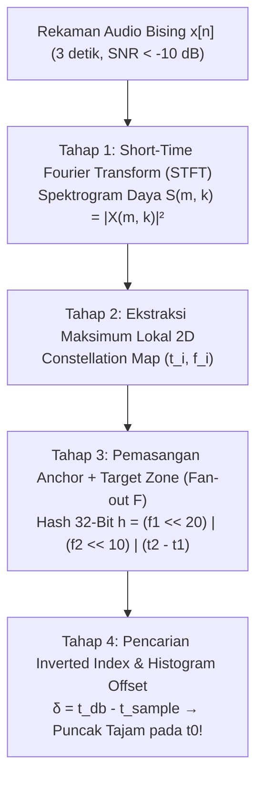

Bayangkan Anda sedang berada di sebuah kedai kopi yang sangat ramai: mesin espresso mendesis keras, cangkir beradu, puluhan pengunjung berbicara serentak, sementara dari pengeras suara murah di langit-langit terdengar samar-samar sebuah lagu. Anda mengangkat ponsel selama <strong>tiga detik</strong>. Kurang dari satu detik kemudian, layar ponsel menampilkan judul lagu yang tepat, nama penyanyi, sampul album, bahkan lirik yang tersinkronisasi tepat pada detik lagu tersebut sedang diputar (misalnya menit `02:14`).

Dari sudut pandang teori informasi dan pemrosesan sinyal digital (*Digital Signal Processing* / DSP), kemampuan ini memecahkan empat rintangan matematis yang tampak mustahil:

1. <strong>Rasio Sinyal terhadap Derau yang Ekstrem ($\text{SNR} < -10\,\text{dB}$)</strong>: Lebih dari 90% energi akustik yang ditangkap mikrofon berasal dari kebisingan latar belakang.
2. <strong>Distorsi Kanal dan Gema Ruangan (*Room Impulse Response*)</strong>: Sinyal asli $s(t)$ terdistorsi oleh pengeras suara dan pantulan dinding ruangan ($h_{\text{room}}(t)$) menjadi konvolusi $x(t) = (s * h_{\text{room}})(t) + n(t)$.
3. <strong>Invariansi Pergeseran Waktu ($t_0$)</strong>: Cuplikan 3 detik $[t_0, t_0 + 3\,\text{s}]$ diambil dari posisi acak di tengah lagu.
4. <strong>Pencarian di Antara 100 Juta Lagu ($10^8$ Lagu)</strong>: Basis data berdurasi lebih dari 1.000 tahun pemutaran nonstop harus dicocokkan dalam hitungan milidetik.

Dalam artikel ini, kita membedah arsitektur empat tahap <strong>Sidik Jari Akustik (*Acoustic Fingerprinting* — Algoritma Shazam)</strong> yang dirancang oleh <strong>Avery Li-Chun Wang (2003)</strong>, serta masalah kembarannya: <strong>Masalah Pesta Koktail (*Cocktail Party Problem*)</strong> dan <strong>Pemisahan Sumber Buta (*Blind Source Separation* / BSS)</strong> menggunakan <strong>Analisis Komponen Independen (ICA / FastICA)</strong>.

---

## Bab 1: Mengapa Pencocokan Gelombang Langsung dan Hash Kriptografi Gagal Total

Fungsi hash kriptografi seperti `SHA-256` dirancang dengan <strong>Efek Longsoran (*Avalanche Effect*)</strong>: perubahan satu bit saja pada sinyal audio akibat derau termal mikrofon atau kompresi MP3 akan mengubah 50% bit hash secara acak.

Begitu pula <strong>Korelasi Silang (*Cross-Correlation*)</strong> domain waktu $R_{x s_i}[\tau] = \sum_{n=0}^{L-1} x[n]\, s_i[n + \tau]$ terhadap $10^8$ lagu gagal karena dua alasan:
1. <strong>Ledakan Komputasi</strong>: Pada frekuensi sampling $f_s = 8000\,\text{Hz}$ ($L = 24.000$ sampel untuk 3 detik), mencocokkan terhadap $10^8$ lagu berdurasi 3 menit membutuhkan sekitar <strong>$3{,}5 \times 10^{18}$ operasi (3,5 ExaFLOPs)</strong> per satu permintaan pengguna!
2. <strong>Kehancuran Spektrum Fase oleh Reverberasi</strong>: Pantulan dinding ruangan $h_{\text{room}}(t)$ mengacak fase gelombang $x[n]$, sehingga korelasi domain waktu anjlok mendekati nol.

---

## Bab 2: Tahap 1 — Transformasi Fourier Waktu-Pendek (STFT) dan Prinsip Ketidakpastian Gabor-Heisenberg

Untuk membuang distorsi fase, sinyal waktu diskrit $x[n]$ dipotong menjadi bingkai (*frames*) sepanjang $N$ sampel dengan pergeseran (*hop size*) $H$, dikalikan dengan <strong>jendela Hann</strong> $w[n] = 0{,}5\left(1 - \cos\frac{2\pi n}{N-1}\right)$, lalu diubah menjadi <strong>Spektrogram Daya 2D</strong> melalui <strong>STFT</strong>:

$$X(m, k) = \sum_{n=0}^{N-1} x[n + mH]\, w[n]\, e^{-i \frac{2\pi k n}{N}}, \qquad S(m, k) = |X(m, k)|^2$$

Pemilihan panjang jendela $N$ dibatasi oleh <strong>Prinsip Ketidakpastian Gabor-Heisenberg</strong>:

$$\sigma_t \cdot \sigma_\omega \ge \frac{1}{2} \quad \Longleftrightarrow \quad \Delta t \cdot \Delta f = \left(\frac{N}{f_s}\right) \cdot \left(\frac{f_s}{N}\right) = 1$$

Jika $N$ terlalu besar, resolusi frekuensi $\Delta f$ sangat tajam tetapi ketukan drum menjadi kabur secara waktu ($\Delta t$ buruk); jika $N$ terlalu kecil, waktu ketukan sangat presisi tetapi nada-nada yang berdekatan menyatu. Shazam memilih titik keseimbangan optimal <strong>$N = 1024$ sampel ($\Delta t = 128\,\text{ms}$, $\Delta f = 7{,}8125\,\text{Hz}$ pada $f_s = 8000\,\text{Hz}$)</strong>.

---

## Bab 3: Tahap 2 — Ekstraksi Puncak Lokal menjadi "Peta Rasi Bintang" (Constellation Map)

Alih-alih menyimpan seluruh matriks spektrogram $S(m, k)$, Avery Wang menerapkan <strong>Non-Maximum Suppression 2D</strong>: hanya titik $(m_i, k_i)$ yang nilainya lebih besar secara ketat daripada seluruh tetangga di sekitarnya $\mathcal{N}(m_i, k_i)$ yang dipertahankan:

$$(m_i, k_i) \in \mathcal{C} \iff S(m_i, k_i) > S(m, k) \quad \forall (m, k) \in \mathcal{N}(m_i, k_i) \setminus \{(m_i, k_i)\}$$

Hasilnya adalah peta titik-titik koordinat waktu-frekuensi $(t_i, f_i)$ yang sangat jarang (*sparse* — membuang $99{,}9\%$ data), yang disebut <strong>Peta Rasi Bintang (*Constellation Map*)</strong>.

Mengapa peta ini tahan terhadap bisingnya mesin kopi? Karena derau akustik menyebar secara merata di seluruh spektrum seperti kabut tipis, sedangkan puncak energi lokal tertinggi dari harmonik vokal dan transien perkusi tetap menonjol menembus lantai derau (*noise floor*)—persis seperti bintang-bintang terang rasi Orion yang tetap terlihat di langit malam kota besar!

---

## Bab 4: Tahap 3 & 4 — Hashing Kombinatorial Pasangan 32-Bit dan Histogram Koinsidensi Waktu

Jika kita hanya mengindeks frekuensi satu titik puncak $f_1 \in [0, 1023]$, hanya ada $1.024$ kemungkinan nilai sehingga terjadi jutaan tabrakan (*hash collisions*).

Oleh karena itu, Shazam menggunakan <strong>Hashing Kombinatorial Pasangan Jangkar-Target (*Anchor-Target Pair Hashing*)</strong>:
1. Setiap puncak $(t_1, f_1)$ dijadikan <strong>Titik Jangkar (*Anchor Point*)</strong>.
2. Di sebelah kanannya (masa depan dekat $\Delta t = t_2 - t_1 \in [\tau_{\min}, \tau_{\max}]$) ditentukan <strong>Zona Target (*Target Zone*)</strong>.
3. Jangkar dipasangkan dengan $F \approx 10$ puncak target $(t_2, f_2)$ (<strong>Fan-out Factor $F$</strong>), lalu informasi pasangan tersebut dikemas ke dalam <strong>satu bilangan bulat hash 32-bit</strong>:

$$h = \text{Hash}(f_1,\; f_2,\; t_2 - t_1) = (f_1 \ll 20) \;\mid\; (f_2 \ll 10) \;\mid\; (t_2 - t_1)$$

Keunggulan matematisnya luar biasa:
- <strong>Spesifisitas Melonjak $1.000.000\times$ Lipat</strong>: Dari $10\,\text{bit}$ ($10^3$ ember) menjadi <strong>$30\,\text{bit}$ ($10^9$ ember unik)</strong> dalam *inverted index*!
- <strong>Invarian terhadap Waktu Mulai Rekaman $t_0$</strong>: Karena yang disimpan adalah selisih waktu relatif $\Delta t = (t_2 + t_0) - (t_1 + t_0) = t_2 - t_1$, nilai hash $h$ tidak berubah sedikit pun meskipun Anda mulai merekam di detik ke-15 maupun menit ke-3!

Pada tahap pencocokan (Tahap 4), untuk setiap hash $h_k$ yang cocok dengan sebuah lagu di database pada waktu $t_{\text{db}, k}$, server menghitung selisih offset:

$$\delta_k = t_{\text{db}, k} - t_{\text{sample}, k}$$

Kecocokan palsu akan menyebar acak di sepanjang sumbu $\delta$, sedangkan lagu yang benar menghasilkan <strong>lonjakan tajam (puncak Dirac)</strong> tepat pada $\delta = t_0$ dalam waktu $O(1)$!

---

## Bab 5: Masalah Pesta Koktail dan Pemisahan Sumber Buta dengan ICA (FastICA)

Bagaimana jika kita tidak hanya ingin mengenali lagu, melainkan <strong>memisahkan secara fisik</strong> suara dua pembicara yang tumpang tindih di ruangan yang sama (<strong>Cocktail Party Problem</strong>)?

Misalkan $M$ mikrofon merekam campuran linear $\mathbf{x}(t) = \mathbf{A}\mathbf{s}(t)$ dari $M$ sumber suara independen $\mathbf{s}(t)$ dengan matriks pencampur $\mathbf{A}$ yang tidak diketahui. Kita ingin menemukan matriks pemisah $\mathbf{W} = \mathbf{A}^{-1}$ sehingga $\hat{\mathbf{s}}(t) = \mathbf{W}\mathbf{x}(t)$.

### Mengapa Principal Component Analysis (PCA) Gagal Memisahkan Suara?
PCA (*Whitening* $\mathbf{z} = \mathbf{V}\mathbf{x}$) hanya membuat sinyal tidak berkorelasi pada momen orde kedua ($\mathbb{E}[\mathbf{z}\mathbf{z}^\top] = \mathbf{I}$). Namun, untuk sembarang matriks rotasi ortogonal $\mathbf{U} \in O(M)$, vektor yang diputar $\mathbf{U}\mathbf{z}$ tetap memiliki kovarians identitas $\mathbf{U}\mathbf{I}\mathbf{U}^\top = \mathbf{I}$! Artinya, statistik orde kedua buta terhadap sudut rotasi $\mathbf{U}$.

### Solusi Independent Component Analysis (ICA): Memaksimalkan Non-Gaussianitas
Kunci dari <strong>ICA (Pierre Comon 1994, Bell & Sejnowski 1995, Aapo Hyvärinen FastICA 1999)</strong> adalah <strong>Teorema Limit Pusat (*Central Limit Theorem*)</strong>:
- Sinyal suara manusia $s_i(t)$ memiliki distribusi <strong>Super-Gaussian (Leptokurtik / puncak tajam dan ekor tebal)</strong>.
- Menurut Teorema Limit Pusat, jumlah dari dua variabel acak independen $y = q_1 s_1 + q_2 s_2$ selalu <strong>lebih mendekati distribusi Gaussian</strong> daripada $s_1$ atau $s_2$ sendiri!
- Oleh karena itu, kombinasi linear $y = \mathbf{w}^\top \mathbf{z}$ mencapai <strong>Non-Gaussianitas maksimum</strong> jika dan hanya jika $\mathbf{w}$ mengekstraksi tepat satu sumber suara murni ($y = \pm s_i$)!

Algoritma <strong>FastICA</strong> memaksimalkan Non-Gaussianitas menggunakan <strong>Kurtosis (momen orde keempat)</strong> atau <strong>Negentropi</strong>:

$$\text{kurt}(y) = \mathbb{E}[y^4] - 3\left(\mathbb{E}[y^2]\right)^2, \qquad J(y) = H(y_{\text{gauss}}) - H(y)$$

melalui iterasi titik-tetap Newton yang konvergen secara kubik, memisahkan suara pembicara dengan jernih tanpa mengetahui geometri ruangan!

---

## Bab 6: Tabel Perbandingan Metode Pemrosesan Sinyal Audio

| Metode / Algoritma | Prinsip Matematika Utama | Ketahanan terhadap Derau & Gema | Kompleksitas Komputasi | Aplikasi Utama |
|---|---|---|---|---|
| <strong>Korelasi Silang Gelombang</strong> | Hasil kali dalam domain waktu $x[n]$ | Sangat buruk (hancur oleh pergeseran fase ruangan) | $O(L \cdot N_{\text{db}})$ (Terlalu lambat) | Sinkronisasi sinyal laboratorium |
| <strong>Shazam (Constellation Hashing)</strong> | STFT + Puncak Lokal + Hash 32-bit $(f_1, f_2, \Delta t)$ | Sangat tinggi (stabil pada $\text{SNR} < -10\,\text{dB}$) | Pencarian tabel hash $O(1)$ + Histogram $\delta$ | Identifikasi lagu & siaran TV instan |
| <strong>PCA / Whitening</strong> | Dekomposisi nilai eigen kovarians $\mathbb{E}[\mathbf{x}\mathbf{x}^\top]$ | Hanya mendekorelasi orde ke-2 (ambiguitas rotasi $\mathbf{U}$) | $O(M^2 T + M^3)$ | Reduksi dimensi & pra-pemrosesan |
| <strong>FastICA (Blind Source Separation)</strong> | Maksimalisasi Non-Gaussianitas (Kurtosis / Negentropi orde $\ge 4$) | Memisahkan campuran linear secara presisi ($M_{\text{mic}} \ge M_{\text{src}}$) | Konvergensi kubik iterasi titik-tetap | Pemisahan suara (*Cocktail Party*), pembersihan sinyal EEG/EKG |

---

## Kesimpulan

Baik algoritma Shazam maupun Independent Component Analysis (ICA) membuktikan kekuatan transformasi representasi matematika: ketika gelombang suara tampak kacau di domain waktu, proyeksi ke dalam <strong>invarian geometri waktu-frekuensi (Constellation Map)</strong> atau <strong>statistik orde tinggi Non-Gaussian (ICA)</strong> mampu mengekstrak informasi murni dari tengah kebisingan ekstrem dalam sekejap mata.
