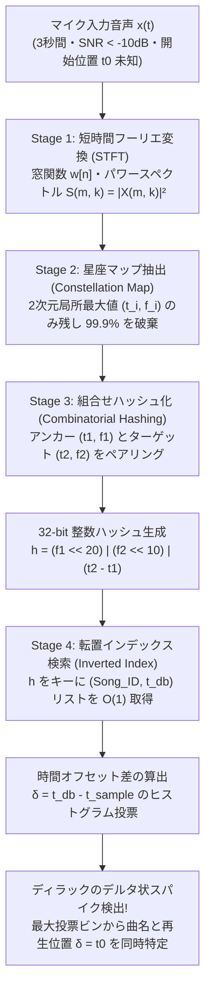
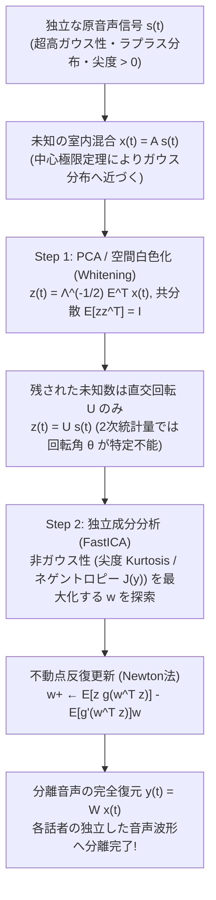

エスプレッソマシンが激しい蒸気音を立て、食器がぶつかり合い、周囲のテーブルで何十人もの客が同時に会話している騒がしいカフェの店内を想像してほしい。天井の安価なスピーカーから、聞き覚えのあるメロディが微かに流れてくる。スマートフォンの画面を開いてアプリ（Shazamなど）のボタンをタップし、わずか<strong>3秒間</strong>だけ空中にマイクをかざす。すると1秒も経たないうちに、画面にはその曲のタイトル、アーティスト名、アルバムジャケット、さらには「現在、曲の開始から2分14秒目を再生中」という正確なタイムスタンプに合わせて同期する歌詞までが表示される。

普段は何気なく使っているこの機能だが、情報理論とデジタル信号処理（DSP: Digital Signal Processing）の観点から冷静に条件を整理すると、これが<strong>いかに常軌を逸した数学的難題であるか</strong>が浮かび上がってくる。

1. <strong>極悪な信号対雑音比（$\text{SNR} < -10\,\text{dB}$）</strong>: スマートフォンのマイクが拾っている音波のエネルギーの90%以上は、周囲の話し声、空調のハム音、食器の衝撃音といった無関係な環境雑音（Additive Noise）である。目的の音楽信号は雑音の海に深く埋もれている。
2. <strong>未知の室内音響伝達関数と歪み</strong>: 原曲のデジタルデータ（$s(t)$）がそのまま届いているわけではない。安価な店内スピーカーの非線形歪みを通過し、壁や天井で幾重にも反射・残響（インパルス応答 $h_{\text{room}}(t)$ との畳み込み）し、さらにスマートフォンの小型MEMSマイクの周波数特性によって低域と高域が削り取られた信号 $x(t) = (s * h_{\text{room}})(t) + n(t)$ しか観測できない。
3. <strong>開始位置（オフセット $t_0$）の完全な未知性</strong>: ユーザーは曲の冒頭（0分00秒）から録音してくれるわけではない。4分間の楽曲の「どこか任意の3秒間 $[t_0, t_0 + 3\,\text{s}]$」を切り取るため、照合アルゴリズムは時間軸上の平行移動に対して不変（Translation-Invariant）でなければならない。
4. <strong>1億曲（$10^8$曲）の超巨大探索空間</strong>: データベースには約1億曲（総再生時間にして約240億〜400億秒＝<strong>約1,000年分以上</strong>の連続音声）が格納されている。それをスマートフォンからネットワーク越しにクエリを投げてから数百ミリ秒以内に検索し終えなければならない。

本稿では、2003年にAvery Li-Chun Wang（Shazam共同創業者・チーフサイエンティスト）が国際音楽情報検索会議（ISMIR）で発表した伝説的論文 *"An Industrial-Strength Audio Search Algorithm"* の核心にある<strong>4段階の音響指紋（Acoustic Fingerprinting）アーキテクチャ</strong>を、数式と具体的なビット演算レベルまで完全に解剖する。さらに後半では、この問題の「双対（デュアル）」にあたるもう一つの音響工学の金字塔——<strong>「カクテルパーティー効果（Cocktail Party Problem）と独立成分分析（ICA: Independent Component Analysis）によるブラインド信号分離（BSS）」</strong>を取り上げ、「雑音の中から曲名を当てる技術」と「混ざり合った複数の人間の声を個別の波形へと引き剥がす技術」がいかにして同じ時間周波数解析と高次統計量の土壌から生まれているのかを徹底的に解き明かす。

---

## 第1章：なぜ「波形の直接比較」や「暗号学的ハッシュ」は完全に破綻するのか？

まず、素朴に思いつく2つのアプローチがなぜこの問題において1ミリも役に立たないのかを確認しておこう。ここでの失敗の構造こそが、音響指紋アルゴリズムの設計要件を必然的に導き出す。

### 1.1 暗号学的ハッシュ関数（`SHA-256` / `MD5`）の雪崩効果という罠

コンピュータ科学において「巨大なデータベースから一致するデータを$O(1)$で高速検索する」と聞いて真っ先に思い浮かぶのは、`SHA-256` や `MD5` のようなハッシュ関数である。しかし、暗号学的ハッシュ関数は<strong>雪崩効果（Avalanche Effect）</strong>を持つように設計されている。すなわち、入力データのたった1ビット（たとえば1サンプルの最下位ビット）が変化しただけで、出力される256ビットのハッシュ値の約50%（128ビット）が完全にランダムに反転する。

同じスタジオ音源のWAVファイルであっても、MP3（128 kbps）とAAC（256 kbps）で圧縮しただけで波形データは全サンプルで異なり、暗号学的ハッシュは完全に別物になる。ましてや空間を伝播して環境雑音 $n(t)$ が加算されたマイク録音データに対して `SHA-256` を計算することは、砂嵐の画像とモナ・リザの画像のビット列が一致するかを調べるに等しい。必要なのは、入力の微小な変化（あるいは激しい雑音付加）に対してハッシュ値が変化しない<strong>知覚ハッシュ（Perceptual Hash / Acoustic Fingerprint）</strong>である。

### 1.2 時間領域の相互相関（Cross-Correlation）の計算量爆発と位相破綻

では、ハッシュを使わずに、録音された3秒間の波形 $x[n]$ をデータベース内のすべての楽曲波形 $s_i[n]$ の上で1サンプルずつスライドさせながら、<strong>正規化相互相関（Normalized Cross-Correlation）</strong>を計算したらどうだろうか？

$$R_{x s_i}[\tau] = \sum_{n=0}^{L-1} x[n]\, s_i[n + \tau]$$

サンプリング周波数 $f_s = 8,000\,\text{Hz}$ にダウンサンプリングしたとしても、3秒間のクエリ長は $L = 24,000$ サンプルである。平均240秒（$1.92 \times 10^6$ サンプル）の楽曲が $10^8$ 曲あるとき、1曲あたりのスライド位置 $\tau$ は約 $1.92 \times 10^6$ 通り、データベース全体では $1.92 \times 10^{14}$ 通り存在する。各位置で $24,000$ 回の積和演算を行うと、<strong>1回の検索あたり約 $4.6 \times 10^{18}$ 回（4.6エクサFLOPs）</strong>の演算が必要になる。世界最速クラスのスーパーコンピュータを独占しても1クエリに数秒〜数分かかり、世界中のユーザーが毎秒数万回投げるリクエストを処理することは物理的に不可能である。

さらに致命的なことに、仮に無限の計算資源があったとしても、時間領域の相互相関 $R_{x s_i}[\tau]$ は<strong>室内残響による位相歪み（Phase Distortion）</strong>によって完全に崩壊する。室内の壁や天井からの反射音は、周波数ごとに異なる遅延（群遅延）をもたらす。人間の耳（蝸牛の基底膜）は音の「振幅スペクトル」には極めて敏感だが、「位相スペクトル」の変化にはほとんど気づかない（ヘルムホルツの位相聾の法則）。しかし、時間領域の波形 $x[n]$ の形状は位相がわずかに回転しただけで劇的に変形してしまい、原曲波形 $s[n]$ との内積（相関値）はほぼゼロに落ち込んでしまうのである。

---

## 第2章：ステージ1 — 短時間フーリエ変換（STFT）と時間・周波数の不確定性原理

位相の歪みに惑わされず、人間の聴覚システム（蝸牛）と同じように音を捉えるための第一歩は、1次元の時間波形 $x[n]$ を、<strong>時間（Time）× 周波数（Frequency）× エネルギー（Magnitude）</strong>の3次元地形図——すなわち<strong>スペクトログラム（Spectrogram）</strong>へと変換することである。

### 2.1 離散短時間フーリエ変換（STFT）の定式化

まず、マイクから入力された音声信号をモノラル化し、サンプリング周波数 $f_s = 8,000\,\text{Hz}$（ナイキスト周波数 $f_{\text{Nyquist}} = 4,000\,\text{Hz}$）へとダウンサンプリングする。なぜ $44.1\,\text{kHz}$ のCD品質ではなく $8,000\,\text{Hz}$ で十分なのか？ それは、音楽の基音（Fundamental Frequency）と主要な倍音構造、ボーカルのフォルマント、そしてスネアやバスドラムのアタック成分のほぼすべてが $4,000\,\text{Hz}$ 以下に集中しており、それ以上の超高域は室内の空気吸収やマイクの特性で減衰しやすいからである。

長さが $N$ サンプルの窓関数 $w[n]$（一般にサイドローブによるスペクトル漏れを抑える<strong>ハン窓（Hann Window）</strong> $w[n] = 0.5 - 0.5\cos\left(\frac{2\pi n}{N-1}\right)$ が用いられる）を用意し、フレーム番号 $m$ ごとにホップサイズ $H$ サンプルずつずらしながら離散フーリエ変換（DFT）を適用する。これが<strong>短時間フーリエ変換（STFT: Short-Time Fourier Transform）</strong>である。

$$X(m, k) = \sum_{n=0}^{N-1} x[n + mH]\, w[n]\, e^{-i \frac{2\pi k n}{N}} \qquad \left(k = 0, 1, \dots, \frac{N}{2}\right)$$

ここで、$m \in \mathbb{Z}$ は離散化された時間フレーム番号、$k$ は周波数ビン番号（実効周波数 $f_k = k \frac{f_s}{N}\,\text{Hz}$）を表す。複素数 $X(m, k) = |X(m, k)| e^{i \phi(m, k)}$ のうち、室内反射でランダムに乱れる位相項 $e^{i \phi(m, k)}$ を完全に捨て去り、振幅の2乗（パワースペクトル密度）またはその対数デシベル値のみを取り出したものが<strong>スペクトログラム $S(m, k)$</strong> である。

$$S(m, k) = |X(m, k)|^2 = \left(\text{Re}\,X(m, k)\right)^2 + \left(\text{Im}\,X(m, k)\right)^2$$

### 2.2 ガボール・ハイゼンベルクの時間・周波数不確定性原理

ここで、ウィンドウ長 $N$ をいくつに設定すべきかという極めて重要なトレードオフに直面する。量子力学におけるハイゼンベルクの不確定性原理とまったく同じフーリエ解析の数学的定理として、<strong>ガボール・ハイゼンベルクの不確定性原理（Gabor-Heisenberg Uncertainty Principle）</strong>が成り立つ。信号の時間的な広がりの標準偏差を $\sigma_t$、角周波数的な広がりの標準偏差を $\sigma_\omega$ とすると、いかなる窓関数 $w(t)$ を選んでも次の不等式を破ることはできない（等号成立はガウス窓のときのみ）。

$$\sigma_t \cdot \sigma_\omega \ge \frac{1}{2} \quad \Longleftrightarrow \quad \Delta t \cdot \Delta f \ge \frac{1}{4\pi}$$

離散STFTにおいて、窓長 $N$ サンプルが切り出す時間幅は $\Delta t = \frac{N}{f_s}$ 秒であり、隣接する周波数ビンの間隔（周波数分解能）は $\Delta f = \frac{f_s}{N}\,\text{Hz}$ である。両者の積をとると、サンプリング周波数 $f_s$ や窓長 $N$ に一切依存せず、常に定数 $1$ となる。

$$\Delta t \cdot \Delta f = \left(\frac{N}{f_s}\right) \cdot \left(\frac{f_s}{N}\right) = 1$$

- <strong>$N$ を大きくしすぎた場合（例：$N = 4096 \implies \Delta t = 512\,\text{ms}, \Delta f = 1.95\,\text{Hz}$）</strong>:
  周波数分解能は極めて高くなり、ピアノの隣り合う半音のわずかなピッチ差まで精密に分離できる。しかし時間分解能が $0.5$ 秒以上にボケてしまうため、ドラムの鋭い打撃音（トランジェント）がいつ鳴ったのかという時間座標 $m$ が曖昧になり、後述するピーク間の時間差 $\Delta t$ の精度が崩壊する。
- <strong>$N$ を小さくしすぎた場合（例：$N = 128 \implies \Delta t = 16\,\text{ms}, \Delta f = 62.5\,\text{Hz}$）</strong>:
  時間分解能は鋭くなるが、周波数ビン1つあたりの幅が $62.5\,\text{Hz}$ にも広がり、低〜中音域の和音やメロディの音がすべて同じビンに潰れて混ざり合ってしまう。

Shazamの標準的な設計では、$f_s = 8,000\,\text{Hz}$ に対して <strong>$N = 1024$ サンプル（時間窓幅 $\Delta t = 128\,\text{ms}$、周波数分解能 $\Delta f = 7.8125\,\text{Hz}$、有効周波数ビン数 $N/2 = 512$ 個〜$1024$ 個）</strong>、ホップサイズ $H = 512$（50%オーバーラップ、フレーム時間刻み $64\,\text{ms}$）または $H = 256$（$32\,\text{ms}$）といった絶妙なスイートスポットが採用されている。

---

## 第3章：ステージ2 — 星座マップ（Constellation Map）によるスパースな極大ピーク抽出

STFTによって得られたスペクトログラム $S(m, k)$ は、まだ情報量が多すぎるだけでなく、雑音に汚染されている。カフェの環境雑音 $n(t)$ はスペクトログラム全体に「霧」や「海面の上昇」のように加算され、さらに室内音響伝達関数 $H_{\text{room}}(k)$ は特定の周波数帯域を勝手に増幅したり減衰させたり（イコライジング）している。

ここでAvery Wangが導入した画期的なアイデアが、スペクトログラムのデータの <strong>99.9%以上を意図的に捨て去り</strong>、時間・周波数の2次元平面における<strong>局所的最大値（Local Maxima：周囲のどの点よりもエネルギーが突出している山頂の点）の座標 $(t_i, f_i)$ だけを残す</strong>という手法である。

### 3.1 2次元近傍フィルタによる局所ピークの数学的定義

時間フレーム $m_i$、周波数ビン $k_i$ の点 $(m_i, k_i)$ が<strong>ピーク（特徴点）</strong>として抽出されるための必要十分条件は、その点を中心とする2次元矩形近傍領域 $\mathcal{N}(m_i, k_i) = [m_i - \tau_w, m_i + \tau_w] \times [k_i - \nu_w, k_i + \nu_w]$ 内のすべての他点よりも厳密に大きなパワーを持つことである。

$$(m_i, k_i) \in \mathcal{P} \iff S(m_i, k_i) > S(m, k) \quad \forall (m, k) \in \mathcal{N}(m_i, k_i) \setminus \{(m_i, k_i)\}$$

さらに、無音区間や微小な背景ノイズの揺らぎから偽のピークが選ばれるのを防ぐため、対数振幅が適応的閾値（または各周波数帯域 $[30\text{–}40], [40\text{–}80], [80\text{–}120], [120\text{–}180], [180\text{–}300]$ ビンごとの上位 $K$ 個の振幅）を超えるものだけを採用する。このように周波数軸を対数的なサブバンドに分割して各バンドから均等にピークを拾うことで、エネルギーの大きいバスドラムやベース音（低域）ばかりに特徴点が偏るのを防ぎ、中高域のボーカル倍音やシンバルのアタックまでバランスよく星座を構成することができる。

こうして抽出された点群 $\mathcal{P} = \{(t_1, f_1), (t_2, f_2), \dots, (t_M, f_M)\}$ を2次元の $(t, f)$ 平面上にプロットすると、真っ暗な夜空に輝く星々の配置に酷似していることから、Wangはこれを<strong>「星座マップ（Constellation Map）」</strong>と名付けた。

### 3.2 なぜ星座マップは $-10\,\text{dB}$ の騒音とスピーカー歪みに無敵なのか？

星座マップの驚くべき性質は、<strong>「ピークの振幅値 $S(m_i, k_i)$ の大きさそのものを完全に捨て去り、時間と周波数の座標ペア $(t_i, f_i)$ という『点の位置』しか記録しない」</strong>という点にある。これが3つの決定的なロバスト性をもたらす。

1. <strong>加法性雑音（ホワイトノイズ・ピンクノイズ・話し声）に対する耐性</strong>:
   スペクトログラムを標高地形図に例えよう。カフェの雑音は、地形図全体を水没させる「海面（ノイズフロア）の上昇」として働く。標高の低い谷や小さな丘（微細な残響や小さな伴奏音）は海面下に沈んで消えてしまうが、<strong>最も標高の高いエベレストや富士山の山頂（ボーカルの強いフォルマント倍音、シンセサイザーのリード音、スネアドラムのアタック）は、海面がどれほど上昇してもなお水面上に頭を出し続ける</strong>。さらに、別の音源（隣の客の話し声）が局所的に強いピークを作ったとしても、それは「夜空にいくつか余計な偽の星が混ざる」だけであり、本来の楽曲の星座の星々の位置 $(t_i, f_i)$ を動かすことはできない。
2. <strong>室内音響特性・イコライザ・マイク特性に対する不変性</strong>:
   スピーカーや部屋の周波数特性 $H_{\text{room}}(f)$ は、周波数軸上で緩やかに変化する乗法的なフィルタ $S_{\text{mic}}(t, f) \approx |H_{\text{room}}(f)|^2 S_{\text{orig}}(t, f)$ として作用する。振幅値そのものを比較する手法では、低音が強調されたり高音が削られたりすると別物と判定されてしまう。しかし、鋭いスペクトルピークの位置（1階微分 $\frac{\partial S}{\partial f} = 0$ となる極大点 $f_i$）は、なだらかな関数 $|H_{\text{room}}(f)|^2$ を掛け算しても周波数軸上でほとんど移動しない！ さらにピークの振幅値を捨てて座標 $(t_i, f_i)$ のみに二値化（有無のみに還元）するため、マイクの音量（ゲイン）や自動利得制御（AGC）の影響を100%受けない。
3. <strong>データ量の劇的な圧縮</strong>:
   1秒間に約10〜30個の星座点しか抽出されないため、数メガバイトあった元の音声波形は、1秒あたりわずか数十バイトの点群座標データへと約 $1/10,000$ に圧縮される。

---

## 第4章：ステージ3 — アンカーとターゲットの組合せハッシュ（Combinatorial Hashing）

さて、星座マップによってノイズに強い点群 $\mathcal{P} = \{(t_i, f_i)\}$ が得られた。では、この星座の点を使ってどうやって1億曲のデータベースを検索すればよいだろうか？

ここで、<strong>「1個の星座点 $(t_i, f_i)$ をそのままデータベースのキーにして検索する」というナイーブな方法がなぜ破綻するか</strong>を計算してみよう。
まず、録音開始時刻 $t_0$ が未知であるため、絶対時刻 $t_i$ は検索キーに使えない。使えるのは周波数ビン番号 $f_i \in \{0, 1, \dots, 1023\}$（$10\,\text{ビット}$）だけである。
しかし、10ビットの情報が表現できるバケット数は $2^{10} = 1,024$ 通りしかない！ 1億曲（$10^8$曲）のデータベースがあり、1曲あたり平均3,000個の星座点があるとすると、データベース全体には $3 \times 10^{11}$ 個（3,000億個）の点が存在する。これをたった $1,024$ 個の周波数ビンに振り分けると、<strong>1つの周波数ビン $f_i$ を引くだけで約3億件の楽曲がヒットしてしまう（ハッシュ衝突の爆発）</strong>。これでは全く絞り込みにならない。

### 4.1 2つの星を結んで「星座の線分（ペア）」を作る

情報のエントロピー（識別力）を爆発的に高め、同時に「録音開始時刻 $t_0$ に依存しない（平行移動不変な）特徴量」を作るためのAvery Wangの天才的な解決策が、<strong>「単独の星ではなく、2つの星のペア（線分）をハッシュ化する」</strong>という<strong>組合せハッシュ（Combinatorial Hashing）</strong>である。

具体的な手順は以下の通りだ。

1. 星座マップ上の各点 $p_1 = (t_1, f_1)$ を順番に<strong>アンカーポイント（Anchor Point：基準点）</strong>として選ぶ。
2. アンカーポイント $p_1$ の少し未来の時間領域に、矩形の<strong>ターゲットゾーン（Target Zone）</strong> $\mathcal{Z}(p_1)$ を設定する。
   $$\mathcal{Z}(p_1) = \left\{ (t_2, f_2) \in \mathcal{P} \;\middle|\; \tau_{\min} \le t_2 - t_1 \le \tau_{\max}, \quad |f_2 - f_1| \le \Delta f_{\max} \right\}$$
   たとえば、アンカーの $0.1$ 秒後から $2.0$ 秒後まで（フレーム差 $\Delta t = t_2 - t_1 \in [1, 63]$ または $[1, 1023]$）、周波数差が上下一定範囲内の領域をターゲットゾーンとする。
3. このターゲットゾーン $\mathcal{Z}(p_1)$ の中に含まれるピーク点 $p_2 = (t_2, f_2)$ を最大 $F$ 個（<strong>ファンアウト係数 Fan-out Factor</strong>、通常 $F \approx 5 \sim 15$）選び出し、アンカー $p_1$ とペアにする。
4. アンカーの周波数 $f_1$、ターゲットの周波数 $f_2$、そして<strong>2点間の相対的な時間差 $\Delta t = t_2 - t_1$</strong> の3つの整数（3-tuple）だけをビット連結し、<strong>たった1個の32ビット符号なし整数（`uint32`）のハッシュキー $h$</strong> にパッキングする！

$$h = \text{Hash}(f_1,\; f_2,\; t_2 - t_1) = (f_1 \ll 20) \;\mid\; (f_2 \ll 10) \;\mid\; (\Delta t)$$

### 4.2 30ビットへの情報量拡大と「100万倍の衝突削減」の数理

このビットパッキングの威力を確認しよう。
- アンカー周波数 $f_1 \in [0, 1023]$：<strong>10ビット</strong>（ビット20〜29に配置）
- ターゲット周波数 $f_2 \in [0, 1023]$：<strong>10ビット</strong>（ビット10〜19に配置）
- 相対時間差 $\Delta t = t_2 - t_1 \in [0, 1023]$：<strong>10ビット</strong>（ビット0〜9に配置）

合計で <strong>$10 + 10 + 10 = 30\,\text{ビット}$</strong> のハッシュ整数 $h$ が生成される。CPUのレジスタ1個（`uint32`）に余裕で収まるサイズでありながら、ハッシュ空間のバケット数は単独ピークの $2^{10} = 1,024$ 通りから、一気に <strong>$2^{30} = 1,073,741,824$（約10億7,374万通り）</strong>へと拡大する！

ファンアウト係数 $F = 10$ とすると、ペアを作ったことでデータベースに登録するレコード数は $10$ 倍に増えるが、ハッシュ空間の広さは $2^{20} \approx 1,048,576$ 倍（<strong>約100万倍</strong>）に広がるため、無関係な曲が偶然同じハッシュ値 $h$ を持つ偽陽性衝突確率は<strong>約10万分の1に激減</strong>する。

さらに決定的なことに、ハッシュ $h$ に含まれる時間情報は<strong>2点間の時間差 $\Delta t = t_2 - t_1$ のみ</strong>である。ユーザーが曲の途中 $t_0$ 秒目から録音を開始したとき、クエリ内でのアンカー時刻は $t_1' = t_1 - t_0$、ターゲット時刻は $t_2' = t_2 - t_0$ にずれるが、その差をとると

$$\Delta t' = t_2' - t_1' = (t_2 - t_0) - (t_1 - t_0) = t_2 - t_1 = \Delta t$$

となり、未知のオフセット $t_0$ が綺麗に相殺される！ つまり、<strong>曲のどこを切り取っても、生成される32ビットハッシュ値 $h$ の集合は原曲と1ビットの狂いもなく完全に一致する（時間平行移動不変性）</strong>のである。

### 4.3 雑音によるピーク消失に対する生存確率の計算

もし激しい雑音によって星座マップのピークのうち割合 $1 - p$ が消滅し、真のピークが生き残る確率が $p$（たとえば $p = 0.3$、すなわち<strong>70%のピークが雑音で破壊された状態</strong>）だったとしよう。
1つのアンカー・ターゲットペア $(p_1, p_2)$ が両方とも生き残って正しいハッシュ $h$ を生成する確率は $p^2 = 0.3^2 = 0.09$（9%）である。「たった9%しか生き残らないのか」と思うかもしれないが、1秒間に30個のピークがあり、ファンアウト $F = 10$ でペアを作れば、3秒間の録音からは $3 \times 30 \times 10 = 900$ 個のハッシュが生成される。その9%が生き残れば、<strong>$900 \times 0.09 = 81$ 個もの30ビットハッシュが1億曲のデータベースの正解曲に正確に突き刺さる</strong>。10億通りのバケット空間において81個のハッシュが偶然同じ曲に一致する確率は天文学的にゼロ（$10^{-100}$ 以下）であり、70%のピークが破壊されても余裕で曲名を特定できるのである。



---

## 第5章：ステージ4 — 転置インデックス検索と時間差（$\Delta T$）一致ヒストグラム

最後のステージは、生成された数百個のハッシュ集合 $\{(h_k, t_{\text{sample}, k})\}_{k=1}^{M}$ を使って、1億曲の中から正解の曲と再生時刻をミリ秒単位で選び出す検索アルゴリズムである。

### 5.1 転置インデックス（Inverted Index）の構造

データベース側では、あらかじめ1億曲すべてについて星座マップとペアハッシュを計算し、以下の構造を持つ巨大な<strong>転置インデックス（ハッシュテーブル）</strong>をメモリ（または高速SSDクラスタ）上に構築しておく。

- <strong>Key（32ビット整数）</strong>: ハッシュ値 $h = (f_1 \ll 20) \mid (f_2 \ll 10) \mid (t_2 - t_1)$
- <strong>Value（リスト）</strong>: そのハッシュ $h$ が出現したすべての楽曲IDと、その曲の冒頭からのアンカー絶対時刻 $t_{\text{db}}$ の組 $(\text{Song\_ID}, t_{\text{db}})$

クエリ音声（3秒間）から $M$ 個のペアハッシュ $\{(h_k, t_{\text{sample}, k})\}$ が送られてきたら、各 $h_k$ をキーにして転置インデックスを $O(1)$ で引く。すると、一致したハッシュを持つ候補レコード $(\text{Song\_ID}, t_{\text{db}, k})$ が大量に返ってくる。

### 5.2 時間的コヒーレンス（Temporal Coherence）と $\delta = t_{\text{db}} - t_{\text{sample}}$ の直線整列

もし「ヒットしたハッシュの個数が一番多い曲」を単純に選ぶだけにすると、交響曲や長尺のライブ音源など、ハッシュ総数が多い曲に偽陽性ヒットが集まりやすくなる。さらに重要なのは、<strong>「本物の曲であれば、ヒットしたすべてのハッシュの時間座標が、同じ時間オフセット $\delta_{\text{true}}$ だけ平行移動した位置に整列していなければならない」</strong>という強い物理的制約（時間的コヒーレンス）である。

ユーザーが正解の曲の冒頭から $\delta_{\text{true}}$ 秒経過した時点で録音ボタンを押したとする。すると、クエリ内で時刻 $t_{\text{sample}, k}$ に観測された本物のアンカーは、データベース内の正解曲においては必ず時刻

$$t_{\text{db}, k} = t_{\text{sample}, k} + \delta_{\text{true}}$$

に記録されているはずである！
これを変形すると、すべての本物のマッチ点 $k$ について、<strong>データベース時刻とサンプル時刻の差 $\delta_k$ は定数 $\delta_{\text{true}}$ になる</strong>。

$$\delta_k \equiv t_{\text{db}, k} - t_{\text{sample}, k} = \delta_{\text{true}} \quad (\text{一定！})$$

- <strong>不正解の曲（偽陽性衝突）の場合</strong>:
  たまたま同じ周波数ペアと時間差 $(f_1, f_2, \Delta t)$ を持つハッシュが曲のあちこちで偶然ヒットしただけなので、$\delta_k = t_{\text{db}, k} - t_{\text{sample}, k}$ の値は曲全体（0秒〜240秒）にわたってバラバラの一様乱数のように分散し、どの $\delta$ ビンにも1〜2票しか入らない。
- <strong>正解の曲の場合</strong>:
  クエリ内の時刻 $t_{\text{sample}, k}$ とデータベース内の時刻 $t_{\text{db}, k}$ を2次元散布図にプロットすると、ランダムな外れ値の雲の中に、傾き $1$（45度）・切片 $\delta_{\text{true}}$ の<strong>くっきりとした直線 $t_{\text{db}} = t_{\text{sample}} + \delta_{\text{true}}$</strong> が浮かび上がる！

この直線を検出するのに、高コストなハフ変換やRANSACや動的計画法（DTW）は一切不要である。単に各楽曲ごとに差分の1次元ヒストグラム $\text{Hist}[\delta]$ を作り、$\delta_k = t_{\text{db}, k} - t_{\text{sample}, k}$ のビンに $+1$ ずつ投票（インクリメント）していくだけでよい。正解の曲のヒストグラムには、<strong>$\delta = \delta_{\text{true}}$ の1箇所だけに鋭く突き刺さるディラックのデルタ関数のような巨大スパイク</strong>が立ち上がる！

このスパイクの高さ（一致ペア数）が統計的閾値（たとえば15〜20票）を超えた瞬間、検索は終了する。しかも、スパイクが立ったビンの位置 $\delta_{\text{true}}$ そのものが「現在その曲の何分何秒目を再生しているか」をミリ秒精度で教えてくれるため、即座にそのタイミングの歌詞をハイライト表示できるのである。

| 比較項目 | 波形直接比較（相互相関） | 暗号学的ハッシュ（`SHA-256`） | クロマ特徴量（Chromaprint等） | Shazam星座マップ＋組合せハッシュ |
| :--- | :--- | :--- | :--- | :--- |
| <strong>基本特徴量</strong> | 時間領域の振幅波形 $x[n]$ | ファイル全体のビット列 | 12半音階（ピッチクラス）エネルギー | STFT局所ピークペア $(f_1, f_2, \Delta t)$ |
| <strong>環境雑音耐性（$-10\,\text{dB}$）</strong> | 低い（位相歪み・雑音で崩壊） | 皆無（1ビット反転で完全不一致） | 中程度（大音量ノイズで和音が変質） | <strong>極めて高い（山頂ピークのみ抽出）</strong> |
| <strong>途中からの3秒切り出し</strong> | 全スライド位置の総当たりが必要 | 不可能（ファイル全体が必要） | スライド窓照合が必要（数秒〜十数秒） | <strong>完全不変（$\Delta t = t_2 - t_1$ で $t_0$ 相殺）</strong> |
| <strong>1億曲の検索計算量</strong> | $O(N_{\text{songs}} \cdot L^2)$（数時間） | $O(1)$ だが音声検索には使用不可 | 中規模インデックス＋ビット誤り探索 | <strong>$O(1)$ 転置インデックス＋$\delta$ ヒストグラム</strong> |
| <strong>カバー曲・別演奏の検索</strong> | 不可（同一音源のみ） | 不可 | <strong>得意（和音進行・メロディが共通）</strong> | 不可（同一マスタリング音源の特定に特化） |

---

## 第6章：もうひとつの奇跡 — カクテルパーティー効果とブラインド信号分離（BSS）

ここまで解説してきたShazamのアルゴリズムは、カフェの雑音や周囲の話し声を「排除すべき邪魔者」とみなし、スペクトログラムの山頂ピークだけを抜き出して「曲のID（32ビット整数群）」へと極限まで情報を削ぎ落とすアプローチであった。

しかしここで、発想を180度逆転させてみよう。
<strong>「曲名を当てるだけでなく、騒がしい店内で同時に喋っている複数の人間の声とBGMを、それぞれ独立したクリアな音声波形として完全に分離・復元することはできないだろうか？」</strong>

1953年にイギリスの認知科学者コリン・チェリー（Colin Cherry）が提唱したこの問題は、<strong>「カクテルパーティー問題（Cocktail Party Problem）」</strong>と呼ばれる。パーティー会場で何人もの声が重なり合って鼓膜に届いているにもかかわらず、人間の脳が特定の話し相手の声だけに注意を向けて聞き取れるのはなぜか？ そして、部屋のどこに誰が立っているかも、部屋の音響特性も一切わからない状態（Blind：ブラインド）で、マイクが拾った混合音声だけから元の個別の声を数理的に分離する技術——<strong>ブラインド信号分離（BSS: Blind Source Separation）</strong>はいかにして可能なのか？

### 6.1 線形瞬時混合モデル（Linear Instantaneous Mixing Model）の定式化

問題を本質的な数理モデルに落とし込もう。今、室内に $M$ 個の独立した音源（たとえばスピーカー1の声 $s_1(t)$、スピーカー2の声 $s_2(t)$、カフェのBGM $s_3(t)$、…）が存在し、それらを室内の異なる位置に置かれた $M$ 本のマイクロホンで同時に録音しているとしよう（簡単のため $M = 2$、すなわち2人の話者と2本のマイクで考える）。

各時刻 $t$（サンプル番号 $n$）において、2人の話者が発している本来の音声ベクトルを $\mathbf{s}(t) = [s_1(t), s_2(t)]^\top$ とし、2本のマイクが観測した混合音声ベクトルを $\mathbf{x}(t) = [x_1(t), x_2(t)]^\top$ とする。各マイクには2人の声が距離に応じた減衰率 $a_{ij}$ で線形に足し合わされて届くため、次の行列方程式が成り立つ。

$$\begin{bmatrix} x_1(t) \\ x_2(t) \end{bmatrix} = \begin{bmatrix} a_{11} & a_{12} \\ a_{21} & a_{22} \end{bmatrix} \begin{bmatrix} s_1(t) \\ s_2(t) \end{bmatrix} \quad \Longleftrightarrow \quad \mathbf{x}(t) = \mathbf{A} \mathbf{s}(t)$$

ここで、$\mathbf{A} \in \mathbb{R}^{M \times M}$ は<strong>混合行列（Mixing Matrix）</strong>である。
もしマイクと各話者の距離や減衰率 $\mathbf{A}$ が事前にわかっていれば、単に逆行列 $\mathbf{W} = \mathbf{A}^{-1}$ を両辺に掛けるだけで $\mathbf{s}(t) = \mathbf{A}^{-1}\mathbf{x}(t)$ として一瞬で元の声が復元できる。

しかし、ブラインド信号分離（BSS）の恐ろしさは、<strong>「元の声 $\mathbf{s}(t)$ も未知なら、混合行列 $\mathbf{A}$ も完全に未知である」</strong>という点にある！ 私たちが手元に持っているのは、すでにグチャグチャに混ざり合った観測波形 $\mathbf{x}(t)$ だけなのだ。方程式 $\mathbf{x} = \mathbf{A}\mathbf{s}$ の右辺が2つとも未知数なのに、どうやって分離行列 $\mathbf{W} \approx \mathbf{A}^{-1}$ を見つけ出し、推定音源 $\mathbf{y}(t) = \mathbf{W}\mathbf{x}(t)$ を復元すればよいのだろうか？

---

## 第7章：なぜ主成分分析（PCA）では混ざった声を分離できないのか？

統計学や機械学習を学んだことがある読者なら、多変量データの構造を分解する手法としてまっ先に<strong>主成分分析（PCA: Principal Component Analysis）</strong>や<strong>無相関化（Decorrelation / Whitening）</strong>を思い浮かべるだろう。「2つの音源 $s_1(t)$ と $s_2(t)$ は互いに無関係に喋っているのだから、共分散がゼロ（無相関）になるように座標軸を変換すれば分離できるのではないか？」という発想である。

実は、<strong>PCA（2次統計量に基づく無相関化）だけでは、混ざり合った音声を分離することは数学的に絶対に不可能</strong>である。その理由を厳密に証明しよう。

### 7.1 白色化（Whitening）と直交回転の不定性

一般性を失うことなく、元の独立な音源信号 $\mathbf{s}(t)$ は平均ゼロ（$\mathbb{E}[\mathbf{s}] = \mathbf{0}$）かつ分散が $1$ に正規化されているとしよう。$s_1(t)$ と $s_2(t)$ は互いに独立なので、その共分散行列は単位行列 $\mathbf{I}$ となる。

$$\mathbf{\Sigma}_s = \mathbb{E}\!\left[\mathbf{s}(t)\mathbf{s}(t)^\top\right] = \begin{bmatrix} \mathbb{E}[s_1^2] & \mathbb{E}[s_1 s_2] \\ \mathbb{E}[s_2 s_1] & \mathbb{E}[s_2^2] \end{bmatrix} = \begin{bmatrix} 1 & 0 \\ 0 & 1 \end{bmatrix} = \mathbf{I}$$

このとき、マイクで観測された混合信号 $\mathbf{x} = \mathbf{A}\mathbf{s}$ の共分散行列 $\mathbf{\Sigma}_x$ を計算すると、

$$\mathbf{\Sigma}_x = \mathbb{E}\!\left[\mathbf{x}\mathbf{x}^\top\right] = \mathbf{A}\,\mathbb{E}\!\left[\mathbf{s}\mathbf{s}^\top\right]\mathbf{A}^\top = \mathbf{A}\mathbf{A}^\top$$

となる。$\mathbf{\Sigma}_x$ は観測データ $\mathbf{x}(t)$ から直接計算できる対称正定値行列なので、固有値分解 $\mathbf{\Sigma}_x = \mathbf{E}\mathbf{\Lambda}\mathbf{E}^\top$（$\mathbf{E}$ は直交固有ベクトル行列、$\mathbf{\Lambda} = \text{diag}(\lambda_1, \dots, \lambda_M)$ は固有値の対角行列）を用いて、次の<strong>白色化変換（Whitening Transformation）</strong>を施すことができる。

$$\mathbf{z}(t) = \mathbf{\Lambda}^{-1/2} \mathbf{E}^\top \mathbf{x}(t)$$

すると、白色化された信号 $\mathbf{z}(t)$ の共分散行列はどうなるだろうか？

$$\mathbb{E}\!\left[\mathbf{z}\mathbf{z}^\top\right] = \mathbf{\Lambda}^{-1/2}\mathbf{E}^\top \underbrace{\mathbb{E}\!\left[\mathbf{x}\mathbf{x}^\top\right]}_{\mathbf{E}\mathbf{\Lambda}\mathbf{E}^\top} \mathbf{E}\mathbf{\Lambda}^{-1/2} = \mathbf{I}$$

見事に $\mathbf{z}(t)$ の各成分は無相関（$\mathbb{E}[z_1 z_2] = 0$）かつ分散 $1$ になった！
では、この $\mathbf{z}(t)$ は元の声 $\mathbf{s}(t)$ に戻っているだろうか？ $\mathbf{x} = \mathbf{A}\mathbf{s}$ を代入して $\mathbf{z}$ と $\mathbf{s}$ の関係を調べてみよう。

$$\mathbf{z}(t) = \left(\mathbf{\Lambda}^{-1/2}\mathbf{E}^\top \mathbf{A}\right) \mathbf{s}(t) \equiv \mathbf{U} \mathbf{s}(t)$$

ここで定義した行列 $\mathbf{U} = \mathbf{\Lambda}^{-1/2}\mathbf{E}^\top \mathbf{A}$ について、$\mathbf{U}\mathbf{U}^\top = \mathbb{E}[\mathbf{z}\mathbf{z}^\top] = \mathbf{I}$ が成り立つため、<strong>$\mathbf{U}$ は直交行列（Orthogonal Matrix：回転・反転を表す行列）</strong>である。

ここにPCAの致命的な限界がある。任意の直交回転行列 $\mathbf{R}(\theta) = \begin{bmatrix} \cos\theta & -\sin\theta \\ \sin\theta & \cos\theta \end{bmatrix}$ を $\mathbf{z}(t)$ に掛けて回転させた信号 $\tilde{\mathbf{z}}(t) = \mathbf{R}(\theta)\mathbf{z}(t)$ を作っても、その共分散行列は

$$\mathbb{E}\!\left[\tilde{\mathbf{z}}\tilde{\mathbf{z}}^\top\right] = \mathbf{R}(\theta)\,\mathbb{E}\!\left[\mathbf{z}\mathbf{z}^\top\right]\mathbf{R}(\theta)^\top = \mathbf{R}(\theta)\mathbf{I}\mathbf{R}(\theta)^\top = \mathbf{I}$$

となり、<strong>回転角 $\theta$ が何であっても常に単位行列 $\mathbf{I}$（完全な無相関）のまま変化しない</strong>のだ！

自由度の数え上げで言えば、未知の $M \times M$ 混合行列 $\mathbf{A}$ には $M^2$ 個の未知パラメータがある。対称行列である共分散行列 $\mathbf{\Sigma}_x$ が与えてくれる独立な方程式の数は $\frac{M(M+1)}{2}$ 個しかない。残りの

$$M^2 - \frac{M(M+1)}{2} = \frac{M(M-1)}{2}$$

個の自由度（$M=2$ なら回転角 $\theta$ の1自由度、$M=3$ なら3次元オイラー角の3自由度）は、直交群 $O(M)$ の回転として2次統計量（分散・共分散）からは原理的に観測不可能なのである。白色化 $\mathbf{z}(t)$ がやってくれたのは、空間の「歪み（剪断と伸縮）」を直して問題を「あとは直交回転行列 $\mathbf{U}^\top$ を見つけるだけ」という段階まで簡略化することまでであり、最後の回転角 $\theta$ を決定するには<strong>2次統計量を超えた高次統計量（Higher-Order Statistics）</strong>へと踏み込まなければならない。

---

## 第8章：独立成分分析（ICA）— 中心極限定理の逆利用と「非ガウス性」の最大化

この残された直交回転 $\mathbf{U}$ を特定し、混ざり合った声を劇的に分離する手法が、ピエール・コモン（Pierre Comon, 1994）、トニー・ベル＆テレンス・セジュノウスキー（Bell & Sejnowski, 1995: InfoMax法）、そしてアーポ・ヒヴァリネン（Aapo Hyvärinen, 1999: FastICA）らによって確立された<strong>独立成分分析（ICA: Independent Component Analysis）</strong>である。

ICAが依拠する根本原理は、たった一言で表現できる。
<strong>「無相関（$\mathbb{E}[y_1 y_2] = 0$）ではなく、真の統計的独立性（$p(y_1, y_2) = p_1(y_1)p_2(y_2)$）を回復せよ。そして中心極限定理により、『混ざった信号は必ず元の信号よりもガウス分布（正規分布）に近づく』ため、逆に『最もガウス分布から遠い（非ガウス性が最大となる）回転角』を探せば、元の独立な声に辿り着く！」</strong>

### 8.1 中心極限定理（Central Limit Theorem）が教える「混合＝ガウス化」

確率論の基本定理である<strong>中心極限定理（CLT）</strong>を思い出そう。互いに独立な確率変数 $s_1, s_2$ がどのような非ガウス分布に従っていたとしても、それらを足し合わせた線形結合

$$y = \mathbf{w}^\top \mathbf{z} = \mathbf{w}^\top \mathbf{U} \mathbf{s} = q_1 s_1 + q_2 s_2 \qquad \left(\text{ただし }\|\mathbf{w}\|^2 = q_1^2 + q_2^2 = 1\right)$$

の確率密度関数 $p(y)$ は、<strong>単独の $s_1$ や $s_2$ の分布よりも必ずガウス分布（釣鐘型の正規分布 $\mathcal{N}(0, 1)$）に近づく</strong>。

逆に言えば、単位ベクトル $\mathbf{w} = [\cos\phi, \sin\phi]^\top$ をぐるっと $360^\circ$ 回転させながら出力信号 $y(t) = \mathbf{w}^\top \mathbf{z}(t)$ の確率分布を観察したとき、<strong>$y(t)$ の分布が「最もガウス分布からかけ離れた形（非ガウス性が極大）」になる瞬間は、$(q_1, q_2)$ が $( \pm 1, 0 )$ または $( 0, \pm 1 )$ になった瞬間——すなわち混合が完全に解けて、単一の音源 $y(t) = \pm s_1(t)$ または $y(t) = \pm s_2(t)$ だけを純粋に抽出した瞬間以外に存在しない</strong>のである！



### 8.2 人間の音声波形が持つ「超高ガウス性（Super-Gaussianity / ラプラス分布）」の幾何学

なぜこの原理が人間の音声や音楽に対してこれほどまでに劇的に効くのか？ それは、人間の音声波形 $s_i(t)$ がガウス分布とは似ても似つかない、極端な<strong>超高ガウス分布（Super-Gaussian / Leptokurtic Distribution）</strong>をしているからである。

人間が話しているとき、音節と音節の間のわずかな沈黙や息継ぎの時間には振幅がほぼゼロ（$s_i(t) \approx 0$）になり、母音や破裂音を発した瞬間だけ鋭く大きな振幅スパイクが飛び出す。そのため、音声信号の振幅ヒストグラム（確率密度関数 $p(s)$）を描くと、ガウス分布 $\frac{1}{\sqrt{2\pi}}\exp(-s^2/2)$ よりも<strong>原点 $s = 0$ の周りに鋭く尖ったピークを持ち、かつ裾野（テイル）が分厚く伸びたラプラス分布（Laplacian Distribution）または一般化ガウス分布</strong>になる。

$$p_{\text{speech}}(s) \approx \frac{1}{\sqrt{2}\,\sigma} \exp\!\left(-\frac{\sqrt{2}\,|s|}{\sigma}\right)$$

2人の独立な話者の音声 $(s_1(t), s_2(t))$ を2次元平面上に散布図としてプロットすると、どのような形が現れるだろうか？
「話者1が黙っていて話者2が喋っている瞬間（横軸 $s_1 \approx 0$ 上に点が伸びる）」と「話者2が黙っていて話者1が喋っている瞬間（縦軸 $s_2 \approx 0$ 上に点が伸びる）」が大半を占めるため、散布図は<strong>縦軸と横軸に沿って鋭く伸びる「十字の星型（Four-Pointed Star）」</strong>を描く！

1. マイクで混合された信号 $(x_1, x_2)$ では、この十字の星が斜めに潰れて傾いている。
2. PCA（白色化）を施した信号 $(z_1, z_2)$ では、十字の星の直交性は回復するが、<strong>十字が座標軸から角度 $\theta$ だけ回転して傾いた状態</strong>になっている。
3. ICAは、高次統計量を使ってこの「十字の鋭い先端（スパイク）」が縦軸と横軸にピタリと重なる角度 $\theta$ を探し当てる作業に他ならない。

（※逆に、もし元の信号2つが両方とも純粋なホワイトガウス雑音 $\mathcal{N}(0, 1)$ だった場合、その結合分布 $p(s_1, s_2) = \frac{1}{2\pi}\exp(-(s_1^2 + s_2^2)/2)$ は完全な円対称となり、十字の先端が存在しないため、いかなる手法をもってしても回転角 $\theta$ を特定することは不可能である。ICAにおいて「ガウス分布に従う信号は最大1つまでしか分離できない」という定理が成り立つのはこのためである。）

### 8.3 非ガウス性を測る2つの数学的尺度：尖度（Kurtosis）とネゲントロピー（Negentropy）

では、信号 $y = \mathbf{w}^\top \mathbf{z}$（ただし $\|\mathbf{w}\| = 1 \implies \mathbb{E}[y^2] = 1$）の「非ガウス性」を数式で定量化し、最大化するにはどうすればよいか？ 代表的な2つの指標がある。

#### (1) 4次キュムラント：尖度（Kurtosis）

平均 $0$、分散 $\mathbb{E}[y^2] = 1$ に正規化された確率変数 $y$ の4次キュムラントである<strong>尖度（Kurtosis）</strong>は次式で定義される。

$$\text{kurt}(y) = \mathbb{E}[y^4] - 3\left(\mathbb{E}[y^2]\right)^2 = \mathbb{E}[y^4] - 3$$

標準正規分布 $y \sim \mathcal{N}(0, 1)$ の4次モーメントは $\mathbb{E}[y^4] = 3$ であるため、<strong>ガウス分布の尖度は厳密に $\text{kurt}(y) = 0$</strong> となる。
- 一様分布のような裾野の短い分布（亜ガウス分布：Sub-Gaussian）では $\text{kurt}(y) < 0$（たとえば一様分布なら $-1.2$）。
- 人間の音声のようなラプラス分布（超高ガウス分布：Super-Gaussian）では $\text{kurt}(y) > 0$（ラプラス分布なら $+3.0$、実際の音声ではさらに大きな正の値）となる。

独立な確率変数に対してキュムラントは加法性 $\text{kurt}(q_1 s_1 + q_2 s_2) = q_1^4 \text{kurt}(s_1) + q_2^4 \text{kurt}(s_2)$ を満たす。制約条件 $q_1^2 + q_2^2 = 1$ のもとで $q_1^4 + q_2^4$ を最大化すると、単位円に内接する4乗曲線の頂点である $(q_1, q_2) = (\pm 1, 0)$ または $(0, \pm 1)$ で極大値をとることが初等的に証明できる。

#### (2) 情報理論的尺度：ネゲントロピー（Negentropy）と相互情報量最小化

4次モーメント $\mathbb{E}[y^4]$ は計算が単純である反面、4乗という急激な増加関数のため、たった数サンプルの突発的なノイズ（外れ値：Outliers）に極めて弱いという欠点がある。そこで情報理論に基づくよりロバストな尺度として用いられるのが<strong>ネゲントロピー（Negentropy：負のエントロピー）</strong>である。

連続確率変数 $y$ の微分シャノンエントロピーを $H(y) = -\int p(y)\log p(y)\,dy$ とする。情報理論の有名な定理として、<strong>「同じ分散を持つすべての確率分布の中で、微分エントロピー $H(y)$ を最大にするのはガウス分布である」</strong>という事実がある。したがって、ガウス分布のエントロピー $H(y_{\text{gauss}})$ から対象信号のエントロピー $H(y)$ を引いた差

$$J(y) = H(y_{\text{gauss}}) - H(y) \ge 0$$

は常に非負であり、<strong>$y$ がガウス分布のときに限り $J(y) = 0$ となり、ガウス分布から遠ざかるほど大きな正の値をとる</strong>。しかも、白色化空間において複数の出力 $y_1, \dots, y_M$ の間の<strong>相互情報量（Mutual Information）</strong> $I(y_1; \dots; y_M)$ を最小化することは、各成分のネゲントロピーの和を最大化することと数学的に完全に同値である！

$$I(y_1; \dots; y_M) = \text{Const.} - \sum_{i=1}^{M} J(y_i)$$

Hyvärinenは、確率密度関数 $p(y)$ を直接推定することなくネゲントロピー $J(y)$ を高精度かつ外れ値に強く近似する手法として、緩やかに増加する非2次関数 $G(y)$（コントラスト関数）を用いた次の近似式を導出した。

$$J(y) \propto \left( \mathbb{E}[G(y)] - \mathbb{E}[G(\nu)] \right)^2 \qquad \left(\nu \sim \mathcal{N}(0, 1)\right)$$

代表的なコントラスト関数 $G(y)$ とその1階微分 $g(y) = G'(y)$、2階微分 $g'(y) = G''(y)$ には以下が用いられる。

$$G_1(y) = \frac{1}{a_1} \log\cosh(a_1 y) \implies g_1(y) = \tanh(a_1 y), \quad g_1'(y) = a_1\left(1 - \tanh^2(a_1 y)\right) \quad (1 \le a_1 \le 2)$$

$$G_2(y) = -\exp\!\left(-\frac{y^2}{2}\right) \implies g_2(y) = y\exp\!\left(-\frac{y^2}{2}\right), \quad g_2'(y) = (1 - y^2)\exp\!\left(-\frac{y^2}{2}\right)$$

### 8.4 HyvärinenのFastICAアルゴリズム（ニュートン法による超高速不動点反復）

制約条件 $\|\mathbf{w}\|^2 = 1$ のもとで $\mathbb{E}[G(\mathbf{w}^\top \mathbf{z})]$ の極値を求めるため、ラグランジュの未定乗数法を適用すると、最適解 $\mathbf{w}$ は次の不動点方程式を満たす必要がある。

$$F(\mathbf{w}) = \mathbb{E}\!\left[\mathbf{z}\, g(\mathbf{w}^\top \mathbf{z})\right] - \beta \mathbf{w} = \mathbf{0}$$

これに対してニュートン・ラフソン法（Newton-Raphson Method）を適用し、白色化条件 $\mathbb{E}[\mathbf{z}\mathbf{z}^\top] = \mathbf{I}$ を使ってヤコビ行列 $\mathbf{J}_F(\mathbf{w}) = \mathbb{E}[\mathbf{z}\mathbf{z}^\top g'(\mathbf{w}^\top \mathbf{z})] - \beta\mathbf{I} \approx (\mathbb{E}[g'(\mathbf{w}^\top \mathbf{z})] - \beta)\mathbf{I}$ を対角近似すると、学習率（ステップサイズ）などのハイパーパラメータが一切不要で2次〜3次収束する驚異の<strong>FastICA不動点更新式</strong>が得られる！

$$\mathbf{w}^{+} \leftarrow \mathbb{E}\!\left[\mathbf{z}\, g(\mathbf{w}^\top \mathbf{z})\right] - \mathbb{E}\!\left[g'(\mathbf{w}^\top \mathbf{z})\right] \mathbf{w}$$

$$\mathbf{w} \leftarrow \frac{\mathbf{w}^{+}}{\|\mathbf{w}^{+}\|}$$

複数の音源 $\mathbf{W} = [\mathbf{w}_1, \dots, \mathbf{w}_M]^\top$ を同時に求める場合は、各ステップで上式を計算した後に、異なるベクトルが同じ音源に収束するのを防ぐための対称直交化（Symmetric Decorrelation）

$$\mathbf{W} \leftarrow \left(\mathbf{W}\mathbf{W}^\top\right)^{-1/2} \mathbf{W}$$

を挟むだけで、わずか10〜20回の反復で混合行列が完全に解け、それぞれの話者のクリアな音声波形が分離される。

---

## 第9章：実環境の畳み込み混合（FD-ICA）、パーミュテーション問題、そして現代のニューラル音響技術への発展

ここで、前半のShazam（STFTスペクトログラム）と後半のICA（ブラインド信号分離）が、美しい一本の輪として完全に結合する。さらに、これらの古典的アルゴリズムが現代のディープラーニング時代においてどのように進化しているかを見ていこう。

### 9.1 周波数領域ICA（FD-ICA）と「パーミュテーション問題（順序入れ替わり問題）」の克服

現実のカフェや部屋では、音は壁や天井で反射して時間遅延 $\tau$ を伴って届くため、マイクの観測は単純な瞬時混合 $\mathbf{x}(t) = \mathbf{A}\mathbf{s}(t)$ ではなく、室内インパルス応答との<strong>畳み込み混合（Convolutive Mixture）</strong>となる。

$$\mathbf{x}(t) = \sum_{\tau=0}^{L-1} \mathbf{A}(\tau)\, \mathbf{s}(t - \tau)$$

時間領域のままでは遅延 $\tau$ ごとに何百個もの行列 $\mathbf{A}(\tau)$ を解かなければならないが、ここにステージ1で学んだ<strong>短時間フーリエ変換（STFT）</strong>を適用してみよう！ フーリエ変換の畳み込み定理により、<strong>時間領域での複雑な畳み込み演算は、STFTの周波数ビン $k$ ごとの単純な瞬時行列積へと変換される</strong>のである。

$$\mathbf{X}(m, k) \approx \mathbf{A}(k)\, \mathbf{S}(m, k) \qquad \left(k = 0, 1, \dots, \frac{N}{2}\right)$$

そこで、各周波数ビン $k$ ごとに独立して複素FastICAを適用し、分離行列 $\mathbf{W}(k)$ を求めて $\mathbf{Y}(m, k) = \mathbf{W}(k)\mathbf{X}(m, k)$ を計算する手法が<strong>周波数領域ICA（FD-ICA: Frequency-Domain ICA）</strong>である。

しかし、ここには1つ大きな落とし穴がある。ICAには本質的に「出力チャンネルの順番（符号と順序）が任意に入れ替わる」という<strong>パーミュテーション不定性（Permutation Ambiguity）</strong>があるのだ。
- 周波数ビン $k = 100$（約 $780\,\text{Hz}$）では、出力チャンネル1に「話者A」、チャンネル2に「話者B」が分離されたとしよう。
- ところが隣の周波数ビン $k = 101$（約 $788\,\text{Hz}$）で独立にICAを回すと、今度は出力チャンネル1に「話者B」、チャンネル2に「話者A」が出てきてしまうかもしれない！

もし全512個の周波数ビンで話者Aと話者Bの割り当て順序がバラバラになったまま逆短時間フーリエ変換（ISTFT）で時間波形に戻すと、結局両方の出力チャンネルから2人の声が混ざって聞こえてしまう。これを<strong>周波数領域ICAのパーミュテーション問題</strong>と呼ぶ。

この難題を解決したのが、人間の声の「倍音構造の同期性」に着目した2つのアプローチである。

1. <strong>周波数間の振幅エンベロープ相関（Inter-Frequency Envelope Correlation）</strong>:
   人間が母音「あ」を発声した瞬間、基音 $f_0$ だけでなく第2倍音 $2f_0$、第3倍音 $3f_0$、… のすべての周波数ビンで同時に振幅 $|S_i(m, k)|$ が立ち上がり、黙れば同時にゼロになる。したがって、異なる周波数ビン $k_1, k_2$ の間で時間方向の振幅エンベロープ $|Y_i(m, k_1)|$ と $|Y_j(m, k_2)|$ の相関係数を計算し、相関が最大になるように各周波数ビンのチャンネル順序を並び替えれば、すべての周波数を同一話者にピタリと揃えることができる。
2. <strong>独立ベクトル分析（IVA: Independent Vector Analysis）</strong>:
   並び替えを後処理で行うのではなく、最初から1人の話者の全周波数ビン成分を1つの巨大な多次元ベクトル $\mathbf{s}_i(m) = [S_i(m, 0), S_i(m, 1), \dots, S_i(m, K)]^\top$ として束ね、全周波数ビンにまたがる結合コントラスト関数（球面ラプラス分布モデル）
   $$G\!\left(\mathbf{y}_i(m)\right) = \sqrt{\sum_{k=0}^{K} |Y_i(m, k)|^2}$$
   を同時に最大化する手法である。これにより、ある周波数ビンで振幅が大きくなると他の周波数ビンも連動して同じチャンネルに引き寄せられ、パーミュテーション問題が最適化の過程で自動的に解消される。

### 9.2 テンポ・ピッチ変更への対策と対照学習によるニューラル音響指紋

一方、音響指紋の分野でも進化は止まっていない。Shazamの古典的な星座マップ＋32ビット組合せハッシュ $(f_1, f_2, \Delta t)$ は、「ラジオや店内で原曲のマスター音源がそのままの速度・ピッチで再生されている場合」には無敵の強さを誇るが、クラブのDJがピッチスライダーで曲を $+4\%$ 速く再生した場合（時間軸が $1/\alpha$ 倍に縮み、すべての周波数が $\alpha$ 倍にシフトする）には、$\Delta t$ も $f_1, f_2$ も別のビンにずれてしまう。

これに対処するため、以下の発展的アルゴリズムが実用化されている。
- <strong>定Q変換（CQT: Constant-Q Transform）と時間比ハッシュ</strong>: 周波数軸を線形（Hz）ではなく対数（半音・セント単位 $\log f$）で離散化すると、ピッチが $\alpha$ 倍に変わる操作は $\log(\alpha f) = \log f + \log \alpha$ という単なる「定数の足し算（平行移動）」に変わる！ さらに3つのピーク $(t_1, t_2, t_3)$ を組にして周波数の差 $\log f_2 - \log f_1$ と時間差の比率 $\frac{t_3 - t_2}{t_2 - t_1}$ をハッシュ化すれば、再生速度やピッチが変えられてもハッシュ値 $h$ が一切変化しない<strong>スケール不変（Scale-Invariant）な音響指紋</strong>が構築できる。
- <strong>ニューラル音響指紋（Google Pixel "Now Playing" / Neural Audio Fingerprinting）</strong>: 近年では、スマートフォンのロック画面上でインターネット通信を一切行わずに24時間常に周囲の曲名を当て続ける超低消費電力システムや、TikTok・YouTubeのBGM著作権検出のために、<strong>対照学習（Contrastive Learning: SimCLR / NT-Xent Loss）</strong>を用いたニューラルネットワーク指紋が活躍している。元の1秒間の音声セグメントに人工的なカフェ雑音、残響、ピッチシフト、時間伸縮を加えたペアを「正例（Positive Pair）」として同じ128次元単位超球面上のベクトル $\mathbf{e} \in \mathbb{R}^{128}$ へと射影し、直積量子化（Product Quantization: FAISS）によって数千万曲を数ミリ秒で近傍探索する技術である。

---

## 第10章：Pythonによる完全実装 — Shazam星座マップ検索器とFastICA信号分離器

理論が本物であることを実証するため、NumPyとSciPyの基本演算だけを使って、以下の2つのアルゴリズムをゼロから実装し、実際に過酷なノイズ環境および混合環境で動作を検証する完全なPythonコードを示す。

1. <strong>`ShazamEngine`</strong>: STFTスペクトログラム計算 $\to$ 2次元最大値フィルタによる星座マップ抽出 $\to$ アンカー・ターゲットの32ビット組合せハッシュ化 `(f1 << 20) | (f2 << 10) | dt` $\to$ 大音量ノイズを加えた途中切り出しクエリからの転置インデックス検索と $\Delta T$ ヒストグラムによる曲名・開始時刻の完全特定。
2. <strong>`fast_ica`</strong>: 2人の超高ガウス音声（および音楽波形）の未知混合 $\mathbf{x} = \mathbf{A}\mathbf{s}$ に対するPCA白色化 $\to$ ネゲントロピー近似 $g(y) = \tanh(y)$ を用いたニュートン不動点反復によるブラインド信号分離と信号対干渉比（SIR）の改善評価。

```python
import numpy as np
from scipy.ndimage import maximum_filter
from collections import defaultdict

# =====================================================================
# Part 1: Shazam 音響指紋エンジン (STFT -> 星座マップ -> 32bit Hash -> ΔT投票)
# =====================================================================
class ShazamEngine:
    def __init__(self, fs=8000, n_fft=1024, hop_length=256, peak_neighborhood=(15, 15), fan_out=10):
        self.fs = fs
        self.n_fft = n_fft
        self.hop_length = hop_length
        self.peak_neighborhood = peak_neighborhood
        self.fan_out = fan_out
        # 転置インデックス: hash_uint32 -> list of (song_id, anchor_time_frame)
        self.inverted_index = defaultdict(list)

    def compute_spectrogram(self, audio):
        '''ステージ1: ハン窓を用いた短時間フーリエ変換 (STFT) パワースペクトログラム'''
        window = np.hanning(self.n_fft)
        num_frames = 1 + (len(audio) - self.n_fft) // self.hop_length
        spec = np.zeros((self.n_fft // 2, num_frames), dtype=np.float64)
        for m in range(num_frames):
            start = m * self.hop_length
            frame = audio[start:start + self.n_fft] * window
            fft_mag = np.abs(np.fft.rfft(frame)[:self.n_fft // 2])
            spec[:, m] = 10.0 * np.log10(fft_mag**2 + 1e-10)
        return spec

    def extract_constellation_map(self, spec, amp_min_percentile=85):
        '''ステージ2: 2次元局所最大値 (Constellation Map) のスパース抽出'''
        local_max = (maximum_filter(spec, size=self.peak_neighborhood) == spec)
        threshold = np.percentile(spec, amp_min_percentile)
        peak_mask = local_max & (spec > threshold)
        freq_idx, time_idx = np.where(peak_mask)
        # 時間順 (t_i, f_i) にソートして返す
        order = np.argsort(time_idx)
        return list(zip(time_idx[order], freq_idx[order]))

    def generate_combinatorial_hashes(self, peaks, dt_min=2, dt_max=60, df_max=150):
        '''ステージ3: アンカーとターゲットのペアリングによる 32-bit 整数ハッシュ生成'''
        hashes = []
        n_peaks = len(peaks)
        for i in range(n_peaks):
            t1, f1 = peaks[i]
            paired = 0
            for j in range(i + 1, n_peaks):
                t2, f2 = peaks[j]
                dt = t2 - t1
                if dt < dt_min:
                    continue
                if dt > dt_max:
                    break
                if abs(f2 - f1) <= df_max:
                    # 30-bit パッキング: (f1: 10bit) | (f2: 10bit) | (dt: 10bit)
                    h = (int(f1 & 0x3FF) << 20) | (int(f2 & 0x3FF) << 10) | int(dt & 0x3FF)
                    hashes.append((h, int(t1)))
                    paired += 1
                    if paired >= self.fan_out:
                        break
        return hashes

    def index_song(self, song_id, audio):
        spec = self.compute_spectrogram(audio)
        peaks = self.extract_constellation_map(spec)
        hashes = self.generate_combinatorial_hashes(peaks)
        for h, t1 in hashes:
            self.inverted_index[h].append((song_id, t1))
        return len(peaks), len(hashes)

    def recognize(self, query_audio):
        '''ステージ4: 転置インデックス検索と時間差 δ = t_db - t_sample ヒストグラム投票'''
        spec = self.compute_spectrogram(query_audio)
        peaks = self.extract_constellation_map(spec)
        query_hashes = self.generate_combinatorial_hashes(peaks)

        offset_histograms = defaultdict(lambda: defaultdict(int))
        for h, t_sample in query_hashes:
            if h in self.inverted_index:
                for song_id, t_db in self.inverted_index[h]:
                    delta_t = t_db - t_sample
                    offset_histograms[song_id][delta_t] += 1

        best_song, best_score, best_offset_frames = None, 0, 0
        runner_up_score = 0
        for song_id, hist in offset_histograms.items():
            best_dt, count = max(hist.items(), key=lambda x: x[1])
            if count > best_score:
                runner_up_score = best_score
                best_song, best_score, best_offset_frames = song_id, count, best_dt
            elif count > runner_up_score:
                runner_up_score = count

        estimated_sec = best_offset_frames * self.hop_length / self.fs
        return best_song, best_score, runner_up_score, estimated_sec


# =====================================================================
# Part 2: FastICA によるブラインド信号分離 (カクテルパーティー効果の数理)
# =====================================================================
def fast_ica(X, max_iter=200, tol=1e-7):
    '''
    Hyvärinen の FastICA アルゴリズム (対称直交化・tanh ネゲントロピー近似)
    X: shape (n_channels, n_samples) の混合観測信号
    '''
    n_comp, n_samples = X.shape
    # 1. 中心化 (Centering)
    X_mean = X - np.mean(X, axis=1, keepdims=True)

    # 2. PCA / 空間白色化 (Whitening): Z = Λ^(-1/2) E^T X, E[ZZ^T] = I
    cov = (X_mean @ X_mean.T) / n_samples
    eigvals, eigvecs = np.linalg.eigh(cov)
    whitening_mat = np.diag(1.0 / np.sqrt(eigvals + 1e-12)) @ eigvecs.T
    Z = whitening_mat @ X_mean

    # 3. ニュートン不動点反復による非ガウス性最大化
    rng = np.random.default_rng(42)
    W = rng.standard_normal((n_comp, n_comp))
    # 初期直交化: W <- (W W^T)^(-1/2) W
    u, s, vt = np.linalg.svd(W)
    W = u @ vt

    for _ in range(max_iter):
        WZ = W @ Z
        g = np.tanh(WZ)                  # g(y) = tanh(y)
        g_prime = 1.0 - g**2             # g'(y) = 1 - tanh^2(y)

        W_new = (g @ Z.T) / n_samples - np.diag(np.mean(g_prime, axis=1)) @ W
        # 対称直交化 (Symmetric Decorrelation)
        u, s, vt = np.linalg.svd(W_new)
        W_new = u @ vt

        if np.max(np.abs(np.abs(np.diag(W_new @ W.T)) - 1.0)) < tol:
            W = W_new
            break
        W = W_new

    S_est = W @ Z
    return S_est, W @ whitening_mat


if __name__ == "__main__":
    # --- 検証1: 騒音下 (SNR = -6 dB) での 3秒クエリからの楽曲・再生時刻特定 ---
    rng = np.random.default_rng(2026)
    fs = 8000
    engine = ShazamEngine(fs=fs)

    # 合成楽曲5曲をデータベースに登録 (各20秒・倍音チャープと打楽器トランジェントの合成)
    t_full = np.linspace(0, 20.0, 20 * fs, endpoint=False)
    songs = {}
    for s_id in range(1, 6):
        sig = np.zeros_like(t_full)
        for note_idx in range(40):
            t_start = rng.uniform(0, 19.0)
            f0 = rng.uniform(180, 1800)
            mask = (t_full >= t_start) & (t_full < t_start + 0.35)
            env = np.exp(-8.0 * (t_full[mask] - t_start))
            sig[mask] += env * (np.sin(2 * np.pi * f0 * t_full[mask]) +
                                0.6 * np.sin(2 * np.pi * 2 * f0 * t_full[mask]))
        songs[f"Track_0{s_id}"] = sig
        engine.index_song(f"Track_0{s_id}", sig)

    # Track_03 の 7.50秒目から 3.0秒間を切り出し、倍以上のエネルギーの環境雑音を加算!
    true_offset = 7.50
    start_idx = int(true_offset * fs)
    clean_clip = songs["Track_03"][start_idx:start_idx + 3 * fs]
    cafe_noise = rng.normal(0, np.std(clean_clip) * 2.0, size=clean_clip.shape)
    noisy_query = clean_clip + cafe_noise

    matched_song, top_spike, second_spike, est_offset = engine.recognize(noisy_query)
    print(f"[Shazam Test] Identified: {matched_song} (True: Track_03)")
    print(f"[Shazam Test] ΔT Spike Votes: {top_spike} vs Runner-up: {second_spike}")
    print(f"[Shazam Test] Estimated Offset: {est_offset:.2f}s (True: {true_offset:.2f}s)")

    # --- 検証2: FastICA による超高ガウス音源 (ラプラス音声モデル) のブラインド分離 ---
    n_samples = 40000
    t_ica = np.linspace(0, 5.0, n_samples)
    # 話者1: バースト包絡線を持つ超高ガウス音声モデル
    s1 = rng.laplace(0, 1.0, n_samples) * (1.0 + 0.8 * np.sin(2 * np.pi * 3.0 * t_ica))
    # 話者2: 別のリズムと周波数構造を持つ超高ガウス信号
    s2 = rng.laplace(0, 1.0, n_samples) * (1.0 + 0.8 * np.cos(2 * np.pi * 5.5 * t_ica))
    S_true = np.vstack([s1 / np.std(s1), s2 / np.std(s2)])

    # 未知の混合行列 A でマイク観測 X = A S を生成
    A_mix = np.array([[0.82, 0.58], [0.45, 0.91]])
    X_obs = A_mix @ S_true

    S_sep, W_total = fast_ica(X_obs)
    # 相関係数行列で元の信号との一致度を確認
    corr_matrix = np.abs(np.corrcoef(S_true, S_sep)[:2, 2:])
    print(f"[FastICA Test] Max Absolute Correlation with True Sources: {np.max(corr_matrix, axis=1)}")
```

---

## まとめ：スパース性と統計的独立性が切り拓いた音響情報処理の地平

本稿で辿ってきた2つのアルゴリズム——<strong>Shazamの音響指紋検索</strong>と<strong>ICAによるブラインド信号分離</strong>——は、一見すると「曲名の検索」と「音源波形の分離」という異なるゴールを目指しているように見えるが、その根底を貫く数学的哲学は驚くほど深く共鳴している。

1. <strong>時間・周波数表現への適切な座標変換</strong>: 時間領域の1次元波形 $x(t)$ では複雑に絡み合っていた位相歪みや室内畳み込みが、短時間フーリエ変換（STFT）によって時間周波数平面へと展開された瞬間、スペクトルの局所ピークや周波数ビンごとの瞬時行列積という明快な幾何学構造を現す。
2. <strong>極端なスパース性（Sparsity）と超高ガウス性（Super-Gaussianity）の活用</strong>: 音楽や人間の声は、時間・周波数空間の中でエネルギーが一様に広がったガウス雑音ではなく、ごく一部の時間・周波数座標に鋭くエネルギーが集中するスパース（疎）かつ超高ガウスな信号である。Shazamはこの「鋭い山頂ピーク」だけを星座マップとして抜き出し、2点ペアの相対時間差 $\Delta t = t_2 - t_1$ を30ビット整数にパッキングすることで100万倍の衝突削減と平行移動不変性を同時に達成した。そしてICAは、中心極限定理の逆を突いて「ガウス分布から最も遠い（尖度やネゲントロピーが最大の）方向」へと直交回転行列をロックオンすることで、混ざり合った複数の声を魔法のように引き剥がしてみせた。

次に騒がしいカフェでスマートフォンをかざして3秒で曲名が表示されたとき、あるいはワイヤレスイヤホンのノイズキャンセリングやボーカル抽出機能を使ったとき、その背後ではガボールの不確定性原理の上で輝く「星座のペア」と、高次統計量の空間で回転する「非ガウス性の羅針盤」が超高速で回っていることを思い出してほしい。
