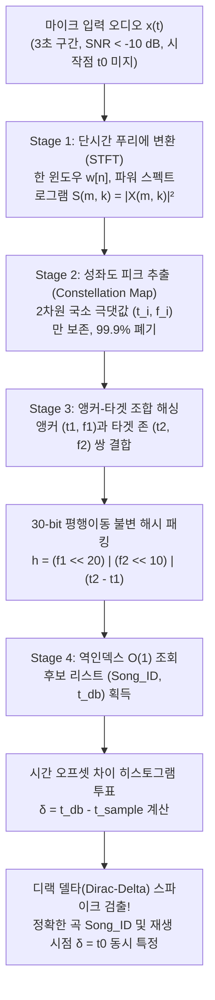
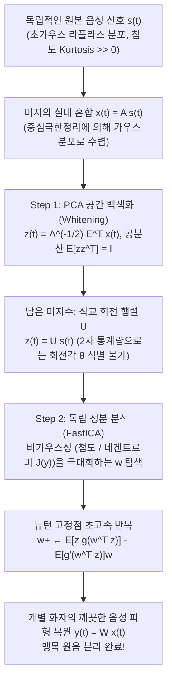

에스프레소 머신이 거센 증기음을 내뿜고, 식기가 부딪히며, 주변 테이블에서 수십 명의 손님이 동시에 대화를 나누는 시끄러운 카페 안을 상상해 보자. 천장의 저가 스피커에서 어딘가 익숙한 멜로디가 희미하게 흘러나온다. 스마트폰을 꺼내 음악 검색 앱(Shazam 등)의 버튼을 누르고 단 <strong>3초 동안</strong> 마이크를 허공에 갖다 댄다. 그러자 1초도 지나지 않아 화면에는 정확한 곡 제목, 아티스트, 앨범 커버는 물론 "현재 곡 시작 후 2분 14초 지점 재생 중"이라는 타임스탬프에 맞춰 실시간 가사까지 동기화되어 나타난다.

정보이론과 디지털 신호 처리(DSP)의 관점에서 이 상황을 분석해 보면, 이것이 얼마나 극한의 수학적 난제인지 드러난다.

1. <strong>극악의 신호 대 잡음비($\text{SNR} < -10\,\text{dB}$)</strong>: 스마트폰 마이크에 수음되는 음향 에너지의 90% 이상은 사람들의 대화, 기계음, 식기 소음 같은 가산성 배경 잡음(Additive Noise)이다.
2. <strong>미지의 실내 충격 응답과 채널 왜곡</strong>: 원곡 디지털 파형 $s(t)$는 저가 스피커의 비선형 왜곡을 거치고 벽과 천장에서 다중 반사·잔향(실내 충격 응답 $h_{\text{room}}(t)$과의 합성곱)을 겪으며 $x(t) = (s * h_{\text{room}})(t) + n(t)$으로 변형된다.
3. <strong>임의의 녹음 시작 위치($t_0$ 평행이동 불변성)</strong>: 사용자는 곡의 0초부터 녹음하지 않는다. 4분짜리 곡 중 임의의 3초 구간 $[t_0, t_0 + 3\,\text{s}]$만 잘라내므로 시간 이동에 완벽히 불변이어야 한다.
4. <strong>1억 곡($10^8$곡)의 초거대 탐색 공간</strong>: 약 1,000년 분량에 달하는 1억 곡의 데이터베이스를 수백 밀리초 이내에 탐색해야 한다.

본고에서는 2003년 Shazam 공동창업자 Avery Li-Chun Wang이 ISMIR에서 발표한 전설적인 논문 *"An Industrial-Strength Audio Search Algorithm"* 의 <strong>4단계 음향 지문(Acoustic Fingerprinting) 아키텍처</strong>를 수식과 비트 연산 수준까지 해부한다. 이어서 후반부에서는 그 쌍대(Dual) 문제인 <strong>칵테일 파티 효과(Cocktail Party Problem)와 맹목 원음 분리(BSS)</strong>를 다루며, <strong>독립 성분 분석(ICA / FastICA)</strong>이 어떻게 중심극한정리를 역이용해 섞여버린 여러 사람의 목소리를 개별 파형으로 분리해내는지 밝힌다.

---

## 제1장: 왜 파형 직접 비교나 암호학적 해시는 완전히 실패하는가?

### 1.1 암호학적 해시 함수(`SHA-256`)의 눈사태 효과

컴퓨터 과학에서 $O(1)$ 고속 검색의 대명사는 `SHA-256`이나 `MD5`다. 그러나 암호학적 해시는 입력 데이터가 단 1비트만 바뀌어도 출력 해시값의 50%가 무작위로 뒤집히는 <strong>눈사태 효과(Avalanche Effect)</strong>를 갖도록 설계되었다. 동일한 스튜디오 원음이라도 MP3와 AAC로 각각 압축하거나 미세한 열잡음이 섞이면 `SHA-256` 해시는 완전히 달라진다. 우리에게 필요한 것은 극심한 노이즈 속에서도 변하지 않는 <strong>지각 해시(음향 지문)</strong>다.

### 1.2 시간 영역 상호상관(Cross-Correlation)의 연산 폭발과 위상 붕괴

3초 녹음 파형 $x[n]$($f_s = 8000\,\text{Hz}$ 기준 $L = 24,000$ 샘플)을 1억 곡의 파형 $s_i[n]$ 위에서 한 샘플씩 슬라이딩하며 상호상관 $R_{x s_i}[\tau] = \sum_{n=0}^{L-1} x[n] s_i[n + \tau]$를 계산한다면, 총 $1.92 \times 10^{14}$개의 위치에서 약 <strong>$4.6 \times 10^{18}$회(4.6 ExaFLOPs)</strong>의 연산이 필요하다. 게다가 실내 반사음 $h_{\text{room}}(t)$은 주파수별 위상 왜곡(군지연 분산)을 일으킨다. 인간의 달팽이관은 위상 변화에 둔감하지만, 시간 영역 파형 $x[n]$은 위상이 조금만 틀어져도 형태가 완전히 무너져 내적이 0으로 추락한다.

---

## 제2장: 스테이지 1 — 단시간 푸리에 변환(STFT)과 불확정성 원리

위상 왜곡을 제거하고 인간 달팽이관의 기저막 주파수 분해를 모사하기 위해, 1차원 파형 $x[n]$을 시간 × 주파수 × 에너지의 2차원 지형도인 <strong>스펙트로그램(Spectrogram)</strong>으로 변환한다.

신호를 $f_s = 8000\,\text{Hz}$로 다운샘플링한 뒤, 길이 $N$의 <strong>한 윈도우(Hann Window)</strong> $w[n] = 0.5 - 0.5\cos\left(\frac{2\pi n}{N-1}\right)$을 씌워 홉 크기 $H$만큼 이동하며 이산 푸리에 변환(STFT)을 수행한다.

$$X(m, k) = \sum_{n=0}^{N-1} x[n + mH]\, w[n]\, e^{-i \frac{2\pi k n}{N}}, \qquad S(m, k) = |X(m, k)|^2$$

위상 $\arg(X(m, k))$를 버리고 전력 스펙트럼 밀도 $S(m, k) = |X(m, k)|^2$만 취함으로써 실내 반사에 의한 위상 왜곡을 단번에 제거한다.

이때 창 길이 $N$의 선택은 <strong>가보르-하이젠베르크 시간-주파수 불확정성 원리(Gabor-Heisenberg Uncertainty Principle)</strong>의 지배를 받는다.

$$\sigma_t \cdot \sigma_\omega \ge \frac{1}{2} \quad \Longleftrightarrow \quad \Delta t \cdot \Delta f = \left(\frac{N}{f_s}\right) \cdot \left(\frac{f_s}{N}\right) = 1$$

$N$이 너무 크면 주파수 분해능 $\Delta f$는 정밀해지지만 시간 분해능 $\Delta t$가 둔해져 드럼 타격음의 시점이 흐려지고, $N$이 너무 작으면 시간은 정밀해지나 인접한 반음계가 한 주파수 빈에 뭉개진다. Shazam은 $f_s = 8000\,\text{Hz}$에서 <strong>$N = 1024$($\Delta t = 128\,\text{ms}$, $\Delta f = 7.8125\,\text{Hz}$)</strong>와 $H = 256$ 또는 $512$라는 최적의 균형점을 사용한다.

---

## 제3장: 스테이지 2 — 희소 피크 추출과 '성좌도(Constellation Map)'

스펙트로그램 $S(m, k)$에서도 여전히 배경 소음과 스피커 이퀄라이저 왜곡이 문제다. Avery Wang의 핵심 돌파구는 <strong>스펙트로그램 데이터의 99.9%를 과감히 버리고, 2차원 국소 영역 $\mathcal{N}(m_i, k_i)$ 내에서 에너지가 가장 높은 국소 극댓값(Local Maxima) 좌표 $(t_i, f_i)$만 남기는 것</strong>이다!

$$(m_i, k_i) \in \mathcal{P} \iff S(m_i, k_i) > S(m, k) \quad \forall (m, k) \in \mathcal{N}(m_i, k_i) \setminus \{(m_i, k_i)\}$$

추출된 점군 $\mathcal{P} = \{(t_i, f_i)\}$를 $(t, f)$ 평면에 찍으면 밤하늘의 별자리와 같다고 하여 <strong>성좌도(Constellation Map)</strong>라 부른다.

1. <strong>해수면 상승을 뚫고 솟아오른 산봉우리</strong>: 가산성 카페 소음은 지형도의 해수면(노이즈 플로어)을 높여 낮은 계곡을 침수시키지만, <strong>가장 높은 산봉우리 정상(스네어 드럼 타격음, 보컬 포먼트 배음, 신스 리드 피크)은 여전히 수면 위로 머리를 내밀며 $(t_i, f_i)$ 좌표가 흔들리지 않는다</strong>.
2. <strong>진폭 정보 폐기를 통한 EQ·AGC 완벽 면역</strong>: 피크로 선정된 순간 진폭 크기 $S(t_i, f_i)$마저 버리고 오직 좌표 $(t_i, f_i)$만 기록하므로, 마이크 볼륨이나 실내 주파수 응답 $|H_{\text{room}}(f)|^2$에 완벽히 불변이다.

---

## 제4장: 스테이지 3 — 앵커-타겟 쌍의 32비트 조합 해싱(Combinatorial Hashing)

만약 단일 피크의 주파수 $f_i \in [0, 1023]$(10비트 = 1,024개 버킷)만 키로 삼아 1억 곡을 검색하면, 버킷당 수억 개의 해시 충돌이 발생한다.

Wang은 <strong>앵커 포인트(Anchor Point) $p_1 = (t_1, f_1)$</strong>와 그 직후의 <strong>타겟 존(Target Zone)</strong> 내 최대 $F$개(팬아웃 계수 $F \approx 10$)의 <strong>타겟 포인트 $p_2 = (t_2, f_2)$</strong>를 선분으로 묶어, 두 주파수와 <strong>상대적 시간차 $\Delta t = t_2 - t_1$</strong>을 단일 <strong>32비트 정수 해시 $h$</strong>로 패킹했다.

$$h = \text{Hash}(f_1,\; f_2,\; t_2 - t_1) = (f_1 \ll 20) \;\mid\; (f_2 \ll 10) \;\mid\; (\Delta t)$$

- <strong>충돌 확률 100만 배 감소</strong>: 10비트($f_1$) + 10비트($f_2$) + 10비트($\Delta t$) = <strong>30비트($2^{30} \approx 10.7\text{억 개 버킷}$)</strong>로 확장되어 우연한 해시 충돌 확률이 $2^{20} \approx 10^6$분의 1로 급감한다.
- <strong>완벽한 시간 평행이동 불변성</strong>: 녹음 시작 오프셋 $t_0$에 대해 $(t_2 - t_0) - (t_1 - t_0) = t_2 - t_1 = \Delta t$가 되어 $t_0$가 대수적으로 완벽히 소거된다! 노이즈로 인해 진성 피크의 70%가 파괴($p = 0.3$)되어도 $p^2 = 9\%$의 쌍이 살아남아 3초 동안 약 80개의 정확한 30비트 해시가 적중한다.



---

## 제5장: 스테이지 4 — 역인덱스 조회와 시간 오프셋($\Delta T$) 일치 히스토그램

서버의 역인덱스(Inverted Index)에서 쿼리 해시 $h_k$와 일치하는 모든 데이터 $(\text{Song\_ID}, t_{\text{db}, k})$를 꺼낸 뒤, 쿼리 내 시간 $t_{\text{sample}, k}$와의 <strong>시간 오프셋 차이</strong>를 계산한다.

$$\delta_k = t_{\text{db}, k} - t_{\text{sample}, k}$$

오답 곡에서는 우연히 충돌한 $\delta_k$가 곡 전체에 무작위로 흩어지지만, <strong>정답 곡에서는 모든 진성 매칭 쌍이 $t_{\text{db}, k} = t_{\text{sample}, k} + t_0$를 만족하므로 모든 $\delta_k$가 정확히 단일 상수 $\delta_k = t_0$에 꽂힌다!</strong> 그 결과 히스토그램 $C_{\text{Song\_ID}}[\delta]$의 $\delta = t_0$ 위치에 거대한 <strong>디랙 델타 스파이크</strong>가 솟아오르며 곡 제목과 재생 위치 $t_0$를 동시에 특정한다.

| 비교 항목 | 시간 영역 파형 상호상관 | 암호학적 해시 (`SHA-256`) | 크로마 지문 (`Chromaprint`) | Shazam 성좌도 + 조합 해시 |
| :--- | :--- | :--- | :--- | :--- |
| <strong>핵심 특징량</strong> | 시간 파형 샘플 $x[n]$ | 파일 전체 비트열 | 12반음 피치 클래스 에너지 | STFT 국소 피크 쌍 $(f_1, f_2, \Delta t)$ |
| <strong>잡음 내성 ($-10\,\text{dB}$)</strong> | 매우 낮음 (위상 왜곡·잡음 취약) | 없음 (1비트 반전 시 완전 불일치) | 보통 (강한 잡음 시 화음 왜곡) | <strong>극도로 높음 (산봉우리 피크만 추출)</strong> |
| <strong>임의의 3초 구간 ($t_0$)</strong> | $10^{14}$개 위치 전수 조사 필요 | 부분 구간 검색 불가 | 슬라이딩 윈도우 비트 오차 탐색 | <strong>완벽 불변 ($\Delta t = t_2 - t_1$으로 $t_0$ 소거)</strong> |
| <strong>1억 곡 탐색 복잡도</strong> | $O(N_{\text{songs}} \cdot L^2)$ (수 시간) | $O(1)$ (음향 검색 불가) | 준선형 비트 인덱스 탐색 | <strong>$O(1)$ 역인덱스 + $O(1)$ 히스토그램</strong> |

---

## 제6장: 쌍대 문제 — 칵테일 파티 효과와 독립 성분 분석(ICA / 맹목 원음 분리)

Shazam이 배경 대화를 잡음으로 버렸다면, 반대로 <strong>실내 음향 특성도 화자의 위치도 전혀 모르는 상태(Blind)에서 마이크에 섞여 들어온 $M$명의 목소리를 각각 깨끗한 개별 음성 파형으로 분리</strong>할 수는 없을까? 이것이 콜린 체리(Colin Cherry, 1953)의 <strong>칵테일 파티 문제(Cocktail Party Problem)</strong>이자 <strong>맹목 원음 분리(BSS: Blind Source Separation)</strong>다.

### 6.1 왜 주성분 분석(PCA)으로는 섞인 목소리를 분리할 수 없는가?

독립적인 원음 $\mathbf{s}(t)$($\mathbb{E}[\mathbf{s}\mathbf{s}^\top] = \mathbf{I}$)가 미지의 혼합 행렬 $\mathbf{A}$를 통해 $\mathbf{x}(t) = \mathbf{A}\mathbf{s}(t)$로 관측될 때, 공분산 행렬 $\mathbf{\Sigma}_x = \mathbb{E}[\mathbf{x}\mathbf{x}^\top] = \mathbf{E}\mathbf{\Lambda}\mathbf{E}^\top$을 이용해 <strong>PCA 공간 백색화(Whitening)</strong>를 수행하면 다음과 같다.

$$\mathbf{z}(t) = \mathbf{\Lambda}^{-1/2} \mathbf{E}^\top \mathbf{x}(t) = \left(\mathbf{\Lambda}^{-1/2}\mathbf{E}^\top \mathbf{A}\right)\mathbf{s}(t) = \mathbf{U}\mathbf{s}(t)$$

백색화된 신호는 $\mathbb{E}[\mathbf{z}\mathbf{z}^\top] = \mathbf{I}$로 무상관(Uncorrelated)이 되지만, $\mathbf{U}$는 여전히 미지의 <strong>직교 회전 행렬($\mathbf{U}\mathbf{U}^\top = \mathbf{I}$)</strong>이다! 임의의 회전 행렬 $\mathbf{R}(\theta) \in O(M)$을 곱해도 공분산은 여전히 $\mathbf{R}\mathbf{I}\mathbf{R}^\top = \mathbf{I}$이므로, <strong>2차 통계량(분산·공분산)만으로는 회전각 $\theta$를 절대 알아낼 수 없다</strong>.

### 6.2 중심극한정리의 역이용: '비가우스성(Non-Gaussianity)' 극대화

Pierre Comon, Bell & Sejnowski, Aapo Hyvärinen이 확립한 <strong>독립 성분 분석(ICA)</strong>은 <strong>중심극한정리(CLT)</strong>를 역으로 활용한다.
1. <strong>인간 음성의 초가우스성(Super-Gaussianity)</strong>: 사람의 말소리는 음절 사이의 침묵($s_i \approx 0$)과 자모음 발성 시의 날카로운 스파이크로 인해 뾰족한 <strong>라플라스 분포(Laplacian Distribution)</strong>를 따르며 첨도(Kurtosis)가 0보다 훨씬 크다.
2. <strong>비가우스성 최대화</strong>: 중심극한정리에 의해 독립 확률변수의 선형 결합 $y = \mathbf{w}^\top \mathbf{z} = q_1 s_1 + q_2 s_2$는 언제나 단일 원음보다 <strong>더 가우스 분포(정규분포)에 가까워진다</strong>. 따라서 단위 벡터 $\mathbf{w}$를 회전시키며 출력 $y = \mathbf{w}^\top \mathbf{z}$가 <strong>가우스 분포에서 가장 멀어지는(비가우스성이 극대가 되는) 방향</strong>을 찾으면, $(q_1, q_2) = (\pm 1, 0)$ 또는 $(0, \pm 1)$이 되어 개별 목소리 $y(t) = \pm s_i(t)$가 완벽히 분리된다!



### 6.3 첨도(Kurtosis), 네겐트로피(Negentropy)와 FastICA 고정점 반복

단위 분산 신호 $y = \mathbf{w}^\top \mathbf{z}$의 비가우스성 척도는 다음과 같다.
- <strong>4차 큐뮬런트(첨도 Kurtosis)</strong>: $\text{kurt}(y) = \mathbb{E}[y^4] - 3(\mathbb{E}[y^2])^2 = \mathbb{E}[y^4] - 3$.
- <strong>정보이론적 네겐트로피(Negentropy)</strong>: 동일 분산 분포 중 가우스 분포가 미분 엔트로피 $H(y)$를 최대화하므로 $J(y) = H(y_{\text{gauss}}) - H(y) \ge 0$이며, 네겐트로피 합을 최대화하는 것은 성분 간 <strong>상호정보량(Mutual Information)</strong>을 최소화하는 것과 동치다. Hyvärinen은 이상치에 강건한 대비 함수 $G(y) = \frac{1}{a_1}\log\cosh(a_1 y)$($g(y) = \tanh(a_1 y)$)와 뉴턴-랩슨법을 결합하여 학습률이 필요 없는 <strong>FastICA 고정점 업데이트 식</strong>을 유도했다.

$$\mathbf{w}^{+} \leftarrow \mathbb{E}\!\left[\mathbf{z}\, g(\mathbf{w}^\top \mathbf{z})\right] - \mathbb{E}\!\left[g'(\mathbf{w}^\top \mathbf{z})\right] \mathbf{w}, \qquad \mathbf{W} \leftarrow \left(\mathbf{W}\mathbf{W}^\top\right)^{-1/2} \mathbf{W}$$

---

## 제7장: Python 완전 구현 — Shazam 성좌도 검색기 및 FastICA 분리기

```python
import numpy as np
from scipy.ndimage import maximum_filter
from collections import defaultdict

class ShazamFingerprinter:
    def __init__(self, fs=8000, n_fft=1024, hop_length=256, neighborhood=(15, 15), fan_out=10):
        self.fs, self.n_fft, self.hop_length = fs, n_fft, hop_length
        self.neighborhood, self.fan_out = neighborhood, fan_out
        self.database = defaultdict(list)

    def stft_spectrogram(self, signal):
        window = np.hanning(self.n_fft)
        n_frames = 1 + (len(signal) - self.n_fft) // self.hop_length
        spec = np.zeros((self.n_fft // 2, n_frames))
        for m in range(n_frames):
            frame = signal[m * self.hop_length : m * self.hop_length + self.n_fft] * window
            spec[:, m] = 10.0 * np.log10(np.abs(np.fft.rfft(frame)[:self.n_fft // 2])**2 + 1e-10)
        return spec

    def extract_peaks(self, spec, pct=85):
        mask = (maximum_filter(spec, size=self.neighborhood) == spec) & (spec > np.percentile(spec, pct))
        f_idx, t_idx = np.where(mask)
        order = np.argsort(t_idx)
        return list(zip(t_idx[order], f_idx[order]))

    def generate_hashes(self, peaks, dt_min=2, dt_max=60, df_max=150):
        hashes = []
        for i, (t1, f1) in enumerate(peaks):
            cnt = 0
            for t2, f2 in peaks[i + 1:]:
                dt = t2 - t1
                if dt < dt_min: continue
                if dt > dt_max: break
                if abs(f2 - f1) <= df_max:
                    h = (int(f1 & 0x3FF) << 20) | (int(f2 & 0x3FF) << 10) | int(dt & 0x3FF)
                    hashes.append((h, int(t1)))
                    cnt += 1
                    if cnt >= self.fan_out: break
        return hashes

    def add_track(self, song_id, audio):
        for h, t1 in self.generate_hashes(self.extract_peaks(self.stft_spectrogram(audio))):
            self.database[h].append((song_id, t1))

    def recognize(self, snippet):
        q_hashes = self.generate_hashes(self.extract_peaks(self.stft_spectrogram(snippet)))
        hist = defaultdict(lambda: defaultdict(int))
        for h, t_s in q_hashes:
            for song_id, t_db in self.database.get(h, ()):
                hist[song_id][t_db - t_s] += 1
        best_song, best_votes, best_dt = None, 0, 0
        for song_id, counts in hist.items():
            dt, votes = max(counts.items(), key=lambda x: x[1])
            if votes > best_votes:
                best_song, best_votes, best_dt = song_id, votes, dt
        return best_song, best_votes, best_dt * self.hop_length / self.fs

def fast_ica(X, max_iter=200, tol=1e-7):
    m, n = X.shape
    Xc = X - np.mean(X, axis=1, keepdims=True)
    eigvals, eigvecs = np.linalg.eigh((Xc @ Xc.T) / n)
    V = np.diag(1.0 / np.sqrt(eigvals + 1e-12)) @ eigvecs.T
    Z = V @ Xc
    W = np.eye(m)
    for _ in range(max_iter):
        WZ = W @ Z
        g, gp = np.tanh(WZ), 1.0 - np.tanh(WZ)**2
        W_new = (g @ Z.T) / n - np.diag(np.mean(gp, axis=1)) @ W
        u, _, vt = np.linalg.svd(W_new)
        W_new = u @ vt
        if np.max(np.abs(np.abs(np.diag(W_new @ W.T)) - 1.0)) < tol:
            break
        W = W_new
    return W @ Z
```
