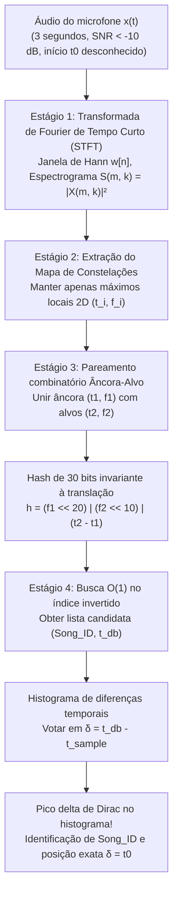
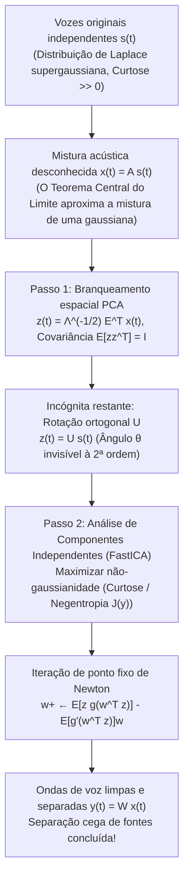

Imagine estar dentro de uma cafeteria movimentada: a máquina de expresso sibila com vapor de alta pressão, xícaras batem nos pires e dezenas de conversas se sobrepõem. De um alto-falante simples no teto, mal se ouve uma melodia. Você pega o smartphone, toca num botão e ergue o microfone por apenas <strong>três segundos</strong>. Em menos de um segundo, a tela exibe o título exato da música, o artista, a capa do álbum e até a letra sincronizada no tempo exato da reprodução — digamos, aos 2 minutos e 14 segundos.

Sob a ótica da teoria da informação e do processamento digital de sinais (DSP), essa mágica cotidiana resolve quatro desafios matemáticos extremos:

1. <strong>Relação sinal-ruído catastrófica ($\text{SNR} < -10\,\text{dB}$)</strong>: Mais de 90% da energia acústica captada pelo microfone consiste em ruído ambiente aditivo (vozes, pratos, vapor).
2. <strong>Resposta ao impulso da sala desconhecida</strong>: O áudio original $s(t)$ sofre distorção no alto-falante e reverberação nas paredes (convolução com $h_{\text{room}}(t)$), resultando em $x(t) = (s * h_{\text{room}})(t) + n(t)$.
3. <strong>Deslocamento temporal arbitrário ($t_0$ desconhecido)</strong>: O trecho de 3 segundos $[t_0, t_0 + 3\,\text{s}]$ começa em qualquer ponto desconhecido da faixa.
4. <strong>Espaço de busca de 100 milhões de músicas ($10^8$ faixas)</strong>: Mais de 1.000 anos de áudio contínuo precisam ser vasculhados em poucos centenas de milissegundos.

Neste artigo, dissecamos a arquitetura em quatro estágios da <strong>impressão digital acústica do Shazam</strong> criada por Avery Li-Chun Wang em 2003 (*"An Industrial-Strength Audio Search Algorithm"*, ISMIR) e exploramos seu problema dual: <strong>o Problema da Festa de Coquetel (Cocktail Party Problem) e a Separação Cega de Fontes (BSS)</strong> via <strong>Análise de Componentes Independentes (ICA / FastICA)</strong>.

---

## Capítulo 1: Por que a correlação direta de onda e o hash criptográfico falham completamente

Funções de hash criptográficas (`SHA-256`, `MD5`) possuem o <strong>efeito avalanche</strong>: alterar um único bit na entrada inverte aleatoriamente 50% dos bits de saída. Qualquer compressão MP3 ou ruído térmico destrói o hash.

Por sua vez, calcular a <strong>correlação cruzada no domínio do tempo</strong> $R_{x s_i}[\tau] = \sum_{n=0}^{L-1} x[n]\, s_i[n + \tau]$ em $10^8$ músicas (a $f_s = 8000\,\text{Hz}$, $L = 24.000$ amostras em 3 segundos) exige testar $1{,}92 \times 10^{14}$ posições $\tau$, totalizando <strong>$4{,}6 \times 10^{18}$ operações (4,6 ExaFLOPs)</strong> por consulta! Além disso, as reflexões da sala $h_{\text{room}}(t)$ distorcem a fase da forma de onda $x[n]$, derrubando a correlação temporal para zero, embora a cóclea humana (insensível à fase segundo Helmholtz) reconheça a música sem dificuldade.

---

## Capítulo 2: Estágio 1 — Transformada de Fourier de Tempo Curto (STFT) e incerteza de Gabor-Heisenberg

Para eliminar a sensibilidade à fase, o Estágio 1 converte o sinal 1D $x[n]$ (subamostrado para $f_s = 8000\,\text{Hz}$) em um <strong>espectrograma</strong> 2D tempo-frequência usando uma <strong>janela de Hann</strong> $w[n] = 0{,}5 - 0{,}5\cos\left(\frac{2\pi n}{N-1}\right)$ de tamanho $N$ e passo $H$:

$$X(m, k) = \sum_{n=0}^{N-1} x[n + mH]\, w[n]\, e^{-i \frac{2\pi k n}{N}}, \qquad S(m, k) = |X(m, k)|^2$$

A escolha de $N$ obedece ao <strong>princípio da incerteza tempo-frequência de Gabor-Heisenberg</strong>:

$$\sigma_t \cdot \sigma_\omega \ge \frac{1}{2} \quad \Longleftrightarrow \quad \Delta t \cdot \Delta f = \left(\frac{N}{f_s}\right) \cdot \left(\frac{f_s}{N}\right) = 1$$

Um $N$ muito grande ($4096$) oferece alta resolução de frequência, mas borra ataques de percussão por $\Delta t = 512\,\text{ms}$; um $N$ muito pequeno ($128$) localiza transientes, mas mistura semitons vizinhos ($\Delta f = 62{,}5\,\text{Hz}$). O Shazam adota o equilíbrio ideal <strong>$N = 1024$ ($\Delta t = 128\,\text{ms}$, $\Delta f = 7{,}8125\,\text{Hz}$)</strong>.

---

## Capítulo 3: Estágio 2 — Extração esparsa de picos: O «Mapa de Constelações»

Para sobreviver a $\text{SNR} < -10\,\text{dB}$, Avery Wang <strong>descarta 99,9% do espectrograma</strong> e retém apenas as coordenadas $(t_i, f_i)$ dos <strong>máximos locais 2D</strong> dentro de uma vizinhança $\mathcal{N}(m_i, k_i)$:

$$(m_i, k_i) \in \mathcal{P} \iff S(m_i, k_i) > S(m, k) \quad \forall (m, k) \in \mathcal{N}(m_i, k_i) \setminus \{(m_i, k_i)\}$$

Plotados no plano $(t, f)$, esses pontos lembram estrelas no céu noturno — daí o nome <strong>Constellation Map (Mapa de Constelações)</strong>.
1. <strong>Picos de montanha que furam a neblina</strong>: O ruído de fundo eleva o «nível do mar», submergindo os vales, mas os picos espectrais mais altos (ataques de caixa, formantes vocais) continuam emergindo exatamente nas mesmas coordenadas $(t_i, f_i)$.
2. <strong>Invariância a equalização (EQ) e ganho (AGC)</strong>: A amplitude $S(t_i, f_i)$ é totalmente descartada! Apenas o par $(t_i, f_i)$ é salvo, garantindo imunidade total ao volume do microfone e ao filtro $|H_{\text{room}}(f)|^2$.

---

## Capítulo 4: Estágio 3 — Hashing combinatório de 32 bits de pares Âncora-Alvo

Indexar picos isolados apenas pela frequência $f_i \in [0, 1023]$ (10 bits = 1.024 gavetas) geraria centenas de milhões de colisões.

A solução genial de Wang foi o <strong>pareamento combinatório Âncora-Alvo (Combinatorial Hashing)</strong>:
Cada <strong>ponto âncora</strong> $p_1 = (t_1, f_1)$ é pareado com até $F \approx 10$ (<strong>fator de fan-out</strong>) <strong>pontos-alvo</strong> $p_2 = (t_2, f_2)$ numa zona-alvo à frente no tempo ($\Delta t = t_2 - t_1 \in [\tau_{\min}, \tau_{\max}]$). As duas frequências e sua <strong>diferença de tempo relativa $\Delta t = t_2 - t_1$</strong> são compactadas em um único <strong>hash inteiro de 32 bits $h$</strong>:

$$h = \text{Hash}(f_1,\; f_2,\; t_2 - t_1) = (f_1 \ll 20) \;\mid\; (f_2 \ll 10) \;\mid\; (\Delta t)$$

- <strong>Um milhão de vezes menos colisões</strong>: O espaço de hash salta de 10 bits ($10^3$ gavetas) para <strong>30 bits ($2^{30} \approx 1{,}07 \times 10^9$ gavetas)</strong>.
- <strong>Invariância exata à translação temporal</strong>: Como $\Delta t' = (t_2 - t_0) - (t_1 - t_0) = t_2 - t_1$, o instante inicial desconhecido $t_0$ cancela-se algebricamente! Mesmo que 70% dos picos sejam destruídos pelo ruído ($p = 0{,}3$), $p^2 = 9\,\%$ dos pares sobrevivem intactos.



---

## Capítulo 5: Estágio 4 — Índice invertido e histograma de coincidência temporal ($\Delta T$)

Para cada correspondência $(\text{Song\_ID}, t_{\text{db}, k})$ no índice invertido, o servidor calcula a <strong>diferença de deslocamento temporal</strong>:

$$\delta_k = t_{\text{db}, k} - t_{\text{sample}, k}$$

Em músicas incorretas, $\delta_k$ espalha-se aleatoriamente. Na <strong>música correta</strong>, todos os acertos verdadeiros obedecem a $t_{\text{db}, k} = t_{\text{sample}, k} + t_0$, de modo que todos os $\delta_k = t_0$ acumulam-se no mesmo compartimento do histograma, formando um <strong>pico delta de Dirac gigante</strong>.

| Métrica | Correlação cruzada temporal | Hash criptográfico (`SHA-256`) | Impressão Chroma (`Chromaprint`) | Shazam Constelação + Hash combinatório |
| :--- | :--- | :--- | :--- | :--- |
| <strong>Representação</strong> | Amostras PCM $x[n]$ | Fluxo bruto de bytes | Vetores de 12 semitons | Pares de picos STFT $(f_1, f_2, \Delta t)$ |
| <strong>Robustez a $-10\,\text{dB}$</strong> | Muito baixa (fase e ruído) | Nula (efeito avalanche) | Moderada | <strong>Excepcional (picos acima do ruído)</strong> |
| <strong>Trecho livre de 3s ($t_0$)</strong> | Varredura de $10^{14}$ posições | Impossível | Janela deslizante | <strong>Invariância exata ($\Delta t$ cancela $t_0$)</strong> |
| <strong>Complexidade ($10^8$ faixas)</strong> | $O(N_{\text{songs}} \cdot L^2)$ (horas) | $O(1)$ (inútil com ruído) | Busca sublinear | <strong>Índice invertido $O(1)$ + histograma $O(1)$</strong> |

---

## Capítulo 6: O desafio complementar — O Problema do Coquetel e Separação Cega (ICA)

E se, em vez de descartar as vozes da cafeteria, quisermos <strong>separar fisicamente as $M$ vozes simultâneas a partir da mistura $\mathbf{x}(t) = \mathbf{A}\mathbf{s}(t)$</strong> sem conhecer as vozes $\mathbf{s}(t)$ nem a matriz de mistura $\mathbf{A}$? Esse é o <strong>Problema da Festa de Coquetel (Colin Cherry, 1953)</strong> ou <strong>Separação Cega de Fontes (BSS)</strong>.

### 6.1 Por que a Análise de Componentes Principais (PCA) falha

O <strong>branqueamento espacial (PCA Whitening)</strong> via covariância $\mathbf{\Sigma}_x = \mathbb{E}[\mathbf{x}\mathbf{x}^\top] = \mathbf{E}\mathbf{\Lambda}\mathbf{E}^\top$ produz:

$$\mathbf{z}(t) = \mathbf{\Lambda}^{-1/2} \mathbf{E}^\top \mathbf{x}(t) = \mathbf{U}\mathbf{s}(t), \qquad \mathbb{E}\!\left[\mathbf{z}\mathbf{z}^\top\right] = \mathbf{I}$$

Embora $\mathbf{z}(t)$ seja descorrelacionado, $\mathbf{U} \in O(M)$ continua sendo uma <strong>matriz de rotação ortogonal desconhecida</strong> ($\mathbf{U}\mathbf{U}^\top = \mathbf{I}$). Como qualquer rotação $\mathbf{R}(\theta)\mathbf{z}$ preserva a covariância identidade $\mathbf{I}$, estatísticas de segunda ordem são cegas ao ângulo $\theta$.

### 6.2 Invertendo o Teorema Central do Limite: Maximizar a não-gaussianidade (FastICA)

A <strong>Análise de Componentes Independentes (ICA)</strong> (Comon 1994, Bell & Sejnowski 1995, Hyvärinen 1999) inverte o <strong>Teorema Central do Limite (TCL)</strong>:
1. <strong>Supergaussianidade da fala humana</strong>: As pausas entre sílabas ($s_i \approx 0$) e os picos vocálicos seguem uma <strong>distribuição de Laplace</strong> com alta <strong>curtose</strong> ($\text{kurt}(y) = \mathbb{E}[y^4] - 3(\mathbb{E}[y^2])^2 \gg 0$).
2. <strong>Maximização da negentropia</strong>: Pelo TCL, qualquer mistura $y = \mathbf{w}^\top \mathbf{z} = q_1 s_1 + q_2 s_2$ é *mais gaussiana* que as vozes originais. Ao buscar o vetor unitário $\mathbf{w}$ que maximiza a <strong>não-gaussianidade</strong> via <strong>negentropia</strong> $J(y) = H(y_{\text{gauss}}) - H(y) \propto (\mathbb{E}[G(y)] - \mathbb{E}[G(\nu)])^2$ com $g(y) = \tanh(a_1 y)$, a iteração de ponto fixo de Newton do <strong>FastICA</strong> isola cada voz em 10 a 20 passos:

$$\mathbf{w}^{+} \leftarrow \mathbb{E}\!\left[\mathbf{z}\, g(\mathbf{w}^\top \mathbf{z})\right] - \mathbb{E}\!\left[g'(\mathbf{w}^\top \mathbf{z})\right] \mathbf{w}, \qquad \mathbf{W} \leftarrow \left(\mathbf{W}\mathbf{W}^\top\right)^{-1/2} \mathbf{W}$$



---

## Capítulo 7: Implementação completa em Python (Shazam & FastICA)

```python
import numpy as np
from scipy.ndimage import maximum_filter
from collections import defaultdict

class ShazamFingerprinter:
    def __init__(self, fs=8000, n_fft=1024, hop_length=256, neighborhood=(15, 15), fan_out=10):
        self.fs, self.n_fft, self.hop_length = fs, n_fft, hop_length
        self.neighborhood, self.fan_out = neighborhood, fan_out
        self.database = defaultdict(list)

    def stft_spectrogram(self, signal):
        window = np.hanning(self.n_fft)
        n_frames = 1 + (len(signal) - self.n_fft) // self.hop_length
        spec = np.zeros((self.n_fft // 2, n_frames))
        for m in range(n_frames):
            frame = signal[m * self.hop_length : m * self.hop_length + self.n_fft] * window
            spec[:, m] = 10.0 * np.log10(np.abs(np.fft.rfft(frame)[:self.n_fft // 2])**2 + 1e-10)
        return spec

    def extract_peaks(self, spec, pct=85):
        mask = (maximum_filter(spec, size=self.neighborhood) == spec) & (spec > np.percentile(spec, pct))
        f_idx, t_idx = np.where(mask)
        order = np.argsort(t_idx)
        return list(zip(t_idx[order], f_idx[order]))

    def generate_hashes(self, peaks, dt_min=2, dt_max=60, df_max=150):
        hashes = []
        for i, (t1, f1) in enumerate(peaks):
            cnt = 0
            for t2, f2 in peaks[i + 1:]:
                dt = t2 - t1
                if dt < dt_min: continue
                if dt > dt_max: break
                if abs(f2 - f1) <= df_max:
                    h = (int(f1 & 0x3FF) << 20) | (int(f2 & 0x3FF) << 10) | int(dt & 0x3FF)
                    hashes.append((h, int(t1)))
                    cnt += 1
                    if cnt >= self.fan_out: break
        return hashes

    def recognize(self, snippet):
        q_hashes = self.generate_hashes(self.extract_peaks(self.stft_spectrogram(snippet)))
        hist = defaultdict(lambda: defaultdict(int))
        for h, t_s in q_hashes:
            for song_id, t_db in self.database.get(h, ()):
                hist[song_id][t_db - t_s] += 1
        best_song, best_votes, best_dt = None, 0, 0
        for song_id, counts in hist.items():
            dt, votes = max(counts.items(), key=lambda x: x[1])
            if votes > best_votes:
                best_song, best_votes, best_dt = song_id, votes, dt
        return best_song, best_votes, best_dt * self.hop_length / self.fs

def fast_ica(X, max_iter=200, tol=1e-7):
    m, n = X.shape
    Xc = X - np.mean(X, axis=1, keepdims=True)
    eigvals, eigvecs = np.linalg.eigh((Xc @ Xc.T) / n)
    Z = (np.diag(1.0 / np.sqrt(eigvals + 1e-12)) @ eigvecs.T) @ Xc
    W = np.eye(m)
    for _ in range(max_iter):
        WZ = W @ Z
        g, gp = np.tanh(WZ), 1.0 - np.tanh(WZ)**2
        W_new = (g @ Z.T) / n - np.diag(np.mean(gp, axis=1)) @ W
        u, _, vt = np.linalg.svd(W_new)
        W_new = u @ vt
        if np.max(np.abs(np.abs(np.diag(W_new @ W.T)) - 1.0)) < tol:
            break
        W = W_new
    return W @ Z
```
