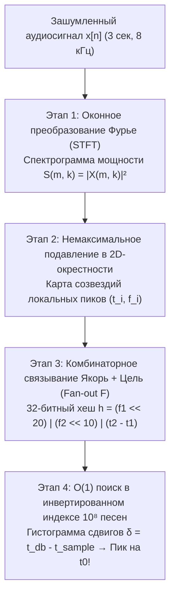

Представьте себе привычную сцену: вы сидите в переполненной кофейне, где под высоким давлением шипит кофемашина, звенят чашки, смеются десятки посетителей, а где-то под потолком из дешевого динамика едва слышно играет незнакомая песня. Вы достаете смартфон, нажимаете кнопку и записываете звук всего <strong>три секунды</strong>. Меньше чем через секунду на экране появляется точное название трека, имя исполнителя, обложка альбома и даже синхронизированный текст песни ровно на той секунде (например, `02:14`), которая звучит прямо сейчас.

С точки зрения теории информации и цифровой обработки сигналов (DSP) за этим повседневным чудом скрывается задача, которая долгое время казалась математически неразрешимой:

1. <strong>Катастрофическое отношение сигнал/шум ($\text{SNR} < -10\,\text{дБ}$)</strong>: более 90% акустической энергии, попадающей в микрофон смартфона, составляет посторонний шум.
2. <strong>Неизвестная импульсная характеристика помещения и искажения тракта</strong>: исходный студийный сигнал $s(t)$ проходит через нелинейный динамик, многократно отражается от стен (свертка с импульсной характеристикой комнаты $h_{\text{room}}(t)$) и превращается в $x(t) = (s * h_{\text{room}})(t) + n(t)$.
3. <strong>Произвольный момент начала записи ($t_0$-инвариантность к сдвигу)</strong>: трехсекундный фрагмент $[t_0, t_0 + 3\,\text{с}]$ выхвачен из неизвестного места композиции.
4. <strong>Масштаб базы данных в 100 миллионов треков ($10^8$ песен)</strong>: поиск по фонотеке длительностью более тысячи лет непрерывного звучания должен завершиться за считанные миллисекунды.

В этой статье мы детально разберем четырехступенчатую математическую архитектуру <strong>акустического фингерпринтинга (алгоритма Shazam)</strong>, представленную сооснователем Shazam <strong>Эйвери Ли-Чุน Ваном (Avery Li-Chun Wang)</strong> в классической статье ISMIR 2003 года (*"An Industrial-Strength Audio Search Algorithm"*), а затем исследуем двойственную ей задачу — <strong>задачу «вечеринки с коктейлями» (Cocktail Party Problem)</strong> и <strong>слепое разделение источников (Blind Source Separation, BSS)</strong> с помощью <strong>метода независимых компонент (ICA / FastICA)</strong>.

---

## Глава 1: Почему прямое сравнение волн и криптографическое хеширование не работают

Криптографические хеш-функции вроде `SHA-256` спроектированы ради <strong>лавинного эффекта (Avalanche Effect)</strong>: изменение всего одного бита входного файла меняет в среднем 50% битов хеша. Малейший тепловой шум микрофона или сжатие AAC/MP3 полностью меняют байтовый поток, делая `SHA-256` бесполезным.

Прямая <strong>взаимная корреляция (Cross-Correlation)</strong> во временной области $R_{x s_i}[\tau] = \sum_{n=0}^{L-1} x[n]\, s_i[n + \tau]$ по $10^8$ песням также терпит крах по двум причинам:
1. <strong>Вычислительный взрыв</strong>: при частоте дискретизации $f_s = 8000\,\text{Гц}$ трехсекундный фрагмент содержит $L = 24\,000$ отсчетов, а база из $10^8$ трехминутных песен — $1{,}44 \times 10^{14}$ позиций сдвига $\tau$, что потребовало бы порядка <strong>$3{,}5 \times 10^{18}$ операций с плавающей точкой (3,5 экзафлопс)</strong> на один пользовательский запрос!
2. <strong>Фазовая катастрофа реверберации</strong>: многолучевое отражение звука от стен помещения $h_{\text{room}}(t)$ полностью разрушает фазовый спектр сигнала, из-за чего скалярное произведение во временной области падает почти до нуля даже для одного и того же трека.

---

## Глава 2: Этап 1 — Оконное преобразование Фурье (STFT) и принцип неопределенности Габора — Гейзенберга

Чтобы избавиться от фазовых искажений и перейти к частотно-временному представлению, сигнал $x[n]$ разбивается на перекрывающиеся кадры длиной $N$ с шагом $H$, взвешивается <strong>окном Ханна</strong> $w[n] = \frac{1}{2}\left(1 - \cos\frac{2\pi n}{N-1}\right)$ и переводится в <strong>спектрограмму мощности</strong> через дискретное <strong>оконное преобразование Фурье (Short-Time Fourier Transform, STFT)</strong>:

$$X(m, k) = \sum_{n=0}^{N-1} x[n + mH]\, w[n]\, e^{-i \frac{2\pi k n}{N}}, \qquad S(m, k) = |X(m, k)|^2$$

Отбрасывание фазы $\arg X(m, k)$ делает спектрограмму $S(m, k)$ устойчивой к фазовым сдвигам аппаратуры. Однако выбор размера окна $N$ фундаментально ограничен <strong>соотношением неопределенностей Габора — Гейзенберга</strong>:

$$\sigma_t \cdot \sigma_\omega \ge \frac{1}{2} \quad \Longleftrightarrow \quad \Delta t \cdot \Delta f = \left(\frac{N}{f_s}\right) \cdot \left(\frac{f_s}{N}\right) = 1$$

Если взять слишком длинное окно $N$, мы получим отличное разрешение по частоте $\Delta f$, но размажем во времени удары барабанов; если взять слишком короткое $N$, мы точно засечем момент удара $\Delta t$, но соседние ноты сольются в одно пятно. В классической архитектуре Shazam при $f_s = 8000\,\text{Гц}$ выбирается компромисс <strong>$N = 1024$ отсчета ($\Delta t = 128\,\text{мс}$, $\Delta f = 7{,}8125\,\text{Гц}$)</strong> с перекрытием $H = 64\text{–}256$ отсчетов.

---

## Глава 3: Этап 2 — «Карта созвездий» (Constellation Map) и устойчивость к шуму

Главная гениальность подхода Эйвери Вана состоит в радикальном сжатии спектрограммы: вместо того чтобы хранить все значения $S(m, k)$, алгоритм оставляет <strong>только локальные максимумы (пики энергии)</strong>, которые строго больше всех своих соседей в окрестности $\mathcal{N}(m, k)$ размера $(2\tau_m + 1) \times (2\tau_k + 1)$:

$$(m_i, k_i) \in \mathcal{C} \iff S(m_i, k_i) > S(m, k) \quad \forall (m, k) \in \mathcal{N}(m_i, k_i) \setminus \{(m_i, k_i)\}$$

В результате трехмерный горный ландшафт спектрограммы превращается в разреженное двумерное облако точек $(t_i, f_i)$, которое Ван назвал <strong>«картой созвездий» (Constellation Map)</strong> — по аналогии со звездами на ночном небе.

Почему «карта созвездий» выживает при чудовищном шуме кофейни ($\text{SNR} = -10\,\text{дБ}$)? Потому что фоновый шум распределен по частотно-временной плоскости относительно равномерно («городской смог»), тогда как узкополосные спектральные пики вокальных формант, гитарных гармоник и перкуссионных атак концентрируют энергию в отдельных точках $(t_i, f_i)$ и пробивают шумовой порог точно так же, как ярчайшие звезды созвездия Ориона остаются видны сквозь засветку мегаполиса!

---

## Глава 4: Этапы 3 и 4 — Комбинаторное 32-битное хеширование пар и гистограмма временного сдвига

Как быстро найти фрагмент созвездия среди $10^8$ песен? Если индексировать отдельные точки по их частоте $f_1 \in [0, 511]$, то всего $512$ возможных корзин хеш-таблицы приведут к миллионам коллизий.

Эйвери Ван применил <strong>комбинаторное хеширование пар точек «Якорь — Цель» (Anchor-Target Combinatorial Hashing)</strong>:
1. Каждая точка $(t_1, f_1)$ объявляется <strong>якорем (Anchor)</strong>.
2. Справа от нее во времени выделяется прямоугольная <strong>целевая зона (Target Zone)</strong>: $t_2 - t_1 \in [\Delta t_{\min}, \Delta t_{\max}]$ и $|f_2 - f_1| \le \Delta f_{\max}$.
3. Якорь связывается с $F \approx 10$ ближайшими точками $(t_2, f_2)$ внутри целевой зоны (<strong>коэффициент ветвления / Fan-out Factor $F$</strong>), и для каждой пары формируется <strong>32-битный целочисленный хеш</strong>, зависящий только от двух частот и <strong>относительной разницы времен $\Delta t = t_2 - t_1$</strong>:

$$h = \text{Hash}(f_1,\; f_2,\; t_2 - t_1) = (f_1 \ll 20) \;\mid\; (f_2 \ll 10) \;\mid\; (t_2 - t_1) \;\in\; [0, 2^{30}-1]$$

Это дает два фундаментальных преимущества:
- <strong>Взрывной рост специфичности в $1\,000\,000$ раз</strong>: вместо $10\,\text{бит}$ ($10^3$ значений) одной частоты тройка $(f_1, f_2, \Delta t)$ кодирует <strong>$30\,\text{бит}$ ($10^9$ уникальных корзин инвертированного индекса)</strong>! Поиск в хеш-таблице происходит за $O(1)$.
- <strong>Абсолютная инвариантность к началу записи $t_0$</strong>: поскольку в хеш входит разность $(t_2 + t_0) - (t_1 + t_0) = t_2 - t_1$, хеш $h$ не зависит от того, на какой минуте песни вы нажали кнопку!

В базе данных каждому хешу $h$ сопоставлен список пар `(Song_ID, t_db)`. Когда смартфон присылает набор пар $(h_k, t_{\text{sample}, k})$ из трехсекундного отрывка, сервер для каждого совпадения вычисляет <strong>временной сдвиг начала записи</strong>:

$$\delta_k = t_{\text{db}, k} - t_{\text{sample}, k}$$

Для случайных ложных совпадений из чужих песен значения $\delta_k$ разбросаны равномерно как белый шум. Но для <strong>истинной песни</strong> все уцелевшие пары $(h_k)$ были сдвинуты ровно на одну и ту же величину $\delta_k = t_0$, образуя на гистограмме $\delta$ <strong>острый пик Дирака</strong>, который мгновенно и безошибочно определяет и песню, и точную секунду воспроизведения!

---

## Глава 5: Задача «вечеринки с коктейлями» и слепое разделение сигналов (ICA)

Если Shazam решает задачу <strong>идентификации</strong> сигнала сквозь шум, то как решить задачу <strong>физического выделения</strong> одного голоса из гула десятков говорящих людей (<strong>Cocktail Party Problem</strong>, сформулированная Колином Черри в 1953 году)?

Пусть $M$ микрофонов записывают линейную смесь $M$ независимых источников звука $\mathbf{s}(t) = [s_1(t), \dots, s_M(t)]^\top$ с неизвестной матрицей смешивания $\mathbf{A} \in \mathbb{R}^{M \times M}$:

$$\mathbf{x}(t) = \mathbf{A}\,\mathbf{s}(t) \quad \Longrightarrow \quad \hat{\mathbf{s}}(t) = \mathbf{W}\,\mathbf{x}(t), \qquad \mathbf{W} \approx \mathbf{A}^{-1}$$

### Почему метод главных компонент (PCA) не может разделить голоса?
Метод главных компонент (PCA) и декорреляция (Whitening $\mathbf{z} = \mathbf{V}\mathbf{x}$) используют только статистики второго порядка (ковариационную матрицу $\mathbb{E}[\mathbf{z}\mathbf{z}^\top] = \mathbf{I}$). Однако если умножить белый вектор $\mathbf{z}$ на <strong>любую ортогональную матрицу поворота</strong> $\mathbf{U} \in O(M)$ ($\mathbf{U}\mathbf{U}^\top = \mathbf{I}$), ковариационная матрица останется единичной:

$$\mathbb{E}[(\mathbf{U}\mathbf{z})(\mathbf{U}\mathbf{z})^\top] = \mathbf{U}\,\mathbb{E}[\mathbf{z}\mathbf{z}^\top]\,\mathbf{U}^\top = \mathbf{U}\mathbf{I}\mathbf{U}^\top = \mathbf{I}$$

Следовательно, декорреляция второго порядка оставляет неизвестным угол поворота $\mathbf{U}$: голоса остаются перемешанными!

### Теорема Комона — Дармуа — Скитовича и максимизация негауссовости (FastICA)
Ключ к <strong>методу независимых компонент (Independent Component Analysis, ICA — Пьер Комон 1994, Тони Белл и Терренс Сейновски 1995, Аапо Хювяринен 1999)</strong> дает <strong>Центральная предельная теорема (ЦПТ)</strong>:
- Реальный речевой и музыкальный сигнал $s_i(t)$ имеет <strong>супергауссовское (островершинное / лептокуртическое)</strong> распределение Лапласа с тяжелыми хвостами и длинными паузами.
- Согласно ЦПТ, любая линейная комбинация независимых сигналов $y = \mathbf{w}^\top \mathbf{z} = \sum_i q_i s_i$ становится <strong>более гауссовской</strong>, чем исходные компоненты $s_i$, и достигает минимума негауссовости, только когда вектор $\mathbf{w}$ выделяет ровно один чистый источник ($y = \pm s_i$)!

Поэтому алгоритм <strong>FastICA</strong> Хювяринена ищет ортогональные направления $\mathbf{w}$, которые <strong>максимизируют негауссовость</strong> через <strong>эксцесс (Kurtosis)</strong> или <strong>негэнтропию (Negentropy)</strong>:

$$\text{kurt}(y) = \mathbb{E}[y^4] - 3\left(\mathbb{E}[y^2]\right)^2, \qquad J(y) = H(y_{\text{gauss}}) - H(y) \approx c\left(\mathbb{E}[G(y)] - \mathbb{E}[G(\nu)]\right)^2$$

с помощью сверхбыстрой неподвижной итерации Ньютона ($\mathbf{w}^+ = \mathbb{E}[\mathbf{z}\,g(\mathbf{w}^\top \mathbf{z})] - \mathbb{E}[g'(\mathbf{w}^\top \mathbf{z})]\mathbf{w}$), разделяя смешанные голоса без какого-либо знания о расположении микрофонов!

---

## Глава 6: Сравнительная таблица методов анализа аудиосигналов

| Метод / Алгоритм | Математический базис | Устойчивость к шуму и реверберации | Вычислительная сложность | Главная область применения |
|---|---|---|---|---|
| <strong>Прямая корреляция волн</strong> | Скалярное произведение во временной области | Очень низкая (разрушается фазой комнаты) | $O(L \cdot N_{\text{db}})$ — неприменимо для больших баз | Синхронизация студийных дорожек |
| <strong>Shazam (Constellation Hashing)</strong> | STFT + локальные пики + 32-битный хеш пар $(f_1, f_2, \Delta t)$ | Экстремально высокая (работает при $\text{SNR} < -10\,\text{дБ}$) | $O(1)$ поиск в хеш-индексе + гистограмма $\delta$ | Мгновенное распознавание музыки и ТВ-трансляций |
| <strong>PCA / Декорреляция</strong> | Собственные векторы ковариационной матрицы $\mathbb{E}[\mathbf{x}\mathbf{x}^\top]$ | Сжимает дисперсию, но не разделяет источники | $O(M^2 T + M^3)$ | Сжатие размерности и предварительное отбеливание (Whitening) |
| <strong>FastICA (Слепое разделение)</strong> | Максимизация негауссовости (эксцесс / негэнтропия, статистики $\ge 4$ порядка) | Высокая при $M_{\text{mic}} \ge M_{\text{src}}$ | Кубическая сходимость метода Ньютона | Разделение голосов (Cocktail Party), очистка ЭЭГ/ЭКГ от артефактов |

---

## Заключение

Алгоритм Shazam и метод независимых компонент (ICA) демонстрируют красоту прикладной математики: там, где «грубая сила» упирается в экзафлопсные барьеры и акустический хаос, переход в правильное пространство инвариантов — будь то разреженная геометрия частотно-временных созвездий или максимизация негауссовой энтропии — позволяет извлечь кристально точную информацию за доли секунды.
