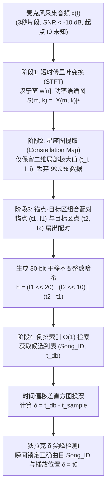
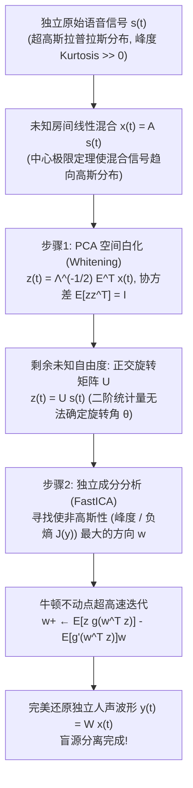

想象你正身处一家喧闹的咖啡馆：意式浓缩咖啡机喷出高压蒸汽，杯盘碰撞声此起彼伏，周围十几桌客人同时交谈。天花板上的廉价音箱里隐约传出一首熟悉的旋律。你掏出手机打开听歌识曲应用（如 Shazam），仅仅将麦克风举起<strong>3秒钟</strong>。不到一秒，屏幕上便精准地显示出歌曲名称、歌手、专辑封面，甚至直接跳转到“当前播放至2分14秒”的实时同步歌词。

从信息论与数字信号处理（DSP）的视角审视，这看似平常的功能背后隐藏着四个近乎苛刻的工程与数学挑战：

1. <strong>极端的信噪比（$\text{SNR} < -10\,\text{dB}$）</strong>：手机麦克风采集到的声能中，超过90%是人声交谈、蒸汽嘶鸣和餐具撞击等加性背景噪声（Additive Noise），目标音乐深埋在噪声基底之下。
2. <strong>未知的房间脉冲响应与信道失真</strong>：原版数字音频 $s(t)$ 经过音箱非线性失真、墙壁与天花板的多径反射混响（与房间脉冲响应 $h_{\text{room}}(t)$ 的卷积），再叠加手机微型MEMS麦克风的频响衰减，观测信号变为 $x(t) = (s * h_{\text{room}})(t) + n(t)$。
3. <strong>未知的时间起点（平移不变性 $t_0$）</strong>：用户不会从歌曲第0秒开始录音，而是随机截取4分钟歌曲里的任意3秒片段 $[t_0, t_0 + 3\,\text{s}]$。
4. <strong>1亿首歌（$10^8$曲）的超大规模检索</strong>：曲库包含约1亿首歌曲（相当于超过1,000年的连续音频），必须在几百毫秒内完成检索。

本文将完整剖析 Shazam 联合创始人 Avery Li-Chun Wang 在2003年 ISMIR 会议上发表的经典论文 *"An Industrial-Strength Audio Search Algorithm"* 的<strong>四阶段声学指纹架构</strong>；随后探讨其对偶问题——<strong>鸡尾酒会问题（Cocktail Party Problem）与盲源分离（BSS）</strong>，揭示<strong>独立成分分析（ICA / FastICA）</strong>如何逆用中心极限定理，从混合录音中分离出每一个独立的人声波形。

---

## 第一章：为什么直接波形匹配与密码学哈希会彻底失效？

### 1.1 密码学哈希（`SHA-256`）的雪崩效应陷阱

在计算机科学中，$O(1)$ 查找的首选通常是 `SHA-256` 或 `MD5`。但密码学哈希的设计核心是<strong>雪崩效应（Avalanche Effect）</strong>：输入哪怕翻转1个比特，输出的256位哈希值也会有约50%随机翻转。同一首录音室母带分别压缩为 128 kbps MP3 和 256 kbps AAC，或者混入极其微弱的热噪声，其 `SHA-256` 值就会面目全非。我们需要的是对强烈噪声与失真免疫的<strong>感知哈希（声学指纹）</strong>。

### 1.2 时域互相关（Cross-Correlation）的算力爆炸与相位崩溃

若直接在时域计算3秒录音 $x[n]$（采样率 $f_s = 8000\,\text{Hz}$ 时长 $L = 24,000$ 样本）与曲库中1亿首歌 $s_i[n]$ 在所有滑动偏移 $\tau$ 下的互相关：

$$R_{x s_i}[\tau] = \sum_{n=0}^{L-1} x[n]\, s_i[n + \tau]$$

1亿首平均240秒的歌曲共有 $1.92 \times 10^{14}$ 个滑动位置，单次查询需要约 <strong>$4.6 \times 10^{18}$ 次乘加运算（4.6 ExaFLOPs）</strong>！更致命的是，房间混响 $h_{\text{room}}(t)$ 会引起严重的频率相关相位失真（群延迟色散）。人耳耳蜗对相位失真几乎不敏感，但时域波形 $x[n]$ 的形状会被相位旋转彻底打乱，导致互相关峰值完全消失。

---

## 第二章：阶段1 — 短时傅里叶变换（STFT）与海森堡不确定性原理

为了消除相位敏感性并模拟人耳耳蜗的基底膜频率分解，第一步是将一维波形 $x[n]$ 转换为二维时频能量图——<strong>语谱图（Spectrogram）</strong>。

我们将音频降采样至 $f_s = 8000\,\text{Hz}$（奈奎斯特频率 $4000\,\text{Hz}$，涵盖音乐基频、主要谐波与人声共振峰），乘以长度为 $N$ 的<strong>汉宁窗（Hann Window）</strong> $w[n] = 0.5 - 0.5\cos\left(\frac{2\pi n}{N-1}\right)$ 以抑制频谱泄漏旁瓣，并以步长 $H$ 滑动计算离散傅里叶变换（STFT）：

$$X(m, k) = \sum_{n=0}^{N-1} x[n + mH]\, w[n]\, e^{-i \frac{2\pi k n}{N}}, \qquad S(m, k) = |X(m, k)|^2$$

通过只保留功率谱密度 $S(m, k) = |X(m, k)|^2$ 并丢弃相位项 $\arg(X(m, k))$，我们直接消除了房间混响带来的相位畸变。

然而，窗口长度 $N$ 的选择受制于<strong>Gabor-Heisenberg 时频不确定性原理</strong>：

$$\sigma_t \cdot \sigma_\omega \ge \frac{1}{2} \quad \Longleftrightarrow \quad \Delta t \cdot \Delta f = \left(\frac{N}{f_s}\right) \cdot \left(\frac{f_s}{N}\right) = 1$$

若 $N$ 过大（如 $4096$），频率分辨率 $\Delta f$ 极高，但时间分辨率 $\Delta t = 512\,\text{ms}$ 过粗，鼓点瞬态被涂抹；若 $N$ 过小（如 $128$），时间定位精准但频率分辨率 $\Delta f = 62.5\,\text{Hz}$ 无法区分相邻半音。Shazam 选取 <strong>$N = 1024$（$\Delta t = 128\,\text{ms}$，$\Delta f = 7.8125\,\text{Hz}$）</strong> 搭配步长 $H = 256$ 或 $512$，在时间与频率分辨率之间取得了最佳平衡。

---

## 第三章：阶段2 — 稀疏峰值提取与“星座图（Constellation Map）”

语谱图 $S(m, k)$ 依然受到咖啡馆宽带噪声和音箱频响失真的污染。Avery Wang 提出了一项极具洞察力的降维策略：<strong>丢弃语谱图中 99.9% 的数据，仅保留二维邻域 $\mathcal{N}(m_i, k_i)$ 内的局部极大值点（Local Maxima）坐标 $(t_i, f_i)$</strong>！

$$(m_i, k_i) \in \mathcal{P} \iff S(m_i, k_i) > S(m, k) \quad \forall (m, k) \in \mathcal{N}(m_i, k_i) \setminus \{(m_i, k_i)\}$$

当把这些稀疏的局部峰值点绘制在黑色的 $(t, f)$ 平面上时，宛如夜空中的璀璨繁星，因此被称为<strong>星座图（Constellation Map）</strong>。

为什么星座图能在 $-10\,\text{dB}$ 的强噪声下存活？
1. <strong>山峰穿透浓雾效应</strong>：加性背景噪声相当于抬高了整个地形图的海平面（噪声基底），淹没了低矮的山谷，但<strong>最高的山峰顶点（军鼓瞬态、人声强共振峰、合成器主音谐波）依然刺破海面，且其 $(t_i, f_i)$ 坐标保持不变</strong>。
2. <strong>抹除幅度，彻底免疫均衡器（EQ）与自动增益（AGC）</strong>：一旦选为星座点，其幅度值 $S(t_i, f_i)$ 即被丢弃，只保留坐标 $(t_i, f_i)$。房间传递函数 $|H_{\text{room}}(f)|^2$ 是平滑的乘性包络，不会改变尖锐谱峰一阶导数 $\frac{\partial S}{\partial f} = 0$ 的极值位置。

---

## 第四章：阶段3 — 锚点与目标区的32位组合哈希（Combinatorial Hashing）

如果直接用单个星座点的频率 $f_i \in [0, 1023]$（仅10比特，1,024个桶）去检索1亿首歌（共约 $3 \times 10^{11}$ 个峰值点），每个桶会发生3亿次哈希碰撞，完全无法检索。

Wang 的天才设计是<strong>锚点-目标对组合哈希（Combinatorial Hashing）</strong>：
1. 选定星座点 $p_1 = (t_1, f_1)$ 作为<strong>锚点（Anchor Point）</strong>。
2. 在其前方时间窗 $\Delta t = t_2 - t_1 \in [\tau_{\min}, \tau_{\max}]$、频率差 $|f_2 - f_1| \le \Delta f_{\max}$ 的矩形<strong>目标区（Target Zone）</strong>内，选取最多 $F$ 个（扇出系数 Fan-out Factor $F \approx 10$）目标点 $p_2 = (t_2, f_2)$。
3. 将锚点频率 $f_1$（10 bit）、目标频率 $f_2$（10 bit）以及<strong>两点相对时间差 $\Delta t = t_2 - t_1$（10 bit）</strong>打包进一个 <strong>32位无符号整数哈希值 $h$</strong>：

$$h = \text{Hash}(f_1,\; f_2,\; t_2 - t_1) = (f_1 \ll 20) \;\mid\; (f_2 \ll 10) \;\mid\; (\Delta t)$$

这一设计创造了两个信息论奇迹：
- <strong>碰撞率降低100万倍</strong>：哈希空间从单点的 $2^{10} = 1,024$ 暴增至 <strong>$2^{30} = 1,073,741,824$（约10.7亿个桶）</strong>，假阳性碰撞概率下降了 $2^{20} \approx 10^6$ 倍！
- <strong>严格的时间平移不变性</strong>：无论用户从歌曲的哪一秒 $t_0$ 开始录音，锚点与目标点的时间偏移都满足 $(t_2 - t_0) - (t_1 - t_0) = t_2 - t_1 = \Delta t$，未知起点 $t_0$ 在相减时被完美抵消！即便 70% 的真峰值被咖啡馆噪声抹除（单峰存活率 $p = 0.3$），仍有 $p^2 = 9\%$ 的点对完整存活，3秒内依然能产生约 80 个精确命中的30位哈希。



---

## 第五章：阶段4 — 倒排索引与时间偏移差（$\Delta T$）一致性直方图

服务器维护着以 32位哈希 $h$ 为键、`$(\text{Song\_ID}, t_{\text{db}})$` 列表为值的巨型<strong>倒排索引（Inverted Index）</strong>。当3秒查询片段生成哈希集合 $\{(h_k, t_{\text{sample}, k})\}$ 后，对每个命中的候选曲目记录计算<strong>时间偏移差</strong>：

$$\delta_k = t_{\text{db}, k} - t_{\text{sample}, k}$$

- 对于<strong>错误歌曲</strong>，偶然碰撞的 $t_{\text{db}, k}$ 随机分布，差值 $\delta_k$ 均匀散落在整首歌的数千个时间箱中，每个箱只有 1～2 票。
- 对于<strong>正确歌曲</strong>，所有真实命中的锚点都满足线性时序关系 $t_{\text{db}, k} = t_{\text{sample}, k} + t_0$，因此所有 $\delta_k$ 恒等于常数 $t_0$！在直方图 $C_{\text{Song\_ID}}[\delta]$ 中，所有选票集中轰击同一个时间箱 $\delta = t_0$，形成一根高耸入云的<strong>狄拉克 $\delta$ 尖峰（Dirac-Delta Spike）</strong>，在毫秒内同时确定曲名与当前播放秒数！

| 评估维度 | 时域波形互相关 | 密码学哈希 (`SHA-256`) | 色度特征指纹 (`Chromaprint`) | Shazam 星座图 + 组合哈希 |
| :--- | :--- | :--- | :--- | :--- |
| <strong>核心特征表示</strong> | 时域采样点 $x[n]$ | 原始文件比特流 | 12半音音级能量向量 | STFT二维局部峰值对 $(f_1, f_2, \Delta t)$ |
| <strong>强噪声鲁棒性 ($-10\,\text{dB}$)</strong> | 极差（相位畸变与噪声淹没） | 零（单比特翻转彻底改变） | 中等（强噪声改变和弦能量比） | <strong>极强（局部最高峰刺破噪声基底）</strong> |
| <strong>任意3秒片段起点 ($t_0$)</strong> | 需遍历 $10^{14}$ 个滑动位置 | 无法处理局部片段 | 需滑动窗口比特容错匹配 | <strong>严格平移不变（$\Delta t = t_2 - t_1$ 抵消 $t_0$）</strong> |
| <strong>1亿曲检索复杂度</strong> | $O(N_{\text{songs}} \cdot L^2)$（数小时） | $O(1)$（但无法用于含噪音频） | 亚线性索引扫描 | <strong>$O(1)$ 倒排索引 + $O(1)$ 直方图投票</strong> |

---

## 第六章：对偶难题 — 鸡尾酒会效应与独立成分分析（ICA / 盲源分离）

Shazam 将周围人声视为噪声加以剔除；但如果我们反过来，希望<strong>在完全未知房间声学特性与说话人位置（Blind）的前提下，把混在一起的 $M$ 个说话人的声音分离还原为各自独立的清晰语音波形</strong>呢？这就是 Colin Cherry 在1953年提出的<strong>鸡尾酒会问题（Cocktail Party Problem）</strong>，即<strong>盲源分离（BSS: Blind Source Separation）</strong>。

### 6.1 为什么主成分分析（PCA）无法分离混合语音？

设 $M$ 个独立声源 $\mathbf{s}(t) = [s_1(t), \dots, s_M(t)]^\top$（满足单位协方差 $\mathbb{E}[\mathbf{s}\mathbf{s}^\top] = \mathbf{I}$）经未知混合矩阵 $\mathbf{A}$ 混合后被麦克风接收为 $\mathbf{x}(t) = \mathbf{A}\mathbf{s}(t)$。
若对观测协方差矩阵 $\mathbf{\Sigma}_x = \mathbb{E}[\mathbf{x}\mathbf{x}^\top] = \mathbf{E}\mathbf{\Lambda}\mathbf{E}^\top$ 进行 <strong>PCA 空间白化（Whitening）</strong>：

$$\mathbf{z}(t) = \mathbf{\Lambda}^{-1/2} \mathbf{E}^\top \mathbf{x}(t) = \left(\mathbf{\Lambda}^{-1/2}\mathbf{E}^\top \mathbf{A}\right)\mathbf{s}(t) = \mathbf{U}\mathbf{s}(t)$$

虽然白化信号满足二阶不相关 $\mathbb{E}[\mathbf{z}\mathbf{z}^\top] = \mathbf{I}$，但矩阵 $\mathbf{U}$ 是一个未知的<strong>正交旋转矩阵（$\mathbf{U}\mathbf{U}^\top = \mathbf{I}$）</strong>！对于任意正交旋转矩阵 $\mathbf{R}(\theta) \in O(M)$，旋转后的信号 $\tilde{\mathbf{z}} = \mathbf{R}(\theta)\mathbf{z}$ 依然满足 $\mathbb{E}[\tilde{\mathbf{z}}\tilde{\mathbf{z}}^\top] = \mathbf{R}\mathbf{I}\mathbf{R}^\top = \mathbf{I}$。这意味着<strong>二阶统计量（方差与协方差）对正交旋转角 $\theta$ 是完全盲目的</strong>！不相关（Uncorrelatedness）远弱于统计独立（Independence）。

### 6.2 逆用中心极限定理：最大化“非高斯性（Non-Gaussianity）”

Pierre Comon、Bell & Sejnowski 与 Aapo Hyvärinen 创立的<strong>独立成分分析（ICA）</strong>完美破解了旋转角 $\theta$：
1. <strong>人类语音的超高斯性（Super-Gaussianity）</strong>：人说话时存在大量音节停顿（幅值接近0）与突发的元音爆发，其幅度分布服从尖峰厚尾的<strong>拉普拉斯分布（Laplacian Distribution）</strong>，峰度（Kurtosis）远大于0。
2. <strong>中心极限定理（CLT）的逆向罗盘</strong>：中心极限定理指出，独立随机变量的线性混合 $y = \mathbf{w}^\top \mathbf{z} = q_1 s_1 + q_2 s_2$ 总是<strong>比单一原始声源更接近高斯分布</strong>！反之，当我们在单位球面上旋转投影向量 $\mathbf{w}$（$\|\mathbf{w}\| = 1$），使输出信号 $y = \mathbf{w}^\top \mathbf{z}$ 的<strong>非高斯性达到极大值</strong>时，权重向量 $(q_1, q_2)$ 必然精确落在坐标轴 $(\pm 1, 0)$ 或 $(0, \pm 1)$ 上——此时混合被彻底解开，$y(t) = \pm s_i(t)$ 即为分离出的纯净人声！



### 6.3 峰度（Kurtosis）、负熵（Negentropy）与 FastICA 不动点迭代

衡量单位方差信号 $y = \mathbf{w}^\top \mathbf{z}$ 非高斯性的两大数学指标为：
- <strong>四阶累积量（峰度 Kurtosis）</strong>：$\text{kurt}(y) = \mathbb{E}[y^4] - 3(\mathbb{E}[y^2])^2 = \mathbb{E}[y^4] - 3$（高斯分布为 $0$，语音信号 $\gg 0$）。
- <strong>信息论负熵（Negentropy）</strong>：由于等方差分布中高斯分布微分熵最大，$J(y) = H(y_{\text{gauss}}) - H(y) \ge 0$ 恒成立，且最大化各分量负熵之和严格等价于最小化输出间的<strong>互信息（Mutual Information）</strong>。Hyvärinen 采用抗异常值的非二次对比函数 $G(y) = \frac{1}{a_1}\log\cosh(a_1 y)$（一阶导数 $g(y) = \tanh(a_1 y)$，二阶导数 $g'(y) = a_1(1 - \tanh^2(a_1 y))$）近似负熵，并利用球面牛顿法推导出无需学习率、具有二阶/三阶收敛速度的 <strong>FastICA 不动点迭代公式</strong>：

$$\mathbf{w}^{+} \leftarrow \mathbb{E}\!\left[\mathbf{z}\, g(\mathbf{w}^\top \mathbf{z})\right] - \mathbb{E}\!\left[g'(\mathbf{w}^\top \mathbf{z})\right] \mathbf{w}, \qquad \mathbf{W} \leftarrow \left(\mathbf{W}\mathbf{W}^\top\right)^{-1/2} \mathbf{W}$$

在真实混响房间中，时域卷积混合 $\mathbf{x}(t) = \sum_\tau \mathbf{A}(\tau)\mathbf{s}(t-\tau)$ 经由阶段1的 <strong>STFT</strong> 转化为每个频率箱 $k$ 内的瞬时矩阵乘积 $\mathbf{X}(m, k) \approx \mathbf{A}(k)\mathbf{S}(m, k)$，结合独立向量分析（IVA）或深度时频掩码网络（如 Hybrid Demucs），便构成了当今智能耳机降噪与实时伴奏人声分离的核心引擎。

---

## 第七章：Python 完整实现 — Shazam 星座图检索与 FastICA 盲源分离

```python
import numpy as np
from scipy.ndimage import maximum_filter
from collections import defaultdict

class ShazamFingerprinter:
    def __init__(self, fs=8000, n_fft=1024, hop_length=256, neighborhood=(15, 15), fan_out=10):
        self.fs, self.n_fft, self.hop_length = fs, n_fft, hop_length
        self.neighborhood, self.fan_out = neighborhood, fan_out
        self.database = defaultdict(list)

    def stft_spectrogram(self, signal):
        window = np.hanning(self.n_fft)
        n_frames = 1 + (len(signal) - self.n_fft) // self.hop_length
        spec = np.zeros((self.n_fft // 2, n_frames))
        for m in range(n_frames):
            frame = signal[m * self.hop_length : m * self.hop_length + self.n_fft] * window
            spec[:, m] = 10.0 * np.log10(np.abs(np.fft.rfft(frame)[:self.n_fft // 2])**2 + 1e-10)
        return spec

    def extract_peaks(self, spec, pct=85):
        mask = (maximum_filter(spec, size=self.neighborhood) == spec) & (spec > np.percentile(spec, pct))
        f_idx, t_idx = np.where(mask)
        order = np.argsort(t_idx)
        return list(zip(t_idx[order], f_idx[order]))

    def generate_hashes(self, peaks, dt_min=2, dt_max=60, df_max=150):
        hashes = []
        for i, (t1, f1) in enumerate(peaks):
            cnt = 0
            for t2, f2 in peaks[i + 1:]:
                dt = t2 - t1
                if dt < dt_min: continue
                if dt > dt_max: break
                if abs(f2 - f1) <= df_max:
                    h = (int(f1 & 0x3FF) << 20) | (int(f2 & 0x3FF) << 10) | int(dt & 0x3FF)
                    hashes.append((h, int(t1)))
                    cnt += 1
                    if cnt >= self.fan_out: break
        return hashes

    def add_track(self, song_id, audio):
        for h, t1 in self.generate_hashes(self.extract_peaks(self.stft_spectrogram(audio))):
            self.database[h].append((song_id, t1))

    def recognize(self, snippet):
        q_hashes = self.generate_hashes(self.extract_peaks(self.stft_spectrogram(snippet)))
        hist = defaultdict(lambda: defaultdict(int))
        for h, t_s in q_hashes:
            for song_id, t_db in self.database.get(h, ()):
                hist[song_id][t_db - t_s] += 1
        best_song, best_votes, best_dt = None, 0, 0
        for song_id, counts in hist.items():
            dt, votes = max(counts.items(), key=lambda x: x[1])
            if votes > best_votes:
                best_song, best_votes, best_dt = song_id, votes, dt
        return best_song, best_votes, best_dt * self.hop_length / self.fs

def fast_ica(X, max_iter=200, tol=1e-7):
    m, n = X.shape
    Xc = X - np.mean(X, axis=1, keepdims=True)
    eigvals, eigvecs = np.linalg.eigh((Xc @ Xc.T) / n)
    V = np.diag(1.0 / np.sqrt(eigvals + 1e-12)) @ eigvecs.T
    Z = V @ Xc
    W = np.eye(m)
    for _ in range(max_iter):
        WZ = W @ Z
        g, gp = np.tanh(WZ), 1.0 - np.tanh(WZ)**2
        W_new = (g @ Z.T) / n - np.diag(np.mean(gp, axis=1)) @ W
        u, _, vt = np.linalg.svd(W_new)
        W_new = u @ vt
        if np.max(np.abs(np.abs(np.diag(W_new @ W.T)) - 1.0)) < tol:
            break
        W = W_new
    return W @ Z
```
